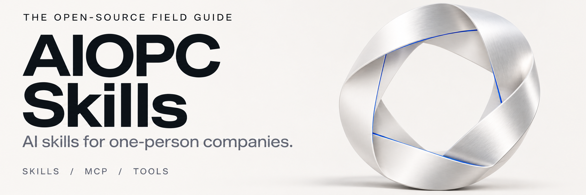
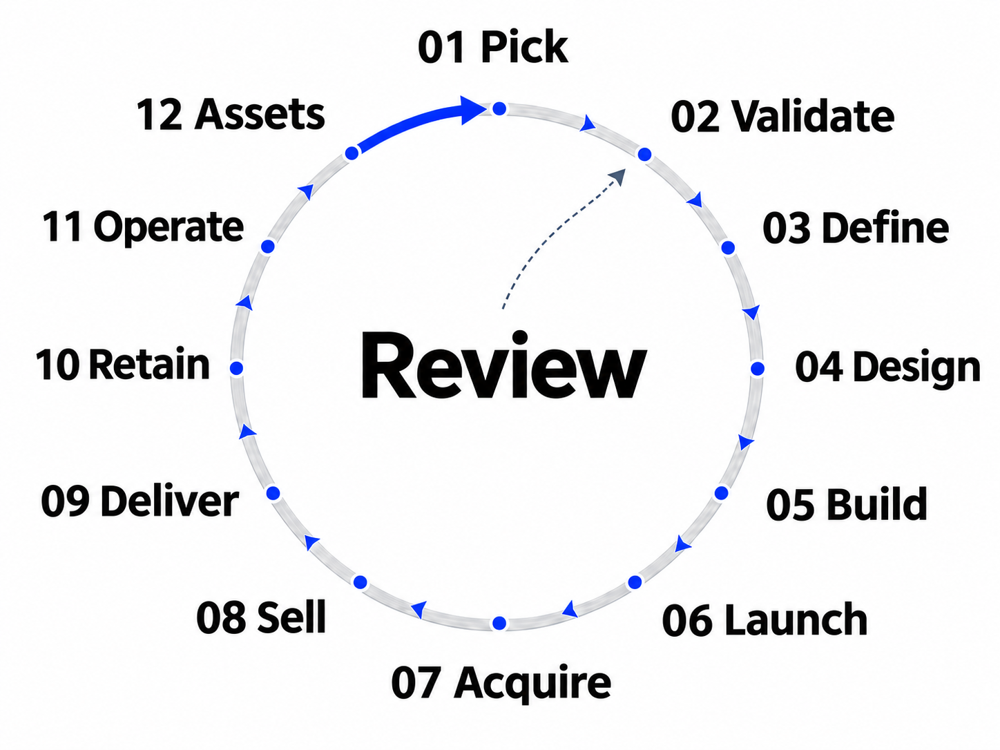

<!-- Generated by scripts/build_readme.py from templates/ and docs/. Edit those sources, then rebuild. -->
<a id="top"></a>

<h1 align="center">
  
</h1>

<p align="center">
  <a href="README.zh.md">中文</a> · <a href="#contents">Full contents</a> · <a href="#getting-started">Getting started</a> · <a href="#contributing">Contribute</a>
</p>

An AI resource index for independent developers, consultants, creators and small service businesses. Covers demand discovery, product, acquisition, sales, delivery and operations. Both the focused collections and the extended catalog are expanded on this page and searchable in your browser.

**3,118 resource and reference URLs · Including 3,052 skill listing pages · English and Chinese.** Counts use unique full URLs; platform and topic views reuse resources. Machine-readable version: [catalog.json](catalog.json).

<a id="contents"></a>
## Contents

[Start with your task](#start-here) · [Installation & use](#getting-started) · [Starter kit](#starter-kit) · [Curation & maintenance](#curation)

- **[Skills by function](#skills)**: [Starting Up](#startup) · [Copywriting](#writing) · [Product & Engineering](#product) · [Design & Frontend](#design) · [Marketing & Growth](#marketing) · [Sales, Support & Ops](#ops) · [Content Production](#content) · [Data & Research](#data) · [OPC & Business](#opc) · [MCP & Runtime](#mcp)
- **[Skills by platform](#platforms)**: [Xiaohongshu](#platform-xiaohongshu) · [WeChat](#platform-wechat) · [Douyin / Channels](#platform-douyin) · [TikTok](#platform-tiktok) · [X / Twitter](#platform-x) · [LinkedIn](#platform-linkedin) · [Reddit](#platform-reddit) · [YouTube](#platform-youtube) · [Ecommerce (Etsy / Amazon / Shopify)](#platform-ecommerce) · [App Store / ASO](#platform-appstore) · [SEO / GEO](#platform-seo) · [Community / Newsletter / Podcast](#platform-private)
- **[Operating playbooks](#business)**: [12 operating playbooks for a one-person company](#operator-playbook) · [OPC Workflow & Capability Map](#workflow) · [Operating tools & official guides](#operating-resources)
- **[Founder collections & topics](#founders)**: [Solo Founder Skills](#solo-founder) · [Founder Packs, by capability](#founder-packs) · [Lenny's Product & Growth Skills](#lenny) · [Classic Frameworks & Mental Models](#classics) · [Naming](#naming) · [Source collections](#landscape)
- **[Extended catalog](#extended)**: [Marketing & sales extended catalog](#full-marketing) · [Design extended catalog](#full-design) · [Product & startup extended catalog](#full-product) · [Ops, legal & finance extended catalog](#full-ops) · [Content & data extended catalog](#full-content)

<a id="start-here"></a>
## Start with your task

| Current task | On this page | First deliverable |
|---|---|---|
| An idea without evidence of paying demand | [Starting up](#startup) · [Operating playbooks](#operator-playbook) | A customer, a problem and a small paid deliverable |
| Turning a service into a product | [Product & engineering](#product) · [Design](#design) | An acceptance scope and a minimum deliverable version |
| A launched product with little traffic | [Marketing & growth](#marketing) · [Platforms](#platforms) | One channel and one content or landing-page experiment |
| Inquiries that do not reliably become paid work | [Sales & operations](#ops) · [Operating playbooks](#operator-playbook) | A quote, scope, payment milestones and acceptance agreement |
| More work than delivery capacity | [Operating playbooks](#operator-playbook) | Capacity, change records, handover notes and margin per job |
| Software serving real customers | [Operating tools & guides](#operating-resources) | Payment-event handling, alerts and a recovery drill |
| Content, courses or digital goods | [Content production](#content) · [Platforms](#platforms) | A product that can be bought, delivered and refunded |
| Reducing dependence on platforms and constant availability | [Operating playbooks](#operator-playbook) · [Operating tools](#operating-resources) | Exportable customer/content assets, absence cover and a handover checklist |

<a id="getting-started"></a>
## Installation & use

| Type | What it provides | How to use it |
|---|---|---|
| Skill | Task instructions, optionally with scripts, templates and references | Follow the source instructions for a compatible agent |
| MCP | Data and actions from an external system | Configure the server and permissions in an MCP client |
| Tool / official guide | A running service, CLI or operating instructions | Deploy, sign up or follow the project's documentation |

Format references: [Agent Skills](https://agentskills.io/home) · [MCP architecture](https://modelcontextprotocol.io/docs/learn/architecture). Format support alone does not provide dependencies, account permissions or a matching runtime.

For example, install a copywriting skill with the [Skills CLI](https://github.com/vercel-labs/skills):

```sh
npx skills add coreyhaines31/marketingskills --skill copywriting
```

The CLI currently requires Node.js 22.20 or later and lets you select a target agent. This command does not install MCP servers or ordinary tools. Start with resources for one current task, evaluate the output on real work and keep what helps.

<a id="starter-kit"></a>
## Starter kit

| Task | Resource | Use |
|---|---|---|
| Refine an idea | [idea-refine](https://www.skills.sh/addyosmani/agent-skills/idea-refine) | Turn an idea into a concept to validate |
| Define the customer job | [define-jtbd-canvas](https://www.skills.sh/product-on-purpose/pm-skills/define-jtbd-canvas) | Describe the customer task and its context |
| Write requirements | [prd-development](https://www.skills.sh/deanpeters/product-manager-skills/prd-development) | Structure scope, needs and acceptance requirements |
| Build an interface | [frontend-design](https://www.skills.sh/anthropics/skills/frontend-design) | Design and implement a frontend interface |
| Write a sales page | [copywriting](https://www.skills.sh/coreyhaines31/marketingskills/copywriting) | Organize benefits, evidence and the next action |
| Review search visibility | [seo-audit](https://www.skills.sh/coreyhaines31/marketingskills/seo-audit) | Inspect issues affecting site discoverability |
| Founder sales | [founder-sales](https://www.skills.sh/refoundai/lenny-skills/founder-sales) | Structure direct customer contact and sales work |
| User onboarding | [user-onboarding](https://www.skills.sh/refoundai/lenny-skills/user-onboarding) | Design the path from first use to initial value |
| Pricing | [pricing](https://www.skills.sh/coreyhaines31/marketingskills/pricing) | Consider pricing, packaging and revenue models |
| Unit economics | [unit-economics](https://www.skills.sh/anthropics/financial-services/unit-economics) | Examine revenue and cost assumptions per unit |
| Browser operations | [Playwright MCP](https://github.com/microsoft/playwright-mcp) | Let an MCP-compatible agent operate and inspect web pages |
| Backup recovery | [restic restore guide](https://restic.readthedocs.io/en/stable/050_restore.html) | Restore a backup to a target directory and verify the result |

<a id="skills"></a>
## Skills by function

<a id="startup"></a>
### Starting Up

Idea, validation, business model and positioning — decide what to build first.

[Idea & problem](#startup-s1) · [Market & competitors](#startup-s2) · [Business model](#startup-s3) · [Validation & decisions](#startup-s4) · [Positioning & sales](#startup-s5)

<a id="startup-s1"></a>
<a id="startup-idea--problem"></a>
#### Idea & problem

- **[idea-refine](https://www.skills.sh/addyosmani/agent-skills/idea-refine)** — Turn rough ideas into sharp concepts.
- **[startup-ideation](https://www.skills.sh/refoundai/lenny-skills/startup-ideation)** — Generate and evaluate startup ideas.
- **[define-problem-statement](https://www.skills.sh/product-on-purpose/pm-skills/define-problem-statement)** — Write a concise problem statement.
- **[define-hypothesis](https://www.skills.sh/product-on-purpose/pm-skills/define-hypothesis)** — Turn assumptions into testable hypotheses.
- **[define-opportunity-tree](https://www.skills.sh/product-on-purpose/pm-skills/define-opportunity-tree)** — Map outcomes to opportunities and solutions.
- **[define-jtbd-canvas](https://www.skills.sh/product-on-purpose/pm-skills/define-jtbd-canvas)** — Fill a Jobs-to-be-Done canvas.
- **[bmad-brainstorming](https://www.skills.sh/bmad-code-org/bmad-method/bmad-brainstorming)** — Run a structured brainstorming session.
- **[bmad-product-brief](https://www.skills.sh/bmad-code-org/bmad-method/bmad-product-brief)** — Write a product brief.
- **[bmad-prfaq](https://www.skills.sh/bmad-code-org/bmad-method/bmad-prfaq)** — Write a PRFAQ.

<a id="startup-s2"></a>
<a id="startup-market--competitors"></a>
#### Market & competitors

- **[market-research](https://www.skills.sh/affaan-m/ecc/market-research)** — Decision-grade market research.
- **[competitive-analysis](https://www.skills.sh/refoundai/lenny-skills/competitive-analysis)** — Analyze competitors and alternatives.
- **[competitor-profiling](https://www.skills.sh/coreyhaines31/marketingskills/competitor-profiling)** — Competitive intelligence profiles.
- **[competitors](https://www.skills.sh/coreyhaines31/marketingskills/competitors)** — Competitor and alternative pages.
- **[firecrawl-market-research](https://www.skills.sh/firecrawl/firecrawl-workflows/firecrawl-market-research)** — Sourced market and financial research.
- **[market-sizing](https://www.skills.sh/phuryn/pm-skills/market-sizing)** — Estimate TAM, SAM and SOM.
- **[ideal-customer-profile](https://www.skills.sh/phuryn/pm-skills/ideal-customer-profile)** — Define your ideal customer profile.
- **[user-personas](https://www.skills.sh/phuryn/pm-skills/user-personas)** — Create user personas.
- **[foundation-persona](https://www.skills.sh/product-on-purpose/pm-skills/foundation-persona)** — Build a target user persona.
- **[discover-interview-synthesis](https://www.skills.sh/product-on-purpose/pm-skills/discover-interview-synthesis)** — Synthesize user interviews.

<a id="startup-s3"></a>
<a id="startup-business-model"></a>
#### Business model

- **[foundation-lean-canvas](https://www.skills.sh/product-on-purpose/pm-skills/foundation-lean-canvas)** — Fill a Lean Canvas.
- **[business-model](https://www.skills.sh/phuryn/pm-skills/business-model)** — Generate a nine-block Business Model Canvas.
- **[startup-canvas](https://www.skills.sh/phuryn/pm-skills/startup-canvas)** — Draft a one-page startup canvas.
- **[value-proposition](https://www.skills.sh/phuryn/pm-skills/value-proposition)** — Write a value proposition.
- **[product-strategy](https://www.skills.sh/phuryn/pm-skills/product-strategy)** — Define product strategy and scope.
- **[gtm-strategy](https://www.skills.sh/phuryn/pm-skills/gtm-strategy)** — Build a go-to-market plan.
- **[product-name](https://www.skills.sh/phuryn/pm-skills/product-name)** — Generate and screen product names.

<a id="startup-s4"></a>
<a id="startup-validation--decisions"></a>
#### Validation & decisions

- **[pre-mortem](https://www.skills.sh/phuryn/pm-skills/pre-mortem)** — Run a pre-mortem on a plan.
- **[strategy-red-team](https://www.skills.sh/phuryn/pm-skills/strategy-red-team)** — Red-team a strategy.
- **[prioritization-frameworks](https://www.skills.sh/phuryn/pm-skills/prioritization-frameworks)** — Prioritize with a chosen framework.
- **[outcome-roadmap](https://www.skills.sh/phuryn/pm-skills/outcome-roadmap)** — Build an outcome-based roadmap.
- **[measure-experiment-design](https://www.skills.sh/product-on-purpose/pm-skills/measure-experiment-design)** — Design a measurable experiment.
- **[develop-solution-brief](https://www.skills.sh/product-on-purpose/pm-skills/develop-solution-brief)** — Write a solution brief.

<a id="startup-s5"></a>
<a id="startup-positioning--sales"></a>
#### Positioning & sales

- **[positioning-messaging](https://www.skills.sh/refoundai/lenny-skills/positioning-messaging)** — Define positioning and messaging.
- **[brand-storytelling](https://www.skills.sh/refoundai/lenny-skills/brand-storytelling)** — Build a brand story.
- **[founder-sales](https://www.skills.sh/refoundai/lenny-skills/founder-sales)** — Run founder-led sales.
- **[ai-product-strategy](https://www.skills.sh/refoundai/lenny-skills/ai-product-strategy)** — Define an AI product strategy.

[Back to contents](#contents)

<a id="writing"></a>
### Copywriting

Organized by where the copy lives: Xiaohongshu, WeChat, short video, ads, cold email, landing pages, ecommerce, app stores.

[Plain language & de-AI](#writing-s1) · [Xiaohongshu copy](#writing-s2) · [WeChat copy](#writing-s3) · [Short-video scripts](#writing-s4) · [Ad copy](#writing-s5) · [Cold email & outreach](#writing-s6) · [Landing & sales pages](#writing-s7) · [Product & UX copy](#writing-s8) · [Brand & PR copy](#writing-s9) · [Ecommerce & store copy](#writing-s10) · [Long-form & blogs](#writing-s11) · [Translation & localization](#writing-s12) · [Scripts & stories](#writing-s13)

<a id="writing-s1"></a>
<a id="writing-plain-language--de-ai"></a>
#### Plain language & de-AI

- **[humanizer-zh](https://www.skills.sh/op7418/humanizer-zh/humanizer-zh)** — Chinese de-AI rewriting that keeps meaning and tone.
- **[humanizer](https://www.skills.sh/blader/humanizer/humanizer)** — Remove AI writing patterns; scores 55 tells.
- **[no-ai-slop](https://www.skills.sh/petergyang/no-ai-slop/no-ai-slop)** — Cut AI slop while preserving the writer’s voice.
- **[avoid-ai-writing](https://www.skills.sh/conorbronsdon/avoid-ai-writing/avoid-ai-writing)** — Audit and rewrite machine-sounding text.
- **[antislop-copywriting](https://www.skills.sh/miqdadbadjuber/anti-slop/antislop-copywriting)** — Anti-slop rules for copy and text.
- **[grammar-check](https://www.skills.sh/phuryn/pm-skills/grammar-check)** — Grammar, logic and flow checking.

<a id="writing-s2"></a>
<a id="writing-xiaohongshu-copy"></a>
#### Xiaohongshu copy

- **[write-xiaohongshu](https://www.skills.sh/adjfks/corner-skills/write-xiaohongshu)** — Research, write and publish Xiaohongshu posts.
- **[dbs-xhs-title](https://www.skills.sh/dontbesilent2025/dbskill/dbs-xhs-title)** — Xiaohongshu title formulas, 75 patterns.
- **[xiaohongshu-note-analyzer](https://www.skills.sh/softbread/xiaohongshu-doctor/xiaohongshu-note-analyzer)** — Diagnose a Xiaohongshu note.

<a id="writing-s3"></a>
<a id="writing-wechat-copy"></a>
#### WeChat copy

- **[wechat-article-writer](https://www.skills.sh/iamzhihuix/happy-claude-skills/wechat-article-writer)** — Four-step WeChat article workflow.
- **[dbs-wechat-html](https://www.skills.sh/dontbesilent2025/dbskill/dbs-wechat-html)** — Convert Markdown to WeChat-ready HTML.
- **[md2wechat](https://www.skills.sh/geekjourneyx/md2wechat-skill/md2wechat)** — Convert Markdown to WeChat HTML.

<a id="writing-s4"></a>
<a id="writing-short-video-scripts"></a>
#### Short-video scripts

- **[dbs-hook](https://www.skills.sh/dontbesilent2025/dbskill/dbs-hook)** — Diagnose and rewrite short-video openings.
- **[dbs-script-flow](https://www.skills.sh/dontbesilent2025/dbskill/dbs-script-flow)** — Check short-video script flow and retention.
- **[dbs-title-cover-intro](https://www.skills.sh/dontbesilent2025/dbskill/dbs-title-cover-intro)** — Write titles, covers and openings.
- **[tiktok-script](https://www.skills.sh/social-media-skills/skills/tiktok-script)** — Write TikTok scripts.
- **[short-form-video-script](https://www.skills.sh/social-media-skills/skills/short-form-video-script)** — Write short-form video scripts.
- **[viral-hook-creator](https://www.skills.sh/ognjengt/founder-skills/viral-hook-creator)** — Generate viral hooks.

<a id="writing-s5"></a>
<a id="writing-ad-copy"></a>
#### Ad copy

- **[ads-copywriter](https://www.skills.sh/claude-office-skills/skills/ads-copywriter)** — Ad copy for Google, Meta, TikTok and LinkedIn.
- **[ad-copy-variants](https://www.skills.sh/mbfinotti/advertising-skills/ad-copy-variants)** — Turn one value prop into testable variants.
- **[conversational-ad-copy](https://www.skills.sh/mbfinotti/advertising-skills/conversational-ad-copy)** — Ads inside AI answers and search.
- **[ad-hook-analyzer](https://www.skills.sh/mbfinotti/advertising-skills/ad-hook-analyzer)** — Rank video-ad openings before spending.
- **[ad-creative-brief](https://www.skills.sh/mbfinotti/advertising-skills/ad-creative-brief)** — Performance creative brief.
- **[copywriting-hooks](https://www.skills.sh/samber/cc-skills/copywriting-hooks)** — Hooks that make readers want sentence two.
- **[ogilvy-copywriting](https://www.skills.sh/boraoztunc/skills/ogilvy-copywriting)** — Ogilvy-style sales copy principles.

<a id="writing-s6"></a>
<a id="writing-cold-email--outreach"></a>
#### Cold email & outreach

- **[cold-email](https://www.skills.sh/coreyhaines31/marketingskills/cold-email)** — Cold email writing.
- **[cold-email-subject-line-tester](https://www.skills.sh/mbfinotti/sales-skills/cold-email-subject-line-tester)** — Score subject lines and design split tests.
- **[emails](https://www.skills.sh/coreyhaines31/marketingskills/emails)** — Email sequence design.
- **[compose-outreach](https://www.skills.sh/anthropics/knowledge-work-plugins/compose-outreach)** — Write personalized outreach.

<a id="writing-s7"></a>
<a id="writing-landing--sales-pages"></a>
#### Landing & sales pages

- **[copywriting](https://www.skills.sh/coreyhaines31/marketingskills/copywriting)** — Conversion copywriting.
- **[copy-editing](https://www.skills.sh/coreyhaines31/marketingskills/copy-editing)** — Pass-by-pass marketing copy editing.
- **[landing-page-copywriter](https://www.skills.sh/onewave-ai/claude-skills/landing-page-copywriter)** — Landing copy that drives one action.
- **[offers](https://www.skills.sh/coreyhaines31/marketingskills/offers)** — Offer design and packaging.

<a id="writing-s8"></a>
<a id="writing-product--ux-copy"></a>
#### Product & UX copy

- **[ux-copy](https://www.skills.sh/anthropics/knowledge-work-plugins/ux-copy)** — Interface copy and error messages.

<a id="writing-s9"></a>
<a id="writing-brand--pr-copy"></a>
#### Brand & PR copy

- **[brand-voice](https://www.skills.sh/affaan-m/ecc/brand-voice)** — Build a durable voice profile from source material.
- **[brand-voice-enforcement](https://www.skills.sh/anthropics/knowledge-work-plugins/brand-voice-enforcement)** — Apply brand guidelines to all sales and marketing content.
- **[brand-naming](https://www.skills.sh/arnabbagxd/brand-building-skills/brand-naming)** — Brand naming strategy and candidate screening.
- **[copywriting-tone-of-voice-creator](https://www.skills.sh/samber/cc-skills/copywriting-tone-of-voice-creator)** — Turn brand voice into operational rules.
- **[public-relations](https://www.skills.sh/coreyhaines31/marketingskills/public-relations)** — PR and earned media.

<a id="writing-s10"></a>
<a id="writing-ecommerce--store-copy"></a>
#### Ecommerce & store copy

- **[product-description-generator](https://www.skills.sh/nexscope-ai/ecommerce-skills/product-description-generator)** — Write product descriptions.
- **[product-title-optimization](https://www.skills.sh/nexscope-ai/ecommerce-skills/product-title-optimization)** — Optimize product titles.
- **[aso](https://www.skills.sh/coreyhaines31/marketingskills/aso)** — App Store / Play Store ASO audit.
- **[asc-localize-metadata](https://www.skills.sh/rorkai/app-store-connect-cli-skills/asc-localize-metadata)** — Localize App Store metadata.

<a id="writing-s11"></a>
<a id="writing-long-form--blogs"></a>
#### Long-form & blogs

- **[edit-article](https://www.skills.sh/mattpocock/skills/edit-article)** — Re-edit an article around its section structure.
- **[article-writing](https://www.skills.sh/affaan-m/ecc/article-writing)** — Long-form writing with a real point of view.
- **[blog](https://www.skills.sh/agricidaniel/claude-blog/blog)** — Blog engine for rankings and AI citations.
- **[blog-factcheck](https://www.skills.sh/agricidaniel/claude-blog/blog-factcheck)** — Fact-check blog drafts.
- **[blog-seo-check](https://www.skills.sh/agricidaniel/claude-blog/blog-seo-check)** — Post-writing SEO validation for blogs.
- **[engineering-blog-post](https://www.skills.sh/samber/developer-relations-skills/engineering-blog-post)** — Write and edit engineering blog posts.
- **[substack-ghostwriting](https://www.skills.sh/samber/cc-skills/substack-ghostwriting)** — Substack ghostwriting and growth.
- **[linkedin-ghostwriting](https://www.skills.sh/samber/cc-skills/linkedin-ghostwriting)** — High-conversion LinkedIn ghostwriting.

<a id="writing-s12"></a>
<a id="writing-translation--localization"></a>
#### Translation & localization

- **[baoyu-translate](https://www.skills.sh/jimliu/baoyu-skills/baoyu-translate)** — High-quality translation and polishing.
- **[mkdocs-translations](https://www.skills.sh/github/awesome-copilot/mkdocs-translations)** — Translate documentation sites.

<a id="writing-s13"></a>
<a id="writing-scripts--stories"></a>
#### Scripts & stories

- **[storyboard-creation](https://www.skills.sh/101-skills/superpowers/storyboard-creation)** — Generate visual storyboards with AI.
- **[chinese-novelist](https://www.skills.sh/penglonghuang/chinese-novelist-skill/chinese-novelist)** — Chinese fiction writing with conflict and hooks.

[Back to contents](#contents)

<a id="product"></a>
### Product & Engineering

From requirement to deploy, by engineering stage.

[Requirements & PRD](#product-s1) · [Architecture](#product-s2) · [Testing](#product-s3) · [Review & security](#product-s4) · [Deploy & CI](#product-s5) · [Debugging & performance](#product-s6) · [Docs & context](#product-s7) · [Release & design handoff](#product-s8) · [Code naming](#product-s9)

<a id="product-s1"></a>
<a id="product-requirements--prd"></a>
#### Requirements & PRD

- **[bmad-prd](https://www.skills.sh/bmad-code-org/bmad-method/bmad-prd)** — Multi-role PRD workflow.
- **[bmad-spec](https://www.skills.sh/bmad-code-org/bmad-method/bmad-spec)** — Spec kernel.
- **[prd-development](https://www.skills.sh/deanpeters/product-manager-skills/prd-development)** — Structured PRD process.
- **[spec-driven-development](https://www.skills.sh/addyosmani/agent-skills/spec-driven-development)** — Write the spec before the code.
- **[deliver-prd](https://www.skills.sh/product-on-purpose/pm-skills/deliver-prd)** — Write a PRD.
- **[deliver-user-stories](https://www.skills.sh/product-on-purpose/pm-skills/deliver-user-stories)** — Write user stories.
- **[deliver-acceptance-criteria](https://www.skills.sh/product-on-purpose/pm-skills/deliver-acceptance-criteria)** — Define acceptance criteria.

<a id="product-s2"></a>
<a id="product-architecture"></a>
#### Architecture

- **[bmad-architecture](https://www.skills.sh/bmad-code-org/bmad-method/bmad-architecture)** — Architecture spine.
- **[architecture-blueprint-generator](https://www.skills.sh/github/awesome-copilot/architecture-blueprint-generator)** — Project architecture blueprint.
- **[system-design](https://www.skills.sh/anthropics/knowledge-work-plugins/system-design)** — System design and architecture decisions.
- **[api-design](https://www.skills.sh/affaan-m/ecc/api-design)** — API design conventions.
- **[documenting-contracts](https://www.skills.sh/riekelt/technical-writer/documenting-contracts)** — Document REST/RPC, webhook, CLI and file-format contracts.
- **[bmad-agent-architect](https://www.skills.sh/bmad-code-org/bmad-method/bmad-agent-architect)** — Architect role.
- **[bmad-agent-dev](https://www.skills.sh/bmad-code-org/bmad-method/bmad-agent-dev)** — Developer role.

<a id="product-s3"></a>
<a id="product-testing"></a>
#### Testing

- **[webapp-testing](https://www.skills.sh/anthropics/skills/webapp-testing)** — Web application testing.
- **[test-driven-development](https://www.skills.sh/addyosmani/agent-skills/test-driven-development)** — Write a failing test first.
- **[browser-testing-with-devtools](https://www.skills.sh/addyosmani/agent-skills/browser-testing-with-devtools)** — Browser testing with DevTools.
- **[vitest](https://www.skills.sh/antfu/skills/vitest)** — Vite-native testing framework.
- **[testing-strategy](https://www.skills.sh/anthropics/knowledge-work-plugins/testing-strategy)** — Design test coverage and strategy.
- **[web-quality-audit](https://www.skills.sh/addyosmani/web-quality-skills/web-quality-audit)** — Browser-backed quality audit.
- **[bmad-qa-generate-e2e-tests](https://www.skills.sh/bmad-code-org/bmad-method/bmad-qa-generate-e2e-tests)** — Generate E2E tests.
- **[deliver-edge-cases](https://www.skills.sh/product-on-purpose/pm-skills/deliver-edge-cases)** — Cover edge cases.

<a id="product-s4"></a>
<a id="product-review--security"></a>
#### Review & security

- **[code-review-and-quality](https://www.skills.sh/addyosmani/agent-skills/code-review-and-quality)** — Multi-dimensional code review.
- **[security-and-hardening](https://www.skills.sh/addyosmani/agent-skills/security-and-hardening)** — Security-first development.
- **[security-audit](https://www.skills.sh/cloudflare/security-audit-skill/security-audit)** — Find vulnerabilities at trust boundaries.
- **[bmad-code-review](https://www.skills.sh/bmad-code-org/bmad-method/bmad-code-review)** — BMad code review workflow.
- **[ponytail-audit](https://www.skills.sh/dietrichgebert/ponytail/ponytail-audit)** — Audit a repo like its new senior owner.
- **[bmad-review](https://www.skills.sh/bmad-code-org/bmad-method/bmad-review)** — Run a BMad review.

<a id="product-s5"></a>
<a id="product-deploy--ci"></a>
#### Deploy & CI

- **[ci-cd-and-automation](https://www.skills.sh/addyosmani/agent-skills/ci-cd-and-automation)** — CI/CD quality gates.
- **[deploy-checklist](https://www.skills.sh/anthropics/knowledge-work-plugins/deploy-checklist)** — Pre-deploy checklist.
- **[docker-patterns](https://www.skills.sh/affaan-m/ecc/docker-patterns)** — Production Docker and Compose patterns.
- **[aws-deployment](https://www.skills.sh/aws/agent-toolkit-for-aws/aws-deployment)** — AWS CI/CD deployment.

<a id="product-s6"></a>
<a id="product-debugging--performance"></a>
#### Debugging & performance

- **[debugging-and-error-recovery](https://www.skills.sh/addyosmani/agent-skills/debugging-and-error-recovery)** — Systematic debugging.
- **[performance-optimization](https://www.skills.sh/addyosmani/agent-skills/performance-optimization)** — Measure before optimizing.
- **[debug](https://www.skills.sh/anthropics/knowledge-work-plugins/debug)** — Structured debugging workflow.
- **[debug-optimize-lcp](https://www.skills.sh/chromedevtools/chrome-devtools-mcp/debug-optimize-lcp)** — Find and fix Largest Contentful Paint.

<a id="product-s7"></a>
<a id="product-docs--context"></a>
#### Docs & context

- **[documentation-and-adrs](https://www.skills.sh/addyosmani/agent-skills/documentation-and-adrs)** — Write docs and ADRs.
- **[documentation](https://www.skills.sh/anthropics/knowledge-work-plugins/documentation)** — Write technical documentation.
- **[tech-debt](https://www.skills.sh/anthropics/knowledge-work-plugins/tech-debt)** — Manage technical debt.
- **[incident-response](https://www.skills.sh/anthropics/knowledge-work-plugins/incident-response)** — Run incident response.
- **[context-engineering](https://www.skills.sh/addyosmani/agent-skills/context-engineering)** — Engineer agent context.
- **[incremental-implementation](https://www.skills.sh/addyosmani/agent-skills/incremental-implementation)** — Ship in small increments.
- **[source-driven-development](https://www.skills.sh/addyosmani/agent-skills/source-driven-development)** — Develop from source truth.
- **[interview-me](https://www.skills.sh/addyosmani/agent-skills/interview-me)** — Interview the user before building.
- **[doubt-driven-development](https://www.skills.sh/addyosmani/agent-skills/doubt-driven-development)** — Build with explicit doubt.
- **[constraint-driven-development](https://www.skills.sh/addyosmani/agent-skills/constraint-driven-development)** — Build under constraints.
- **[observability-and-instrumentation](https://www.skills.sh/addyosmani/agent-skills/observability-and-instrumentation)** — Add observability and instrumentation.
- **[measure-instrumentation-spec](https://www.skills.sh/product-on-purpose/pm-skills/measure-instrumentation-spec)** — Write an instrumentation spec.

<a id="product-s8"></a>
<a id="product-release--design-handoff"></a>
#### Release & design handoff

- **[develop-design-rationale](https://www.skills.sh/product-on-purpose/pm-skills/develop-design-rationale)** — Document design rationale.
- **[deliver-release-notes](https://www.skills.sh/product-on-purpose/pm-skills/deliver-release-notes)** — Write release notes.

<a id="product-s9"></a>
<a id="product-code-naming"></a>
#### Code naming

- **[naming-analyzer](https://www.skills.sh/softaworks/agent-toolkit/naming-analyzer)** — Improve variable, function, class, file and API names using context and conventions.

[Back to contents](#contents)

<a id="design"></a>
### Design & Frontend

Design is a big block: style, type, components, motion, Figma and frontend.

[Visual styles](#design-s1) · [Type, color & layout](#design-s2) · [UX patterns](#design-s3) · [Design systems](#design-s4) · [Critique & research](#design-s5) · [Motion & 3D](#design-s6) · [Page design](#design-s7) · [Figma](#design-s8) · [UI & visual](#design-s9) · [Frontend implementation](#design-s10) · [Accessibility](#design-s11) · [Logo & brand identity](#design-s12) · [Typography](#design-s13) · [Color](#design-s14) · [Icons](#design-s15) · [Layout](#design-s16) · [UX & usability](#design-s17) · [Motion](#design-s18) · [Design systems](#design-s19)

<a id="design-s1"></a>
<a id="design-visual-styles"></a>
#### Visual styles

- **[minimal](https://www.skills.sh/bergside/awesome-design-skills/minimal)** — Minimal visual style.
- **[editorial](https://www.skills.sh/bergside/awesome-design-skills/editorial)** — Editorial magazine style.
- **[bento](https://www.skills.sh/bergside/awesome-design-skills/bento)** — Bento grid layout style.
- **[glassmorphism](https://www.skills.sh/bergside/awesome-design-skills/glassmorphism)** — Glassmorphism visual style.
- **[neobrutalism](https://www.skills.sh/bergside/awesome-design-skills/neobrutalism)** — Neobrutalist visual style.
- **[premium](https://www.skills.sh/bergside/awesome-design-skills/premium)** — Premium, high-end visual style.
- **[enterprise](https://www.skills.sh/bergside/awesome-design-skills/enterprise)** — Enterprise-grade visual style.
- **[professional](https://www.skills.sh/bergside/awesome-design-skills/professional)** — Professional, trustworthy style.
- **[storytelling](https://www.skills.sh/bergside/awesome-design-skills/storytelling)** — Narrative-driven visual style.
- **[shadcn](https://www.skills.sh/bergside/awesome-design-skills/shadcn)** — shadcn/ui visual style.

<a id="design-s2"></a>
<a id="design-type-color--layout"></a>
#### Type, color & layout

- **[typography-scale](https://www.skills.sh/owl-listener/designer-skills/typography-scale)** — Build a modular type scale.
- **[color-system](https://www.skills.sh/owl-listener/designer-skills/color-system)** — Build an accessible color system.
- **[spacing-system](https://www.skills.sh/owl-listener/designer-skills/spacing-system)** — Define a spacing scale.
- **[layout-grid](https://www.skills.sh/owl-listener/designer-skills/layout-grid)** — Design a responsive grid.
- **[icon-system](https://www.skills.sh/owl-listener/designer-skills/icon-system)** — Build a consistent icon system.
- **[visual-hierarchy](https://www.skills.sh/owl-listener/designer-skills/visual-hierarchy)** — Establish visual hierarchy.
- **[responsive-design](https://www.skills.sh/owl-listener/designer-skills/responsive-design)** — Design responsive layouts.
- **[dark-mode-design](https://www.skills.sh/owl-listener/designer-skills/dark-mode-design)** — Design dark mode.
- **[theming-system](https://www.skills.sh/owl-listener/designer-skills/theming-system)** — Build a theme system.
- **[readable-measure](https://www.skills.sh/owl-listener/designer-skills/readable-measure)** — Set readable line lengths.

<a id="design-s3"></a>
<a id="design-ux-patterns"></a>
#### UX patterns

- **[user-flow-diagram](https://www.skills.sh/owl-listener/designer-skills/user-flow-diagram)** — Draw user flows.
- **[wireframe-spec](https://www.skills.sh/owl-listener/designer-skills/wireframe-spec)** — Write a wireframe spec.
- **[micro-interaction-spec](https://www.skills.sh/owl-listener/designer-skills/micro-interaction-spec)** — Specify micro-interactions.
- **[loading-states](https://www.skills.sh/owl-listener/designer-skills/loading-states)** — Design loading states.
- **[error-handling-ux](https://www.skills.sh/owl-listener/designer-skills/error-handling-ux)** — Design error handling and recovery.
- **[state-machine](https://www.skills.sh/owl-listener/designer-skills/state-machine)** — Model UI state machines.
- **[form-design](https://www.skills.sh/owl-listener/designer-skills/form-design)** — Design forms that convert.
- **[navigation-patterns](https://www.skills.sh/owl-listener/designer-skills/navigation-patterns)** — Choose navigation patterns.
- **[onboarding-design](https://www.skills.sh/owl-listener/designer-skills/onboarding-design)** — Design onboarding.
- **[information-architecture](https://www.skills.sh/owl-listener/designer-skills/information-architecture)** — Structure information architecture.
- **[search-ux](https://www.skills.sh/owl-listener/designer-skills/search-ux)** — Design search experiences.
- **[feedback-patterns](https://www.skills.sh/owl-listener/designer-skills/feedback-patterns)** — Design feedback patterns.

<a id="design-s4"></a>
<a id="design-design-systems"></a>
#### Design systems

- **[design-token](https://www.skills.sh/owl-listener/designer-skills/design-token)** — Define design tokens.
- **[design-token-audit](https://www.skills.sh/owl-listener/designer-skills/design-token-audit)** — Audit design tokens.
- **[component-spec](https://www.skills.sh/owl-listener/designer-skills/component-spec)** — Write component specs.
- **[pattern-library](https://www.skills.sh/owl-listener/designer-skills/pattern-library)** — Build a pattern library.
- **[design-system-governance](https://www.skills.sh/owl-listener/designer-skills/design-system-governance)** — Govern a design system.
- **[design-system-adoption](https://www.skills.sh/owl-listener/designer-skills/design-system-adoption)** — Drive design-system adoption.
- **[naming-convention](https://www.skills.sh/owl-listener/designer-skills/naming-convention)** — Set naming conventions.
- **[handoff-spec](https://www.skills.sh/owl-listener/designer-skills/handoff-spec)** — Write a design handoff spec.
- **[extract-design-system](https://www.skills.sh/arvindrk/extract-design-system/extract-design-system)** — Reverse-engineer a design system from a site.
- **[expo-design-system](https://www.skills.sh/expo/skills/expo-design-system)** — One visual system across Expo screens.
- **[figma-create-design-system-rules](https://www.skills.sh/openai/skills/figma-create-design-system-rules)** — Generate design-system rules.
- **[figma-generate-design](https://www.skills.sh/figma/mcp-server-guide/figma-generate-design)** — Generate screens from a design system.

<a id="design-s5"></a>
<a id="design-critique--research"></a>
#### Critique & research

- **[design-critique](https://www.skills.sh/owl-listener/designer-skills/design-critique)** — Facilitate a design critique.
- **[design-qa-checklist](https://www.skills.sh/owl-listener/designer-skills/design-qa-checklist)** — Run a design QA checklist.
- **[heuristic-evaluation](https://www.skills.sh/owl-listener/designer-skills/heuristic-evaluation)** — Run a heuristic evaluation.
- **[usability-test-plan](https://www.skills.sh/owl-listener/designer-skills/usability-test-plan)** — Plan a usability test.
- **[accessibility-test-plan](https://www.skills.sh/owl-listener/designer-skills/accessibility-test-plan)** — Plan accessibility testing.
- **[a-b-test-design](https://www.skills.sh/owl-listener/designer-skills/a-b-test-design)** — Design an A/B test.
- **[card-sort-analysis](https://www.skills.sh/owl-listener/designer-skills/card-sort-analysis)** — Analyze card-sort results.
- **[interview-script](https://www.skills.sh/owl-listener/designer-skills/interview-script)** — Write a user interview script.
- **[summarize-interview](https://www.skills.sh/owl-listener/designer-skills/summarize-interview)** — Summarize interviews.
- **[journey-map](https://www.skills.sh/owl-listener/designer-skills/journey-map)** — Build a customer journey map.
- **[service-blueprint](https://www.skills.sh/owl-listener/designer-skills/service-blueprint)** — Build a service blueprint.

<a id="design-s6"></a>
<a id="design-motion--3d"></a>
#### Motion & 3D

- **[build-awwwards-quality-sites](https://www.skills.sh/mengto/skills/build-awwwards-quality-sites)** — Build an Awwwards-quality site.
- **[cinematic-scroll-storytelling](https://www.skills.sh/mengto/skills/cinematic-scroll-storytelling)** — Build cinematic scroll storytelling.
- **[animation-on-scroll](https://www.skills.sh/mengto/skills/animation-on-scroll)** — Add scroll-triggered animation.
- **[animation-systems](https://www.skills.sh/mengto/skills/animation-systems)** — Design a motion system.
- **[gsap](https://www.skills.sh/mengto/skills/gsap)** — Animate with GSAP.
- **[gsap-scrolltrigger-storytelling](https://www.skills.sh/mengto/skills/gsap-scrolltrigger-storytelling)** — Build ScrollTrigger narratives.
- **[beautiful-shadows](https://www.skills.sh/mengto/skills/beautiful-shadows)** — Craft layered shadows.
- **[no-ai-design-slop](https://www.skills.sh/mengto/skills/no-ai-design-slop)** — Remove generic AI design tells.
- **[progressive-blur](https://www.skills.sh/mengto/skills/progressive-blur)** — Add progressive blur effects.
- **[masked-reveal](https://www.skills.sh/mengto/skills/masked-reveal)** — Build masked reveal transitions.
- **[glass-dark-ui](https://www.skills.sh/mengto/skills/glass-dark-ui)** — Build dark glass UI.
- **[scroll-world-storytelling](https://www.skills.sh/mengto/skills/scroll-world-storytelling)** — Build a scroll-driven world.
- **[threejs-shaders](https://www.skills.sh/cloudai-x/threejs-skills/threejs-shaders)** — Three.js shaders.
- **[threejs-fundamentals](https://www.skills.sh/cloudai-x/threejs-skills/threejs-fundamentals)** — Three.js scenes and rendering basics.
- **[remotion-render](https://www.skills.sh/101-skills/superpowers/remotion-render)** — Render video with Remotion.
- **[transitions-polish](https://www.skills.sh/jakubantalik/transitions.dev/transitions-polish)** — Polish transitions and motion.

<a id="design-s7"></a>
<a id="design-page-design"></a>
#### Page design

- **[landing-page](https://www.skills.sh/mengto/skills/landing-page)** — Design a high-conversion landing page.
- **[pricing-page](https://www.skills.sh/mengto/skills/pricing-page)** — Design a pricing page.
- **[tailwind-design-system](https://www.skills.sh/wshobson/agents/tailwind-design-system)** — Build a Tailwind design system.
- **[brand-landingpage](https://www.skills.sh/wshobson/agents/brand-landingpage)** — Build a brand landing page.
- **[mobile-android-design](https://www.skills.sh/wshobson/agents/mobile-android-design)** — Design Android screens.
- **[mobile-ios-design](https://www.skills.sh/wshobson/agents/mobile-ios-design)** — Design iOS screens.

<a id="design-s8"></a>
<a id="design-figma"></a>
#### Figma

- **[figma-use](https://www.skills.sh/figma/mcp-server-guide/figma-use)** — Operate Figma through the Plugin API.
- **[figma-implement-design](https://www.skills.sh/openai/skills/figma-implement-design)** — Turn Figma designs into code.
- **[figma-code-connect](https://www.skills.sh/figma/mcp-server-guide/figma-code-connect)** — Map Figma components to code components.
- **[figma-create-new-file](https://www.skills.sh/figma/mcp-server-guide/figma-create-new-file)** — Create Figma Design, FigJam or Slides files.
- **[figma-generate-library](https://www.skills.sh/figma/mcp-server-guide/figma-generate-library)** — Generate a Figma design library.
- **[figma-design-to-code](https://www.skills.sh/figma/mcp-server-guide/figma-design-to-code)** — Turn Figma designs into code.
- **[figma-generate-diagram](https://www.skills.sh/figma/mcp-server-guide/figma-generate-diagram)** — Generate Figma diagrams.
- **[figma-use-figjam](https://www.skills.sh/figma/mcp-server-guide/figma-use-figjam)** — Operate FigJam boards.
- **[figma-use-slides](https://www.skills.sh/figma/mcp-server-guide/figma-use-slides)** — Build Figma Slides decks.
- **[figma-implement-motion](https://www.skills.sh/figma/mcp-server-guide/figma-implement-motion)** — Implement Figma motion.
- **[figma-swiftui](https://www.skills.sh/figma/mcp-server-guide/figma-swiftui)** — Turn Figma into SwiftUI.
- **[figma-spec](https://www.skills.sh/figma/mcp-server-guide/figma-spec)** — Write a Figma spec.

<a id="design-s9"></a>
<a id="design-ui--visual"></a>
#### UI & visual

- **[frontend-design](https://www.skills.sh/anthropics/skills/frontend-design)** — Distinctive, production-grade frontend design.
- **[huashu-design](https://www.skills.sh/alchaincyf/huashu-design/huashu-design)** — Chinese HTML design with proposal-first workflow.
- **[mobile-app-ui-design](https://www.skills.sh/ceorkm/mobile-app-ui-design/mobile-app-ui-design)** — Mobile app UI/UX design.
- **[web-design-engineer](https://www.skills.sh/conardli/garden-skills/web-design-engineer)** — Design-engineering for the web.
- **[canvas-design](https://www.skills.sh/anthropics/skills/canvas-design)** — Visual style and design philosophy.
- **[design-lab](https://www.skills.sh/0xdesign/design-plugin/design-lab)** — Design experiments and variants.
- **[theme-factory](https://www.skills.sh/anthropics/skills/theme-factory)** — Generate UI themes.
- **[web-artifacts-builder](https://www.skills.sh/anthropics/skills/web-artifacts-builder)** — Build web artifacts.
- **[algorithmic-art](https://www.skills.sh/anthropics/skills/algorithmic-art)** — Generate algorithmic art.

<a id="design-s10"></a>
<a id="design-frontend-implementation"></a>
#### Frontend implementation

- **[frontend-ui-engineering](https://www.skills.sh/addyosmani/agent-skills/frontend-ui-engineering)** — Production-quality UI engineering.
- **[react-patterns](https://www.skills.sh/affaan-m/ecc/react-patterns)** — Idiomatic React 18/19 patterns.
- **[react-performance](https://www.skills.sh/affaan-m/ecc/react-performance)** — React and Next.js performance.
- **[swiftui-expert-skill](https://www.skills.sh/avdlee/swiftui-agent-skill/swiftui-expert-skill)** — SwiftUI expert operating rules.

<a id="design-s11"></a>
<a id="design-accessibility"></a>
#### Accessibility

- **[better-accessibility](https://www.skills.sh/jakubkrehel/skills/better-accessibility)** — Fix semantics, keyboard and focus.
- **[fixing-accessibility](https://www.skills.sh/ibelick/ui-skills/fixing-accessibility)** — Systematically fix accessibility issues.
- **[wcag-audit-patterns](https://www.skills.sh/wshobson/agents/wcag-audit-patterns)** — WCAG 2.2 audit patterns.
- **[accessibility-audit](https://www.skills.sh/accesslint/skills/accessibility-audit)** — Full WCAG 2.2 accessibility audit.
- **[accessibility-fix](https://www.skills.sh/accesslint/skills/accessibility-fix)** — Fix accessibility issues from a baseline.

<a id="design-s12"></a>
<a id="design-logo--brand-identity"></a>
#### Logo & brand identity

- **[logo-design](https://www.skills.sh/kaankiziltug/logo-design-skill/logo-design)** — Logo design.
- **[logo-design-guide](https://www.skills.sh/inference-sh/skills/logo-design-guide)** — Logo design guide.
- **[logo-generator](https://www.skills.sh/kostja94/marketing-skills/logo-generator)** — Logo generator.
- **[logo-designer](https://www.skills.sh/neonwatty/logo-designer-skill/logo-designer)** — Logo designer.
- **[svg-logo-designer](https://www.skills.sh/rknall/claude-skills/svg-logo-designer)** — SVG logo designer.
- **[mascot-logo-reconstruction](https://www.skills.sh/roble3/cc-blender-skill/mascot-logo-reconstruction)** — Mascot logo reconstruction.
- **[logo-animation](https://www.skills.sh/iart-ai/motion-design-skills/logo-animation)** — Logo animation.
- **[animated-readme-logo](https://www.skills.sh/stark-ai-de/agent-skills/animated-readme-logo)** — Animated README logo.
- **[muapi-logo-branding](https://www.skills.sh/samuraigpt/generative-media-skills/muapi-logo-branding)** — Logo branding.
- **[muapi-logo-creator](https://www.skills.sh/samuraigpt/generative-media-skills/muapi-logo-creator)** — Logo creator.
- **[muapi-logo-generator](https://www.skills.sh/samuraigpt/generative-media-skills/muapi-logo-generator)** — Logo generator.
- **[muapi-3d-logo-animation](https://www.skills.sh/samuraigpt/generative-media-skills/muapi-3d-logo-animation)** — 3D logo animation.
- **[logo-creator](https://www.skills.sh/resciencelab/opc-skills/logo-creator)** — Logo creator (OPC).
- **[brand-identity](https://www.skills.sh/arnabbagxd/brand-building-skills/brand-identity)** — Brand identity.
- **[brand-guidelines](https://www.skills.sh/arnabbagxd/brand-building-skills/brand-guidelines)** — Brand guidelines.
- **[brand-naming](https://www.skills.sh/arnabbagxd/brand-building-skills/brand-naming)** — Brand naming.
- **[brand-strategy](https://www.skills.sh/arnabbagxd/brand-building-skills/brand-strategy)** — Brand strategy.
- **[brand-positioning](https://www.skills.sh/arnabbagxd/brand-building-skills/brand-positioning)** — Brand positioning.
- **[brand-story](https://www.skills.sh/arnabbagxd/brand-building-skills/brand-story)** — Brand story.
- **[brand-audit](https://www.skills.sh/arnabbagxd/brand-building-skills/brand-audit)** — Brand audit.
- **[brand-architecture](https://www.skills.sh/arnabbagxd/brand-building-skills/brand-architecture)** — Brand architecture.
- **[rebranding](https://www.skills.sh/arnabbagxd/brand-building-skills/rebranding)** — Rebranding.
- **[competitor-branding](https://www.skills.sh/arnabbagxd/brand-building-skills/competitor-branding)** — Competitor branding.
- **[brand-packaging](https://www.skills.sh/arnabbagxd/brand-building-skills/brand-packaging)** — Brand packaging.

<a id="design-s13"></a>
<a id="design-typography"></a>
#### Typography

- **[ui-typography](https://www.skills.sh/bencium/bencium-marketplace/ui-typography)** — UI typography.
- **[modular-scale-typography](https://www.skills.sh/dembrandt/dembrandt-skills/modular-scale-typography)** — Modular type scale.
- **[kinetic-typography](https://www.skills.sh/iart-ai/kinetic-typography-skills/kinetic-typography)** — Kinetic typography.
- **[better-typography](https://www.skills.sh/jakubkrehel/skills/better-typography)** — Better typography.
- **[typography-audit](https://www.skills.sh/mblode/agent-skills/typography-audit)** — Typography audit.
- **[font-pairing-suggester](https://www.skills.sh/onewave-ai/claude-skills/font-pairing-suggester)** — Font pairing.
- **[critique-typography](https://www.skills.sh/owl-listener/designer-skills/critique-typography)** — Typography critique.
- **[web-typography](https://www.skills.sh/wondelai/skills/web-typography)** — Web typography.
- **[slug-font-rendering](https://www.skills.sh/reason-machines/trending-skills/slug-font-rendering)** — Font rendering.
- **[layer-typography](https://www.skills.sh/layerai/skills/layer-typography)** — Layer typography.

<a id="design-s14"></a>
<a id="design-color"></a>
#### Color

- **[color-accessibility](https://www.skills.sh/aj-geddes/useful-ai-prompts/color-accessibility)** — Color accessibility.
- **[algorithmic-color-palette](https://www.skills.sh/dembrandt/dembrandt-skills/algorithmic-color-palette)** — Algorithmic palettes.
- **[color-palette](https://www.skills.sh/jezweb/claude-skills/color-palette)** — Color palette.
- **[color-expert](https://www.skills.sh/meodai/skill.color-expert/color-expert)** — Color expert.
- **[color-palette-extractor](https://www.skills.sh/onewave-ai/claude-skills/color-palette-extractor)** — Palette extractor.
- **[critique-color](https://www.skills.sh/owl-listener/designer-skills/critique-color)** — Color critique.
- **[better-colors](https://www.skills.sh/jakubkrehel/skills/better-colors)** — Better colors.
- **[status-colors-and-errors](https://www.skills.sh/dembrandt/dembrandt-skills/status-colors-and-errors)** — Status and error colors.
- **[color-mode-and-theme](https://www.skills.sh/dembrandt/dembrandt-skills/color-mode-and-theme)** — Color mode and theme.

<a id="design-s15"></a>
<a id="design-icons"></a>
#### Icons

- **[ios-icon-gen](https://www.skills.sh/affaan-m/ecc/ios-icon-gen)** — iOS icon generator.
- **[icon-retrieval](https://www.skills.sh/antvis/chart-visualization-skills/icon-retrieval)** — Icon retrieval.
- **[app-icon-optimization](https://www.skills.sh/appeeky/aso-skills/app-icon-optimization)** — App icon optimization.
- **[better-icons](https://www.skills.sh/better-auth/better-icons/better-icons)** — Better icons.
- **[favicon](https://www.skills.sh/brianlovin/agent-config/favicon)** — Favicon.
- **[favicon-gen](https://www.skills.sh/jezweb/claude-skills/favicon-gen)** — Favicon generator.
- **[icon-set-generator](https://www.skills.sh/jezweb/claude-skills/icon-set-generator)** — Icon set generator.
- **[svg-icon-generator](https://www.skills.sh/jeremylongshore/tons-of-skills-marketplace/svg-icon-generator)** — SVG icon generator.
- **[suggest-lucide-icons](https://www.skills.sh/nweii/agent-stuff/suggest-lucide-icons)** — Suggest Lucide icons.
- **[add-icon](https://www.skills.sh/fortawesome/fontawesome-agent-tools/add-icon)** — Add icon.

<a id="design-s16"></a>
<a id="design-layout"></a>
#### Layout

- **[layout-analyzer](https://www.skills.sh/claude-office-skills/skills/layout-analyzer)** — Layout analyzer.
- **[better-layout](https://www.skills.sh/jakubkrehel/skills/better-layout)** — Better layout.
- **[layout-paradigms-and-consistency](https://www.skills.sh/dembrandt/dembrandt-skills/layout-paradigms-and-consistency)** — Layout paradigms.
- **[tailwindcss-advanced-layouts](https://www.skills.sh/josiahsiegel/claude-plugin-marketplace/tailwindcss-advanced-layouts)** — Tailwind layouts.

<a id="design-s17"></a>
<a id="design-ux--usability"></a>
#### UX & usability

- **[ux-designer](https://www.skills.sh/aj-geddes/claude-code-bmad-skills/ux-designer)** — UX designer.
- **[ux-research-discovery-testing](https://www.skills.sh/hueyexe/frontend-agent-skills/ux-research-discovery-testing)** — UX research and testing.
- **[ux-usability-foundations](https://www.skills.sh/hueyexe/frontend-agent-skills/ux-usability-foundations)** — Usability foundations.
- **[ux-audit](https://www.skills.sh/jezweb/claude-skills/ux-audit)** — UX audit.
- **[ux-friction](https://www.skills.sh/dylantarre/animation-principles/ux-friction)** — UX friction.
- **[nielsen-usability-heuristics](https://www.skills.sh/dembrandt/dembrandt-skills/nielsen-usability-heuristics)** — Nielsen heuristics.
- **[user-flows-and-guided-paths](https://www.skills.sh/dembrandt/dembrandt-skills/user-flows-and-guided-paths)** — User flows.
- **[wireframe-prototyping](https://www.skills.sh/aj-geddes/useful-ai-prompts/wireframe-prototyping)** — Wireframe prototyping.
- **[prototype](https://www.skills.sh/adobe/skills/prototype)** — Prototyping.

<a id="design-s18"></a>
<a id="design-motion"></a>
#### Motion

- **[motion-foundations](https://www.skills.sh/affaan-m/ecc/motion-foundations)** — Motion foundations.
- **[motion-patterns](https://www.skills.sh/affaan-m/ecc/motion-patterns)** — Motion patterns.
- **[motion-ui](https://www.skills.sh/affaan-m/ecc/motion-ui)** — UI motion.
- **[motion-dev-animations](https://www.skills.sh/199-biotechnologies/motion-dev-animations-skill/motion-dev-animations)** — Motion dev animations.
- **[framer-motion](https://www.skills.sh/athevon/genjutsu/framer-motion)** — Framer Motion.
- **[framer-motion-scroll](https://www.skills.sh/c-jeril/framer-motion-skills/framer-motion-scroll)** — Framer Motion scroll.
- **[gsap-react](https://www.skills.sh/bbeierle12/skill-mcp-claude/gsap-react)** — GSAP React.
- **[threejs-animation](https://www.skills.sh/cesartevisual/threejs-skills/threejs-animation)** — Three.js animation.
- **[threejs-interaction](https://www.skills.sh/cesartevisual/threejs-skills/threejs-interaction)** — Three.js interaction.
- **[threejs-lighting](https://www.skills.sh/cesartevisual/threejs-skills/threejs-lighting)** — Three.js lighting.

<a id="design-s19"></a>
<a id="design-design-systems-1"></a>
#### Design systems

- **[design-system-creation](https://www.skills.sh/aj-geddes/useful-ai-prompts/design-system-creation)** — Design system creation.
- **[ui-design-system](https://www.skills.sh/alirezarezvani/claude-skills/ui-design-system)** — UI design system.
- **[component-family-consistency](https://www.skills.sh/dembrandt/dembrandt-skills/component-family-consistency)** — Component consistency.
- **[design-system](https://www.skills.sh/affaan-m/ecc/design-system)** — Design system.
- **[create-design-system-rules](https://www.skills.sh/figma/mcp-server-guide/create-design-system-rules)** — Design system rules.

[Back to contents](#contents)

<a id="marketing"></a>
### Marketing & Growth

Visibility, understanding, conversion — one skill per job.

[GEO / AI search](#marketing-s1) · [SEO](#marketing-s2) · [Content strategy](#marketing-s3) · [Social](#marketing-s4) · [Landing pages, funnels & CRO](#marketing-s5) · [Growth & conversion](#marketing-s6) · [Email](#marketing-s7) · [Ads](#marketing-s8) · [PR, partnerships & referrals](#marketing-s9) · [Launch & ASO](#marketing-s10) · [Directories, links & analytics](#marketing-s11) · [Ecommerce marketing](#marketing-s12)

<a id="marketing-s1"></a>
<a id="marketing-geo--ai-search"></a>
#### GEO / AI search

- **[seo-geo](https://www.skills.sh/resciencelab/opc-skills/seo-geo)** — Combined SEO and GEO optimization.
- **[ai-seo](https://www.skills.sh/coreyhaines31/marketingskills/ai-seo)** — Review content structure, sources and crawlability for AI search.
- **[seo-aeo-best-practices](https://www.skills.sh/sanity-io/agent-toolkit/seo-aeo-best-practices)** — Optimize for both SEO and answer engines.
- **[bencium-aeo](https://www.skills.sh/bencium/bencium-marketplace/bencium-aeo)** — Answer Engine Optimization for content.

<a id="marketing-s2"></a>
<a id="marketing-seo"></a>
#### SEO

- **[seo-audit](https://www.skills.sh/coreyhaines31/marketingskills/seo-audit)** — Full-site SEO audit.
- **[programmatic-seo](https://www.skills.sh/coreyhaines31/marketingskills/programmatic-seo)** — Template × data page generation.
- **[schema](https://www.skills.sh/coreyhaines31/marketingskills/schema)** — Structured data and schema markup.
- **[keyword-research](https://www.skills.sh/every-app/open-seo/keyword-research)** — Keyword opportunity research.
- **[seo-coach](https://www.skills.sh/every-app/open-seo/seo-coach)** — Site-specific SEO coaching.
- **[firecrawl-seo-audit](https://www.skills.sh/firecrawl/firecrawl-workflows/firecrawl-seo-audit)** — Evidence-based SEO audit by crawling.
- **[link-prospecting](https://www.skills.sh/every-app/open-seo/link-prospecting)** — Find realistic link opportunities.
- **[seo-content](https://www.skills.sh/agricidaniel/claude-seo/seo-content)** — Write SEO content.
- **[seo-sitemap](https://www.skills.sh/agricidaniel/claude-seo/seo-sitemap)** — Audit and generate sitemaps.
- **[seo-technical](https://www.skills.sh/agricidaniel/claude-seo/seo-technical)** — Run a technical SEO audit.
- **[seo-backlinks](https://www.skills.sh/agricidaniel/claude-seo/seo-backlinks)** — Analyze backlinks.
- **[seo-schema](https://www.skills.sh/agricidaniel/claude-seo/seo-schema)** — Implement schema markup.
- **[seo-page](https://www.skills.sh/agricidaniel/claude-seo/seo-page)** — Optimize a single page.
- **[seo-competitor-pages](https://www.skills.sh/agricidaniel/claude-seo/seo-competitor-pages)** — Build competitor comparison pages.
- **[youtube-seo](https://www.skills.sh/kostja94/marketing-skills/youtube-seo)** — Optimize for YouTube search.
- **[local-seo](https://www.skills.sh/kostja94/marketing-skills/local-seo)** — Optimize local SEO.
- **[entity-seo](https://www.skills.sh/kostja94/marketing-skills/entity-seo)** — Build entity SEO.
- **[parasite-seo](https://www.skills.sh/kostja94/marketing-skills/parasite-seo)** — Run parasite SEO.

<a id="marketing-s3"></a>
<a id="marketing-content-strategy"></a>
#### Content strategy

- **[content-strategy](https://www.skills.sh/coreyhaines31/marketingskills/content-strategy)** — Plan a content strategy.
- **[content-pillars](https://www.skills.sh/social-media-skills/skills/content-pillars)** — Define content pillars.
- **[content-calendar](https://www.skills.sh/social-media-skills/skills/content-calendar)** — Build a content calendar.
- **[podcast-marketing](https://www.skills.sh/kostja94/marketing-skills/podcast-marketing)** — Market with podcasts.
- **[article-content](https://www.skills.sh/kostja94/marketing-skills/article-content)** — Write article content.
- **[medium-posts](https://www.skills.sh/kostja94/marketing-skills/medium-posts)** — Write Medium posts.

<a id="marketing-s4"></a>
<a id="marketing-social"></a>
#### Social

- **[social](https://www.skills.sh/coreyhaines31/marketingskills/social)** — Social content strategy.
- **[social-publisher](https://www.skills.sh/claude-office-skills/skills/social-publisher)** — Multi-platform social publishing.
- **[twitter-automation](https://www.skills.sh/101-skills/superpowers/twitter-automation)** — X/Twitter automation.
- **[twitter-algorithm-optimizer](https://www.skills.sh/composiohq/awesome-claude-skills/twitter-algorithm-optimizer)** — Optimize posts for the X algorithm.
- **[tiktok-marketing](https://www.skills.sh/claude-office-skills/skills/tiktok-marketing)** — TikTok content and ads.
- **[reddit-leads](https://www.skills.sh/lignertys/reddit-research-skills/reddit-leads)** — Find B2B leads on Reddit.
- **[linkedin-posts](https://www.skills.sh/kostja94/marketing-skills/linkedin-posts)** — Write LinkedIn posts.
- **[twitter-x-posts](https://www.skills.sh/kostja94/marketing-skills/twitter-x-posts)** — Write X posts.
- **[reddit-posts](https://www.skills.sh/kostja94/marketing-skills/reddit-posts)** — Write Reddit posts.
- **[tiktok-captions](https://www.skills.sh/kostja94/marketing-skills/tiktok-captions)** — Write TikTok captions.
- **[tiktok-script](https://www.skills.sh/social-media-skills/skills/tiktok-script)** — Write TikTok scripts.
- **[youtube-shorts](https://www.skills.sh/social-media-skills/skills/youtube-shorts)** — Script YouTube Shorts.
- **[instagram-growth](https://www.skills.sh/social-media-skills/skills/instagram-growth)** — Grow on Instagram.
- **[pinterest-posts](https://www.skills.sh/social-media-skills/skills/pinterest-posts)** — Write Pinterest posts.
- **[carousel-writer](https://www.skills.sh/social-media-skills/skills/carousel-writer)** — Write carousel posts.
- **[caption-writer](https://www.skills.sh/social-media-skills/skills/caption-writer)** — Write captions.
- **[hook-writer](https://www.skills.sh/social-media-skills/skills/hook-writer)** — Write hooks.
- **[viral-reverse-engineering](https://www.skills.sh/social-media-skills/skills/viral-reverse-engineering)** — Reverse-engineer viral posts.
- **[audience-research](https://www.skills.sh/social-media-skills/skills/audience-research)** — Research your audience.
- **[thumbnail-design](https://www.skills.sh/social-media-skills/skills/thumbnail-design)** — Design thumbnails.
- **[instagram-seo](https://www.skills.sh/social-media-skills/skills/instagram-seo)** — Optimize Instagram search.

<a id="marketing-s5"></a>
<a id="marketing-landing-pages-funnels--cro"></a>
#### Landing pages, funnels & CRO

- **[landing-page-conversion-audit](https://www.skills.sh/autonnel/autonnel-skills/landing-page-conversion-audit)** — Audit a landing page for potential conversion barriers.
- **[sales-funnel-blueprint](https://www.skills.sh/autonnel/autonnel-skills/sales-funnel-blueprint)** — Build-ready sales funnel spec.
- **[funnel-platform-picker](https://www.skills.sh/autonnel/autonnel-skills/funnel-platform-picker)** — Pick a funnel platform from the case.
- **[server-side-conversion-tracking](https://www.skills.sh/autonnel/autonnel-skills/server-side-conversion-tracking)** — Server-side conversion tracking.
- **[self-hosted-funnel-launch](https://www.skills.sh/autonnel/autonnel-skills/self-hosted-funnel-launch)** — Launch a self-hosted funnel from zero.
- **[cro](https://www.skills.sh/coreyhaines31/marketingskills/cro)** — Conversion rate optimization.
- **[offers](https://www.skills.sh/coreyhaines31/marketingskills/offers)** — Offer design and packaging.
- **[onboarding](https://www.skills.sh/coreyhaines31/marketingskills/onboarding)** — Onboarding and activation CRO.

<a id="marketing-s6"></a>
<a id="marketing-growth--conversion"></a>
#### Growth & conversion

- **[lead-magnets](https://www.skills.sh/coreyhaines31/marketingskills/lead-magnets)** — Design lead magnets.
- **[churn-prevention](https://www.skills.sh/coreyhaines31/marketingskills/churn-prevention)** — Reduce churn.
- **[free-tools](https://www.skills.sh/coreyhaines31/marketingskills/free-tools)** — Grow with free tools.
- **[signup](https://www.skills.sh/coreyhaines31/marketingskills/signup)** — Optimize signup conversion.
- **[paywalls](https://www.skills.sh/coreyhaines31/marketingskills/paywalls)** — Design paywalls.
- **[popups](https://www.skills.sh/coreyhaines31/marketingskills/popups)** — Design conversion popups.
- **[sms](https://www.skills.sh/coreyhaines31/marketingskills/sms)** — Run SMS campaigns.
- **[referrals](https://www.skills.sh/coreyhaines31/marketingskills/referrals)** — Build a referral program.
- **[ab-testing](https://www.skills.sh/coreyhaines31/marketingskills/ab-testing)** — Run A/B tests.
- **[conversion-tracking](https://www.skills.sh/coreyhaines31/marketingskills/conversion-tracking)** — Track conversions.

<a id="marketing-s7"></a>
<a id="marketing-email"></a>
#### Email

- **[cold-email](https://www.skills.sh/coreyhaines31/marketingskills/cold-email)** — Cold email writing.
- **[emails](https://www.skills.sh/coreyhaines31/marketingskills/emails)** — Email sequence design.
- **[deliverability-qa](https://www.skills.sh/aaron-he-zhu/aaron-marketing-skills/deliverability-qa)** — Pre-send email deliverability checks.
- **[newsletter-monetization-planner](https://www.skills.sh/aaron-he-zhu/aaron-marketing-skills/newsletter-monetization-planner)** — Newsletter monetization and growth loops.

<a id="marketing-s8"></a>
<a id="marketing-ads"></a>
#### Ads

- **[ads](https://www.skills.sh/coreyhaines31/marketingskills/ads)** — Paid ads strategy.
- **[ad-creative](https://www.skills.sh/coreyhaines31/marketingskills/ad-creative)** — Performance ad creative.
- **[ad-creative-brief](https://www.skills.sh/mbfinotti/advertising-skills/ad-creative-brief)** — Performance creative brief.
- **[google-ads-api-quickstart](https://www.skills.sh/google/skills/google-ads-api-quickstart)** — Go from zero to a working Google Ads API call.
- **[google-ads-api-account-diagnostics](https://www.skills.sh/google/skills/google-ads-api-account-diagnostics)** — Diagnose Google Ads account performance.

<a id="marketing-s9"></a>
<a id="marketing-pr-partnerships--referrals"></a>
#### PR, partnerships & referrals

- **[public-relations](https://www.skills.sh/coreyhaines31/marketingskills/public-relations)** — PR and earned media.
- **[influencer-marketing](https://www.skills.sh/coreyhaines31/marketingskills/influencer-marketing)** — Influencer and creator marketing.
- **[referrals](https://www.skills.sh/coreyhaines31/marketingskills/referrals)** — Referral and affiliate programs.
- **[influencer-campaign-brief](https://www.skills.sh/mbfinotti/partnerships-skills/influencer-campaign-brief)** — Creative brief for an influencer campaign.
- **[affiliate-disclosure-compliance](https://www.skills.sh/mbfinotti/partnerships-skills/affiliate-disclosure-compliance)** — Affiliate and influencer disclosure compliance.

<a id="marketing-s10"></a>
<a id="marketing-launch--aso"></a>
#### Launch & ASO

- **[launch](https://www.skills.sh/coreyhaines31/marketingskills/launch)** — Product launch strategy.
- **[shipping-and-launch](https://www.skills.sh/addyosmani/agent-skills/shipping-and-launch)** — Ship with quality gates.
- **[product-hunt-launch](https://www.skills.sh/101-skills/superpowers/product-hunt-launch)** — Product Hunt launch playbook.
- **[aso](https://www.skills.sh/coreyhaines31/marketingskills/aso)** — App Store / Play Store ASO audit.

<a id="marketing-s11"></a>
<a id="marketing-directories-links--analytics"></a>
#### Directories, links & analytics

- **[directory-submissions](https://www.skills.sh/coreyhaines31/marketingskills/directory-submissions)** — Submit to directories.
- **[link-building](https://www.skills.sh/coreyhaines31/marketingskills/link-building)** — Build backlinks.
- **[reverse-engineer-marketing](https://www.skills.sh/coreyhaines31/marketingskills/reverse-engineer-marketing)** — Reverse-engineer a marketing funnel.
- **[analytics](https://www.skills.sh/coreyhaines31/marketingskills/analytics)** — Analyze marketing performance.
- **[attribution](https://www.skills.sh/coreyhaines31/marketingskills/attribution)** — Attribute conversions.
- **[site-architecture](https://www.skills.sh/coreyhaines31/marketingskills/site-architecture)** — Design site architecture.
- **[google-search-console](https://www.skills.sh/kostja94/marketing-skills/google-search-console)** — Analyze Search Console data.

<a id="marketing-s12"></a>
<a id="marketing-ecommerce-marketing"></a>
#### Ecommerce marketing

- **[product-description-generator](https://www.skills.sh/nexscope-ai/ecommerce-skills/product-description-generator)** — Write product descriptions.
- **[ecommerce-growth-strategy](https://www.skills.sh/nexscope-ai/ecommerce-skills/ecommerce-growth-strategy)** — Build an ecommerce growth plan.
- **[etsy-seo](https://www.skills.sh/nexscope-ai/ecommerce-skills/etsy-seo)** — Optimize Etsy SEO.
- **[ecommerce-landing-page](https://www.skills.sh/nexscope-ai/ecommerce-skills/ecommerce-landing-page)** — Build ecommerce landing pages.
- **[ecommerce-competitor-analysis](https://www.skills.sh/nexscope-ai/ecommerce-skills/ecommerce-competitor-analysis)** — Analyze ecommerce competitors.
- **[market-gap-analysis](https://www.skills.sh/nexscope-ai/ecommerce-skills/market-gap-analysis)** — Find market gaps.
- **[product-review-analysis](https://www.skills.sh/nexscope-ai/ecommerce-skills/product-review-analysis)** — Analyze product reviews.
- **[checkout-optimization](https://www.skills.sh/nexscope-ai/ecommerce-skills/checkout-optimization)** — Optimize checkout.

[Back to contents](#contents)

<a id="ops"></a>
### Sales, Support & Ops

Sales and delivery as repeatable actions.

[Sales & customers](#ops-s1) · [Contracts, legal & compliance](#ops-s2) · [Hiring](#ops-s3) · [Projects & tasks](#ops-s4) · [Google Workspace](#ops-s5) · [Lark / Feishu](#ops-s6) · [Office docs](#ops-s7) · [Finance & RevOps](#ops-s8)

<a id="ops-s1"></a>
<a id="ops-sales--customers"></a>
#### Sales & customers

- **[sales-enablement](https://www.skills.sh/coreyhaines31/marketingskills/sales-enablement)** — B2B sales enablement.
- **[prospecting](https://www.skills.sh/coreyhaines31/marketingskills/prospecting)** — Build qualified prospect lists.
- **[customer-research](https://www.skills.sh/coreyhaines31/marketingskills/customer-research)** — Customer research.
- **[customer-health-score](https://www.skills.sh/mbfinotti/revops-skills/customer-health-score)** — Customer health scoring.
- **[customer-churn-signals](https://www.skills.sh/mbfinotti/revops-skills/customer-churn-signals)** — Churn signals.

<a id="ops-s2"></a>
<a id="ops-contracts-legal--compliance"></a>
#### Contracts, legal & compliance

- **[employment-contract-templates](https://www.skills.sh/wshobson/agents/employment-contract-templates)** — Employment contract templates.
- **[pci-compliance](https://www.skills.sh/wshobson/agents/pci-compliance)** — PCI DSS compliance.
- **[ai-legal-claude](https://github.com/zubair-trabzada/ai-legal-claude)** — Contract review and risk flags.
- **[claude-legal-skill](https://github.com/evolsb/claude-legal-skill)** — CUAD contract risk review.
- **[legal-risk-assessment](https://www.skills.sh/anthropics/knowledge-work-plugins/legal-risk-assessment)** — Assess legal risk.
- **[saas-msa-review](https://www.skills.sh/anthropics/claude-for-legal/saas-msa-review)** — Review a SaaS MSA.
- **[nda-review](https://www.skills.sh/anthropics/claude-for-legal/nda-review)** — Review an NDA.
- **[dpa-review](https://www.skills.sh/anthropics/claude-for-legal/dpa-review)** — Review a DPA.
- **[marketing-claims-review](https://www.skills.sh/anthropics/claude-for-legal/marketing-claims-review)** — Review marketing claims.
- **[hiring-review](https://www.skills.sh/anthropics/claude-for-legal/hiring-review)** — Run a hiring compliance review.

<a id="ops-s3"></a>
<a id="ops-hiring"></a>
#### Hiring

- **[resume-ats-optimizer](https://www.skills.sh/paramchoudhary/resumeskills/resume-ats-optimizer)** — ATS resume optimization.
- **[resume-bullet-writer](https://www.skills.sh/paramchoudhary/resumeskills/resume-bullet-writer)** — Resume bullet writing.
- **[tailored-resume-generator](https://www.skills.sh/composiohq/awesome-claude-skills/tailored-resume-generator)** — Tailor a resume to a job description.
- **[sales-hiring](https://www.skills.sh/mbfinotti/sales-skills/sales-hiring)** — Four artifacts for sales hiring.

<a id="ops-s4"></a>
<a id="ops-projects--tasks"></a>
#### Projects & tasks

- **[planning-and-task-breakdown](https://www.skills.sh/addyosmani/agent-skills/planning-and-task-breakdown)** — Task breakdown and planning.
- **[task-management](https://www.skills.sh/anthropics/knowledge-work-plugins/task-management)** — Task management.
- **[to-tickets](https://www.skills.sh/mattpocock/skills/to-tickets)** — Turn a plan or spec into tracer-bullet tickets.
- **[lark-task](https://www.skills.sh/larksuite/cli/lark-task)** — Feishu/Lark tasks.

<a id="ops-s5"></a>
<a id="ops-google-workspace"></a>
#### Google Workspace

- **[gws-docs](https://www.skills.sh/googleworkspace/cli/gws-docs)** — Read and write Google Docs.
- **[gws-slides](https://www.skills.sh/googleworkspace/cli/gws-slides)** — Build Google Slides decks.
- **[gws-tasks](https://www.skills.sh/googleworkspace/cli/gws-tasks)** — Manage Google Tasks.
- **[gws-gmail](https://www.skills.sh/googleworkspace/cli/gws-gmail)** — Triage and send Gmail.
- **[gws-calendar](https://www.skills.sh/googleworkspace/cli/gws-calendar)** — Manage Google Calendar.
- **[gws-drive](https://www.skills.sh/googleworkspace/cli/gws-drive)** — Organize Google Drive.
- **[gws-admin-reports](https://www.skills.sh/googleworkspace/cli/gws-admin-reports)** — Pull Workspace admin reports.
- **[gws-workflow-standup-report](https://www.skills.sh/googleworkspace/cli/gws-workflow-standup-report)** — Generate standup reports.

<a id="ops-s6"></a>
<a id="ops-lark--feishu"></a>
#### Lark / Feishu

- **[lark-doc](https://www.skills.sh/larksuite/cli/lark-doc)** — Read and write Lark docs.
- **[lark-sheets](https://www.skills.sh/larksuite/cli/lark-sheets)** — Edit Lark sheets.
- **[lark-slides](https://www.skills.sh/larksuite/cli/lark-slides)** — Build Lark slides.
- **[lark-im](https://www.skills.sh/larksuite/cli/lark-im)** — Send Lark messages.
- **[lark-calendar](https://www.skills.sh/larksuite/cli/lark-calendar)** — Manage Lark calendars.
- **[lark-drive](https://www.skills.sh/larksuite/cli/lark-drive)** — Organize Lark Drive.
- **[lark-base](https://www.skills.sh/larksuite/cli/lark-base)** — Work with Lark Base.
- **[lark-approval](https://www.skills.sh/larksuite/cli/lark-approval)** — Run Lark approvals.

<a id="ops-s7"></a>
<a id="ops-office-docs"></a>
#### Office docs

- **[ppt-visual](https://www.skills.sh/claude-office-skills/skills/ppt-visual)** — Design visual decks.
- **[pdf-extraction](https://www.skills.sh/claude-office-skills/skills/pdf-extraction)** — Extract PDF content.
- **[smart-ocr](https://www.skills.sh/claude-office-skills/skills/smart-ocr)** — OCR scanned documents.
- **[xlsx-manipulation](https://www.skills.sh/claude-office-skills/skills/xlsx-manipulation)** — Manipulate Excel files.
- **[docx-manipulation](https://www.skills.sh/claude-office-skills/skills/docx-manipulation)** — Manipulate Word files.
- **[calendar-automation](https://www.skills.sh/claude-office-skills/skills/calendar-automation)** — Automate scheduling.
- **[cv-builder](https://www.skills.sh/claude-office-skills/skills/cv-builder)** — Build a CV.
- **[proposal-writer](https://www.skills.sh/claude-office-skills/skills/proposal-writer)** — Write proposals.
- **[chart-designer](https://www.skills.sh/claude-office-skills/skills/chart-designer)** — Design charts.
- **[meeting-notes](https://www.skills.sh/claude-office-skills/skills/meeting-notes)** — Turn meetings into notes.

<a id="ops-s8"></a>
<a id="ops-finance--revops"></a>
#### Finance & RevOps

- **[revenue-leakage](https://www.skills.sh/mbfinotti/revops-skills/revenue-leakage)** — Find revenue leakage.
- **[revenue-reporting](https://www.skills.sh/mbfinotti/revops-skills/revenue-reporting)** — Build revenue reports.
- **[crm-data-governance](https://www.skills.sh/mbfinotti/revops-skills/crm-data-governance)** — Govern CRM data.
- **[revenue-data-governance-strategy](https://www.skills.sh/mbfinotti/revops-skills/revenue-data-governance-strategy)** — Set revenue data governance.

[Back to contents](#contents)

<a id="content"></a>
### Content Production

Images, video, slides, docs and audio — by deliverable.

[Images](#content-s1) · [Video](#content-s2) · [Slides & PPT](#content-s3) · [Docs & sheets](#content-s4) · [Audio](#content-s5)

<a id="content-s1"></a>
<a id="content-images"></a>
#### Images

- **[image](https://www.skills.sh/coreyhaines31/marketingskills/image)** — Marketing image production.
- **[product-photography](https://www.skills.sh/101-skills/superpowers/product-photography)** — Product photography.
- **[ai-image-generation](https://www.skills.sh/101-skills/superpowers/ai-image-generation)** — Multi-model AI image generation.
- **[gpt-image](https://www.skills.sh/101-skills/superpowers/gpt-image)** — GPT image generation.
- **[image-enhancer](https://www.skills.sh/composiohq/awesome-claude-skills/image-enhancer)** — Enhance images and screenshots.

<a id="content-s2"></a>
<a id="content-video"></a>
#### Video

- **[ai-video-generation](https://www.skills.sh/gencraft-labs/skills/ai-video-generation)** — Multi-model AI video generation.
- **[image-to-video](https://www.skills.sh/gencraft-labs/skills/image-to-video)** — Image-to-video generation.
- **[video-edit](https://www.skills.sh/gencraft-labs/skills/video-edit)** — AI video editing.
- **[video-use](https://www.skills.sh/browser-use/video-use/video-use)** — Edit video with a coding agent.
- **[dbs-video-extract](https://www.skills.sh/dontbesilent2025/dbskill/dbs-video-extract)** — Extract information from short videos.
- **[dbs-video-navigation](https://www.skills.sh/dontbesilent2025/dbskill/dbs-video-navigation)** — Add chapter navigation to videos.

<a id="content-s3"></a>
<a id="content-slides--ppt"></a>
#### Slides & PPT

- **[slideshow](https://www.skills.sh/heygen-com/hyperframes/slideshow)** — HTML slideshows and presentations.
- **[slides](https://www.skills.sh/nextlevelbuilder/ui-ux-pro-max-skill/slides)** — Data-driven HTML presentations.
- **[ppt-master](https://www.skills.sh/hugohe3/ppt-master/ppt-master)** — Routed PPT workflow.
- **[html-ppt](https://www.skills.sh/lewislulu/html-ppt-skill/html-ppt)** — HTML PPT studio.
- **[baoyu-slide-deck](https://www.skills.sh/jimliu/baoyu-skills/baoyu-slide-deck)** — Generate slide decks.
- **[pptx](https://www.skills.sh/anthropics/skills/pptx)** — Create, edit and analyze PPTX.

<a id="content-s4"></a>
<a id="content-docs--sheets"></a>
#### Docs & sheets

- **[docx](https://www.skills.sh/anthropics/skills/docx)** — Create, edit and analyze DOCX.
- **[pdf](https://www.skills.sh/anthropics/skills/pdf)** — PDF processing.
- **[excel-automation](https://www.skills.sh/claude-office-skills/skills/excel-automation)** — Excel automation.
- **[gws-sheets](https://www.skills.sh/googleworkspace/cli/gws-sheets)** — Read, write and automate Google Sheets.

<a id="content-s5"></a>
<a id="content-audio"></a>
#### Audio

- **[hyperframes-audio](https://www.skills.sh/heygen-com/hyperframes/hyperframes-audio)** — Audio, music and sound design.
- **[ai-music](https://www.skills.sh/gencraft-labs/skills/ai-music)** — AI music generation.
- **[music](https://www.skills.sh/elevenlabs/skills/music)** — ElevenLabs text-to-music.
- **[music-to-video](https://www.skills.sh/heygen-com/hyperframes/music-to-video)** — Turn music into visual videos.
- **[edge-tts](https://www.skills.sh/aahl/skills/edge-tts)** — Microsoft Edge text-to-speech.

[Back to contents](#contents)

<a id="data"></a>
### Data & Research

Search, scrape, analyze and monitor.

[Search & deep research](#data-s1) · [Scraping & browsers](#data-s2) · [Analysis & dashboards](#data-s3) · [Monitoring](#data-s4)

<a id="data-s1"></a>
<a id="data-search--deep-research"></a>
#### Search & deep research

- **[web-search](https://www.skills.sh/101-skills/superpowers/web-search)** — Web search and extraction.
- **[deep-research](https://www.skills.sh/199-biotechnologies/claude-deep-research-skill/deep-research)** — Citation-tracked research reports.
- **[anysearch](https://www.skills.sh/anysearch-ai/anysearch-skill/anysearch)** — Unified real-time search.
- **[exa-search](https://www.skills.sh/affaan-m/ecc/exa-search)** — Exa semantic search.
- **[academic-search](https://www.skills.sh/claude-office-skills/skills/academic-search)** — Academic literature search.
- **[search-strategy](https://www.skills.sh/anthropics/knowledge-work-plugins/search-strategy)** — Plan a search strategy.
- **[knowledge-synthesis](https://www.skills.sh/anthropics/knowledge-work-plugins/knowledge-synthesis)** — Synthesize knowledge.

<a id="data-s2"></a>
<a id="data-scraping--browsers"></a>
#### Scraping & browsers

- **[agent-browser](https://www.skills.sh/101-skills/superpowers/agent-browser)** — Agentic browser.
- **[browser-use](https://www.skills.sh/browser-use/browser-use/browser-use)** — Direct browser control.
- **[firecrawl](https://www.skills.sh/firecrawl/cli/firecrawl)** — Scrape, search and interact with the web.
- **[browser-act](https://www.skills.sh/browser-act/skills/browser-act)** — Browser automation CLI.

<a id="data-s3"></a>
<a id="data-analysis--dashboards"></a>
#### Analysis & dashboards

- **[data-analysis](https://www.skills.sh/claude-office-skills/skills/data-analysis)** — Spreadsheet data analysis.
- **[build-dashboard](https://www.skills.sh/anthropics/knowledge-work-plugins/build-dashboard)** — Build interactive dashboards.
- **[data-visualization](https://www.skills.sh/anthropics/knowledge-work-plugins/data-visualization)** — Chart selection and visualization.
- **[explore-data](https://www.skills.sh/anthropics/knowledge-work-plugins/explore-data)** — Explore a dataset.
- **[create-viz](https://www.skills.sh/anthropics/knowledge-work-plugins/create-viz)** — Create a visualization.
- **[analyze](https://www.skills.sh/anthropics/knowledge-work-plugins/analyze)** — Analyze a dataset.

<a id="data-s4"></a>
<a id="data-monitoring"></a>
#### Monitoring

- **[firecrawl-monitor](https://www.skills.sh/firecrawl/cli/firecrawl-monitor)** — Monitor web pages for changes.
- **[changedetection.io](https://github.com/dgtlmoon/changedetection.io)** — Page change monitoring and alerts.

[Back to contents](#contents)

<a id="opc"></a>
### OPC & Business

Pricing, finance and marketing for a one-person company.

[Pricing & monetization](#opc-s1) · [Finance & metrics](#opc-s2) · [Marketing planning](#opc-s3)

<a id="opc-s1"></a>
<a id="opc-pricing--monetization"></a>
#### Pricing & monetization

- **[pricing](https://www.skills.sh/coreyhaines31/marketingskills/pricing)** — SaaS pricing strategy.
- **[monetization-strategy](https://www.skills.sh/appeeky/aso-skills/monetization-strategy)** — Mobile app monetization.
- **[devtools-pricing-strategy](https://www.skills.sh/samber/developer-relations-skills/devtools-pricing-strategy)** — Developer-tool pricing.
- **[devtools-business-model](https://www.skills.sh/samber/developer-relations-skills/devtools-business-model)** — Developer-tool business models.

<a id="opc-s2"></a>
<a id="opc-finance--metrics"></a>
#### Finance & metrics

- **[startup-financial-modeling](https://www.skills.sh/wshobson/agents/startup-financial-modeling)** — 3-5 year financial models.
- **[startup-metrics-framework](https://www.skills.sh/wshobson/agents/startup-metrics-framework)** — Startup metrics framework.
- **[revenue-kpi-framework](https://www.skills.sh/mbfinotti/revops-skills/revenue-kpi-framework)** — Revenue KPI framework.
- **[revenue-funnel](https://www.skills.sh/mbfinotti/revops-skills/revenue-funnel)** — Revenue funnel design.
- **[unit-economics](https://www.skills.sh/anthropics/financial-services/unit-economics)** — Model unit economics.
- **[3-statement-model](https://www.skills.sh/anthropics/financial-services/3-statement-model)** — Build a 3-statement model.
- **[financial-plan](https://www.skills.sh/anthropics/financial-services/financial-plan)** — Build a financial plan.
- **[deal-screening](https://www.skills.sh/anthropics/financial-services/deal-screening)** — Screen deals.
- **[foundation-okr-writer](https://www.skills.sh/product-on-purpose/pm-skills/foundation-okr-writer)** — Write OKRs.
- **[metrics-definition](https://www.skills.sh/owl-listener/designer-skills/metrics-definition)** — Define metrics.
- **[north-star-vision](https://www.skills.sh/owl-listener/designer-skills/north-star-vision)** — Define a north-star vision.
- **[design-impact-reporting](https://www.skills.sh/owl-listener/designer-skills/design-impact-reporting)** — Report design impact.

<a id="opc-s3"></a>
<a id="opc-marketing-planning"></a>
#### Marketing planning

- **[marketing-plan](https://www.skills.sh/coreyhaines31/marketingskills/marketing-plan)** — Marketing plan.
- **[marketing-ideas](https://www.skills.sh/coreyhaines31/marketingskills/marketing-ideas)** — 100+ marketing ideas for SaaS.
- **[marketing-psychology](https://www.skills.sh/coreyhaines31/marketingskills/marketing-psychology)** — Marketing psychology and mental models.
- **[community-marketing](https://www.skills.sh/coreyhaines31/marketingskills/community-marketing)** — Community-led marketing.
- **[co-marketing](https://www.skills.sh/coreyhaines31/marketingskills/co-marketing)** — Co-marketing partnerships.
- **[product-marketing](https://www.skills.sh/coreyhaines31/marketingskills/product-marketing)** — Product marketing context.

<a id="opc-opc-repos"></a>
#### OPC repos

- **[Easy Chen OPC Methodology](https://github.com/easychen/opc-methodology)** — Niche selection, asset pool, canvas and 9 business skills.
- **[iamtouchskyer/opc](https://github.com/iamtouchskyer/opc)** — 21 roles, 6 flows and scripted gates for review.
- **[validate-opc-project](https://github.com/luqi67677/validate-opc-project)** — Five-role review, counter-evidence and stop lines.
- **[opcspace/opcstartup-skill](https://github.com/opcspace/opcstartup-skill)** — 0-6 stages, 100-day plan and 12 templates.
- **[slavingia/skills](https://github.com/slavingia/skills)** — Nine-step skills from The Minimalist Entrepreneur.

[Back to contents](#contents)

<a id="mcp"></a>
### MCP & Runtime

Concrete servers and runtimes. Install one, prove it on a real task, then add another.

- **[Playwright MCP](https://github.com/microsoft/playwright-mcp)** `MCP` — Browser automation, clicks, screenshots and tests.
- **[Chrome DevTools MCP](https://github.com/ChromeDevTools/chrome-devtools-mcp)** `MCP` — Debug a real browser, network and performance.
- **[Context7](https://github.com/upstash/context7)** `MCP` — Inject up-to-date library docs.
- **[GitHub MCP](https://github.com/github/github-mcp-server)** `MCP` — Issues, PRs, code search and Actions.
- **[Filesystem MCP](https://github.com/modelcontextprotocol/servers/tree/main/src/filesystem)** `MCP` — Controlled local file access.
- **[Postgres MCP Pro](https://github.com/crystaldba/postgres-mcp)** `MCP` — Postgres reads, writes, indexes and tuning.
- **[Notion MCP](https://github.com/makenotion/notion-mcp-server)** `MCP` — Read and write pages, databases and comments.
- **[Framelink MCP for Figma](https://github.com/GLips/Figma-Context-MCP)** `MCP` — Community server maintained by GLips that provides Figma layout and styling data to coding agents.
- **[Firecrawl MCP](https://github.com/firecrawl/firecrawl-mcp-server)** `MCP` — Scraping, crawling and deep research.
- **[Tavily MCP](https://github.com/tavily-ai/tavily-mcp)** `MCP` — Real-time search and scraping.
- **[Memory MCP](https://github.com/modelcontextprotocol/servers/tree/main/src/memory)** `MCP` — Knowledge-graph persistent memory.
- **[Slack MCP](https://github.com/korotovsky/slack-mcp-server)** `MCP` — Read channels, search and send messages.
- **[Feishu/Lark OpenAPI MCP](https://github.com/larksuite/lark-openapi-mcp)** `MCP` — Feishu/Lark docs, sheets and messages.
- **[n8n](https://github.com/n8n-io/n8n)** `Tool` — Open-source visual workflows, self-hostable.
- **[Activepieces](https://github.com/activepieces/activepieces)** `Tool` — Open-source Zapier alternative.
- **[Dify](https://github.com/langgenius/dify)** `Tool` — Visual LLM apps and workflows.
- **[Coze Studio](https://github.com/coze-dev/coze-studio)** `Tool` — Low-code bot and agent platform.
- **[Claude Code](https://github.com/anthropics/claude-code)** `Tool` — Terminal agent that reads, edits and runs code.
- **[OpenHands](https://github.com/All-Hands-AI/OpenHands)** `Tool` — Open-source AI software engineer.

[Back to contents](#contents)

<a id="platforms"></a>
## Skills by platform

<a id="platform-xiaohongshu"></a>
### Xiaohongshu

Covers, titles, copy, publishing and review — one loop.

> **Playbook:** Topic → title/cover → copy/images → publish → review

| Step | Start with |
|---|---|
| Topic | [write-xiaohongshu](https://www.skills.sh/adjfks/corner-skills/write-xiaohongshu) |
| Title | [dbs-xhs-title](https://www.skills.sh/dontbesilent2025/dbskill/dbs-xhs-title) |
| Cover/images | [baoyu-xhs-images](https://www.skills.sh/jimliu/baoyu-skills/baoyu-xhs-images) |
| Copy | [write-xiaohongshu](https://www.skills.sh/adjfks/corner-skills/write-xiaohongshu) |
| Publish | [xiaohongshu](https://www.skills.sh/zhjiang22/openclaw-xhs/xiaohongshu) |
| Review | [xiaohongshu-note-analyzer](https://www.skills.sh/softbread/xiaohongshu-doctor/xiaohongshu-note-analyzer) |

- **[write-xiaohongshu](https://www.skills.sh/adjfks/corner-skills/write-xiaohongshu)** — Research, write and publish Xiaohongshu posts.
- **[dbs-xhs-title](https://www.skills.sh/dontbesilent2025/dbskill/dbs-xhs-title)** — Xiaohongshu title formulas, 75 patterns.
- **[xiaohongshu-note-analyzer](https://www.skills.sh/softbread/xiaohongshu-doctor/xiaohongshu-note-analyzer)** — Diagnose a Xiaohongshu note.
- **[xiaohongshu-images](https://www.skills.sh/iamzifei/xiaohongshu-images-skill/xiaohongshu-images)** — Generate Xiaohongshu image sets.
- **[card-xiaohongshu](https://www.skills.sh/nexu-io/open-design/card-xiaohongshu)** — Xiaohongshu image-card templates.
- **[baoyu-xhs-images](https://www.skills.sh/jimliu/baoyu-skills/baoyu-xhs-images)** — Generate Xiaohongshu image-card series.
- **[xiaohongshu](https://www.skills.sh/zhjiang22/openclaw-xhs/xiaohongshu)** — Operate Xiaohongshu via MCP.
- **[caption-writer](https://www.skills.sh/social-media-skills/skills/caption-writer)** — Write captions.
- **[hook-writer](https://www.skills.sh/social-media-skills/skills/hook-writer)** — Write hooks.
- **[thumbnail-design](https://www.skills.sh/social-media-skills/skills/thumbnail-design)** — Design thumbnails.
- **[huashu-xhs-image](https://www.skills.sh/alchaincyf/huashu-skills/huashu-xhs-image)** — Xiaohongshu illustrations.
- **[xhs-note-creator](https://www.skills.sh/comeonzhj/auto-redbook-skills/xhs-note-creator)** — Xiaohongshu note generator.
- **[canghe-xhs-images](https://www.skills.sh/freestylefly/canghe-skills/canghe-xhs-images)** — Xiaohongshu image generator.
- **[xiaohongshu-cover-generator](https://www.skills.sh/freestylefly/xiaohongshu-skills/xiaohongshu-cover-generator)** — Xiaohongshu cover generator.
- **[xiaohongshu-cli](https://www.skills.sh/jackwener/xiaohongshu-cli/xiaohongshu-cli)** — Xiaohongshu CLI.
- **[muapi-rednote-cover](https://www.skills.sh/samuraigpt/generative-media-skills/muapi-rednote-cover)** — Rednote cover generator.
- **[xiaohongshu-ops](https://www.skills.sh/xiangyu-cas/xiaohongshu-ops-skill/xiaohongshu-ops)** — Xiaohongshu operations.

[Back to contents](#contents)

<a id="platform-wechat"></a>
### WeChat

Long-form, layout, illustrations, publishing and group-chat summaries.

> **Playbook:** Topic/research → long-form → layout/images → publish → private-domain follow-up

| Step | Start with |
|---|---|
| Topic | [content-strategy](https://www.skills.sh/coreyhaines31/marketingskills/content-strategy) |
| Long-form | [wechat-article-writer](https://www.skills.sh/iamzhihuix/happy-claude-skills/wechat-article-writer) |
| Layout | [dbs-wechat-html](https://www.skills.sh/dontbesilent2025/dbskill/dbs-wechat-html) |
| Images | [huashu-wechat-image](https://www.skills.sh/alchaincyf/huashu-skills/huashu-wechat-image) |
| Publish | [baoyu-post-to-wechat](https://www.skills.sh/jimliu/baoyu-skills/baoyu-post-to-wechat) |
| Group summary | [baoyu-wechat-summary](https://www.skills.sh/jimliu/baoyu-skills/baoyu-wechat-summary) |

- **[wechat-article-writer](https://www.skills.sh/iamzhihuix/happy-claude-skills/wechat-article-writer)** — Four-step WeChat article workflow.
- **[dbs-wechat-html](https://www.skills.sh/dontbesilent2025/dbskill/dbs-wechat-html)** — Convert Markdown to WeChat-ready HTML.
- **[baoyu-post-to-wechat](https://www.skills.sh/jimliu/baoyu-skills/baoyu-post-to-wechat)** — Publish Markdown to WeChat drafts.
- **[wechat-article-publisher](https://www.skills.sh/iamzifei/wechat-article-publisher-skill/wechat-article-publisher)** — Publish articles to WeChat.
- **[md2wechat](https://www.skills.sh/geekjourneyx/md2wechat-skill/md2wechat)** — Convert Markdown to WeChat HTML.
- **[baoyu-wechat-summary](https://www.skills.sh/jimliu/baoyu-skills/baoyu-wechat-summary)** — Baoyu Wechat Summary.
- **[huashu-wechat-image](https://www.skills.sh/alchaincyf/huashu-skills/huashu-wechat-image)** — WeChat article illustration workflow.
- **[gzh-design](https://www.skills.sh/isjiamu/gzh-design-skill/gzh-design)** — WeChat layout design.
- **[wechat-article-to-markdown](https://www.skills.sh/jackwener/wechat-article-to-markdown/wechat-article-to-markdown)** — WeChat article to Markdown.
- **[wechat-article-search](https://www.skills.sh/wuchubuzai2018/expert-skills-hub/wechat-article-search)** — WeChat article search.
- **[wechat-publisher](https://www.skills.sh/0731coderlee-sudo/wechat-publisher/wechat-publisher)** — WeChat publisher.
- **[wewrite-wechat-ai-publishing](https://www.skills.sh/reason-machines/trending-skills/wewrite-wechat-ai-publishing)** — AI-assisted WeChat publishing.
- **[wechat-message-sender](https://www.skills.sh/cloudsen/eliteforge-skills/wechat-message-sender)** — Send WeChat messages.

[Back to contents](#contents)

<a id="platform-douyin"></a>
### Douyin / Channels

Hooks, scripts, titles and covers, extraction and chapter navigation.

> **Playbook:** Topic → hook → script → shoot/edit → publish/review

| Step | Start with |
|---|---|
| Topic | [dbs-content-system](https://www.skills.sh/dontbesilent2025/dbskill/dbs-content-system) |
| Hook | [dbs-hook](https://www.skills.sh/dontbesilent2025/dbskill/dbs-hook) |
| Script | [dbs-script-flow](https://www.skills.sh/dontbesilent2025/dbskill/dbs-script-flow) |
| Title/cover | [dbs-title-cover-intro](https://www.skills.sh/dontbesilent2025/dbskill/dbs-title-cover-intro) |
| Publish/review | [dbs-report](https://www.skills.sh/dontbesilent2025/dbskill/dbs-report) |

- **[dbs-hook](https://www.skills.sh/dontbesilent2025/dbskill/dbs-hook)** — Diagnose and rewrite short-video openings.
- **[dbs-script-flow](https://www.skills.sh/dontbesilent2025/dbskill/dbs-script-flow)** — Check short-video script flow and retention.
- **[dbs-title-cover-intro](https://www.skills.sh/dontbesilent2025/dbskill/dbs-title-cover-intro)** — Write titles, covers and openings.
- **[dbs-video-extract](https://www.skills.sh/dontbesilent2025/dbskill/dbs-video-extract)** — Extract information from short videos.
- **[dbs-video-navigation](https://www.skills.sh/dontbesilent2025/dbskill/dbs-video-navigation)** — Add chapter navigation to videos.
- **[dbs-report](https://www.skills.sh/dontbesilent2025/dbskill/dbs-report)** — Generate a short-video diagnostic report.
- **[short-form-video-script](https://www.skills.sh/social-media-skills/skills/short-form-video-script)** — Write short-form video scripts.
- **[viral-hook-creator](https://www.skills.sh/ognjengt/founder-skills/viral-hook-creator)** — Generate viral hooks.
- **[storyboard-creation](https://www.skills.sh/101-skills/superpowers/storyboard-creation)** — Generate visual storyboards with AI.
- **[video-use](https://www.skills.sh/browser-use/video-use/video-use)** — Edit video with a coding agent.
- **[huashu-douyin-script](https://www.skills.sh/alchaincyf/huashu-skills/huashu-douyin-script)** — Douyin scripts.
- **[dbs-content-system](https://www.skills.sh/dontbesilent2025/dbskill/dbs-content-system)** — Content system.
- **[dbs-diagnosis](https://www.skills.sh/dontbesilent2025/dbskill/dbs-diagnosis)** — Account diagnosis.
- **[dbs-jtbd](https://www.skills.sh/dontbesilent2025/dbskill/dbs-jtbd)** — JTBD analysis.
- **[dbs-plain-writing](https://www.skills.sh/dontbesilent2025/dbskill/dbs-plain-writing)** — Plain-language writing.
- **[dbs-spread](https://www.skills.sh/dontbesilent2025/dbskill/dbs-spread)** — Spread and distribution.
- **[dbs-deconstruct](https://www.skills.sh/dontbesilent2025/dbskill/dbs-deconstruct)** — Deconstruct viral content.
- **[dbs-resonate](https://www.skills.sh/dontbesilent2025/dbskill/dbs-resonate)** — Resonance design.

[Back to contents](#contents)

<a id="platform-tiktok"></a>
### TikTok

Content, scripts, captions and ads.

> **Playbook:** Product/topic → script → shoot/edit → publish → ads/creators

| Step | Start with |
|---|---|
| Product/topic | [tiktok-shop-content-strategy](https://www.skills.sh/nexscope-ai/ecommerce-skills/tiktok-shop-content-strategy) |
| Script | [tiktok-script](https://www.skills.sh/social-media-skills/skills/tiktok-script) |
| Captions | [tiktok-captions](https://www.skills.sh/kostja94/marketing-skills/tiktok-captions) |
| Ads | [tiktok-shop-ads](https://www.skills.sh/nexscope-ai/ecommerce-skills/tiktok-shop-ads) |
| Creators | [tiktok-influencer-marketing](https://www.skills.sh/nexscope-ai/ecommerce-skills/tiktok-influencer-marketing) |

- **[tiktok-marketing](https://www.skills.sh/claude-office-skills/skills/tiktok-marketing)** — TikTok content and ads.
- **[tiktok-script](https://www.skills.sh/social-media-skills/skills/tiktok-script)** — Write TikTok scripts.
- **[tiktok-captions](https://www.skills.sh/kostja94/marketing-skills/tiktok-captions)** — Write TikTok captions.
- **[ads-tiktok](https://www.skills.sh/agricidaniel/claude-ads/ads-tiktok)** — Audit TikTok ads.
- **[video-edit](https://www.skills.sh/gencraft-labs/skills/video-edit)** — AI video editing.
- **[ai-video-generation](https://www.skills.sh/gencraft-labs/skills/ai-video-generation)** — Multi-model AI video generation.
- **[tiktok-shop-content-strategy](https://www.skills.sh/nexscope-ai/ecommerce-skills/tiktok-shop-content-strategy)** — TikTok Shop content strategy.
- **[tiktok-shop-ads](https://www.skills.sh/nexscope-ai/ecommerce-skills/tiktok-shop-ads)** — TikTok Shop ads.
- **[tiktok-shop-affiliate-program](https://www.skills.sh/nexscope-ai/ecommerce-skills/tiktok-shop-affiliate-program)** — TikTok Shop affiliate program.
- **[tiktok-shop-analytics](https://www.skills.sh/nexscope-ai/ecommerce-skills/tiktok-shop-analytics)** — TikTok Shop analytics.
- **[tiktok-shop-branding](https://www.skills.sh/nexscope-ai/ecommerce-skills/tiktok-shop-branding)** — TikTok Shop branding.
- **[tiktok-shop-compliance](https://www.skills.sh/nexscope-ai/ecommerce-skills/tiktok-shop-compliance)** — TikTok Shop compliance.
- **[tiktok-creator-marketplace](https://www.skills.sh/nexscope-ai/ecommerce-skills/tiktok-creator-marketplace)** — TikTok creator marketplace.
- **[tiktok-influencer-marketing](https://www.skills.sh/nexscope-ai/ecommerce-skills/tiktok-influencer-marketing)** — TikTok influencer marketing.

[Back to contents](#contents)

<a id="platform-x"></a>
### X / Twitter

Posts, threads, algorithm optimization and automation.

> **Playbook:** Positioning → post/thread → engagement → review

| Step | Start with |
|---|---|
| Positioning | [positioning-messaging](https://www.skills.sh/refoundai/lenny-skills/positioning-messaging) |
| Posts | [twitter-x-posts](https://www.skills.sh/kostja94/marketing-skills/twitter-x-posts) |
| Hooks | [hook-writer](https://www.skills.sh/social-media-skills/skills/hook-writer) |
| Algorithm | [twitter-algorithm-optimizer](https://www.skills.sh/composiohq/awesome-claude-skills/twitter-algorithm-optimizer) |
| Automation | [twitter-automation](https://www.skills.sh/101-skills/superpowers/twitter-automation) |

- **[twitter-x-posts](https://www.skills.sh/kostja94/marketing-skills/twitter-x-posts)** — Write X posts.
- **[twitter-algorithm-optimizer](https://www.skills.sh/composiohq/awesome-claude-skills/twitter-algorithm-optimizer)** — Optimize posts for the X algorithm.
- **[twitter-automation](https://www.skills.sh/101-skills/superpowers/twitter-automation)** — X/Twitter automation.
- **[hook-writer](https://www.skills.sh/social-media-skills/skills/hook-writer)** — Write hooks.
- **[social](https://www.skills.sh/coreyhaines31/marketingskills/social)** — Social content strategy.
- **[social-publisher](https://www.skills.sh/claude-office-skills/skills/social-publisher)** — Multi-platform social publishing.
- **[twitter](https://www.skills.sh/resciencelab/opc-skills/twitter)** — X publishing.

[Back to contents](#contents)

<a id="platform-linkedin"></a>
### LinkedIn

Professional content, ghostwriting, outreach and ads.

> **Playbook:** Persona → case post → engagement/outreach → conversion

| Step | Start with |
|---|---|
| Persona | [linkedin-personal-branding](https://www.skills.sh/schwepps/skills/linkedin-personal-branding) |
| Posts | [linkedin-posts](https://www.skills.sh/kostja94/marketing-skills/linkedin-posts) |
| Writing | [linkedin-writer](https://www.skills.sh/ognjengt/founder-skills/linkedin-writer) |
| Outreach | [compose-outreach](https://www.skills.sh/anthropics/knowledge-work-plugins/compose-outreach) |
| Ads | [ads-linkedin](https://www.skills.sh/agricidaniel/claude-ads/ads-linkedin) |

- **[linkedin-posts](https://www.skills.sh/kostja94/marketing-skills/linkedin-posts)** — Write LinkedIn posts.
- **[linkedin-ghostwriting](https://www.skills.sh/samber/cc-skills/linkedin-ghostwriting)** — High-conversion LinkedIn ghostwriting.
- **[ads-linkedin](https://www.skills.sh/agricidaniel/claude-ads/ads-linkedin)** — Audit LinkedIn ads.
- **[compose-outreach](https://www.skills.sh/anthropics/knowledge-work-plugins/compose-outreach)** — Write personalized outreach.
- **[brand-voice](https://www.skills.sh/affaan-m/ecc/brand-voice)** — Build a durable voice profile from source material.
- **[social](https://www.skills.sh/coreyhaines31/marketingskills/social)** — Social content strategy.
- **[linkedin-writer](https://www.skills.sh/ognjengt/founder-skills/linkedin-writer)** — LinkedIn writer.
- **[linkedin-content](https://www.skills.sh/inference-sh/skills/linkedin-content)** — LinkedIn content.
- **[linkedin-growth](https://www.skills.sh/social-media-skills/skills/linkedin-growth)** — LinkedIn growth.
- **[linkedin-personal-branding](https://www.skills.sh/schwepps/skills/linkedin-personal-branding)** — LinkedIn personal branding.
- **[linkedin-profile-optimizer](https://www.skills.sh/brianrwagner/ai-marketing-claude-code-skills/linkedin-profile-optimizer)** — LinkedIn profile optimizer.
- **[linkedin-company-pages](https://www.skills.sh/social-media-skills/skills/linkedin-company-pages)** — LinkedIn company pages.

[Back to contents](#contents)

<a id="platform-reddit"></a>
### Reddit

Native posts, lead discovery and ads.

> **Playbook:** Pick subreddit → genuine answers → soft share → leads

| Step | Start with |
|---|---|
| Research | [reddit-research](https://www.skills.sh/lignertys/reddit-research-skills/reddit-research) |
| Posts | [reddit-posts](https://www.skills.sh/kostja94/marketing-skills/reddit-posts) |
| Leads | [reddit-leads](https://www.skills.sh/lignertys/reddit-research-skills/reddit-leads) |
| Ads | [reddit-ads](https://www.skills.sh/kostja94/marketing-skills/reddit-ads) |
| Automation | [reddit-automation](https://www.skills.sh/doany-skills/skills/reddit-automation) |

- **[reddit-posts](https://www.skills.sh/kostja94/marketing-skills/reddit-posts)** — Write Reddit posts.
- **[reddit-leads](https://www.skills.sh/lignertys/reddit-research-skills/reddit-leads)** — Find B2B leads on Reddit.
- **[reddit-ads](https://www.skills.sh/kostja94/marketing-skills/reddit-ads)** — Set up Reddit ads.
- **[audience-research](https://www.skills.sh/social-media-skills/skills/audience-research)** — Research your audience.
- **[social](https://www.skills.sh/coreyhaines31/marketingskills/social)** — Social content strategy.
- **[reddit](https://www.skills.sh/resciencelab/opc-skills/reddit)** — Reddit publishing.
- **[reddit-insights](https://www.skills.sh/brianrwagner/ai-marketing-claude-code-skills/reddit-insights)** — Reddit insights.
- **[reddit-research](https://www.skills.sh/lignertys/reddit-research-skills/reddit-research)** — Reddit research.
- **[reddit-marketing](https://www.skills.sh/social-media-skills/skills/reddit-marketing)** — Reddit marketing.
- **[reddit-automation](https://www.skills.sh/doany-skills/skills/reddit-automation)** — Reddit automation.

[Back to contents](#contents)

<a id="platform-youtube"></a>
### YouTube

Search, Shorts, thumbnails and ads.

> **Playbook:** Topic → script → shoot/edit → thumbnail/title → publish/ads

| Step | Start with |
|---|---|
| Topic | [youtube-seo](https://www.skills.sh/kostja94/marketing-skills/youtube-seo) |
| Script | [youtube-scriptwriting](https://www.skills.sh/cdeistopened/skill-stack/youtube-scriptwriting) |
| Thumbnail | [thumbnail-design](https://www.skills.sh/social-media-skills/skills/thumbnail-design) |
| Upload | [youtube-uploader](https://www.skills.sh/aviz85/claude-skills-library/youtube-uploader) |
| Ads | [ads-youtube](https://www.skills.sh/agricidaniel/claude-ads/ads-youtube) |

- **[youtube-seo](https://www.skills.sh/kostja94/marketing-skills/youtube-seo)** — Optimize for YouTube search.
- **[youtube-shorts](https://www.skills.sh/social-media-skills/skills/youtube-shorts)** — Script YouTube Shorts.
- **[thumbnail-design](https://www.skills.sh/social-media-skills/skills/thumbnail-design)** — Design thumbnails.
- **[youtube-thumbnail-design](https://www.skills.sh/101-skills/superpowers/youtube-thumbnail-design)** — YouTube Thumbnail Design.
- **[ads-youtube](https://www.skills.sh/agricidaniel/claude-ads/ads-youtube)** — Audit YouTube ads.
- **[video-edit](https://www.skills.sh/gencraft-labs/skills/video-edit)** — AI video editing.
- **[ai-video-generation](https://www.skills.sh/gencraft-labs/skills/ai-video-generation)** — Multi-model AI video generation.
- **[script-writer](https://www.skills.sh/ailabs-393/ai-labs-claude-skills/script-writer)** — Write video scripts.
- **[youtube-scriptwriting](https://www.skills.sh/cdeistopened/skill-stack/youtube-scriptwriting)** — YouTube scriptwriting.
- **[youtube-transcript](https://www.skills.sh/badlogic/pi-skills/youtube-transcript)** — YouTube transcripts.
- **[youtube-uploader](https://www.skills.sh/aviz85/claude-skills-library/youtube-uploader)** — YouTube uploader.
- **[youtube-automation](https://www.skills.sh/claude-office-skills/skills/youtube-automation)** — YouTube automation.
- **[youtube-intro-outro](https://www.skills.sh/iart-ai/youtube-video-skills/youtube-intro-outro)** — YouTube intro and outro.
- **[youtube-ads](https://www.skills.sh/kostja94/marketing-skills/youtube-ads)** — YouTube ads.
- **[youtube-thumbnail](https://www.skills.sh/charlie947/social-media-skills/youtube-thumbnail)** — YouTube thumbnails.

[Back to contents](#contents)

<a id="platform-ecommerce"></a>
### Ecommerce (Etsy / Amazon / Shopify)

Product research, listings, SEO, pricing and checkout.

> **Playbook:** Product → listing → traffic → conversion → repeat purchase

| Step | Start with |
|---|---|
| Product | [market-gap-analysis](https://www.skills.sh/nexscope-ai/ecommerce-skills/market-gap-analysis) |
| Listing | [product-description-generator](https://www.skills.sh/nexscope-ai/ecommerce-skills/product-description-generator) |
| SEO | [seo-ecommerce](https://www.skills.sh/agricidaniel/claude-seo/seo-ecommerce) |
| Pricing | [etsy-pricing-strategy](https://www.skills.sh/nexscope-ai/ecommerce-skills/etsy-pricing-strategy) |
| Checkout | [checkout-optimization](https://www.skills.sh/nexscope-ai/ecommerce-skills/checkout-optimization) |
| Ads | [amazon-advertising-strategy](https://www.skills.sh/nexscope-ai/amazon-skills/amazon-advertising-strategy) |

- **[etsy-seo](https://www.skills.sh/nexscope-ai/ecommerce-skills/etsy-seo)** — Optimize Etsy SEO.
- **[etsy-pricing-strategy](https://www.skills.sh/nexscope-ai/ecommerce-skills/etsy-pricing-strategy)** — Price products for Etsy.
- **[shopify-blog-strategy](https://www.skills.sh/nexscope-ai/ecommerce-skills/shopify-blog-strategy)** — Plan a Shopify blog.
- **[seo-ecommerce](https://www.skills.sh/agricidaniel/claude-seo/seo-ecommerce)** — Run ecommerce SEO.
- **[product-title-optimization](https://www.skills.sh/nexscope-ai/ecommerce-skills/product-title-optimization)** — Optimize product titles.
- **[product-description-generator](https://www.skills.sh/nexscope-ai/ecommerce-skills/product-description-generator)** — Write product descriptions.
- **[ecommerce-growth-strategy](https://www.skills.sh/nexscope-ai/ecommerce-skills/ecommerce-growth-strategy)** — Build an ecommerce growth plan.
- **[ecommerce-landing-page](https://www.skills.sh/nexscope-ai/ecommerce-skills/ecommerce-landing-page)** — Build ecommerce landing pages.
- **[ecommerce-competitor-analysis](https://www.skills.sh/nexscope-ai/ecommerce-skills/ecommerce-competitor-analysis)** — Analyze ecommerce competitors.
- **[market-gap-analysis](https://www.skills.sh/nexscope-ai/ecommerce-skills/market-gap-analysis)** — Find market gaps.
- **[product-review-analysis](https://www.skills.sh/nexscope-ai/ecommerce-skills/product-review-analysis)** — Analyze product reviews.
- **[checkout-optimization](https://www.skills.sh/nexscope-ai/ecommerce-skills/checkout-optimization)** — Optimize checkout.
- **[etsy-seo-tags](https://www.skills.sh/nexscope-ai/ecommerce-skills/etsy-seo-tags)** — Etsy SEO tags.
- **[etsy-keyword-research](https://www.skills.sh/nexscope-ai/ecommerce-skills/etsy-keyword-research)** — Etsy keyword research.
- **[etsy-competitor-analysis](https://www.skills.sh/nexscope-ai/ecommerce-skills/etsy-competitor-analysis)** — Etsy competitor analysis.
- **[etsy-digital-products](https://www.skills.sh/nexscope-ai/ecommerce-skills/etsy-digital-products)** — Etsy digital products.
- **[etsy-print-on-demand](https://www.skills.sh/nexscope-ai/ecommerce-skills/etsy-print-on-demand)** — Etsy print on demand.
- **[etsy-listing-photography](https://www.skills.sh/nexscope-ai/ecommerce-skills/etsy-listing-photography)** — Etsy listing photography.
- **[etsy-review-strategy](https://www.skills.sh/nexscope-ai/ecommerce-skills/etsy-review-strategy)** — Etsy review strategy.
- **[etsy-shop-analytics](https://www.skills.sh/nexscope-ai/ecommerce-skills/etsy-shop-analytics)** — Etsy shop analytics.
- **[etsy-shop-setup](https://www.skills.sh/nexscope-ai/ecommerce-skills/etsy-shop-setup)** — Etsy shop setup.
- **[etsy-star-seller](https://www.skills.sh/nexscope-ai/ecommerce-skills/etsy-star-seller)** — Etsy star seller.
- **[amazon-seller](https://www.skills.sh/claude-office-skills/skills/amazon-seller)** — Amazon seller.
- **[amazon-a-plus-content](https://www.skills.sh/nexscope-ai/amazon-skills/amazon-a-plus-content)** — Amazon A+ content.
- **[amazon-backend-keywords](https://www.skills.sh/nexscope-ai/amazon-skills/amazon-backend-keywords)** — Amazon backend keywords.
- **[amazon-brand-analytics](https://www.skills.sh/nexscope-ai/amazon-skills/amazon-brand-analytics)** — Amazon brand analytics.
- **[amazon-buy-box](https://www.skills.sh/nexscope-ai/amazon-skills/amazon-buy-box)** — Amazon buy box.
- **[amazon-category-ungating](https://www.skills.sh/nexscope-ai/amazon-skills/amazon-category-ungating)** — Amazon category ungating.
- **[amazon-competitor-analysis](https://www.skills.sh/nexscope-ai/amazon-skills/amazon-competitor-analysis)** — Amazon competitor analysis.
- **[amazon-competitor-monitoring](https://www.skills.sh/nexscope-ai/amazon-skills/amazon-competitor-monitoring)** — Amazon competitor monitoring.
- **[amazon-coupon-strategy](https://www.skills.sh/nexscope-ai/amazon-skills/amazon-coupon-strategy)** — Amazon coupon strategy.
- **[amazon-advertising-strategy](https://www.skills.sh/nexscope-ai/amazon-skills/amazon-advertising-strategy)** — Amazon advertising strategy.
- **[shopify-liquid-themes](https://www.skills.sh/benjaminsehl/liquid-skills/shopify-liquid-themes)** — Shopify Liquid themes.
- **[shopify-products](https://www.skills.sh/jezweb/claude-skills/shopify-products)** — Shopify products.
- **[shopify-checkout-customization](https://www.skills.sh/nexscope-ai/ecommerce-skills/shopify-checkout-customization)** — Shopify checkout customization.
- **[shopify-email-flows](https://www.skills.sh/nexscope-ai/ecommerce-skills/shopify-email-flows)** — Shopify email flows.
- **[shopify-landing-page-builder](https://www.skills.sh/nexscope-ai/ecommerce-skills/shopify-landing-page-builder)** — Shopify landing page builder.
- **[shopify-upsell-cross-sell](https://www.skills.sh/nexscope-ai/ecommerce-skills/shopify-upsell-cross-sell)** — Shopify upsell and cross-sell.
- **[shopify-speed-optimization](https://www.skills.sh/nexscope-ai/ecommerce-skills/shopify-speed-optimization)** — Shopify speed optimization.
- **[shopify-international](https://www.skills.sh/nexscope-ai/ecommerce-skills/shopify-international)** — Shopify international.
- **[shopify-loyalty-program](https://www.skills.sh/nexscope-ai/ecommerce-skills/shopify-loyalty-program)** — Shopify loyalty program.
- **[shopify-cart-abandonment](https://www.skills.sh/nexscope-ai/ecommerce-skills/shopify-cart-abandonment)** — Shopify cart abandonment.

[Back to contents](#contents)

<a id="platform-appstore"></a>
### App Store / ASO

Store listing, keywords, localization and pricing.

> **Playbook:** Keywords → screenshots → description → review → metrics

| Step | Start with |
|---|---|
| Keywords | [aso](https://www.skills.sh/coreyhaines31/marketingskills/aso) |
| Screenshots | [app-store-screenshots](https://www.skills.sh/101-skills/superpowers/app-store-screenshots) |
| Localization | [asc-localize-metadata](https://www.skills.sh/rorkai/app-store-connect-cli-skills/asc-localize-metadata) |
| Pricing | [asc-ppp-pricing](https://www.skills.sh/rorkai/app-store-connect-cli-skills/asc-ppp-pricing) |
| Metrics | [asc-metrics](https://www.skills.sh/appeeky/aso-skills/asc-metrics) |

- **[aso](https://www.skills.sh/coreyhaines31/marketingskills/aso)** — App Store / Play Store ASO audit.
- **[asc-localize-metadata](https://www.skills.sh/rorkai/app-store-connect-cli-skills/asc-localize-metadata)** — Localize App Store metadata.
- **[asc-subscription-localization](https://www.skills.sh/rorkai/app-store-connect-cli-skills/asc-subscription-localization)** — Localize App Store subscription metadata.
- **[asc-ppp-pricing](https://www.skills.sh/rorkai/app-store-connect-cli-skills/asc-ppp-pricing)** — Asc Ppp Pricing.
- **[analytics](https://www.skills.sh/coreyhaines31/marketingskills/analytics)** — Analyze marketing performance.
- **[attribution](https://www.skills.sh/coreyhaines31/marketingskills/attribution)** — Attribute conversions.
- **[app-store-optimization](https://www.skills.sh/alirezarezvani/claude-skills/app-store-optimization)** — App Store optimization.
- **[android-aso](https://www.skills.sh/appeeky/aso-skills/android-aso)** — Android ASO.
- **[app-store-screenshots](https://www.skills.sh/101-skills/superpowers/app-store-screenshots)** — App Store screenshots.
- **[seasonal-aso](https://www.skills.sh/appeeky/aso-skills/seasonal-aso)** — Seasonal ASO.
- **[asc-metrics](https://www.skills.sh/appeeky/aso-skills/asc-metrics)** — App Store Connect metrics.
- **[app-store-featured](https://www.skills.sh/appeeky/aso-skills/app-store-featured)** — App Store featuring.

[Back to contents](#contents)

<a id="platform-seo"></a>
### SEO / GEO

Technical, content, backlinks, local and AI search.

> **Playbook:** Keywords → content → technical → backlinks → monitoring

| Step | Start with |
|---|---|
| Keywords | [keyword-research](https://www.skills.sh/every-app/open-seo/keyword-research) |
| Content | [seo-content](https://www.skills.sh/agricidaniel/claude-seo/seo-content) |
| Technical | [seo-technical](https://www.skills.sh/agricidaniel/claude-seo/seo-technical) |
| Backlinks | [link-building](https://www.skills.sh/coreyhaines31/marketingskills/link-building) |
| AI search | [ai-seo](https://www.skills.sh/coreyhaines31/marketingskills/ai-seo) |
| Monitoring | [google-search-console](https://www.skills.sh/kostja94/marketing-skills/google-search-console) |

- **[seo-geo](https://www.skills.sh/resciencelab/opc-skills/seo-geo)** — Combined SEO and GEO optimization.
- **[ai-seo](https://www.skills.sh/coreyhaines31/marketingskills/ai-seo)** — Review content structure, sources and crawlability for AI search.
- **[seo-audit](https://www.skills.sh/coreyhaines31/marketingskills/seo-audit)** — Full-site SEO audit.
- **[programmatic-seo](https://www.skills.sh/coreyhaines31/marketingskills/programmatic-seo)** — Template × data page generation.
- **[schema](https://www.skills.sh/coreyhaines31/marketingskills/schema)** — Structured data and schema markup.
- **[keyword-research](https://www.skills.sh/every-app/open-seo/keyword-research)** — Keyword opportunity research.
- **[seo-coach](https://www.skills.sh/every-app/open-seo/seo-coach)** — Site-specific SEO coaching.
- **[firecrawl-seo-audit](https://www.skills.sh/firecrawl/firecrawl-workflows/firecrawl-seo-audit)** — Evidence-based SEO audit by crawling.
- **[link-prospecting](https://www.skills.sh/every-app/open-seo/link-prospecting)** — Find realistic link opportunities.
- **[seo-content](https://www.skills.sh/agricidaniel/claude-seo/seo-content)** — Write SEO content.
- **[seo-technical](https://www.skills.sh/agricidaniel/claude-seo/seo-technical)** — Run a technical SEO audit.
- **[seo-backlinks](https://www.skills.sh/agricidaniel/claude-seo/seo-backlinks)** — Analyze backlinks.
- **[seo-schema](https://www.skills.sh/agricidaniel/claude-seo/seo-schema)** — Implement schema markup.
- **[seo-page](https://www.skills.sh/agricidaniel/claude-seo/seo-page)** — Optimize a single page.
- **[local-seo](https://www.skills.sh/kostja94/marketing-skills/local-seo)** — Optimize local SEO.
- **[entity-seo](https://www.skills.sh/kostja94/marketing-skills/entity-seo)** — Build entity SEO.
- **[parasite-seo](https://www.skills.sh/kostja94/marketing-skills/parasite-seo)** — Run parasite SEO.
- **[directory-submissions](https://www.skills.sh/coreyhaines31/marketingskills/directory-submissions)** — Submit to directories.
- **[link-building](https://www.skills.sh/coreyhaines31/marketingskills/link-building)** — Build backlinks.
- **[google-search-console](https://www.skills.sh/kostja94/marketing-skills/google-search-console)** — Analyze Search Console data.
- **[site-architecture](https://www.skills.sh/coreyhaines31/marketingskills/site-architecture)** — Design site architecture.

[Back to contents](#contents)

<a id="platform-private"></a>
### Community / Newsletter / Podcast

Community, email list and podcast — turn traffic into a reachable asset.

> **Playbook:** Acquire → capture → content → convert → repeat

| Step | Start with |
|---|---|
| Acquire | [lead-magnets](https://www.skills.sh/coreyhaines31/marketingskills/lead-magnets) |
| Capture | [newsletter-signup-generator](https://www.skills.sh/kostja94/marketing-skills/newsletter-signup-generator) |
| Content | [newsletter-generation](https://www.skills.sh/bytedance/deer-flow/newsletter-generation) |
| Community | [community-marketing](https://www.skills.sh/coreyhaines31/marketingskills/community-marketing) |
| Monetize | [newsletter-monetization-planner](https://www.skills.sh/aaron-he-zhu/aaron-marketing-skills/newsletter-monetization-planner) |
| Podcast | [podcast-marketing](https://www.skills.sh/kostja94/marketing-skills/podcast-marketing) |

- **[community-marketing](https://www.skills.sh/coreyhaines31/marketingskills/community-marketing)** — Community-led marketing.
- **[newsletter-monetization-planner](https://www.skills.sh/aaron-he-zhu/aaron-marketing-skills/newsletter-monetization-planner)** — Newsletter monetization and growth loops.
- **[newsletter-promo](https://www.skills.sh/charlie947/motion-graphics-skills/newsletter-promo)** — Promote a newsletter.
- **[newsletter-generation](https://www.skills.sh/bytedance/deer-flow/newsletter-generation)** — Generate a newsletter.
- **[newsletter-voice](https://www.skills.sh/charlie947/social-media-skills/newsletter-voice)** — Set a newsletter voice.
- **[podcast-marketing](https://www.skills.sh/kostja94/marketing-skills/podcast-marketing)** — Market with podcasts.
- **[podcast-generation](https://www.skills.sh/bytedance/deer-flow/podcast-generation)** — Generate a podcast episode.
- **[video-podcast-maker](https://www.skills.sh/agents365-ai/365-skills/video-podcast-maker)** — Make a video podcast.
- **[social](https://www.skills.sh/coreyhaines31/marketingskills/social)** — Social content strategy.
- **[social-publisher](https://www.skills.sh/claude-office-skills/skills/social-publisher)** — Multi-platform social publishing.
- **[audience-research](https://www.skills.sh/social-media-skills/skills/audience-research)** — Research your audience.
- **[content-calendar](https://www.skills.sh/social-media-skills/skills/content-calendar)** — Build a content calendar.
- **[substack-ghostwriting](https://www.skills.sh/samber/cc-skills/substack-ghostwriting)** — Substack ghostwriting and growth.
- **[podcast-automation](https://www.skills.sh/claude-office-skills/skills/podcast-automation)** — Podcast automation.
- **[ai-podcast](https://www.skills.sh/inference-sh/skills/ai-podcast)** — AI podcast.
- **[podcast-and-audiograms](https://www.skills.sh/social-media-skills/skills/podcast-and-audiograms)** — Podcasts and audiograms.
- **[newsletter-curation](https://www.skills.sh/inference-sh/skills/newsletter-curation)** — Newsletter curation.
- **[newsletter-signup-generator](https://www.skills.sh/kostja94/marketing-skills/newsletter-signup-generator)** — Newsletter signup generator.
- **[email-and-newsletter](https://www.skills.sh/social-media-skills/skills/email-and-newsletter)** — Email and newsletter.

[Back to contents](#contents)

<a id="business"></a>
## Operating playbooks

<a id="operator-playbook"></a>
### 12 operating playbooks for a one-person company

Start with the job that is currently blocked. These playbooks and completion checks are editorial suggestions for independent software, professional services, content products and small ecommerce businesses.

<a id="operator-playbook-1-turn-a-skill-into-a-first-paid-service"></a>
#### 1. Turn a skill into a first paid service

Use this for consulting, design, research, automation setup or training before you have paying customers.

- **Deliverable**: A one-page offer covering the customer, output, required inputs, exclusions, schedule and price, with a sample of the work.
- **Completion check**: Find a customer willing to pay the agreed price, deliver a paid pilot with a clear acceptance result, then decide whether to sell it again. Track interviews and likes separately from payments.
- **Resources**: [first-customers](https://www.skills.sh/whawkinsiv/solo-founder-skills/first-customers) for finding paying customers individually; [proposal-writer](https://www.skills.sh/ncklrs/startup-os-skills/proposal-writer) for a service proposal; [Stripe Payment Links documentation](https://docs.stripe.com/payment-links) for collecting payment through a link.

<a id="operator-playbook-2-agree-on-scope-and-confirm-changes"></a>
#### 2. Agree on scope and confirm changes

Use this when added requests make the original quote unprofitable.

- **Deliverable**: A quote and scope of work covering milestones, revision rounds, acceptance, payment dates, intellectual property ownership and a change log.
- **Completion check**: Both parties confirm the same version; added work has written agreement on price and timing. A quote does not replace other contract terms that need separate agreement.
- **Resources**: [proposal-writer](https://www.skills.sh/ncklrs/startup-os-skills/proposal-writer) includes commercial statements of work (SOWs); [ip-clause-review](https://www.skills.sh/anthropics/claude-for-legal/ip-clause-review) reviews intellectual property clauses; [Stripe Quotes documentation](https://docs.stripe.com/quotes) covers the quotation workflow.

<a id="operator-playbook-3-track-collections-failed-payments-and-refunds"></a>
#### 3. Track collections, failed payments and refunds

Use this when payment status, remaining balances or refunds are buried in chat histories.

- **Deliverable**: An order and collection ledger separating pending, paid, failed, overdue and refunded amounts, with due dates, evidence and next actions.
- **Completion check**: Run a test payment, a failed-payment follow-up and a refund record. Reconcile processor settlements with bank receipts before treating order value as available cash.
- **Resources**: [payments](https://www.skills.sh/whawkinsiv/solo-founder-skills/payments) for payment integration; [revenue-leakage](https://www.skills.sh/mbfinotti/revops-skills/revenue-leakage) for investigating missed billing and renewal losses; [Stripe automatic collection documentation](https://docs.stripe.com/invoicing/automatic-collection) for handling failed payments.

<a id="operator-playbook-4-decide-with-cash-and-delivery-costs"></a>
#### 4. Decide with cash and delivery costs

Use this when revenue is growing but you cannot tell how long cash will last or which orders are worth accepting.

- **Deliverable**: A rolling weekly cash forecast and order cost sheet covering receipt dates, fixed expenses, refunds, tax reserves, purchasing, contractors, payment fees, model usage and your delivery hours. Separate actuals from assumptions.
- **Completion check**: Reconcile one completed week, model delayed receipts, cancellations and higher costs, and record when to cut spending, raise prices or stop investing.
- **Resources**: [finances](https://www.skills.sh/whawkinsiv/solo-founder-skills/finances) for cash runway; [founder-cfo](https://www.skills.sh/jakeschincariol/founder-skill/founder-cfo) for per-unit costs and break-even analysis; [unit-economics](https://www.skills.sh/anthropics/financial-services/unit-economics) for customer economics in subscriptions or recurring services. Its investment-screening benchmarks do not apply to every small business.

<a id="operator-playbook-5-accept-work-and-delegate-within-capacity"></a>
#### 5. Accept work and delegate within capacity

Use this when the same person sells, produces and supports the work, and overlapping projects cause delays.

- **Deliverable**: A weekly capacity plan, active-project list and delivery SOP with time reserved for support and rework. Contractor tasks specify inputs, examples, quality criteria, the reviewer and access permissions.
- **Completion check**: Calibrate estimates against one real delivery and confirm a start date before accepting another order. Have someone else complete one standard task from the instructions and pass review.
- **Resources**: [sop-creator](https://www.skills.sh/ognjengt/founder-skills/sop-creator) for repeatable business procedures; [to-tickets](https://www.skills.sh/mattpocock/skills/to-tickets) for splitting software development work into verifiable tasks and dependencies.

<a id="operator-playbook-6-test-physical-fulfillment-and-returns"></a>
#### 6. Test physical fulfillment and returns

Use this for small ecommerce businesses, custom goods or offline delivery, where product-page conversion is only one part of the job.

- **Deliverable**: Sample acceptance records, supplier lead times, purchasing and freight costs, an inventory ledger, reorder conditions, shipping and returns procedures.
- **Completion check**: Complete one order from purchasing to receipt, then rehearse an out-of-stock case or a return. Include loss, packaging, shipping and support in the order cost.
- **Resources**: [inventory-planner](https://www.skills.sh/anthropics/knowledge-work-plugins/inventory-planner) for estimating stockouts and reorders from sales and inventory records; [Shopify inventory and locations documentation](https://help.shopify.com/en/manual/inventory-and-locations) for inventory operations.

<a id="operator-playbook-7-make-renewal-and-cancellation-predictable"></a>
#### 7. Make renewal and cancellation predictable

Use this for subscriptions, memberships and ongoing services where renewal depends on last-minute reminders.

- **Deliverable**: Customer outcome records, renewal dates, next-period deliverables, and cancellation, export and refund routes. Distinguish voluntary cancellation from failed payment.
- **Completion check**: Use a test customer to complete onboarding, a renewal reminder and cancellation. Confirm that subsequent billing and access follow the agreed rules.
- **Resources**: [onboarding-specialist](https://www.skills.sh/ncklrs/startup-os-skills/onboarding-specialist) for customer activation and delivery handoffs; [renewal-manager](https://www.skills.sh/ncklrs/startup-os-skills/renewal-manager) for renewal planning; [Stripe customer portal documentation](https://docs.stripe.com/customer-management) for subscription management and cancellation.

<a id="operator-playbook-8-keep-portable-content-and-customer-records"></a>
#### 8. Keep portable content and customer records

Use this when a platform outage or account restriction would prevent you from reaching customers.

- **Deliverable**: A domain you control, source content, and exports of customer and subscription records, preserving consent, unsubscribe status and permitted use.
- **Completion check**: Import a test export into an alternative system and verify key fields. Record what the original platform did not export. Do not reactivate unsubscribed people during migration.
- **Resources**: [Ghost content and member export documentation](https://ghost.org/help/exports/). For other platforms, check the fields and files included in their exports.

<a id="operator-playbook-9-bound-ai-costs-and-prepare-degraded-service"></a>
#### 9. Bound AI costs and prepare degraded service

Use this when model failures, quality changes or usage spikes can affect paying customers.

- **Deliverable**: Task-level usage costs, representative acceptance examples, request timeouts, retry limits, a backup model and a manual handling path.
- **Completion check**: Simulate a primary-provider failure and an over-budget request in a test environment. Confirm that fallback output still meets acceptance criteria and errors cannot trigger endless retries. LiteLLM budget enforcement needs a database; test that the configured limits actually apply.
- **Resources**: [LiteLLM fallback documentation](https://docs.litellm.ai/docs/proxy/reliability), [LiteLLM budgets and rate limits documentation](https://docs.litellm.ai/docs/proxy/users).

<a id="operator-playbook-10-restore-a-backup-in-practice"></a>
#### 10. Restore a backup in practice

Use this when losing a database, files, orders or a device would stop the business.

- **Deliverable**: A critical-data inventory, backup locations, restoration steps, account-recovery methods and an incident notice template. Record acceptable data loss and recovery time separately.
- **Completion check**: Restore a backup to an isolated location, verify its data and usability, and measure the time taken. Confirm that a backup failure generates a notification instead of relying only on a successful job status.
- **Resources**: [restic restoration documentation](https://restic.readthedocs.io/en/stable/050_restore.html) for recovery practice; [incident-response](https://www.skills.sh/anthropics/knowledge-work-plugins/incident-response) for incident triage, communication and postmortems.

<a id="operator-playbook-11-plan-for-rest-and-temporary-absence"></a>
#### 11. Plan for rest and temporary absence

Use this when work consumes all available time and even a short absence would interrupt delivery.

- **Deliverable**: Service hours, order limits, time off, an automatic reply and an emergency contact. List obligations that still need attention while new orders are paused.
- **Completion check**: Rehearse a planned absence. Check that customers can learn when to expect a response and that critical matters are handled. Emergency help receives only the access agreed in advance.
- **Resources**: [time-energy-management](https://www.skills.sh/refoundai/lenny-skills/time-energy-management) for scheduling time and energy; [grow-sustainably](https://www.skills.sh/slavingia/skills/grow-sustainably) for assessing the cash and energy demands of growth; [sop-creator](https://www.skills.sh/ognjengt/founder-skills/sop-creator) for instructions used during an absence.

<a id="operator-playbook-12-prepare-a-sale-license-or-shutdown-handover"></a>
#### 12. Prepare a sale, license or shutdown handover

Use this when selling a product, licensing content, transferring a client project or ending a business activity.

- **Deliverable**: An asset and rights register covering code, domains, brands, content licenses, customer contracts, vendor accounts, outstanding obligations and transfer conditions. Include customer notices and data-handling arrangements.
- **Completion check**: The recipient independently completes a key task in a test environment, and both sides confirm the handover checklist and unresolved items. A shutdown also needs explicit arrangements for remaining delivery, refunds and data retention.
- **Resources**: [ip-clause-review](https://www.skills.sh/anthropics/claude-for-legal/ip-clause-review) for reviewing IP clauses in assignments or licenses; [GitHub repository transfer documentation](https://docs.github.com/en/repositories/creating-and-managing-repositories/transferring-a-repository) for code repository handover. Check each other platform's account-transfer rules separately.

Choose payment services for your business location, settlement currency and account eligibility; check contracts, tax and data obligations for the applicable jurisdiction. The SaaS products above are implementation examples. Official documentation links were checked on 2026-11-11; this does not establish regional availability or hands-on validation of every listed skill.

[Back to contents](#contents)

<a id="workflow"></a>
### OPC Workflow & Capability Map

Twelve stages from self-audit to asset building, 21 capabilities and the 10 most-missed items. It is not a line but a loop: after asset building, go back to picking and validating — review decides whether to double down, pivot or stop. Complements the OPC talk deck: the deck explains why and how to teach; this page maps each step to skills.

> Companion deck: [OPC Sharing](https://docs.xiaohongshu.com/doc/55736c63da0ab149198d36cab67220b4) — macro framing, 2C/2B routes, cases and talk outline.



<p align="center"><sub>12 stages and the review loop · <a href="assets/opc-workflow-en.png">Download full image</a> · <a href="assets/opc-workflow.png">中文版</a></sub></p>

<a id="workflow-12-stages"></a>
#### 12 stages

| Stage | Decision | Where |
|---|---|---|
| 0 | **Self-audit** — Time, cash, skills, relationships, risk | [Open](#startup) |
| 1 | **Pick a direction** — Problem bank, scoring, niche | [Open](#startup) |
| 2 | **Validate** — Interviews, pre-sales, manual delivery | [Open](#startup) |
| 3 | **Define the product** — PRD, scope, acceptance | [Open](#product) |
| 4 | **Design** — Style, design system, pages, Figma | [Open](#design) |
| 5 | **Build** — Build, payments, deploy | [Open](#product) |
| 6 | **Launch** — Store/site, launch, review | [Open](#marketing) |
| 7 | **Acquire** — Content, SEO/GEO, social, ads | [Open](#marketing) |
| 8 | **Sell** — Outreach, demo, quote, close | [Open](#ops) |
| 9 | **Deliver** — SOP, onboarding, acceptance | [Open](#ops) |
| 10 | **Retain** — Support, repeat, community, referrals | [Open](#workflow-support) |
| 11 | **Operate** — Finance, tax, legal, insurance | [Open](#opc) |
| 12 | **Build assets** — Content, audience, code, sell/license | [Open](#workflow-risk) |

<a id="workflow-three-ongoing-loops"></a>
#### Three ongoing loops

| Loop | Repeated actions |
|---|---|
| Validation | Build → measure → improve → build again |
| Acquisition | Content → leads → sales → case studies → new content |
| Compounding | Assets → more customers → more assets |

After each review, decide whether to double down, pivot or stop. If continuing, return to picking or validating. Keep the assets accumulated so far.

<a id="workflow-three-routes"></a>
#### Three routes

| Route | Focus |
|---|---|
| Consumer apps | Store launch, ASO, subscriptions and retention |
| B2B services and products | Target customers, outreach, pilots, delivery and renewal |
| Content and knowledge products | Topic validation, content production, community and repeat purchases |

Assets to keep building include customer lists, content libraries, code and products, case studies and testimonials, relationships, brands and domains, SOPs and templates, and personal reputation.

<a id="workflow-capability-check"></a>
#### Capability check

● dedicated page / ○ partial / — missing.

| Capability | Status | Where |
|---|---|---|
| Direction and validation | ● | [Open](#startup) |
| User research | ● | [Open](#startup) |
| Product definition | ● | [Open](#product) |
| Design | ● | [Open](#design) |
| Development | ● | [Open](#product) |
| Payments | ○ | [Open](#product) |
| Launch | ● | [Open](#marketing) |
| SEO / GEO | ● | [Open](#marketing) |
| Content | ● | [Open](#content) |
| Social media | ● | [Open](#platform-xiaohongshu) |
| Advertising | ● | [Open](#platform-seo) |
| Sales | ● | [Open](#ops) |
| Pricing | ● | [Open](#opc) |
| Delivery | ● | [Open](#ops) |
| Support | ● | [Open](#workflow-support) |
| Retention | ● | [Open](#workflow-support) |
| Data | ● | [Open](#data) |
| Finance | ● | [Open](#workflow-finance) |
| Legal | ● | [Open](#workflow-legal) |
| Risk and security | ● | [Open](#workflow-risk) |
| Asset building | ○ | [Open](#workflow-risk) |

<a id="workflow-10-most-missed-items"></a>
#### 10 most-missed items

1. Legal entity and contracts: sole prop vs company, contracts, invoices
2. Privacy policy, terms of service, refund rules
3. Tax registration, invoicing, payment compliance
4. Backups, account security, 2FA, password manager
5. Support SLA and refund/cancellation flow
6. Cash flow and 6-12 months of runway
7. Insurance: liability, business, professional
8. Platform dependency and ban contingency
9. Exit and asset building: sell, license, audience assets
10. Mental health: isolation, anxiety, burnout

<a id="workflow-fill-the-gaps"></a>
#### Fill the gaps

<a id="workflow-legal"></a>
<a id="workflow-legal--compliance"></a>
#### Legal & compliance

- **[entity-compliance](https://www.skills.sh/anthropics/claude-for-legal/entity-compliance)** — Entity compliance.
- **[saas-msa-review](https://www.skills.sh/anthropics/claude-for-legal/saas-msa-review)** — SaaS MSA review.
- **[nda-review](https://www.skills.sh/anthropics/claude-for-legal/nda-review)** — NDA review.
- **[dpa-review](https://www.skills.sh/anthropics/claude-for-legal/dpa-review)** — DPA review.
- **[vendor-agreement-review](https://www.skills.sh/anthropics/claude-for-legal/vendor-agreement-review)** — Vendor agreement.
- **[ip-clause-review](https://www.skills.sh/anthropics/claude-for-legal/ip-clause-review)** — IP clause review.
- **[marketing-claims-review](https://www.skills.sh/anthropics/claude-for-legal/marketing-claims-review)** — Marketing claims review.
- **[hiring-review](https://www.skills.sh/anthropics/claude-for-legal/hiring-review)** — Hiring review.
- **[policy-drafting](https://www.skills.sh/anthropics/claude-for-legal/policy-drafting)** — Policy drafting.
- **[pia-generation](https://www.skills.sh/anthropics/claude-for-legal/pia-generation)** — Privacy impact assessment.
- **[dsar-response](https://www.skills.sh/anthropics/claude-for-legal/dsar-response)** — DSAR response.
- **[launch-review](https://www.skills.sh/anthropics/claude-for-legal/launch-review)** — Launch review.
- **[oss-review](https://www.skills.sh/anthropics/claude-for-legal/oss-review)** — OSS license review.
- **[termination-review](https://www.skills.sh/anthropics/claude-for-legal/termination-review)** — Review employee dismissal, severance arrangements and final-pay requirements.
- **[legal-risk-assessment](https://www.skills.sh/anthropics/knowledge-work-plugins/legal-risk-assessment)** — Legal risk assessment.
- **[pci-compliance](https://www.skills.sh/wshobson/agents/pci-compliance)** — PCI compliance.

<a id="workflow-finance"></a>
<a id="workflow-finance--tax"></a>
#### Finance & tax

- **[unit-economics](https://www.skills.sh/anthropics/financial-services/unit-economics)** — Unit economics.
- **[3-statement-model](https://www.skills.sh/anthropics/financial-services/3-statement-model)** — 3-statement model.
- **[financial-plan](https://www.skills.sh/anthropics/financial-services/financial-plan)** — Financial plan.
- **[dcf-model](https://www.skills.sh/anthropics/financial-services/dcf-model)** — DCF model.
- **[comps-analysis](https://www.skills.sh/anthropics/financial-services/comps-analysis)** — Comps analysis.
- **[deal-screening](https://www.skills.sh/anthropics/financial-services/deal-screening)** — Deal screening.
- **[model-update](https://www.skills.sh/anthropics/financial-services/model-update)** — Model update.
- **[variance-commentary](https://www.skills.sh/anthropics/financial-services/variance-commentary)** — Variance commentary.
- **[gl-recon](https://www.skills.sh/anthropics/financial-services/gl-recon)** — GL reconciliation.
- **[accrual-schedule](https://www.skills.sh/anthropics/financial-services/accrual-schedule)** — Accrual schedule.
- **[finances](https://www.skills.sh/whawkinsiv/solo-founder-skills/finances)** — Financial planning.
- **[payments](https://www.skills.sh/whawkinsiv/solo-founder-skills/payments)** — Payments.
- **[founder-cfo](https://www.skills.sh/jakeschincariol/founder-skill/founder-cfo)** — Founder CFO.
- **[pricing-strategist](https://www.skills.sh/ognjengt/founder-skills/pricing-strategist)** — Pricing strategist.
- **[revenue-kpi-framework](https://www.skills.sh/mbfinotti/revops-skills/revenue-kpi-framework)** — Revenue KPIs.
- **[revenue-leakage](https://www.skills.sh/mbfinotti/revops-skills/revenue-leakage)** — Revenue leakage.
- **[revenue-reporting](https://www.skills.sh/mbfinotti/revops-skills/revenue-reporting)** — Revenue reporting.
- **[startup-financial-modeling](https://www.skills.sh/wshobson/agents/startup-financial-modeling)** — Financial modeling.
- **[startup-metrics-framework](https://www.skills.sh/wshobson/agents/startup-metrics-framework)** — Startup metrics.

<a id="workflow-founder-os"></a>
#### Founder OS

- **[personal-productivity](https://www.skills.sh/refoundai/lenny-skills/personal-productivity)** — Personal productivity.
- **[energy-management](https://www.skills.sh/refoundai/lenny-skills/energy-management)** — Energy management.
- **[time-energy-management](https://www.skills.sh/refoundai/lenny-skills/time-energy-management)** — Time and energy.
- **[managing-imposter-syndrome](https://www.skills.sh/refoundai/lenny-skills/managing-imposter-syndrome)** — Imposter syndrome.
- **[having-difficult-conversations](https://www.skills.sh/refoundai/lenny-skills/having-difficult-conversations)** — Difficult conversations.
- **[giving-feedback](https://www.skills.sh/refoundai/lenny-skills/giving-feedback)** — Giving feedback.
- **[high-stakes-decisions](https://www.skills.sh/refoundai/lenny-skills/high-stakes-decisions)** — High-stakes decisions.
- **[running-decision-processes](https://www.skills.sh/refoundai/lenny-skills/running-decision-processes)** — Decision processes.
- **[planning-under-uncertainty](https://www.skills.sh/refoundai/lenny-skills/planning-under-uncertainty)** — Planning under uncertainty.
- **[systems-thinking](https://www.skills.sh/refoundai/lenny-skills/systems-thinking)** — Systems thinking.
- **[evaluating-trade-offs](https://www.skills.sh/refoundai/lenny-skills/evaluating-trade-offs)** — Trade-offs.
- **[founder-psychology](https://www.skills.sh/refoundai/lenny-skills/founder-psychology)** — Founder psychology.
- **[focus](https://www.skills.sh/whawkinsiv/solo-founder-skills/focus)** — Focus.

<a id="workflow-support"></a>
<a id="workflow-support--retention"></a>
#### Support & retention

- **[user-onboarding](https://www.skills.sh/refoundai/lenny-skills/user-onboarding)** — User onboarding.
- **[retention-engagement](https://www.skills.sh/refoundai/lenny-skills/retention-engagement)** — Retention.
- **[customer-health-score](https://www.skills.sh/mbfinotti/revops-skills/customer-health-score)** — Customer health score.
- **[customer-churn-signals](https://www.skills.sh/mbfinotti/revops-skills/customer-churn-signals)** — Churn signals.
- **[qbr-facilitator](https://www.skills.sh/ncklrs/startup-os-skills/qbr-facilitator)** — QBR facilitator.
- **[renewal-manager](https://www.skills.sh/ncklrs/startup-os-skills/renewal-manager)** — Renewal manager.
- **[cs-strategist](https://www.skills.sh/ncklrs/startup-os-skills/cs-strategist)** — CS strategist.
- **[support-operations](https://www.skills.sh/ncklrs/startup-os-skills/support-operations)** — Support operations.
- **[onboarding-specialist](https://www.skills.sh/ncklrs/startup-os-skills/onboarding-specialist)** — Onboarding specialist.
- **[customer-lifecycle-marketer](https://www.skills.sh/ncklrs/startup-os-skills/customer-lifecycle-marketer)** — Lifecycle marketing.
- **[community-building](https://www.skills.sh/refoundai/lenny-skills/community-building)** — Community building.
- **[customer-research](https://www.skills.sh/coreyhaines31/marketingskills/customer-research)** — Customer research.

<a id="workflow-risk"></a>
<a id="workflow-risk--assets"></a>
#### Risk & assets

- **[security-and-hardening](https://www.skills.sh/addyosmani/agent-skills/security-and-hardening)** — Security hardening.
- **[security-audit](https://www.skills.sh/cloudflare/skills/security-audit)** — Security audit.
- **[incident-response](https://www.skills.sh/anthropics/knowledge-work-plugins/incident-response)** — Incident response.
- **[grow-sustainably](https://www.skills.sh/slavingia/skills/grow-sustainably)** — Grow sustainably.
- **[company-values](https://www.skills.sh/slavingia/skills/company-values)** — Company values.
- **[minimalist-review](https://www.skills.sh/slavingia/skills/minimalist-review)** — Minimalist review.
- **[personal-brand-network](https://www.skills.sh/refoundai/lenny-skills/personal-brand-network)** — Personal brand network.
- **[revenue-funnel](https://www.skills.sh/mbfinotti/revops-skills/revenue-funnel)** — Revenue funnel.

[Back to contents](#contents)

<a id="operating-resources"></a>
### Operating tools & official guides

Resources for payments, monitoring, recovery, support, migration and digital delivery after launch. Every link below points to a project's own repository or first-party documentation. Choose for the task at hand; this is not an installation checklist.

Sources reviewed: 2026-11-11. Official descriptions were checked; deployment and live-payment tests were not completed for every resource. Account eligibility, payout regions and fees depend on each payment or sales platform's current rules.

<a id="operating-resources-reliability--recovery"></a>
#### Reliability & recovery

- **[Uptime Kuma](https://github.com/louislam/uptime-kuma)** — Self-host availability checks for HTTP, TCP, DNS and other services, with alerts and public status pages.
- **[Healthchecks.io](https://healthchecks.io/docs/)** — Monitor backups, reports and scheduled sync jobs; receive an alert when a job fails to report on time.
- **[restic restore guide](https://restic.readthedocs.io/en/stable/050_restore.html)** — Restore entire snapshots or selected files to a target directory and verify backups through an actual recovery.
- **[Sentry Alerts](https://docs.sentry.io/product/monitors-and-alerts/alerts/)** — Send notifications, create tickets or call webhooks using issue sources, triggers and filtering rules.

<a id="operating-resources-payments--subscriptions"></a>
#### Payments & subscriptions

- **[Stripe subscription events](https://docs.stripe.com/billing/subscriptions/webhooks)** — Handle failed payments, trial endings and subscription changes so product access follows the actual subscription state.
- **[Stripe Customer Portal](https://docs.stripe.com/customer-management)** — Let customers update billing details, payment methods and subscriptions through a self-service portal.
- **[RevenueCat](https://www.revenuecat.com/docs/welcome/overview)** — Manage in-app subscription status and entitlements, with paywalls and revenue analytics.
- **[Paddle Webhooks](https://developer.paddle.com/webhooks/)** — Receive completed purchases, renewals, upgrades, pauses and cancellations to update fulfillment and access.

<a id="operating-resources-accessibility--data-protection"></a>
#### Accessibility & data protection

- **[W3C WAI Easy Checks](https://www.w3.org/WAI/test-evaluate/easy-checks/)** — Manually review keyboard focus, form labels, alternative text and contrast; these checks do not cover all accessibility requirements.
- **[axe-core](https://github.com/dequelabs/axe-core)** — Add automated accessibility checks to web tests while retaining manual review for issues the tool cannot determine.
- **[OWASP Logging Cheat Sheet](https://cheatsheetseries.owasp.org/cheatsheets/Logging_Cheat_Sheet.html)** — Decide which events to log and how to exclude or handle tokens, passwords and sensitive personal data.

<a id="operating-resources-support--scheduling"></a>
#### Support & scheduling

- **[Chatwoot](https://www.chatwoot.com/features)** — Bring website chat, support email and other channels into one inbox for handling customer conversations.
- **[Cal.com](https://cal.com/scheduling)** — Offer booking slots for consultations, demos and delivery meetings while accounting for calendar conflicts and customer time zones.

<a id="operating-resources-export--migration"></a>
#### Export & migration

- **[PostgreSQL pg_dump](https://www.postgresql.org/docs/current/app-pgdump.html)** — Export a single database for migration or handover; handle global objects such as roles separately and design production backups independently.
- **[rclone](https://rclone.org/docs/)** — Copy, verify and migrate files between local and cloud storage; check destination-deletion behavior before using sync commands.
- **[Ghost data exports](https://ghost.org/help/exports/)** — Export publishing assets including content, members and themes; copy media separately for self-hosted sites.

<a id="operating-resources-digital-products--distribution"></a>
#### Digital products & distribution

- **[Gumroad creator help](https://gumroad.com/help)** — Find official instructions for publishing digital products, testing purchases, issuing refunds and managing memberships.
- **[itch.io creator guide](https://itch.io/docs/creators/getting-started)** — Create product pages for games, assets, books and soundtracks, upload deliverables and publish updates.
- **[Shopify Digital Products](https://help.shopify.com/en/manual/products/digital-service-product/digital-downloads)** — Sell files or content-access links through a Shopify store and manage delivery after purchase.
- **[listmonk](https://listmonk.app/)** — Self-host mailing lists and newsletters with subscriber segmentation and campaigns; configure a separate email delivery service.

[Back to contents](#contents)

<a id="founders"></a>
## Founder collections & topics

<a id="solo-founder"></a>
### Solo Founder Skills

The 21 skills in the current upstream directory, organized around validation, development, customer acquisition, operations and the founder’s voice.

Source: [upstream skill directory](https://github.com/whawkinsiv/solo-founder-skills/tree/01bd10f79a4b6a741be78e3184612a90ecbd54ef/skills). The directory and individual SKILL.md files were reviewed; these summaries do not imply runtime testing.

<a id="solo-founder-stage-and-validation"></a>
#### Stage and validation

- **[journey](https://www.skills.sh/whawkinsiv/solo-founder-skills/journey)** — Identify the founder’s stage from paying customers and product progress, then choose the next skill and weekly action.
- **[validate](https://www.skills.sh/whawkinsiv/solo-founder-skills/validate)** — Design a low-cost demand test and score the evidence for a go, further testing or stop decision.
- **[is-this-an-app](https://www.skills.sh/whawkinsiv/solo-founder-skills/is-this-an-app)** — Compare web, mobile, extension, automation, skill, API and no-build options with a weighted matrix.
- **[focus](https://www.skills.sh/whawkinsiv/solo-founder-skills/focus)** — Evaluate one activity, purchase or feature choice and produce a plan for the week.

<a id="solo-founder-build-and-launch"></a>
#### Build and launch

- **[build](https://www.skills.sh/whawkinsiv/solo-founder-skills/build)** — Scope the first version from validated manual delivery, write a short spec, and build and retest one piece at a time.
- **[beautify](https://www.skills.sh/whawkinsiv/solo-founder-skills/beautify)** — Set a visual direction and review hierarchy, spacing, type, UI states and accessibility basics.
- **[secure](https://www.skills.sh/whawkinsiv/solo-founder-skills/secure)** — Audit exposed secrets, user-data isolation, route authentication, webhook signatures and spend limits.
- **[go-live](https://www.skills.sh/whawkinsiv/solo-founder-skills/go-live)** — Check the core flow, payments, deployment, backup restoration, error alerts and rollback before launch.

<a id="solo-founder-customers-and-content"></a>
#### Customers and content

- **[first-customers](https://www.skills.sh/whawkinsiv/solo-founder-skills/first-customers)** — Build a prospect list with pain signals, draft individual outreach and follow-ups, and plan a later launch.
- **[landing-page](https://www.skills.sh/whawkinsiv/solo-founder-skills/landing-page)** — Write a sales page from customer language, an offer and real proof, with one primary call to action.
- **[seo](https://www.skills.sh/whawkinsiv/solo-founder-skills/seo)** — Audit site code, page intent and AI-search information, then produce a prioritized plan with file paths.
- **[content](https://www.skills.sh/whawkinsiv/solo-founder-skills/content)** — Choose one main platform, develop a supported angle, and draft and edit in the founder’s voice.

<a id="solo-founder-naming-and-voice"></a>
#### Naming and voice

- **[domain-name](https://www.skills.sh/whawkinsiv/solo-founder-skills/domain-name)** — Score product names, then check domain availability with DNS and RDAP.
- **[about-me](https://www.skills.sh/whawkinsiv/solo-founder-skills/about-me)** — Create ABOUT-ME.md with experience, opinions, stories and testable writing rules for other skills.
- **[humanize](https://www.skills.sh/whawkinsiv/solo-founder-skills/humanize)** — Edit existing text to remove formulaic patterns and filler while preserving facts and the writer’s voice.

<a id="solo-founder-pricing-payments-and-legal"></a>
#### Pricing, payments and legal

- **[pricing](https://www.skills.sh/whawkinsiv/solo-founder-skills/pricing)** — Choose an initial price or tiers based on the paying-customer stage and calculate customers needed for the revenue goal.
- **[payments](https://www.skills.sh/whawkinsiv/solo-founder-skills/payments)** — Start with payment links or invoices, then configure Stripe Checkout, the customer portal and payment webhooks.
- **[finances](https://www.skills.sh/whawkinsiv/solo-founder-skills/finances)** — Estimate the income target, cash runway and business cash flow, and establish basic money-management habits.
- **[legal](https://www.skills.sh/whawkinsiv/solo-founder-skills/legal)** — Outline entity choices, terms, privacy and data export/deletion requirements, and prepare drafts for legal review.

<a id="solo-founder-email-and-customer-care"></a>
#### Email and customer care

- **[email](https://www.skills.sh/whawkinsiv/solo-founder-skills/email)** — Configure domain email, forwarding and sending services, then check SPF, DKIM, DMARC and app email setup.
- **[retention](https://www.skills.sh/whawkinsiv/solo-founder-skills/retention)** — Plan first-use onboarding, welcome emails, check-ins, support, feedback and cancellation flows.

[Back to contents](#contents)

<a id="founder-packs"></a>
### Founder Packs, by capability

99 skills from resciencelab/opc-skills, ognjengt/founder-skills, jakeschincariol/founder-skill, ferdinandobons/startup-skill, ncklrs/startup-os-skills and slavingia/skills, re-grouped by capability.

<a id="founder-packs-positioning--competitors"></a>
#### Positioning & competitors

- **[startup-positioning](https://www.skills.sh/ferdinandobons/startup-skill/startup-positioning)** — Startup positioning.
- **[startup-competitors](https://www.skills.sh/ferdinandobons/startup-skill/startup-competitors)** — Startup competitor analysis.
- **[competitor-intel](https://www.skills.sh/ognjengt/founder-skills/competitor-intel)** — Competitor intelligence.
- **[founder-competitors](https://www.skills.sh/jakeschincariol/founder-skill/founder-competitors)** — Founder competitor view.
- **[competitive-strategist](https://www.skills.sh/ncklrs/startup-os-skills/competitive-strategist)** — Competitive strategy.
- **[requesthunt](https://www.skills.sh/resciencelab/opc-skills/requesthunt)** — Request mining.

<a id="founder-packs-product--delivery"></a>
#### Product & delivery

- **[startup-design](https://www.skills.sh/ferdinandobons/startup-skill/startup-design)** — Startup product design.
- **[prd-generator](https://www.skills.sh/ognjengt/founder-skills/prd-generator)** — PRD generator.
- **[product-specs-writer](https://www.skills.sh/ncklrs/startup-os-skills/product-specs-writer)** — Product spec writing.
- **[sop-creator](https://www.skills.sh/ognjengt/founder-skills/sop-creator)** — SOP creator.
- **[proposal-writer](https://www.skills.sh/ncklrs/startup-os-skills/proposal-writer)** — Proposal writing.
- **[onboarding-specialist](https://www.skills.sh/ncklrs/startup-os-skills/onboarding-specialist)** — Onboarding specialist.
- **[product-analyst](https://www.skills.sh/ncklrs/startup-os-skills/product-analyst)** — Product analyst.
- **[growth-product-manager](https://www.skills.sh/ncklrs/startup-os-skills/growth-product-manager)** — Growth PM.
- **[founder-plan](https://www.skills.sh/jakeschincariol/founder-skill/founder-plan)** — Founder plan.
- **[product-leader](https://www.skills.sh/ncklrs/startup-os-skills/product-leader)** — Product leader.
- **[product-manager](https://www.skills.sh/ncklrs/startup-os-skills/product-manager)** — Product manager.
- **[product-strategist](https://www.skills.sh/ncklrs/startup-os-skills/product-strategist)** — Product strategist.
- **[product-discovery](https://www.skills.sh/ncklrs/startup-os-skills/product-discovery)** — Product discovery.
- **[platform-product-manager](https://www.skills.sh/ncklrs/startup-os-skills/platform-product-manager)** — Platform PM.
- **[adr](https://www.skills.sh/ncklrs/startup-os-skills/adr)** — ADR.
- **[logging-best-practices](https://www.skills.sh/ncklrs/startup-os-skills/logging-best-practices)** — Logging best practices.

<a id="founder-packs-marketing--content"></a>
#### Marketing & content

- **[brand-copywriter](https://www.skills.sh/ognjengt/founder-skills/brand-copywriter)** — Brand copywriting.
- **[go-to-market-plan](https://www.skills.sh/ognjengt/founder-skills/go-to-market-plan)** — Go-to-market plan.
- **[marketing-ideas](https://www.skills.sh/ognjengt/founder-skills/marketing-ideas)** — Marketing ideas.
- **[lead-magnet-generator](https://www.skills.sh/ognjengt/founder-skills/lead-magnet-generator)** — Lead magnet generator.
- **[x-writer](https://www.skills.sh/ognjengt/founder-skills/x-writer)** — X writing.
- **[website-copy-specialist](https://www.skills.sh/ncklrs/startup-os-skills/website-copy-specialist)** — Website copy.
- **[gtm-copywriter](https://www.skills.sh/ncklrs/startup-os-skills/gtm-copywriter)** — GTM copywriting.
- **[marketing-strategist](https://www.skills.sh/ncklrs/startup-os-skills/marketing-strategist)** — Marketing strategy.
- **[pr-specialist](https://www.skills.sh/ncklrs/startup-os-skills/pr-specialist)** — PR specialist.
- **[performance-marketer](https://www.skills.sh/ncklrs/startup-os-skills/performance-marketer)** — Performance marketing.
- **[community-builder](https://www.skills.sh/ncklrs/startup-os-skills/community-builder)** — Community builder.
- **[partnership-marketer](https://www.skills.sh/ncklrs/startup-os-skills/partnership-marketer)** — Partnership marketer.
- **[customer-lifecycle-marketer](https://www.skills.sh/ncklrs/startup-os-skills/customer-lifecycle-marketer)** — Customer lifecycle marketer.
- **[vsl-storyboard-writer](https://www.skills.sh/ncklrs/startup-os-skills/vsl-storyboard-writer)** — VSL storyboard.
- **[seo-content-strategist](https://www.skills.sh/ncklrs/startup-os-skills/seo-content-strategist)** — SEO content strategist.
- **[gtm-leader](https://www.skills.sh/ncklrs/startup-os-skills/gtm-leader)** — GTM leader.
- **[senior-product-marketer](https://www.skills.sh/ncklrs/startup-os-skills/senior-product-marketer)** — Senior product marketer.
- **[event-marketer](https://www.skills.sh/ncklrs/startup-os-skills/event-marketer)** — Event marketer.
- **[create-video-start](https://www.skills.sh/ncklrs/startup-os-skills/create-video-start)** — Create video start.
- **[motion-designer](https://www.skills.sh/ncklrs/startup-os-skills/motion-designer)** — Motion designer.
- **[remotion-animation](https://www.skills.sh/ncklrs/startup-os-skills/remotion-animation)** — Remotion animation.
- **[remotion-video-reviewer](https://www.skills.sh/ncklrs/startup-os-skills/remotion-video-reviewer)** — Remotion reviewer.
- **[remotion-composition](https://www.skills.sh/ncklrs/startup-os-skills/remotion-composition)** — Remotion composition.
- **[remotion-asset-coordinator](https://www.skills.sh/ncklrs/startup-os-skills/remotion-asset-coordinator)** — Remotion assets.
- **[remotion-render-config](https://www.skills.sh/ncklrs/startup-os-skills/remotion-render-config)** — Remotion render config.
- **[remotion-component-gen](https://www.skills.sh/ncklrs/startup-os-skills/remotion-component-gen)** — Remotion components.
- **[remotion-performance-optimizer](https://www.skills.sh/ncklrs/startup-os-skills/remotion-performance-optimizer)** — Remotion performance.
- **[remotion-scaffold](https://www.skills.sh/ncklrs/startup-os-skills/remotion-scaffold)** — Remotion scaffold.
- **[remotion-spec-translator](https://www.skills.sh/ncklrs/startup-os-skills/remotion-spec-translator)** — Remotion spec translator.
- **[remotion-best-practices](https://www.skills.sh/ncklrs/startup-os-skills/remotion-best-practices)** — Remotion best practices.
- **[cro-optimization](https://www.skills.sh/ognjengt/founder-skills/cro-optimization)** — CRO optimization.
- **[nanobanana](https://www.skills.sh/resciencelab/opc-skills/nanobanana)** — Nanobanana images.

<a id="founder-packs-sales--customers"></a>
#### Sales & customers

- **[outreach-specialist](https://www.skills.sh/ognjengt/founder-skills/outreach-specialist)** — Outreach specialist.
- **[sales-strategist](https://www.skills.sh/ncklrs/startup-os-skills/sales-strategist)** — Sales strategy.
- **[sales-enablement](https://www.skills.sh/ncklrs/startup-os-skills/sales-enablement)** — Sales enablement.
- **[account-executive](https://www.skills.sh/ncklrs/startup-os-skills/account-executive)** — Account executive.
- **[renewal-manager](https://www.skills.sh/ncklrs/startup-os-skills/renewal-manager)** — Renewal manager.
- **[qbr-facilitator](https://www.skills.sh/ncklrs/startup-os-skills/qbr-facilitator)** — QBR facilitator.
- **[customer-health-analyst](https://www.skills.sh/ncklrs/startup-os-skills/customer-health-analyst)** — Customer health analyst.
- **[sales-ops-analyst](https://www.skills.sh/ncklrs/startup-os-skills/sales-ops-analyst)** — Sales ops analyst.
- **[sales-leader](https://www.skills.sh/ncklrs/startup-os-skills/sales-leader)** — Sales leader.
- **[sales-negotiator](https://www.skills.sh/ncklrs/startup-os-skills/sales-negotiator)** — Sales negotiator.
- **[demo-specialist](https://www.skills.sh/ncklrs/startup-os-skills/demo-specialist)** — Demo specialist.
- **[cs-strategist](https://www.skills.sh/ncklrs/startup-os-skills/cs-strategist)** — CS strategist.
- **[product-launch-manager](https://www.skills.sh/ncklrs/startup-os-skills/product-launch-manager)** — Product launch manager.
- **[discovery-caller](https://www.skills.sh/ncklrs/startup-os-skills/discovery-caller)** — Discovery caller.

<a id="founder-packs-pricing--finance"></a>
#### Pricing & finance

- **[pricing-strategist](https://www.skills.sh/ognjengt/founder-skills/pricing-strategist)** — Pricing strategist.
- **[founder-pricing](https://www.skills.sh/jakeschincariol/founder-skill/founder-pricing)** — Founder pricing.
- **[founder-cfo](https://www.skills.sh/jakeschincariol/founder-skill/founder-cfo)** — Founder CFO.
- **[founder-offer](https://www.skills.sh/jakeschincariol/founder-skill/founder-offer)** — Founder offer.
- **[founder-consumer](https://www.skills.sh/jakeschincariol/founder-skill/founder-consumer)** — Founder consumer.
- **[pricing-strategist](https://www.skills.sh/ncklrs/startup-os-skills/pricing-strategist)** — Pricing strategist (Startup OS).

<a id="founder-packs-brand--launch"></a>
#### Brand & launch

- **[logo-creator](https://www.skills.sh/resciencelab/opc-skills/logo-creator)** — Logo creator.
- **[banner-creator](https://www.skills.sh/resciencelab/opc-skills/banner-creator)** — Banner creator.
- **[domain-hunter](https://www.skills.sh/resciencelab/opc-skills/domain-hunter)** — Domain hunter.
- **[producthunt](https://www.skills.sh/resciencelab/opc-skills/producthunt)** — Product Hunt launch.
- **[product-hunt-launch-plan](https://www.skills.sh/ognjengt/founder-skills/product-hunt-launch-plan)** — Product Hunt launch plan.

<a id="founder-packs-strategy--operations"></a>
#### Strategy & operations

- **[strategic-planning](https://www.skills.sh/ognjengt/founder-skills/strategic-planning)** — Strategic planning.
- **[founder-ops](https://www.skills.sh/jakeschincariol/founder-skill/founder-ops)** — Founder ops.
- **[founder-board](https://www.skills.sh/jakeschincariol/founder-skill/founder-board)** — Founder board.
- **[founder-marketing](https://www.skills.sh/jakeschincariol/founder-skill/founder-marketing)** — Founder marketing.
- **[founder-launch](https://www.skills.sh/jakeschincariol/founder-skill/founder-launch)** — Founder launch.
- **[founder-brand](https://www.skills.sh/jakeschincariol/founder-skill/founder-brand)** — Founder brand.
- **[startup-pitch](https://www.skills.sh/ferdinandobons/startup-skill/startup-pitch)** — Startup pitch.
- **[archive](https://www.skills.sh/resciencelab/opc-skills/archive)** — Archive.
- **[support-operations](https://www.skills.sh/ncklrs/startup-os-skills/support-operations)** — Support operations.
- **[add-new-opc-skill](https://www.skills.sh/resciencelab/opc-skills/add-new-opc-skill)** — Add an OPC skill.

<a id="founder-packs-minimalist-entrepreneur-sahil"></a>
#### Minimalist Entrepreneur (Sahil)

- **[validate-idea](https://www.skills.sh/slavingia/skills/validate-idea)** — Validate idea.
- **[mvp](https://www.skills.sh/slavingia/skills/mvp)** — MVP.
- **[first-customers](https://www.skills.sh/slavingia/skills/first-customers)** — First customers (Sahil).
- **[minimalist-review](https://www.skills.sh/slavingia/skills/minimalist-review)** — Minimalist review.
- **[marketing-plan](https://www.skills.sh/slavingia/skills/marketing-plan)** — Marketing plan (Sahil).
- **[pricing](https://www.skills.sh/slavingia/skills/pricing)** — Pricing (Sahil).
- **[find-community](https://www.skills.sh/slavingia/skills/find-community)** — Find community.
- **[grow-sustainably](https://www.skills.sh/slavingia/skills/grow-sustainably)** — Grow sustainably.
- **[company-values](https://www.skills.sh/slavingia/skills/company-values)** — Company values.
- **[processize](https://www.skills.sh/slavingia/skills/processize)** — Processize.

[Back to contents](#contents)

<a id="lenny"></a>
### Lenny's Product & Growth Skills

all 148 skills from Lenny Rachitsky’s pack, re-grouped by product, growth, sales, team and decisions.

<a id="lenny-product"></a>
#### Product

- **[writing-prds](https://www.skills.sh/refoundai/lenny-skills/writing-prds)** — Write PRDs.
- **[writing-specs-designs](https://www.skills.sh/refoundai/lenny-skills/writing-specs-designs)** — Write specs and design docs.
- **[defining-product-vision](https://www.skills.sh/refoundai/lenny-skills/defining-product-vision)** — Define product vision.
- **[problem-definition](https://www.skills.sh/refoundai/lenny-skills/problem-definition)** — Define the problem.
- **[prioritizing-roadmap](https://www.skills.sh/refoundai/lenny-skills/prioritizing-roadmap)** — Prioritize the roadmap.
- **[technical-roadmaps](https://www.skills.sh/refoundai/lenny-skills/technical-roadmaps)** — Technical roadmaps.
- **[scoping-cutting](https://www.skills.sh/refoundai/lenny-skills/scoping-cutting)** — Scope and cut.
- **[measuring-product-market-fit](https://www.skills.sh/refoundai/lenny-skills/measuring-product-market-fit)** — Measure PMF.
- **[shipping-products](https://www.skills.sh/refoundai/lenny-skills/shipping-products)** — Ship products.
- **[product-taste-intuition](https://www.skills.sh/refoundai/lenny-skills/product-taste-intuition)** — Product taste.
- **[usability-testing](https://www.skills.sh/refoundai/lenny-skills/usability-testing)** — Usability testing.
- **[user-onboarding](https://www.skills.sh/refoundai/lenny-skills/user-onboarding)** — User onboarding.
- **[design-systems](https://www.skills.sh/refoundai/lenny-skills/design-systems)** — Design systems.
- **[design-engineering](https://www.skills.sh/refoundai/lenny-skills/design-engineering)** — Design engineering.
- **[working-backwards](https://www.skills.sh/refoundai/lenny-skills/working-backwards)** — Working backwards.

<a id="lenny-growth--marketing"></a>
#### Growth & marketing

- **[designing-growth-loops](https://www.skills.sh/refoundai/lenny-skills/designing-growth-loops)** — Design growth loops.
- **[launch-marketing](https://www.skills.sh/refoundai/lenny-skills/launch-marketing)** — Launch marketing.
- **[retention-engagement](https://www.skills.sh/refoundai/lenny-skills/retention-engagement)** — Retention and engagement.
- **[community-building](https://www.skills.sh/refoundai/lenny-skills/community-building)** — Community building.
- **[product-led-sales](https://www.skills.sh/refoundai/lenny-skills/product-led-sales)** — Product-led sales.
- **[positioning](https://www.skills.sh/refoundai/lenny-skills/positioning)** — Positioning.
- **[positioning-messaging](https://www.skills.sh/refoundai/lenny-skills/positioning-messaging)** — Positioning and messaging.
- **[competitive-strategy](https://www.skills.sh/refoundai/lenny-skills/competitive-strategy)** — Competitive strategy.
- **[competitive-analysis](https://www.skills.sh/refoundai/lenny-skills/competitive-analysis)** — Competitive analysis.
- **[marketplace-liquidity](https://www.skills.sh/refoundai/lenny-skills/marketplace-liquidity)** — Marketplace liquidity.

<a id="lenny-sales--bd"></a>
#### Sales & BD

- **[founder-sales](https://www.skills.sh/refoundai/lenny-skills/founder-sales)** — Founder sales.
- **[enterprise-sales](https://www.skills.sh/refoundai/lenny-skills/enterprise-sales)** — Enterprise sales.
- **[sales-qualification](https://www.skills.sh/refoundai/lenny-skills/sales-qualification)** — Sales qualification.
- **[partnership-bd](https://www.skills.sh/refoundai/lenny-skills/partnership-bd)** — Partnerships and BD.
- **[media-relations](https://www.skills.sh/refoundai/lenny-skills/media-relations)** — Media relations.

<a id="lenny-team--management"></a>
#### Team & management

- **[evaluating-candidates](https://www.skills.sh/refoundai/lenny-skills/evaluating-candidates)** — Evaluate candidates.
- **[running-effective-1-1s](https://www.skills.sh/refoundai/lenny-skills/running-effective-1-1s)** — Effective 1:1s.
- **[running-effective-meetings](https://www.skills.sh/refoundai/lenny-skills/running-effective-meetings)** — Effective meetings.
- **[giving-presentations](https://www.skills.sh/refoundai/lenny-skills/giving-presentations)** — Give presentations.
- **[written-communication](https://www.skills.sh/refoundai/lenny-skills/written-communication)** — Written communication.
- **[executive-communication](https://www.skills.sh/refoundai/lenny-skills/executive-communication)** — Executive communication.
- **[stakeholder-alignment](https://www.skills.sh/refoundai/lenny-skills/stakeholder-alignment)** — Stakeholder alignment.
- **[setting-okrs-goals](https://www.skills.sh/refoundai/lenny-skills/setting-okrs-goals)** — Set OKRs.

<a id="lenny-judgment--decisions"></a>
#### Judgment & decisions

- **[systems-thinking](https://www.skills.sh/refoundai/lenny-skills/systems-thinking)** — Systems thinking.
- **[evaluating-trade-offs](https://www.skills.sh/refoundai/lenny-skills/evaluating-trade-offs)** — Evaluate trade-offs.
- **[running-decision-processes](https://www.skills.sh/refoundai/lenny-skills/running-decision-processes)** — Run decision processes.
- **[planning-under-uncertainty](https://www.skills.sh/refoundai/lenny-skills/planning-under-uncertainty)** — Plan under uncertainty.
- **[high-stakes-decisions](https://www.skills.sh/refoundai/lenny-skills/high-stakes-decisions)** — High-stakes decisions.
- **[post-mortems-retrospectives](https://www.skills.sh/refoundai/lenny-skills/post-mortems-retrospectives)** — Post-mortems and retros.
- **[startup-pivoting](https://www.skills.sh/refoundai/lenny-skills/startup-pivoting)** — Startup pivoting.

<a id="lenny-product-and-design"></a>
#### Product and design

- **[behavioral-product-design](https://www.skills.sh/refoundai/lenny-skills/behavioral-product-design)** — Behavioral product design.
- **[designing-surveys](https://www.skills.sh/refoundai/lenny-skills/designing-surveys)** — Design surveys.
- **[conducting-user-interviews](https://www.skills.sh/refoundai/lenny-skills/conducting-user-interviews)** — User interviews.
- **[conducting-interviews](https://www.skills.sh/refoundai/lenny-skills/conducting-interviews)** — Interviews.
- **[customer-interviews](https://www.skills.sh/refoundai/lenny-skills/customer-interviews)** — Customer interviews.
- **[running-design-reviews](https://www.skills.sh/refoundai/lenny-skills/running-design-reviews)** — Design reviews.
- **[product-operations](https://www.skills.sh/refoundai/lenny-skills/product-operations)** — Product operations.
- **[product-taste](https://www.skills.sh/refoundai/lenny-skills/product-taste)** — Product taste.
- **[product-vision](https://www.skills.sh/refoundai/lenny-skills/product-vision)** — Product vision.
- **[continuous-discovery](https://www.skills.sh/refoundai/lenny-skills/continuous-discovery)** — Continuous discovery.
- **[defining-product-strategy](https://www.skills.sh/refoundai/lenny-skills/defining-product-strategy)** — Product strategy.
- **[roadmap-prioritization](https://www.skills.sh/refoundai/lenny-skills/roadmap-prioritization)** — Roadmap prioritization.
- **[measuring-pmf](https://www.skills.sh/refoundai/lenny-skills/measuring-pmf)** — Measure PMF.
- **[north-star-metrics](https://www.skills.sh/refoundai/lenny-skills/north-star-metrics)** — North-star metrics.
- **[writing-north-star-metrics](https://www.skills.sh/refoundai/lenny-skills/writing-north-star-metrics)** — Write north-star metrics.
- **[user-onboarding-activation](https://www.skills.sh/refoundai/lenny-skills/user-onboarding-activation)** — Onboarding and activation.
- **[ai-native-ux](https://www.skills.sh/refoundai/lenny-skills/ai-native-ux)** — AI-native UX.
- **[product-experiments](https://www.skills.sh/refoundai/lenny-skills/product-experiments)** — Product experiments.
- **[product-reviews](https://www.skills.sh/refoundai/lenny-skills/product-reviews)** — Product reviews.
- **[product-tool-stack](https://www.skills.sh/refoundai/lenny-skills/product-tool-stack)** — Product tool stack.
- **[shipping-velocity](https://www.skills.sh/refoundai/lenny-skills/shipping-velocity)** — Shipping velocity.
- **[platform-strategy](https://www.skills.sh/refoundai/lenny-skills/platform-strategy)** — Platform strategy.
- **[platform-infrastructure](https://www.skills.sh/refoundai/lenny-skills/platform-infrastructure)** — Platform infrastructure.
- **[dogfooding](https://www.skills.sh/refoundai/lenny-skills/dogfooding)** — Dogfooding.
- **[recovering-from-failure](https://www.skills.sh/refoundai/lenny-skills/recovering-from-failure)** — Recovering from failure.
- **[ai-product-strategy](https://www.skills.sh/refoundai/lenny-skills/ai-product-strategy)** — AI product strategy.
- **[analyzing-user-feedback](https://www.skills.sh/refoundai/lenny-skills/analyzing-user-feedback)** — Analyze user feedback.
- **[evaluating-startup-ideas](https://www.skills.sh/refoundai/lenny-skills/evaluating-startup-ideas)** — Evaluate startup ideas.
- **[idea-validation](https://www.skills.sh/refoundai/lenny-skills/idea-validation)** — Idea validation.

<a id="lenny-growth-and-channels"></a>
#### Growth and channels

- **[content-marketing](https://www.skills.sh/refoundai/lenny-skills/content-marketing)** — Content marketing.
- **[seo-strategy](https://www.skills.sh/refoundai/lenny-skills/seo-strategy)** — SEO strategy.
- **[acquisition-channels](https://www.skills.sh/refoundai/lenny-skills/acquisition-channels)** — Acquisition channels.
- **[referrals-word-of-mouth](https://www.skills.sh/refoundai/lenny-skills/referrals-word-of-mouth)** — Referrals and word of mouth.
- **[growth-model](https://www.skills.sh/refoundai/lenny-skills/growth-model)** — Growth model.
- **[growth-experimentation](https://www.skills.sh/refoundai/lenny-skills/growth-experimentation)** — Growth experimentation.
- **[launch-planning](https://www.skills.sh/refoundai/lenny-skills/launch-planning)** — Launch planning.
- **[naming-and-branding](https://www.skills.sh/refoundai/lenny-skills/naming-and-branding)** — Naming and branding.
- **[defining-icp](https://www.skills.sh/refoundai/lenny-skills/defining-icp)** — Define ICP.
- **[first-b2b-customers](https://www.skills.sh/refoundai/lenny-skills/first-b2b-customers)** — First B2B customers.
- **[pr-and-press](https://www.skills.sh/refoundai/lenny-skills/pr-and-press)** — PR and press.
- **[marketing-org-and-stack](https://www.skills.sh/refoundai/lenny-skills/marketing-org-and-stack)** — Marketing org and stack.
- **[personal-brand-network](https://www.skills.sh/refoundai/lenny-skills/personal-brand-network)** — Personal brand network.
- **[brand-storytelling](https://www.skills.sh/refoundai/lenny-skills/brand-storytelling)** — Brand storytelling.
- **[startup-ideation](https://www.skills.sh/refoundai/lenny-skills/startup-ideation)** — Startup ideation.
- **[pricing-strategy](https://www.skills.sh/refoundai/lenny-skills/pricing-strategy)** — Pricing strategy.
- **[plg-fundamentals](https://www.skills.sh/refoundai/lenny-skills/plg-fundamentals)** — PLG fundamentals.
- **[international-expansion](https://www.skills.sh/refoundai/lenny-skills/international-expansion)** — International expansion.

<a id="lenny-sales-and-fundraising"></a>
#### Sales and fundraising

- **[enterprise-sales-motion](https://www.skills.sh/refoundai/lenny-skills/enterprise-sales-motion)** — Enterprise sales motion.
- **[building-sales-team](https://www.skills.sh/refoundai/lenny-skills/building-sales-team)** — Build a sales team.
- **[sales-compensation](https://www.skills.sh/refoundai/lenny-skills/sales-compensation)** — Sales compensation.
- **[negotiating-offers](https://www.skills.sh/refoundai/lenny-skills/negotiating-offers)** — Negotiating offers.
- **[plg-sales-integration](https://www.skills.sh/refoundai/lenny-skills/plg-sales-integration)** — PLG sales integration.
- **[fundraising](https://www.skills.sh/refoundai/lenny-skills/fundraising)** — Fundraising.

<a id="lenny-teams-and-organizations"></a>
#### Teams and organizations

- **[organizational-design](https://www.skills.sh/refoundai/lenny-skills/organizational-design)** — Org design.
- **[org-design](https://www.skills.sh/refoundai/lenny-skills/org-design)** — Org design.
- **[organizational-transformation](https://www.skills.sh/refoundai/lenny-skills/organizational-transformation)** — Org transformation.
- **[onboarding-new-hires](https://www.skills.sh/refoundai/lenny-skills/onboarding-new-hires)** — Onboarding new hires.
- **[building-team-culture](https://www.skills.sh/refoundai/lenny-skills/building-team-culture)** — Team culture.
- **[engineering-culture](https://www.skills.sh/refoundai/lenny-skills/engineering-culture)** — Engineering culture.
- **[team-culture](https://www.skills.sh/refoundai/lenny-skills/team-culture)** — Team culture.
- **[running-meetings](https://www.skills.sh/refoundai/lenny-skills/running-meetings)** — Running meetings.
- **[running-offsites](https://www.skills.sh/refoundai/lenny-skills/running-offsites)** — Running offsites.
- **[team-rituals](https://www.skills.sh/refoundai/lenny-skills/team-rituals)** — Team rituals.
- **[delegating-work](https://www.skills.sh/refoundai/lenny-skills/delegating-work)** — Delegating work.
- **[writing-job-descriptions](https://www.skills.sh/refoundai/lenny-skills/writing-job-descriptions)** — Writing job descriptions.
- **[interviewing-evaluating-candidates](https://www.skills.sh/refoundai/lenny-skills/interviewing-evaluating-candidates)** — Interviewing candidates.
- **[hiring-product-talent](https://www.skills.sh/refoundai/lenny-skills/hiring-product-talent)** — Hiring product talent.
- **[fixing-underperforming-teams](https://www.skills.sh/refoundai/lenny-skills/fixing-underperforming-teams)** — Fixing underperforming teams.
- **[leading-org-change](https://www.skills.sh/refoundai/lenny-skills/leading-org-change)** — Leading org change.
- **[coaching-development](https://www.skills.sh/refoundai/lenny-skills/coaching-development)** — Coaching and development.
- **[coaching-pms](https://www.skills.sh/refoundai/lenny-skills/coaching-pms)** — Coaching PMs.
- **[building-growth-team](https://www.skills.sh/refoundai/lenny-skills/building-growth-team)** — Building a growth team.
- **[founding-exec-team](https://www.skills.sh/refoundai/lenny-skills/founding-exec-team)** — Founding exec team.
- **[pm-career-growth](https://www.skills.sh/refoundai/lenny-skills/pm-career-growth)** — PM career growth.
- **[managing-timelines](https://www.skills.sh/refoundai/lenny-skills/managing-timelines)** — Managing timelines.
- **[managing-tech-debt](https://www.skills.sh/refoundai/lenny-skills/managing-tech-debt)** — Managing tech debt.
- **[engineering-health](https://www.skills.sh/refoundai/lenny-skills/engineering-health)** — Engineering health.
- **[goal-setting-okrs](https://www.skills.sh/refoundai/lenny-skills/goal-setting-okrs)** — Goals and OKRs.
- **[planning-cadence](https://www.skills.sh/refoundai/lenny-skills/planning-cadence)** — Planning cadence.

<a id="lenny-leadership-and-personal-development"></a>
#### Leadership and personal development

- **[public-speaking](https://www.skills.sh/refoundai/lenny-skills/public-speaking)** — Public speaking.
- **[having-difficult-conversations](https://www.skills.sh/refoundai/lenny-skills/having-difficult-conversations)** — Difficult conversations.
- **[giving-feedback](https://www.skills.sh/refoundai/lenny-skills/giving-feedback)** — Giving feedback.
- **[managing-up](https://www.skills.sh/refoundai/lenny-skills/managing-up)** — Managing up.
- **[cross-functional-collaboration](https://www.skills.sh/refoundai/lenny-skills/cross-functional-collaboration)** — Cross-functional collaboration.
- **[personal-productivity](https://www.skills.sh/refoundai/lenny-skills/personal-productivity)** — Personal productivity.
- **[time-energy-management](https://www.skills.sh/refoundai/lenny-skills/time-energy-management)** — Time and energy.
- **[energy-management](https://www.skills.sh/refoundai/lenny-skills/energy-management)** — Energy management.
- **[managing-imposter-syndrome](https://www.skills.sh/refoundai/lenny-skills/managing-imposter-syndrome)** — Imposter syndrome.
- **[finding-mentors-sponsors](https://www.skills.sh/refoundai/lenny-skills/finding-mentors-sponsors)** — Mentors and sponsors.
- **[career-transitions](https://www.skills.sh/refoundai/lenny-skills/career-transitions)** — Career transitions.
- **[building-a-promotion-case](https://www.skills.sh/refoundai/lenny-skills/building-a-promotion-case)** — Promotion case.
- **[negotiating-compensation](https://www.skills.sh/refoundai/lenny-skills/negotiating-compensation)** — Negotiating compensation.
- **[breaking-into-product](https://www.skills.sh/refoundai/lenny-skills/breaking-into-product)** — Breaking into product.
- **[founder-psychology](https://www.skills.sh/refoundai/lenny-skills/founder-psychology)** — Founder psychology.

<a id="lenny-ai-and-technology"></a>
#### AI and technology

- **[vibe-coding](https://www.skills.sh/refoundai/lenny-skills/vibe-coding)** — Vibe coding.
- **[ai-evals](https://www.skills.sh/refoundai/lenny-skills/ai-evals)** — AI evals.
- **[building-with-llms](https://www.skills.sh/refoundai/lenny-skills/building-with-llms)** — Building with LLMs.
- **[ai-assisted-prototyping](https://www.skills.sh/refoundai/lenny-skills/ai-assisted-prototyping)** — AI-assisted prototyping.
- **[building-with-ai-agents](https://www.skills.sh/refoundai/lenny-skills/building-with-ai-agents)** — Building with AI agents.
- **[evaluating-new-technology](https://www.skills.sh/refoundai/lenny-skills/evaluating-new-technology)** — Evaluating new technology.

<a id="lenny-two-sided-marketplaces"></a>
#### Two-sided marketplaces

- **[marketplace-fundamentals](https://www.skills.sh/refoundai/lenny-skills/marketplace-fundamentals)** — Marketplace fundamentals.
- **[marketplace-liquidity-take-rates](https://www.skills.sh/refoundai/lenny-skills/marketplace-liquidity-take-rates)** — Liquidity and take rates.
- **[supply-demand-balance](https://www.skills.sh/refoundai/lenny-skills/supply-demand-balance)** — Supply-demand balance.

[Back to contents](#contents)

<a id="classics"></a>
### Classic Frameworks & Mental Models

Classic business books and mental models as callable skills, grouped by judgment, startup, marketing, sales and pricing.

<a id="classics-mental-models"></a>
#### Mental models

- **[munger-perspective](https://www.skills.sh/alchaincyf/munger-skill/munger-perspective)** — Munger’s mental models.
- **[naval-perspective](https://www.skills.sh/alchaincyf/naval-skill/naval-perspective)** — Naval on wealth and leverage.
- **[paul-graham-perspective](https://www.skills.sh/alchaincyf/paul-graham-skill/paul-graham-perspective)** — Paul Graham on startups and writing.
- **[taleb-perspective](https://www.skills.sh/alchaincyf/taleb-skill/taleb-perspective)** — Taleb on antifragility.

<a id="classics-startup--product"></a>
#### Startup & product

- **[lean-startup](https://www.skills.sh/getagentseal/founder-playbook/lean-startup)** — Lean Startup: build-measure-learn.
- **[mom-test](https://www.skills.sh/getagentseal/founder-playbook/mom-test)** — The Mom Test: ask about the past.
- **[obviously-awesome](https://www.skills.sh/getagentseal/founder-playbook/obviously-awesome)** — Obviously Awesome positioning.
- **[crossing-the-chasm](https://www.skills.sh/getagentseal/founder-playbook/crossing-the-chasm)** — Crossing the Chasm.
- **[blue-ocean-strategy](https://www.skills.sh/getagentseal/founder-playbook/blue-ocean-strategy)** — Blue Ocean Strategy.
- **[diagnose](https://www.skills.sh/getagentseal/founder-playbook/diagnose)** — Diagnose the business.

<a id="classics-marketing"></a>
#### Marketing

- **[100m-offers](https://www.skills.sh/getagentseal/founder-playbook/100m-offers)** — $100M Offers.
- **[100m-leads](https://www.skills.sh/getagentseal/founder-playbook/100m-leads)** — $100M Leads.
- **[storybrand](https://www.skills.sh/getagentseal/founder-playbook/storybrand)** — StoryBrand messaging.
- **[made-to-stick](https://www.skills.sh/getagentseal/founder-playbook/made-to-stick)** — Made to Stick.
- **[influence](https://www.skills.sh/getagentseal/founder-playbook/influence)** — Influence principles.
- **[traction](https://www.skills.sh/getagentseal/founder-playbook/traction)** — Traction channels.

<a id="classics-sales"></a>
#### Sales

- **[spin-selling](https://www.skills.sh/getagentseal/founder-playbook/spin-selling)** — SPIN Selling.
- **[four-steps](https://www.skills.sh/getagentseal/founder-playbook/four-steps)** — Four-step sales process.

<a id="classics-pricing--business-models"></a>
#### Pricing & business models

- **[monetizing-innovation](https://www.skills.sh/getagentseal/founder-playbook/monetizing-innovation)** — Monetizing Innovation.
- **[money-models](https://www.skills.sh/getagentseal/founder-playbook/money-models)** — Money Models.

[Back to contents](#contents)

<a id="naming"></a>
### Naming

Brand names, app names, domains and product titles: semantics, sound, memory, trademarks, domains and platform availability — in Chinese and English.

<a id="naming-seven-checks-for-a-name"></a>
#### Seven checks for a name

| Dimension | What to ask |
|---|---|
| Semantics | Does the name carry the positioning, not just taste? |
| Sound | Does it sound natural in Chinese and English? |
| Memory | Is it easy to spell and remember? |
| Global | Any ambiguity, taboo or pronunciation issue in target markets? |
| Trademark | Is it already registered in your class? |
| Domain | Are the .com, local domain and handles available? |
| Platform | Is it already taken on app stores or search? |

<a id="naming-brand-and-product-names"></a>
#### Brand and product names

- **[brand-naming](https://www.skills.sh/arnabbagxd/brand-building-skills/brand-naming)** — Brand naming.
- **[product-name](https://www.skills.sh/phuryn/pm-skills/product-name)** — Product naming.
- **[brand-identity](https://www.skills.sh/arnabbagxd/brand-building-skills/brand-identity)** — Brand identity.

<a id="naming-domains-and-online-identity"></a>
#### Domains and online identity

- **[domain-name-brainstormer](https://www.skills.sh/composiohq/awesome-claude-skills/domain-name-brainstormer)** — Domain name brainstormer.
- **[domain-selection](https://www.skills.sh/kostja94/marketing-skills/domain-selection)** — Domain selection.
- **[domain-hunter](https://www.skills.sh/resciencelab/opc-skills/domain-hunter)** — Domain hunter.
- **[domain-architecture](https://www.skills.sh/kostja94/marketing-skills/domain-architecture)** — Domain architecture.
- **[domain-name](https://www.skills.sh/whawkinsiv/solo-founder-skills/domain-name)** — Domain name.

<a id="naming-titles-and-product-listings"></a>
#### Titles and product listings

- **[product-title-optimization](https://www.skills.sh/nexscope-ai/ecommerce-skills/product-title-optimization)** — Product title optimization.
- **[dbs-xhs-title](https://www.skills.sh/dontbesilent2025/dbskill/dbs-xhs-title)** — Xiaohongshu title formulas.

[Back to contents](#contents)

<a id="landscape"></a>
### Source collections

Collections referenced in this index, grouped by the topics their skills cover. Follow each source for its current contents and installation instructions.

<a id="landscape-browse-by-topic"></a>
#### Browse by topic

[Founder skills](#founder-packs) · [Solo founder skills](#solo-founder) · [Product and growth](#lenny) · [Business frameworks](#classics)

<a id="landscape-collections"></a>
#### Collections

- **[OPC Skill Pack](https://www.skills.sh/resciencelab/opc-skills)** — Launch and solo-operator tools.
- **[Solo Founder Skills](https://www.skills.sh/whawkinsiv/solo-founder-skills)** — Skills spanning solo-founder operations.
- **[Founder Playbook](https://www.skills.sh/getagentseal/founder-playbook)** — Business-book frameworks adapted into skills.
- **[Founder Skills](https://www.skills.sh/ognjengt/founder-skills)** — Founder growth and marketing skills.
- **[Founder Skill](https://www.skills.sh/jakeschincariol/founder-skill)** — Finance, pricing and other executive perspectives.
- **[Startup Skill](https://www.skills.sh/ferdinandobons/startup-skill)** — Startup design, pitches and positioning.
- **[Startup OS](https://www.skills.sh/ncklrs/startup-os-skills)** — Go-to-market, sales, product and Remotion skills.
- **[Lenny Skills](https://www.skills.sh/refoundai/lenny-skills)** — Product, growth and management skills based on Lenny Rachitsky’s content.
- **[Minimalist Entrepreneur](https://www.skills.sh/slavingia/skills)** — Skills based on The Minimalist Entrepreneur.
- **[Great Minds](https://www.skills.sh/alchaincyf/munger-skill)** — Mental-model skills drawing on Munger, Naval, Paul Graham and Taleb.

[Back to contents](#contents)

<a id="extended"></a>
## Extended catalog

Additional entries beyond the focused sections, grouped by source pack. These contain names and source links; they have not all been tested. The same name can belong to different authors.

<a id="full-marketing"></a>
### Marketing & sales extended catalog

Additional skill listings beyond the focused topics, grouped by source pack. A pack can include cross-domain entries. Names and source links only; these have not all been installed or task-tested.

<a id="full-marketing-coreyhaines31marketingskills--5"></a>
#### coreyhaines31/marketingskills · 5

- **[revops](https://www.skills.sh/coreyhaines31/marketingskills/revops)**
- **[video](https://www.skills.sh/coreyhaines31/marketingskills/video)**
- **[marketing-loops](https://www.skills.sh/coreyhaines31/marketingskills/marketing-loops)**
- **[marketing-council](https://www.skills.sh/coreyhaines31/marketingskills/marketing-council)**
- **[events](https://www.skills.sh/coreyhaines31/marketingskills/events)**

<a id="full-marketing-jimliubaoyu-skills--20"></a>
#### jimliu/baoyu-skills · 20

- **[baoyu-image-gen](https://www.skills.sh/jimliu/baoyu-skills/baoyu-image-gen)**
- **[baoyu-infographic](https://www.skills.sh/jimliu/baoyu-skills/baoyu-infographic)**
- **[baoyu-markdown-to-html](https://www.skills.sh/jimliu/baoyu-skills/baoyu-markdown-to-html)**
- **[baoyu-cover-image](https://www.skills.sh/jimliu/baoyu-skills/baoyu-cover-image)**
- **[baoyu-article-illustrator](https://www.skills.sh/jimliu/baoyu-skills/baoyu-article-illustrator)**
- **[baoyu-url-to-markdown](https://www.skills.sh/jimliu/baoyu-skills/baoyu-url-to-markdown)**
- **[baoyu-comic](https://www.skills.sh/jimliu/baoyu-skills/baoyu-comic)**
- **[baoyu-post-to-x](https://www.skills.sh/jimliu/baoyu-skills/baoyu-post-to-x)**
- **[baoyu-compress-image](https://www.skills.sh/jimliu/baoyu-skills/baoyu-compress-image)**
- **[baoyu-format-markdown](https://www.skills.sh/jimliu/baoyu-skills/baoyu-format-markdown)**
- **[baoyu-danger-x-to-markdown](https://www.skills.sh/jimliu/baoyu-skills/baoyu-danger-x-to-markdown)**
- **[baoyu-danger-gemini-web](https://www.skills.sh/jimliu/baoyu-skills/baoyu-danger-gemini-web)**
- **[release-skills](https://www.skills.sh/jimliu/baoyu-skills/release-skills)**
- **[baoyu-youtube-transcript](https://www.skills.sh/jimliu/baoyu-skills/baoyu-youtube-transcript)**
- **[baoyu-post-to-weibo](https://www.skills.sh/jimliu/baoyu-skills/baoyu-post-to-weibo)**
- **[baoyu-diagram](https://www.skills.sh/jimliu/baoyu-skills/baoyu-diagram)**
- **[baoyu-imagine](https://www.skills.sh/jimliu/baoyu-skills/baoyu-imagine)**
- **[baoyu-electron-extract](https://www.skills.sh/jimliu/baoyu-skills/baoyu-electron-extract)**
- **[baoyu-image-cards](https://www.skills.sh/jimliu/baoyu-skills/baoyu-image-cards)**
- **[baoyu-gemini-web](https://www.skills.sh/jimliu/baoyu-skills/baoyu-gemini-web)**

<a id="full-marketing-dontbesilent2025dbskill--29"></a>
#### dontbesilent2025/dbskill · 29

- **[dbs-benchmark](https://www.skills.sh/dontbesilent2025/dbskill/dbs-benchmark)**
- **[dbs-action](https://www.skills.sh/dontbesilent2025/dbskill/dbs-action)**
- **[dbs-ai-check](https://www.skills.sh/dontbesilent2025/dbskill/dbs-ai-check)**
- **[dbs-chatroom](https://www.skills.sh/dontbesilent2025/dbskill/dbs-chatroom)**
- **[dbs-chatroom-austrian](https://www.skills.sh/dontbesilent2025/dbskill/dbs-chatroom-austrian)**
- **[dbs-save](https://www.skills.sh/dontbesilent2025/dbskill/dbs-save)**
- **[dbs-restore](https://www.skills.sh/dontbesilent2025/dbskill/dbs-restore)**
- **[dbs-goal](https://www.skills.sh/dontbesilent2025/dbskill/dbs-goal)**
- **[dbs-learning](https://www.skills.sh/dontbesilent2025/dbskill/dbs-learning)**
- **[dbs-good-question](https://www.skills.sh/dontbesilent2025/dbskill/dbs-good-question)**
- **[dbs-agent-migration](https://www.skills.sh/dontbesilent2025/dbskill/dbs-agent-migration)**
- **[dbs-decision](https://www.skills.sh/dontbesilent2025/dbskill/dbs-decision)**
- **[dbs-slowisfast](https://www.skills.sh/dontbesilent2025/dbskill/dbs-slowisfast)**
- **[dbs-update](https://www.skills.sh/dontbesilent2025/dbskill/dbs-update)**
- **[dbs-knowledge](https://www.skills.sh/dontbesilent2025/dbskill/dbs-knowledge)**
- **[dbs-standard-answer](https://www.skills.sh/dontbesilent2025/dbskill/dbs-standard-answer)**
- **[dbs-content-risk-check](https://www.skills.sh/dontbesilent2025/dbskill/dbs-content-risk-check)**
- **[dbs-install-skill](https://www.skills.sh/dontbesilent2025/dbskill/dbs-install-skill)**
- **[dbs-skill-maker](https://www.skills.sh/dontbesilent2025/dbskill/dbs-skill-maker)**
- **[dbs-bridge](https://www.skills.sh/dontbesilent2025/dbskill/dbs-bridge)**
- **[dbs-skill-cleaner](https://www.skills.sh/dontbesilent2025/dbskill/dbs-skill-cleaner)**
- **[dbs-theory-grounding](https://www.skills.sh/dontbesilent2025/dbskill/dbs-theory-grounding)**
- **[dbs-content-value](https://www.skills.sh/dontbesilent2025/dbskill/dbs-content-value)**
- **[dbs-human-dispatch](https://www.skills.sh/dontbesilent2025/dbskill/dbs-human-dispatch)**
- **[chatroom-austrian](https://www.skills.sh/dontbesilent2025/dbskill/chatroom-austrian)**
- **[dbskill-upgrade](https://www.skills.sh/dontbesilent2025/dbskill/dbskill-upgrade)**
- **[dbs-unblock](https://www.skills.sh/dontbesilent2025/dbskill/dbs-unblock)**
- **[dbs-sync-to-dondon](https://www.skills.sh/dontbesilent2025/dbskill/dbs-sync-to-dondon)**
- **[dbs-speak-human](https://www.skills.sh/dontbesilent2025/dbskill/dbs-speak-human)**

<a id="full-marketing-mbfinottiadvertising-skills--27"></a>
#### mbfinotti/advertising-skills · 27

- **[ad-creative-fatigue](https://www.skills.sh/mbfinotti/advertising-skills/ad-creative-fatigue)**
- **[ad-creative-test-plan](https://www.skills.sh/mbfinotti/advertising-skills/ad-creative-test-plan)**
- **[ad-account-diagnostic](https://www.skills.sh/mbfinotti/advertising-skills/ad-account-diagnostic)**
- **[ad-swipe-file](https://www.skills.sh/mbfinotti/advertising-skills/ad-swipe-file)**
- **[ad-spend-guardrails](https://www.skills.sh/mbfinotti/advertising-skills/ad-spend-guardrails)**
- **[ad-conversion-tracking](https://www.skills.sh/mbfinotti/advertising-skills/ad-conversion-tracking)**
- **[paid-media-scaling](https://www.skills.sh/mbfinotti/advertising-skills/paid-media-scaling)**
- **[ad-audience-targeting](https://www.skills.sh/mbfinotti/advertising-skills/ad-audience-targeting)**
- **[ad-spend-allocation](https://www.skills.sh/mbfinotti/advertising-skills/ad-spend-allocation)**
- **[paid-landing-page-audit](https://www.skills.sh/mbfinotti/advertising-skills/paid-landing-page-audit)**
- **[ad-budget-pacing](https://www.skills.sh/mbfinotti/advertising-skills/ad-budget-pacing)**
- **[lookalike-audience-seeds](https://www.skills.sh/mbfinotti/advertising-skills/lookalike-audience-seeds)**
- **[ad-negative-keywords](https://www.skills.sh/mbfinotti/advertising-skills/ad-negative-keywords)**
- **[cac-roas-benchmark](https://www.skills.sh/mbfinotti/advertising-skills/cac-roas-benchmark)**
- **[retargeting-funnel](https://www.skills.sh/mbfinotti/advertising-skills/retargeting-funnel)**
- **[advertising-kickoff](https://www.skills.sh/mbfinotti/advertising-skills/advertising-kickoff)**
- **[ad-platform-selection](https://www.skills.sh/mbfinotti/advertising-skills/ad-platform-selection)**
- **[ad-attribution-gap](https://www.skills.sh/mbfinotti/advertising-skills/ad-attribution-gap)**
- **[advertising-hiring](https://www.skills.sh/mbfinotti/advertising-skills/advertising-hiring)**
- **[ad-buyer-group-mapper](https://www.skills.sh/mbfinotti/advertising-skills/ad-buyer-group-mapper)**
- **[advertising-career](https://www.skills.sh/mbfinotti/advertising-skills/advertising-career)**
- **[advertising-radar](https://www.skills.sh/mbfinotti/advertising-skills/advertising-radar)**
- **[ad-bidding-strategy](https://www.skills.sh/mbfinotti/advertising-skills/ad-bidding-strategy)**
- **[ugc-ad-scripts](https://www.skills.sh/mbfinotti/advertising-skills/ugc-ad-scripts)**
- **[ad-format-fit](https://www.skills.sh/mbfinotti/advertising-skills/ad-format-fit)**
- **[ad-campaign-consolidation](https://www.skills.sh/mbfinotti/advertising-skills/ad-campaign-consolidation)**
- **[thought-leadership-ads](https://www.skills.sh/mbfinotti/advertising-skills/thought-leadership-ads)**

<a id="full-marketing-mbfinottisales-skills--25"></a>
#### mbfinotti/sales-skills · 25

- **[sales-icp-definition](https://www.skills.sh/mbfinotti/sales-skills/sales-icp-definition)**
- **[sales-pipeline-coverage-modeling](https://www.skills.sh/mbfinotti/sales-skills/sales-pipeline-coverage-modeling)**
- **[sales-account-tiering](https://www.skills.sh/mbfinotti/sales-skills/sales-account-tiering)**
- **[sales-market-sizing](https://www.skills.sh/mbfinotti/sales-skills/sales-market-sizing)**
- **[sales-kickoff](https://www.skills.sh/mbfinotti/sales-skills/sales-kickoff)**
- **[sales-radar](https://www.skills.sh/mbfinotti/sales-skills/sales-radar)**
- **[sales-career](https://www.skills.sh/mbfinotti/sales-skills/sales-career)**
- **[sales-objection-handling](https://www.skills.sh/mbfinotti/sales-skills/sales-objection-handling)**
- **[sales-discovery-questions](https://www.skills.sh/mbfinotti/sales-skills/sales-discovery-questions)**
- **[sales-outbound-sequence](https://www.skills.sh/mbfinotti/sales-skills/sales-outbound-sequence)**
- **[sales-outreach-personalization](https://www.skills.sh/mbfinotti/sales-skills/sales-outreach-personalization)**
- **[sales-call-review](https://www.skills.sh/mbfinotti/sales-skills/sales-call-review)**
- **[sales-motion](https://www.skills.sh/mbfinotti/sales-skills/sales-motion)**
- **[sales-quota-setting](https://www.skills.sh/mbfinotti/sales-skills/sales-quota-setting)**
- **[sales-meeting-recap](https://www.skills.sh/mbfinotti/sales-skills/sales-meeting-recap)**
- **[sales-org-structure](https://www.skills.sh/mbfinotti/sales-skills/sales-org-structure)**
- **[sales-comp-design](https://www.skills.sh/mbfinotti/sales-skills/sales-comp-design)**
- **[sales-account-segmentation](https://www.skills.sh/mbfinotti/sales-skills/sales-account-segmentation)**
- **[cold-email-deliverability](https://www.skills.sh/mbfinotti/sales-skills/cold-email-deliverability)**
- **[deal-champion-mapping](https://www.skills.sh/mbfinotti/sales-skills/deal-champion-mapping)**
- **[cold-call-opener](https://www.skills.sh/mbfinotti/sales-skills/cold-call-opener)**
- **[negotiation-concession-planner](https://www.skills.sh/mbfinotti/sales-skills/negotiation-concession-planner)**
- **[meddpicc-scorecard](https://www.skills.sh/mbfinotti/sales-skills/meddpicc-scorecard)**
- **[deal-red-flags](https://www.skills.sh/mbfinotti/sales-skills/deal-red-flags)**
- **[deal-value-calc](https://www.skills.sh/mbfinotti/sales-skills/deal-value-calc)**

<a id="full-marketing-mbfinottirevops-skills--12"></a>
#### mbfinotti/revops-skills · 12

- **[sales-pipeline-hygiene](https://www.skills.sh/mbfinotti/revops-skills/sales-pipeline-hygiene)**
- **[revops-kickoff](https://www.skills.sh/mbfinotti/revops-skills/revops-kickoff)**
- **[pipeline-stage-definition-audit](https://www.skills.sh/mbfinotti/revops-skills/pipeline-stage-definition-audit)**
- **[revops-career](https://www.skills.sh/mbfinotti/revops-skills/revops-career)**
- **[revops-radar](https://www.skills.sh/mbfinotti/revops-skills/revops-radar)**
- **[sales-forecast-diagnostic](https://www.skills.sh/mbfinotti/revops-skills/sales-forecast-diagnostic)**
- **[revops-hiring](https://www.skills.sh/mbfinotti/revops-skills/revops-hiring)**
- **[revops-stack-rationalization](https://www.skills.sh/mbfinotti/revops-skills/revops-stack-rationalization)**
- **[sales-to-cs-handoff](https://www.skills.sh/mbfinotti/revops-skills/sales-to-cs-handoff)**
- **[lead-scoring](https://www.skills.sh/mbfinotti/revops-skills/lead-scoring)**
- **[lead-routing](https://www.skills.sh/mbfinotti/revops-skills/lead-routing)**
- **[deal-desk-approval](https://www.skills.sh/mbfinotti/revops-skills/deal-desk-approval)**

<a id="full-marketing-mbfinottipartnerships-skills--28"></a>
#### mbfinotti/partnerships-skills · 28

- **[affiliate-payout-audit](https://www.skills.sh/mbfinotti/partnerships-skills/affiliate-payout-audit)**
- **[affiliate-performance-dashboard](https://www.skills.sh/mbfinotti/partnerships-skills/affiliate-performance-dashboard)**
- **[alliance-prioritization](https://www.skills.sh/mbfinotti/partnerships-skills/alliance-prioritization)**
- **[affiliate-program-terms](https://www.skills.sh/mbfinotti/partnerships-skills/affiliate-program-terms)**
- **[affiliate-fraud-detection](https://www.skills.sh/mbfinotti/partnerships-skills/affiliate-fraud-detection)**
- **[affiliate-recruitment-outreach](https://www.skills.sh/mbfinotti/partnerships-skills/affiliate-recruitment-outreach)**
- **[affiliate-onboarding-sequence](https://www.skills.sh/mbfinotti/partnerships-skills/affiliate-onboarding-sequence)**
- **[affiliate-commission-structure](https://www.skills.sh/mbfinotti/partnerships-skills/affiliate-commission-structure)**
- **[partner-ecosystem-expansion](https://www.skills.sh/mbfinotti/partnerships-skills/partner-ecosystem-expansion)**
- **[partnerships-kickoff](https://www.skills.sh/mbfinotti/partnerships-skills/partnerships-kickoff)**
- **[partnerships-hiring](https://www.skills.sh/mbfinotti/partnerships-skills/partnerships-hiring)**
- **[partner-performance](https://www.skills.sh/mbfinotti/partnerships-skills/partner-performance)**
- **[partner-channel-conflict](https://www.skills.sh/mbfinotti/partnerships-skills/partner-channel-conflict)**
- **[partner-tiering](https://www.skills.sh/mbfinotti/partnerships-skills/partner-tiering)**
- **[partner-economics](https://www.skills.sh/mbfinotti/partnerships-skills/partner-economics)**
- **[partner-marketplace-strategy](https://www.skills.sh/mbfinotti/partnerships-skills/partner-marketplace-strategy)**
- **[partnerships-career](https://www.skills.sh/mbfinotti/partnerships-skills/partnerships-career)**
- **[partner-channel-program](https://www.skills.sh/mbfinotti/partnerships-skills/partner-channel-program)**
- **[influencer-discovery-brief](https://www.skills.sh/mbfinotti/partnerships-skills/influencer-discovery-brief)**
- **[partner-enablement](https://www.skills.sh/mbfinotti/partnerships-skills/partner-enablement)**
- **[partner-ecosystem](https://www.skills.sh/mbfinotti/partnerships-skills/partner-ecosystem)**
- **[referral-abuse-guardrails](https://www.skills.sh/mbfinotti/partnerships-skills/referral-abuse-guardrails)**
- **[influencer-measurement-framework](https://www.skills.sh/mbfinotti/partnerships-skills/influencer-measurement-framework)**
- **[referral-incentive-design](https://www.skills.sh/mbfinotti/partnerships-skills/referral-incentive-design)**
- **[co-selling-strategy](https://www.skills.sh/mbfinotti/partnerships-skills/co-selling-strategy)**
- **[influencer-negotiation-playbook](https://www.skills.sh/mbfinotti/partnerships-skills/influencer-negotiation-playbook)**
- **[influencer-outreach](https://www.skills.sh/mbfinotti/partnerships-skills/influencer-outreach)**
- **[joint-gtm-planning](https://www.skills.sh/mbfinotti/partnerships-skills/joint-gtm-planning)**

<a id="full-marketing-agricidanielclaude-seo--24"></a>
#### agricidaniel/claude-seo · 24

- **[seo-audit](https://www.skills.sh/agricidaniel/claude-seo/seo-audit)**
- **[seo-local](https://www.skills.sh/agricidaniel/claude-seo/seo-local)**
- **[seo-geo](https://www.skills.sh/agricidaniel/claude-seo/seo-geo)**
- **[seo-images](https://www.skills.sh/agricidaniel/claude-seo/seo-images)**
- **[seo-plan](https://www.skills.sh/agricidaniel/claude-seo/seo-plan)**
- **[seo-hreflang](https://www.skills.sh/agricidaniel/claude-seo/seo-hreflang)**
- **[seo-cluster](https://www.skills.sh/agricidaniel/claude-seo/seo-cluster)**
- **[seo-programmatic](https://www.skills.sh/agricidaniel/claude-seo/seo-programmatic)**
- **[seo-google](https://www.skills.sh/agricidaniel/claude-seo/seo-google)**
- **[seo-maps](https://www.skills.sh/agricidaniel/claude-seo/seo-maps)**
- **[seo-dataforseo](https://www.skills.sh/agricidaniel/claude-seo/seo-dataforseo)**
- **[seo-image-gen](https://www.skills.sh/agricidaniel/claude-seo/seo-image-gen)**
- **[seo-content-brief](https://www.skills.sh/agricidaniel/claude-seo/seo-content-brief)**
- **[seo-drift](https://www.skills.sh/agricidaniel/claude-seo/seo-drift)**
- **[seo-sxo](https://www.skills.sh/agricidaniel/claude-seo/seo-sxo)**
- **[seo-flow](https://www.skills.sh/agricidaniel/claude-seo/seo-flow)**
- **[seo-agentic](https://www.skills.sh/agricidaniel/claude-seo/seo-agentic)**
- **[seo-firecrawl](https://www.skills.sh/agricidaniel/claude-seo/seo-firecrawl)**
- **[seo-unlighthouse](https://www.skills.sh/agricidaniel/claude-seo/seo-unlighthouse)**
- **[seo-bing](https://www.skills.sh/agricidaniel/claude-seo/seo-bing)**
- **[seo-profound](https://www.skills.sh/agricidaniel/claude-seo/seo-profound)**
- **[seo-ahrefs](https://www.skills.sh/agricidaniel/claude-seo/seo-ahrefs)**
- **[seo-seranking](https://www.skills.sh/agricidaniel/claude-seo/seo-seranking)**
- **[seo-matomo](https://www.skills.sh/agricidaniel/claude-seo/seo-matomo)**

<a id="full-marketing-agricidanielclaude-blog--30"></a>
#### agricidaniel/claude-blog · 30

- **[blog-analyze](https://www.skills.sh/agricidaniel/claude-blog/blog-analyze)**
- **[blog-audit](https://www.skills.sh/agricidaniel/claude-blog/blog-audit)**
- **[blog-brief](https://www.skills.sh/agricidaniel/claude-blog/blog-brief)**
- **[blog-geo](https://www.skills.sh/agricidaniel/claude-blog/blog-geo)**
- **[blog-calendar](https://www.skills.sh/agricidaniel/claude-blog/blog-calendar)**
- **[blog-chart](https://www.skills.sh/agricidaniel/claude-blog/blog-chart)**
- **[blog-write](https://www.skills.sh/agricidaniel/claude-blog/blog-write)**
- **[blog-image](https://www.skills.sh/agricidaniel/claude-blog/blog-image)**
- **[blog-cannibalization](https://www.skills.sh/agricidaniel/claude-blog/blog-cannibalization)**
- **[blog-audio](https://www.skills.sh/agricidaniel/claude-blog/blog-audio)**
- **[blog-outline](https://www.skills.sh/agricidaniel/claude-blog/blog-outline)**
- **[blog-rewrite](https://www.skills.sh/agricidaniel/claude-blog/blog-rewrite)**
- **[blog-repurpose](https://www.skills.sh/agricidaniel/claude-blog/blog-repurpose)**
- **[blog-google](https://www.skills.sh/agricidaniel/claude-blog/blog-google)**
- **[blog-schema](https://www.skills.sh/agricidaniel/claude-blog/blog-schema)**
- **[blog-persona](https://www.skills.sh/agricidaniel/claude-blog/blog-persona)**
- **[blog-strategy](https://www.skills.sh/agricidaniel/claude-blog/blog-strategy)**
- **[blog-notebooklm](https://www.skills.sh/agricidaniel/claude-blog/blog-notebooklm)**
- **[blog-cluster](https://www.skills.sh/agricidaniel/claude-blog/blog-cluster)**
- **[blog-multilingual](https://www.skills.sh/agricidaniel/claude-blog/blog-multilingual)**
- **[blog-brand](https://www.skills.sh/agricidaniel/claude-blog/blog-brand)**
- **[blog-flow](https://www.skills.sh/agricidaniel/claude-blog/blog-flow)**
- **[blog-localize](https://www.skills.sh/agricidaniel/claude-blog/blog-localize)**
- **[blog-locale-audit](https://www.skills.sh/agricidaniel/claude-blog/blog-locale-audit)**
- **[blog-taxonomy](https://www.skills.sh/agricidaniel/claude-blog/blog-taxonomy)**
- **[blog-discourse](https://www.skills.sh/agricidaniel/claude-blog/blog-discourse)**
- **[blog-translate](https://www.skills.sh/agricidaniel/claude-blog/blog-translate)**
- **[blog-style](https://www.skills.sh/agricidaniel/claude-blog/blog-style)**
- **[blog-decay](https://www.skills.sh/agricidaniel/claude-blog/blog-decay)**
- **[claude-blog-brain](https://www.skills.sh/agricidaniel/claude-blog/claude-blog-brain)**

<a id="full-marketing-agricidanielclaude-ads--30"></a>
#### agricidaniel/claude-ads · 30

- **[ads-meta](https://www.skills.sh/agricidaniel/claude-ads/ads-meta)**
- **[ads-google](https://www.skills.sh/agricidaniel/claude-ads/ads-google)**
- **[ads-creative](https://www.skills.sh/agricidaniel/claude-ads/ads-creative)**
- **[ads-competitor](https://www.skills.sh/agricidaniel/claude-ads/ads-competitor)**
- **[ads-audit](https://www.skills.sh/agricidaniel/claude-ads/ads-audit)**
- **[ads-budget](https://www.skills.sh/agricidaniel/claude-ads/ads-budget)**
- **[ads-plan](https://www.skills.sh/agricidaniel/claude-ads/ads-plan)**
- **[ads-landing](https://www.skills.sh/agricidaniel/claude-ads/ads-landing)**
- **[ads-create](https://www.skills.sh/agricidaniel/claude-ads/ads-create)**
- **[ads-generate](https://www.skills.sh/agricidaniel/claude-ads/ads-generate)**
- **[ads-dna](https://www.skills.sh/agricidaniel/claude-ads/ads-dna)**
- **[ads-microsoft](https://www.skills.sh/agricidaniel/claude-ads/ads-microsoft)**
- **[ads-photoshoot](https://www.skills.sh/agricidaniel/claude-ads/ads-photoshoot)**
- **[ads-apple](https://www.skills.sh/agricidaniel/claude-ads/ads-apple)**
- **[ads-math](https://www.skills.sh/agricidaniel/claude-ads/ads-math)**
- **[ads-test](https://www.skills.sh/agricidaniel/claude-ads/ads-test)**
- **[ads-attribution](https://www.skills.sh/agricidaniel/claude-ads/ads-attribution)**
- **[ads-server-side-tracking](https://www.skills.sh/agricidaniel/claude-ads/ads-server-side-tracking)**
- **[ads-amazon](https://www.skills.sh/agricidaniel/claude-ads/ads-amazon)**
- **[ads-optimize](https://www.skills.sh/agricidaniel/claude-ads/ads-optimize)**
- **[ads-report](https://www.skills.sh/agricidaniel/claude-ads/ads-report)**
- **[ads-monitor](https://www.skills.sh/agricidaniel/claude-ads/ads-monitor)**
- **[ads-setup](https://www.skills.sh/agricidaniel/claude-ads/ads-setup)**
- **[ads-launch](https://www.skills.sh/agricidaniel/claude-ads/ads-launch)**
- **[ads-research](https://www.skills.sh/agricidaniel/claude-ads/ads-research)**
- **[ads-validate](https://www.skills.sh/agricidaniel/claude-ads/ads-validate)**
- **[ads-pinterest](https://www.skills.sh/agricidaniel/claude-ads/ads-pinterest)**
- **[ads-snapchat](https://www.skills.sh/agricidaniel/claude-ads/ads-snapchat)**
- **[ads-reddit](https://www.skills.sh/agricidaniel/claude-ads/ads-reddit)**
- **[ads-x](https://www.skills.sh/agricidaniel/claude-ads/ads-x)**

<a id="full-marketing-kostja94marketing-skills--225"></a>
#### kostja94/marketing-skills · 225

- **[copywriting](https://www.skills.sh/kostja94/marketing-skills/copywriting)**
- **[video-marketing](https://www.skills.sh/kostja94/marketing-skills/video-marketing)**
- **[analytics-tracking](https://www.skills.sh/kostja94/marketing-skills/analytics-tracking)**
- **[translation](https://www.skills.sh/kostja94/marketing-skills/translation)**
- **[visual-content](https://www.skills.sh/kostja94/marketing-skills/visual-content)**
- **[meta-ads](https://www.skills.sh/kostja94/marketing-skills/meta-ads)**
- **[programmatic-seo](https://www.skills.sh/kostja94/marketing-skills/programmatic-seo)**
- **[pinterest-posts](https://www.skills.sh/kostja94/marketing-skills/pinterest-posts)**
- **[branding](https://www.skills.sh/kostja94/marketing-skills/branding)**
- **[grokipedia-recommendations](https://www.skills.sh/kostja94/marketing-skills/grokipedia-recommendations)**
- **[github](https://www.skills.sh/kostja94/marketing-skills/github)**
- **[landing-page-generator](https://www.skills.sh/kostja94/marketing-skills/landing-page-generator)**
- **[google-ads](https://www.skills.sh/kostja94/marketing-skills/google-ads)**
- **[legal-page-generator](https://www.skills.sh/kostja94/marketing-skills/legal-page-generator)**
- **[terms-page-generator](https://www.skills.sh/kostja94/marketing-skills/terms-page-generator)**
- **[privacy-page-generator](https://www.skills.sh/kostja94/marketing-skills/privacy-page-generator)**
- **[keyword-research](https://www.skills.sh/kostja94/marketing-skills/keyword-research)**
- **[conversion-optimization](https://www.skills.sh/kostja94/marketing-skills/conversion-optimization)**
- **[brand-visual-generator](https://www.skills.sh/kostja94/marketing-skills/brand-visual-generator)**
- **[cookie-policy-page-generator](https://www.skills.sh/kostja94/marketing-skills/cookie-policy-page-generator)**
- **[tiktok-ads](https://www.skills.sh/kostja94/marketing-skills/tiktok-ads)**
- **[competitor-research](https://www.skills.sh/kostja94/marketing-skills/competitor-research)**
- **[content-strategy](https://www.skills.sh/kostja94/marketing-skills/content-strategy)**
- **[carousel](https://www.skills.sh/kostja94/marketing-skills/carousel)**
- **[generative-engine-optimization](https://www.skills.sh/kostja94/marketing-skills/generative-engine-optimization)**
- **[seo-strategy](https://www.skills.sh/kostja94/marketing-skills/seo-strategy)**
- **[schema-markup](https://www.skills.sh/kostja94/marketing-skills/schema-markup)**
- **[website-structure](https://www.skills.sh/kostja94/marketing-skills/website-structure)**
- **[robots-txt](https://www.skills.sh/kostja94/marketing-skills/robots-txt)**
- **[affiliate-marketing](https://www.skills.sh/kostja94/marketing-skills/affiliate-marketing)**
- **[content-optimization](https://www.skills.sh/kostja94/marketing-skills/content-optimization)**
- **[paid-ads-strategy](https://www.skills.sh/kostja94/marketing-skills/paid-ads-strategy)**
- **[meta-description](https://www.skills.sh/kostja94/marketing-skills/meta-description)**
- **[refund-page-generator](https://www.skills.sh/kostja94/marketing-skills/refund-page-generator)**
- **[influencer-marketing](https://www.skills.sh/kostja94/marketing-skills/influencer-marketing)**
- **[hero-generator](https://www.skills.sh/kostja94/marketing-skills/hero-generator)**
- **[shipping-page-generator](https://www.skills.sh/kostja94/marketing-skills/shipping-page-generator)**
- **[seo-monitoring](https://www.skills.sh/kostja94/marketing-skills/seo-monitoring)**
- **[growth-funnel](https://www.skills.sh/kostja94/marketing-skills/growth-funnel)**
- **[title-tag](https://www.skills.sh/kostja94/marketing-skills/title-tag)**
- **[indexing](https://www.skills.sh/kostja94/marketing-skills/indexing)**
- **[xml-sitemap](https://www.skills.sh/kostja94/marketing-skills/xml-sitemap)**
- **[indie-hacker-strategy](https://www.skills.sh/kostja94/marketing-skills/indie-hacker-strategy)**
- **[content-marketing](https://www.skills.sh/kostja94/marketing-skills/content-marketing)**
- **[open-graph](https://www.skills.sh/kostja94/marketing-skills/open-graph)**
- **[email-marketing](https://www.skills.sh/kostja94/marketing-skills/email-marketing)**
- **[traffic-analysis](https://www.skills.sh/kostja94/marketing-skills/traffic-analysis)**
- **[link-building](https://www.skills.sh/kostja94/marketing-skills/link-building)**
- **[blog-page-generator](https://www.skills.sh/kostja94/marketing-skills/blog-page-generator)**
- **[cold-start-strategy](https://www.skills.sh/kostja94/marketing-skills/cold-start-strategy)**
- **[homepage-generator](https://www.skills.sh/kostja94/marketing-skills/homepage-generator)**
- **[products-page-generator](https://www.skills.sh/kostja94/marketing-skills/products-page-generator)**
- **[image-optimization](https://www.skills.sh/kostja94/marketing-skills/image-optimization)**
- **[gtm-strategy](https://www.skills.sh/kostja94/marketing-skills/gtm-strategy)**
- **[eeat-signals](https://www.skills.sh/kostja94/marketing-skills/eeat-signals)**
- **[canonical-tag](https://www.skills.sh/kostja94/marketing-skills/canonical-tag)**
- **[faq-page-generator](https://www.skills.sh/kostja94/marketing-skills/faq-page-generator)**
- **[linkedin-ads](https://www.skills.sh/kostja94/marketing-skills/linkedin-ads)**
- **[product-launch](https://www.skills.sh/kostja94/marketing-skills/product-launch)**
- **[cta-generator](https://www.skills.sh/kostja94/marketing-skills/cta-generator)**
- **[internal-links](https://www.skills.sh/kostja94/marketing-skills/internal-links)**
- **[backlink-analysis](https://www.skills.sh/kostja94/marketing-skills/backlink-analysis)**
- **[localization-strategy](https://www.skills.sh/kostja94/marketing-skills/localization-strategy)**
- **[page-metadata](https://www.skills.sh/kostja94/marketing-skills/page-metadata)**
- **[community-forum](https://www.skills.sh/kostja94/marketing-skills/community-forum)**
- **[ai-traffic-tracking](https://www.skills.sh/kostja94/marketing-skills/ai-traffic-tracking)**
- **[retention-strategy](https://www.skills.sh/kostja94/marketing-skills/retention-strategy)**
- **[indexnow](https://www.skills.sh/kostja94/marketing-skills/indexnow)**
- **[site-crawlability](https://www.skills.sh/kostja94/marketing-skills/site-crawlability)**
- **[seo-audit](https://www.skills.sh/kostja94/marketing-skills/seo-audit)**
- **[affiliate-page-generator](https://www.skills.sh/kostja94/marketing-skills/affiliate-page-generator)**
- **[core-web-vitals](https://www.skills.sh/kostja94/marketing-skills/core-web-vitals)**
- **[heading-structure](https://www.skills.sh/kostja94/marketing-skills/heading-structure)**
- **[article-page-generator](https://www.skills.sh/kostja94/marketing-skills/article-page-generator)**
- **[pricing-page-generator](https://www.skills.sh/kostja94/marketing-skills/pricing-page-generator)**
- **[about-page-generator](https://www.skills.sh/kostja94/marketing-skills/about-page-generator)**
- **[rebranding-strategy](https://www.skills.sh/kostja94/marketing-skills/rebranding-strategy)**
- **[footer-generator](https://www.skills.sh/kostja94/marketing-skills/footer-generator)**
- **[url-structure](https://www.skills.sh/kostja94/marketing-skills/url-structure)**
- **[testimonials-generator](https://www.skills.sh/kostja94/marketing-skills/testimonials-generator)**
- **[featured-snippet](https://www.skills.sh/kostja94/marketing-skills/featured-snippet)**
- **[twitter-cards](https://www.skills.sh/kostja94/marketing-skills/twitter-cards)**
- **[favicon-generator](https://www.skills.sh/kostja94/marketing-skills/favicon-generator)**
- **[contact-page-generator](https://www.skills.sh/kostja94/marketing-skills/contact-page-generator)**
- **[integrated-marketing](https://www.skills.sh/kostja94/marketing-skills/integrated-marketing)**
- **[serp-features](https://www.skills.sh/kostja94/marketing-skills/serp-features)**
- **[display-ads](https://www.skills.sh/kostja94/marketing-skills/display-ads)**
- **[404-page-generator](https://www.skills.sh/kostja94/marketing-skills/404-page-generator)**
- **[mobile-friendly](https://www.skills.sh/kostja94/marketing-skills/mobile-friendly)**
- **[directory-submission](https://www.skills.sh/kostja94/marketing-skills/directory-submission)**
- **[creator-program](https://www.skills.sh/kostja94/marketing-skills/creator-program)**
- **[alternatives-page-generator](https://www.skills.sh/kostja94/marketing-skills/alternatives-page-generator)**
- **[category-page-generator](https://www.skills.sh/kostja94/marketing-skills/category-page-generator)**
- **[research-sources](https://www.skills.sh/kostja94/marketing-skills/research-sources)**
- **[top-banner-generator](https://www.skills.sh/kostja94/marketing-skills/top-banner-generator)**
- **[url-slug-generator](https://www.skills.sh/kostja94/marketing-skills/url-slug-generator)**
- **[pmf-strategy](https://www.skills.sh/kostja94/marketing-skills/pmf-strategy)**
- **[navigation-menu-generator](https://www.skills.sh/kostja94/marketing-skills/navigation-menu-generator)**
- **[app-ads](https://www.skills.sh/kostja94/marketing-skills/app-ads)**
- **[brand-protection](https://www.skills.sh/kostja94/marketing-skills/brand-protection)**
- **[card](https://www.skills.sh/kostja94/marketing-skills/card)**
- **[media-kit-page-generator](https://www.skills.sh/kostja94/marketing-skills/media-kit-page-generator)**
- **[trust-badges-generator](https://www.skills.sh/kostja94/marketing-skills/trust-badges-generator)**
- **[breadcrumb-generator](https://www.skills.sh/kostja94/marketing-skills/breadcrumb-generator)**
- **[distribution-channels](https://www.skills.sh/kostja94/marketing-skills/distribution-channels)**
- **[grid](https://www.skills.sh/kostja94/marketing-skills/grid)**
- **[social-share-generator](https://www.skills.sh/kostja94/marketing-skills/social-share-generator)**
- **[sidebar-generator](https://www.skills.sh/kostja94/marketing-skills/sidebar-generator)**
- **[employee-generated-content](https://www.skills.sh/kostja94/marketing-skills/employee-generated-content)**
- **[docs-page-generator](https://www.skills.sh/kostja94/marketing-skills/docs-page-generator)**
- **[customer-stories-page-generator](https://www.skills.sh/kostja94/marketing-skills/customer-stories-page-generator)**
- **[features-page-generator](https://www.skills.sh/kostja94/marketing-skills/features-page-generator)**
- **[showcase-page-generator](https://www.skills.sh/kostja94/marketing-skills/showcase-page-generator)**
- **[referral-program](https://www.skills.sh/kostja94/marketing-skills/referral-program)**
- **[popup-generator](https://www.skills.sh/kostja94/marketing-skills/popup-generator)**
- **[use-cases-page-generator](https://www.skills.sh/kostja94/marketing-skills/use-cases-page-generator)**
- **[contest-page-generator](https://www.skills.sh/kostja94/marketing-skills/contest-page-generator)**
- **[video-optimization](https://www.skills.sh/kostja94/marketing-skills/video-optimization)**
- **[services-page-generator](https://www.skills.sh/kostja94/marketing-skills/services-page-generator)**
- **[native-ads](https://www.skills.sh/kostja94/marketing-skills/native-ads)**
- **[glossary-page-generator](https://www.skills.sh/kostja94/marketing-skills/glossary-page-generator)**
- **[disclosure-page-generator](https://www.skills.sh/kostja94/marketing-skills/disclosure-page-generator)**
- **[tools-page-generator](https://www.skills.sh/kostja94/marketing-skills/tools-page-generator)**
- **[changelog-page-generator](https://www.skills.sh/kostja94/marketing-skills/changelog-page-generator)**
- **[careers-page-generator](https://www.skills.sh/kostja94/marketing-skills/careers-page-generator)**
- **[integrations-page-generator](https://www.skills.sh/kostja94/marketing-skills/integrations-page-generator)**
- **[download-page-generator](https://www.skills.sh/kostja94/marketing-skills/download-page-generator)**
- **[toc-generator](https://www.skills.sh/kostja94/marketing-skills/toc-generator)**
- **[directory-listing-ads](https://www.skills.sh/kostja94/marketing-skills/directory-listing-ads)**
- **[feedback-page-generator](https://www.skills.sh/kostja94/marketing-skills/feedback-page-generator)**
- **[startups-page-generator](https://www.skills.sh/kostja94/marketing-skills/startups-page-generator)**
- **[status-page-generator](https://www.skills.sh/kostja94/marketing-skills/status-page-generator)**
- **[masonry](https://www.skills.sh/kostja94/marketing-skills/masonry)**
- **[resources-page-generator](https://www.skills.sh/kostja94/marketing-skills/resources-page-generator)**
- **[product-hunt-launch](https://www.skills.sh/kostja94/marketing-skills/product-hunt-launch)**
- **[solutions-page-generator](https://www.skills.sh/kostja94/marketing-skills/solutions-page-generator)**
- **[list](https://www.skills.sh/kostja94/marketing-skills/list)**
- **[template-page-generator](https://www.skills.sh/kostja94/marketing-skills/template-page-generator)**
- **[ctv-ads](https://www.skills.sh/kostja94/marketing-skills/ctv-ads)**
- **[brand-monitoring](https://www.skills.sh/kostja94/marketing-skills/brand-monitoring)**
- **[migration-page-generator](https://www.skills.sh/kostja94/marketing-skills/migration-page-generator)**
- **[press-coverage-page-generator](https://www.skills.sh/kostja94/marketing-skills/press-coverage-page-generator)**
- **[tab-accordion](https://www.skills.sh/kostja94/marketing-skills/tab-accordion)**
- **[public-relations](https://www.skills.sh/kostja94/marketing-skills/public-relations)**
- **[signup-login-page-generator](https://www.skills.sh/kostja94/marketing-skills/signup-login-page-generator)**
- **[open-source-strategy](https://www.skills.sh/kostja94/marketing-skills/open-source-strategy)**
- **[education-program](https://www.skills.sh/kostja94/marketing-skills/education-program)**
- **[rendering-strategies](https://www.skills.sh/kostja94/marketing-skills/rendering-strategies)**
- **[api-page-generator](https://www.skills.sh/kostja94/marketing-skills/api-page-generator)**
- **[pricing-strategy](https://www.skills.sh/kostja94/marketing-skills/pricing-strategy)**
- **[discount-marketing-strategy](https://www.skills.sh/kostja94/marketing-skills/discount-marketing-strategy)**
- **[multi-domain-brand-seo](https://www.skills.sh/kostja94/marketing-skills/multi-domain-brand-seo)**
- **[comparison-table-generator](https://www.skills.sh/kostja94/marketing-skills/comparison-table-generator)**
- **[howto-section-generator](https://www.skills.sh/kostja94/marketing-skills/howto-section-generator)**
- **[github-seo](https://www.skills.sh/kostja94/marketing-skills/github-seo)**
- **[pr-marketing](https://www.skills.sh/kostja94/marketing-skills/pr-marketing)**
- **[keyword-discovery](https://www.skills.sh/kostja94/marketing-skills/keyword-discovery)**
- **[keyword-mapping](https://www.skills.sh/kostja94/marketing-skills/keyword-mapping)**
- **[keyword-opportunity](https://www.skills.sh/kostja94/marketing-skills/keyword-opportunity)**
- **[keyword-clustering](https://www.skills.sh/kostja94/marketing-skills/keyword-clustering)**
- **[content-marketing-strategy](https://www.skills.sh/kostja94/marketing-skills/content-marketing-strategy)**
- **[outbound-links](https://www.skills.sh/kostja94/marketing-skills/outbound-links)**
- **[components-footer](https://www.skills.sh/kostja94/marketing-skills/components-footer)**
- **[seo-technical-indexing](https://www.skills.sh/kostja94/marketing-skills/seo-technical-indexing)**
- **[seo-off-page-link-building](https://www.skills.sh/kostja94/marketing-skills/seo-off-page-link-building)**
- **[analytics-ai-traffic](https://www.skills.sh/kostja94/marketing-skills/analytics-ai-traffic)**
- **[pages-terms](https://www.skills.sh/kostja94/marketing-skills/pages-terms)**
- **[pages-privacy](https://www.skills.sh/kostja94/marketing-skills/pages-privacy)**
- **[components-hero](https://www.skills.sh/kostja94/marketing-skills/components-hero)**
- **[pages-contact](https://www.skills.sh/kostja94/marketing-skills/pages-contact)**
- **[components-testimonials](https://www.skills.sh/kostja94/marketing-skills/components-testimonials)**
- **[strategies-localization](https://www.skills.sh/kostja94/marketing-skills/strategies-localization)**
- **[seo-content-keyword-research](https://www.skills.sh/kostja94/marketing-skills/seo-content-keyword-research)**
- **[seo-on-page-metadata](https://www.skills.sh/kostja94/marketing-skills/seo-on-page-metadata)**
- **[strategies-geo](https://www.skills.sh/kostja94/marketing-skills/strategies-geo)**
- **[components-navigation-menu](https://www.skills.sh/kostja94/marketing-skills/components-navigation-menu)**
- **[seo-content-content-strategy](https://www.skills.sh/kostja94/marketing-skills/seo-content-content-strategy)**
- **[seo-technical-crawlability](https://www.skills.sh/kostja94/marketing-skills/seo-technical-crawlability)**
- **[platforms-x](https://www.skills.sh/kostja94/marketing-skills/platforms-x)**
- **[platforms-linkedin](https://www.skills.sh/kostja94/marketing-skills/platforms-linkedin)**
- **[pages-media-kit](https://www.skills.sh/kostja94/marketing-skills/pages-media-kit)**
- **[pages-glossary](https://www.skills.sh/kostja94/marketing-skills/pages-glossary)**
- **[pages-cookie-policy](https://www.skills.sh/kostja94/marketing-skills/pages-cookie-policy)**
- **[seo-on-page-internal-links](https://www.skills.sh/kostja94/marketing-skills/seo-on-page-internal-links)**
- **[channels-referral](https://www.skills.sh/kostja94/marketing-skills/channels-referral)**
- **[seo-technical-canonical](https://www.skills.sh/kostja94/marketing-skills/seo-technical-canonical)**
- **[components-logo](https://www.skills.sh/kostja94/marketing-skills/components-logo)**
- **[components-toc](https://www.skills.sh/kostja94/marketing-skills/components-toc)**
- **[pages-features](https://www.skills.sh/kostja94/marketing-skills/pages-features)**
- **[seo-technical-indexnow](https://www.skills.sh/kostja94/marketing-skills/seo-technical-indexnow)**
- **[seo-on-page-url-structure](https://www.skills.sh/kostja94/marketing-skills/seo-on-page-url-structure)**
- **[pages-blog](https://www.skills.sh/kostja94/marketing-skills/pages-blog)**
- **[pages-customer-stories](https://www.skills.sh/kostja94/marketing-skills/pages-customer-stories)**
- **[pages-404](https://www.skills.sh/kostja94/marketing-skills/pages-404)**
- **[pages-refund](https://www.skills.sh/kostja94/marketing-skills/pages-refund)**
- **[seo-on-page-schema](https://www.skills.sh/kostja94/marketing-skills/seo-on-page-schema)**
- **[seo-on-page-heading](https://www.skills.sh/kostja94/marketing-skills/seo-on-page-heading)**
- **[platforms-tiktok](https://www.skills.sh/kostja94/marketing-skills/platforms-tiktok)**
- **[analytics-traffic](https://www.skills.sh/kostja94/marketing-skills/analytics-traffic)**
- **[pages-services](https://www.skills.sh/kostja94/marketing-skills/pages-services)**
- **[seo-off-page-backlink-analysis](https://www.skills.sh/kostja94/marketing-skills/seo-off-page-backlink-analysis)**
- **[channels-creator-program](https://www.skills.sh/kostja94/marketing-skills/channels-creator-program)**
- **[pages-home](https://www.skills.sh/kostja94/marketing-skills/pages-home)**
- **[channels-affiliate](https://www.skills.sh/kostja94/marketing-skills/channels-affiliate)**
- **[pages-category-pages](https://www.skills.sh/kostja94/marketing-skills/pages-category-pages)**
- **[pages-affiliate-program](https://www.skills.sh/kostja94/marketing-skills/pages-affiliate-program)**
- **[pages-legal](https://www.skills.sh/kostja94/marketing-skills/pages-legal)**
- **[pages-about](https://www.skills.sh/kostja94/marketing-skills/pages-about)**
- **[pages-faq](https://www.skills.sh/kostja94/marketing-skills/pages-faq)**
- **[pages-shipping](https://www.skills.sh/kostja94/marketing-skills/pages-shipping)**
- **[platforms-reddit](https://www.skills.sh/kostja94/marketing-skills/platforms-reddit)**
- **[components-cta](https://www.skills.sh/kostja94/marketing-skills/components-cta)**
- **[pages-products](https://www.skills.sh/kostja94/marketing-skills/pages-products)**
- **[pages-resources](https://www.skills.sh/kostja94/marketing-skills/pages-resources)**
- **[seo-technical-sitemap](https://www.skills.sh/kostja94/marketing-skills/seo-technical-sitemap)**
- **[pages-pricing](https://www.skills.sh/kostja94/marketing-skills/pages-pricing)**
- **[channels-influencer](https://www.skills.sh/kostja94/marketing-skills/channels-influencer)**
- **[pages-careers](https://www.skills.sh/kostja94/marketing-skills/pages-careers)**
- **[seo-technical-robots](https://www.skills.sh/kostja94/marketing-skills/seo-technical-robots)**
- **[components-newsletter-signup](https://www.skills.sh/kostja94/marketing-skills/components-newsletter-signup)**
- **[components-trust-badges](https://www.skills.sh/kostja94/marketing-skills/components-trust-badges)**
- **[platforms-grokipedia](https://www.skills.sh/kostja94/marketing-skills/platforms-grokipedia)**
- **[seo-content-optimization](https://www.skills.sh/kostja94/marketing-skills/seo-content-optimization)**
- **[components-breadcrumb](https://www.skills.sh/kostja94/marketing-skills/components-breadcrumb)**
- **[analytics-google-search-console](https://www.skills.sh/kostja94/marketing-skills/analytics-google-search-console)**

<a id="full-marketing-social-media-skillsskills--88"></a>
#### social-media-skills/skills · 88

- **[reels-script](https://www.skills.sh/social-media-skills/skills/reels-script)**
- **[brand-profile](https://www.skills.sh/social-media-skills/skills/brand-profile)**
- **[voice-builder](https://www.skills.sh/social-media-skills/skills/voice-builder)**
- **[scripting-and-storyboarding](https://www.skills.sh/social-media-skills/skills/scripting-and-storyboarding)**
- **[storytelling-and-narrative](https://www.skills.sh/social-media-skills/skills/storytelling-and-narrative)**
- **[capcut](https://www.skills.sh/social-media-skills/skills/capcut)**
- **[analytics-and-reporting](https://www.skills.sh/social-media-skills/skills/analytics-and-reporting)**
- **[captions-and-clipping](https://www.skills.sh/social-media-skills/skills/captions-and-clipping)**
- **[instagram-reels-publishing](https://www.skills.sh/social-media-skills/skills/instagram-reels-publishing)**
- **[competitor-analysis](https://www.skills.sh/social-media-skills/skills/competitor-analysis)**
- **[tiktok-growth](https://www.skills.sh/social-media-skills/skills/tiktok-growth)**
- **[design-and-templates](https://www.skills.sh/social-media-skills/skills/design-and-templates)**
- **[cross-platform-repurposing](https://www.skills.sh/social-media-skills/skills/cross-platform-repurposing)**
- **[social-strategy](https://www.skills.sh/social-media-skills/skills/social-strategy)**
- **[trend-jacking](https://www.skills.sh/social-media-skills/skills/trend-jacking)**
- **[profile-optimization](https://www.skills.sh/social-media-skills/skills/profile-optimization)**
- **[hashtag-strategy](https://www.skills.sh/social-media-skills/skills/hashtag-strategy)**
- **[idea-generation-and-ideation](https://www.skills.sh/social-media-skills/skills/idea-generation-and-ideation)**
- **[batch-content-plan](https://www.skills.sh/social-media-skills/skills/batch-content-plan)**
- **[content-audit](https://www.skills.sh/social-media-skills/skills/content-audit)**
- **[youtube-publishing-and-metadata](https://www.skills.sh/social-media-skills/skills/youtube-publishing-and-metadata)**
- **[platform-specs-and-validation](https://www.skills.sh/social-media-skills/skills/platform-specs-and-validation)**
- **[story-writer](https://www.skills.sh/social-media-skills/skills/story-writer)**
- **[reply-and-comment-writer](https://www.skills.sh/social-media-skills/skills/reply-and-comment-writer)**
- **[goals-and-kpis](https://www.skills.sh/social-media-skills/skills/goals-and-kpis)**
- **[engagement-routine](https://www.skills.sh/social-media-skills/skills/engagement-routine)**
- **[youtube-long-form](https://www.skills.sh/social-media-skills/skills/youtube-long-form)**
- **[ai-voiceover](https://www.skills.sh/social-media-skills/skills/ai-voiceover)**
- **[talking-head-and-piece-to-camera](https://www.skills.sh/social-media-skills/skills/talking-head-and-piece-to-camera)**
- **[content-research-and-sourcing](https://www.skills.sh/social-media-skills/skills/content-research-and-sourcing)**
- **[writing-style-and-tone](https://www.skills.sh/social-media-skills/skills/writing-style-and-tone)**
- **[image-prompt](https://www.skills.sh/social-media-skills/skills/image-prompt)**
- **[facebook-strategy](https://www.skills.sh/social-media-skills/skills/facebook-strategy)**
- **[linkedin-post-writer](https://www.skills.sh/social-media-skills/skills/linkedin-post-writer)**
- **[educational-content-and-how-to](https://www.skills.sh/social-media-skills/skills/educational-content-and-how-to)**
- **[experimentation-and-ab-testing](https://www.skills.sh/social-media-skills/skills/experimentation-and-ab-testing)**
- **[social-selling-and-dm](https://www.skills.sh/social-media-skills/skills/social-selling-and-dm)**
- **[community-management](https://www.skills.sh/social-media-skills/skills/community-management)**
- **[social-seo](https://www.skills.sh/social-media-skills/skills/social-seo)**
- **[veo-3](https://www.skills.sh/social-media-skills/skills/veo-3)**
- **[behind-the-scenes-and-founder](https://www.skills.sh/social-media-skills/skills/behind-the-scenes-and-founder)**
- **[scheduling-and-queue](https://www.skills.sh/social-media-skills/skills/scheduling-and-queue)**
- **[ai-video](https://www.skills.sh/social-media-skills/skills/ai-video)**
- **[threads-growth](https://www.skills.sh/social-media-skills/skills/threads-growth)**
- **[tiktok-video-publishing](https://www.skills.sh/social-media-skills/skills/tiktok-video-publishing)**
- **[quote-cards-and-text-graphics](https://www.skills.sh/social-media-skills/skills/quote-cards-and-text-graphics)**
- **[creator-monetization](https://www.skills.sh/social-media-skills/skills/creator-monetization)**
- **[link-in-bio-and-traffic](https://www.skills.sh/social-media-skills/skills/link-in-bio-and-traffic)**
- **[social-proof-and-testimonials](https://www.skills.sh/social-media-skills/skills/social-proof-and-testimonials)**
- **[content-recycling](https://www.skills.sh/social-media-skills/skills/content-recycling)**
- **[pinterest-pin-design](https://www.skills.sh/social-media-skills/skills/pinterest-pin-design)**
- **[threads-post](https://www.skills.sh/social-media-skills/skills/threads-post)**
- **[campaign-and-launch-planning](https://www.skills.sh/social-media-skills/skills/campaign-and-launch-planning)**
- **[ai-music-and-sound](https://www.skills.sh/social-media-skills/skills/ai-music-and-sound)**
- **[pinterest-seo](https://www.skills.sh/social-media-skills/skills/pinterest-seo)**
- **[meme-and-culture](https://www.skills.sh/social-media-skills/skills/meme-and-culture)**
- **[facebook-groups](https://www.skills.sh/social-media-skills/skills/facebook-groups)**
- **[seasonal-and-moment-marketing](https://www.skills.sh/social-media-skills/skills/seasonal-and-moment-marketing)**
- **[tiktok-photo-mode](https://www.skills.sh/social-media-skills/skills/tiktok-photo-mode)**
- **[nano-banana](https://www.skills.sh/social-media-skills/skills/nano-banana)**
- **[infographic-and-data-viz](https://www.skills.sh/social-media-skills/skills/infographic-and-data-viz)**
- **[ugc-and-influencer](https://www.skills.sh/social-media-skills/skills/ugc-and-influencer)**
- **[before-after-and-transformation](https://www.skills.sh/social-media-skills/skills/before-after-and-transformation)**
- **[thread-writer](https://www.skills.sh/social-media-skills/skills/thread-writer)**
- **[collabs-and-cross-promotion](https://www.skills.sh/social-media-skills/skills/collabs-and-cross-promotion)**
- **[canva](https://www.skills.sh/social-media-skills/skills/canva)**
- **[lead-magnets-and-funnels](https://www.skills.sh/social-media-skills/skills/lead-magnets-and-funnels)**
- **[ai-image-editing](https://www.skills.sh/social-media-skills/skills/ai-image-editing)**
- **[pinterest-growth](https://www.skills.sh/social-media-skills/skills/pinterest-growth)**
- **[contrarian-and-opinion](https://www.skills.sh/social-media-skills/skills/contrarian-and-opinion)**
- **[x-growth](https://www.skills.sh/social-media-skills/skills/x-growth)**
- **[crisis-and-moderation](https://www.skills.sh/social-media-skills/skills/crisis-and-moderation)**
- **[text-post-and-microblog](https://www.skills.sh/social-media-skills/skills/text-post-and-microblog)**
- **[opus-clip](https://www.skills.sh/social-media-skills/skills/opus-clip)**
- **[interactive-content](https://www.skills.sh/social-media-skills/skills/interactive-content)**
- **[kling](https://www.skills.sh/social-media-skills/skills/kling)**
- **[heygen](https://www.skills.sh/social-media-skills/skills/heygen)**
- **[data-and-original-research](https://www.skills.sh/social-media-skills/skills/data-and-original-research)**
- **[suno](https://www.skills.sh/social-media-skills/skills/suno)**
- **[livestream-and-realtime](https://www.skills.sh/social-media-skills/skills/livestream-and-realtime)**
- **[runway](https://www.skills.sh/social-media-skills/skills/runway)**
- **[ai-search-optimization](https://www.skills.sh/social-media-skills/skills/ai-search-optimization)**
- **[descript](https://www.skills.sh/social-media-skills/skills/descript)**
- **[listicle-and-roundup](https://www.skills.sh/social-media-skills/skills/listicle-and-roundup)**
- **[ideogram](https://www.skills.sh/social-media-skills/skills/ideogram)**
- **[flux](https://www.skills.sh/social-media-skills/skills/flux)**
- **[luma](https://www.skills.sh/social-media-skills/skills/luma)**
- **[synthesia](https://www.skills.sh/social-media-skills/skills/synthesia)**

<a id="full-marketing-nexscope-aiecommerce-skills--85"></a>
#### nexscope-ai/ecommerce-skills · 85

- **[cross-border-ecommerce](https://www.skills.sh/nexscope-ai/ecommerce-skills/cross-border-ecommerce)**
- **[dropshipping-product-research](https://www.skills.sh/nexscope-ai/ecommerce-skills/dropshipping-product-research)**
- **[ecommerce-keyword-research](https://www.skills.sh/nexscope-ai/ecommerce-skills/ecommerce-keyword-research)**
- **[product-page-seo](https://www.skills.sh/nexscope-ai/ecommerce-skills/product-page-seo)**
- **[ecommerce-marketing-strategy-builder](https://www.skills.sh/nexscope-ai/ecommerce-skills/ecommerce-marketing-strategy-builder)**
- **[ecommerce-social-media-marketing](https://www.skills.sh/nexscope-ai/ecommerce-skills/ecommerce-social-media-marketing)**
- **[ecommerce-checkout-optimization](https://www.skills.sh/nexscope-ai/ecommerce-skills/ecommerce-checkout-optimization)**
- **[tiktok-shop-product-research](https://www.skills.sh/nexscope-ai/ecommerce-skills/tiktok-shop-product-research)**
- **[competitor-price-analysis](https://www.skills.sh/nexscope-ai/ecommerce-skills/competitor-price-analysis)**
- **[ecommerce-content-marketing](https://www.skills.sh/nexscope-ai/ecommerce-skills/ecommerce-content-marketing)**
- **[shopify-dropshipping](https://www.skills.sh/nexscope-ai/ecommerce-skills/shopify-dropshipping)**
- **[ecommerce-ppc-strategy-planner](https://www.skills.sh/nexscope-ai/ecommerce-skills/ecommerce-ppc-strategy-planner)**
- **[tiktok-shop-trending-products](https://www.skills.sh/nexscope-ai/ecommerce-skills/tiktok-shop-trending-products)**
- **[ecommerce-email-marketing-builder](https://www.skills.sh/nexscope-ai/ecommerce-skills/ecommerce-email-marketing-builder)**
- **[ecommerce-business-plan](https://www.skills.sh/nexscope-ai/ecommerce-skills/ecommerce-business-plan)**
- **[ecommerce-branding](https://www.skills.sh/nexscope-ai/ecommerce-skills/ecommerce-branding)**
- **[shopify-marketing](https://www.skills.sh/nexscope-ai/ecommerce-skills/shopify-marketing)**
- **[product-launch-strategy](https://www.skills.sh/nexscope-ai/ecommerce-skills/product-launch-strategy)**
- **[tiktok-shop-listing-optimization](https://www.skills.sh/nexscope-ai/ecommerce-skills/tiktok-shop-listing-optimization)**
- **[etsy-product-description](https://www.skills.sh/nexscope-ai/ecommerce-skills/etsy-product-description)**
- **[google-shopping-optimization](https://www.skills.sh/nexscope-ai/ecommerce-skills/google-shopping-optimization)**
- **[ecommerce-returns-management](https://www.skills.sh/nexscope-ai/ecommerce-skills/ecommerce-returns-management)**
- **[competitor-price-tracker](https://www.skills.sh/nexscope-ai/ecommerce-skills/competitor-price-tracker)**
- **[shopify-theme-optimization](https://www.skills.sh/nexscope-ai/ecommerce-skills/shopify-theme-optimization)**
- **[brand-monitoring](https://www.skills.sh/nexscope-ai/ecommerce-skills/brand-monitoring)**
- **[tiktok-shop-cross-border](https://www.skills.sh/nexscope-ai/ecommerce-skills/tiktok-shop-cross-border)**
- **[ecommerce-shipping-rates](https://www.skills.sh/nexscope-ai/ecommerce-skills/ecommerce-shipping-rates)**
- **[social-media-monitor](https://www.skills.sh/nexscope-ai/ecommerce-skills/social-media-monitor)**
- **[ecommerce-personalization](https://www.skills.sh/nexscope-ai/ecommerce-skills/ecommerce-personalization)**
- **[sales-tracking-tool](https://www.skills.sh/nexscope-ai/ecommerce-skills/sales-tracking-tool)**
- **[warehouse-optimization](https://www.skills.sh/nexscope-ai/ecommerce-skills/warehouse-optimization)**
- **[shopify-inventory-management](https://www.skills.sh/nexscope-ai/ecommerce-skills/shopify-inventory-management)**
- **[shopify-product-photography-guide](https://www.skills.sh/nexscope-ai/ecommerce-skills/shopify-product-photography-guide)**
- **[review-monitoring](https://www.skills.sh/nexscope-ai/ecommerce-skills/review-monitoring)**
- **[tiktok-shop-pricing](https://www.skills.sh/nexscope-ai/ecommerce-skills/tiktok-shop-pricing)**
- **[shopify-google-channel](https://www.skills.sh/nexscope-ai/ecommerce-skills/shopify-google-channel)**
- **[shopify-facebook-instagram-shop](https://www.skills.sh/nexscope-ai/ecommerce-skills/shopify-facebook-instagram-shop)**
- **[tiktok-shop-customer-service](https://www.skills.sh/nexscope-ai/ecommerce-skills/tiktok-shop-customer-service)**
- **[etsy-advertising](https://www.skills.sh/nexscope-ai/ecommerce-skills/etsy-advertising)**
- **[shopify-app-recommendations](https://www.skills.sh/nexscope-ai/ecommerce-skills/shopify-app-recommendations)**
- **[etsy-seasonal-strategy](https://www.skills.sh/nexscope-ai/ecommerce-skills/etsy-seasonal-strategy)**
- **[etsy-social-media-marketing](https://www.skills.sh/nexscope-ai/ecommerce-skills/etsy-social-media-marketing)**
- **[etsy-shop-branding](https://www.skills.sh/nexscope-ai/ecommerce-skills/etsy-shop-branding)**
- **[shopify-tax-compliance](https://www.skills.sh/nexscope-ai/ecommerce-skills/shopify-tax-compliance)**
- **[tiktok-shop-fulfillment](https://www.skills.sh/nexscope-ai/ecommerce-skills/tiktok-shop-fulfillment)**
- **[tiktok-shop-conversion](https://www.skills.sh/nexscope-ai/ecommerce-skills/tiktok-shop-conversion)**
- **[tiktok-shop-creator-management](https://www.skills.sh/nexscope-ai/ecommerce-skills/tiktok-shop-creator-management)**
- **[walmart-listing-optimization](https://www.skills.sh/nexscope-ai/ecommerce-skills/walmart-listing-optimization)**
- **[shopify-wholesale-channel](https://www.skills.sh/nexscope-ai/ecommerce-skills/shopify-wholesale-channel)**
- **[tiktok-shop-inventory](https://www.skills.sh/nexscope-ai/ecommerce-skills/tiktok-shop-inventory)**
- **[shopify-subscription-setup](https://www.skills.sh/nexscope-ai/ecommerce-skills/shopify-subscription-setup)**
- **[tiktok-shop-promotions](https://www.skills.sh/nexscope-ai/ecommerce-skills/tiktok-shop-promotions)**
- **[shopify-migration](https://www.skills.sh/nexscope-ai/ecommerce-skills/shopify-migration)**
- **[tiktok-shop-returns](https://www.skills.sh/nexscope-ai/ecommerce-skills/tiktok-shop-returns)**
- **[etsy-offsite-ads](https://www.skills.sh/nexscope-ai/ecommerce-skills/etsy-offsite-ads)**
- **[etsy-multi-shop](https://www.skills.sh/nexscope-ai/ecommerce-skills/etsy-multi-shop)**
- **[tiktok-shop-shipping](https://www.skills.sh/nexscope-ai/ecommerce-skills/tiktok-shop-shipping)**
- **[tiktok-shop-reviews](https://www.skills.sh/nexscope-ai/ecommerce-skills/tiktok-shop-reviews)**
- **[etsy-custom-orders](https://www.skills.sh/nexscope-ai/ecommerce-skills/etsy-custom-orders)**
- **[etsy-shipping-strategy](https://www.skills.sh/nexscope-ai/ecommerce-skills/etsy-shipping-strategy)**
- **[tiktok-shop-seller-guide](https://www.skills.sh/nexscope-ai/ecommerce-skills/tiktok-shop-seller-guide)**
- **[competitive-pricing-strategy](https://www.skills.sh/nexscope-ai/ecommerce-skills/competitive-pricing-strategy)**
- **[price-optimization-tool](https://www.skills.sh/nexscope-ai/ecommerce-skills/price-optimization-tool)**
- **[dynamic-pricing-ecommerce](https://www.skills.sh/nexscope-ai/ecommerce-skills/dynamic-pricing-ecommerce)**
- **[profit-margin-calculator-shopify](https://www.skills.sh/nexscope-ai/ecommerce-skills/profit-margin-calculator-shopify)**
- **[profit-margin-calculator-amazon](https://www.skills.sh/nexscope-ai/ecommerce-skills/profit-margin-calculator-amazon)**
- **[profit-margin-calculator-tiktok](https://www.skills.sh/nexscope-ai/ecommerce-skills/profit-margin-calculator-tiktok)**
- **[product-differentiation-shopify](https://www.skills.sh/nexscope-ai/ecommerce-skills/product-differentiation-shopify)**
- **[amazon-review-checker](https://www.skills.sh/nexscope-ai/ecommerce-skills/amazon-review-checker)**
- **[supply-chain-optimization-shopify](https://www.skills.sh/nexscope-ai/ecommerce-skills/supply-chain-optimization-shopify)**
- **[product-differentiation-amazon](https://www.skills.sh/nexscope-ai/ecommerce-skills/product-differentiation-amazon)**
- **[product-differentiation-tiktok](https://www.skills.sh/nexscope-ai/ecommerce-skills/product-differentiation-tiktok)**
- **[brand-protection-amazon](https://www.skills.sh/nexscope-ai/ecommerce-skills/brand-protection-amazon)**
- **[product-differentiation-ebay](https://www.skills.sh/nexscope-ai/ecommerce-skills/product-differentiation-ebay)**
- **[brand-protection-shopify](https://www.skills.sh/nexscope-ai/ecommerce-skills/brand-protection-shopify)**
- **[supply-chain-optimization-tiktok](https://www.skills.sh/nexscope-ai/ecommerce-skills/supply-chain-optimization-tiktok)**
- **[brand-protection-tiktok](https://www.skills.sh/nexscope-ai/ecommerce-skills/brand-protection-tiktok)**
- **[supply-chain-optimization-walmart](https://www.skills.sh/nexscope-ai/ecommerce-skills/supply-chain-optimization-walmart)**
- **[profit-margin-calculator-walmart](https://www.skills.sh/nexscope-ai/ecommerce-skills/profit-margin-calculator-walmart)**
- **[supply-chain-optimization-amazon-lite](https://www.skills.sh/nexscope-ai/ecommerce-skills/supply-chain-optimization-amazon-lite)**
- **[ebay-review-checker](https://www.skills.sh/nexscope-ai/ecommerce-skills/ebay-review-checker)**
- **[walmart-review-checker](https://www.skills.sh/nexscope-ai/ecommerce-skills/walmart-review-checker)**
- **[brand-protection-walmart](https://www.skills.sh/nexscope-ai/ecommerce-skills/brand-protection-walmart)**
- **[brand-protection-ebay](https://www.skills.sh/nexscope-ai/ecommerce-skills/brand-protection-ebay)**
- **[ecommerce-advertising](https://www.skills.sh/nexscope-ai/ecommerce-skills/ecommerce-advertising)**

[Back to contents](#contents)

<a id="full-design"></a>
### Design extended catalog

Additional skill listings beyond the focused topics, grouped by source pack. A pack can include cross-domain entries. Names and source links only; these have not all been installed or task-tested.

<a id="full-design-anthropicsskills--12"></a>
#### anthropics/skills · 12

- **[skill-creator](https://www.skills.sh/anthropics/skills/skill-creator)**
- **[xlsx](https://www.skills.sh/anthropics/skills/xlsx)**
- **[mcp-builder](https://www.skills.sh/anthropics/skills/mcp-builder)**
- **[brand-guidelines](https://www.skills.sh/anthropics/skills/brand-guidelines)**
- **[doc-coauthoring](https://www.skills.sh/anthropics/skills/doc-coauthoring)**
- **[internal-comms](https://www.skills.sh/anthropics/skills/internal-comms)**
- **[slack-gif-creator](https://www.skills.sh/anthropics/skills/slack-gif-creator)**
- **[claude-api](https://www.skills.sh/anthropics/skills/claude-api)**
- **[template-skill](https://www.skills.sh/anthropics/skills/template-skill)**
- **[discernment-nudge](https://www.skills.sh/anthropics/skills/discernment-nudge)**
- **[academy-guide](https://www.skills.sh/anthropics/skills/academy-guide)**
- **[claude-academy-guide](https://www.skills.sh/anthropics/skills/claude-academy-guide)**

<a id="full-design-figmamcp-server-guide--11"></a>
#### figma/mcp-server-guide · 11

- **[implement-design](https://www.skills.sh/figma/mcp-server-guide/implement-design)**
- **[figma-implement-design](https://www.skills.sh/figma/mcp-server-guide/figma-implement-design)**
- **[figma-create-design-system-rules](https://www.skills.sh/figma/mcp-server-guide/figma-create-design-system-rules)**
- **[figma-use-motion](https://www.skills.sh/figma/mcp-server-guide/figma-use-motion)**
- **[code-connect-components](https://www.skills.sh/figma/mcp-server-guide/code-connect-components)**
- **[figma-shaders](https://www.skills.sh/figma/mcp-server-guide/figma-shaders)**
- **[figma-generative-plugins](https://www.skills.sh/figma/mcp-server-guide/figma-generative-plugins)**
- **[figma-code-workflows](https://www.skills.sh/figma/mcp-server-guide/figma-code-workflows)**
- **[figma-code-connect-components](https://www.skills.sh/figma/mcp-server-guide/figma-code-connect-components)**
- **[generate-project-plan](https://www.skills.sh/figma/mcp-server-guide/generate-project-plan)**
- **[video-interaction-mapper](https://www.skills.sh/figma/mcp-server-guide/video-interaction-mapper)**

<a id="full-design-mengtoskills--178"></a>
#### mengto/skills · 178

- **[cinematic-gsap-lenis-motion-system](https://www.skills.sh/mengto/skills/cinematic-gsap-lenis-motion-system)**
- **[threejs](https://www.skills.sh/mengto/skills/threejs)**
- **[design-first-ui-prompting](https://www.skills.sh/mengto/skills/design-first-ui-prompting)**
- **[optimize-web-animations](https://www.skills.sh/mengto/skills/optimize-web-animations)**
- **[cobejs](https://www.skills.sh/mengto/skills/cobejs)**
- **[tailwindcss](https://www.skills.sh/mengto/skills/tailwindcss)**
- **[webgl-landing-steering](https://www.skills.sh/mengto/skills/webgl-landing-steering)**
- **[video-to-superprompt](https://www.skills.sh/mengto/skills/video-to-superprompt)**
- **[webgl-3d-object](https://www.skills.sh/mengto/skills/webgl-3d-object)**
- **[build-threejs-scroll-worlds](https://www.skills.sh/mengto/skills/build-threejs-scroll-worlds)**
- **[scroll-scrubbed-visual-sequence](https://www.skills.sh/mengto/skills/scroll-scrubbed-visual-sequence)**
- **[staggered-word-reveal](https://www.skills.sh/mengto/skills/staggered-word-reveal)**
- **[unsplash-asset-images](https://www.skills.sh/mengto/skills/unsplash-asset-images)**
- **[css-border-gradient](https://www.skills.sh/mengto/skills/css-border-gradient)**
- **[matterjs](https://www.skills.sh/mengto/skills/matterjs)**
- **[marquee-loop](https://www.skills.sh/mengto/skills/marquee-loop)**
- **[company-logos](https://www.skills.sh/mengto/skills/company-logos)**
- **[container-lines](https://www.skills.sh/mengto/skills/container-lines)**
- **[css-alpha-masking](https://www.skills.sh/mengto/skills/css-alpha-masking)**
- **[atmosphere-background](https://www.skills.sh/mengto/skills/atmosphere-background)**
- **[stitched-full-page-capture](https://www.skills.sh/mengto/skills/stitched-full-page-capture)**
- **[globe-gl](https://www.skills.sh/mengto/skills/globe-gl)**
- **[vantajs](https://www.skills.sh/mengto/skills/vantajs)**
- **[editorial-tech](https://www.skills.sh/mengto/skills/editorial-tech)**
- **[agency-grid-layout-minimal](https://www.skills.sh/mengto/skills/agency-grid-layout-minimal)**
- **[background-grid-webgl](https://www.skills.sh/mengto/skills/background-grid-webgl)**
- **[skeuomorphic-ui](https://www.skills.sh/mengto/skills/skeuomorphic-ui)**
- **[unicorn-studio](https://www.skills.sh/mengto/skills/unicorn-studio)**
- **[globe-particles](https://www.skills.sh/mengto/skills/globe-particles)**
- **[dither-background](https://www.skills.sh/mengto/skills/dither-background)**
- **[image-first-grid-layout](https://www.skills.sh/mengto/skills/image-first-grid-layout)**
- **[html-to-interaction-prompts](https://www.skills.sh/mengto/skills/html-to-interaction-prompts)**
- **[scroll-scrubbed-word-reveal](https://www.skills.sh/mengto/skills/scroll-scrubbed-word-reveal)**
- **[webgl-laser](https://www.skills.sh/mengto/skills/webgl-laser)**
- **[audit-ai-design-slop](https://www.skills.sh/mengto/skills/audit-ai-design-slop)**
- **[framed-grid-layout](https://www.skills.sh/mengto/skills/framed-grid-layout)**
- **[dark-glass-clean-layout](https://www.skills.sh/mengto/skills/dark-glass-clean-layout)**
- **[number-details](https://www.skills.sh/mengto/skills/number-details)**
- **[mesh-gradient-dark-blue-clean](https://www.skills.sh/mengto/skills/mesh-gradient-dark-blue-clean)**
- **[gooey-blob-system](https://www.skills.sh/mengto/skills/gooey-blob-system)**
- **[clean-minimal-beige-light-mode](https://www.skills.sh/mengto/skills/clean-minimal-beige-light-mode)**
- **[technical-wireframe-info-layout](https://www.skills.sh/mengto/skills/technical-wireframe-info-layout)**
- **[reveal-hover-effect](https://www.skills.sh/mengto/skills/reveal-hover-effect)**
- **[split-layout-technical](https://www.skills.sh/mengto/skills/split-layout-technical)**
- **[corner-diagonals](https://www.skills.sh/mengto/skills/corner-diagonals)**
- **[high-contrast-skeuomorphic-clean](https://www.skills.sh/mengto/skills/high-contrast-skeuomorphic-clean)**
- **[book-serif-index](https://www.skills.sh/mengto/skills/book-serif-index)**
- **[editorial-portfolio-chapters](https://www.skills.sh/mengto/skills/editorial-portfolio-chapters)**
- **[light-mode-paper-technical](https://www.skills.sh/mengto/skills/light-mode-paper-technical)**
- **[blue-laser-clean-glass-layout](https://www.skills.sh/mengto/skills/blue-laser-clean-glass-layout)**
- **[scroll-progress-timeline](https://www.skills.sh/mengto/skills/scroll-progress-timeline)**
- **[dither-laser-dark-mode](https://www.skills.sh/mengto/skills/dither-laser-dark-mode)**
- **[ambient-section-particles](https://www.skills.sh/mengto/skills/ambient-section-particles)**
- **[aura-asset-images](https://www.skills.sh/mengto/skills/aura-asset-images)**
- **[nested-container-frames](https://www.skills.sh/mengto/skills/nested-container-frames)**
- **[corner-lasers](https://www.skills.sh/mengto/skills/corner-lasers)**
- **[blue-cloudy-clean-modern](https://www.skills.sh/mengto/skills/blue-cloudy-clean-modern)**
- **[tech-green-dark-mode-modern](https://www.skills.sh/mengto/skills/tech-green-dark-mode-modern)**
- **[glass-dark-mode-clock](https://www.skills.sh/mengto/skills/glass-dark-mode-clock)**
- **[bright-green-tech-system-webgl](https://www.skills.sh/mengto/skills/bright-green-tech-system-webgl)**
- **[dark-blue-contrasting-clean](https://www.skills.sh/mengto/skills/dark-blue-contrasting-clean)**
- **[nested-container-clean-agency](https://www.skills.sh/mengto/skills/nested-container-clean-agency)**
- **[create-game-vfx](https://www.skills.sh/mengto/skills/create-game-vfx)**
- **[product-proof-saas](https://www.skills.sh/mengto/skills/product-proof-saas)**
- **[solar-duotone-bold](https://www.skills.sh/mengto/skills/solar-duotone-bold)**
- **[orange-clean-paper-saas](https://www.skills.sh/mengto/skills/orange-clean-paper-saas)**
- **[framed-tech-dark-border-gradient](https://www.skills.sh/mengto/skills/framed-tech-dark-border-gradient)**
- **[browser-video-recording](https://www.skills.sh/mengto/skills/browser-video-recording)**
- **[daily-ui-inspiration-capture](https://www.skills.sh/mengto/skills/daily-ui-inspiration-capture)**
- **[shaders-cursor-ripples](https://www.skills.sh/mengto/skills/shaders-cursor-ripples)**
- **[funky-purple-container-tech](https://www.skills.sh/mengto/skills/funky-purple-container-tech)**
- **[performance-profiling](https://www.skills.sh/mengto/skills/performance-profiling)**
- **[add-shader-cursor-trail](https://www.skills.sh/mengto/skills/add-shader-cursor-trail)**
- **[audit-verify-explain-grade-5](https://www.skills.sh/mengto/skills/audit-verify-explain-grade-5)**
- **[elevenlabs-tts](https://www.skills.sh/mengto/skills/elevenlabs-tts)**
- **[audit-reference-originality](https://www.skills.sh/mengto/skills/audit-reference-originality)**
- **[editorial-service-booking](https://www.skills.sh/mengto/skills/editorial-service-booking)**
- **[generate-reference-inspired-brand-worlds](https://www.skills.sh/mengto/skills/generate-reference-inspired-brand-worlds)**
- **[build-game-audio-feedback](https://www.skills.sh/mengto/skills/build-game-audio-feedback)**
- **[test-playable-web-games](https://www.skills.sh/mengto/skills/test-playable-web-games)**
- **[operational-enterprise-ai](https://www.skills.sh/mengto/skills/operational-enterprise-ai)**
- **[thinking-orbs](https://www.skills.sh/mengto/skills/thinking-orbs)**
- **[documentary-brutalist-agency](https://www.skills.sh/mengto/skills/documentary-brutalist-agency)**
- **[optimize-threejs-games](https://www.skills.sh/mengto/skills/optimize-threejs-games)**
- **[beam-glow-states](https://www.skills.sh/mengto/skills/beam-glow-states)**
- **[liquid-metal-border](https://www.skills.sh/mengto/skills/liquid-metal-border)**
- **[x-bookmark-quote-posts](https://www.skills.sh/mengto/skills/x-bookmark-quote-posts)**
- **[build-mobile-threejs-games](https://www.skills.sh/mengto/skills/build-mobile-threejs-games)**
- **[design-game-encounters](https://www.skills.sh/mengto/skills/design-game-encounters)**
- **[design-action-combat](https://www.skills.sh/mengto/skills/design-action-combat)**
- **[build-game-camera-controls](https://www.skills.sh/mengto/skills/build-game-camera-controls)**
- **[build-isometric-arpg](https://www.skills.sh/mengto/skills/build-isometric-arpg)**
- **[iterate-until-verified](https://www.skills.sh/mengto/skills/iterate-until-verified)**
- **[author-game-levels](https://www.skills.sh/mengto/skills/author-game-levels)**
- **[article-prompts-to-skills](https://www.skills.sh/mengto/skills/article-prompts-to-skills)**
- **[build-hybrid-game-assets](https://www.skills.sh/mengto/skills/build-hybrid-game-assets)**
- **[ship-web-games](https://www.skills.sh/mengto/skills/ship-web-games)**
- **[tune-enemy-ai](https://www.skills.sh/mengto/skills/tune-enemy-ai)**
- **[build-game-inventory](https://www.skills.sh/mengto/skills/build-game-inventory)**
- **[build-threejs-enemy-systems](https://www.skills.sh/mengto/skills/build-threejs-enemy-systems)**
- **[build-daily-inspiration-sites](https://www.skills.sh/mengto/skills/build-daily-inspiration-sites)**
- **[build-game-monster-system](https://www.skills.sh/mengto/skills/build-game-monster-system)**
- **[write-like-meng-on-x](https://www.skills.sh/mengto/skills/write-like-meng-on-x)**
- **[build-game-map-editor](https://www.skills.sh/mengto/skills/build-game-map-editor)**
- **[pointer-trail-emitter](https://www.skills.sh/mengto/skills/pointer-trail-emitter)**
- **[falling-leaves](https://www.skills.sh/mengto/skills/falling-leaves)**
- **[build-game-changelog](https://www.skills.sh/mengto/skills/build-game-changelog)**
- **[build-vesperfall-review-assets](https://www.skills.sh/mengto/skills/build-vesperfall-review-assets)**
- **[implement-fog-of-war](https://www.skills.sh/mengto/skills/implement-fog-of-war)**
- **[threejs-landscape](https://www.skills.sh/mengto/skills/threejs-landscape)**
- **[threejs-weather](https://www.skills.sh/mengto/skills/threejs-weather)**
- **[build-rigged-game-assets](https://www.skills.sh/mengto/skills/build-rigged-game-assets)**
- **[threejs-towers](https://www.skills.sh/mengto/skills/threejs-towers)**
- **[add-mouse-driven-orbit](https://www.skills.sh/mengto/skills/add-mouse-driven-orbit)**
- **[build-interactive-particle-trail](https://www.skills.sh/mengto/skills/build-interactive-particle-trail)**
- **[web-technique-to-skill](https://www.skills.sh/mengto/skills/web-technique-to-skill)**
- **[build-wireframe-scan-reveal](https://www.skills.sh/mengto/skills/build-wireframe-scan-reveal)**
- **[publish-project-to-github](https://www.skills.sh/mengto/skills/publish-project-to-github)**
- **[3d-virtual-tour](https://www.skills.sh/mengto/skills/3d-virtual-tour)**
- **[3d-high-poly-models](https://www.skills.sh/mengto/skills/3d-high-poly-models)**
- **[3d-high-resolution-textures](https://www.skills.sh/mengto/skills/3d-high-resolution-textures)**
- **[3d-retina-resolution](https://www.skills.sh/mengto/skills/3d-retina-resolution)**
- **[3d-sky-background](https://www.skills.sh/mengto/skills/3d-sky-background)**
- **[3d-sky-rays](https://www.skills.sh/mengto/skills/3d-sky-rays)**
- **[3d-four-seasons](https://www.skills.sh/mengto/skills/3d-four-seasons)**
- **[3d-falling-leaves](https://www.skills.sh/mengto/skills/3d-falling-leaves)**
- **[codex-gpt-image-2-5-flare](https://www.skills.sh/mengto/skills/codex-gpt-image-2-5-flare)**
- **[3d-ultra-realistic-water](https://www.skills.sh/mengto/skills/3d-ultra-realistic-water)**
- **[horizontal-scroll-scenes](https://www.skills.sh/mengto/skills/horizontal-scroll-scenes)**
- **[workflow-score-to-target](https://www.skills.sh/mengto/skills/workflow-score-to-target)**
- **[workflow-progress-screenshots](https://www.skills.sh/mengto/skills/workflow-progress-screenshots)**
- **[paper-cinder-transition](https://www.skills.sh/mengto/skills/paper-cinder-transition)**
- **[3d-orbit-inspect-demo](https://www.skills.sh/mengto/skills/3d-orbit-inspect-demo)**
- **[fire-paper-loader](https://www.skills.sh/mengto/skills/fire-paper-loader)**
- **[workflow-ship-change](https://www.skills.sh/mengto/skills/workflow-ship-change)**
- **[3d-paper-material](https://www.skills.sh/mengto/skills/3d-paper-material)**
- **[3d-wood-material](https://www.skills.sh/mengto/skills/3d-wood-material)**
- **[workflow-threads-manager](https://www.skills.sh/mengto/skills/workflow-threads-manager)**
- **[3d-cloth-material](https://www.skills.sh/mengto/skills/3d-cloth-material)**
- **[3d-wood-lighting-scorecard](https://www.skills.sh/mengto/skills/3d-wood-lighting-scorecard)**
- **[game-dev-combat-animation](https://www.skills.sh/mengto/skills/game-dev-combat-animation)**
- **[game-dev-combat-skill-polish](https://www.skills.sh/mengto/skills/game-dev-combat-skill-polish)**
- **[html-demo](https://www.skills.sh/mengto/skills/html-demo)**
- **[3d-underwater-god-rays](https://www.skills.sh/mengto/skills/3d-underwater-god-rays)**
- **[illustration-ink-sketch](https://www.skills.sh/mengto/skills/illustration-ink-sketch)**
- **[illustration-halftone-line](https://www.skills.sh/mengto/skills/illustration-halftone-line)**
- **[illustration-one-line](https://www.skills.sh/mengto/skills/illustration-one-line)**
- **[illustration-grainy-gouache](https://www.skills.sh/mengto/skills/illustration-grainy-gouache)**
- **[illustration-line-interior](https://www.skills.sh/mengto/skills/illustration-line-interior)**
- **[illustration-framed-panel](https://www.skills.sh/mengto/skills/illustration-framed-panel)**
- **[html-reel](https://www.skills.sh/mengto/skills/html-reel)**
- **[customer-support-verification](https://www.skills.sh/mengto/skills/customer-support-verification)**
- **[customer-email-draft-threads](https://www.skills.sh/mengto/skills/customer-email-draft-threads)**
- **[html-explainer-video](https://www.skills.sh/mengto/skills/html-explainer-video)**
- **[create-ai-avatar](https://www.skills.sh/mengto/skills/create-ai-avatar)**
- **[url-to-motion-design](https://www.skills.sh/mengto/skills/url-to-motion-design)**
- **[design-taste-frontend](https://www.skills.sh/mengto/skills/design-taste-frontend)**
- **[high-end-visual-design](https://www.skills.sh/mengto/skills/high-end-visual-design)**
- **[frontend-design](https://www.skills.sh/mengto/skills/frontend-design)**
- **[redesign-existing-projects](https://www.skills.sh/mengto/skills/redesign-existing-projects)**
- **[gpt-taste](https://www.skills.sh/mengto/skills/gpt-taste)**
- **[copywriting](https://www.skills.sh/mengto/skills/copywriting)**
- **[seo-audit](https://www.skills.sh/mengto/skills/seo-audit)**
- **[full-output-enforcement](https://www.skills.sh/mengto/skills/full-output-enforcement)**
- **[image-to-code](https://www.skills.sh/mengto/skills/image-to-code)**
- **[minimalist-ui](https://www.skills.sh/mengto/skills/minimalist-ui)**
- **[swiftui-pro](https://www.skills.sh/mengto/skills/swiftui-pro)**
- **[screenshot](https://www.skills.sh/mengto/skills/screenshot)**
- **[stitch-design-taste](https://www.skills.sh/mengto/skills/stitch-design-taste)**
- **[industrial-brutalist-ui](https://www.skills.sh/mengto/skills/industrial-brutalist-ui)**
- **[swiftui-debugging](https://www.skills.sh/mengto/skills/swiftui-debugging)**
- **[netlify-deploy](https://www.skills.sh/mengto/skills/netlify-deploy)**
- **[playwright-interactive](https://www.skills.sh/mengto/skills/playwright-interactive)**
- **[playwright](https://www.skills.sh/mengto/skills/playwright)**
- **[pdf](https://www.skills.sh/mengto/skills/pdf)**
- **[digital-twin](https://www.skills.sh/mengto/skills/digital-twin)**
- **[handle-saas-billing-cases](https://www.skills.sh/mengto/skills/handle-saas-billing-cases)**
- **[handle-saas-account-cases](https://www.skills.sh/mengto/skills/handle-saas-account-cases)**

<a id="full-design-owl-listenerdesigner-skills--65"></a>
#### owl-listener/designer-skills · 65

- **[presentation-deck](https://www.skills.sh/owl-listener/designer-skills/presentation-deck)**
- **[illustration-style](https://www.skills.sh/owl-listener/designer-skills/illustration-style)**
- **[data-visualization](https://www.skills.sh/owl-listener/designer-skills/data-visualization)**
- **[animation-principles](https://www.skills.sh/owl-listener/designer-skills/animation-principles)**
- **[case-study](https://www.skills.sh/owl-listener/designer-skills/case-study)**
- **[accessibility-audit](https://www.skills.sh/owl-listener/designer-skills/accessibility-audit)**
- **[ux-writing](https://www.skills.sh/owl-listener/designer-skills/ux-writing)**
- **[design-principles](https://www.skills.sh/owl-listener/designer-skills/design-principles)**
- **[competitive-analysis](https://www.skills.sh/owl-listener/designer-skills/competitive-analysis)**
- **[design-brief](https://www.skills.sh/owl-listener/designer-skills/design-brief)**
- **[prototype-strategy](https://www.skills.sh/owl-listener/designer-skills/prototype-strategy)**
- **[critique-visual-hierarchy](https://www.skills.sh/owl-listener/designer-skills/critique-visual-hierarchy)**
- **[user-persona](https://www.skills.sh/owl-listener/designer-skills/user-persona)**
- **[gesture-patterns](https://www.skills.sh/owl-listener/designer-skills/gesture-patterns)**
- **[jobs-to-be-done](https://www.skills.sh/owl-listener/designer-skills/jobs-to-be-done)**
- **[experience-map](https://www.skills.sh/owl-listener/designer-skills/experience-map)**
- **[empathy-map](https://www.skills.sh/owl-listener/designer-skills/empathy-map)**
- **[documentation-template](https://www.skills.sh/owl-listener/designer-skills/documentation-template)**
- **[affinity-diagram](https://www.skills.sh/owl-listener/designer-skills/affinity-diagram)**
- **[design-rationale](https://www.skills.sh/owl-listener/designer-skills/design-rationale)**
- **[diary-study-plan](https://www.skills.sh/owl-listener/designer-skills/diary-study-plan)**
- **[stakeholder-alignment](https://www.skills.sh/owl-listener/designer-skills/stakeholder-alignment)**
- **[test-scenario](https://www.skills.sh/owl-listener/designer-skills/test-scenario)**
- **[design-review-process](https://www.skills.sh/owl-listener/designer-skills/design-review-process)**
- **[opportunity-framework](https://www.skills.sh/owl-listener/designer-skills/opportunity-framework)**
- **[team-workflow](https://www.skills.sh/owl-listener/designer-skills/team-workflow)**
- **[design-sprint-plan](https://www.skills.sh/owl-listener/designer-skills/design-sprint-plan)**
- **[click-test-plan](https://www.skills.sh/owl-listener/designer-skills/click-test-plan)**
- **[critique-composition](https://www.skills.sh/owl-listener/designer-skills/critique-composition)**
- **[version-control-strategy](https://www.skills.sh/owl-listener/designer-skills/version-control-strategy)**
- **[aesthetic-usability](https://www.skills.sh/owl-listener/designer-skills/aesthetic-usability)**
- **[motion-system](https://www.skills.sh/owl-listener/designer-skills/motion-system)**
- **[critique-brand-consistency](https://www.skills.sh/owl-listener/designer-skills/critique-brand-consistency)**
- **[law-of-proximity](https://www.skills.sh/owl-listener/designer-skills/law-of-proximity)**
- **[localization-design](https://www.skills.sh/owl-listener/designer-skills/localization-design)**
- **[survey-design](https://www.skills.sh/owl-listener/designer-skills/survey-design)**
- **[law-of-common-region](https://www.skills.sh/owl-listener/designer-skills/law-of-common-region)**
- **[critique-information-density](https://www.skills.sh/owl-listener/designer-skills/critique-information-density)**
- **[fitts-law](https://www.skills.sh/owl-listener/designer-skills/fitts-law)**
- **[hicks-law](https://www.skills.sh/owl-listener/designer-skills/hicks-law)**
- **[von-restorff-effect](https://www.skills.sh/owl-listener/designer-skills/von-restorff-effect)**
- **[design-debt-audit](https://www.skills.sh/owl-listener/designer-skills/design-debt-audit)**
- **[millers-law](https://www.skills.sh/owl-listener/designer-skills/millers-law)**
- **[content-strategy](https://www.skills.sh/owl-listener/designer-skills/content-strategy)**
- **[doherty-threshold](https://www.skills.sh/owl-listener/designer-skills/doherty-threshold)**
- **[research-repository](https://www.skills.sh/owl-listener/designer-skills/research-repository)**
- **[design-negotiation](https://www.skills.sh/owl-listener/designer-skills/design-negotiation)**
- **[critique-affordance](https://www.skills.sh/owl-listener/designer-skills/critique-affordance)**
- **[interfaces-that-feel](https://www.skills.sh/owl-listener/designer-skills/interfaces-that-feel)**
- **[business-design](https://www.skills.sh/owl-listener/designer-skills/business-design)**
- **[law-of-similarity](https://www.skills.sh/owl-listener/designer-skills/law-of-similarity)**
- **[law-of-figure-ground](https://www.skills.sh/owl-listener/designer-skills/law-of-figure-ground)**
- **[conversational-ux](https://www.skills.sh/owl-listener/designer-skills/conversational-ux)**
- **[law-of-closure](https://www.skills.sh/owl-listener/designer-skills/law-of-closure)**
- **[law-of-continuity](https://www.skills.sh/owl-listener/designer-skills/law-of-continuity)**
- **[platform-conventions](https://www.skills.sh/owl-listener/designer-skills/platform-conventions)**
- **[jakobs-law](https://www.skills.sh/owl-listener/designer-skills/jakobs-law)**
- **[peak-end-rule](https://www.skills.sh/owl-listener/designer-skills/peak-end-rule)**
- **[zeigarnik-effect](https://www.skills.sh/owl-listener/designer-skills/zeigarnik-effect)**
- **[teslers-law](https://www.skills.sh/owl-listener/designer-skills/teslers-law)**
- **[serial-position-effect](https://www.skills.sh/owl-listener/designer-skills/serial-position-effect)**
- **[parallel-concepts](https://www.skills.sh/owl-listener/designer-skills/parallel-concepts)**
- **[concept-selection](https://www.skills.sh/owl-listener/designer-skills/concept-selection)**
- **[behavioural-analytics](https://www.skills.sh/owl-listener/designer-skills/behavioural-analytics)**
- **[qual-quant-triangulation](https://www.skills.sh/owl-listener/designer-skills/qual-quant-triangulation)**

<a id="full-design-bergsideawesome-design-skills--64"></a>
#### bergside/awesome-design-skills · 64

- **[clean](https://www.skills.sh/bergside/awesome-design-skills/clean)**
- **[refined](https://www.skills.sh/bergside/awesome-design-skills/refined)**
- **[neumorphism](https://www.skills.sh/bergside/awesome-design-skills/neumorphism)**
- **[modern](https://www.skills.sh/bergside/awesome-design-skills/modern)**
- **[claymorphism](https://www.skills.sh/bergside/awesome-design-skills/claymorphism)**
- **[sleek](https://www.skills.sh/bergside/awesome-design-skills/sleek)**
- **[contemporary](https://www.skills.sh/bergside/awesome-design-skills/contemporary)**
- **[corporate](https://www.skills.sh/bergside/awesome-design-skills/corporate)**
- **[material](https://www.skills.sh/bergside/awesome-design-skills/material)**
- **[futuristic](https://www.skills.sh/bergside/awesome-design-skills/futuristic)**
- **[brutalism](https://www.skills.sh/bergside/awesome-design-skills/brutalism)**
- **[paper](https://www.skills.sh/bergside/awesome-design-skills/paper)**
- **[spacious](https://www.skills.sh/bergside/awesome-design-skills/spacious)**
- **[doodle](https://www.skills.sh/bergside/awesome-design-skills/doodle)**
- **[creative](https://www.skills.sh/bergside/awesome-design-skills/creative)**
- **[gradient](https://www.skills.sh/bergside/awesome-design-skills/gradient)**
- **[friendly](https://www.skills.sh/bergside/awesome-design-skills/friendly)**
- **[artistic](https://www.skills.sh/bergside/awesome-design-skills/artistic)**
- **[colorful](https://www.skills.sh/bergside/awesome-design-skills/colorful)**
- **[bold](https://www.skills.sh/bergside/awesome-design-skills/bold)**
- **[cosmic](https://www.skills.sh/bergside/awesome-design-skills/cosmic)**
- **[ant](https://www.skills.sh/bergside/awesome-design-skills/ant)**
- **[agentic](https://www.skills.sh/bergside/awesome-design-skills/agentic)**
- **[flat](https://www.skills.sh/bergside/awesome-design-skills/flat)**
- **[cafe](https://www.skills.sh/bergside/awesome-design-skills/cafe)**
- **[vintage](https://www.skills.sh/bergside/awesome-design-skills/vintage)**
- **[dramatic](https://www.skills.sh/bergside/awesome-design-skills/dramatic)**
- **[dithered](https://www.skills.sh/bergside/awesome-design-skills/dithered)**
- **[vibrant](https://www.skills.sh/bergside/awesome-design-skills/vibrant)**
- **[mono](https://www.skills.sh/bergside/awesome-design-skills/mono)**
- **[fantasy](https://www.skills.sh/bergside/awesome-design-skills/fantasy)**
- **[neon](https://www.skills.sh/bergside/awesome-design-skills/neon)**
- **[levels](https://www.skills.sh/bergside/awesome-design-skills/levels)**
- **[retro](https://www.skills.sh/bergside/awesome-design-skills/retro)**
- **[expressive](https://www.skills.sh/bergside/awesome-design-skills/expressive)**
- **[skeumorphism](https://www.skills.sh/bergside/awesome-design-skills/skeumorphism)**
- **[perspective](https://www.skills.sh/bergside/awesome-design-skills/perspective)**
- **[immersive](https://www.skills.sh/bergside/awesome-design-skills/immersive)**
- **[lingo](https://www.skills.sh/bergside/awesome-design-skills/lingo)**
- **[claude](https://www.skills.sh/bergside/awesome-design-skills/claude)**
- **[pacman](https://www.skills.sh/bergside/awesome-design-skills/pacman)**
- **[tetris](https://www.skills.sh/bergside/awesome-design-skills/tetris)**
- **[sketch](https://www.skills.sh/bergside/awesome-design-skills/sketch)**
- **[codex](https://www.skills.sh/bergside/awesome-design-skills/codex)**
- **[impeccable](https://www.skills.sh/bergside/awesome-design-skills/impeccable)**
- **[terracotta](https://www.skills.sh/bergside/awesome-design-skills/terracotta)**
- **[fiction](https://www.skills.sh/bergside/awesome-design-skills/fiction)**
- **[riso](https://www.skills.sh/bergside/awesome-design-skills/riso)**
- **[matrix](https://www.skills.sh/bergside/awesome-design-skills/matrix)**
- **[sega](https://www.skills.sh/bergside/awesome-design-skills/sega)**
- **[stitch](https://www.skills.sh/bergside/awesome-design-skills/stitch)**
- **[geometric](https://www.skills.sh/bergside/awesome-design-skills/geometric)**
- **[basic](https://www.skills.sh/bergside/awesome-design-skills/basic)**
- **[power](https://www.skills.sh/bergside/awesome-design-skills/power)**
- **[roku](https://www.skills.sh/bergside/awesome-design-skills/roku)**
- **[pulse](https://www.skills.sh/bergside/awesome-design-skills/pulse)**
- **[square](https://www.skills.sh/bergside/awesome-design-skills/square)**
- **[dashboard](https://www.skills.sh/bergside/awesome-design-skills/dashboard)**
- **[luxury](https://www.skills.sh/bergside/awesome-design-skills/luxury)**
- **[elegant](https://www.skills.sh/bergside/awesome-design-skills/elegant)**
- **[publication](https://www.skills.sh/bergside/awesome-design-skills/publication)**
- **[application](https://www.skills.sh/bergside/awesome-design-skills/application)**
- **[energetic](https://www.skills.sh/bergside/awesome-design-skills/energetic)**
- **[simple](https://www.skills.sh/bergside/awesome-design-skills/simple)**

[Back to contents](#contents)

<a id="full-product"></a>
### Product & startup extended catalog

Additional skill listings beyond the focused topics, grouped by source pack. A pack can include cross-domain entries. Names and source links only; these have not all been installed or task-tested.

<a id="full-product-bmad-code-orgbmad-method--79"></a>
#### bmad-code-org/bmad-method · 79

- **[bmad-build](https://www.skills.sh/bmad-code-org/bmad-method/bmad-build)**
- **[bmad-agent-pm](https://www.skills.sh/bmad-code-org/bmad-method/bmad-agent-pm)**
- **[bmad-agent-analyst](https://www.skills.sh/bmad-code-org/bmad-method/bmad-agent-analyst)**
- **[bmad-agent-ux-designer](https://www.skills.sh/bmad-code-org/bmad-method/bmad-agent-ux-designer)**
- **[bmad-ux](https://www.skills.sh/bmad-code-org/bmad-method/bmad-ux)**
- **[bmad-advanced-elicitation](https://www.skills.sh/bmad-code-org/bmad-method/bmad-advanced-elicitation)**
- **[bmad-build-auto](https://www.skills.sh/bmad-code-org/bmad-method/bmad-build-auto)**
- **[bmad-party-mode](https://www.skills.sh/bmad-code-org/bmad-method/bmad-party-mode)**
- **[bmad-project-context](https://www.skills.sh/bmad-code-org/bmad-method/bmad-project-context)**
- **[bmad-deep-recon](https://www.skills.sh/bmad-code-org/bmad-method/bmad-deep-recon)**
- **[bmad-forge-idea](https://www.skills.sh/bmad-code-org/bmad-method/bmad-forge-idea)**
- **[bmad-customize](https://www.skills.sh/bmad-code-org/bmad-method/bmad-customize)**
- **[bmad-walkthrough](https://www.skills.sh/bmad-code-org/bmad-method/bmad-walkthrough)**
- **[bmod-core-tools](https://www.skills.sh/bmad-code-org/bmad-method/bmod-core-tools)**
- **[bmod-method](https://www.skills.sh/bmad-code-org/bmad-method/bmod-method)**
- **[bmad-retrospective](https://www.skills.sh/bmad-code-org/bmad-method/bmad-retrospective)**
- **[bmad-correct-course](https://www.skills.sh/bmad-code-org/bmad-method/bmad-correct-course)**
- **[bmad-eval](https://www.skills.sh/bmad-code-org/bmad-method/bmad-eval)**
- **[bmad-toolsmith](https://www.skills.sh/bmad-code-org/bmad-method/bmad-toolsmith)**
- **[bmod-toolsmith](https://www.skills.sh/bmad-code-org/bmad-method/bmod-toolsmith)**
- **[bmad-ticket](https://www.skills.sh/bmad-code-org/bmad-method/bmad-ticket)**
- **[bmad-agent-po](https://www.skills.sh/bmad-code-org/bmad-method/bmad-agent-po)**
- **[bmad-create-epics-and-stories](https://www.skills.sh/bmad-code-org/bmad-method/bmad-create-epics-and-stories)**
- **[bmad-sprint-planning](https://www.skills.sh/bmad-code-org/bmad-method/bmad-sprint-planning)**
- **[bmad-ingest](https://www.skills.sh/bmad-code-org/bmad-method/bmad-ingest)**
- **[bmad-shard-pro](https://www.skills.sh/bmad-code-org/bmad-method/bmad-shard-pro)**
- **[bmad-preview-ticketing](https://www.skills.sh/bmad-code-org/bmad-method/bmad-preview-ticketing)**
- **[bmad-facilitate](https://www.skills.sh/bmad-code-org/bmad-method/bmad-facilitate)**
- **[bmod-founder](https://www.skills.sh/bmad-code-org/bmad-method/bmod-founder)**
- **[bmad-help](https://www.skills.sh/bmad-code-org/bmad-method/bmad-help)**
- **[bmad-generate-project-context](https://www.skills.sh/bmad-code-org/bmad-method/bmad-generate-project-context)**
- **[bmad-create-prd](https://www.skills.sh/bmad-code-org/bmad-method/bmad-create-prd)**
- **[bmad-create-architecture](https://www.skills.sh/bmad-code-org/bmad-method/bmad-create-architecture)**
- **[bmad-document-project](https://www.skills.sh/bmad-code-org/bmad-method/bmad-document-project)**
- **[bmad-dev-story](https://www.skills.sh/bmad-code-org/bmad-method/bmad-dev-story)**
- **[bmad-create-story](https://www.skills.sh/bmad-code-org/bmad-method/bmad-create-story)**
- **[bmad-technical-research](https://www.skills.sh/bmad-code-org/bmad-method/bmad-technical-research)**
- **[bmad-quick-dev](https://www.skills.sh/bmad-code-org/bmad-method/bmad-quick-dev)**
- **[bmad-sprint-status](https://www.skills.sh/bmad-code-org/bmad-method/bmad-sprint-status)**
- **[bmad-market-research](https://www.skills.sh/bmad-code-org/bmad-method/bmad-market-research)**
- **[bmad-check-implementation-readiness](https://www.skills.sh/bmad-code-org/bmad-method/bmad-check-implementation-readiness)**
- **[bmad-domain-research](https://www.skills.sh/bmad-code-org/bmad-method/bmad-domain-research)**
- **[bmad-validate-prd](https://www.skills.sh/bmad-code-org/bmad-method/bmad-validate-prd)**
- **[bmad-edit-prd](https://www.skills.sh/bmad-code-org/bmad-method/bmad-edit-prd)**
- **[bmad-checkpoint-preview](https://www.skills.sh/bmad-code-org/bmad-method/bmad-checkpoint-preview)**
- **[bmad-review-adversarial-general](https://www.skills.sh/bmad-code-org/bmad-method/bmad-review-adversarial-general)**
- **[bmad-agent-tech-writer](https://www.skills.sh/bmad-code-org/bmad-method/bmad-agent-tech-writer)**
- **[bmad-editorial-review-prose](https://www.skills.sh/bmad-code-org/bmad-method/bmad-editorial-review-prose)**
- **[bmad-review-edge-case-hunter](https://www.skills.sh/bmad-code-org/bmad-method/bmad-review-edge-case-hunter)**
- **[bmad-editorial-review-structure](https://www.skills.sh/bmad-code-org/bmad-method/bmad-editorial-review-structure)**
- **[bmad-shard-doc](https://www.skills.sh/bmad-code-org/bmad-method/bmad-shard-doc)**
- **[bmad-index-docs](https://www.skills.sh/bmad-code-org/bmad-method/bmad-index-docs)**
- **[bmad-create-ux-design](https://www.skills.sh/bmad-code-org/bmad-method/bmad-create-ux-design)**
- **[bmad-distillator](https://www.skills.sh/bmad-code-org/bmad-method/bmad-distillator)**
- **[bmad-dev-auto](https://www.skills.sh/bmad-code-org/bmad-method/bmad-dev-auto)**
- **[bmad-investigate](https://www.skills.sh/bmad-code-org/bmad-method/bmad-investigate)**
- **[bmad-agent-qa](https://www.skills.sh/bmad-code-org/bmad-method/bmad-agent-qa)**
- **[bmad-agent-sm](https://www.skills.sh/bmad-code-org/bmad-method/bmad-agent-sm)**
- **[bmad-agent-quick-flow-solo-dev](https://www.skills.sh/bmad-code-org/bmad-method/bmad-agent-quick-flow-solo-dev)**
- **[bmad-os-gh-triage](https://www.skills.sh/bmad-code-org/bmad-method/bmad-os-gh-triage)**
- **[bmad-review-verification-gap](https://www.skills.sh/bmad-code-org/bmad-method/bmad-review-verification-gap)**
- **[bmad-os-release-module](https://www.skills.sh/bmad-code-org/bmad-method/bmad-os-release-module)**
- **[bmad-os-draft-changelog](https://www.skills.sh/bmad-code-org/bmad-method/bmad-os-draft-changelog)**
- **[bmad-os-diataxis-style-fix](https://www.skills.sh/bmad-code-org/bmad-method/bmad-os-diataxis-style-fix)**
- **[bmad-os-changelog-social](https://www.skills.sh/bmad-code-org/bmad-method/bmad-os-changelog-social)**
- **[bmad-os-review-pr](https://www.skills.sh/bmad-code-org/bmad-method/bmad-os-review-pr)**
- **[bmad-init](https://www.skills.sh/bmad-code-org/bmad-method/bmad-init)**
- **[bmad-os-root-cause-analysis](https://www.skills.sh/bmad-code-org/bmad-method/bmad-os-root-cause-analysis)**
- **[bmad-os-audit-file-refs](https://www.skills.sh/bmad-code-org/bmad-method/bmad-os-audit-file-refs)**
- **[deprecated-shim](https://www.skills.sh/bmad-code-org/bmad-method/deprecated-shim)**
- **[missing-trigger](https://www.skills.sh/bmad-code-org/bmad-method/missing-trigger)**
- **[with-trigger](https://www.skills.sh/bmad-code-org/bmad-method/with-trigger)**
- **[bmad-quick-dev-new-preview](https://www.skills.sh/bmad-code-org/bmad-method/bmad-quick-dev-new-preview)**
- **[bmad-os-review-prompt](https://www.skills.sh/bmad-code-org/bmad-method/bmad-os-review-prompt)**
- **[bmad-os-findings-triage](https://www.skills.sh/bmad-code-org/bmad-method/bmad-os-findings-triage)**
- **[bmad-create-product-brief](https://www.skills.sh/bmad-code-org/bmad-method/bmad-create-product-brief)**
- **[bmad-product-brief-preview](https://www.skills.sh/bmad-code-org/bmad-method/bmad-product-brief-preview)**
- **[bmad-editorial-review](https://www.skills.sh/bmad-code-org/bmad-method/bmad-editorial-review)**
- **[bmad-quick-spec](https://www.skills.sh/bmad-code-org/bmad-method/bmad-quick-spec)**

<a id="full-product-wshobsonagents--176"></a>
#### wshobson/agents · 176

- **[typescript-advanced-types](https://www.skills.sh/wshobson/agents/typescript-advanced-types)**
- **[nodejs-backend-patterns](https://www.skills.sh/wshobson/agents/nodejs-backend-patterns)**
- **[python-testing-patterns](https://www.skills.sh/wshobson/agents/python-testing-patterns)**
- **[python-performance-optimization](https://www.skills.sh/wshobson/agents/python-performance-optimization)**
- **[nextjs-app-router-patterns](https://www.skills.sh/wshobson/agents/nextjs-app-router-patterns)**
- **[api-design-principles](https://www.skills.sh/wshobson/agents/api-design-principles)**
- **[code-review-excellence](https://www.skills.sh/wshobson/agents/code-review-excellence)**
- **[postgresql-table-design](https://www.skills.sh/wshobson/agents/postgresql-table-design)**
- **[fastapi-templates](https://www.skills.sh/wshobson/agents/fastapi-templates)**
- **[security-requirement-extraction](https://www.skills.sh/wshobson/agents/security-requirement-extraction)**
- **[architecture-patterns](https://www.skills.sh/wshobson/agents/architecture-patterns)**
- **[e2e-testing-patterns](https://www.skills.sh/wshobson/agents/e2e-testing-patterns)**
- **[architecture-decision-records](https://www.skills.sh/wshobson/agents/architecture-decision-records)**
- **[prompt-engineering-patterns](https://www.skills.sh/wshobson/agents/prompt-engineering-patterns)**
- **[python-design-patterns](https://www.skills.sh/wshobson/agents/python-design-patterns)**
- **[error-handling-patterns](https://www.skills.sh/wshobson/agents/error-handling-patterns)**
- **[modern-javascript-patterns](https://www.skills.sh/wshobson/agents/modern-javascript-patterns)**
- **[stride-analysis-patterns](https://www.skills.sh/wshobson/agents/stride-analysis-patterns)**
- **[responsive-design](https://www.skills.sh/wshobson/agents/responsive-design)**
- **[rust-async-patterns](https://www.skills.sh/wshobson/agents/rust-async-patterns)**
- **[threat-mitigation-mapping](https://www.skills.sh/wshobson/agents/threat-mitigation-mapping)**
- **[javascript-testing-patterns](https://www.skills.sh/wshobson/agents/javascript-testing-patterns)**
- **[auth-implementation-patterns](https://www.skills.sh/wshobson/agents/auth-implementation-patterns)**
- **[sql-optimization-patterns](https://www.skills.sh/wshobson/agents/sql-optimization-patterns)**
- **[git-advanced-workflows](https://www.skills.sh/wshobson/agents/git-advanced-workflows)**
- **[dotnet-backend-patterns](https://www.skills.sh/wshobson/agents/dotnet-backend-patterns)**
- **[async-python-patterns](https://www.skills.sh/wshobson/agents/async-python-patterns)**
- **[attack-tree-construction](https://www.skills.sh/wshobson/agents/attack-tree-construction)**
- **[godot-gdscript-patterns](https://www.skills.sh/wshobson/agents/godot-gdscript-patterns)**
- **[github-actions-templates](https://www.skills.sh/wshobson/agents/github-actions-templates)**
- **[database-migration](https://www.skills.sh/wshobson/agents/database-migration)**
- **[data-storytelling](https://www.skills.sh/wshobson/agents/data-storytelling)**
- **[backtesting-frameworks](https://www.skills.sh/wshobson/agents/backtesting-frameworks)**
- **[kpi-dashboard-design](https://www.skills.sh/wshobson/agents/kpi-dashboard-design)**
- **[python-code-style](https://www.skills.sh/wshobson/agents/python-code-style)**
- **[interaction-design](https://www.skills.sh/wshobson/agents/interaction-design)**
- **[openapi-spec-generation](https://www.skills.sh/wshobson/agents/openapi-spec-generation)**
- **[design-system-patterns](https://www.skills.sh/wshobson/agents/design-system-patterns)**
- **[terraform-module-library](https://www.skills.sh/wshobson/agents/terraform-module-library)**
- **[react-native-design](https://www.skills.sh/wshobson/agents/react-native-design)**
- **[react-state-management](https://www.skills.sh/wshobson/agents/react-state-management)**
- **[solidity-security](https://www.skills.sh/wshobson/agents/solidity-security)**
- **[uv-package-manager](https://www.skills.sh/wshobson/agents/uv-package-manager)**
- **[react-native-architecture](https://www.skills.sh/wshobson/agents/react-native-architecture)**
- **[gdpr-data-handling](https://www.skills.sh/wshobson/agents/gdpr-data-handling)**
- **[python-project-structure](https://www.skills.sh/wshobson/agents/python-project-structure)**
- **[accessibility-compliance](https://www.skills.sh/wshobson/agents/accessibility-compliance)**
- **[k8s-security-policies](https://www.skills.sh/wshobson/agents/k8s-security-policies)**
- **[monorepo-management](https://www.skills.sh/wshobson/agents/monorepo-management)**
- **[python-error-handling](https://www.skills.sh/wshobson/agents/python-error-handling)**
- **[rag-implementation](https://www.skills.sh/wshobson/agents/rag-implementation)**
- **[deployment-pipeline-design](https://www.skills.sh/wshobson/agents/deployment-pipeline-design)**
- **[bash-defensive-patterns](https://www.skills.sh/wshobson/agents/bash-defensive-patterns)**
- **[visual-design-foundations](https://www.skills.sh/wshobson/agents/visual-design-foundations)**
- **[changelog-automation](https://www.skills.sh/wshobson/agents/changelog-automation)**
- **[debugging-strategies](https://www.skills.sh/wshobson/agents/debugging-strategies)**
- **[python-anti-patterns](https://www.skills.sh/wshobson/agents/python-anti-patterns)**
- **[stripe-integration](https://www.skills.sh/wshobson/agents/stripe-integration)**
- **[microservices-patterns](https://www.skills.sh/wshobson/agents/microservices-patterns)**
- **[secrets-management](https://www.skills.sh/wshobson/agents/secrets-management)**
- **[web-component-design](https://www.skills.sh/wshobson/agents/web-component-design)**
- **[gitlab-ci-patterns](https://www.skills.sh/wshobson/agents/gitlab-ci-patterns)**
- **[grafana-dashboards](https://www.skills.sh/wshobson/agents/grafana-dashboards)**
- **[langchain-architecture](https://www.skills.sh/wshobson/agents/langchain-architecture)**
- **[protocol-reverse-engineering](https://www.skills.sh/wshobson/agents/protocol-reverse-engineering)**
- **[python-packaging](https://www.skills.sh/wshobson/agents/python-packaging)**
- **[llm-evaluation](https://www.skills.sh/wshobson/agents/llm-evaluation)**
- **[python-type-safety](https://www.skills.sh/wshobson/agents/python-type-safety)**
- **[react-modernization](https://www.skills.sh/wshobson/agents/react-modernization)**
- **[unity-ecs-patterns](https://www.skills.sh/wshobson/agents/unity-ecs-patterns)**
- **[workflow-orchestration-patterns](https://www.skills.sh/wshobson/agents/workflow-orchestration-patterns)**
- **[helm-chart-scaffolding](https://www.skills.sh/wshobson/agents/helm-chart-scaffolding)**
- **[python-resilience](https://www.skills.sh/wshobson/agents/python-resilience)**
- **[market-sizing-analysis](https://www.skills.sh/wshobson/agents/market-sizing-analysis)**
- **[memory-safety-patterns](https://www.skills.sh/wshobson/agents/memory-safety-patterns)**
- **[gitops-workflow](https://www.skills.sh/wshobson/agents/gitops-workflow)**
- **[python-observability](https://www.skills.sh/wshobson/agents/python-observability)**
- **[shellcheck-configuration](https://www.skills.sh/wshobson/agents/shellcheck-configuration)**
- **[python-configuration](https://www.skills.sh/wshobson/agents/python-configuration)**
- **[cost-optimization](https://www.skills.sh/wshobson/agents/cost-optimization)**
- **[embedding-strategies](https://www.skills.sh/wshobson/agents/embedding-strategies)**
- **[data-quality-frameworks](https://www.skills.sh/wshobson/agents/data-quality-frameworks)**
- **[go-concurrency-patterns](https://www.skills.sh/wshobson/agents/go-concurrency-patterns)**
- **[prometheus-configuration](https://www.skills.sh/wshobson/agents/prometheus-configuration)**
- **[billing-automation](https://www.skills.sh/wshobson/agents/billing-automation)**
- **[k8s-manifest-generator](https://www.skills.sh/wshobson/agents/k8s-manifest-generator)**
- **[python-background-jobs](https://www.skills.sh/wshobson/agents/python-background-jobs)**
- **[ml-pipeline-workflow](https://www.skills.sh/wshobson/agents/ml-pipeline-workflow)**
- **[context-driven-development](https://www.skills.sh/wshobson/agents/context-driven-development)**
- **[dependency-upgrade](https://www.skills.sh/wshobson/agents/dependency-upgrade)**
- **[competitive-landscape](https://www.skills.sh/wshobson/agents/competitive-landscape)**
- **[bats-testing-patterns](https://www.skills.sh/wshobson/agents/bats-testing-patterns)**
- **[memory-forensics](https://www.skills.sh/wshobson/agents/memory-forensics)**
- **[risk-metrics-calculation](https://www.skills.sh/wshobson/agents/risk-metrics-calculation)**
- **[python-resource-management](https://www.skills.sh/wshobson/agents/python-resource-management)**
- **[binary-analysis-patterns](https://www.skills.sh/wshobson/agents/binary-analysis-patterns)**
- **[cqrs-implementation](https://www.skills.sh/wshobson/agents/cqrs-implementation)**
- **[incident-runbook-templates](https://www.skills.sh/wshobson/agents/incident-runbook-templates)**
- **[workflow-patterns](https://www.skills.sh/wshobson/agents/workflow-patterns)**
- **[airflow-dag-patterns](https://www.skills.sh/wshobson/agents/airflow-dag-patterns)**
- **[dbt-transformation-patterns](https://www.skills.sh/wshobson/agents/dbt-transformation-patterns)**
- **[paypal-integration](https://www.skills.sh/wshobson/agents/paypal-integration)**
- **[temporal-python-testing](https://www.skills.sh/wshobson/agents/temporal-python-testing)**
- **[anti-reversing-techniques](https://www.skills.sh/wshobson/agents/anti-reversing-techniques)**
- **[angular-migration](https://www.skills.sh/wshobson/agents/angular-migration)**
- **[nx-workspace-patterns](https://www.skills.sh/wshobson/agents/nx-workspace-patterns)**
- **[postmortem-writing](https://www.skills.sh/wshobson/agents/postmortem-writing)**
- **[event-store-design](https://www.skills.sh/wshobson/agents/event-store-design)**
- **[sast-configuration](https://www.skills.sh/wshobson/agents/sast-configuration)**
- **[hybrid-search-implementation](https://www.skills.sh/wshobson/agents/hybrid-search-implementation)**
- **[web3-testing](https://www.skills.sh/wshobson/agents/web3-testing)**
- **[distributed-tracing](https://www.skills.sh/wshobson/agents/distributed-tracing)**
- **[screen-reader-testing](https://www.skills.sh/wshobson/agents/screen-reader-testing)**
- **[saga-orchestration](https://www.skills.sh/wshobson/agents/saga-orchestration)**
- **[multi-cloud-architecture](https://www.skills.sh/wshobson/agents/multi-cloud-architecture)**
- **[spark-optimization](https://www.skills.sh/wshobson/agents/spark-optimization)**
- **[similarity-search-patterns](https://www.skills.sh/wshobson/agents/similarity-search-patterns)**
- **[vector-index-tuning](https://www.skills.sh/wshobson/agents/vector-index-tuning)**
- **[hybrid-cloud-networking](https://www.skills.sh/wshobson/agents/hybrid-cloud-networking)**
- **[turborepo-caching](https://www.skills.sh/wshobson/agents/turborepo-caching)**
- **[projection-patterns](https://www.skills.sh/wshobson/agents/projection-patterns)**
- **[slo-implementation](https://www.skills.sh/wshobson/agents/slo-implementation)**
- **[defi-protocol-templates](https://www.skills.sh/wshobson/agents/defi-protocol-templates)**
- **[team-composition-analysis](https://www.skills.sh/wshobson/agents/team-composition-analysis)**
- **[mtls-configuration](https://www.skills.sh/wshobson/agents/mtls-configuration)**
- **[on-call-handoff-patterns](https://www.skills.sh/wshobson/agents/on-call-handoff-patterns)**
- **[service-mesh-observability](https://www.skills.sh/wshobson/agents/service-mesh-observability)**
- **[track-management](https://www.skills.sh/wshobson/agents/track-management)**
- **[bazel-build-optimization](https://www.skills.sh/wshobson/agents/bazel-build-optimization)**
- **[istio-traffic-management](https://www.skills.sh/wshobson/agents/istio-traffic-management)**
- **[nft-standards](https://www.skills.sh/wshobson/agents/nft-standards)**
- **[linkerd-patterns](https://www.skills.sh/wshobson/agents/linkerd-patterns)**
- **[parallel-debugging](https://www.skills.sh/wshobson/agents/parallel-debugging)**
- **[parallel-feature-development](https://www.skills.sh/wshobson/agents/parallel-feature-development)**
- **[task-coordination-strategies](https://www.skills.sh/wshobson/agents/task-coordination-strategies)**
- **[multi-reviewer-patterns](https://www.skills.sh/wshobson/agents/multi-reviewer-patterns)**
- **[team-communication-protocols](https://www.skills.sh/wshobson/agents/team-communication-protocols)**
- **[team-composition-patterns](https://www.skills.sh/wshobson/agents/team-composition-patterns)**
- **[evaluation-methodology](https://www.skills.sh/wshobson/agents/evaluation-methodology)**
- **[hads](https://www.skills.sh/wshobson/agents/hads)**
- **[block-no-verify-hook](https://www.skills.sh/wshobson/agents/block-no-verify-hook)**
- **[signed-audit-trails-recipe](https://www.skills.sh/wshobson/agents/signed-audit-trails-recipe)**
- **[protect-mcp-setup](https://www.skills.sh/wshobson/agents/protect-mcp-setup)**
- **[review-agent-setup](https://www.skills.sh/wshobson/agents/review-agent-setup)**
- **[scan](https://www.skills.sh/wshobson/agents/scan)**
- **[recsys-pipeline-architect](https://www.skills.sh/wshobson/agents/recsys-pipeline-architect)**
- **[social-publishing](https://www.skills.sh/wshobson/agents/social-publishing)**
- **[before-you-build](https://www.skills.sh/wshobson/agents/before-you-build)**
- **[file-conversion](https://www.skills.sh/wshobson/agents/file-conversion)**
- **[ai-debt-detector](https://www.skills.sh/wshobson/agents/ai-debt-detector)**
- **[session-guard](https://www.skills.sh/wshobson/agents/session-guard)**
- **[visual-edit-precision](https://www.skills.sh/wshobson/agents/visual-edit-precision)**
- **[dataset-curation](https://www.skills.sh/wshobson/agents/dataset-curation)**
- **[hermes-tweet](https://www.skills.sh/wshobson/agents/hermes-tweet)**
- **[eval-harness-first](https://www.skills.sh/wshobson/agents/eval-harness-first)**
- **[lora-qlora-recipes](https://www.skills.sh/wshobson/agents/lora-qlora-recipes)**
- **[finetuning-method-selection](https://www.skills.sh/wshobson/agents/finetuning-method-selection)**
- **[pptx-visual-assets](https://www.skills.sh/wshobson/agents/pptx-visual-assets)**
- **[preference-optimization](https://www.skills.sh/wshobson/agents/preference-optimization)**
- **[pptx-slide-specification](https://www.skills.sh/wshobson/agents/pptx-slide-specification)**
- **[pptx-reference-deck-analysis](https://www.skills.sh/wshobson/agents/pptx-reference-deck-analysis)**
- **[pptx-quality-gates](https://www.skills.sh/wshobson/agents/pptx-quality-gates)**
- **[quantized-export](https://www.skills.sh/wshobson/agents/quantized-export)**
- **[grpo-rlvr-training](https://www.skills.sh/wshobson/agents/grpo-rlvr-training)**
- **[checkpoint-promotion](https://www.skills.sh/wshobson/agents/checkpoint-promotion)**
- **[pptx-deck-context](https://www.skills.sh/wshobson/agents/pptx-deck-context)**
- **[trace-to-training-data](https://www.skills.sh/wshobson/agents/trace-to-training-data)**
- **[vision-sft](https://www.skills.sh/wshobson/agents/vision-sft)**
- **[spark-memory-thermal-ops](https://www.skills.sh/wshobson/agents/spark-memory-thermal-ops)**
- **[spark-training-gotchas](https://www.skills.sh/wshobson/agents/spark-training-gotchas)**
- **[spark-environment-setup](https://www.skills.sh/wshobson/agents/spark-environment-setup)**
- **[avoid-ai-writing](https://www.skills.sh/wshobson/agents/avoid-ai-writing)**
- **[grounded-vault](https://www.skills.sh/wshobson/agents/grounded-vault)**
- **[superself](https://www.skills.sh/wshobson/agents/superself)**
- **[connectivity-triage](https://www.skills.sh/wshobson/agents/connectivity-triage)**
- **[social-evidence-research](https://www.skills.sh/wshobson/agents/social-evidence-research)**

<a id="full-product-phurynpm-skills--58"></a>
#### phuryn/pm-skills · 58

- **[create-prd](https://www.skills.sh/phuryn/pm-skills/create-prd)**
- **[competitor-analysis](https://www.skills.sh/phuryn/pm-skills/competitor-analysis)**
- **[privacy-policy](https://www.skills.sh/phuryn/pm-skills/privacy-policy)**
- **[brainstorm-ideas-new](https://www.skills.sh/phuryn/pm-skills/brainstorm-ideas-new)**
- **[user-stories](https://www.skills.sh/phuryn/pm-skills/user-stories)**
- **[monetization-strategy](https://www.skills.sh/phuryn/pm-skills/monetization-strategy)**
- **[sentiment-analysis](https://www.skills.sh/phuryn/pm-skills/sentiment-analysis)**
- **[customer-journey-map](https://www.skills.sh/phuryn/pm-skills/customer-journey-map)**
- **[summarize-meeting](https://www.skills.sh/phuryn/pm-skills/summarize-meeting)**
- **[brainstorm-ideas-existing](https://www.skills.sh/phuryn/pm-skills/brainstorm-ideas-existing)**
- **[swot-analysis](https://www.skills.sh/phuryn/pm-skills/swot-analysis)**
- **[metrics-dashboard](https://www.skills.sh/phuryn/pm-skills/metrics-dashboard)**
- **[opportunity-solution-tree](https://www.skills.sh/phuryn/pm-skills/opportunity-solution-tree)**
- **[pricing-strategy](https://www.skills.sh/phuryn/pm-skills/pricing-strategy)**
- **[review-resume](https://www.skills.sh/phuryn/pm-skills/review-resume)**
- **[release-notes](https://www.skills.sh/phuryn/pm-skills/release-notes)**
- **[identify-assumptions-new](https://www.skills.sh/phuryn/pm-skills/identify-assumptions-new)**
- **[interview-script](https://www.skills.sh/phuryn/pm-skills/interview-script)**
- **[lean-canvas](https://www.skills.sh/phuryn/pm-skills/lean-canvas)**
- **[test-scenarios](https://www.skills.sh/phuryn/pm-skills/test-scenarios)**
- **[positioning-ideas](https://www.skills.sh/phuryn/pm-skills/positioning-ideas)**
- **[brainstorm-okrs](https://www.skills.sh/phuryn/pm-skills/brainstorm-okrs)**
- **[brainstorm-experiments-new](https://www.skills.sh/phuryn/pm-skills/brainstorm-experiments-new)**
- **[prioritize-features](https://www.skills.sh/phuryn/pm-skills/prioritize-features)**
- **[product-vision](https://www.skills.sh/phuryn/pm-skills/product-vision)**
- **[ab-test-analysis](https://www.skills.sh/phuryn/pm-skills/ab-test-analysis)**
- **[cohort-analysis](https://www.skills.sh/phuryn/pm-skills/cohort-analysis)**
- **[growth-loops](https://www.skills.sh/phuryn/pm-skills/growth-loops)**
- **[north-star-metric](https://www.skills.sh/phuryn/pm-skills/north-star-metric)**
- **[market-segments](https://www.skills.sh/phuryn/pm-skills/market-segments)**
- **[summarize-interview](https://www.skills.sh/phuryn/pm-skills/summarize-interview)**
- **[identify-assumptions-existing](https://www.skills.sh/phuryn/pm-skills/identify-assumptions-existing)**
- **[marketing-ideas](https://www.skills.sh/phuryn/pm-skills/marketing-ideas)**
- **[stakeholder-map](https://www.skills.sh/phuryn/pm-skills/stakeholder-map)**
- **[prioritize-assumptions](https://www.skills.sh/phuryn/pm-skills/prioritize-assumptions)**
- **[pestle-analysis](https://www.skills.sh/phuryn/pm-skills/pestle-analysis)**
- **[analyze-feature-requests](https://www.skills.sh/phuryn/pm-skills/analyze-feature-requests)**
- **[value-prop-statements](https://www.skills.sh/phuryn/pm-skills/value-prop-statements)**
- **[porters-five-forces](https://www.skills.sh/phuryn/pm-skills/porters-five-forces)**
- **[brainstorm-experiments-existing](https://www.skills.sh/phuryn/pm-skills/brainstorm-experiments-existing)**
- **[beachhead-segment](https://www.skills.sh/phuryn/pm-skills/beachhead-segment)**
- **[competitive-battlecard](https://www.skills.sh/phuryn/pm-skills/competitive-battlecard)**
- **[sql-queries](https://www.skills.sh/phuryn/pm-skills/sql-queries)**
- **[job-stories](https://www.skills.sh/phuryn/pm-skills/job-stories)**
- **[gtm-motions](https://www.skills.sh/phuryn/pm-skills/gtm-motions)**
- **[ansoff-matrix](https://www.skills.sh/phuryn/pm-skills/ansoff-matrix)**
- **[sprint-plan](https://www.skills.sh/phuryn/pm-skills/sprint-plan)**
- **[user-segmentation](https://www.skills.sh/phuryn/pm-skills/user-segmentation)**
- **[dummy-dataset](https://www.skills.sh/phuryn/pm-skills/dummy-dataset)**
- **[wwas](https://www.skills.sh/phuryn/pm-skills/wwas)**
- **[retro](https://www.skills.sh/phuryn/pm-skills/retro)**
- **[draft-nda](https://www.skills.sh/phuryn/pm-skills/draft-nda)**
- **[intended-vs-implemented](https://www.skills.sh/phuryn/pm-skills/intended-vs-implemented)**
- **[shipping-artifacts](https://www.skills.sh/phuryn/pm-skills/shipping-artifacts)**
- **[code-review](https://www.skills.sh/phuryn/pm-skills/code-review)**
- **[survey-design](https://www.skills.sh/phuryn/pm-skills/survey-design)**
- **[live-qa](https://www.skills.sh/phuryn/pm-skills/live-qa)**
- **[live-polls](https://www.skills.sh/phuryn/pm-skills/live-polls)**

<a id="full-product-deanpetersproduct-manager-skills--76"></a>
#### deanpeters/product-manager-skills · 76

- **[user-story](https://www.skills.sh/deanpeters/product-manager-skills/user-story)**
- **[roadmap-planning](https://www.skills.sh/deanpeters/product-manager-skills/roadmap-planning)**
- **[company-research](https://www.skills.sh/deanpeters/product-manager-skills/company-research)**
- **[discovery-process](https://www.skills.sh/deanpeters/product-manager-skills/discovery-process)**
- **[jobs-to-be-done](https://www.skills.sh/deanpeters/product-manager-skills/jobs-to-be-done)**
- **[prioritization-advisor](https://www.skills.sh/deanpeters/product-manager-skills/prioritization-advisor)**
- **[discovery-interview-prep](https://www.skills.sh/deanpeters/product-manager-skills/discovery-interview-prep)**
- **[product-strategy-session](https://www.skills.sh/deanpeters/product-manager-skills/product-strategy-session)**
- **[customer-journey-map](https://www.skills.sh/deanpeters/product-manager-skills/customer-journey-map)**
- **[epic-breakdown-advisor](https://www.skills.sh/deanpeters/product-manager-skills/epic-breakdown-advisor)**
- **[epic-hypothesis](https://www.skills.sh/deanpeters/product-manager-skills/epic-hypothesis)**
- **[business-health-diagnostic](https://www.skills.sh/deanpeters/product-manager-skills/business-health-diagnostic)**
- **[opportunity-solution-tree](https://www.skills.sh/deanpeters/product-manager-skills/opportunity-solution-tree)**
- **[feature-investment-advisor](https://www.skills.sh/deanpeters/product-manager-skills/feature-investment-advisor)**
- **[finance-based-pricing-advisor](https://www.skills.sh/deanpeters/product-manager-skills/finance-based-pricing-advisor)**
- **[context-engineering-advisor](https://www.skills.sh/deanpeters/product-manager-skills/context-engineering-advisor)**
- **[customer-journey-mapping-workshop](https://www.skills.sh/deanpeters/product-manager-skills/customer-journey-mapping-workshop)**
- **[user-story-mapping](https://www.skills.sh/deanpeters/product-manager-skills/user-story-mapping)**
- **[acquisition-channel-advisor](https://www.skills.sh/deanpeters/product-manager-skills/acquisition-channel-advisor)**
- **[lean-ux-canvas](https://www.skills.sh/deanpeters/product-manager-skills/lean-ux-canvas)**
- **[ai-shaped-readiness-advisor](https://www.skills.sh/deanpeters/product-manager-skills/ai-shaped-readiness-advisor)**
- **[finance-metrics-quickref](https://www.skills.sh/deanpeters/product-manager-skills/finance-metrics-quickref)**
- **[problem-framing-canvas](https://www.skills.sh/deanpeters/product-manager-skills/problem-framing-canvas)**
- **[problem-statement](https://www.skills.sh/deanpeters/product-manager-skills/problem-statement)**
- **[altitude-horizon-framework](https://www.skills.sh/deanpeters/product-manager-skills/altitude-horizon-framework)**
- **[eol-message](https://www.skills.sh/deanpeters/product-manager-skills/eol-message)**
- **[storyboard](https://www.skills.sh/deanpeters/product-manager-skills/storyboard)**
- **[positioning-statement](https://www.skills.sh/deanpeters/product-manager-skills/positioning-statement)**
- **[director-readiness-advisor](https://www.skills.sh/deanpeters/product-manager-skills/director-readiness-advisor)**
- **[executive-onboarding-playbook](https://www.skills.sh/deanpeters/product-manager-skills/executive-onboarding-playbook)**
- **[user-story-splitting](https://www.skills.sh/deanpeters/product-manager-skills/user-story-splitting)**
- **[positioning-workshop](https://www.skills.sh/deanpeters/product-manager-skills/positioning-workshop)**
- **[pestel-analysis](https://www.skills.sh/deanpeters/product-manager-skills/pestel-analysis)**
- **[press-release](https://www.skills.sh/deanpeters/product-manager-skills/press-release)**
- **[pol-probe](https://www.skills.sh/deanpeters/product-manager-skills/pol-probe)**
- **[pol-probe-advisor](https://www.skills.sh/deanpeters/product-manager-skills/pol-probe-advisor)**
- **[saas-revenue-growth-metrics](https://www.skills.sh/deanpeters/product-manager-skills/saas-revenue-growth-metrics)**
- **[workshop-facilitation](https://www.skills.sh/deanpeters/product-manager-skills/workshop-facilitation)**
- **[proto-persona](https://www.skills.sh/deanpeters/product-manager-skills/proto-persona)**
- **[saas-economics-efficiency-metrics](https://www.skills.sh/deanpeters/product-manager-skills/saas-economics-efficiency-metrics)**
- **[tam-sam-som-calculator](https://www.skills.sh/deanpeters/product-manager-skills/tam-sam-som-calculator)**
- **[user-story-mapping-workshop](https://www.skills.sh/deanpeters/product-manager-skills/user-story-mapping-workshop)**
- **[recommendation-canvas](https://www.skills.sh/deanpeters/product-manager-skills/recommendation-canvas)**
- **[skill-authoring-workflow](https://www.skills.sh/deanpeters/product-manager-skills/skill-authoring-workflow)**
- **[vp-cpo-readiness-advisor](https://www.skills.sh/deanpeters/product-manager-skills/vp-cpo-readiness-advisor)**
- **[product-sense-interview-answer](https://www.skills.sh/deanpeters/product-manager-skills/product-sense-interview-answer)**
- **[organic-growth-advisor](https://www.skills.sh/deanpeters/product-manager-skills/organic-growth-advisor)**
- **[pm-skill-creator](https://www.skills.sh/deanpeters/product-manager-skills/pm-skill-creator)**
- **[company-intel](https://www.skills.sh/deanpeters/product-manager-skills/company-intel)**
- **[derisk-measurement-advisor](https://www.skills.sh/deanpeters/product-manager-skills/derisk-measurement-advisor)**
- **[agent-orchestration-advisor](https://www.skills.sh/deanpeters/product-manager-skills/agent-orchestration-advisor)**
- **[incoming-request-advisor](https://www.skills.sh/deanpeters/product-manager-skills/incoming-request-advisor)**
- **[competitive-research-snapshot](https://www.skills.sh/deanpeters/product-manager-skills/competitive-research-snapshot)**
- **[competitive-analysis-process](https://www.skills.sh/deanpeters/product-manager-skills/competitive-analysis-process)**
- **[autonomous-investigation](https://www.skills.sh/deanpeters/product-manager-skills/autonomous-investigation)**
- **[battle-card-builder](https://www.skills.sh/deanpeters/product-manager-skills/battle-card-builder)**
- **[ansoff-matrix](https://www.skills.sh/deanpeters/product-manager-skills/ansoff-matrix)**
- **[competitive-intel-watch](https://www.skills.sh/deanpeters/product-manager-skills/competitive-intel-watch)**
- **[intelligence-collection-disciplines](https://www.skills.sh/deanpeters/product-manager-skills/intelligence-collection-disciplines)**
- **[intel-discipline-advisor](https://www.skills.sh/deanpeters/product-manager-skills/intel-discipline-advisor)**
- **[market-landscape-scan](https://www.skills.sh/deanpeters/product-manager-skills/market-landscape-scan)**
- **[eol-checklist](https://www.skills.sh/deanpeters/product-manager-skills/eol-checklist)**
- **[eol-internal-enablement](https://www.skills.sh/deanpeters/product-manager-skills/eol-internal-enablement)**
- **[eol-process](https://www.skills.sh/deanpeters/product-manager-skills/eol-process)**
- **[eol-stakeholder-sequence](https://www.skills.sh/deanpeters/product-manager-skills/eol-stakeholder-sequence)**
- **[eol-readiness-advisor](https://www.skills.sh/deanpeters/product-manager-skills/eol-readiness-advisor)**
- **[pestel-delta-monitor](https://www.skills.sh/deanpeters/product-manager-skills/pestel-delta-monitor)**
- **[porters-five-forces](https://www.skills.sh/deanpeters/product-manager-skills/porters-five-forces)**
- **[stakeholder-mapping](https://www.skills.sh/deanpeters/product-manager-skills/stakeholder-mapping)**
- **[pricing-packaging-tracker](https://www.skills.sh/deanpeters/product-manager-skills/pricing-packaging-tracker)**
- **[stakeholder-engagement-advisor](https://www.skills.sh/deanpeters/product-manager-skills/stakeholder-engagement-advisor)**
- **[stakeholder-identification](https://www.skills.sh/deanpeters/product-manager-skills/stakeholder-identification)**
- **[lifecycle-play-advisor](https://www.skills.sh/deanpeters/product-manager-skills/lifecycle-play-advisor)**
- **[voice-of-customer-miner](https://www.skills.sh/deanpeters/product-manager-skills/voice-of-customer-miner)**
- **[swot-analysis](https://www.skills.sh/deanpeters/product-manager-skills/swot-analysis)**
- **[product-lifecycle-plays](https://www.skills.sh/deanpeters/product-manager-skills/product-lifecycle-plays)**

<a id="full-product-product-on-purposepm-skills--54"></a>
#### product-on-purpose/pm-skills · 54

- **[discover-competitive-analysis](https://www.skills.sh/product-on-purpose/pm-skills/discover-competitive-analysis)**
- **[develop-adr](https://www.skills.sh/product-on-purpose/pm-skills/develop-adr)**
- **[deliver-launch-checklist](https://www.skills.sh/product-on-purpose/pm-skills/deliver-launch-checklist)**
- **[measure-dashboard-requirements](https://www.skills.sh/product-on-purpose/pm-skills/measure-dashboard-requirements)**
- **[measure-experiment-results](https://www.skills.sh/product-on-purpose/pm-skills/measure-experiment-results)**
- **[iterate-retrospective](https://www.skills.sh/product-on-purpose/pm-skills/iterate-retrospective)**
- **[utility-mermaid-diagrams](https://www.skills.sh/product-on-purpose/pm-skills/utility-mermaid-diagrams)**
- **[discover-stakeholder-summary](https://www.skills.sh/product-on-purpose/pm-skills/discover-stakeholder-summary)**
- **[develop-spike-summary](https://www.skills.sh/product-on-purpose/pm-skills/develop-spike-summary)**
- **[iterate-pivot-decision](https://www.skills.sh/product-on-purpose/pm-skills/iterate-pivot-decision)**
- **[iterate-lessons-log](https://www.skills.sh/product-on-purpose/pm-skills/iterate-lessons-log)**
- **[utility-slideshow-creator](https://www.skills.sh/product-on-purpose/pm-skills/utility-slideshow-creator)**
- **[iterate-refinement-notes](https://www.skills.sh/product-on-purpose/pm-skills/iterate-refinement-notes)**
- **[utility-pm-skill-builder](https://www.skills.sh/product-on-purpose/pm-skills/utility-pm-skill-builder)**
- **[foundation-meeting-agenda](https://www.skills.sh/product-on-purpose/pm-skills/foundation-meeting-agenda)**
- **[foundation-stakeholder-update](https://www.skills.sh/product-on-purpose/pm-skills/foundation-stakeholder-update)**
- **[foundation-meeting-recap](https://www.skills.sh/product-on-purpose/pm-skills/foundation-meeting-recap)**
- **[foundation-meeting-synthesize](https://www.skills.sh/product-on-purpose/pm-skills/foundation-meeting-synthesize)**
- **[utility-pm-skill-validate](https://www.skills.sh/product-on-purpose/pm-skills/utility-pm-skill-validate)**
- **[utility-pm-skill-iterate](https://www.skills.sh/product-on-purpose/pm-skills/utility-pm-skill-iterate)**
- **[foundation-meeting-brief](https://www.skills.sh/product-on-purpose/pm-skills/foundation-meeting-brief)**
- **[utility-update-pm-skills](https://www.skills.sh/product-on-purpose/pm-skills/utility-update-pm-skills)**
- **[measure-okr-grader](https://www.skills.sh/product-on-purpose/pm-skills/measure-okr-grader)**
- **[define-prioritization-framework](https://www.skills.sh/product-on-purpose/pm-skills/define-prioritization-framework)**
- **[discover-journey-map](https://www.skills.sh/product-on-purpose/pm-skills/discover-journey-map)**
- **[measure-survey-analysis](https://www.skills.sh/product-on-purpose/pm-skills/measure-survey-analysis)**
- **[utility-pm-critic](https://www.skills.sh/product-on-purpose/pm-skills/utility-pm-critic)**
- **[tool-note-and-vote](https://www.skills.sh/product-on-purpose/pm-skills/tool-note-and-vote)**
- **[tool-foundation-sprint-founding-hypothesis](https://www.skills.sh/product-on-purpose/pm-skills/tool-foundation-sprint-founding-hypothesis)**
- **[tool-foundation-sprint-brief](https://www.skills.sh/product-on-purpose/pm-skills/tool-foundation-sprint-brief)**
- **[tool-foundation-sprint-differentiation](https://www.skills.sh/product-on-purpose/pm-skills/tool-foundation-sprint-differentiation)**
- **[tool-foundation-sprint-approach-options](https://www.skills.sh/product-on-purpose/pm-skills/tool-foundation-sprint-approach-options)**
- **[tool-design-sprint-decide-and-storyboard](https://www.skills.sh/product-on-purpose/pm-skills/tool-design-sprint-decide-and-storyboard)**
- **[tool-design-sprint-map-and-target](https://www.skills.sh/product-on-purpose/pm-skills/tool-design-sprint-map-and-target)**
- **[tool-design-sprint-test-and-score](https://www.skills.sh/product-on-purpose/pm-skills/tool-design-sprint-test-and-score)**
- **[tool-foundation-sprint-magic-lenses](https://www.skills.sh/product-on-purpose/pm-skills/tool-foundation-sprint-magic-lenses)**
- **[tool-design-sprint-prototype-plan](https://www.skills.sh/product-on-purpose/pm-skills/tool-design-sprint-prototype-plan)**
- **[tool-foundation-sprint-basics](https://www.skills.sh/product-on-purpose/pm-skills/tool-foundation-sprint-basics)**
- **[discover-market-sizing](https://www.skills.sh/product-on-purpose/pm-skills/discover-market-sizing)**
- **[tool-design-sprint-readiness](https://www.skills.sh/product-on-purpose/pm-skills/tool-design-sprint-readiness)**
- **[tool-design-sprint-brief](https://www.skills.sh/product-on-purpose/pm-skills/tool-design-sprint-brief)**
- **[tool-foundation-sprint-readiness](https://www.skills.sh/product-on-purpose/pm-skills/tool-foundation-sprint-readiness)**
- **[tool-design-sprint-sketch](https://www.skills.sh/product-on-purpose/pm-skills/tool-design-sprint-sketch)**
- **[utility-pm-skill-auditor](https://www.skills.sh/product-on-purpose/pm-skills/utility-pm-skill-auditor)**
- **[utility-pm-changelog-curator](https://www.skills.sh/product-on-purpose/pm-skills/utility-pm-changelog-curator)**
- **[utility-pm-release-conductor](https://www.skills.sh/product-on-purpose/pm-skills/utility-pm-release-conductor)**
- **[foundation-prioritized-action-plan](https://www.skills.sh/product-on-purpose/pm-skills/foundation-prioritized-action-plan)**
- **[utility-pm-workflow-orchestrator](https://www.skills.sh/product-on-purpose/pm-skills/utility-pm-workflow-orchestrator)**
- **[utility-pm-workflow-builder](https://www.skills.sh/product-on-purpose/pm-skills/utility-pm-workflow-builder)**
- **[foundation-build-risk-review](https://www.skills.sh/product-on-purpose/pm-skills/foundation-build-risk-review)**
- **[foundation-stakeholder-briefings](https://www.skills.sh/product-on-purpose/pm-skills/foundation-stakeholder-briefings)**
- **[init-project](https://www.skills.sh/product-on-purpose/pm-skills/init-project)**
- **[wrap-session](https://www.skills.sh/product-on-purpose/pm-skills/wrap-session)**
- **[init-project-jpkb](https://www.skills.sh/product-on-purpose/pm-skills/init-project-jpkb)**

<a id="full-product-addyosmaniagent-skills--5"></a>
#### addyosmani/agent-skills · 5

- **[code-simplification](https://www.skills.sh/addyosmani/agent-skills/code-simplification)**
- **[api-and-interface-design](https://www.skills.sh/addyosmani/agent-skills/api-and-interface-design)**
- **[git-workflow-and-versioning](https://www.skills.sh/addyosmani/agent-skills/git-workflow-and-versioning)**
- **[using-agent-skills](https://www.skills.sh/addyosmani/agent-skills/using-agent-skills)**
- **[deprecation-and-migration](https://www.skills.sh/addyosmani/agent-skills/deprecation-and-migration)**

[Back to contents](#contents)

<a id="full-ops"></a>
### Ops, legal & finance extended catalog

Additional skill listings beyond the focused topics, grouped by source pack. A pack can include cross-domain entries. Names and source links only; these have not all been installed or task-tested.

<a id="full-ops-anthropicsknowledge-work-plugins--254"></a>
#### anthropics/knowledge-work-plugins · 254

- **[code-review](https://www.skills.sh/anthropics/knowledge-work-plugins/code-review)**
- **[memory-management](https://www.skills.sh/anthropics/knowledge-work-plugins/memory-management)**
- **[architecture](https://www.skills.sh/anthropics/knowledge-work-plugins/architecture)**
- **[view-pdf](https://www.skills.sh/anthropics/knowledge-work-plugins/view-pdf)**
- **[product-brainstorming](https://www.skills.sh/anthropics/knowledge-work-plugins/product-brainstorming)**
- **[design-critique](https://www.skills.sh/anthropics/knowledge-work-plugins/design-critique)**
- **[standup](https://www.skills.sh/anthropics/knowledge-work-plugins/standup)**
- **[source-management](https://www.skills.sh/anthropics/knowledge-work-plugins/source-management)**
- **[content-creation](https://www.skills.sh/anthropics/knowledge-work-plugins/content-creation)**
- **[update](https://www.skills.sh/anthropics/knowledge-work-plugins/update)**
- **[start](https://www.skills.sh/anthropics/knowledge-work-plugins/start)**
- **[statistical-analysis](https://www.skills.sh/anthropics/knowledge-work-plugins/statistical-analysis)**
- **[financial-statements](https://www.skills.sh/anthropics/knowledge-work-plugins/financial-statements)**
- **[competitive-intelligence](https://www.skills.sh/anthropics/knowledge-work-plugins/competitive-intelligence)**
- **[sql-queries](https://www.skills.sh/anthropics/knowledge-work-plugins/sql-queries)**
- **[design-system](https://www.skills.sh/anthropics/knowledge-work-plugins/design-system)**
- **[accessibility-review](https://www.skills.sh/anthropics/knowledge-work-plugins/accessibility-review)**
- **[research-synthesis](https://www.skills.sh/anthropics/knowledge-work-plugins/research-synthesis)**
- **[user-research](https://www.skills.sh/anthropics/knowledge-work-plugins/user-research)**
- **[slack-messaging](https://www.skills.sh/anthropics/knowledge-work-plugins/slack-messaging)**
- **[review-contract](https://www.skills.sh/anthropics/knowledge-work-plugins/review-contract)**
- **[validate-data](https://www.skills.sh/anthropics/knowledge-work-plugins/validate-data)**
- **[seo-audit](https://www.skills.sh/anthropics/knowledge-work-plugins/seo-audit)**
- **[design-handoff](https://www.skills.sh/anthropics/knowledge-work-plugins/design-handoff)**
- **[interview-prep](https://www.skills.sh/anthropics/knowledge-work-plugins/interview-prep)**
- **[write-spec](https://www.skills.sh/anthropics/knowledge-work-plugins/write-spec)**
- **[reconciliation](https://www.skills.sh/anthropics/knowledge-work-plugins/reconciliation)**
- **[legal-response](https://www.skills.sh/anthropics/knowledge-work-plugins/legal-response)**
- **[account-research](https://www.skills.sh/anthropics/knowledge-work-plugins/account-research)**
- **[competitive-brief](https://www.skills.sh/anthropics/knowledge-work-plugins/competitive-brief)**
- **[risk-assessment](https://www.skills.sh/anthropics/knowledge-work-plugins/risk-assessment)**
- **[variance-analysis](https://www.skills.sh/anthropics/knowledge-work-plugins/variance-analysis)**
- **[compliance-check](https://www.skills.sh/anthropics/knowledge-work-plugins/compliance-check)**
- **[draft-outreach](https://www.skills.sh/anthropics/knowledge-work-plugins/draft-outreach)**
- **[campaign-plan](https://www.skills.sh/anthropics/knowledge-work-plugins/campaign-plan)**
- **[performance-review](https://www.skills.sh/anthropics/knowledge-work-plugins/performance-review)**
- **[daily-briefing](https://www.skills.sh/anthropics/knowledge-work-plugins/daily-briefing)**
- **[brand-review](https://www.skills.sh/anthropics/knowledge-work-plugins/brand-review)**
- **[process-optimization](https://www.skills.sh/anthropics/knowledge-work-plugins/process-optimization)**
- **[slack-search](https://www.skills.sh/anthropics/knowledge-work-plugins/slack-search)**
- **[audit-support](https://www.skills.sh/anthropics/knowledge-work-plugins/audit-support)**
- **[sprint-planning](https://www.skills.sh/anthropics/knowledge-work-plugins/sprint-planning)**
- **[runbook](https://www.skills.sh/anthropics/knowledge-work-plugins/runbook)**
- **[roadmap-update](https://www.skills.sh/anthropics/knowledge-work-plugins/roadmap-update)**
- **[status-report](https://www.skills.sh/anthropics/knowledge-work-plugins/status-report)**
- **[data-context-extractor](https://www.skills.sh/anthropics/knowledge-work-plugins/data-context-extractor)**
- **[customer-research](https://www.skills.sh/anthropics/knowledge-work-plugins/customer-research)**
- **[synthesize-research](https://www.skills.sh/anthropics/knowledge-work-plugins/synthesize-research)**
- **[close-management](https://www.skills.sh/anthropics/knowledge-work-plugins/close-management)**
- **[performance-report](https://www.skills.sh/anthropics/knowledge-work-plugins/performance-report)**
- **[call-prep](https://www.skills.sh/anthropics/knowledge-work-plugins/call-prep)**
- **[process-doc](https://www.skills.sh/anthropics/knowledge-work-plugins/process-doc)**
- **[forecast](https://www.skills.sh/anthropics/knowledge-work-plugins/forecast)**
- **[journal-entry-prep](https://www.skills.sh/anthropics/knowledge-work-plugins/journal-entry-prep)**
- **[write-query](https://www.skills.sh/anthropics/knowledge-work-plugins/write-query)**
- **[ticket-triage](https://www.skills.sh/anthropics/knowledge-work-plugins/ticket-triage)**
- **[meeting-briefing](https://www.skills.sh/anthropics/knowledge-work-plugins/meeting-briefing)**
- **[compliance-tracking](https://www.skills.sh/anthropics/knowledge-work-plugins/compliance-tracking)**
- **[stakeholder-update](https://www.skills.sh/anthropics/knowledge-work-plugins/stakeholder-update)**
- **[guideline-generation](https://www.skills.sh/anthropics/knowledge-work-plugins/guideline-generation)**
- **[metrics-review](https://www.skills.sh/anthropics/knowledge-work-plugins/metrics-review)**
- **[draft-content](https://www.skills.sh/anthropics/knowledge-work-plugins/draft-content)**
- **[email-sequence](https://www.skills.sh/anthropics/knowledge-work-plugins/email-sequence)**
- **[create-an-asset](https://www.skills.sh/anthropics/knowledge-work-plugins/create-an-asset)**
- **[recruiting-pipeline](https://www.skills.sh/anthropics/knowledge-work-plugins/recruiting-pipeline)**
- **[discover-brand](https://www.skills.sh/anthropics/knowledge-work-plugins/discover-brand)**
- **[enrich-lead](https://www.skills.sh/anthropics/knowledge-work-plugins/enrich-lead)**
- **[org-planning](https://www.skills.sh/anthropics/knowledge-work-plugins/org-planning)**
- **[call-summary](https://www.skills.sh/anthropics/knowledge-work-plugins/call-summary)**
- **[prospect](https://www.skills.sh/anthropics/knowledge-work-plugins/prospect)**
- **[customer-escalation](https://www.skills.sh/anthropics/knowledge-work-plugins/customer-escalation)**
- **[change-request](https://www.skills.sh/anthropics/knowledge-work-plugins/change-request)**
- **[create-cowork-plugin](https://www.skills.sh/anthropics/knowledge-work-plugins/create-cowork-plugin)**
- **[contact-research](https://www.skills.sh/anthropics/knowledge-work-plugins/contact-research)**
- **[vendor-review](https://www.skills.sh/anthropics/knowledge-work-plugins/vendor-review)**
- **[capacity-plan](https://www.skills.sh/anthropics/knowledge-work-plugins/capacity-plan)**
- **[comp-analysis](https://www.skills.sh/anthropics/knowledge-work-plugins/comp-analysis)**
- **[cowork-plugin-customizer](https://www.skills.sh/anthropics/knowledge-work-plugins/cowork-plugin-customizer)**
- **[kb-article](https://www.skills.sh/anthropics/knowledge-work-plugins/kb-article)**
- **[brief](https://www.skills.sh/anthropics/knowledge-work-plugins/brief)**
- **[vendor-check](https://www.skills.sh/anthropics/knowledge-work-plugins/vendor-check)**
- **[policy-lookup](https://www.skills.sh/anthropics/knowledge-work-plugins/policy-lookup)**
- **[pipeline-review](https://www.skills.sh/anthropics/knowledge-work-plugins/pipeline-review)**
- **[triage-nda](https://www.skills.sh/anthropics/knowledge-work-plugins/triage-nda)**
- **[onboarding](https://www.skills.sh/anthropics/knowledge-work-plugins/onboarding)**
- **[journal-entry](https://www.skills.sh/anthropics/knowledge-work-plugins/journal-entry)**
- **[digest](https://www.skills.sh/anthropics/knowledge-work-plugins/digest)**
- **[draft-response](https://www.skills.sh/anthropics/knowledge-work-plugins/draft-response)**
- **[weekly-prep-brief](https://www.skills.sh/anthropics/knowledge-work-plugins/weekly-prep-brief)**
- **[people-report](https://www.skills.sh/anthropics/knowledge-work-plugins/people-report)**
- **[signature-request](https://www.skills.sh/anthropics/knowledge-work-plugins/signature-request)**
- **[sox-testing](https://www.skills.sh/anthropics/knowledge-work-plugins/sox-testing)**
- **[sequence-load](https://www.skills.sh/anthropics/knowledge-work-plugins/sequence-load)**
- **[draft-offer](https://www.skills.sh/anthropics/knowledge-work-plugins/draft-offer)**
- **[contract-review](https://www.skills.sh/anthropics/knowledge-work-plugins/contract-review)**
- **[scientific-problem-selection](https://www.skills.sh/anthropics/knowledge-work-plugins/scientific-problem-selection)**
- **[single-cell-rna-qc](https://www.skills.sh/anthropics/knowledge-work-plugins/single-cell-rna-qc)**
- **[nextflow-development](https://www.skills.sh/anthropics/knowledge-work-plugins/nextflow-development)**
- **[scvi-tools](https://www.skills.sh/anthropics/knowledge-work-plugins/scvi-tools)**
- **[instrument-data-to-allotrope](https://www.skills.sh/anthropics/knowledge-work-plugins/instrument-data-to-allotrope)**
- **[design-mcp-workflow](https://www.skills.sh/anthropics/knowledge-work-plugins/design-mcp-workflow)**
- **[zoom-mcp](https://www.skills.sh/anthropics/knowledge-work-plugins/zoom-mcp)**
- **[build-zoom-rest-api-app](https://www.skills.sh/anthropics/knowledge-work-plugins/build-zoom-rest-api-app)**
- **[scribe](https://www.skills.sh/anthropics/knowledge-work-plugins/scribe)**
- **[plan-zoom-product](https://www.skills.sh/anthropics/knowledge-work-plugins/plan-zoom-product)**
- **[build-zoom-phone-integration](https://www.skills.sh/anthropics/knowledge-work-plugins/build-zoom-phone-integration)**
- **[probe-sdk](https://www.skills.sh/anthropics/knowledge-work-plugins/probe-sdk)**
- **[rivet-sdk](https://www.skills.sh/anthropics/knowledge-work-plugins/rivet-sdk)**
- **[setup-zoom-oauth](https://www.skills.sh/anthropics/knowledge-work-plugins/setup-zoom-oauth)**
- **[build-zoom-meeting-sdk-app](https://www.skills.sh/anthropics/knowledge-work-plugins/build-zoom-meeting-sdk-app)**
- **[choose-zoom-approach](https://www.skills.sh/anthropics/knowledge-work-plugins/choose-zoom-approach)**
- **[build-zoom-bot](https://www.skills.sh/anthropics/knowledge-work-plugins/build-zoom-bot)**
- **[setup-zoom-websockets](https://www.skills.sh/anthropics/knowledge-work-plugins/setup-zoom-websockets)**
- **[build-zoom-video-sdk-app](https://www.skills.sh/anthropics/knowledge-work-plugins/build-zoom-video-sdk-app)**
- **[build-zoom-meeting-app](https://www.skills.sh/anthropics/knowledge-work-plugins/build-zoom-meeting-app)**
- **[build-zoom-team-chat-app](https://www.skills.sh/anthropics/knowledge-work-plugins/build-zoom-team-chat-app)**
- **[setup-zoom-webhooks](https://www.skills.sh/anthropics/knowledge-work-plugins/setup-zoom-webhooks)**
- **[plan-zoom-integration](https://www.skills.sh/anthropics/knowledge-work-plugins/plan-zoom-integration)**
- **[debug-zoom](https://www.skills.sh/anthropics/knowledge-work-plugins/debug-zoom)**
- **[build-zoom-contact-center-app](https://www.skills.sh/anthropics/knowledge-work-plugins/build-zoom-contact-center-app)**
- **[build-zoom-virtual-agent](https://www.skills.sh/anthropics/knowledge-work-plugins/build-zoom-virtual-agent)**
- **[zoom-oauth](https://www.skills.sh/anthropics/knowledge-work-plugins/zoom-oauth)**
- **[zoom-rtms](https://www.skills.sh/anthropics/knowledge-work-plugins/zoom-rtms)**
- **[debug-zoom-integration](https://www.skills.sh/anthropics/knowledge-work-plugins/debug-zoom-integration)**
- **[zoom-general](https://www.skills.sh/anthropics/knowledge-work-plugins/zoom-general)**
- **[setup-zoom-mcp](https://www.skills.sh/anthropics/knowledge-work-plugins/setup-zoom-mcp)**
- **[zoom-cobrowse-sdk](https://www.skills.sh/anthropics/knowledge-work-plugins/zoom-cobrowse-sdk)**
- **[zoom-apps-sdk](https://www.skills.sh/anthropics/knowledge-work-plugins/zoom-apps-sdk)**
- **[invoice-chase](https://www.skills.sh/anthropics/knowledge-work-plugins/invoice-chase)**
- **[canva-creator](https://www.skills.sh/anthropics/knowledge-work-plugins/canva-creator)**
- **[cash-flow-snapshot](https://www.skills.sh/anthropics/knowledge-work-plugins/cash-flow-snapshot)**
- **[tax-prep](https://www.skills.sh/anthropics/knowledge-work-plugins/tax-prep)**
- **[content-strategy](https://www.skills.sh/anthropics/knowledge-work-plugins/content-strategy)**
- **[plan-payroll](https://www.skills.sh/anthropics/knowledge-work-plugins/plan-payroll)**
- **[close-month](https://www.skills.sh/anthropics/knowledge-work-plugins/close-month)**
- **[business-pulse](https://www.skills.sh/anthropics/knowledge-work-plugins/business-pulse)**
- **[job-post-builder](https://www.skills.sh/anthropics/knowledge-work-plugins/job-post-builder)**
- **[month-end-prep](https://www.skills.sh/anthropics/knowledge-work-plugins/month-end-prep)**
- **[tax-season-organizer](https://www.skills.sh/anthropics/knowledge-work-plugins/tax-season-organizer)**
- **[lead-triage](https://www.skills.sh/anthropics/knowledge-work-plugins/lead-triage)**
- **[call-list](https://www.skills.sh/anthropics/knowledge-work-plugins/call-list)**
- **[monday-brief](https://www.skills.sh/anthropics/knowledge-work-plugins/monday-brief)**
- **[ticket-deflector](https://www.skills.sh/anthropics/knowledge-work-plugins/ticket-deflector)**
- **[smb-onboard](https://www.skills.sh/anthropics/knowledge-work-plugins/smb-onboard)**
- **[smb-router](https://www.skills.sh/anthropics/knowledge-work-plugins/smb-router)**
- **[margin-analyzer](https://www.skills.sh/anthropics/knowledge-work-plugins/margin-analyzer)**
- **[handle-complaint](https://www.skills.sh/anthropics/knowledge-work-plugins/handle-complaint)**
- **[crm-cleanup](https://www.skills.sh/anthropics/knowledge-work-plugins/crm-cleanup)**
- **[sales-brief](https://www.skills.sh/anthropics/knowledge-work-plugins/sales-brief)**
- **[quarterly-review](https://www.skills.sh/anthropics/knowledge-work-plugins/quarterly-review)**
- **[crm-maintenance](https://www.skills.sh/anthropics/knowledge-work-plugins/crm-maintenance)**
- **[price-check](https://www.skills.sh/anthropics/knowledge-work-plugins/price-check)**
- **[friday-brief](https://www.skills.sh/anthropics/knowledge-work-plugins/friday-brief)**
- **[run-campaign](https://www.skills.sh/anthropics/knowledge-work-plugins/run-campaign)**
- **[customer-pulse](https://www.skills.sh/anthropics/knowledge-work-plugins/customer-pulse)**
- **[month-heads-up](https://www.skills.sh/anthropics/knowledge-work-plugins/month-heads-up)**
- **[customer-pulse-check](https://www.skills.sh/anthropics/knowledge-work-plugins/customer-pulse-check)**
- **[interactive-dashboard-builder](https://www.skills.sh/anthropics/knowledge-work-plugins/interactive-dashboard-builder)**
- **[feature-spec](https://www.skills.sh/anthropics/knowledge-work-plugins/feature-spec)**
- **[user-research-synthesis](https://www.skills.sh/anthropics/knowledge-work-plugins/user-research-synthesis)**
- **[competitive-analysis](https://www.skills.sh/anthropics/knowledge-work-plugins/competitive-analysis)**
- **[proposal-builder](https://www.skills.sh/anthropics/knowledge-work-plugins/proposal-builder)**
- **[handle-objection](https://www.skills.sh/anthropics/knowledge-work-plugins/handle-objection)**
- **[seo-ai-visibility](https://www.skills.sh/anthropics/knowledge-work-plugins/seo-ai-visibility)**
- **[social-content-engine](https://www.skills.sh/anthropics/knowledge-work-plugins/social-content-engine)**
- **[report-builder](https://www.skills.sh/anthropics/knowledge-work-plugins/report-builder)**
- **[review-reputation](https://www.skills.sh/anthropics/knowledge-work-plugins/review-reputation)**
- **[brand-style](https://www.skills.sh/anthropics/knowledge-work-plugins/brand-style)**
- **[hiring-screener](https://www.skills.sh/anthropics/knowledge-work-plugins/hiring-screener)**
- **[speed-to-lead](https://www.skills.sh/anthropics/knowledge-work-plugins/speed-to-lead)**
- **[lead-finder](https://www.skills.sh/anthropics/knowledge-work-plugins/lead-finder)**
- **[crm-hygiene-check](https://www.skills.sh/anthropics/knowledge-work-plugins/crm-hygiene-check)**
- **[inbox-manager](https://www.skills.sh/anthropics/knowledge-work-plugins/inbox-manager)**
- **[build-agent](https://www.skills.sh/anthropics/knowledge-work-plugins/build-agent)**
- **[payroll-prep](https://www.skills.sh/anthropics/knowledge-work-plugins/payroll-prep)**
- **[report-pack](https://www.skills.sh/anthropics/knowledge-work-plugins/report-pack)**
- **[crm-autopilot](https://www.skills.sh/anthropics/knowledge-work-plugins/crm-autopilot)**
- **[ap-processor](https://www.skills.sh/anthropics/knowledge-work-plugins/ap-processor)**
- **[grant-rfp-writer](https://www.skills.sh/anthropics/knowledge-work-plugins/grant-rfp-writer)**
- **[win-loss-review](https://www.skills.sh/anthropics/knowledge-work-plugins/win-loss-review)**
- **[marketing-monday](https://www.skills.sh/anthropics/knowledge-work-plugins/marketing-monday)**
- **[close-plan](https://www.skills.sh/anthropics/knowledge-work-plugins/close-plan)**
- **[pay-the-bills](https://www.skills.sh/anthropics/knowledge-work-plugins/pay-the-bills)**
- **[build-connector](https://www.skills.sh/anthropics/knowledge-work-plugins/build-connector)**
- **[outreach-composer](https://www.skills.sh/anthropics/knowledge-work-plugins/outreach-composer)**
- **[account-plan](https://www.skills.sh/anthropics/knowledge-work-plugins/account-plan)**
- **[deal-review](https://www.skills.sh/anthropics/knowledge-work-plugins/deal-review)**
- **[growth-pulse](https://www.skills.sh/anthropics/knowledge-work-plugins/growth-pulse)**
- **[stakeholder-map](https://www.skills.sh/anthropics/knowledge-work-plugins/stakeholder-map)**
- **[grow-pipeline](https://www.skills.sh/anthropics/knowledge-work-plugins/grow-pipeline)**
- **[restock](https://www.skills.sh/anthropics/knowledge-work-plugins/restock)**
- **[roadmap-management](https://www.skills.sh/anthropics/knowledge-work-plugins/roadmap-management)**
- **[reactivate](https://www.skills.sh/anthropics/knowledge-work-plugins/reactivate)**
- **[account-tiering](https://www.skills.sh/anthropics/knowledge-work-plugins/account-tiering)**
- **[weekly-wrap](https://www.skills.sh/anthropics/knowledge-work-plugins/weekly-wrap)**
- **[inbox-sweep](https://www.skills.sh/anthropics/knowledge-work-plugins/inbox-sweep)**
- **[ad-manager](https://www.skills.sh/anthropics/knowledge-work-plugins/ad-manager)**
- **[team-pipeline](https://www.skills.sh/anthropics/knowledge-work-plugins/team-pipeline)**
- **[customer-health](https://www.skills.sh/anthropics/knowledge-work-plugins/customer-health)**
- **[expansion-whitespace](https://www.skills.sh/anthropics/knowledge-work-plugins/expansion-whitespace)**
- **[customer-voice](https://www.skills.sh/anthropics/knowledge-work-plugins/customer-voice)**
- **[account-context](https://www.skills.sh/anthropics/knowledge-work-plugins/account-context)**
- **[schedule-meeting](https://www.skills.sh/anthropics/knowledge-work-plugins/schedule-meeting)**
- **[deal-signals](https://www.skills.sh/anthropics/knowledge-work-plugins/deal-signals)**
- **[deal-advance-gap](https://www.skills.sh/anthropics/knowledge-work-plugins/deal-advance-gap)**
- **[route-lead](https://www.skills.sh/anthropics/knowledge-work-plugins/route-lead)**
- **[end-of-day](https://www.skills.sh/anthropics/knowledge-work-plugins/end-of-day)**
- **[setup](https://www.skills.sh/anthropics/knowledge-work-plugins/setup)**
- **[update-opportunity](https://www.skills.sh/anthropics/knowledge-work-plugins/update-opportunity)**
- **[deal-slip-scenario](https://www.skills.sh/anthropics/knowledge-work-plugins/deal-slip-scenario)**
- **[renewal-radar](https://www.skills.sh/anthropics/knowledge-work-plugins/renewal-radar)**
- **[log-activity](https://www.skills.sh/anthropics/knowledge-work-plugins/log-activity)**
- **[rep-context](https://www.skills.sh/anthropics/knowledge-work-plugins/rep-context)**
- **[knowledge-management](https://www.skills.sh/anthropics/knowledge-work-plugins/knowledge-management)**
- **[metrics-tracking](https://www.skills.sh/anthropics/knowledge-work-plugins/metrics-tracking)**
- **[data-validation](https://www.skills.sh/anthropics/knowledge-work-plugins/data-validation)**
- **[performance-analytics](https://www.skills.sh/anthropics/knowledge-work-plugins/performance-analytics)**
- **[stakeholder-comms](https://www.skills.sh/anthropics/knowledge-work-plugins/stakeholder-comms)**
- **[data-exploration](https://www.skills.sh/anthropics/knowledge-work-plugins/data-exploration)**
- **[campaign-planning](https://www.skills.sh/anthropics/knowledge-work-plugins/campaign-planning)**
- **[compliance](https://www.skills.sh/anthropics/knowledge-work-plugins/compliance)**
- **[response-drafting](https://www.skills.sh/anthropics/knowledge-work-plugins/response-drafting)**
- **[nda-triage](https://www.skills.sh/anthropics/knowledge-work-plugins/nda-triage)**
- **[escalation](https://www.skills.sh/anthropics/knowledge-work-plugins/escalation)**
- **[canned-responses](https://www.skills.sh/anthropics/knowledge-work-plugins/canned-responses)**
- **[ux-writing](https://www.skills.sh/anthropics/knowledge-work-plugins/ux-writing)**
- **[design-system-management](https://www.skills.sh/anthropics/knowledge-work-plugins/design-system-management)**
- **[change-management](https://www.skills.sh/anthropics/knowledge-work-plugins/change-management)**
- **[people-analytics](https://www.skills.sh/anthropics/knowledge-work-plugins/people-analytics)**
- **[resource-planning](https://www.skills.sh/anthropics/knowledge-work-plugins/resource-planning)**
- **[vendor-management](https://www.skills.sh/anthropics/knowledge-work-plugins/vendor-management)**
- **[compensation-benchmarking](https://www.skills.sh/anthropics/knowledge-work-plugins/compensation-benchmarking)**
- **[employee-handbook](https://www.skills.sh/anthropics/knowledge-work-plugins/employee-handbook)**
- **[zoom-meeting-sdk-electron](https://www.skills.sh/anthropics/knowledge-work-plugins/zoom-meeting-sdk-electron)**
- **[zoom-video-sdk-react-native](https://www.skills.sh/anthropics/knowledge-work-plugins/zoom-video-sdk-react-native)**
- **[zoom-meeting-sdk-react-native](https://www.skills.sh/anthropics/knowledge-work-plugins/zoom-meeting-sdk-react-native)**
- **[zoom-meeting-sdk-macos](https://www.skills.sh/anthropics/knowledge-work-plugins/zoom-meeting-sdk-macos)**
- **[zoom-meeting-sdk-windows](https://www.skills.sh/anthropics/knowledge-work-plugins/zoom-meeting-sdk-windows)**
- **[zoom-video-sdk-android](https://www.skills.sh/anthropics/knowledge-work-plugins/zoom-video-sdk-android)**
- **[zoom-video-sdk-ios](https://www.skills.sh/anthropics/knowledge-work-plugins/zoom-video-sdk-ios)**
- **[zoom-video-sdk-unity](https://www.skills.sh/anthropics/knowledge-work-plugins/zoom-video-sdk-unity)**
- **[zoom-meeting-sdk-unreal](https://www.skills.sh/anthropics/knowledge-work-plugins/zoom-meeting-sdk-unreal)**
- **[zoom-video-sdk-macos](https://www.skills.sh/anthropics/knowledge-work-plugins/zoom-video-sdk-macos)**
- **[zoom-meeting-sdk-web](https://www.skills.sh/anthropics/knowledge-work-plugins/zoom-meeting-sdk-web)**
- **[zoom-meeting-sdk-ios](https://www.skills.sh/anthropics/knowledge-work-plugins/zoom-meeting-sdk-ios)**
- **[zoom-video-sdk-flutter](https://www.skills.sh/anthropics/knowledge-work-plugins/zoom-video-sdk-flutter)**
- **[zoom-meeting-sdk-android](https://www.skills.sh/anthropics/knowledge-work-plugins/zoom-meeting-sdk-android)**
- **[clinical-trial-protocol-skill](https://www.skills.sh/anthropics/knowledge-work-plugins/clinical-trial-protocol-skill)**
- **[whiteboard](https://www.skills.sh/anthropics/knowledge-work-plugins/whiteboard)**
- **[windows](https://www.skills.sh/anthropics/knowledge-work-plugins/windows)**
- **[web](https://www.skills.sh/anthropics/knowledge-work-plugins/web)**
- **[linux](https://www.skills.sh/anthropics/knowledge-work-plugins/linux)**
- **[ios](https://www.skills.sh/anthropics/knowledge-work-plugins/ios)**
- **[android](https://www.skills.sh/anthropics/knowledge-work-plugins/android)**

<a id="full-ops-anthropicsclaude-for-legal--104"></a>
#### anthropics/claude-for-legal · 104

- **[legal-writing](https://www.skills.sh/anthropics/claude-for-legal/legal-writing)**
- **[draft](https://www.skills.sh/anthropics/claude-for-legal/draft)**
- **[flashcards](https://www.skills.sh/anthropics/claude-for-legal/flashcards)**
- **[review](https://www.skills.sh/anthropics/claude-for-legal/review)**
- **[study-plan](https://www.skills.sh/anthropics/claude-for-legal/study-plan)**
- **[policy-monitor](https://www.skills.sh/anthropics/claude-for-legal/policy-monitor)**
- **[research-start](https://www.skills.sh/anthropics/claude-for-legal/research-start)**
- **[claim-chart](https://www.skills.sh/anthropics/claude-for-legal/claim-chart)**
- **[chronology](https://www.skills.sh/anthropics/claude-for-legal/chronology)**
- **[demand-draft](https://www.skills.sh/anthropics/claude-for-legal/demand-draft)**
- **[reg-gap-analysis](https://www.skills.sh/anthropics/claude-for-legal/reg-gap-analysis)**
- **[socratic-drill](https://www.skills.sh/anthropics/claude-for-legal/socratic-drill)**
- **[invention-intake](https://www.skills.sh/anthropics/claude-for-legal/invention-intake)**
- **[case-brief](https://www.skills.sh/anthropics/claude-for-legal/case-brief)**
- **[cold-start-interview](https://www.skills.sh/anthropics/claude-for-legal/cold-start-interview)**
- **[memo](https://www.skills.sh/anthropics/claude-for-legal/memo)**
- **[cease-desist](https://www.skills.sh/anthropics/claude-for-legal/cease-desist)**
- **[exam-forecast](https://www.skills.sh/anthropics/claude-for-legal/exam-forecast)**
- **[legal-hold](https://www.skills.sh/anthropics/claude-for-legal/legal-hold)**
- **[board-minutes](https://www.skills.sh/anthropics/claude-for-legal/board-minutes)**
- **[matter-intake](https://www.skills.sh/anthropics/claude-for-legal/matter-intake)**
- **[client-letter](https://www.skills.sh/anthropics/claude-for-legal/client-letter)**
- **[fto-triage](https://www.skills.sh/anthropics/claude-for-legal/fto-triage)**
- **[brief-section-drafter](https://www.skills.sh/anthropics/claude-for-legal/brief-section-drafter)**
- **[auto-updater](https://www.skills.sh/anthropics/claude-for-legal/auto-updater)**
- **[deep-research](https://www.skills.sh/anthropics/claude-for-legal/deep-research)**
- **[infringement-triage](https://www.skills.sh/anthropics/claude-for-legal/infringement-triage)**
- **[amendment-history](https://www.skills.sh/anthropics/claude-for-legal/amendment-history)**
- **[irac-practice](https://www.skills.sh/anthropics/claude-for-legal/irac-practice)**
- **[clearance](https://www.skills.sh/anthropics/claude-for-legal/clearance)**
- **[diligence-issue-extraction](https://www.skills.sh/anthropics/claude-for-legal/diligence-issue-extraction)**
- **[outline-builder](https://www.skills.sh/anthropics/claude-for-legal/outline-builder)**
- **[tabular-review](https://www.skills.sh/anthropics/claude-for-legal/tabular-review)**
- **[demand-intake](https://www.skills.sh/anthropics/claude-for-legal/demand-intake)**
- **[escalation-flagger](https://www.skills.sh/anthropics/claude-for-legal/escalation-flagger)**
- **[subpoena-triage](https://www.skills.sh/anthropics/claude-for-legal/subpoena-triage)**
- **[deadlines](https://www.skills.sh/anthropics/claude-for-legal/deadlines)**
- **[stakeholder-summary](https://www.skills.sh/anthropics/claude-for-legal/stakeholder-summary)**
- **[review-proposals](https://www.skills.sh/anthropics/claude-for-legal/review-proposals)**
- **[cold-call-prep](https://www.skills.sh/anthropics/claude-for-legal/cold-call-prep)**
- **[customize](https://www.skills.sh/anthropics/claude-for-legal/customize)**
- **[closing-checklist](https://www.skills.sh/anthropics/claude-for-legal/closing-checklist)**
- **[material-contract-schedule](https://www.skills.sh/anthropics/claude-for-legal/material-contract-schedule)**
- **[written-consent](https://www.skills.sh/anthropics/claude-for-legal/written-consent)**
- **[matter-briefing](https://www.skills.sh/anthropics/claude-for-legal/matter-briefing)**
- **[skills-qa](https://www.skills.sh/anthropics/claude-for-legal/skills-qa)**
- **[demand-received](https://www.skills.sh/anthropics/claude-for-legal/demand-received)**
- **[client-intake](https://www.skills.sh/anthropics/claude-for-legal/client-intake)**
- **[renewal-tracker](https://www.skills.sh/anthropics/claude-for-legal/renewal-tracker)**
- **[feature-risk-assessment](https://www.skills.sh/anthropics/claude-for-legal/feature-risk-assessment)**
- **[internal-investigation](https://www.skills.sh/anthropics/claude-for-legal/internal-investigation)**
- **[plain-language-letters](https://www.skills.sh/anthropics/claude-for-legal/plain-language-letters)**
- **[skill-manager](https://www.skills.sh/anthropics/claude-for-legal/skill-manager)**
- **[portfolio](https://www.skills.sh/anthropics/claude-for-legal/portfolio)**
- **[is-this-a-problem](https://www.skills.sh/anthropics/claude-for-legal/is-this-a-problem)**
- **[investigation-query](https://www.skills.sh/anthropics/claude-for-legal/investigation-query)**
- **[policy-diff](https://www.skills.sh/anthropics/claude-for-legal/policy-diff)**
- **[bar-prep-questions](https://www.skills.sh/anthropics/claude-for-legal/bar-prep-questions)**
- **[registry-browser](https://www.skills.sh/anthropics/claude-for-legal/registry-browser)**
- **[deposition-prep](https://www.skills.sh/anthropics/claude-for-legal/deposition-prep)**
- **[ai-inventory](https://www.skills.sh/anthropics/claude-for-legal/ai-inventory)**
- **[investigation-add](https://www.skills.sh/anthropics/claude-for-legal/investigation-add)**
- **[aia-generation](https://www.skills.sh/anthropics/claude-for-legal/aia-generation)**
- **[handbook-updates](https://www.skills.sh/anthropics/claude-for-legal/handbook-updates)**
- **[leave-tracker](https://www.skills.sh/anthropics/claude-for-legal/leave-tracker)**
- **[takedown](https://www.skills.sh/anthropics/claude-for-legal/takedown)**
- **[policy-redraft](https://www.skills.sh/anthropics/claude-for-legal/policy-redraft)**
- **[matter-workspace](https://www.skills.sh/anthropics/claude-for-legal/matter-workspace)**
- **[use-case-triage](https://www.skills.sh/anthropics/claude-for-legal/use-case-triage)**
- **[matter-close](https://www.skills.sh/anthropics/claude-for-legal/matter-close)**
- **[skill-installer](https://www.skills.sh/anthropics/claude-for-legal/skill-installer)**
- **[ai-tool-handoff](https://www.skills.sh/anthropics/claude-for-legal/ai-tool-handoff)**
- **[investigation-open](https://www.skills.sh/anthropics/claude-for-legal/investigation-open)**
- **[oc-status](https://www.skills.sh/anthropics/claude-for-legal/oc-status)**
- **[vendor-ai-review](https://www.skills.sh/anthropics/claude-for-legal/vendor-ai-review)**
- **[deal-team-summary](https://www.skills.sh/anthropics/claude-for-legal/deal-team-summary)**
- **[policy-starter](https://www.skills.sh/anthropics/claude-for-legal/policy-starter)**
- **[matter-update](https://www.skills.sh/anthropics/claude-for-legal/matter-update)**
- **[worker-classification](https://www.skills.sh/anthropics/claude-for-legal/worker-classification)**
- **[comments](https://www.skills.sh/anthropics/claude-for-legal/comments)**
- **[client-comms-log](https://www.skills.sh/anthropics/claude-for-legal/client-comms-log)**
- **[build-guide](https://www.skills.sh/anthropics/claude-for-legal/build-guide)**
- **[investigation-summary](https://www.skills.sh/anthropics/claude-for-legal/investigation-summary)**
- **[international-expansion](https://www.skills.sh/anthropics/claude-for-legal/international-expansion)**
- **[integration-management](https://www.skills.sh/anthropics/claude-for-legal/integration-management)**
- **[gaps](https://www.skills.sh/anthropics/claude-for-legal/gaps)**
- **[status](https://www.skills.sh/anthropics/claude-for-legal/status)**
- **[privilege-log-review](https://www.skills.sh/anthropics/claude-for-legal/privilege-log-review)**
- **[reg-feed-watcher](https://www.skills.sh/anthropics/claude-for-legal/reg-feed-watcher)**
- **[disable](https://www.skills.sh/anthropics/claude-for-legal/disable)**
- **[investigation-memo](https://www.skills.sh/anthropics/claude-for-legal/investigation-memo)**
- **[gap-surfacer](https://www.skills.sh/anthropics/claude-for-legal/gap-surfacer)**
- **[session](https://www.skills.sh/anthropics/claude-for-legal/session)**
- **[portfolio-status](https://www.skills.sh/anthropics/claude-for-legal/portfolio-status)**
- **[expansion-kickoff](https://www.skills.sh/anthropics/claude-for-legal/expansion-kickoff)**
- **[related-skills-surfacer](https://www.skills.sh/anthropics/claude-for-legal/related-skills-surfacer)**
- **[form-generation](https://www.skills.sh/anthropics/claude-for-legal/form-generation)**
- **[wage-hour-qa](https://www.skills.sh/anthropics/claude-for-legal/wage-hour-qa)**
- **[uninstall](https://www.skills.sh/anthropics/claude-for-legal/uninstall)**
- **[expansion-update](https://www.skills.sh/anthropics/claude-for-legal/expansion-update)**
- **[supervisor-review-queue](https://www.skills.sh/anthropics/claude-for-legal/supervisor-review-queue)**
- **[log-leave](https://www.skills.sh/anthropics/claude-for-legal/log-leave)**
- **[semester-handoff](https://www.skills.sh/anthropics/claude-for-legal/semester-handoff)**
- **[ramp](https://www.skills.sh/anthropics/claude-for-legal/ramp)**

<a id="full-ops-anthropicsfinancial-services--66"></a>
#### anthropics/financial-services · 66

- **[earnings-analysis](https://www.skills.sh/anthropics/financial-services/earnings-analysis)**
- **[equity-research](https://www.skills.sh/anthropics/financial-services/equity-research)**
- **[pitch-deck](https://www.skills.sh/anthropics/financial-services/pitch-deck)**
- **[competitive-analysis](https://www.skills.sh/anthropics/financial-services/competitive-analysis)**
- **[macro-rates-monitor](https://www.skills.sh/anthropics/financial-services/macro-rates-monitor)**
- **[audit-xls](https://www.skills.sh/anthropics/financial-services/audit-xls)**
- **[ppt-template-creator](https://www.skills.sh/anthropics/financial-services/ppt-template-creator)**
- **[clean-data-xls](https://www.skills.sh/anthropics/financial-services/clean-data-xls)**
- **[option-vol-analysis](https://www.skills.sh/anthropics/financial-services/option-vol-analysis)**
- **[initiating-coverage](https://www.skills.sh/anthropics/financial-services/initiating-coverage)**
- **[lbo-model](https://www.skills.sh/anthropics/financial-services/lbo-model)**
- **[fixed-income-portfolio](https://www.skills.sh/anthropics/financial-services/fixed-income-portfolio)**
- **[earnings-preview-single](https://www.skills.sh/anthropics/financial-services/earnings-preview-single)**
- **[datapack-builder](https://www.skills.sh/anthropics/financial-services/datapack-builder)**
- **[bond-futures-basis](https://www.skills.sh/anthropics/financial-services/bond-futures-basis)**
- **[ib-check-deck](https://www.skills.sh/anthropics/financial-services/ib-check-deck)**
- **[bond-relative-value](https://www.skills.sh/anthropics/financial-services/bond-relative-value)**
- **[fx-carry-trade](https://www.skills.sh/anthropics/financial-services/fx-carry-trade)**
- **[tear-sheet](https://www.skills.sh/anthropics/financial-services/tear-sheet)**
- **[skill-creator](https://www.skills.sh/anthropics/financial-services/skill-creator)**
- **[funding-digest](https://www.skills.sh/anthropics/financial-services/funding-digest)**
- **[fsi-strip-profile](https://www.skills.sh/anthropics/financial-services/fsi-strip-profile)**
- **[deck-refresh](https://www.skills.sh/anthropics/financial-services/deck-refresh)**
- **[swap-curve-strategy](https://www.skills.sh/anthropics/financial-services/swap-curve-strategy)**
- **[xlsx-author](https://www.skills.sh/anthropics/financial-services/xlsx-author)**
- **[pptx-author](https://www.skills.sh/anthropics/financial-services/pptx-author)**
- **[dd-checklist](https://www.skills.sh/anthropics/financial-services/dd-checklist)**
- **[break-trace](https://www.skills.sh/anthropics/financial-services/break-trace)**
- **[roll-forward](https://www.skills.sh/anthropics/financial-services/roll-forward)**
- **[kyc-rules](https://www.skills.sh/anthropics/financial-services/kyc-rules)**
- **[thesis-tracker](https://www.skills.sh/anthropics/financial-services/thesis-tracker)**
- **[sector-overview](https://www.skills.sh/anthropics/financial-services/sector-overview)**
- **[kyc-doc-parse](https://www.skills.sh/anthropics/financial-services/kyc-doc-parse)**
- **[nav-tieout](https://www.skills.sh/anthropics/financial-services/nav-tieout)**
- **[idea-generation](https://www.skills.sh/anthropics/financial-services/idea-generation)**
- **[catalyst-calendar](https://www.skills.sh/anthropics/financial-services/catalyst-calendar)**
- **[investment-proposal](https://www.skills.sh/anthropics/financial-services/investment-proposal)**
- **[earnings-preview](https://www.skills.sh/anthropics/financial-services/earnings-preview)**
- **[ic-memo](https://www.skills.sh/anthropics/financial-services/ic-memo)**
- **[morning-note](https://www.skills.sh/anthropics/financial-services/morning-note)**
- **[portfolio-monitoring](https://www.skills.sh/anthropics/financial-services/portfolio-monitoring)**
- **[client-report](https://www.skills.sh/anthropics/financial-services/client-report)**
- **[returns-analysis](https://www.skills.sh/anthropics/financial-services/returns-analysis)**
- **[client-review](https://www.skills.sh/anthropics/financial-services/client-review)**
- **[merger-model](https://www.skills.sh/anthropics/financial-services/merger-model)**
- **[cim-builder](https://www.skills.sh/anthropics/financial-services/cim-builder)**
- **[dd-meeting-prep](https://www.skills.sh/anthropics/financial-services/dd-meeting-prep)**
- **[ai-readiness](https://www.skills.sh/anthropics/financial-services/ai-readiness)**
- **[value-creation-plan](https://www.skills.sh/anthropics/financial-services/value-creation-plan)**
- **[deal-sourcing](https://www.skills.sh/anthropics/financial-services/deal-sourcing)**
- **[buyer-list](https://www.skills.sh/anthropics/financial-services/buyer-list)**
- **[teaser](https://www.skills.sh/anthropics/financial-services/teaser)**
- **[deal-tracker](https://www.skills.sh/anthropics/financial-services/deal-tracker)**
- **[process-letter](https://www.skills.sh/anthropics/financial-services/process-letter)**
- **[portfolio-rebalance](https://www.skills.sh/anthropics/financial-services/portfolio-rebalance)**
- **[tax-loss-harvesting](https://www.skills.sh/anthropics/financial-services/tax-loss-harvesting)**
- **[fsi-comps-analysis](https://www.skills.sh/anthropics/financial-services/fsi-comps-analysis)**
- **[3-statements](https://www.skills.sh/anthropics/financial-services/3-statements)**
- **[check-deck](https://www.skills.sh/anthropics/financial-services/check-deck)**
- **[verify](https://www.skills.sh/anthropics/financial-services/verify)**
- **[portfolio-rebalance-review](https://www.skills.sh/anthropics/financial-services/portfolio-rebalance-review)**
- **[estate-and-tax-brief](https://www.skills.sh/anthropics/financial-services/estate-and-tax-brief)**
- **[pre-meeting](https://www.skills.sh/anthropics/financial-services/pre-meeting)**
- **[post-meeting](https://www.skills.sh/anthropics/financial-services/post-meeting)**
- **[alts-brief](https://www.skills.sh/anthropics/financial-services/alts-brief)**
- **[compliance](https://www.skills.sh/anthropics/financial-services/compliance)**

<a id="full-ops-larksuitecli--25"></a>
#### larksuite/cli · 25

- **[lark-shared](https://www.skills.sh/larksuite/cli/lark-shared)**
- **[lark-wiki](https://www.skills.sh/larksuite/cli/lark-wiki)**
- **[lark-whiteboard](https://www.skills.sh/larksuite/cli/lark-whiteboard)**
- **[lark-mail](https://www.skills.sh/larksuite/cli/lark-mail)**
- **[lark-event](https://www.skills.sh/larksuite/cli/lark-event)**
- **[lark-contact](https://www.skills.sh/larksuite/cli/lark-contact)**
- **[lark-workflow-meeting-summary](https://www.skills.sh/larksuite/cli/lark-workflow-meeting-summary)**
- **[lark-minutes](https://www.skills.sh/larksuite/cli/lark-minutes)**
- **[lark-vc](https://www.skills.sh/larksuite/cli/lark-vc)**
- **[lark-workflow-standup-report](https://www.skills.sh/larksuite/cli/lark-workflow-standup-report)**
- **[lark-openapi-explorer](https://www.skills.sh/larksuite/cli/lark-openapi-explorer)**
- **[lark-skill-maker](https://www.skills.sh/larksuite/cli/lark-skill-maker)**
- **[lark-attendance](https://www.skills.sh/larksuite/cli/lark-attendance)**
- **[lark-okr](https://www.skills.sh/larksuite/cli/lark-okr)**
- **[lark-markdown](https://www.skills.sh/larksuite/cli/lark-markdown)**
- **[lark-vc-agent](https://www.skills.sh/larksuite/cli/lark-vc-agent)**
- **[lark-apps](https://www.skills.sh/larksuite/cli/lark-apps)**
- **[lark-note](https://www.skills.sh/larksuite/cli/lark-note)**
- **[lark-meeting](https://www.skills.sh/larksuite/cli/lark-meeting)**
- **[lark-whiteboard-cli](https://www.skills.sh/larksuite/cli/lark-whiteboard-cli)**
- **[good-skill-complex](https://www.skills.sh/larksuite/cli/good-skill-complex)**
- **[good-skill](https://www.skills.sh/larksuite/cli/good-skill)**
- **[good-skill-minimal](https://www.skills.sh/larksuite/cli/good-skill-minimal)**
- **[cli-e2e-testcase-writer](https://www.skills.sh/larksuite/cli/cli-e2e-testcase-writer)**
- **[lark-suite](https://www.skills.sh/larksuite/cli/lark-suite)**

<a id="full-ops-googleworkspacecli--102"></a>
#### googleworkspace/cli · 102

- **[gws-gmail-send](https://www.skills.sh/googleworkspace/cli/gws-gmail-send)**
- **[gws-shared](https://www.skills.sh/googleworkspace/cli/gws-shared)**
- **[gws-sheets-read](https://www.skills.sh/googleworkspace/cli/gws-sheets-read)**
- **[gws-docs-write](https://www.skills.sh/googleworkspace/cli/gws-docs-write)**
- **[gws-calendar-agenda](https://www.skills.sh/googleworkspace/cli/gws-calendar-agenda)**
- **[gws-drive-upload](https://www.skills.sh/googleworkspace/cli/gws-drive-upload)**
- **[gws-calendar-insert](https://www.skills.sh/googleworkspace/cli/gws-calendar-insert)**
- **[gws-gmail-triage](https://www.skills.sh/googleworkspace/cli/gws-gmail-triage)**
- **[gws-sheets-append](https://www.skills.sh/googleworkspace/cli/gws-sheets-append)**
- **[gws-forms](https://www.skills.sh/googleworkspace/cli/gws-forms)**
- **[gws-meet](https://www.skills.sh/googleworkspace/cli/gws-meet)**
- **[gws-gmail-read](https://www.skills.sh/googleworkspace/cli/gws-gmail-read)**
- **[gws-keep](https://www.skills.sh/googleworkspace/cli/gws-keep)**
- **[gws-gmail-watch](https://www.skills.sh/googleworkspace/cli/gws-gmail-watch)**
- **[gws-gmail-reply](https://www.skills.sh/googleworkspace/cli/gws-gmail-reply)**
- **[gws-gmail-forward](https://www.skills.sh/googleworkspace/cli/gws-gmail-forward)**
- **[gws-chat](https://www.skills.sh/googleworkspace/cli/gws-chat)**
- **[gws-people](https://www.skills.sh/googleworkspace/cli/gws-people)**
- **[gws-gmail-reply-all](https://www.skills.sh/googleworkspace/cli/gws-gmail-reply-all)**
- **[gws-workflow-email-to-task](https://www.skills.sh/googleworkspace/cli/gws-workflow-email-to-task)**
- **[recipe-create-presentation](https://www.skills.sh/googleworkspace/cli/recipe-create-presentation)**
- **[gws-chat-send](https://www.skills.sh/googleworkspace/cli/gws-chat-send)**
- **[gws-workflow-meeting-prep](https://www.skills.sh/googleworkspace/cli/gws-workflow-meeting-prep)**
- **[gws-workflow-weekly-digest](https://www.skills.sh/googleworkspace/cli/gws-workflow-weekly-digest)**
- **[recipe-draft-email-from-doc](https://www.skills.sh/googleworkspace/cli/recipe-draft-email-from-doc)**
- **[persona-project-manager](https://www.skills.sh/googleworkspace/cli/persona-project-manager)**
- **[recipe-email-drive-link](https://www.skills.sh/googleworkspace/cli/recipe-email-drive-link)**
- **[gws-events](https://www.skills.sh/googleworkspace/cli/gws-events)**
- **[persona-researcher](https://www.skills.sh/googleworkspace/cli/persona-researcher)**
- **[recipe-create-gmail-filter](https://www.skills.sh/googleworkspace/cli/recipe-create-gmail-filter)**
- **[recipe-save-email-attachments](https://www.skills.sh/googleworkspace/cli/recipe-save-email-attachments)**
- **[recipe-backup-sheet-as-csv](https://www.skills.sh/googleworkspace/cli/recipe-backup-sheet-as-csv)**
- **[recipe-organize-drive-folder](https://www.skills.sh/googleworkspace/cli/recipe-organize-drive-folder)**
- **[persona-exec-assistant](https://www.skills.sh/googleworkspace/cli/persona-exec-assistant)**
- **[recipe-find-free-time](https://www.skills.sh/googleworkspace/cli/recipe-find-free-time)**
- **[gws-workflow-file-announce](https://www.skills.sh/googleworkspace/cli/gws-workflow-file-announce)**
- **[recipe-compare-sheet-tabs](https://www.skills.sh/googleworkspace/cli/recipe-compare-sheet-tabs)**
- **[persona-content-creator](https://www.skills.sh/googleworkspace/cli/persona-content-creator)**
- **[gws-events-renew](https://www.skills.sh/googleworkspace/cli/gws-events-renew)**
- **[gws-events-subscribe](https://www.skills.sh/googleworkspace/cli/gws-events-subscribe)**
- **[recipe-plan-weekly-schedule](https://www.skills.sh/googleworkspace/cli/recipe-plan-weekly-schedule)**
- **[recipe-create-doc-from-template](https://www.skills.sh/googleworkspace/cli/recipe-create-doc-from-template)**
- **[recipe-bulk-download-folder](https://www.skills.sh/googleworkspace/cli/recipe-bulk-download-folder)**
- **[recipe-sync-contacts-to-sheet](https://www.skills.sh/googleworkspace/cli/recipe-sync-contacts-to-sheet)**
- **[recipe-generate-report-from-sheet](https://www.skills.sh/googleworkspace/cli/recipe-generate-report-from-sheet)**
- **[recipe-label-and-archive-emails](https://www.skills.sh/googleworkspace/cli/recipe-label-and-archive-emails)**
- **[recipe-reschedule-meeting](https://www.skills.sh/googleworkspace/cli/recipe-reschedule-meeting)**
- **[recipe-save-email-to-doc](https://www.skills.sh/googleworkspace/cli/recipe-save-email-to-doc)**
- **[recipe-block-focus-time](https://www.skills.sh/googleworkspace/cli/recipe-block-focus-time)**
- **[recipe-watch-drive-changes](https://www.skills.sh/googleworkspace/cli/recipe-watch-drive-changes)**
- **[recipe-create-shared-drive](https://www.skills.sh/googleworkspace/cli/recipe-create-shared-drive)**
- **[persona-team-lead](https://www.skills.sh/googleworkspace/cli/persona-team-lead)**
- **[recipe-share-doc-and-notify](https://www.skills.sh/googleworkspace/cli/recipe-share-doc-and-notify)**
- **[recipe-find-large-files](https://www.skills.sh/googleworkspace/cli/recipe-find-large-files)**
- **[recipe-create-task-list](https://www.skills.sh/googleworkspace/cli/recipe-create-task-list)**
- **[recipe-schedule-recurring-event](https://www.skills.sh/googleworkspace/cli/recipe-schedule-recurring-event)**
- **[recipe-review-overdue-tasks](https://www.skills.sh/googleworkspace/cli/recipe-review-overdue-tasks)**
- **[recipe-copy-sheet-for-new-month](https://www.skills.sh/googleworkspace/cli/recipe-copy-sheet-for-new-month)**
- **[recipe-review-meet-participants](https://www.skills.sh/googleworkspace/cli/recipe-review-meet-participants)**
- **[recipe-batch-invite-to-event](https://www.skills.sh/googleworkspace/cli/recipe-batch-invite-to-event)**
- **[recipe-collect-form-responses](https://www.skills.sh/googleworkspace/cli/recipe-collect-form-responses)**
- **[recipe-create-events-from-sheet](https://www.skills.sh/googleworkspace/cli/recipe-create-events-from-sheet)**
- **[persona-it-admin](https://www.skills.sh/googleworkspace/cli/persona-it-admin)**
- **[recipe-create-vacation-responder](https://www.skills.sh/googleworkspace/cli/recipe-create-vacation-responder)**
- **[recipe-share-folder-with-team](https://www.skills.sh/googleworkspace/cli/recipe-share-folder-with-team)**
- **[persona-customer-support](https://www.skills.sh/googleworkspace/cli/persona-customer-support)**
- **[recipe-forward-labeled-emails](https://www.skills.sh/googleworkspace/cli/recipe-forward-labeled-emails)**
- **[persona-event-coordinator](https://www.skills.sh/googleworkspace/cli/persona-event-coordinator)**
- **[gws-modelarmor](https://www.skills.sh/googleworkspace/cli/gws-modelarmor)**
- **[persona-sales-ops](https://www.skills.sh/googleworkspace/cli/persona-sales-ops)**
- **[recipe-create-meet-space](https://www.skills.sh/googleworkspace/cli/recipe-create-meet-space)**
- **[recipe-create-expense-tracker](https://www.skills.sh/googleworkspace/cli/recipe-create-expense-tracker)**
- **[recipe-create-feedback-form](https://www.skills.sh/googleworkspace/cli/recipe-create-feedback-form)**
- **[recipe-post-mortem-setup](https://www.skills.sh/googleworkspace/cli/recipe-post-mortem-setup)**
- **[gws-modelarmor-create-template](https://www.skills.sh/googleworkspace/cli/gws-modelarmor-create-template)**
- **[persona-hr-coordinator](https://www.skills.sh/googleworkspace/cli/persona-hr-coordinator)**
- **[recipe-share-event-materials](https://www.skills.sh/googleworkspace/cli/recipe-share-event-materials)**
- **[recipe-send-team-announcement](https://www.skills.sh/googleworkspace/cli/recipe-send-team-announcement)**
- **[gws-modelarmor-sanitize-prompt](https://www.skills.sh/googleworkspace/cli/gws-modelarmor-sanitize-prompt)**
- **[gws-classroom](https://www.skills.sh/googleworkspace/cli/gws-classroom)**
- **[gws-modelarmor-sanitize-response](https://www.skills.sh/googleworkspace/cli/gws-modelarmor-sanitize-response)**
- **[recipe-log-deal-update](https://www.skills.sh/googleworkspace/cli/recipe-log-deal-update)**
- **[recipe-create-classroom-course](https://www.skills.sh/googleworkspace/cli/recipe-create-classroom-course)**
- **[gws-script](https://www.skills.sh/googleworkspace/cli/gws-script)**
- **[gws-script-push](https://www.skills.sh/googleworkspace/cli/gws-script-push)**
- **[recipe-batch-rename-files](https://www.skills.sh/googleworkspace/cli/recipe-batch-rename-files)**
- **[gws-apps-script](https://www.skills.sh/googleworkspace/cli/gws-apps-script)**
- **[recipe-cancel-and-notify](https://www.skills.sh/googleworkspace/cli/recipe-cancel-and-notify)**
- **[recipe-batch-reply-to-emails](https://www.skills.sh/googleworkspace/cli/recipe-batch-reply-to-emails)**
- **[gws-apps-script-push](https://www.skills.sh/googleworkspace/cli/gws-apps-script-push)**
- **[recipe-send-personalized-emails](https://www.skills.sh/googleworkspace/cli/recipe-send-personalized-emails)**
- **[recipe-search-and-export-emails](https://www.skills.sh/googleworkspace/cli/recipe-search-and-export-emails)**
- **[recipe-audit-external-sharing](https://www.skills.sh/googleworkspace/cli/recipe-audit-external-sharing)**
- **[gws-groupssettings](https://www.skills.sh/googleworkspace/cli/gws-groupssettings)**
- **[recipe-deploy-apps-script](https://www.skills.sh/googleworkspace/cli/recipe-deploy-apps-script)**
- **[recipe-triage-security-alerts](https://www.skills.sh/googleworkspace/cli/recipe-triage-security-alerts)**
- **[recipe-transfer-file-ownership](https://www.skills.sh/googleworkspace/cli/recipe-transfer-file-ownership)**
- **[gws-alertcenter](https://www.skills.sh/googleworkspace/cli/gws-alertcenter)**
- **[gws-cloudidentity](https://www.skills.sh/googleworkspace/cli/gws-cloudidentity)**
- **[gws-vault](https://www.skills.sh/googleworkspace/cli/gws-vault)**
- **[gws-licensing](https://www.skills.sh/googleworkspace/cli/gws-licensing)**
- **[gws-reseller](https://www.skills.sh/googleworkspace/cli/gws-reseller)**

<a id="full-ops-claude-office-skillsskills--89"></a>
#### claude-office-skills/skills · 89

- **[html-slides](https://www.skills.sh/claude-office-skills/skills/html-slides)**
- **[stock-analysis](https://www.skills.sh/claude-office-skills/skills/stock-analysis)**
- **[office-mcp](https://www.skills.sh/claude-office-skills/skills/office-mcp)**
- **[utomation](https://www.skills.sh/claude-office-skills/skills/utomation)**
- **[whatsapp-automation](https://www.skills.sh/claude-office-skills/skills/whatsapp-automation)**
- **[telegram-bot](https://www.skills.sh/claude-office-skills/skills/telegram-bot)**
- **[google-ads-manager](https://www.skills.sh/claude-office-skills/skills/google-ads-manager)**
- **[airtable-automation](https://www.skills.sh/claude-office-skills/skills/airtable-automation)**
- **[pdf-to-docx](https://www.skills.sh/claude-office-skills/skills/pdf-to-docx)**
- **[xtraction](https://www.skills.sh/claude-office-skills/skills/xtraction)**
- **[office-to-md](https://www.skills.sh/claude-office-skills/skills/office-to-md)**
- **[pptx-manipulation](https://www.skills.sh/claude-office-skills/skills/pptx-manipulation)**
- **[image-generation](https://www.skills.sh/claude-office-skills/skills/image-generation)**
- **[rganizer](https://www.skills.sh/claude-office-skills/skills/rganizer)**
- **[contract-review](https://www.skills.sh/claude-office-skills/skills/contract-review)**
- **[crm-automation](https://www.skills.sh/claude-office-skills/skills/crm-automation)**
- **[weekly-report](https://www.skills.sh/claude-office-skills/skills/weekly-report)**
- **[investment-memo](https://www.skills.sh/claude-office-skills/skills/investment-memo)**
- **[resume-tailor](https://www.skills.sh/claude-office-skills/skills/resume-tailor)**
- **[discord-bot](https://www.skills.sh/claude-office-skills/skills/discord-bot)**
- **[doc-parser](https://www.skills.sh/claude-office-skills/skills/doc-parser)**
- **[eller](https://www.skills.sh/claude-office-skills/skills/eller)**
- **[sheets-automation](https://www.skills.sh/claude-office-skills/skills/sheets-automation)**
- **[report-generator](https://www.skills.sh/claude-office-skills/skills/report-generator)**
- **[md-to-office](https://www.skills.sh/claude-office-skills/skills/md-to-office)**
- **[onverter](https://www.skills.sh/claude-office-skills/skills/onverter)**
- **[competitive-analysis](https://www.skills.sh/claude-office-skills/skills/competitive-analysis)**
- **[financial-modeling](https://www.skills.sh/claude-office-skills/skills/financial-modeling)**
- **[infographic](https://www.skills.sh/claude-office-skills/skills/infographic)**
- **[news-monitor](https://www.skills.sh/claude-office-skills/skills/news-monitor)**
- **[company-research](https://www.skills.sh/claude-office-skills/skills/company-research)**
- **[dcf-valuation](https://www.skills.sh/claude-office-skills/skills/dcf-valuation)**
- **[invoice-generator](https://www.skills.sh/claude-office-skills/skills/invoice-generator)**
- **[cover-letter](https://www.skills.sh/claude-office-skills/skills/cover-letter)**
- **[contract-template](https://www.skills.sh/claude-office-skills/skills/contract-template)**
- **[deep-research](https://www.skills.sh/claude-office-skills/skills/deep-research)**
- **[email-marketing](https://www.skills.sh/claude-office-skills/skills/email-marketing)**
- **[diagram-creator](https://www.skills.sh/claude-office-skills/skills/diagram-creator)**
- **[subscription-management](https://www.skills.sh/claude-office-skills/skills/subscription-management)**
- **[html-to-ppt](https://www.skills.sh/claude-office-skills/skills/html-to-ppt)**
- **[gmail-workflows](https://www.skills.sh/claude-office-skills/skills/gmail-workflows)**
- **[saas-metrics](https://www.skills.sh/claude-office-skills/skills/saas-metrics)**
- **[ayments](https://www.skills.sh/claude-office-skills/skills/ayments)**
- **[data-pipeline](https://www.skills.sh/claude-office-skills/skills/data-pipeline)**
- **[slack-workflows](https://www.skills.sh/claude-office-skills/skills/slack-workflows)**
- **[hr-automation](https://www.skills.sh/claude-office-skills/skills/hr-automation)**
- **[ai-slides](https://www.skills.sh/claude-office-skills/skills/ai-slides)**
- **[table-extractor](https://www.skills.sh/claude-office-skills/skills/table-extractor)**
- **[ai-agent-builder](https://www.skills.sh/claude-office-skills/skills/ai-agent-builder)**
- **[n8n-workflow](https://www.skills.sh/claude-office-skills/skills/n8n-workflow)**
- **[notion-automation](https://www.skills.sh/claude-office-skills/skills/notion-automation)**
- **[seo-optimizer](https://www.skills.sh/claude-office-skills/skills/seo-optimizer)**
- **[batch-convert](https://www.skills.sh/claude-office-skills/skills/batch-convert)**
- **[web-search](https://www.skills.sh/claude-office-skills/skills/web-search)**
- **[batch-processor](https://www.skills.sh/claude-office-skills/skills/batch-processor)**
- **[shopify-automation](https://www.skills.sh/claude-office-skills/skills/shopify-automation)**
- **[devops-automation](https://www.skills.sh/claude-office-skills/skills/devops-automation)**
- **[expense-report](https://www.skills.sh/claude-office-skills/skills/expense-report)**
- **[ipeline](https://www.skills.sh/claude-office-skills/skills/ipeline)**
- **[data-extractor](https://www.skills.sh/claude-office-skills/skills/data-extractor)**
- **[enerator](https://www.skills.sh/claude-office-skills/skills/enerator)**
- **[crypto-report](https://www.skills.sh/claude-office-skills/skills/crypto-report)**
- **[email-drafter](https://www.skills.sh/claude-office-skills/skills/email-drafter)**
- **[customer-success](https://www.skills.sh/claude-office-skills/skills/customer-success)**
- **[md-slides](https://www.skills.sh/claude-office-skills/skills/md-slides)**
- **[racker](https://www.skills.sh/claude-office-skills/skills/racker)**
- **[iller](https://www.skills.sh/claude-office-skills/skills/iller)**
- **[ntegration](https://www.skills.sh/claude-office-skills/skills/ntegration)**
- **[plit](https://www.skills.sh/claude-office-skills/skills/plit)**
- **[ompress](https://www.skills.sh/claude-office-skills/skills/ompress)**
- **[riter](https://www.skills.sh/claude-office-skills/skills/riter)**
- **[ualification](https://www.skills.sh/claude-office-skills/skills/ualification)**
- **[creening](https://www.skills.sh/claude-office-skills/skills/creening)**
- **[template-engine](https://www.skills.sh/claude-office-skills/skills/template-engine)**
- **[invoice-template](https://www.skills.sh/claude-office-skills/skills/invoice-template)**
- **[onitoring](https://www.skills.sh/claude-office-skills/skills/onitoring)**
- **[atermark](https://www.skills.sh/claude-office-skills/skills/atermark)**
- **[ssistant](https://www.skills.sh/claude-office-skills/skills/ssistant)**
- **[form-builder](https://www.skills.sh/claude-office-skills/skills/form-builder)**
- **[ync](https://www.skills.sh/claude-office-skills/skills/ync)**
- **[lassifier](https://www.skills.sh/claude-office-skills/skills/lassifier)**
- **[doc-pipeline](https://www.skills.sh/claude-office-skills/skills/doc-pipeline)**
- **[mcp-hub](https://www.skills.sh/claude-office-skills/skills/mcp-hub)**
- **[dev-slides](https://www.skills.sh/claude-office-skills/skills/dev-slides)**
- **[nda-generator](https://www.skills.sh/claude-office-skills/skills/nda-generator)**
- **[lead-routing](https://www.skills.sh/claude-office-skills/skills/lead-routing)**
- **[nalyzer](https://www.skills.sh/claude-office-skills/skills/nalyzer)**
- **[skill-name](https://www.skills.sh/claude-office-skills/skills/skill-name)**
- **[ds](https://www.skills.sh/claude-office-skills/skills/ds)**

[Back to contents](#contents)

<a id="full-content"></a>
### Content & data extended catalog

Additional skill listings beyond the focused topics, grouped by source pack. A pack can include cross-domain entries. Names and source links only; these have not all been installed or task-tested.

<a id="full-content-openaiskills--53"></a>
#### openai/skills · 53

- **[pdf](https://www.skills.sh/openai/skills/pdf)**
- **[security-best-practices](https://www.skills.sh/openai/skills/security-best-practices)**
- **[gh-fix-ci](https://www.skills.sh/openai/skills/gh-fix-ci)**
- **[linear](https://www.skills.sh/openai/skills/linear)**
- **[playwright](https://www.skills.sh/openai/skills/playwright)**
- **[security-threat-model](https://www.skills.sh/openai/skills/security-threat-model)**
- **[openai-docs](https://www.skills.sh/openai/skills/openai-docs)**
- **[screenshot](https://www.skills.sh/openai/skills/screenshot)**
- **[imagegen](https://www.skills.sh/openai/skills/imagegen)**
- **[jupyter-notebook](https://www.skills.sh/openai/skills/jupyter-notebook)**
- **[playwright-interactive](https://www.skills.sh/openai/skills/playwright-interactive)**
- **[skill-creator](https://www.skills.sh/openai/skills/skill-creator)**
- **[gh-address-comments](https://www.skills.sh/openai/skills/gh-address-comments)**
- **[cloudflare-deploy](https://www.skills.sh/openai/skills/cloudflare-deploy)**
- **[aspnet-core](https://www.skills.sh/openai/skills/aspnet-core)**
- **[transcribe](https://www.skills.sh/openai/skills/transcribe)**
- **[security-ownership-map](https://www.skills.sh/openai/skills/security-ownership-map)**
- **[skill-installer](https://www.skills.sh/openai/skills/skill-installer)**
- **[notion-research-documentation](https://www.skills.sh/openai/skills/notion-research-documentation)**
- **[sentry](https://www.skills.sh/openai/skills/sentry)**
- **[speech](https://www.skills.sh/openai/skills/speech)**
- **[notion-knowledge-capture](https://www.skills.sh/openai/skills/notion-knowledge-capture)**
- **[netlify-deploy](https://www.skills.sh/openai/skills/netlify-deploy)**
- **[yeet](https://www.skills.sh/openai/skills/yeet)**
- **[vercel-deploy](https://www.skills.sh/openai/skills/vercel-deploy)**
- **[hatch-pet](https://www.skills.sh/openai/skills/hatch-pet)**
- **[chatgpt-apps](https://www.skills.sh/openai/skills/chatgpt-apps)**
- **[notion-spec-to-implementation](https://www.skills.sh/openai/skills/notion-spec-to-implementation)**
- **[winui-app](https://www.skills.sh/openai/skills/winui-app)**
- **[cli-creator](https://www.skills.sh/openai/skills/cli-creator)**
- **[render-deploy](https://www.skills.sh/openai/skills/render-deploy)**
- **[notion-meeting-intelligence](https://www.skills.sh/openai/skills/notion-meeting-intelligence)**
- **[figma-use](https://www.skills.sh/openai/skills/figma-use)**
- **[figma-generate-design](https://www.skills.sh/openai/skills/figma-generate-design)**
- **[define-goal](https://www.skills.sh/openai/skills/define-goal)**
- **[figma-code-connect-components](https://www.skills.sh/openai/skills/figma-code-connect-components)**
- **[figma-generate-library](https://www.skills.sh/openai/skills/figma-generate-library)**
- **[figma-create-new-file](https://www.skills.sh/openai/skills/figma-create-new-file)**
- **[migrate-to-codex](https://www.skills.sh/openai/skills/migrate-to-codex)**
- **[plugin-creator](https://www.skills.sh/openai/skills/plugin-creator)**
- **[spreadsheet](https://www.skills.sh/openai/skills/spreadsheet)**
- **[frontend-skill](https://www.skills.sh/openai/skills/frontend-skill)**
- **[doc](https://www.skills.sh/openai/skills/doc)**
- **[develop-web-game](https://www.skills.sh/openai/skills/develop-web-game)**
- **[sora](https://www.skills.sh/openai/skills/sora)**
- **[slides](https://www.skills.sh/openai/skills/slides)**
- **[create-plan](https://www.skills.sh/openai/skills/create-plan)**
- **[codex-readiness-unit-test](https://www.skills.sh/openai/skills/codex-readiness-unit-test)**
- **[codex-readiness-integration-test](https://www.skills.sh/openai/skills/codex-readiness-integration-test)**
- **[build-things](https://www.skills.sh/openai/skills/build-things)**
- **[gitlab-address-comments](https://www.skills.sh/openai/skills/gitlab-address-comments)**
- **[codex-wrapped](https://www.skills.sh/openai/skills/codex-wrapped)**
- **[atlas](https://www.skills.sh/openai/skills/atlas)**

[Back to contents](#contents)


<a id="curation"></a>
## Curation & maintenance

- Organize by concrete tasks, with source links and short descriptions. Full instructions, dependencies and licenses live upstream.
- Focused collections include use descriptions. The extended index groups entries by source pack; individual entries can cross domains, so a pack's section is not an item-level classification.
- A reachable page, an existing upstream skill, a successful installation and a useful real-task result are different checks. New operating guides were checked against first-party descriptions. The entire catalog has not been installed or tested; a cached page returning 200 does not establish current installability.
- READMEs and the machine catalog are generated from source documents. Checks enforce complete resource exposure, matching bilingual external-link sets, valid local links and anchors, and GitHub's README size limit.
- See [CHANGELOG](CHANGELOG.md) for changes and [NOTICE](NOTICE.md) for attribution.

<a id="contributing"></a>
## Contributing

Contribute missing tasks, correct descriptions or replace unavailable resources. Include the original source, its specific use and the level of verification performed. Update both languages and rebuild the catalog; see [CONTRIBUTING](CONTRIBUTING.md).

[Back to top](#top) · [中文](README.zh.md)
