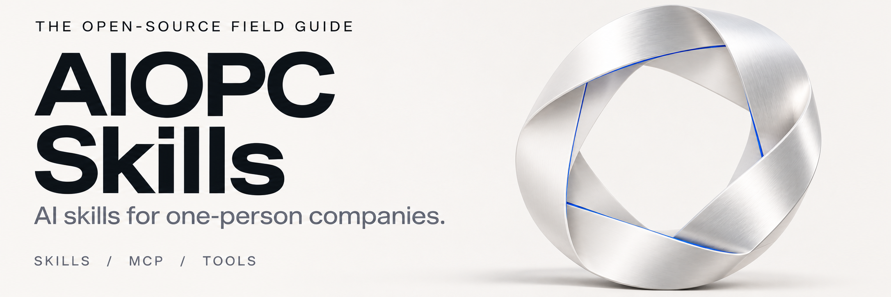
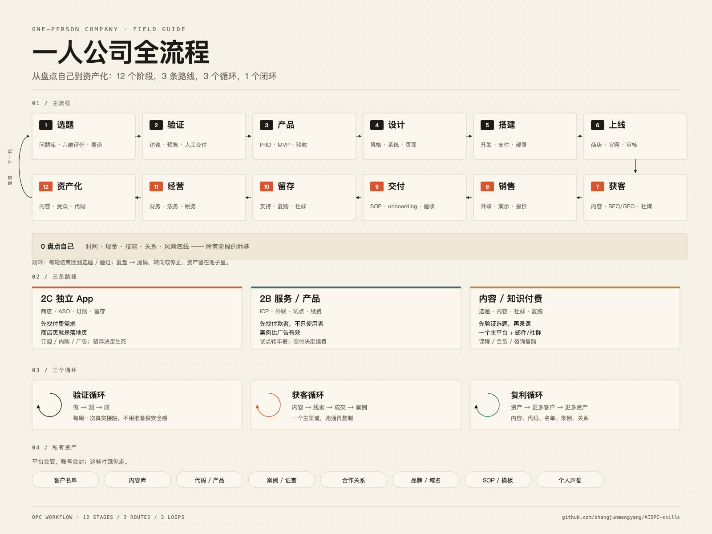

<!-- Generated by scripts/build_readme.py from templates/ and docs/. Edit those sources, then rebuild. -->
<a id="top"></a>

<p align="center">
  
</p>

<p align="center">
  <a href="README.md">English</a> · <a href="#contents">资源目录</a> · <a href="#start-here">开始使用</a> · <a href="#contributing">参与贡献</a>
</p>

面向一人公司的 AI 技能、工具与实践指南，覆盖从验证想法到获客、交付和经营。

2,766 个来源链接 · 中英文同步 · 全部在本页展开

<a id="contents"></a>
## 目录

| 栏目 | 内容 |
|---|---|
|  [职能技能](#skills) | 从产品、设计到营销、销售和运营 |
|  [平台技能](#platforms) | 社交媒体、电商、应用商店与搜索 |
|  [经营实践](#business) | 工作流、交付、回款与持续经营 |
|  [创业专题](#founders) | 创始人技能包、产品经验与商业框架 |
|  [扩展目录](#extended) | 按来源仓库整理的更多资源 |

<a id="skills"></a>
##  职能技能

<table>
<tr><td width="50%"><a href="#startup">创业起点</a></td><td width="50%"><a href="#writing">文案写作</a></td></tr>
<tr><td width="50%"><a href="#product">产品与研发</a></td><td width="50%"><a href="#design">设计与前端</a></td></tr>
<tr><td width="50%"><a href="#marketing">营销增长</a></td><td width="50%"><a href="#ops">销售与运营</a></td></tr>
<tr><td width="50%"><a href="#content">内容生产</a></td><td width="50%"><a href="#data">数据研究</a></td></tr>
<tr><td width="50%"><a href="#opc">公司经营</a></td><td width="50%"><a href="#mcp">MCP 与工具</a></td></tr>
</table>

<a id="startup"></a>
### 创业起点

选题、验证、商业模式、定位——先把“做什么”想清楚。

<a id="startup-s1"></a>
<a id="startup-想法与问题"></a>
#### 想法与问题

- [idea-refine](https://github.com/addyosmani/agent-skills/blob/HEAD/skills/idea-refine/SKILL.md) — 把粗糙想法打磨成可执行概念。
- [startup-ideation](https://github.com/refoundai/lenny-skills) (仓库入口) — 创业点子生成。
- [define-problem-statement](https://github.com/product-on-purpose/pm-skills/blob/HEAD/skills/define-problem-statement/SKILL.md) — 问题陈述。
- [define-hypothesis](https://github.com/product-on-purpose/pm-skills/blob/HEAD/skills/define-hypothesis/SKILL.md) — 假设定义。
- [define-opportunity-tree](https://github.com/product-on-purpose/pm-skills/blob/HEAD/skills/define-opportunity-tree/SKILL.md) — 机会树。
- [define-jtbd-canvas](https://github.com/product-on-purpose/pm-skills/blob/HEAD/skills/define-jtbd-canvas/SKILL.md) — JTBD 画布。
- [bmad-brainstorming](https://github.com/bmad-code-org/BMAD-METHOD/blob/HEAD/skills/bmad-brainstorming/SKILL.md) — 头脑风暴。
- [bmad-product-brief](https://github.com/bmad-code-org/BMAD-METHOD) (仓库入口) — 产品 brief。
- [bmad-prfaq](https://github.com/bmad-code-org/BMAD-METHOD) (仓库入口) — PRFAQ。

<a id="startup-s2"></a>
<a id="startup-市场与竞品"></a>
#### 市场与竞品

- [market-research](https://github.com/affaan-m/ECC/blob/HEAD/skills/market-research/SKILL.md) — 支持决策的市场研究。
- [competitive-analysis](https://github.com/refoundai/lenny-skills) (仓库入口) — 竞品分析。
- [competitor-profiling](https://github.com/coreyhaines31/marketingskills/blob/HEAD/skills/competitor-profiling/SKILL.md) — 竞品档案。
- [competitors](https://github.com/coreyhaines31/marketingskills/blob/HEAD/skills/competitors/SKILL.md) — 竞品与替代方案页面。
- [firecrawl-market-research](https://github.com/firecrawl/firecrawl-workflows/blob/HEAD/skills/firecrawl-market-research/SKILL.md) — 抓取式市场研究。
- [market-sizing](https://github.com/phuryn/pm-skills/blob/HEAD/pm-market-research/skills/market-sizing/SKILL.md) — 市场规模测算。
- [ideal-customer-profile](https://github.com/phuryn/pm-skills/blob/HEAD/pm-go-to-market/skills/ideal-customer-profile/SKILL.md) — ICP 定义。
- [user-personas](https://github.com/phuryn/pm-skills/blob/HEAD/pm-market-research/skills/user-personas/SKILL.md) — 用户画像。
- [foundation-persona](https://github.com/product-on-purpose/pm-skills/blob/HEAD/skills/foundation-persona/SKILL.md) — 用户画像。
- [discover-interview-synthesis](https://github.com/product-on-purpose/pm-skills/blob/HEAD/skills/discover-interview-synthesis/SKILL.md) — 访谈综合。

<a id="startup-s3"></a>
<a id="startup-商业模式"></a>
#### 商业模式

- [foundation-lean-canvas](https://github.com/product-on-purpose/pm-skills/blob/HEAD/skills/foundation-lean-canvas/SKILL.md) — 精益画布。
- [business-model](https://github.com/phuryn/pm-skills/blob/HEAD/pm-product-strategy/skills/business-model/SKILL.md) — 商业模式画布。
- [startup-canvas](https://github.com/phuryn/pm-skills/blob/HEAD/pm-product-strategy/skills/startup-canvas/SKILL.md) — 创业画布。
- [value-proposition](https://github.com/phuryn/pm-skills/blob/HEAD/pm-product-strategy/skills/value-proposition/SKILL.md) — 价值主张。
- [product-strategy](https://github.com/phuryn/pm-skills/blob/HEAD/pm-product-strategy/skills/product-strategy/SKILL.md) — 产品战略。
- [gtm-strategy](https://github.com/phuryn/pm-skills/blob/HEAD/pm-go-to-market/skills/gtm-strategy/SKILL.md) — GTM 策略。
- [product-name](https://github.com/phuryn/pm-skills/blob/HEAD/pm-marketing-growth/skills/product-name/SKILL.md) — 产品命名。

<a id="startup-s4"></a>
<a id="startup-验证与决策"></a>
#### 验证与决策

- [pre-mortem](https://github.com/phuryn/pm-skills/blob/HEAD/pm-execution/skills/pre-mortem/SKILL.md) — 事前验尸。
- [strategy-red-team](https://github.com/phuryn/pm-skills/blob/HEAD/pm-execution/skills/strategy-red-team/SKILL.md) — 战略红队。
- [prioritization-frameworks](https://github.com/phuryn/pm-skills/blob/HEAD/pm-execution/skills/prioritization-frameworks/SKILL.md) — 优先级框架。
- [outcome-roadmap](https://github.com/phuryn/pm-skills/blob/HEAD/pm-execution/skills/outcome-roadmap/SKILL.md) — 结果路线图。
- [measure-experiment-design](https://github.com/product-on-purpose/pm-skills/blob/HEAD/skills/measure-experiment-design/SKILL.md) — 实验设计。
- [develop-solution-brief](https://github.com/product-on-purpose/pm-skills/blob/HEAD/skills/develop-solution-brief/SKILL.md) — 方案 brief。

<a id="startup-s5"></a>
<a id="startup-定位与销售"></a>
#### 定位与销售

- [positioning-messaging](https://github.com/refoundai/lenny-skills) (仓库入口) — 定位与信息。
- [brand-storytelling](https://github.com/refoundai/lenny-skills) (仓库入口) — 品牌叙事。
- [founder-sales](https://github.com/refoundai/lenny-skills/blob/HEAD/skills/founder-sales/SKILL.md) — 创始人销售。
- [ai-product-strategy](https://github.com/refoundai/lenny-skills/blob/HEAD/skills/ai-product-strategy/SKILL.md) — AI 产品战略。

[回到目录](#contents)

<a id="writing"></a>
### 文案

按“写给哪里”拆：小红书、公众号、短视频、广告、冷邮件、落地页、电商、商店。

<table>
<tr><td width="50%"><a href="#writing-s1">说人话 / 去 AI 味</a></td><td width="50%"><a href="#writing-s2">小红书文案</a></td></tr>
<tr><td width="50%"><a href="#writing-s3">公众号文案</a></td><td width="50%"><a href="#writing-s4">短视频脚本</a></td></tr>
<tr><td width="50%"><a href="#writing-s5">广告文案</a></td><td width="50%"><a href="#writing-s6">冷邮件 / 外联</a></td></tr>
<tr><td width="50%"><a href="#writing-s7">落地页 / 销售页</a></td><td width="50%"><a href="#writing-s8">产品 / UX 文案</a></td></tr>
<tr><td width="50%"><a href="#writing-s9">品牌 / PR 文案</a></td><td width="50%"><a href="#writing-s10">电商 / 商店文案</a></td></tr>
<tr><td width="50%"><a href="#writing-s11">长文 / 博客</a></td><td width="50%"><a href="#writing-s12">翻译 / 本地化</a></td></tr>
<tr><td width="50%"><a href="#writing-s13">脚本 / 故事</a></td><td></td></tr>
</table>

<a id="writing-s1"></a>
<a id="writing-说人话--去-ai-味"></a>
#### 说人话 / 去 AI 味

- [humanizer-zh](https://github.com/op7418/humanizer-zh/blob/HEAD/SKILL.md) — 中文去 AI 味，保留原意和语气。
- [humanizer](https://github.com/blader/humanizer/blob/HEAD/SKILL.md) — 英文去 AI 味，识别 55 种模式。
- [no-ai-slop](https://github.com/petergyang/no-ai-slop/blob/HEAD/skills/no-ai-slop/SKILL.md) — 去 AI 腔，保留个人声音。
- [avoid-ai-writing](https://github.com/conorbronsdon/avoid-ai-writing/blob/HEAD/skills/avoid-ai-writing/SKILL.md) — 审计并重写 AI 写作痕迹。
- [antislop-copywriting](https://github.com/miqdadbadjuber/anti-slop/blob/HEAD/skills/antislop-copywriting/SKILL.md) — 反 AI 文案规则，偏代码代理。
- [grammar-check](https://github.com/phuryn/pm-skills/blob/HEAD/pm-toolkit/skills/grammar-check/SKILL.md) — 语法、逻辑和流畅度检查。

<a id="writing-s2"></a>
<a id="writing-小红书文案"></a>
#### 小红书文案

- [write-xiaohongshu](https://github.com/adjfks/corner-skills/blob/HEAD/skills/write-xiaohongshu/SKILL.md) — 小红书先研究再写再发。
- [dbs-xhs-title](https://github.com/dontbesilent2025/dbskill) (仓库入口) — 小红书标题公式，75 种。
- [xiaohongshu-note-analyzer](https://github.com/softbread/xiaohongshu-doctor/blob/HEAD/skill_extracted/xiaohongshu-note-analyzer/SKILL.md) — 小红书笔记诊断。

<a id="writing-s3"></a>
<a id="writing-公众号文案"></a>
#### 公众号文案

- [dbs-wechat-html](https://github.com/dontbesilent2025/dbskill/blob/HEAD/skills/dbs-wechat-html/SKILL.md) — Markdown 转公众号 HTML。
- [md2wechat](https://github.com/geekjourneyx/md2wechat-skill/blob/HEAD/skills/md2wechat/SKILL.md) — Markdown 转公众号。

<a id="writing-s4"></a>
<a id="writing-短视频脚本"></a>
#### 短视频脚本

- [dbs-hook](https://github.com/dontbesilent2025/dbskill) (仓库入口) — 短视频开头诊断与优化。
- [dbs-script-flow](https://github.com/dontbesilent2025/dbskill/blob/HEAD/skills/dbs-script-flow/SKILL.md) — 短视频逐字稿衔接与留存检查。
- [dbs-title-cover-intro](https://github.com/dontbesilent2025/dbskill/blob/HEAD/skills/dbs-title-cover-intro/SKILL.md) — 标题、封面与开头。
- [tiktok-script](https://github.com/social-media-skills/skills/blob/HEAD/skills/tiktok-script/SKILL.md) — TikTok 脚本。
- [short-form-video-script](https://github.com/social-media-skills/skills/blob/HEAD/skills/short-form-video-script/SKILL.md) — 短视频脚本。
- [viral-hook-creator](https://github.com/ognjengt/founder-skills/blob/HEAD/skills/viral-hook-creator/SKILL.md) — 爆款钩子。

<a id="writing-s5"></a>
<a id="writing-广告文案"></a>
#### 广告文案

- [ads-copywriter](https://github.com/claude-office-skills/skills/blob/HEAD/ads-copywriter/SKILL.md) — 多平台广告文案与 A/B 变体。
- [ad-copy-variants](https://github.com/mbfinotti/advertising-skills/blob/HEAD/skills/ad-copy-variants/SKILL.md) — 一个卖点生成多组可测变体。
- [conversational-ad-copy](https://github.com/mbfinotti/advertising-skills/blob/HEAD/skills/conversational-ad-copy/SKILL.md) — AI 回答/搜索里的对话式广告。
- [ad-hook-analyzer](https://github.com/mbfinotti/advertising-skills/blob/HEAD/skills/ad-hook-analyzer/SKILL.md) — 批量分析视频广告开头。
- [ad-creative-brief](https://github.com/mbfinotti/advertising-skills/blob/HEAD/skills/ad-creative-brief/SKILL.md) — 广告创意 brief。
- [copywriting-hooks](https://github.com/samber/cc-skills/blob/HEAD/skills/copywriting-hooks/SKILL.md) — 写让人想读第二句的钩子。
- [ogilvy-copywriting](https://github.com/boraoztunc/skills) (仓库入口) — 奥格威式销售文案原则。

<a id="writing-s6"></a>
<a id="writing-冷邮件--外联"></a>
#### 冷邮件 / 外联

- [cold-email](https://github.com/coreyhaines31/marketingskills/blob/HEAD/skills/cold-email/SKILL.md) — 冷邮件写作。
- [cold-email-subject-line-tester](https://github.com/mbfinotti/sales-skills/blob/HEAD/skills/cold-email-subject-line-tester/SKILL.md) — 冷邮件标题评分与 A/B。
- [emails](https://github.com/coreyhaines31/marketingskills/blob/HEAD/skills/emails/SKILL.md) — 邮件序列设计。
- [compose-outreach](https://github.com/anthropics/knowledge-work-plugins/blob/HEAD/partner-built/common-room/skills/compose-outreach/SKILL.md) — 个性化外联。

<a id="writing-s7"></a>
<a id="writing-落地页--销售页"></a>
#### 落地页 / 销售页

- [copywriting](https://github.com/coreyhaines31/marketingskills/blob/HEAD/skills/copywriting/SKILL.md) — 转化文案写作。
- [copy-editing](https://github.com/coreyhaines31/marketingskills/blob/HEAD/skills/copy-editing/SKILL.md) — 营销文案逐轮编辑。
- [landing-page-copywriter](https://github.com/onewave-ai/claude-skills/blob/HEAD/landing-page-copywriter/SKILL.md) — 落地页文案，一页一个动作。
- [offers](https://github.com/coreyhaines31/marketingskills/blob/HEAD/skills/offers/SKILL.md) — Offer 设计与包装。

<a id="writing-s8"></a>
<a id="writing-产品--ux-文案"></a>
#### 产品 / UX 文案

- [ux-copy](https://github.com/anthropics/knowledge-work-plugins/blob/HEAD/design/skills/ux-copy/SKILL.md) — 界面文案与错误提示。

<a id="writing-s9"></a>
<a id="writing-品牌--pr-文案"></a>
#### 品牌 / PR 文案

- [brand-voice](https://github.com/affaan-m/ECC/blob/HEAD/skills/brand-voice/SKILL.md) — 从真实材料建立品牌语气档案。
- [brand-voice-enforcement](https://github.com/anthropics/knowledge-work-plugins/blob/HEAD/partner-built/brand-voice/skills/brand-voice-enforcement/SKILL.md) — 把已有品牌规范套到所有销售/营销内容。
- [brand-naming](https://github.com/arnabbagxd/Brand-building-skills/blob/HEAD/skills/brand-naming/SKILL.md) — 品牌命名策略与候选筛选。
- [copywriting-tone-of-voice-creator](https://github.com/samber/cc-skills/blob/HEAD/skills/copywriting-tone-of-voice-creator/SKILL.md) — 把品牌语气做成可执行规则。
- [public-relations](https://github.com/coreyhaines31/marketingskills/blob/HEAD/skills/public-relations/SKILL.md) — 媒体公关与 earned media。

<a id="writing-s10"></a>
<a id="writing-电商--商店文案"></a>
#### 电商 / 商店文案

- [product-description-generator](https://github.com/nexscope-ai/ecommerce-skills/blob/HEAD/product-description-generator/SKILL.md) — 商品描述。
- [product-title-optimization](https://github.com/nexscope-ai/ecommerce-skills/blob/HEAD/product-title-optimization/SKILL.md) — 商品标题优化。
- [aso](https://github.com/coreyhaines31/marketingskills/blob/HEAD/skills/aso/SKILL.md) — 应用商店 ASO 审计。
- [asc-localize-metadata](https://github.com/rorkai/app-store-connect-cli-skills/blob/HEAD/skills/asc-localize-metadata/SKILL.md) — App Store 元数据本地化。

<a id="writing-s11"></a>
<a id="writing-长文--博客"></a>
#### 长文 / 博客

- [edit-article](https://github.com/mattpocock/skills) (仓库入口) — 按标题结构重编文章。
- [article-writing](https://github.com/affaan-m/ECC/blob/HEAD/skills/article-writing/SKILL.md) — 有观点、像真人写的长文。
- [blog](https://github.com/AgriciDaniel/claude-blog/blob/HEAD/skills/blog/SKILL.md) — 为排名和 AI 引用写博客。
- [blog-factcheck](https://github.com/AgriciDaniel/claude-blog/blob/HEAD/skills/blog-factcheck/SKILL.md) — 博客事实核查。
- [blog-seo-check](https://github.com/AgriciDaniel/claude-blog/blob/HEAD/skills/blog-seo-check/SKILL.md) — 发布前博客 SEO 检查。
- [engineering-blog-post](https://github.com/samber/developer-relations-skills/blob/HEAD/skills/engineering-blog-post/SKILL.md) — 工程博客写作与编辑。
- [substack-ghostwriting](https://github.com/samber/cc-skills/blob/HEAD/skills/substack-ghostwriting/SKILL.md) — Substack 代写与增长。
- [linkedin-ghostwriting](https://github.com/samber/cc-skills/blob/HEAD/skills/linkedin-ghostwriting/SKILL.md) — LinkedIn 高转化代写。

<a id="writing-s12"></a>
<a id="writing-翻译--本地化"></a>
#### 翻译 / 本地化

- [baoyu-translate](https://github.com/jimliu/baoyu-skills/blob/HEAD/skills/baoyu-translate/SKILL.md) — 高质量翻译与润色。
- [mkdocs-translations](https://github.com/github/awesome-copilot/blob/HEAD/skills/mkdocs-translations/SKILL.md) — 把文档站翻译成目标语言。

<a id="writing-s13"></a>
<a id="writing-脚本--故事"></a>
#### 脚本 / 故事

- [storyboard-creation](https://github.com/101-skills/superpowers/blob/HEAD/guides/video/storyboard-creation/SKILL.md) — AI 生成分镜。
- [chinese-novelist](https://github.com/penglonghuang/chinese-novelist-skill/blob/HEAD/SKILL.md) — 中文小说创作，冲突与悬念。

[回到目录](#contents)

<a id="product"></a>
### 产品与研发

从需求到上线，按工程阶段拆。

<table>
<tr><td width="50%"><a href="#product-s1">需求 / PRD</a></td><td width="50%"><a href="#product-s2">架构</a></td></tr>
<tr><td width="50%"><a href="#product-s3">测试</a></td><td width="50%"><a href="#product-s4">审查 / 安全</a></td></tr>
<tr><td width="50%"><a href="#product-s5">部署 / CI</a></td><td width="50%"><a href="#product-s6">调试 / 性能</a></td></tr>
<tr><td width="50%"><a href="#product-s7">文档 / 上下文</a></td><td width="50%"><a href="#product-s8">发布 / 设计协作</a></td></tr>
<tr><td width="50%"><a href="#product-s9">代码命名</a></td><td></td></tr>
</table>

<a id="product-s1"></a>
<a id="product-需求--prd"></a>
#### 需求 / PRD

- [bmad-prd](https://github.com/bmad-code-org/BMAD-METHOD) (仓库入口) — 多角色 PRD 工作流。
- [bmad-spec](https://github.com/bmad-code-org/BMAD-METHOD) (仓库入口) — 规格内核。
- [prd-development](https://github.com/deanpeters/Product-Manager-Skills/blob/HEAD/skills/prd-development/SKILL.md) — 结构化 PRD 流程。
- [spec-driven-development](https://github.com/addyosmani/agent-skills/blob/HEAD/skills/spec-driven-development/SKILL.md) — 先写规格再写代码。
- [deliver-prd](https://github.com/product-on-purpose/pm-skills/blob/HEAD/skills/deliver-prd/SKILL.md) — PRD。
- [deliver-user-stories](https://github.com/product-on-purpose/pm-skills/blob/HEAD/skills/deliver-user-stories/SKILL.md) — 用户故事。
- [deliver-acceptance-criteria](https://github.com/product-on-purpose/pm-skills/blob/HEAD/skills/deliver-acceptance-criteria/SKILL.md) — 验收标准。

<a id="product-s2"></a>
<a id="product-架构"></a>
#### 架构

- [bmad-architecture](https://github.com/bmad-code-org/BMAD-METHOD/blob/HEAD/skills/bmad-architecture/SKILL.md) — 架构 spine。
- [architecture-blueprint-generator](https://github.com/github/awesome-copilot/blob/HEAD/skills/architecture-blueprint-generator/SKILL.md) — 项目架构蓝图。
- [system-design](https://github.com/anthropics/knowledge-work-plugins/blob/HEAD/engineering/skills/system-design/SKILL.md) — 系统设计与架构决策。
- [api-design](https://github.com/affaan-m/ECC/blob/HEAD/skills/api-design/SKILL.md) — API 设计约定。
- [documenting-contracts](https://github.com/riekelt/technical-writer/blob/HEAD/plugins/technical-writer/skills/documenting-contracts/SKILL.md) — 记录 REST/RPC、Webhook、CLI 与文件格式的接口契约。
- [bmad-agent-architect](https://github.com/bmad-code-org/BMAD-METHOD/blob/HEAD/skills/bmad-agent-architect/SKILL.md) — 架构师角色。
- [bmad-agent-dev](https://github.com/bmad-code-org/BMAD-METHOD/blob/HEAD/skills/bmad-agent-dev/SKILL.md) — 开发角色。

<a id="product-s3"></a>
<a id="product-测试"></a>
#### 测试

- [webapp-testing](https://github.com/anthropics/skills/blob/HEAD/skills/webapp-testing/SKILL.md) — Web 应用测试。
- [test-driven-development](https://github.com/addyosmani/agent-skills/blob/HEAD/skills/test-driven-development/SKILL.md) — 先写失败测试。
- [browser-testing-with-devtools](https://github.com/addyosmani/agent-skills/blob/HEAD/skills/browser-testing-with-devtools/SKILL.md) — 用 DevTools 做浏览器测试。
- [vitest](https://github.com/antfu/skills/blob/HEAD/skills/vitest/SKILL.md) — Vite 原生测试框架。
- [testing-strategy](https://github.com/anthropics/knowledge-work-plugins/blob/HEAD/engineering/skills/testing-strategy/SKILL.md) — 设计测试策略与覆盖。
- [web-quality-audit](https://github.com/addyosmani/web-quality-skills/blob/HEAD/skills/web-quality-audit/SKILL.md) — 浏览器实测 + 质量审计。
- [bmad-qa-generate-e2e-tests](https://github.com/bmad-code-org/BMAD-METHOD/blob/HEAD/skills/bmad-qa-generate-e2e-tests/SKILL.md) — 生成 E2E。
- [deliver-edge-cases](https://github.com/product-on-purpose/pm-skills/blob/HEAD/skills/deliver-edge-cases/SKILL.md) — 边界情况。

<a id="product-s4"></a>
<a id="product-审查--安全"></a>
#### 审查 / 安全

- [code-review-and-quality](https://github.com/addyosmani/agent-skills/blob/HEAD/skills/code-review-and-quality/SKILL.md) — 多维度代码审查。
- [security-and-hardening](https://github.com/addyosmani/agent-skills/blob/HEAD/skills/security-and-hardening/SKILL.md) — 安全优先的开发。
- [security-audit](https://github.com/cloudflare/security-audit-skill/blob/HEAD/skills/security-audit/SKILL.md) — 找真实信任边界漏洞。
- [bmad-code-review](https://github.com/bmad-code-org/BMAD-METHOD/blob/HEAD/skills/bmad-code-review/SKILL.md) — BMad 代码审查流程。
- [ponytail-audit](https://github.com/DietrichGebert/ponytail/blob/HEAD/skills/ponytail-audit/SKILL.md) — 像接手项目的资深工程师一样审全仓。
- [bmad-review](https://github.com/bmad-code-org/BMAD-METHOD/blob/HEAD/skills/bmad-review/SKILL.md) — 代码评审。

<a id="product-s5"></a>
<a id="product-部署--ci"></a>
#### 部署 / CI

- [ci-cd-and-automation](https://github.com/addyosmani/agent-skills/blob/HEAD/skills/ci-cd-and-automation/SKILL.md) — CI/CD 质量门禁。
- [deploy-checklist](https://github.com/anthropics/knowledge-work-plugins/blob/HEAD/engineering/skills/deploy-checklist/SKILL.md) — 部署前检查。
- [docker-patterns](https://github.com/affaan-m/ECC/blob/HEAD/skills/docker-patterns/SKILL.md) — Docker/Compose 生产实践。
- [aws-deployment](https://github.com/aws/agent-toolkit-for-aws/blob/HEAD/skills/core-skills/aws-deployment/SKILL.md) — AWS CI/CD 部署。

<a id="product-s6"></a>
<a id="product-调试--性能"></a>
#### 调试 / 性能

- [debugging-and-error-recovery](https://github.com/addyosmani/agent-skills/blob/HEAD/skills/debugging-and-error-recovery/SKILL.md) — 系统化调试。
- [performance-optimization](https://github.com/addyosmani/agent-skills/blob/HEAD/skills/performance-optimization/SKILL.md) — 先测量再优化。
- [debug](https://github.com/anthropics/knowledge-work-plugins/blob/HEAD/engineering/skills/debug/SKILL.md) — 结构化调试流程。
- [debug-optimize-lcp](https://github.com/ChromeDevTools/chrome-devtools-mcp/blob/HEAD/skills/debug-optimize-lcp/SKILL.md) — 定位并优化 LCP。

<a id="product-s7"></a>
<a id="product-文档--上下文"></a>
#### 文档 / 上下文

- [documentation-and-adrs](https://github.com/addyosmani/agent-skills/blob/HEAD/skills/documentation-and-adrs/SKILL.md) — 文档与 ADR。
- [documentation](https://github.com/anthropics/knowledge-work-plugins/blob/HEAD/engineering/skills/documentation/SKILL.md) — 文档写作。
- [tech-debt](https://github.com/anthropics/knowledge-work-plugins/blob/HEAD/engineering/skills/tech-debt/SKILL.md) — 技术债。
- [incident-response](https://github.com/anthropics/knowledge-work-plugins/blob/HEAD/engineering/skills/incident-response/SKILL.md) — 事故响应。
- [context-engineering](https://github.com/addyosmani/agent-skills/blob/HEAD/skills/context-engineering/SKILL.md) — 上下文工程。
- [incremental-implementation](https://github.com/addyosmani/agent-skills/blob/HEAD/skills/incremental-implementation/SKILL.md) — 增量实现。
- [source-driven-development](https://github.com/addyosmani/agent-skills/blob/HEAD/skills/source-driven-development/SKILL.md) — 源码驱动。
- [interview-me](https://github.com/addyosmani/agent-skills/blob/HEAD/skills/interview-me/SKILL.md) — 需求访谈。
- [doubt-driven-development](https://github.com/addyosmani/agent-skills/blob/HEAD/skills/doubt-driven-development/SKILL.md) — 怀疑驱动。
- [constraint-driven-development](https://github.com/addyosmani/agent-skills/blob/HEAD/skills/constraint-driven-development/SKILL.md) — 约束驱动。
- [observability-and-instrumentation](https://github.com/addyosmani/agent-skills/blob/HEAD/skills/observability-and-instrumentation/SKILL.md) — 可观测与埋点。
- [measure-instrumentation-spec](https://github.com/product-on-purpose/pm-skills/blob/HEAD/skills/measure-instrumentation-spec/SKILL.md) — 埋点规格。

<a id="product-s8"></a>
<a id="product-发布--设计协作"></a>
#### 发布 / 设计协作

- [develop-design-rationale](https://github.com/product-on-purpose/pm-skills/blob/HEAD/skills/develop-design-rationale/SKILL.md) — 设计理由。
- [deliver-release-notes](https://github.com/product-on-purpose/pm-skills/blob/HEAD/skills/deliver-release-notes/SKILL.md) — 发布说明。

<a id="product-s9"></a>
<a id="product-代码命名"></a>
#### 代码命名

- [naming-analyzer](https://github.com/softaworks/agent-toolkit/blob/HEAD/skills/naming-analyzer/SKILL.md) — 按上下文和约定改进变量、函数、类、文件及 API 名称。

[回到目录](#contents)

<a id="design"></a>
### 设计与前端

设计是一大块：风格、排版、组件、动效、Figma、前端实现。

<table>
<tr><td width="50%"><a href="#design-s1">视觉风格</a></td><td width="50%"><a href="#design-s2">排版 / 颜色 / 布局</a></td></tr>
<tr><td width="50%"><a href="#design-s3">UX 模式</a></td><td width="50%"><a href="#design-s4">设计系统</a></td></tr>
<tr><td width="50%"><a href="#design-s5">评审 / 研究</a></td><td width="50%"><a href="#design-s6">动效 / 3D</a></td></tr>
<tr><td width="50%"><a href="#design-s7">页面设计</a></td><td width="50%"><a href="#design-s8">Figma</a></td></tr>
<tr><td width="50%"><a href="#design-s9">UI / 视觉</a></td><td width="50%"><a href="#design-s10">前端实现</a></td></tr>
<tr><td width="50%"><a href="#design-s11">可访问性</a></td><td width="50%"><a href="#design-s12">Logo / 品牌识别</a></td></tr>
<tr><td width="50%"><a href="#design-s13">排版</a></td><td width="50%"><a href="#design-s14">色彩</a></td></tr>
<tr><td width="50%"><a href="#design-s15">图标</a></td><td width="50%"><a href="#design-s16">布局</a></td></tr>
<tr><td width="50%"><a href="#design-s17">UX / 可用性</a></td><td width="50%"><a href="#design-s18">动效</a></td></tr>
<tr><td width="50%"><a href="#design-s19">设计系统</a></td><td></td></tr>
</table>

<a id="design-s1"></a>
<a id="design-视觉风格"></a>
#### 视觉风格

- [minimal](https://github.com/bergside/awesome-design-skills/blob/HEAD/skills/minimal/SKILL.md) — 极简风。
- [editorial](https://github.com/bergside/awesome-design-skills/blob/HEAD/skills/editorial/SKILL.md) — 杂志编辑风。
- [bento](https://github.com/bergside/awesome-design-skills/blob/HEAD/skills/bento/SKILL.md) — Bento 网格。
- [glassmorphism](https://github.com/bergside/awesome-design-skills/blob/HEAD/skills/glassmorphism/SKILL.md) — 玻璃拟态。
- [neobrutalism](https://github.com/bergside/awesome-design-skills/blob/HEAD/skills/neobrutalism/SKILL.md) — 新粗野主义。
- [premium](https://github.com/bergside/awesome-design-skills/blob/HEAD/skills/premium/SKILL.md) — 高端质感。
- [enterprise](https://github.com/bergside/awesome-design-skills/blob/HEAD/skills/enterprise/SKILL.md) — 企业级风格。
- [professional](https://github.com/bergside/awesome-design-skills/blob/HEAD/skills/professional/SKILL.md) — 专业稳重。
- [storytelling](https://github.com/bergside/awesome-design-skills/blob/HEAD/skills/storytelling/SKILL.md) — 叙事型视觉。
- [shadcn](https://github.com/bergside/awesome-design-skills/blob/HEAD/skills/shadcn/SKILL.md) — shadcn 风格。

<a id="design-s2"></a>
<a id="design-排版--颜色--布局"></a>
#### 排版 / 颜色 / 布局

- [typography-scale](https://github.com/owl-listener/designer-skills/blob/HEAD/ui-design/skills/typography-scale/SKILL.md) — 字号与排版比例。
- [color-system](https://github.com/owl-listener/designer-skills/blob/HEAD/ui-design/skills/color-system/SKILL.md) — 配色系统。
- [spacing-system](https://github.com/owl-listener/designer-skills/blob/HEAD/ui-design/skills/spacing-system/SKILL.md) — 间距系统。
- [layout-grid](https://github.com/owl-listener/designer-skills/blob/HEAD/ui-design/skills/layout-grid/SKILL.md) — 栅格布局。
- [icon-system](https://github.com/owl-listener/designer-skills/blob/HEAD/design-systems/skills/icon-system/SKILL.md) — 图标系统。
- [visual-hierarchy](https://github.com/owl-listener/designer-skills/blob/HEAD/ui-design/skills/visual-hierarchy/SKILL.md) — 视觉层次。
- [responsive-design](https://github.com/owl-listener/designer-skills/blob/HEAD/ui-design/skills/responsive-design/SKILL.md) — 响应式设计。
- [dark-mode-design](https://github.com/owl-listener/designer-skills/blob/HEAD/ui-design/skills/dark-mode-design/SKILL.md) — 深色模式。
- [theming-system](https://github.com/owl-listener/designer-skills/blob/HEAD/design-systems/skills/theming-system/SKILL.md) — 主题系统。
- [readable-measure](https://github.com/owl-listener/designer-skills/blob/HEAD/ui-design/skills/readable-measure/SKILL.md) — 可读行宽。

<a id="design-s3"></a>
<a id="design-ux-模式"></a>
#### UX 模式

- [user-flow-diagram](https://github.com/owl-listener/designer-skills/blob/HEAD/prototyping-testing/skills/user-flow-diagram/SKILL.md) — 用户流程图。
- [wireframe-spec](https://github.com/owl-listener/designer-skills/blob/HEAD/prototyping-testing/skills/wireframe-spec/SKILL.md) — 线框规范。
- [micro-interaction-spec](https://github.com/owl-listener/designer-skills/blob/HEAD/interaction-design/skills/micro-interaction-spec/SKILL.md) — 微交互规范。
- [loading-states](https://github.com/owl-listener/designer-skills/blob/HEAD/interaction-design/skills/loading-states/SKILL.md) — 加载状态。
- [error-handling-ux](https://github.com/owl-listener/designer-skills/blob/HEAD/interaction-design/skills/error-handling-ux/SKILL.md) — 错误处理体验。
- [state-machine](https://github.com/owl-listener/designer-skills/blob/HEAD/interaction-design/skills/state-machine/SKILL.md) — 状态机。
- [form-design](https://github.com/owl-listener/designer-skills/blob/HEAD/interaction-design/skills/form-design/SKILL.md) — 表单设计。
- [navigation-patterns](https://github.com/owl-listener/designer-skills/blob/HEAD/interaction-design/skills/navigation-patterns/SKILL.md) — 导航模式。
- [onboarding-design](https://github.com/owl-listener/designer-skills/blob/HEAD/interaction-design/skills/onboarding-design/SKILL.md) — 新手引导设计。
- [information-architecture](https://github.com/owl-listener/designer-skills/blob/HEAD/ux-strategy/skills/information-architecture/SKILL.md) — 信息架构。
- [search-ux](https://github.com/owl-listener/designer-skills/blob/HEAD/interaction-design/skills/search-ux/SKILL.md) — 搜索体验。
- [feedback-patterns](https://github.com/owl-listener/designer-skills/blob/HEAD/interaction-design/skills/feedback-patterns/SKILL.md) — 反馈模式。

<a id="design-s4"></a>
<a id="design-设计系统"></a>
#### 设计系统

- [design-token](https://github.com/owl-listener/designer-skills/blob/HEAD/design-systems/skills/design-token/SKILL.md) — 设计 token。
- [design-token-audit](https://github.com/owl-listener/designer-skills/blob/HEAD/designer-toolkit/skills/design-token-audit/SKILL.md) — token 审计。
- [component-spec](https://github.com/owl-listener/designer-skills/blob/HEAD/design-systems/skills/component-spec/SKILL.md) — 组件规范。
- [pattern-library](https://github.com/owl-listener/designer-skills/blob/HEAD/design-systems/skills/pattern-library/SKILL.md) — 模式库。
- [design-system-governance](https://github.com/owl-listener/designer-skills/blob/HEAD/design-systems/skills/design-system-governance/SKILL.md) — 设计系统治理。
- [design-system-adoption](https://github.com/owl-listener/designer-skills/blob/HEAD/designer-toolkit/skills/design-system-adoption/SKILL.md) — 设计系统落地。
- [naming-convention](https://github.com/owl-listener/designer-skills/blob/HEAD/design-systems/skills/naming-convention/SKILL.md) — 命名规范。
- [handoff-spec](https://github.com/owl-listener/designer-skills/blob/HEAD/design-ops/skills/handoff-spec/SKILL.md) — 交付规范。
- [extract-design-system](https://github.com/arvindrk/extract-design-system/blob/HEAD/skills/extract-design-system/SKILL.md) — 从现有网站逆向设计系统。
- [expo-design-system](https://github.com/expo/skills/blob/HEAD/plugins/expo/skills/expo-design-system/SKILL.md) — Expo 统一设计系统。
- [figma-create-design-system-rules](https://github.com/openai/skills/blob/HEAD/skills/.curated/figma-create-design-system-rules/SKILL.md) — 生成设计系统规则。
- [figma-generate-design](https://github.com/figma/mcp-server-guide/blob/HEAD/skills/figma-generate-design/SKILL.md) — 从设计系统生成页面。

<a id="design-s5"></a>
<a id="design-评审--研究"></a>
#### 评审 / 研究

- [design-critique](https://github.com/owl-listener/designer-skills/blob/HEAD/design-ops/skills/design-critique/SKILL.md) — 设计评审。
- [design-qa-checklist](https://github.com/owl-listener/designer-skills/blob/HEAD/design-ops/skills/design-qa-checklist/SKILL.md) — 设计 QA 清单。
- [heuristic-evaluation](https://github.com/owl-listener/designer-skills/blob/HEAD/prototyping-testing/skills/heuristic-evaluation/SKILL.md) — 启发式评估。
- [usability-test-plan](https://github.com/owl-listener/designer-skills/blob/HEAD/design-research/skills/usability-test-plan/SKILL.md) — 可用性测试。
- [accessibility-test-plan](https://github.com/owl-listener/designer-skills/blob/HEAD/prototyping-testing/skills/accessibility-test-plan/SKILL.md) — 无障碍测试。
- [a-b-test-design](https://github.com/owl-listener/designer-skills/blob/HEAD/prototyping-testing/skills/a-b-test-design/SKILL.md) — A/B 测试设计。
- [card-sort-analysis](https://github.com/owl-listener/designer-skills/blob/HEAD/design-research/skills/card-sort-analysis/SKILL.md) — 卡片分类。
- [interview-script](https://github.com/owl-listener/designer-skills/blob/HEAD/design-research/skills/interview-script/SKILL.md) — 访谈脚本。
- [summarize-interview](https://github.com/owl-listener/designer-skills/blob/HEAD/design-research/skills/summarize-interview/SKILL.md) — 访谈总结。
- [journey-map](https://github.com/owl-listener/designer-skills/blob/HEAD/design-research/skills/journey-map/SKILL.md) — 用户旅程图。
- [service-blueprint](https://github.com/owl-listener/designer-skills/blob/HEAD/ux-strategy/skills/service-blueprint/SKILL.md) — 服务蓝图。

<a id="design-s6"></a>
<a id="design-动效--3d"></a>
#### 动效 / 3D

- [build-awwwards-quality-sites](https://github.com/mengto/skills/blob/HEAD/agent-skills/web-design/build-awwwards-quality-sites/SKILL.md) — Awwwards 级网站。
- [cinematic-scroll-storytelling](https://github.com/mengto/skills/blob/HEAD/agent-skills/web-design/cinematic-scroll-storytelling/SKILL.md) — 电影感滚动叙事。
- [animation-on-scroll](https://github.com/mengto/skills/blob/HEAD/agent-skills/web-design/animation-on-scroll/SKILL.md) — 滚动动画。
- [animation-systems](https://github.com/mengto/skills/blob/HEAD/agent-skills/web-design/animation-systems/SKILL.md) — 动效系统。
- [gsap](https://github.com/mengto/skills/blob/HEAD/agent-skills/web-design/gsap/SKILL.md) — GSAP 动画。
- [gsap-scrolltrigger-storytelling](https://github.com/mengto/skills/blob/HEAD/agent-skills/web-design/gsap-scrolltrigger-storytelling/SKILL.md) — ScrollTrigger 叙事。
- [beautiful-shadows](https://github.com/mengto/skills/blob/HEAD/agent-skills/web-design/beautiful-shadows/SKILL.md) — 高级阴影。
- [no-ai-design-slop](https://github.com/mengto/skills/blob/HEAD/agent-skills/ui/no-ai-design-slop/SKILL.md) — 去 AI 设计味。
- [progressive-blur](https://github.com/mengto/skills/blob/HEAD/agent-skills/web-design/progressive-blur/SKILL.md) — 渐进模糊。
- [masked-reveal](https://github.com/mengto/skills/blob/HEAD/agent-skills/web-design/masked-reveal/SKILL.md) — 遮罩揭示。
- [glass-dark-ui](https://github.com/mengto/skills/blob/HEAD/agent-skills/web-design/glass-dark-ui/SKILL.md) — 深色玻璃 UI。
- [scroll-world-storytelling](https://github.com/mengto/skills/blob/HEAD/agent-skills/web-design/scroll-world-storytelling/SKILL.md) — 滚动世界。
- [threejs-shaders](https://github.com/CloudAI-X/threejs-skills/blob/HEAD/skills/threejs-shaders/SKILL.md) — Three.js 着色器。
- [threejs-fundamentals](https://github.com/CloudAI-X/threejs-skills/blob/HEAD/skills/threejs-fundamentals/SKILL.md) — Three.js 基础场景与渲染。
- [remotion-render](https://github.com/101-skills/superpowers/blob/HEAD/tools/video/remotion-render/SKILL.md) — Remotion 视频渲染。
- [transitions-polish](https://github.com/Jakubantalik/transitions.dev/blob/HEAD/skills/transitions-polish/SKILL.md) — 过渡动效打磨。

<a id="design-s7"></a>
<a id="design-页面设计"></a>
#### 页面设计

- [landing-page](https://github.com/mengto/skills/blob/HEAD/agent-skills/web-design/landing-page/SKILL.md) — 落地页设计。
- [pricing-page](https://github.com/mengto/skills/blob/HEAD/agent-skills/web-design/pricing-page/SKILL.md) — 定价页设计。
- [tailwind-design-system](https://github.com/wshobson/agents/blob/HEAD/plugins/frontend-mobile-development/skills/tailwind-design-system/SKILL.md) — Tailwind 设计系统。
- [brand-landingpage](https://github.com/wshobson/agents/blob/HEAD/plugins/brand-landingpage/skills/brand-landingpage/SKILL.md) — 品牌落地页。
- [mobile-android-design](https://github.com/wshobson/agents/blob/HEAD/plugins/ui-design/skills/mobile-android-design/SKILL.md) — Android 设计。
- [mobile-ios-design](https://github.com/wshobson/agents/blob/HEAD/plugins/ui-design/skills/mobile-ios-design/SKILL.md) — iOS 设计。

<a id="design-s8"></a>
<a id="design-figma"></a>
#### Figma

- [figma-use](https://github.com/figma/mcp-server-guide/blob/HEAD/skills/figma-use/SKILL.md) — 用 Figma Plugin API 操作画布。
- [figma-implement-design](https://github.com/openai/skills/blob/HEAD/skills/.curated/figma-implement-design/SKILL.md) — 把设计稿实现成代码。
- [figma-code-connect](https://github.com/figma/mcp-server-guide/blob/HEAD/skills/figma-code-connect/SKILL.md) — 创建和维护设计组件与代码组件之间的 Code Connect 模板。
- [figma-create-new-file](https://github.com/figma/mcp-server-guide/blob/HEAD/skills/figma-create-new-file/SKILL.md) — 新建 Figma 设计/FigJam/Slides 文件。
- [figma-generate-library](https://github.com/figma/mcp-server-guide/blob/HEAD/skills/figma-generate-library/SKILL.md) — 生成设计库。
- [figma-design-to-code](https://github.com/figma/mcp-server-guide/blob/HEAD/skills/figma-design-to-code/SKILL.md) — 设计转代码。
- [figma-generate-diagram](https://github.com/figma/mcp-server-guide/blob/HEAD/skills/figma-generate-diagram/SKILL.md) — 生成图表。
- [figma-use-figjam](https://github.com/figma/mcp-server-guide/blob/HEAD/skills/figma-use-figjam/SKILL.md) — FigJam 操作。
- [figma-use-slides](https://github.com/figma/mcp-server-guide/blob/HEAD/skills/figma-use-slides/SKILL.md) — Figma Slides。
- [figma-implement-motion](https://github.com/figma/mcp-server-guide/blob/HEAD/skills/figma-implement-motion/SKILL.md) — 实现动效。
- [figma-swiftui](https://github.com/figma/mcp-server-guide/blob/HEAD/skills/figma-swiftui/SKILL.md) — Figma 转 SwiftUI。
- [figma-spec](https://github.com/figma/mcp-server-guide/blob/HEAD/skills/figma-spec/SKILL.md) — 设计规格。

<a id="design-s9"></a>
<a id="design-ui--视觉"></a>
#### UI / 视觉

- [frontend-design](https://github.com/anthropics/skills/blob/HEAD/skills/frontend-design/SKILL.md) — 高质量前端界面设计。
- [huashu-design](https://github.com/alchaincyf/huashu-design/blob/HEAD/SKILL.md) — 中文 HTML 设计，先提案。
- [mobile-app-ui-design](https://github.com/ceorkm/mobile-app-ui-design/blob/HEAD/SKILL.md) — 移动 App UI/UX。
- [web-design-engineer](https://github.com/ConardLi/garden-skills/blob/HEAD/skills/web-design-engineer/SKILL.md) — 像设计工程师一样做网页。
- [canvas-design](https://github.com/anthropics/skills/blob/HEAD/skills/canvas-design/SKILL.md) — 视觉风格与设计哲学。
- [design-lab](https://github.com/0xdesign/design-plugin/blob/HEAD/design-and-refine/skills/design-lab/SKILL.md) — 设计实验与变体。
- [theme-factory](https://github.com/anthropics/skills/blob/HEAD/skills/theme-factory/SKILL.md) — 主题生成。
- [web-artifacts-builder](https://github.com/anthropics/skills/blob/HEAD/skills/web-artifacts-builder/SKILL.md) — Web Artifacts。
- [algorithmic-art](https://github.com/anthropics/skills/blob/HEAD/skills/algorithmic-art/SKILL.md) — 算法艺术。

<a id="design-s10"></a>
<a id="design-前端实现"></a>
#### 前端实现

- [frontend-ui-engineering](https://github.com/addyosmani/agent-skills/blob/HEAD/skills/frontend-ui-engineering/SKILL.md) — 生产级 UI 工程。
- [react-patterns](https://github.com/affaan-m/ECC/blob/HEAD/skills/react-patterns/SKILL.md) — React 18/19 模式。
- [react-performance](https://github.com/affaan-m/ECC/blob/HEAD/skills/react-performance/SKILL.md) — React/Next 性能。
- [swiftui-expert-skill](https://github.com/AvdLee/SwiftUI-Agent-Skill/blob/HEAD/skills/swiftui-expert-skill/SKILL.md) — SwiftUI 专家规则。

<a id="design-s11"></a>
<a id="design-可访问性"></a>
#### 可访问性

- [better-accessibility](https://github.com/jakubkrehel/skills/blob/HEAD/skills/better-accessibility/SKILL.md) — 语义、键盘、焦点修复。
- [fixing-accessibility](https://github.com/ibelick/ui-skills/blob/HEAD/skills/fixing-accessibility/SKILL.md) — 系统修复可访问性问题。
- [wcag-audit-patterns](https://github.com/wshobson/agents/blob/HEAD/plugins/accessibility-compliance/skills/wcag-audit-patterns/SKILL.md) — WCAG 2.2 审计。
- [accessibility-audit](https://github.com/AccessLint/skills/blob/HEAD/plugins/accesslint/skills/accessibility-audit/SKILL.md) — WCAG 2.2 全站审计。
- [accessibility-fix](https://github.com/AccessLint/skills/blob/HEAD/plugins/accesslint/skills/accessibility-fix/SKILL.md) — 按基线修复无障碍问题。

<a id="design-s12"></a>
<a id="design-logo--品牌识别"></a>
#### Logo / 品牌识别

- [logo-design](https://github.com/kaankiziltug/logo-design-skill/blob/HEAD/skills/logo-design/SKILL.md) — Logo 设计。
- [logo-design-guide](https://github.com/inference-sh/skills/blob/HEAD/guides/design/logo-design-guide/SKILL.md) — Logo 设计指南。
- [logo-generator](https://github.com/kostja94/marketing-skills/blob/HEAD/skills/components/branding/logo/SKILL.md) — Logo 生成。
- [logo-designer](https://github.com/neonwatty/logo-designer-skill/blob/HEAD/skills/logo-designer/SKILL.md) — Logo 设计师。
- [svg-logo-designer](https://github.com/rknall/claude-skills/blob/HEAD/svg-logo-designer/SKILL.md) — SVG Logo。
- [mascot-logo-reconstruction](https://github.com/roble3/cc-blender-skill/blob/HEAD/plugin/skills/mascot-logo-reconstruction/SKILL.md) — 吉祥物 Logo 3D 重建。
- [logo-animation](https://github.com/iart-ai/motion-design-skills/blob/HEAD/skills/logo-animation/SKILL.md) — Logo 动效。
- [animated-readme-logo](https://github.com/stark-ai-de/agent-skills/blob/HEAD/skills/engineering-workflows/animated-readme-logo/SKILL.md) — 动态 README Logo。
- [muapi-logo-branding](https://github.com/samuraigpt/generative-media-skills) (仓库入口) — Logo 品牌化。
- [muapi-logo-creator](https://github.com/samuraigpt/generative-media-skills/blob/HEAD/.opencode/skills/muapi-logo-creator/SKILL.md) — Logo 创建。
- [muapi-logo-generator](https://github.com/samuraigpt/generative-media-skills) (仓库入口) — Logo 生成器。
- [muapi-3d-logo-animation](https://github.com/samuraigpt/generative-media-skills) (仓库入口) — 3D Logo 动画。
- [logo-creator](https://github.com/resciencelab/opc-skills/blob/HEAD/skills/logo-creator/SKILL.md) — Logo 生成（OPC）。
- [brand-identity](https://github.com/arnabbagxd/Brand-building-skills/blob/HEAD/skills/brand-identity/SKILL.md) — 品牌识别系统。
- [brand-guidelines](https://github.com/arnabbagxd/Brand-building-skills/blob/HEAD/skills/brand-guidelines/SKILL.md) — 品牌规范。
- [brand-naming](https://github.com/arnabbagxd/Brand-building-skills/blob/HEAD/skills/brand-naming/SKILL.md) — 品牌命名。
- [brand-strategy](https://github.com/arnabbagxd/Brand-building-skills/blob/HEAD/skills/brand-strategy/SKILL.md) — 品牌战略。
- [brand-positioning](https://github.com/arnabbagxd/Brand-building-skills/blob/HEAD/skills/brand-positioning/SKILL.md) — 品牌定位。
- [brand-story](https://github.com/arnabbagxd/Brand-building-skills/blob/HEAD/skills/brand-story/SKILL.md) — 品牌故事。
- [brand-audit](https://github.com/arnabbagxd/Brand-building-skills/blob/HEAD/skills/brand-audit/SKILL.md) — 品牌审计。
- [brand-architecture](https://github.com/arnabbagxd/Brand-building-skills/blob/HEAD/skills/brand-architecture/SKILL.md) — 品牌架构。
- [rebranding](https://github.com/arnabbagxd/Brand-building-skills/blob/HEAD/skills/rebranding/SKILL.md) — 品牌重塑。
- [competitor-branding](https://github.com/arnabbagxd/Brand-building-skills/blob/HEAD/skills/competitor-branding/SKILL.md) — 竞品品牌分析。
- [brand-packaging](https://github.com/arnabbagxd/Brand-building-skills/blob/HEAD/skills/brand-packaging/SKILL.md) — 品牌包装。

<a id="design-s13"></a>
<a id="design-排版"></a>
#### 排版

- [ui-typography](https://github.com/bencium/bencium-marketplace) (仓库入口) — 界面排版。
- [modular-scale-typography](https://github.com/dembrandt/dembrandt-skills/blob/HEAD/skills/modular-scale-typography/SKILL.md) — 模块化字号。
- [kinetic-typography](https://github.com/iart-ai/kinetic-typography-skills/blob/HEAD/skills/kinetic-typography/SKILL.md) — 动态排版。
- [better-typography](https://github.com/jakubkrehel/skills/blob/HEAD/skills/better-typography/SKILL.md) — 排版优化。
- [typography-audit](https://github.com/mblode/agent-skills/blob/HEAD/skills/typography-audit/SKILL.md) — 排版审计。
- [font-pairing-suggester](https://github.com/onewave-ai/claude-skills/blob/HEAD/font-pairing-suggester/SKILL.md) — 字体搭配。
- [critique-typography](https://github.com/owl-listener/designer-skills/blob/HEAD/visual-critique/skills/critique-typography/SKILL.md) — 排版评审。
- [web-typography](https://github.com/wondelai/skills/blob/HEAD/web-typography/SKILL.md) — Web 排版。
- [slug-font-rendering](https://github.com/reason-machines/trending-skills/blob/HEAD/skills/slug-font-rendering/SKILL.md) — 字体渲染。
- [layer-typography](https://github.com/layerai/skills/blob/HEAD/plugins/layer/skills/layer-typography/SKILL.md) — 分层排版。

<a id="design-s14"></a>
<a id="design-色彩"></a>
#### 色彩

- [color-accessibility](https://github.com/aj-geddes/useful-ai-prompts/blob/HEAD/skills/color-accessibility/SKILL.md) — 色彩可访问性。
- [algorithmic-color-palette](https://github.com/dembrandt/dembrandt-skills/blob/HEAD/skills/algorithmic-color-palette/SKILL.md) — 算法配色。
- [color-palette](https://github.com/jezweb/claude-skills/blob/HEAD/plugins/design-assets/skills/color-palette/SKILL.md) — 配色方案。
- [color-expert](https://github.com/meodai/skill.color-expert/blob/HEAD/SKILL.md) — 色彩专家。
- [color-palette-extractor](https://github.com/onewave-ai/claude-skills/blob/HEAD/color-palette-extractor/SKILL.md) — 配色提取。
- [critique-color](https://github.com/owl-listener/designer-skills/blob/HEAD/visual-critique/skills/critique-color/SKILL.md) — 配色评审。
- [better-colors](https://github.com/jakubkrehel/skills/blob/HEAD/skills/better-colors/SKILL.md) — 配色优化。
- [status-colors-and-errors](https://github.com/dembrandt/dembrandt-skills/blob/HEAD/skills/status-colors-and-errors/SKILL.md) — 状态色与错误色。
- [color-mode-and-theme](https://github.com/dembrandt/dembrandt-skills/blob/HEAD/skills/color-mode-and-theme/SKILL.md) — 深浅色与主题。

<a id="design-s15"></a>
<a id="design-图标"></a>
#### 图标

- [ios-icon-gen](https://github.com/affaan-m/ECC/blob/HEAD/skills/ios-icon-gen/SKILL.md) — iOS 图标生成。
- [icon-retrieval](https://github.com/antvis/chart-visualization-skills/blob/HEAD/skills/icon-retrieval/SKILL.md) — 图标检索。
- [app-icon-optimization](https://github.com/appeeky/aso-skills/blob/HEAD/skills/app-icon-optimization/SKILL.md) — App 图标优化。
- [better-icons](https://github.com/better-auth/better-icons/blob/HEAD/skills/SKILL.md) — 图标系统优化。
- [favicon-gen](https://github.com/jezweb/claude-skills/blob/HEAD/plugins/design-assets/skills/favicon-gen/SKILL.md) — Favicon 生成。
- [icon-set-generator](https://github.com/jezweb/claude-skills/blob/HEAD/plugins/design-assets/skills/icon-set-generator/SKILL.md) — 图标集生成。
- [svg-icon-generator](https://github.com/jeremylongshore/tons-of-skills-marketplace) (仓库入口) — SVG 图标生成。
- [suggest-lucide-icons](https://github.com/nweii/agent-stuff/blob/HEAD/skills/suggest-lucide-icons/SKILL.md) — Lucide 图标推荐。
- [add-icon](https://github.com/FortAwesome/fontawesome-agent-tools/blob/HEAD/plugins/icons/skills/add-icon/SKILL.md) — 添加图标。

<a id="design-s16"></a>
<a id="design-布局"></a>
#### 布局

- [layout-analyzer](https://github.com/claude-office-skills/skills/blob/HEAD/layout-analyzer/SKILL.md) — 布局分析。
- [better-layout](https://github.com/jakubkrehel/skills/blob/HEAD/skills/better-layout/SKILL.md) — 布局优化。
- [layout-paradigms-and-consistency](https://github.com/dembrandt/dembrandt-skills/blob/HEAD/skills/layout-paradigms-and-consistency/SKILL.md) — 布局范式与一致性。
- [tailwindcss-advanced-layouts](https://github.com/josiahsiegel/claude-plugin-marketplace/blob/HEAD/plugins/tailwindcss-master/skills/tailwindcss-advanced-layouts/SKILL.md) — Tailwind 高级布局。

<a id="design-s17"></a>
<a id="design-ux--可用性"></a>
#### UX / 可用性

- [ux-designer](https://github.com/aj-geddes/claude-code-bmad-skills) (仓库入口) — UX 设计师。
- [ux-research-discovery-testing](https://github.com/hueyexe/frontend-agent-skills/blob/HEAD/ux-research-discovery-testing/SKILL.md) — UX 研究与测试。
- [ux-usability-foundations](https://github.com/hueyexe/frontend-agent-skills/blob/HEAD/ux-usability-foundations/SKILL.md) — 可用性基础。
- [ux-audit](https://github.com/jezweb/claude-skills/blob/HEAD/plugins/dev-tools/skills/ux-audit/SKILL.md) — UX 审计。
- [ux-friction](https://github.com/dylantarre/animation-principles/blob/HEAD/skills/12-by-problem-type/ux-friction/SKILL.md) — UX 摩擦点。
- [nielsen-usability-heuristics](https://github.com/dembrandt/dembrandt-skills/blob/HEAD/skills/nielsen-usability-heuristics/SKILL.md) — 尼尔森可用性十原则。
- [user-flows-and-guided-paths](https://github.com/dembrandt/dembrandt-skills/blob/HEAD/skills/user-flows-and-guided-paths/SKILL.md) — 用户流程与引导。
- [wireframe-prototyping](https://github.com/aj-geddes/useful-ai-prompts/blob/HEAD/skills/wireframe-prototyping/SKILL.md) — 线框原型。
- [prototype](https://github.com/adobe/skills/blob/HEAD/plugins/stardust/skills/prototype/SKILL.md) — 原型设计。

<a id="design-s18"></a>
<a id="design-动效"></a>
#### 动效

- [motion-foundations](https://github.com/affaan-m/ECC/blob/HEAD/skills/motion-foundations/SKILL.md) — 动效基础。
- [motion-patterns](https://github.com/affaan-m/ECC/blob/HEAD/skills/motion-patterns/SKILL.md) — 动效模式。
- [motion-ui](https://github.com/affaan-m/ECC) (仓库入口) — UI 动效。
- [motion-dev-animations](https://github.com/199-biotechnologies/motion-dev-animations-skill/blob/HEAD/SKILL.md) — 动效开发。
- [framer-motion](https://github.com/AThevon/genjutsu/blob/HEAD/skills/_jutsu/framer-motion/SKILL.md) — Framer Motion。
- [framer-motion-scroll](https://github.com/C-Jeril/framer-motion-skills/blob/HEAD/skills/framer-motion-scroll/SKILL.md) — Framer Motion 滚动。
- [gsap-react](https://github.com/Bbeierle12/Skill-MCP-Claude/blob/HEAD/skills/gsap-react/SKILL.md) — GSAP + React。
- [threejs-animation](https://github.com/cesartevisual/threejs-skills/blob/HEAD/skills/threejs-animation/SKILL.md) — Three.js 动画。
- [threejs-interaction](https://github.com/cesartevisual/threejs-skills/blob/HEAD/skills/threejs-interaction/SKILL.md) — Three.js 交互。
- [threejs-lighting](https://github.com/cesartevisual/threejs-skills/blob/HEAD/skills/threejs-lighting/SKILL.md) — Three.js 灯光。

<a id="design-s19"></a>
<a id="design-设计系统-1"></a>
#### 设计系统

- [design-system-creation](https://github.com/aj-geddes/useful-ai-prompts/blob/HEAD/skills/design-system-creation/SKILL.md) — 设计系统创建。
- [ui-design-system](https://github.com/alirezarezvani/claude-skills/blob/HEAD/product-team/skills/ui-design-system/SKILL.md) — UI 设计系统。
- [component-family-consistency](https://github.com/dembrandt/dembrandt-skills/blob/HEAD/skills/component-family-consistency/SKILL.md) — 组件一致性。
- [design-system](https://github.com/affaan-m/ECC/blob/HEAD/skills/design-system/SKILL.md) — 设计系统。
- [create-design-system-rules](https://github.com/figma/mcp-server-guide/blob/HEAD/figma-power/steering/create-design-system-rules.md) — 设计系统规则。

[回到目录](#contents)

<a id="marketing"></a>
### 营销与增长

按“被看见 → 被理解 → 被购买”拆开，每一格只放能直接用的。

<table>
<tr><td width="50%"><a href="#marketing-s1">GEO / AI 搜索</a></td><td width="50%"><a href="#marketing-s2">SEO</a></td></tr>
<tr><td width="50%"><a href="#marketing-s3">内容策略</a></td><td width="50%"><a href="#marketing-s4">社媒</a></td></tr>
<tr><td width="50%"><a href="#marketing-s5">落地页 / 漏斗 / CRO</a></td><td width="50%"><a href="#marketing-s6">增长 / 转化</a></td></tr>
<tr><td width="50%"><a href="#marketing-s7">邮件</a></td><td width="50%"><a href="#marketing-s8">广告</a></td></tr>
<tr><td width="50%"><a href="#marketing-s9">PR / 合作 / 推荐</a></td><td width="50%"><a href="#marketing-s10">发布 / ASO</a></td></tr>
<tr><td width="50%"><a href="#marketing-s11">目录 / 外链 / 分析</a></td><td width="50%"><a href="#marketing-s12">电商营销</a></td></tr>
</table>

<a id="marketing-s1"></a>
<a id="marketing-geo--ai-搜索"></a>
#### GEO / AI 搜索

- [seo-geo](https://github.com/resciencelab/opc-skills/blob/HEAD/skills/seo-geo/SKILL.md) — SEO + GEO 优化全流程。
- [ai-seo](https://github.com/coreyhaines31/marketingskills/blob/HEAD/skills/ai-seo/SKILL.md) — 检查内容结构与引用来源，提出 AI 搜索优化建议。
- [seo-aeo-best-practices](https://github.com/sanity-io/agent-toolkit/blob/HEAD/skills/seo-aeo-best-practices/SKILL.md) — 同时优化 SEO 和 AEO。
- [bencium-aeo](https://github.com/bencium/bencium-marketplace/blob/HEAD/bencium-aeo/skills/bencium-aeo/SKILL.md) — AEO 内容优化。

<a id="marketing-s2"></a>
<a id="marketing-seo"></a>
#### SEO

- [seo-audit](https://github.com/coreyhaines31/marketingskills/blob/HEAD/skills/seo-audit/SKILL.md) — 全站 SEO 审计。
- [programmatic-seo](https://github.com/coreyhaines31/marketingskills/blob/HEAD/skills/programmatic-seo/SKILL.md) — 模板×数据批量生成页面。
- [schema](https://github.com/coreyhaines31/marketingskills/blob/HEAD/skills/schema/SKILL.md) — 结构化数据标记。
- [keyword-research](https://github.com/every-app/open-seo/blob/HEAD/plugins/openseo/skills/keyword-research/SKILL.md) — 关键词机会研究。
- [seo-coach](https://github.com/every-app/open-seo/blob/HEAD/plugins/openseo/skills/seo-coach/SKILL.md) — 按站点情况给 SEO 建议。
- [firecrawl-seo-audit](https://github.com/firecrawl/firecrawl-workflows/blob/HEAD/skills/firecrawl-seo-audit/SKILL.md) — 抓网页做证据型 SEO 审计。
- [link-prospecting](https://github.com/every-app/open-seo/blob/HEAD/plugins/openseo/skills/link-prospecting/SKILL.md) — 找真实外链机会。
- [seo-content](https://github.com/AgriciDaniel/claude-seo/blob/HEAD/skills/seo-content/SKILL.md) — 内容 SEO。
- [seo-sitemap](https://github.com/AgriciDaniel/claude-seo/blob/HEAD/skills/seo-sitemap/SKILL.md) — Sitemap。
- [seo-technical](https://github.com/AgriciDaniel/claude-seo/blob/HEAD/skills/seo-technical/SKILL.md) — 技术 SEO。
- [seo-backlinks](https://github.com/AgriciDaniel/claude-seo/blob/HEAD/skills/seo-backlinks/SKILL.md) — 外链分析。
- [seo-schema](https://github.com/AgriciDaniel/claude-seo/blob/HEAD/skills/seo-schema/SKILL.md) — Schema。
- [seo-page](https://github.com/AgriciDaniel/claude-seo/blob/HEAD/skills/seo-page/SKILL.md) — 单页 SEO。
- [seo-competitor-pages](https://github.com/AgriciDaniel/claude-seo/blob/HEAD/skills/seo-competitor-pages/SKILL.md) — 竞品页。
- [youtube-seo](https://github.com/kostja94/marketing-skills/blob/HEAD/skills/platforms/youtube/SKILL.md) — YouTube SEO。
- [local-seo](https://github.com/kostja94/marketing-skills/blob/HEAD/skills/seo/local/SKILL.md) — 本地 SEO。
- [entity-seo](https://github.com/kostja94/marketing-skills/blob/HEAD/skills/seo/entity-seo/SKILL.md) — 实体 SEO。
- [parasite-seo](https://github.com/kostja94/marketing-skills/blob/HEAD/skills/seo/parasite-seo/SKILL.md) — 寄生 SEO。

<a id="marketing-s3"></a>
<a id="marketing-内容策略"></a>
#### 内容策略

- [content-strategy](https://github.com/coreyhaines31/marketingskills/blob/HEAD/skills/content-strategy/SKILL.md) — 内容策略。
- [content-pillars](https://github.com/social-media-skills/skills/blob/HEAD/skills/content-pillars/SKILL.md) — 内容支柱。
- [content-calendar](https://github.com/social-media-skills/skills/blob/HEAD/skills/content-calendar/SKILL.md) — 内容日历。
- [podcast-marketing](https://github.com/kostja94/marketing-skills/blob/HEAD/skills/content/podcast/SKILL.md) — 播客营销。
- [article-content](https://github.com/kostja94/marketing-skills/blob/HEAD/skills/content/article/SKILL.md) — 文章内容。
- [medium-posts](https://github.com/kostja94/marketing-skills/blob/HEAD/skills/platforms/medium/SKILL.md) — Medium 文章。

<a id="marketing-s4"></a>
<a id="marketing-社媒"></a>
#### 社媒

- [social](https://github.com/coreyhaines31/marketingskills/blob/HEAD/skills/social/SKILL.md) — 社媒内容策略。
- [social-publisher](https://github.com/claude-office-skills/skills/blob/HEAD/social-publisher/SKILL.md) — 多平台发布。
- [twitter-automation](https://github.com/101-skills/superpowers/blob/HEAD/tools/social/twitter-automation/SKILL.md) — X 自动化。
- [twitter-algorithm-optimizer](https://github.com/ComposioHQ/awesome-claude-skills/blob/HEAD/twitter-algorithm-optimizer/SKILL.md) — 按 X 算法优化内容。
- [tiktok-marketing](https://github.com/claude-office-skills/skills/blob/HEAD/tiktok-marketing/SKILL.md) — TikTok 内容与投放。
- [reddit-leads](https://github.com/lignertys/reddit-research-skills/blob/HEAD/skills/reddit-leads/SKILL.md) — 从 Reddit 找 B2B 线索。
- [linkedin-posts](https://github.com/kostja94/marketing-skills/blob/HEAD/skills/platforms/linkedin/SKILL.md) — LinkedIn 帖子。
- [twitter-x-posts](https://github.com/kostja94/marketing-skills/blob/HEAD/skills/platforms/x/SKILL.md) — X 帖子。
- [reddit-posts](https://github.com/kostja94/marketing-skills/blob/HEAD/skills/platforms/reddit/SKILL.md) — Reddit 帖子。
- [tiktok-captions](https://github.com/kostja94/marketing-skills/blob/HEAD/skills/platforms/tiktok/SKILL.md) — TikTok 文案。
- [tiktok-script](https://github.com/social-media-skills/skills/blob/HEAD/skills/tiktok-script/SKILL.md) — TikTok 脚本。
- [youtube-shorts](https://github.com/social-media-skills/skills/blob/HEAD/skills/youtube-shorts/SKILL.md) — YouTube Shorts。
- [instagram-growth](https://github.com/social-media-skills/skills/blob/HEAD/skills/instagram-growth/SKILL.md) — Instagram 增长。
- [pinterest-posts](https://github.com/social-media-skills/skills) (仓库入口) — Pinterest 帖子。
- [carousel-writer](https://github.com/social-media-skills/skills/blob/HEAD/skills/carousel-writer/SKILL.md) — 轮播图文案。
- [caption-writer](https://github.com/social-media-skills/skills/blob/HEAD/skills/caption-writer/SKILL.md) — 配图文案。
- [hook-writer](https://github.com/social-media-skills/skills/blob/HEAD/skills/hook-writer/SKILL.md) — 钩子文案。
- [viral-reverse-engineering](https://github.com/social-media-skills/skills/blob/HEAD/skills/viral-reverse-engineering/SKILL.md) — 爆款逆向。
- [audience-research](https://github.com/social-media-skills/skills/blob/HEAD/skills/audience-research/SKILL.md) — 受众研究。
- [thumbnail-design](https://github.com/social-media-skills/skills/blob/HEAD/skills/thumbnail-design/SKILL.md) — 缩略图设计。
- [instagram-seo](https://github.com/social-media-skills/skills/blob/HEAD/skills/instagram-seo/SKILL.md) — Instagram SEO。

<a id="marketing-s5"></a>
<a id="marketing-落地页--漏斗--cro"></a>
#### 落地页 / 漏斗 / CRO

- [landing-page-conversion-audit](https://github.com/autonnel/autonnel-skills/blob/HEAD/landing-page-conversion-audit/SKILL.md) — 落地页转化审计。
- [sales-funnel-blueprint](https://github.com/autonnel/autonnel-skills/blob/HEAD/sales-funnel-blueprint/SKILL.md) — 可执行的漏斗页面蓝图。
- [funnel-platform-picker](https://github.com/autonnel/autonnel-skills/blob/HEAD/funnel-platform-picker/SKILL.md) — 按案例选漏斗平台。
- [server-side-conversion-tracking](https://github.com/autonnel/autonnel-skills/blob/HEAD/server-side-conversion-tracking/SKILL.md) — 服务端转化追踪。
- [self-hosted-funnel-launch](https://github.com/autonnel/autonnel-skills/blob/HEAD/self-hosted-funnel-launch/SKILL.md) — 自托管漏斗从零上线。
- [cro](https://github.com/coreyhaines31/marketingskills/blob/HEAD/skills/cro/SKILL.md) — 转化率优化。
- [offers](https://github.com/coreyhaines31/marketingskills/blob/HEAD/skills/offers/SKILL.md) — Offer 设计与包装。
- [onboarding](https://github.com/coreyhaines31/marketingskills/blob/HEAD/skills/onboarding/SKILL.md) — 新手引导转化。

<a id="marketing-s6"></a>
<a id="marketing-增长--转化"></a>
#### 增长 / 转化

- [lead-magnets](https://github.com/coreyhaines31/marketingskills/blob/HEAD/skills/lead-magnets/SKILL.md) — 引流磁铁。
- [churn-prevention](https://github.com/coreyhaines31/marketingskills/blob/HEAD/skills/churn-prevention/SKILL.md) — 流失预防。
- [free-tools](https://github.com/coreyhaines31/marketingskills/blob/HEAD/skills/free-tools/SKILL.md) — 免费工具获客。
- [signup](https://github.com/coreyhaines31/marketingskills/blob/HEAD/skills/signup/SKILL.md) — 注册转化。
- [paywalls](https://github.com/coreyhaines31/marketingskills/blob/HEAD/skills/paywalls/SKILL.md) — 付费墙。
- [popups](https://github.com/coreyhaines31/marketingskills/blob/HEAD/skills/popups/SKILL.md) — 弹窗转化。
- [sms](https://github.com/coreyhaines31/marketingskills/blob/HEAD/skills/sms/SKILL.md) — 短信营销。
- [referrals](https://github.com/coreyhaines31/marketingskills/blob/HEAD/skills/referrals/SKILL.md) — 推荐计划。
- [ab-testing](https://github.com/coreyhaines31/marketingskills/blob/HEAD/skills/ab-testing/SKILL.md) — A/B 测试。
- [conversion-tracking](https://github.com/coreyhaines31/marketingskills/blob/HEAD/skills/conversion-tracking/SKILL.md) — 转化追踪。

<a id="marketing-s7"></a>
<a id="marketing-邮件"></a>
#### 邮件

- [cold-email](https://github.com/coreyhaines31/marketingskills/blob/HEAD/skills/cold-email/SKILL.md) — 冷邮件写作。
- [emails](https://github.com/coreyhaines31/marketingskills/blob/HEAD/skills/emails/SKILL.md) — 邮件序列设计。
- [deliverability-qa](https://github.com/aaron-he-zhu/aaron-marketing-skills/blob/HEAD/email/setup/deliverability-qa/SKILL.md) — 发信前送达率检查。
- [newsletter-monetization-planner](https://github.com/aaron-he-zhu/aaron-marketing-skills/blob/HEAD/email/nurture/newsletter-monetization-planner/SKILL.md) — Newsletter 变现与增长闭环。

<a id="marketing-s8"></a>
<a id="marketing-广告"></a>
#### 广告

- [ads](https://github.com/coreyhaines31/marketingskills/blob/HEAD/skills/ads/SKILL.md) — 付费广告策略。
- [ad-creative](https://github.com/coreyhaines31/marketingskills/blob/HEAD/skills/ad-creative/SKILL.md) — 广告创意生成。
- [ad-creative-brief](https://github.com/mbfinotti/advertising-skills/blob/HEAD/skills/ad-creative-brief/SKILL.md) — 广告创意 brief。
- [google-ads-api-quickstart](https://github.com/google/skills/blob/HEAD/skills/ads/google-ads-api-quickstart/SKILL.md) — Google Ads API 从零跑通。
- [google-ads-api-account-diagnostics](https://github.com/google/skills/blob/HEAD/skills/ads/google-ads-api-account-diagnostics/SKILL.md) — 诊断 Google Ads 账户表现。

<a id="marketing-s9"></a>
<a id="marketing-pr--合作--推荐"></a>
#### PR / 合作 / 推荐

- [public-relations](https://github.com/coreyhaines31/marketingskills/blob/HEAD/skills/public-relations/SKILL.md) — 媒体公关与 earned media。
- [influencer-marketing](https://github.com/coreyhaines31/marketingskills/blob/HEAD/skills/influencer-marketing/SKILL.md) — 达人 / 创作者营销。
- [referrals](https://github.com/coreyhaines31/marketingskills/blob/HEAD/skills/referrals/SKILL.md) — 推荐与联盟计划。
- [influencer-campaign-brief](https://github.com/mbfinotti/partnerships-skills/blob/HEAD/skills/influencer-campaign-brief/SKILL.md) — 达人合作创意 brief。
- [affiliate-disclosure-compliance](https://github.com/mbfinotti/partnerships-skills/blob/HEAD/skills/affiliate-disclosure-compliance/SKILL.md) — 联盟/达人披露合规检查。

<a id="marketing-s10"></a>
<a id="marketing-发布--aso"></a>
#### 发布 / ASO

- [launch](https://github.com/coreyhaines31/marketingskills/blob/HEAD/skills/launch/SKILL.md) — 产品发布策略。
- [shipping-and-launch](https://github.com/addyosmani/agent-skills/blob/HEAD/skills/shipping-and-launch/SKILL.md) — 带质量门禁的发布。
- [product-hunt-launch](https://github.com/101-skills/superpowers/blob/HEAD/guides/product/product-hunt-launch/SKILL.md) — Product Hunt 发布。
- [aso](https://github.com/coreyhaines31/marketingskills/blob/HEAD/skills/aso/SKILL.md) — 应用商店 ASO 审计。

<a id="marketing-s11"></a>
<a id="marketing-目录--外链--分析"></a>
#### 目录 / 外链 / 分析

- [directory-submissions](https://github.com/coreyhaines31/marketingskills/blob/HEAD/skills/directory-submissions/SKILL.md) — 目录提交。
- [link-building](https://github.com/coreyhaines31/marketingskills/blob/HEAD/skills/link-building/SKILL.md) — 外链建设。
- [reverse-engineer-marketing](https://github.com/coreyhaines31/marketingskills/blob/HEAD/skills/reverse-engineer-marketing/SKILL.md) — 逆向拆解营销。
- [analytics](https://github.com/coreyhaines31/marketingskills/blob/HEAD/skills/analytics/SKILL.md) — 营销分析。
- [attribution](https://github.com/coreyhaines31/marketingskills/blob/HEAD/skills/attribution/SKILL.md) — 归因。
- [site-architecture](https://github.com/coreyhaines31/marketingskills/blob/HEAD/skills/site-architecture/SKILL.md) — 站点架构。
- [google-search-console](https://github.com/kostja94/marketing-skills/blob/HEAD/skills/analytics/seo/google-search-console/SKILL.md) — GSC 分析。

<a id="marketing-s12"></a>
<a id="marketing-电商营销"></a>
#### 电商营销

- [product-description-generator](https://github.com/nexscope-ai/ecommerce-skills/blob/HEAD/product-description-generator/SKILL.md) — 商品描述。
- [ecommerce-growth-strategy](https://github.com/nexscope-ai/ecommerce-skills/blob/HEAD/ecommerce-growth-strategy/SKILL.md) — 电商增长。
- [etsy-seo](https://github.com/nexscope-ai/ecommerce-skills/blob/HEAD/etsy-seo/SKILL.md) — Etsy SEO。
- [ecommerce-landing-page](https://github.com/nexscope-ai/ecommerce-skills/blob/HEAD/ecommerce-landing-page/SKILL.md) — 电商落地页。
- [ecommerce-competitor-analysis](https://github.com/nexscope-ai/ecommerce-skills/blob/HEAD/ecommerce-competitor-analysis/SKILL.md) — 电商竞品。
- [market-gap-analysis](https://github.com/nexscope-ai/ecommerce-skills/blob/HEAD/market-gap-analysis/SKILL.md) — 市场缺口。
- [product-review-analysis](https://github.com/nexscope-ai/ecommerce-skills/blob/HEAD/product-review-analysis/SKILL.md) — 评论分析。
- [checkout-optimization](https://github.com/nexscope-ai/ecommerce-skills) (仓库入口) — 结账优化。

[回到目录](#contents)

<a id="ops"></a>
### 销售、客服与运营

把“卖”和“交付”拆成可复用动作。

<table>
<tr><td width="50%"><a href="#ops-s1">销售 / 客户</a></td><td width="50%"><a href="#ops-s2">合同 / 法务 / 合规</a></td></tr>
<tr><td width="50%"><a href="#ops-s3">招聘</a></td><td width="50%"><a href="#ops-s4">项目 / 任务</a></td></tr>
<tr><td width="50%"><a href="#ops-s5">Google Workspace</a></td><td width="50%"><a href="#ops-s6">飞书</a></td></tr>
<tr><td width="50%"><a href="#ops-s7">办公文档</a></td><td width="50%"><a href="#ops-s8">财务 / RevOps</a></td></tr>
</table>

<a id="ops-s1"></a>
<a id="ops-销售--客户"></a>
#### 销售 / 客户

- [sales-enablement](https://github.com/coreyhaines31/marketingskills/blob/HEAD/skills/sales-enablement/SKILL.md) — B2B 销售赋能。
- [prospecting](https://github.com/coreyhaines31/marketingskills/blob/HEAD/skills/prospecting/SKILL.md) — 建合格线索名单。
- [customer-research](https://github.com/coreyhaines31/marketingskills/blob/HEAD/skills/customer-research/SKILL.md) — 客户研究。
- [customer-health-score](https://github.com/mbfinotti/revops-skills/blob/HEAD/skills/customer-health-score/SKILL.md) — 客户健康分。
- [customer-churn-signals](https://github.com/mbfinotti/revops-skills/blob/HEAD/skills/customer-churn-signals/SKILL.md) — 流失信号。

<a id="ops-s2"></a>
<a id="ops-合同--法务--合规"></a>
#### 合同 / 法务 / 合规

- [employment-contract-templates](https://github.com/wshobson/agents/blob/HEAD/plugins/hr-legal-compliance/skills/employment-contract-templates/SKILL.md) — 雇佣合同模板。
- [pci-compliance](https://github.com/wshobson/agents/blob/HEAD/plugins/payment-processing/skills/pci-compliance/SKILL.md) — PCI DSS 合规。
- [ai-legal-claude](https://github.com/zubair-trabzada/ai-legal-claude) — 合同审阅与风险提示。
- [claude-legal-skill](https://github.com/evolsb/claude-legal-skill) — CUAD 合同风险审查。
- [legal-risk-assessment](https://github.com/anthropics/knowledge-work-plugins/blob/HEAD/legal/skills/legal-risk-assessment/SKILL.md) — 法律风险评估。
- [saas-msa-review](https://github.com/anthropics/claude-for-legal/blob/HEAD/commercial-legal/skills/saas-msa-review/SKILL.md) — SaaS MSA 审阅。
- [nda-review](https://github.com/anthropics/claude-for-legal/blob/HEAD/commercial-legal/skills/nda-review/SKILL.md) — NDA 审阅。
- [dpa-review](https://github.com/anthropics/claude-for-legal/blob/HEAD/privacy-legal/skills/dpa-review/SKILL.md) — DPA 审阅。
- [marketing-claims-review](https://github.com/anthropics/claude-for-legal/blob/HEAD/product-legal/skills/marketing-claims-review/SKILL.md) — 营销声明审查。
- [hiring-review](https://github.com/anthropics/claude-for-legal/blob/HEAD/employment-legal/skills/hiring-review/SKILL.md) — 招聘合规审查。

<a id="ops-s3"></a>
<a id="ops-招聘"></a>
#### 招聘

- [resume-ats-optimizer](https://github.com/paramchoudhary/resumeskills/blob/HEAD/skills/resume-ats-optimizer/SKILL.md) — 简历 ATS 优化。
- [resume-bullet-writer](https://github.com/paramchoudhary/resumeskills/blob/HEAD/skills/resume-bullet-writer/SKILL.md) — 简历要点写作。
- [tailored-resume-generator](https://github.com/ComposioHQ/awesome-claude-skills/blob/HEAD/tailored-resume-generator/SKILL.md) — 按 JD 定制简历。
- [sales-hiring](https://github.com/mbfinotti/sales-skills/blob/HEAD/skills/sales-hiring/SKILL.md) — 销售招聘四件套。

<a id="ops-s4"></a>
<a id="ops-项目--任务"></a>
#### 项目 / 任务

- [planning-and-task-breakdown](https://github.com/addyosmani/agent-skills/blob/HEAD/skills/planning-and-task-breakdown/SKILL.md) — 任务拆解。
- [task-management](https://github.com/anthropics/knowledge-work-plugins/blob/HEAD/productivity/skills/task-management/SKILL.md) — 任务管理。
- [to-tickets](https://github.com/mattpocock/skills/blob/HEAD/skills/engineering/to-tickets/SKILL.md) — 把计划/规格拆成可执行 tickets。
- [lark-task](https://github.com/larksuite/cli/blob/HEAD/skills/lark-task/SKILL.md) — 飞书任务。

<a id="ops-s5"></a>
<a id="ops-google-workspace"></a>
#### Google Workspace

- [gws-docs](https://github.com/googleworkspace/cli/blob/HEAD/skills/gws-docs/SKILL.md) — Google Docs。
- [gws-slides](https://github.com/googleworkspace/cli/blob/HEAD/skills/gws-slides/SKILL.md) — Google Slides。
- [gws-tasks](https://github.com/googleworkspace/cli/blob/HEAD/skills/gws-tasks/SKILL.md) — Google Tasks。
- [gws-gmail](https://github.com/googleworkspace/cli/blob/HEAD/skills/gws-gmail/SKILL.md) — Gmail。
- [gws-calendar](https://github.com/googleworkspace/cli/blob/HEAD/skills/gws-calendar/SKILL.md) — Google Calendar。
- [gws-drive](https://github.com/googleworkspace/cli/blob/HEAD/skills/gws-drive/SKILL.md) — Google Drive。
- [gws-admin-reports](https://github.com/googleworkspace/cli/blob/HEAD/skills/gws-admin-reports/SKILL.md) — 管理报表。
- [gws-workflow-standup-report](https://github.com/googleworkspace/cli/blob/HEAD/skills/gws-workflow-standup-report/SKILL.md) — 站会报告。

<a id="ops-s6"></a>
<a id="ops-飞书"></a>
#### 飞书

- [lark-doc](https://github.com/larksuite/cli/blob/HEAD/skills/lark-doc/SKILL.md) — 飞书文档。
- [lark-sheets](https://github.com/larksuite/cli/blob/HEAD/skills/lark-sheets/SKILL.md) — 飞书表格。
- [lark-slides](https://github.com/larksuite/cli/blob/HEAD/skills/lark-slides/SKILL.md) — 飞书幻灯片。
- [lark-im](https://github.com/larksuite/cli/blob/HEAD/skills/lark-im/SKILL.md) — 飞书消息。
- [lark-calendar](https://github.com/larksuite/cli/blob/HEAD/skills/lark-calendar/SKILL.md) — 飞书日历。
- [lark-drive](https://github.com/larksuite/cli/blob/HEAD/skills/lark-drive/SKILL.md) — 飞书云盘。
- [lark-base](https://github.com/larksuite/cli/blob/HEAD/skills/lark-base/SKILL.md) — 飞书多维表格。
- [lark-approval](https://github.com/larksuite/cli/blob/HEAD/skills/lark-approval/SKILL.md) — 飞书审批。

<a id="ops-s7"></a>
<a id="ops-办公文档"></a>
#### 办公文档

- [ppt-visual](https://github.com/claude-office-skills/skills/blob/HEAD/ppt-visual/SKILL.md) — 视觉 PPT。
- [pdf-extraction](https://github.com/claude-office-skills/skills/blob/HEAD/pdf-extraction/SKILL.md) — PDF 提取。
- [smart-ocr](https://github.com/claude-office-skills/skills/blob/HEAD/smart-ocr/SKILL.md) — OCR。
- [xlsx-manipulation](https://github.com/claude-office-skills/skills/blob/HEAD/xlsx-manipulation/SKILL.md) — Excel 操作。
- [docx-manipulation](https://github.com/claude-office-skills/skills/blob/HEAD/docx-manipulation/SKILL.md) — Word 操作。
- [calendar-automation](https://github.com/claude-office-skills/skills/blob/HEAD/calendar-automation/SKILL.md) — 日历自动化。
- [cv-builder](https://github.com/claude-office-skills/skills/blob/HEAD/cv-builder/SKILL.md) — 简历生成。
- [proposal-writer](https://github.com/claude-office-skills/skills/blob/HEAD/proposal-writer/SKILL.md) — 提案写作。
- [chart-designer](https://github.com/claude-office-skills/skills/blob/HEAD/chart-designer/SKILL.md) — 图表设计。
- [meeting-notes](https://github.com/claude-office-skills/skills/blob/HEAD/meeting-notes/SKILL.md) — 会议纪要。

<a id="ops-s8"></a>
<a id="ops-财务--revops"></a>
#### 财务 / RevOps

- [revenue-leakage](https://github.com/mbfinotti/revops-skills/blob/HEAD/skills/revenue-leakage/SKILL.md) — 收入漏损。
- [revenue-reporting](https://github.com/mbfinotti/revops-skills/blob/HEAD/skills/revenue-reporting/SKILL.md) — 收入报告。
- [crm-data-governance](https://github.com/mbfinotti/revops-skills/blob/HEAD/skills/crm-data-governance/SKILL.md) — CRM 数据治理。
- [revenue-data-governance-strategy](https://github.com/mbfinotti/revops-skills/blob/HEAD/skills/revenue-data-governance-strategy/SKILL.md) — 收入数据治理。

[回到目录](#contents)

<a id="content"></a>
### 内容生产

图、视频、PPT、文档、音频，按最终交付物分。

<a id="content-s1"></a>
<a id="content-图片"></a>
#### 图片

- [image](https://github.com/coreyhaines31/marketingskills/blob/HEAD/skills/image/SKILL.md) — 营销图片制作。
- [product-photography](https://github.com/101-skills/superpowers/blob/HEAD/guides/photo/product-photography/SKILL.md) — 产品摄影。
- [ai-image-generation](https://github.com/101-skills/superpowers/blob/HEAD/tools/image/ai-image-generation/SKILL.md) — 多模型 AI 图片生成。
- [gpt-image](https://github.com/101-skills/superpowers/blob/HEAD/tools/image/gpt-image/SKILL.md) — GPT 图片生成。
- [image-enhancer](https://github.com/ComposioHQ/awesome-claude-skills/blob/HEAD/image-enhancer/SKILL.md) — 图片/截图增强。

<a id="content-s2"></a>
<a id="content-视频"></a>
#### 视频

- [ai-video-generation](https://github.com/gencraft-labs/skills/blob/HEAD/ai-video-generation/SKILL.md) — 多模型 AI 视频生成。
- [image-to-video](https://github.com/gencraft-labs/skills/blob/HEAD/image-to-video/SKILL.md) — 图生视频。
- [video-edit](https://github.com/gencraft-labs/skills/blob/HEAD/video-edit/SKILL.md) — AI 视频编辑。
- [video-use](https://github.com/browser-use/video-use/blob/HEAD/SKILL.md) — 编码代理剪视频。
- [dbs-video-extract](https://github.com/dontbesilent2025/dbskill/blob/HEAD/skills/dbs-video-extract/SKILL.md) — 短视频信息提取。
- [dbs-video-navigation](https://github.com/dontbesilent2025/dbskill/blob/HEAD/skills/dbs-video-navigation/SKILL.md) — 视频章节导航。

<a id="content-s3"></a>
<a id="content-演示--ppt"></a>
#### 演示 / PPT

- [slideshow](https://github.com/heygen-com/hyperframes/blob/HEAD/skills/slideshow/SKILL.md) — HTML 演示/幻灯片。
- [slides](https://github.com/nextlevelbuilder/ui-ux-pro-max-skill/blob/HEAD/cli/assets/skills/slides/SKILL.md) — 数据可视化演示。
- [ppt-master](https://github.com/hugohe3/ppt-master/blob/HEAD/skills/ppt-master/SKILL.md) — 路由式 PPT 工作流。
- [html-ppt](https://github.com/lewislulu/html-ppt-skill/blob/HEAD/SKILL.md) — HTML PPT 工作室。
- [baoyu-slide-deck](https://github.com/jimliu/baoyu-skills/blob/HEAD/skills/baoyu-slide-deck/SKILL.md) — 幻灯片组生成。
- [pptx](https://github.com/anthropics/skills/blob/HEAD/skills/pptx/SKILL.md) — PPTX 创建/编辑/分析。

<a id="content-s4"></a>
<a id="content-文档--表格"></a>
#### 文档 / 表格

- [docx](https://github.com/anthropics/skills/blob/HEAD/skills/docx/SKILL.md) — DOCX 创建/编辑/分析。
- [pdf](https://github.com/anthropics/skills/blob/HEAD/skills/pdf/SKILL.md) — PDF 处理。
- [excel-automation](https://github.com/claude-office-skills/skills/blob/HEAD/excel-automation/SKILL.md) — Excel 自动化。
- [gws-sheets](https://github.com/googleworkspace/cli/blob/HEAD/skills/gws-sheets/SKILL.md) — Google Sheets 读写与自动化。

<a id="content-s5"></a>
<a id="content-音频"></a>
#### 音频

- [hyperframes-audio](https://github.com/heygen-com/hyperframes) (仓库入口) — 音频/配乐/音效。
- [ai-music](https://github.com/gencraft-labs/skills/blob/HEAD/ai-music/SKILL.md) — AI 音乐生成。
- [music](https://github.com/elevenlabs/skills/blob/HEAD/music/SKILL.md) — ElevenLabs 文本生成音乐。
- [music-to-video](https://github.com/heygen-com/hyperframes) (仓库入口) — 把音乐生成可视化视频。
- [edge-tts](https://github.com/aahl/skills/blob/HEAD/skills/edge-tts/SKILL.md) — 微软 Edge 语音合成。

[回到目录](#contents)

<a id="data"></a>
### 数据与研究

找资料、抓数据、做分析、盯变化。

[搜索 / 深度研究](#data-s1) · [抓取 / 浏览器](#data-s2) · [分析 / 看板](#data-s3) · [监控](#data-s4)

<a id="data-s1"></a>
<a id="data-搜索--深度研究"></a>
#### 搜索 / 深度研究

- [web-search](https://github.com/101-skills/superpowers/blob/HEAD/tools/llm/web-search/SKILL.md) — 网页搜索与提取。
- [deep-research](https://github.com/199-biotechnologies/claude-deep-research-skill/blob/HEAD/SKILL.md) — 带引用的深度研究报告。
- [anysearch](https://github.com/anysearch-ai/anysearch-skill/blob/HEAD/SKILL.md) — 统一实时搜索。
- [exa-search](https://github.com/affaan-m/ECC/blob/HEAD/skills/exa-search/SKILL.md) — Exa 语义搜索。
- [academic-search](https://github.com/claude-office-skills/skills/blob/HEAD/academic-search/SKILL.md) — 学术文献搜索。
- [search-strategy](https://github.com/anthropics/knowledge-work-plugins/blob/HEAD/enterprise-search/skills/search-strategy/SKILL.md) — 搜索策略。
- [knowledge-synthesis](https://github.com/anthropics/knowledge-work-plugins/blob/HEAD/enterprise-search/skills/knowledge-synthesis/SKILL.md) — 知识综合。

<a id="data-s2"></a>
<a id="data-抓取--浏览器"></a>
#### 抓取 / 浏览器

- [agent-browser](https://github.com/101-skills/superpowers/blob/HEAD/tools/utilities/agent-browser/SKILL.md) — 代理浏览器。
- [browser-use](https://github.com/browser-use/browser-use/blob/HEAD/skills/browser-use/SKILL.md) — 浏览器直接控制。
- [firecrawl](https://github.com/firecrawl/cli/blob/HEAD/skills/firecrawl/SKILL.md) — 抓取/搜索/交互网页。
- [browser-act](https://github.com/browser-act/skills/blob/HEAD/browser-act/SKILL.md) — 浏览器自动化 CLI。

<a id="data-s3"></a>
<a id="data-分析--看板"></a>
#### 分析 / 看板

- [data-analysis](https://github.com/claude-office-skills/skills/blob/HEAD/data-analysis/SKILL.md) — 表格数据分析。
- [build-dashboard](https://github.com/anthropics/knowledge-work-plugins/blob/HEAD/data/skills/build-dashboard/SKILL.md) — 交互式仪表盘。
- [data-visualization](https://github.com/anthropics/knowledge-work-plugins/blob/HEAD/data/skills/data-visualization/SKILL.md) — 图表选择与可视化成图。
- [explore-data](https://github.com/anthropics/knowledge-work-plugins/blob/HEAD/data/skills/explore-data/SKILL.md) — 数据探索。
- [create-viz](https://github.com/anthropics/knowledge-work-plugins/blob/HEAD/data/skills/create-viz/SKILL.md) — 图表生成。
- [analyze](https://github.com/anthropics/knowledge-work-plugins/blob/HEAD/data/skills/analyze/SKILL.md) — 分析。

<a id="data-s4"></a>
<a id="data-监控"></a>
#### 监控

- [firecrawl-monitor](https://github.com/firecrawl/cli/blob/HEAD/skills/firecrawl-monitor/SKILL.md) — 网页变化监控与通知。
- [changedetection.io](https://github.com/dgtlmoon/changedetection.io) — 网页变化监控与告警。

[回到目录](#contents)

<a id="opc"></a>
### OPC / 经营

定价、财务、营销规划，一人公司的经营动作。

[定价 / 变现](#opc-s1) · [财务 / 指标](#opc-s2) · [营销规划](#opc-s3)

<a id="opc-s1"></a>
<a id="opc-定价--变现"></a>
#### 定价 / 变现

- [pricing](https://github.com/coreyhaines31/marketingskills/blob/HEAD/skills/pricing/SKILL.md) — SaaS 定价策略。
- [monetization-strategy](https://github.com/appeeky/aso-skills/blob/HEAD/skills/monetization-strategy/SKILL.md) — 移动 App 变现。
- [devtools-pricing-strategy](https://github.com/samber/developer-relations-skills/blob/HEAD/skills/devtools-pricing-strategy/SKILL.md) — 开发者工具定价。
- [devtools-business-model](https://github.com/samber/developer-relations-skills/blob/HEAD/skills/devtools-business-model/SKILL.md) — 开发者工具商业模式。

<a id="opc-s2"></a>
<a id="opc-财务--指标"></a>
#### 财务 / 指标

- [startup-financial-modeling](https://github.com/wshobson/agents/blob/HEAD/plugins/startup-business-analyst/skills/startup-financial-modeling/SKILL.md) — 3-5 年财务模型。
- [startup-metrics-framework](https://github.com/wshobson/agents/blob/HEAD/plugins/startup-business-analyst/skills/startup-metrics-framework/SKILL.md) — 创业指标体系。
- [revenue-kpi-framework](https://github.com/mbfinotti/revops-skills/blob/HEAD/skills/revenue-kpi-framework/SKILL.md) — 收入 KPI 框架。
- [revenue-funnel](https://github.com/mbfinotti/revops-skills/blob/HEAD/skills/revenue-funnel/SKILL.md) — 收入漏斗设计。
- [unit-economics](https://github.com/anthropics/financial-services/blob/HEAD/plugins/vertical-plugins/private-equity/skills/unit-economics/SKILL.md) — 单位经济。
- [3-statement-model](https://github.com/anthropics/financial-services/blob/HEAD/plugins/agent-plugins/pitch-agent/skills/3-statement-model/SKILL.md) — 三表模型。
- [financial-plan](https://github.com/anthropics/financial-services) (仓库入口) — 财务计划。
- [deal-screening](https://github.com/anthropics/financial-services/blob/HEAD/plugins/vertical-plugins/private-equity/skills/deal-screening/SKILL.md) — 交易筛选。
- [foundation-okr-writer](https://github.com/product-on-purpose/pm-skills/blob/HEAD/skills/foundation-okr-writer/SKILL.md) — OKR 写作。
- [metrics-definition](https://github.com/owl-listener/designer-skills/blob/HEAD/ux-strategy/skills/metrics-definition/SKILL.md) — 指标定义。
- [north-star-vision](https://github.com/owl-listener/designer-skills/blob/HEAD/ux-strategy/skills/north-star-vision/SKILL.md) — 北极星愿景。
- [design-impact-reporting](https://github.com/owl-listener/designer-skills/blob/HEAD/design-ops/skills/design-impact-reporting/SKILL.md) — 设计影响报告。

<a id="opc-s3"></a>
<a id="opc-营销规划"></a>
#### 营销规划

- [marketing-plan](https://github.com/coreyhaines31/marketingskills/blob/HEAD/skills/marketing-plan/SKILL.md) — 营销计划。
- [marketing-ideas](https://github.com/coreyhaines31/marketingskills/blob/HEAD/skills/marketing-ideas/SKILL.md) — 100+ 营销点子。
- [marketing-psychology](https://github.com/coreyhaines31/marketingskills/blob/HEAD/skills/marketing-psychology/SKILL.md) — 营销心理与心智模型。
- [community-marketing](https://github.com/coreyhaines31/marketingskills/blob/HEAD/skills/community-marketing/SKILL.md) — 社区营销。
- [co-marketing](https://github.com/coreyhaines31/marketingskills/blob/HEAD/skills/co-marketing/SKILL.md) — 联合营销。
- [product-marketing](https://github.com/coreyhaines31/marketingskills/blob/HEAD/skills/product-marketing/SKILL.md) — 产品营销上下文。

<a id="opc-opc-专属仓库"></a>
#### OPC 专属仓库

- [Easy Chen 一人企业方法论](https://github.com/easychen/opc-methodology) — 赛道、资产池、画布与 9 个业务 Skill。
- [iamtouchskyer/opc](https://github.com/iamtouchskyer/opc) — 21 个角色、6 种流程、脚本化 gate 的评审流水线。
- [validate-opc-project](https://github.com/luqi67677/validate-opc-project) — 五角色审查 + 正反证 + 停止线。
- [opcspace/opcstartup-skill](https://github.com/opcspace/opcstartup-skill) — 0-6 阶段、百日计划、12 个模板。
- [slavingia/skills](https://github.com/slavingia/skills) — 《极简创业》的 9 步技能库。

[回到目录](#contents)

<a id="mcp"></a>
### MCP 与运行时

具体 server 和运行时。先装一个，跑通一个真实任务，再加第二个。

- [Playwright MCP](https://github.com/microsoft/playwright-mcp) `MCP` — 浏览器自动化、点击、截图、跑测试。
- [Chrome DevTools MCP](https://github.com/ChromeDevTools/chrome-devtools-mcp) `MCP` — 调试真实浏览器，看网络与性能。
- [Context7](https://github.com/upstash/context7) `MCP` — 给 AI 注入最新库文档。
- [GitHub MCP](https://github.com/github/github-mcp-server) `MCP` — Issue、PR、代码搜索、Actions。
- [Filesystem MCP](https://github.com/modelcontextprotocol/servers/tree/main/src/filesystem) `MCP` — 受控读写本地文件。
- [Postgres MCP Pro](https://github.com/crystaldba/postgres-mcp) `MCP` — Postgres 读写、索引与调优。
- [Notion MCP](https://github.com/makenotion/notion-mcp-server) `MCP` — 读写页面、数据库和评论。
- [Framelink MCP for Figma](https://github.com/GLips/Figma-Context-MCP) `MCP` — GLips 维护的社区服务，将 Figma 布局与样式信息提供给编程 Agent。
- [Firecrawl MCP](https://github.com/firecrawl/firecrawl-mcp-server) `MCP` — 网页抓取、爬站、深度研究。
- [Tavily MCP](https://github.com/tavily-ai/tavily-mcp) `MCP` — 实时搜索与抓取。
- [Memory MCP](https://github.com/modelcontextprotocol/servers/tree/main/src/memory) `MCP` — 知识图谱式持久记忆。
- [Slack MCP](https://github.com/korotovsky/slack-mcp-server) `MCP` — 读频道、搜消息、发消息。
- [飞书 OpenAPI MCP](https://github.com/larksuite/lark-openapi-mcp) `MCP` — 飞书文档、表格、消息接入。
- [n8n](https://github.com/n8n-io/n8n) `Tool` — 开源可视化工作流，可自托管。
- [Activepieces](https://github.com/activepieces/activepieces) `Tool` — 开源 Zapier 替代。
- [Dify](https://github.com/langgenius/dify) `Tool` — 可视化 LLM 应用与工作流。
- [Coze Studio](https://github.com/coze-dev/coze-studio) `Tool` — 低代码 Bot/Agent 平台。
- [Claude Code](https://github.com/anthropics/claude-code) `Tool` — 终端 Agent，读代码、改代码、跑命令。
- [OpenHands](https://github.com/All-Hands-AI/OpenHands) `Tool` — 开源 AI 软件开发智能体。

[回到目录](#contents)

<a id="platforms"></a>
##  平台技能

<table>
<tr><td width="50%"><a href="#platform-xiaohongshu">小红书</a></td><td width="50%"><a href="#platform-wechat">公众号</a></td></tr>
<tr><td width="50%"><a href="#platform-douyin">抖音与视频号</a></td><td width="50%"><a href="#platform-tiktok">TikTok</a></td></tr>
<tr><td width="50%"><a href="#platform-x">X / Twitter</a></td><td width="50%"><a href="#platform-linkedin">LinkedIn</a></td></tr>
<tr><td width="50%"><a href="#platform-reddit">Reddit</a></td><td width="50%"><a href="#platform-youtube">YouTube</a></td></tr>
<tr><td width="50%"><a href="#platform-ecommerce">电商</a></td><td width="50%"><a href="#platform-appstore">App Store</a></td></tr>
<tr><td width="50%"><a href="#platform-seo">SEO / GEO</a></td><td width="50%"><a href="#platform-private">私域与订阅</a></td></tr>
</table>

<a id="platform-xiaohongshu"></a>
### 小红书

封面、标题、正文、发布、复盘，一条链路。

> **打法：** 选题 → 标题/封面 → 正文/配图 → 发布 → 数据复盘

| 步骤 | 先用 |
|---|---|
| 选题 | [write-xiaohongshu](https://github.com/adjfks/corner-skills/blob/HEAD/skills/write-xiaohongshu/SKILL.md) |
| 标题 | [dbs-xhs-title](https://github.com/dontbesilent2025/dbskill) (仓库入口) |
| 封面/配图 | [baoyu-xhs-images](https://github.com/jimliu/baoyu-skills/blob/HEAD/skills/baoyu-xhs-images/SKILL.md) |
| 正文 | [write-xiaohongshu](https://github.com/adjfks/corner-skills/blob/HEAD/skills/write-xiaohongshu/SKILL.md) |
| 发布 | [xiaohongshu](https://github.com/zhjiang22/openclaw-xhs/blob/HEAD/SKILL.md) |
| 复盘 | [xiaohongshu-note-analyzer](https://github.com/softbread/xiaohongshu-doctor/blob/HEAD/skill_extracted/xiaohongshu-note-analyzer/SKILL.md) |

- [write-xiaohongshu](https://github.com/adjfks/corner-skills/blob/HEAD/skills/write-xiaohongshu/SKILL.md) — 小红书先研究再写再发。
- [dbs-xhs-title](https://github.com/dontbesilent2025/dbskill) (仓库入口) — 小红书标题公式，75 种。
- [xiaohongshu-note-analyzer](https://github.com/softbread/xiaohongshu-doctor/blob/HEAD/skill_extracted/xiaohongshu-note-analyzer/SKILL.md) — 小红书笔记诊断。
- [xiaohongshu-images](https://github.com/iamzifei/xiaohongshu-images-skill/blob/HEAD/SKILL.md) — 小红书配图生成。
- [card-xiaohongshu](https://github.com/nexu-io/open-design) (仓库入口) — 小红书图文卡片模板。
- [baoyu-xhs-images](https://github.com/jimliu/baoyu-skills/blob/HEAD/skills/baoyu-xhs-images/SKILL.md) — 小红书图文卡片组。
- [xiaohongshu](https://github.com/zhjiang22/openclaw-xhs/blob/HEAD/SKILL.md) — 小红书 MCP 操作。
- [caption-writer](https://github.com/social-media-skills/skills/blob/HEAD/skills/caption-writer/SKILL.md) — 配图文案。
- [hook-writer](https://github.com/social-media-skills/skills/blob/HEAD/skills/hook-writer/SKILL.md) — 钩子文案。
- [thumbnail-design](https://github.com/social-media-skills/skills/blob/HEAD/skills/thumbnail-design/SKILL.md) — 缩略图设计。
- [huashu-xhs-image](https://github.com/alchaincyf/huashu-skills/blob/HEAD/huashu-xhs-image/SKILL.md) — 小红书配图。
- [xhs-note-creator](https://github.com/comeonzhj/Auto-Redbook-Skills/blob/HEAD/skills/xhs-note-creator/SKILL.md) — 小红书笔记生成。
- [canghe-xhs-images](https://github.com/freestylefly/canghe-skills/blob/HEAD/skills/canghe-xhs-images/SKILL.md) — 小红书图片生成。
- [xiaohongshu-cover-generator](https://github.com/freestylefly/xiaohongshu-skills/blob/HEAD/SKILL.md) — 小红书封面生成。
- [xiaohongshu-cli](https://github.com/jackwener/xiaohongshu-cli/blob/HEAD/SKILL.md) — 小红书命令行。
- [muapi-rednote-cover](https://github.com/samuraigpt/generative-media-skills) (仓库入口) — Rednote 封面。
- [xiaohongshu-ops](https://github.com/xiangyu-cas/xiaohongshu-ops-skill/blob/HEAD/SKILL.md) — 小红书运营。

[回到目录](#contents)

<a id="platform-wechat"></a>
### 公众号

长文、排版、配图、发布、群聊提炼。

> **打法：** 选题/资料 → 长文 → 排版/配图 → 发布 → 私域承接

| 步骤 | 先用 |
|---|---|
| 选题 | [content-strategy](https://github.com/coreyhaines31/marketingskills/blob/HEAD/skills/content-strategy/SKILL.md) |
| 排版 | [dbs-wechat-html](https://github.com/dontbesilent2025/dbskill/blob/HEAD/skills/dbs-wechat-html/SKILL.md) |
| 配图 | [huashu-wechat-image](https://github.com/alchaincyf/huashu-skills/blob/HEAD/huashu-wechat-image/SKILL.md) |
| 发布 | [baoyu-post-to-wechat](https://github.com/jimliu/baoyu-skills/blob/HEAD/skills/baoyu-post-to-wechat/SKILL.md) |
| 群聊提炼 | [baoyu-wechat-summary](https://github.com/jimliu/baoyu-skills/blob/HEAD/skills/baoyu-wechat-summary/SKILL.md) |

- [dbs-wechat-html](https://github.com/dontbesilent2025/dbskill/blob/HEAD/skills/dbs-wechat-html/SKILL.md) — Markdown 转公众号 HTML。
- [baoyu-post-to-wechat](https://github.com/jimliu/baoyu-skills/blob/HEAD/skills/baoyu-post-to-wechat/SKILL.md) — 一键发布到公众号草稿箱。
- [wechat-article-publisher](https://github.com/iamzifei/wechat-article-publisher-skill/blob/HEAD/skills/wechat-article-publisher/SKILL.md) — 公众号文章发布。
- [md2wechat](https://github.com/geekjourneyx/md2wechat-skill/blob/HEAD/skills/md2wechat/SKILL.md) — Markdown 转公众号。
- [baoyu-wechat-summary](https://github.com/jimliu/baoyu-skills/blob/HEAD/skills/baoyu-wechat-summary/SKILL.md) — 。
- [huashu-wechat-image](https://github.com/alchaincyf/huashu-skills/blob/HEAD/huashu-wechat-image/SKILL.md) — 公众号配图工作流。
- [gzh-design](https://github.com/isjiamu/gzh-design-skill/blob/HEAD/SKILL.md) — 公众号排版设计。
- [wechat-article-to-markdown](https://github.com/jackwener/wechat-article-to-markdown/blob/HEAD/SKILL.md) — 公众号文章转 Markdown。
- [wechat-article-search](https://github.com/wuchubuzai2018/expert-skills-hub/blob/HEAD/skills/wechat-article-search/SKILL.md) — 公众号文章搜索。
- [wechat-publisher](https://github.com/0731coderlee-sudo/wechat-publisher/blob/HEAD/SKILL.md) — 公众号发布。
- [wewrite-wechat-ai-publishing](https://github.com/reason-machines/trending-skills/blob/HEAD/skills/wewrite-wechat-ai-publishing/SKILL.md) — 公众号 AI 发布。

[回到目录](#contents)

<a id="platform-douyin"></a>
### 抖音 / 视频号

开头、逐字稿、标题封面、信息提取、章节导航。

> **打法：** 选题 → 开头 → 逐字稿 → 拍摄/剪辑 → 发布/复盘

| 步骤 | 先用 |
|---|---|
| 选题 | [dbs-content-system](https://github.com/dontbesilent2025/dbskill/blob/HEAD/skills/dbs-content-system/SKILL.md) |
| 开头 | [dbs-hook](https://github.com/dontbesilent2025/dbskill) (仓库入口) |
| 逐字稿 | [dbs-script-flow](https://github.com/dontbesilent2025/dbskill/blob/HEAD/skills/dbs-script-flow/SKILL.md) |
| 标题/封面 | [dbs-title-cover-intro](https://github.com/dontbesilent2025/dbskill/blob/HEAD/skills/dbs-title-cover-intro/SKILL.md) |
| 发布/复盘 | [dbs-report](https://github.com/dontbesilent2025/dbskill/blob/HEAD/skills/dbs-report/SKILL.md) |

- [dbs-hook](https://github.com/dontbesilent2025/dbskill) (仓库入口) — 短视频开头诊断与优化。
- [dbs-script-flow](https://github.com/dontbesilent2025/dbskill/blob/HEAD/skills/dbs-script-flow/SKILL.md) — 短视频逐字稿衔接与留存检查。
- [dbs-title-cover-intro](https://github.com/dontbesilent2025/dbskill/blob/HEAD/skills/dbs-title-cover-intro/SKILL.md) — 标题、封面与开头。
- [dbs-video-extract](https://github.com/dontbesilent2025/dbskill/blob/HEAD/skills/dbs-video-extract/SKILL.md) — 短视频信息提取。
- [dbs-video-navigation](https://github.com/dontbesilent2025/dbskill/blob/HEAD/skills/dbs-video-navigation/SKILL.md) — 视频章节导航。
- [dbs-report](https://github.com/dontbesilent2025/dbskill/blob/HEAD/skills/dbs-report/SKILL.md) — 短视频诊断报告。
- [short-form-video-script](https://github.com/social-media-skills/skills/blob/HEAD/skills/short-form-video-script/SKILL.md) — 短视频脚本。
- [viral-hook-creator](https://github.com/ognjengt/founder-skills/blob/HEAD/skills/viral-hook-creator/SKILL.md) — 爆款钩子。
- [storyboard-creation](https://github.com/101-skills/superpowers/blob/HEAD/guides/video/storyboard-creation/SKILL.md) — AI 生成分镜。
- [video-use](https://github.com/browser-use/video-use/blob/HEAD/SKILL.md) — 编码代理剪视频。
- [huashu-douyin-script](https://github.com/alchaincyf/huashu-skills/blob/HEAD/huashu-douyin-script/SKILL.md) — 抖音脚本。
- [dbs-content-system](https://github.com/dontbesilent2025/dbskill/blob/HEAD/skills/dbs-content-system/SKILL.md) — 内容系统。
- [dbs-diagnosis](https://github.com/dontbesilent2025/dbskill/blob/HEAD/skills/dbs-diagnosis/SKILL.md) — 账号诊断。
- [dbs-jtbd](https://github.com/dontbesilent2025/dbskill/blob/HEAD/skills/dbs-jtbd/SKILL.md) — 用户任务分析。
- [dbs-plain-writing](https://github.com/dontbesilent2025/dbskill/blob/HEAD/skills/dbs-plain-writing/SKILL.md) — 说人话。
- [dbs-spread](https://github.com/dontbesilent2025/dbskill/blob/HEAD/skills/dbs-spread/SKILL.md) — 传播设计。
- [dbs-deconstruct](https://github.com/dontbesilent2025/dbskill/blob/HEAD/skills/dbs-deconstruct/SKILL.md) — 爆款拆解。
- [dbs-resonate](https://github.com/dontbesilent2025/dbskill/blob/HEAD/skills/dbs-resonate/SKILL.md) — 共鸣设计。

[回到目录](#contents)

<a id="platform-tiktok"></a>
### TikTok

内容、脚本、文案、广告。

> **打法：** 选品/选题 → 脚本 → 拍摄/剪辑 → 发布 → 广告/达人

| 步骤 | 先用 |
|---|---|
| 选品/选题 | [tiktok-shop-content-strategy](https://github.com/nexscope-ai/ecommerce-skills/blob/HEAD/tiktok-shop-content-strategy/SKILL.md) |
| 脚本 | [tiktok-script](https://github.com/social-media-skills/skills/blob/HEAD/skills/tiktok-script/SKILL.md) |
| 文案 | [tiktok-captions](https://github.com/kostja94/marketing-skills/blob/HEAD/skills/platforms/tiktok/SKILL.md) |
| 广告 | [tiktok-shop-ads](https://github.com/nexscope-ai/ecommerce-skills/blob/HEAD/tiktok-shop-ads/SKILL.md) |
| 达人 | [tiktok-influencer-marketing](https://github.com/nexscope-ai/ecommerce-skills/blob/HEAD/tiktok-influencer-marketing/SKILL.md) |

- [tiktok-marketing](https://github.com/claude-office-skills/skills/blob/HEAD/tiktok-marketing/SKILL.md) — TikTok 内容与投放。
- [tiktok-script](https://github.com/social-media-skills/skills/blob/HEAD/skills/tiktok-script/SKILL.md) — TikTok 脚本。
- [tiktok-captions](https://github.com/kostja94/marketing-skills/blob/HEAD/skills/platforms/tiktok/SKILL.md) — TikTok 文案。
- [ads-tiktok](https://github.com/AgriciDaniel/claude-ads/blob/HEAD/skills/ads-tiktok/SKILL.md) — TikTok 广告审计。
- [video-edit](https://github.com/gencraft-labs/skills/blob/HEAD/video-edit/SKILL.md) — AI 视频编辑。
- [ai-video-generation](https://github.com/gencraft-labs/skills/blob/HEAD/ai-video-generation/SKILL.md) — 多模型 AI 视频生成。
- [tiktok-shop-content-strategy](https://github.com/nexscope-ai/ecommerce-skills/blob/HEAD/tiktok-shop-content-strategy/SKILL.md) — TikTok Shop 内容策略。
- [tiktok-shop-ads](https://github.com/nexscope-ai/ecommerce-skills/blob/HEAD/tiktok-shop-ads/SKILL.md) — TikTok Shop 广告。
- [tiktok-shop-affiliate-program](https://github.com/nexscope-ai/ecommerce-skills/blob/HEAD/tiktok-shop-affiliate-program/SKILL.md) — TikTok Shop 联盟。
- [tiktok-shop-analytics](https://github.com/nexscope-ai/ecommerce-skills/blob/HEAD/tiktok-shop-analytics/SKILL.md) — TikTok Shop 分析。
- [tiktok-shop-branding](https://github.com/nexscope-ai/ecommerce-skills/blob/HEAD/tiktok-shop-branding/SKILL.md) — TikTok Shop 品牌。
- [tiktok-shop-compliance](https://github.com/nexscope-ai/ecommerce-skills/blob/HEAD/tiktok-shop-compliance/SKILL.md) — TikTok Shop 合规。
- [tiktok-creator-marketplace](https://github.com/nexscope-ai/ecommerce-skills/blob/HEAD/tiktok-creator-marketplace/SKILL.md) — TikTok 达人市场。
- [tiktok-influencer-marketing](https://github.com/nexscope-ai/ecommerce-skills/blob/HEAD/tiktok-influencer-marketing/SKILL.md) — TikTok 达人营销。

[回到目录](#contents)

<a id="platform-x"></a>
### X / Twitter

帖子、线程、算法优化、自动化。

> **打法：** 定位 → 帖子/线程 → 互动 → 复盘

| 步骤 | 先用 |
|---|---|
| 定位 | [positioning-messaging](https://github.com/refoundai/lenny-skills) (仓库入口) |
| 帖子 | [twitter-x-posts](https://github.com/kostja94/marketing-skills/blob/HEAD/skills/platforms/x/SKILL.md) |
| 钩子 | [hook-writer](https://github.com/social-media-skills/skills/blob/HEAD/skills/hook-writer/SKILL.md) |
| 算法 | [twitter-algorithm-optimizer](https://github.com/ComposioHQ/awesome-claude-skills/blob/HEAD/twitter-algorithm-optimizer/SKILL.md) |
| 自动化 | [twitter-automation](https://github.com/101-skills/superpowers/blob/HEAD/tools/social/twitter-automation/SKILL.md) |

- [twitter-x-posts](https://github.com/kostja94/marketing-skills/blob/HEAD/skills/platforms/x/SKILL.md) — X 帖子。
- [twitter-algorithm-optimizer](https://github.com/ComposioHQ/awesome-claude-skills/blob/HEAD/twitter-algorithm-optimizer/SKILL.md) — 按 X 算法优化内容。
- [twitter-automation](https://github.com/101-skills/superpowers/blob/HEAD/tools/social/twitter-automation/SKILL.md) — X 自动化。
- [hook-writer](https://github.com/social-media-skills/skills/blob/HEAD/skills/hook-writer/SKILL.md) — 钩子文案。
- [social](https://github.com/coreyhaines31/marketingskills/blob/HEAD/skills/social/SKILL.md) — 社媒内容策略。
- [social-publisher](https://github.com/claude-office-skills/skills/blob/HEAD/social-publisher/SKILL.md) — 多平台发布。
- [twitter](https://github.com/resciencelab/opc-skills/blob/HEAD/skills/twitter/SKILL.md) — X 发布。

[回到目录](#contents)

<a id="platform-linkedin"></a>
### LinkedIn

专业内容、代写、外联、广告。

> **打法：** 人设 → 案例帖 → 互动/外联 → 转化

| 步骤 | 先用 |
|---|---|
| 人设 | [linkedin-personal-branding](https://github.com/schwepps/skills/blob/HEAD/linkedin-personal-branding/SKILL.md) |
| 帖子 | [linkedin-posts](https://github.com/kostja94/marketing-skills/blob/HEAD/skills/platforms/linkedin/SKILL.md) |
| 写作 | [linkedin-writer](https://github.com/ognjengt/founder-skills/blob/HEAD/skills/linkedin-writer/SKILL.md) |
| 外联 | [compose-outreach](https://github.com/anthropics/knowledge-work-plugins/blob/HEAD/partner-built/common-room/skills/compose-outreach/SKILL.md) |
| 广告 | [ads-linkedin](https://github.com/AgriciDaniel/claude-ads/blob/HEAD/skills/ads-linkedin/SKILL.md) |

- [linkedin-posts](https://github.com/kostja94/marketing-skills/blob/HEAD/skills/platforms/linkedin/SKILL.md) — LinkedIn 帖子。
- [linkedin-ghostwriting](https://github.com/samber/cc-skills/blob/HEAD/skills/linkedin-ghostwriting/SKILL.md) — LinkedIn 高转化代写。
- [ads-linkedin](https://github.com/AgriciDaniel/claude-ads/blob/HEAD/skills/ads-linkedin/SKILL.md) — LinkedIn 广告审计。
- [compose-outreach](https://github.com/anthropics/knowledge-work-plugins/blob/HEAD/partner-built/common-room/skills/compose-outreach/SKILL.md) — 个性化外联。
- [brand-voice](https://github.com/affaan-m/ECC/blob/HEAD/skills/brand-voice/SKILL.md) — 从真实材料建立品牌语气档案。
- [social](https://github.com/coreyhaines31/marketingskills/blob/HEAD/skills/social/SKILL.md) — 社媒内容策略。
- [linkedin-writer](https://github.com/ognjengt/founder-skills/blob/HEAD/skills/linkedin-writer/SKILL.md) — LinkedIn 写作。
- [linkedin-content](https://github.com/inference-sh/skills/blob/HEAD/guides/social/linkedin-content/SKILL.md) — LinkedIn 内容。
- [linkedin-growth](https://github.com/social-media-skills/skills/blob/HEAD/skills/linkedin-growth/SKILL.md) — LinkedIn 增长。
- [linkedin-personal-branding](https://github.com/schwepps/skills/blob/HEAD/linkedin-personal-branding/SKILL.md) — LinkedIn 个人品牌。
- [linkedin-profile-optimizer](https://github.com/BrianRWagner/ai-marketing-claude-code-skills/blob/HEAD/linkedin-profile-optimizer/SKILL.md) — LinkedIn 主页优化。
- [linkedin-company-pages](https://github.com/social-media-skills/skills/blob/HEAD/skills/linkedin-company-pages/SKILL.md) — LinkedIn 公司页。

[回到目录](#contents)

<a id="platform-reddit"></a>
### Reddit

原生帖子、找线索、广告。

> **打法：** 选 subreddit → 真实回答 → 软性分享 → 线索

| 步骤 | 先用 |
|---|---|
| 研究 | [reddit-research](https://github.com/lignertys/reddit-research-skills/blob/HEAD/skills/reddit-research/SKILL.md) |
| 帖子 | [reddit-posts](https://github.com/kostja94/marketing-skills/blob/HEAD/skills/platforms/reddit/SKILL.md) |
| 线索 | [reddit-leads](https://github.com/lignertys/reddit-research-skills/blob/HEAD/skills/reddit-leads/SKILL.md) |
| 广告 | [reddit-ads](https://github.com/kostja94/marketing-skills/blob/HEAD/skills/paid-ads/platforms/reddit-ads/SKILL.md) |
| 自动化 | [reddit-automation](https://github.com/doany-skills/skills/blob/HEAD/reddit-automation/SKILL.md) |

- [reddit-posts](https://github.com/kostja94/marketing-skills/blob/HEAD/skills/platforms/reddit/SKILL.md) — Reddit 帖子。
- [reddit-leads](https://github.com/lignertys/reddit-research-skills/blob/HEAD/skills/reddit-leads/SKILL.md) — 从 Reddit 找 B2B 线索。
- [reddit-ads](https://github.com/kostja94/marketing-skills/blob/HEAD/skills/paid-ads/platforms/reddit-ads/SKILL.md) — Reddit 广告。
- [audience-research](https://github.com/social-media-skills/skills/blob/HEAD/skills/audience-research/SKILL.md) — 受众研究。
- [social](https://github.com/coreyhaines31/marketingskills/blob/HEAD/skills/social/SKILL.md) — 社媒内容策略。
- [reddit](https://github.com/resciencelab/opc-skills/blob/HEAD/skills/reddit/SKILL.md) — Reddit 发布。
- [reddit-insights](https://github.com/BrianRWagner/ai-marketing-claude-code-skills/blob/HEAD/reddit-insights/SKILL.md) — Reddit 洞察。
- [reddit-research](https://github.com/lignertys/reddit-research-skills/blob/HEAD/skills/reddit-research/SKILL.md) — Reddit 研究。
- [reddit-marketing](https://github.com/social-media-skills/skills/blob/HEAD/skills/reddit-marketing/SKILL.md) — Reddit 营销。
- [reddit-automation](https://github.com/doany-skills/skills/blob/HEAD/reddit-automation/SKILL.md) — Reddit 自动化。

[回到目录](#contents)

<a id="platform-youtube"></a>
### YouTube

搜索、Shorts、缩略图、广告。

> **打法：** 选题 → 脚本 → 拍摄/剪辑 → 缩略图/标题 → 发布/广告

| 步骤 | 先用 |
|---|---|
| 选题 | [youtube-seo](https://github.com/kostja94/marketing-skills/blob/HEAD/skills/platforms/youtube/SKILL.md) |
| 脚本 | [youtube-scriptwriting](https://github.com/cdeistopened/skill-stack/blob/HEAD/.claude/skills/youtube-scriptwriting/SKILL.md) |
| 缩略图 | [thumbnail-design](https://github.com/social-media-skills/skills/blob/HEAD/skills/thumbnail-design/SKILL.md) |
| 上传 | [youtube-uploader](https://github.com/aviz85/claude-skills-library/blob/HEAD/skills/youtube-uploader/SKILL.md) |
| 广告 | [ads-youtube](https://github.com/AgriciDaniel/claude-ads/blob/HEAD/skills/ads-youtube/SKILL.md) |

- [youtube-seo](https://github.com/kostja94/marketing-skills/blob/HEAD/skills/platforms/youtube/SKILL.md) — YouTube SEO。
- [youtube-shorts](https://github.com/social-media-skills/skills/blob/HEAD/skills/youtube-shorts/SKILL.md) — YouTube Shorts。
- [thumbnail-design](https://github.com/social-media-skills/skills/blob/HEAD/skills/thumbnail-design/SKILL.md) — 缩略图设计。
- [youtube-thumbnail-design](https://github.com/101-skills/superpowers/blob/HEAD/guides/design/youtube-thumbnail-design/SKILL.md) — 。
- [ads-youtube](https://github.com/AgriciDaniel/claude-ads/blob/HEAD/skills/ads-youtube/SKILL.md) — YouTube 广告审计。
- [video-edit](https://github.com/gencraft-labs/skills/blob/HEAD/video-edit/SKILL.md) — AI 视频编辑。
- [ai-video-generation](https://github.com/gencraft-labs/skills/blob/HEAD/ai-video-generation/SKILL.md) — 多模型 AI 视频生成。
- [script-writer](https://github.com/ailabs-393/ai-labs-claude-skills/blob/HEAD/dist/skills/script-writer/SKILL.md) — 视频脚本写作。
- [youtube-scriptwriting](https://github.com/cdeistopened/skill-stack/blob/HEAD/.claude/skills/youtube-scriptwriting/SKILL.md) — YouTube 脚本。
- [youtube-transcript](https://github.com/badlogic/pi-skills/blob/HEAD/youtube-transcript/SKILL.md) — YouTube 转写。
- [youtube-uploader](https://github.com/aviz85/claude-skills-library/blob/HEAD/skills/youtube-uploader/SKILL.md) — YouTube 上传。
- [youtube-automation](https://github.com/claude-office-skills/skills/blob/HEAD/youtube-automation/SKILL.md) — YouTube 自动化。
- [youtube-intro-outro](https://github.com/iart-ai/youtube-video-skills/blob/HEAD/skills/youtube-intro-outro/SKILL.md) — 片头片尾。
- [youtube-ads](https://github.com/kostja94/marketing-skills/blob/HEAD/skills/paid-ads/platforms/youtube-ads/SKILL.md) — YouTube 广告。
- [youtube-thumbnail](https://github.com/charlie947/social-media-skills/blob/HEAD/skills/youtube-thumbnail/SKILL.md) — YouTube 缩略图。

[回到目录](#contents)

<a id="platform-ecommerce"></a>
### 电商（Etsy / Amazon / Shopify）

选品、listing、SEO、定价、结账。

> **打法：** 选品 → listing → 流量 → 转化 → 复购

| 步骤 | 先用 |
|---|---|
| 选品 | [market-gap-analysis](https://github.com/nexscope-ai/ecommerce-skills/blob/HEAD/market-gap-analysis/SKILL.md) |
| Listing | [product-description-generator](https://github.com/nexscope-ai/ecommerce-skills/blob/HEAD/product-description-generator/SKILL.md) |
| SEO | [seo-ecommerce](https://github.com/AgriciDaniel/claude-seo/blob/HEAD/skills/seo-ecommerce/SKILL.md) |
| 定价 | [etsy-pricing-strategy](https://github.com/nexscope-ai/ecommerce-skills/blob/HEAD/etsy-pricing-strategy/SKILL.md) |
| 结账 | [checkout-optimization](https://github.com/nexscope-ai/ecommerce-skills) (仓库入口) |
| 广告 | [amazon-advertising-strategy](https://github.com/nexscope-ai/amazon-skills/blob/HEAD/amazon-advertising-strategy/SKILL.md) |

- [etsy-seo](https://github.com/nexscope-ai/ecommerce-skills/blob/HEAD/etsy-seo/SKILL.md) — Etsy SEO。
- [etsy-pricing-strategy](https://github.com/nexscope-ai/ecommerce-skills/blob/HEAD/etsy-pricing-strategy/SKILL.md) — Etsy 定价策略。
- [shopify-blog-strategy](https://github.com/nexscope-ai/ecommerce-skills/blob/HEAD/shopify-blog-strategy/SKILL.md) — Shopify 博客策略。
- [seo-ecommerce](https://github.com/AgriciDaniel/claude-seo/blob/HEAD/skills/seo-ecommerce/SKILL.md) — 电商 SEO。
- [product-title-optimization](https://github.com/nexscope-ai/ecommerce-skills/blob/HEAD/product-title-optimization/SKILL.md) — 商品标题优化。
- [product-description-generator](https://github.com/nexscope-ai/ecommerce-skills/blob/HEAD/product-description-generator/SKILL.md) — 商品描述。
- [ecommerce-growth-strategy](https://github.com/nexscope-ai/ecommerce-skills/blob/HEAD/ecommerce-growth-strategy/SKILL.md) — 电商增长。
- [ecommerce-landing-page](https://github.com/nexscope-ai/ecommerce-skills/blob/HEAD/ecommerce-landing-page/SKILL.md) — 电商落地页。
- [ecommerce-competitor-analysis](https://github.com/nexscope-ai/ecommerce-skills/blob/HEAD/ecommerce-competitor-analysis/SKILL.md) — 电商竞品。
- [market-gap-analysis](https://github.com/nexscope-ai/ecommerce-skills/blob/HEAD/market-gap-analysis/SKILL.md) — 市场缺口。
- [product-review-analysis](https://github.com/nexscope-ai/ecommerce-skills/blob/HEAD/product-review-analysis/SKILL.md) — 评论分析。
- [checkout-optimization](https://github.com/nexscope-ai/ecommerce-skills) (仓库入口) — 结账优化。
- [etsy-seo-tags](https://github.com/nexscope-ai/ecommerce-skills/blob/HEAD/etsy-seo-tags/SKILL.md) — Etsy 标签 SEO。
- [etsy-keyword-research](https://github.com/nexscope-ai/ecommerce-skills/blob/HEAD/etsy-keyword-research/SKILL.md) — Etsy 关键词。
- [etsy-competitor-analysis](https://github.com/nexscope-ai/ecommerce-skills/blob/HEAD/etsy-competitor-analysis/SKILL.md) — Etsy 竞品。
- [etsy-digital-products](https://github.com/nexscope-ai/ecommerce-skills/blob/HEAD/etsy-digital-products/SKILL.md) — Etsy 数字商品。
- [etsy-print-on-demand](https://github.com/nexscope-ai/ecommerce-skills/blob/HEAD/etsy-print-on-demand/SKILL.md) — Etsy POD。
- [etsy-listing-photography](https://github.com/nexscope-ai/ecommerce-skills/blob/HEAD/etsy-listing-photography/SKILL.md) — Etsy 商品图。
- [etsy-review-strategy](https://github.com/nexscope-ai/ecommerce-skills/blob/HEAD/etsy-review-strategy/SKILL.md) — Etsy 评价策略。
- [etsy-shop-analytics](https://github.com/nexscope-ai/ecommerce-skills/blob/HEAD/etsy-shop-analytics/SKILL.md) — Etsy 店铺分析。
- [etsy-shop-setup](https://github.com/nexscope-ai/ecommerce-skills/blob/HEAD/etsy-shop-setup/SKILL.md) — Etsy 开店。
- [etsy-star-seller](https://github.com/nexscope-ai/ecommerce-skills/blob/HEAD/etsy-star-seller/SKILL.md) — Etsy 星级卖家。
- [amazon-seller](https://github.com/claude-office-skills/skills/blob/HEAD/amazon-seller/SKILL.md) — Amazon 卖家。
- [amazon-a-plus-content](https://github.com/nexscope-ai/amazon-skills/blob/HEAD/amazon-a-plus-content/SKILL.md) — Amazon A+ 内容。
- [amazon-backend-keywords](https://github.com/nexscope-ai/amazon-skills/blob/HEAD/amazon-backend-keywords/SKILL.md) — Amazon 后台关键词。
- [amazon-brand-analytics](https://github.com/nexscope-ai/amazon-skills/blob/HEAD/amazon-brand-analytics/SKILL.md) — Amazon 品牌分析。
- [amazon-buy-box](https://github.com/nexscope-ai/amazon-skills/blob/HEAD/amazon-buy-box/SKILL.md) — Amazon Buy Box。
- [amazon-category-ungating](https://github.com/nexscope-ai/amazon-skills/blob/HEAD/amazon-category-ungating/SKILL.md) — Amazon 类目解锁。
- [amazon-competitor-analysis](https://github.com/nexscope-ai/amazon-skills/blob/HEAD/amazon-competitor-analysis/SKILL.md) — Amazon 竞品分析。
- [amazon-competitor-monitoring](https://github.com/nexscope-ai/amazon-skills/blob/HEAD/amazon-competitor-monitoring/SKILL.md) — Amazon 竞品监控。
- [amazon-coupon-strategy](https://github.com/nexscope-ai/amazon-skills/blob/HEAD/amazon-coupon-strategy/SKILL.md) — Amazon 优惠券。
- [amazon-advertising-strategy](https://github.com/nexscope-ai/amazon-skills/blob/HEAD/amazon-advertising-strategy/SKILL.md) — Amazon 广告。
- [shopify-liquid-themes](https://github.com/benjaminsehl/liquid-skills/blob/HEAD/skills/shopify-liquid-themes/SKILL.md) — Shopify 主题。
- [shopify-products](https://github.com/jezweb/claude-skills/blob/HEAD/plugins/shopify/skills/shopify-products/SKILL.md) — Shopify 商品。
- [shopify-checkout-customization](https://github.com/nexscope-ai/ecommerce-skills/blob/HEAD/shopify-checkout-customization/SKILL.md) — Shopify 结账定制。
- [shopify-email-flows](https://github.com/nexscope-ai/ecommerce-skills/blob/HEAD/shopify-email-flows/SKILL.md) — Shopify 邮件流。
- [shopify-landing-page-builder](https://github.com/nexscope-ai/ecommerce-skills/blob/HEAD/shopify-landing-page-builder/SKILL.md) — Shopify 落地页。
- [shopify-upsell-cross-sell](https://github.com/nexscope-ai/ecommerce-skills/blob/HEAD/shopify-upsell-cross-sell/SKILL.md) — Shopify 追加销售。
- [shopify-speed-optimization](https://github.com/nexscope-ai/ecommerce-skills/blob/HEAD/shopify-speed-optimization/SKILL.md) — Shopify 提速。
- [shopify-international](https://github.com/nexscope-ai/ecommerce-skills/blob/HEAD/shopify-international/SKILL.md) — Shopify 国际化。
- [shopify-loyalty-program](https://github.com/nexscope-ai/ecommerce-skills/blob/HEAD/shopify-loyalty-program/SKILL.md) — Shopify 会员。
- [shopify-cart-abandonment](https://github.com/nexscope-ai/ecommerce-skills/blob/HEAD/shopify-cart-abandonment/SKILL.md) — Shopify 弃购。

[回到目录](#contents)

<a id="platform-appstore"></a>
### App Store / ASO

商店页、关键词、本地化、定价。

> **打法：** 关键词 → 截图 → 描述 → 审核 → 数据

| 步骤 | 先用 |
|---|---|
| 关键词 | [aso](https://github.com/coreyhaines31/marketingskills/blob/HEAD/skills/aso/SKILL.md) |
| 截图 | [app-store-screenshots](https://github.com/101-skills/superpowers/blob/HEAD/guides/design/app-store-screenshots/SKILL.md) |
| 本地化 | [asc-localize-metadata](https://github.com/rorkai/app-store-connect-cli-skills/blob/HEAD/skills/asc-localize-metadata/SKILL.md) |
| 定价 | [asc-ppp-pricing](https://github.com/rorkai/app-store-connect-cli-skills/blob/HEAD/skills/asc-ppp-pricing/SKILL.md) |
| 数据 | [asc-metrics](https://github.com/appeeky/aso-skills/blob/HEAD/skills/asc-metrics/SKILL.md) |

- [aso](https://github.com/coreyhaines31/marketingskills/blob/HEAD/skills/aso/SKILL.md) — 应用商店 ASO 审计。
- [asc-localize-metadata](https://github.com/rorkai/app-store-connect-cli-skills/blob/HEAD/skills/asc-localize-metadata/SKILL.md) — App Store 元数据本地化。
- [asc-subscription-localization](https://github.com/rorkai/app-store-connect-cli-skills/blob/HEAD/skills/asc-subscription-localization/SKILL.md) — App Store 订阅名称与描述本地化。
- [asc-ppp-pricing](https://github.com/rorkai/app-store-connect-cli-skills/blob/HEAD/skills/asc-ppp-pricing/SKILL.md) — 。
- [analytics](https://github.com/coreyhaines31/marketingskills/blob/HEAD/skills/analytics/SKILL.md) — 营销分析。
- [attribution](https://github.com/coreyhaines31/marketingskills/blob/HEAD/skills/attribution/SKILL.md) — 归因。
- [app-store-optimization](https://github.com/alirezarezvani/claude-skills/blob/HEAD/marketing-skill/skills/app-store-optimization/SKILL.md) — App Store 优化。
- [android-aso](https://github.com/appeeky/aso-skills/blob/HEAD/skills/android-aso/SKILL.md) — Android ASO。
- [app-store-screenshots](https://github.com/101-skills/superpowers/blob/HEAD/guides/design/app-store-screenshots/SKILL.md) — 商店截图。
- [seasonal-aso](https://github.com/appeeky/aso-skills/blob/HEAD/skills/seasonal-aso/SKILL.md) — 季节性 ASO。
- [asc-metrics](https://github.com/appeeky/aso-skills/blob/HEAD/skills/asc-metrics/SKILL.md) — ASC 指标。
- [app-store-featured](https://github.com/appeeky/aso-skills/blob/HEAD/skills/app-store-featured/SKILL.md) — 商店推荐。

[回到目录](#contents)

<a id="platform-seo"></a>
### SEO / GEO

技术、内容、外链、本地、AI 搜索。

> **打法：** 关键词 → 内容 → 技术 → 外链 → 监测

| 步骤 | 先用 |
|---|---|
| 关键词 | [keyword-research](https://github.com/every-app/open-seo/blob/HEAD/plugins/openseo/skills/keyword-research/SKILL.md) |
| 内容 | [seo-content](https://github.com/AgriciDaniel/claude-seo/blob/HEAD/skills/seo-content/SKILL.md) |
| 技术 | [seo-technical](https://github.com/AgriciDaniel/claude-seo/blob/HEAD/skills/seo-technical/SKILL.md) |
| 外链 | [link-building](https://github.com/coreyhaines31/marketingskills/blob/HEAD/skills/link-building/SKILL.md) |
| AI 搜索 | [ai-seo](https://github.com/coreyhaines31/marketingskills/blob/HEAD/skills/ai-seo/SKILL.md) |
| 监测 | [google-search-console](https://github.com/kostja94/marketing-skills/blob/HEAD/skills/analytics/seo/google-search-console/SKILL.md) |

- [seo-geo](https://github.com/resciencelab/opc-skills/blob/HEAD/skills/seo-geo/SKILL.md) — SEO + GEO 优化全流程。
- [ai-seo](https://github.com/coreyhaines31/marketingskills/blob/HEAD/skills/ai-seo/SKILL.md) — 检查内容结构与引用来源，提出 AI 搜索优化建议。
- [seo-audit](https://github.com/coreyhaines31/marketingskills/blob/HEAD/skills/seo-audit/SKILL.md) — 全站 SEO 审计。
- [programmatic-seo](https://github.com/coreyhaines31/marketingskills/blob/HEAD/skills/programmatic-seo/SKILL.md) — 模板×数据批量生成页面。
- [schema](https://github.com/coreyhaines31/marketingskills/blob/HEAD/skills/schema/SKILL.md) — 结构化数据标记。
- [keyword-research](https://github.com/every-app/open-seo/blob/HEAD/plugins/openseo/skills/keyword-research/SKILL.md) — 关键词机会研究。
- [seo-coach](https://github.com/every-app/open-seo/blob/HEAD/plugins/openseo/skills/seo-coach/SKILL.md) — 按站点情况给 SEO 建议。
- [firecrawl-seo-audit](https://github.com/firecrawl/firecrawl-workflows/blob/HEAD/skills/firecrawl-seo-audit/SKILL.md) — 抓网页做证据型 SEO 审计。
- [link-prospecting](https://github.com/every-app/open-seo/blob/HEAD/plugins/openseo/skills/link-prospecting/SKILL.md) — 找真实外链机会。
- [seo-content](https://github.com/AgriciDaniel/claude-seo/blob/HEAD/skills/seo-content/SKILL.md) — 内容 SEO。
- [seo-technical](https://github.com/AgriciDaniel/claude-seo/blob/HEAD/skills/seo-technical/SKILL.md) — 技术 SEO。
- [seo-backlinks](https://github.com/AgriciDaniel/claude-seo/blob/HEAD/skills/seo-backlinks/SKILL.md) — 外链分析。
- [seo-schema](https://github.com/AgriciDaniel/claude-seo/blob/HEAD/skills/seo-schema/SKILL.md) — Schema。
- [seo-page](https://github.com/AgriciDaniel/claude-seo/blob/HEAD/skills/seo-page/SKILL.md) — 单页 SEO。
- [local-seo](https://github.com/kostja94/marketing-skills/blob/HEAD/skills/seo/local/SKILL.md) — 本地 SEO。
- [entity-seo](https://github.com/kostja94/marketing-skills/blob/HEAD/skills/seo/entity-seo/SKILL.md) — 实体 SEO。
- [parasite-seo](https://github.com/kostja94/marketing-skills/blob/HEAD/skills/seo/parasite-seo/SKILL.md) — 寄生 SEO。
- [directory-submissions](https://github.com/coreyhaines31/marketingskills/blob/HEAD/skills/directory-submissions/SKILL.md) — 目录提交。
- [link-building](https://github.com/coreyhaines31/marketingskills/blob/HEAD/skills/link-building/SKILL.md) — 外链建设。
- [google-search-console](https://github.com/kostja94/marketing-skills/blob/HEAD/skills/analytics/seo/google-search-console/SKILL.md) — GSC 分析。
- [site-architecture](https://github.com/coreyhaines31/marketingskills/blob/HEAD/skills/site-architecture/SKILL.md) — 站点架构。

[回到目录](#contents)

<a id="platform-private"></a>
### 私域 / Newsletter / 播客

社群、邮件列表、播客，把流量变成可反复触达的资产。

> **打法：** 引流 → 承接 → 内容 → 转化 → 复购

| 步骤 | 先用 |
|---|---|
| 引流 | [lead-magnets](https://github.com/coreyhaines31/marketingskills/blob/HEAD/skills/lead-magnets/SKILL.md) |
| 承接 | [newsletter-signup-generator](https://github.com/kostja94/marketing-skills/blob/HEAD/skills/components/conversion/newsletter-signup/SKILL.md) |
| 内容 | [newsletter-generation](https://github.com/bytedance/deer-flow/blob/HEAD/skills/public/newsletter-generation/SKILL.md) |
| 社群 | [community-marketing](https://github.com/coreyhaines31/marketingskills/blob/HEAD/skills/community-marketing/SKILL.md) |
| 变现 | [newsletter-monetization-planner](https://github.com/aaron-he-zhu/aaron-marketing-skills/blob/HEAD/email/nurture/newsletter-monetization-planner/SKILL.md) |
| 播客 | [podcast-marketing](https://github.com/kostja94/marketing-skills/blob/HEAD/skills/content/podcast/SKILL.md) |

- [community-marketing](https://github.com/coreyhaines31/marketingskills/blob/HEAD/skills/community-marketing/SKILL.md) — 社区营销。
- [newsletter-monetization-planner](https://github.com/aaron-he-zhu/aaron-marketing-skills/blob/HEAD/email/nurture/newsletter-monetization-planner/SKILL.md) — Newsletter 变现与增长闭环。
- [newsletter-promo](https://github.com/charlie947/motion-graphics-skills/blob/HEAD/skills/newsletter-promo/SKILL.md) — Newsletter 推广。
- [newsletter-generation](https://github.com/bytedance/deer-flow/blob/HEAD/skills/public/newsletter-generation/SKILL.md) — Newsletter 生成。
- [newsletter-voice](https://github.com/charlie947/social-media-skills/blob/HEAD/skills/newsletter-voice/SKILL.md) — Newsletter 语气。
- [podcast-marketing](https://github.com/kostja94/marketing-skills/blob/HEAD/skills/content/podcast/SKILL.md) — 播客营销。
- [podcast-generation](https://github.com/bytedance/deer-flow/blob/HEAD/skills/public/podcast-generation/SKILL.md) — 播客生成。
- [video-podcast-maker](https://github.com/Agents365-ai/365-skills) (仓库入口) — 视频播客制作。
- [social](https://github.com/coreyhaines31/marketingskills/blob/HEAD/skills/social/SKILL.md) — 社媒内容策略。
- [social-publisher](https://github.com/claude-office-skills/skills/blob/HEAD/social-publisher/SKILL.md) — 多平台发布。
- [audience-research](https://github.com/social-media-skills/skills/blob/HEAD/skills/audience-research/SKILL.md) — 受众研究。
- [content-calendar](https://github.com/social-media-skills/skills/blob/HEAD/skills/content-calendar/SKILL.md) — 内容日历。
- [substack-ghostwriting](https://github.com/samber/cc-skills/blob/HEAD/skills/substack-ghostwriting/SKILL.md) — Substack 代写与增长。
- [podcast-automation](https://github.com/claude-office-skills/skills/blob/HEAD/podcast-automation/SKILL.md) — 播客自动化。
- [ai-podcast](https://github.com/inference-sh/skills/blob/HEAD/guides/content/ai-podcast/SKILL.md) — AI 播客。
- [podcast-and-audiograms](https://github.com/social-media-skills/skills/blob/HEAD/skills/podcast-and-audiograms/SKILL.md) — 播客与音频图。
- [newsletter-curation](https://github.com/inference-sh/skills/blob/HEAD/guides/writing/newsletter-curation/SKILL.md) — Newsletter 策展。
- [newsletter-signup-generator](https://github.com/kostja94/marketing-skills/blob/HEAD/skills/components/conversion/newsletter-signup/SKILL.md) — 订阅页生成。
- [email-and-newsletter](https://github.com/social-media-skills/skills/blob/HEAD/skills/email-and-newsletter/SKILL.md) — 邮件与 Newsletter。

[回到目录](#contents)

<a id="business"></a>
##  经营实践

<table>
<tr><td width="50%"><a href="#operator-playbook">经营路线</a></td><td width="50%"><a href="#workflow">工作流</a></td></tr>
<tr><td width="50%"><a href="#operating-resources">工具与指南</a></td><td></td></tr>
</table>

<a id="operator-playbook"></a>
### 一人公司的 12 条经营路线

从正在卡住的事情开始选资源。以下路线和完成条件是本仓库的编辑建议，适用于独立软件、专业服务、内容产品和小型电商。

<a id="operator-playbook-1-把专业能力卖成第一笔服务"></a>
#### 1. 把专业能力卖成第一笔服务

适用：咨询、设计、研究、自动化搭建、培训等服务，还没有付费客户。

- **交付物**：一页服务说明，写清服务谁、交付什么、客户提供什么、不包含什么、时间和价格；附一份可展示的样例。
- **完成条件**：找到愿意按约付款的客户，完成一次有明确验收结果的付费试点，再判断是否重复销售。访谈和点赞单独记录，不当作付款。
- **资源**：[first-customers](https://github.com/whawkinsiv/solo-founder-skills/blob/HEAD/skills/first-customers/SKILL.md) 用于逐个寻找付费客户；[proposal-writer](https://github.com/ncklrs/startup-os-skills/blob/HEAD/skills/proposal-writer/SKILL.md) 用于服务提案；[Stripe Payment Links 官方指南](https://docs.stripe.com/payment-links) 用于收款链接。

<a id="operator-playbook-2-报价时约定范围变更时重新确认"></a>
#### 2. 报价时约定范围，变更时重新确认

适用：客户频繁增加需求，原报价覆盖不了实际工作。

- **交付物**：报价与工作范围表，包含里程碑、修改次数、验收方式、付款节点、知识产权归属和变更记录。
- **完成条件**：双方确认同一版本；每次新增工作都有价格和交期的书面确认。报价单不能替代需要另行约定的合同条款。
- **资源**：[proposal-writer](https://github.com/ncklrs/startup-os-skills/blob/HEAD/skills/proposal-writer/SKILL.md) 包含商务工作说明书（SOW）；[ip-clause-review](https://github.com/anthropics/claude-for-legal/blob/HEAD/ip-legal/skills/ip-clause-review/SKILL.md) 用于知识产权条款审阅；[Stripe Quotes 官方指南](https://docs.stripe.com/quotes) 用于报价流程。

<a id="operator-playbook-3-把回款失败支付和退款记清楚"></a>
#### 3. 把回款、失败支付和退款记清楚

适用：已经成交，但收款状态、尾款或退款处理混在聊天记录里。

- **交付物**：订单与回款台账，区分待付、已付、失败、逾期、退款；每项写明金额、到期日、凭证和下一步。
- **完成条件**：走通一次测试付款、失败支付跟进和退款记录；把平台结算金额与银行到账核对，避免把订单金额直接当作可用现金。
- **资源**：[payments](https://github.com/whawkinsiv/solo-founder-skills/blob/HEAD/skills/payments/SKILL.md) 用于支付接入；[revenue-leakage](https://github.com/mbfinotti/revops-skills/blob/HEAD/skills/revenue-leakage/SKILL.md) 用于排查漏收与续费流失；[Stripe 自动收款与重试](https://docs.stripe.com/invoicing/automatic-collection) 用于失败支付处理。

<a id="operator-playbook-4-用现金和交付成本决定下一步"></a>
#### 4. 用现金和交付成本决定下一步

适用：收入在增长，却不知道还能支撑多久、哪些订单值得继续接。

- **交付物**：按周滚动的现金表与订单成本表，列出到账时间、固定支出、退款、税费预留、采购、外包、支付手续费、模型调用和自己的交付工时；实际值与假设分开。
- **完成条件**：用已发生的一周核对一次，分别检查回款推迟、退单和成本上涨时的现金缺口，并写明何时降支出、提价或停止投入。
- **资源**：[finances](https://github.com/whawkinsiv/solo-founder-skills/blob/HEAD/skills/finances/SKILL.md) 用于测算现金能支撑多久；[founder-cfo](https://github.com/Jakeschincariol/founder-skill/blob/HEAD/skills/founder-cfo/SKILL.md) 用于单笔成本与盈亏平衡；[unit-economics](https://github.com/anthropics/financial-services/blob/HEAD/plugins/vertical-plugins/private-equity/skills/unit-economics/SKILL.md) 用于订阅或持续服务的客户经济分析，其投资评估指标不直接套用到所有小生意。

<a id="operator-playbook-5-按实际产能接单和外包"></a>
#### 5. 按实际产能接单和外包

适用：同一人负责销售、制作和客服，项目一多就延期。

- **交付物**：一周产能表、在手项目表和交付 SOP，预留售后与返工时间；外包任务写清输入、样例、质量标准、验收人和权限范围。
- **完成条件**：用一次真实交付校准工时，确认新订单的开始日期；至少有一项标准任务能由他人按文档完成并通过验收。
- **资源**：[sop-creator](https://github.com/ognjengt/founder-skills/blob/HEAD/skills/sop-creator/SKILL.md) 用于可重复业务的操作文档；软件开发任务可用 [to-tickets](https://github.com/mattpocock/skills/blob/HEAD/skills/engineering/to-tickets/SKILL.md) 拆分可验收任务及依赖。

<a id="operator-playbook-6-实物生意先跑通履约和退货"></a>
#### 6. 实物生意先跑通履约和退货

适用：小型电商、定制商品或线下交付，不能只检查商品页转化。

- **交付物**：样品验收记录、供应商交期、采购与运费成本、库存台账、补货条件、发货和退换货流程。
- **完成条件**：走完一单从采购到签收的流程，再演练缺货或退货；将损耗、包装、运费和售后计入订单成本。
- **资源**：[inventory-planner](https://github.com/anthropics/knowledge-work-plugins/blob/HEAD/small-business/skills/inventory-planner/SKILL.md) 用于按销售与库存记录估算缺货及补货；[Shopify 库存与库位官方指南](https://help.shopify.com/en/manual/inventory-and-locations) 用于库存操作。

<a id="operator-playbook-7-让续费和退出都有明确流程"></a>
#### 7. 让续费和退出都有明确流程

适用：订阅、会员、长期服务已经有人使用，续费只靠临时提醒。

- **交付物**：客户结果记录、续费日期、下期交付内容，以及取消、导出和退款入口；区分主动取消与支付失败。
- **完成条件**：用测试客户走通首次使用、续费提醒和取消流程；取消后账单及访问权限按已约定规则变化。
- **资源**：[onboarding-specialist](https://github.com/ncklrs/startup-os-skills/blob/HEAD/skills/onboarding-specialist/SKILL.md) 用于客户启用与交付衔接；[renewal-manager](https://github.com/ncklrs/startup-os-skills/blob/HEAD/skills/renewal-manager/SKILL.md) 用于续费计划；[Stripe 客户门户官方指南](https://docs.stripe.com/customer-management) 用于订阅管理与取消。

<a id="operator-playbook-8-保留能迁移的内容和客户记录"></a>
#### 8. 保留能迁移的内容和客户记录

适用：收入依赖单个平台，平台停服或账号受限就无法继续联系客户。

- **交付物**：自己控制的域名、内容源文件、客户和订阅记录的导出副本；保留订阅同意、退订状态及使用范围。
- **完成条件**：将一份测试导出导入替代系统，核对关键字段；记录原平台没有导出的内容。迁移名单时不重新激活已退订的人。
- **资源**：[Ghost 内容与会员导出官方指南](https://ghost.org/help/exports/)。使用其他平台时，对照检查其导出字段和文件范围。

<a id="operator-playbook-9-管住-ai-成本并准备服务降级"></a>
#### 9. 管住 AI 成本，并准备服务降级

适用：产品或交付依赖模型 API，调用失败、质量变化或用量上涨会直接影响客户。

- **交付物**：按任务记录调用成本的小账本、代表性验收样例、请求超时与重试上限、替代模型和人工处理路径。
- **完成条件**：在测试环境模拟主供应商失败和超预算请求，确认降级后的结果仍满足验收要求，且异常不会无限重试。LiteLLM 的预算控制需要数据库支持，应实际验证配置生效。
- **资源**：[LiteLLM 故障切换官方指南](https://docs.litellm.ai/docs/proxy/reliability)、[LiteLLM 预算与限流官方指南](https://docs.litellm.ai/docs/proxy/users)。

<a id="operator-playbook-10-备份之后实际恢复一次"></a>
#### 10. 备份之后，实际恢复一次

适用：数据库、素材、订单或设备损坏会让业务停摆。

- **交付物**：关键数据清单、备份位置、恢复步骤、账号恢复方式和故障通知模板，分别记录可接受的数据损失与恢复时间。
- **完成条件**：在隔离位置恢复一份备份，核对数据和打开方式，记录真实耗时；确认备份失败时能收到通知，而不只检查任务显示成功。
- **资源**：[restic 恢复官方指南](https://restic.readthedocs.io/en/stable/050_restore.html) 用于恢复演练；[incident-response](https://github.com/anthropics/knowledge-work-plugins/blob/HEAD/engineering/skills/incident-response/SKILL.md) 用于故障分级、通知与复盘。

<a id="operator-playbook-11-为休息和临时离岗预留安排"></a>
#### 11. 为休息和临时离岗预留安排

适用：工作持续占满所有时间，创始人短暂离开就无法交付。

- **交付物**：明确服务时段、接单上限、休息时间、自动回复和紧急联系人；列出暂停新订单时仍必须履行的事项。
- **完成条件**：安排一次计划内离岗，检查客户能否获知响应时间、关键事项是否有人处理；应急协助只授予事先约定的权限。
- **资源**：[time-energy-management](https://github.com/refoundai/lenny-skills/blob/HEAD/skills/time-energy-management/SKILL.md) 用于时间与精力安排；[grow-sustainably](https://github.com/slavingia/skills/blob/HEAD/skills/grow-sustainably/SKILL.md) 用于评估扩张对资金与精力的消耗；[sop-creator](https://github.com/ognjengt/founder-skills/blob/HEAD/skills/sop-creator/SKILL.md) 用于离岗期间的操作说明。

<a id="operator-playbook-12-出售授权或停止时能交接清楚"></a>
#### 12. 出售、授权或停止时能交接清楚

适用：准备出售产品、授权内容、转交客户项目，或结束一项业务。

- **交付物**：资产与权利清单，逐项记录代码、域名、品牌、内容授权、客户合同、供应商账户、未履行义务和可转移条件；另列客户通知与数据处理安排。
- **完成条件**：接手人能在测试环境独立完成一次关键操作，双方确认交接清单和未结事项。停止经营也要明确剩余交付、退款及数据保留安排。
- **资源**：[ip-clause-review](https://github.com/anthropics/claude-for-legal/blob/HEAD/ip-legal/skills/ip-clause-review/SKILL.md) 用于转让或授权中的知识产权条款审阅；[GitHub 仓库转移官方指南](https://docs.github.com/en/repositories/creating-and-managing-repositories/transferring-a-repository) 用于代码仓库交接。其他账户按各平台的转移规则逐项确认。

支付产品按经营主体所在地、结算币种和平台资格选择；合同、税务与数据义务按适用地区核对。上面的 SaaS 产品是操作示例，官方文档链接核对于 2026-11-11，不代表所有地区均可开通，也不代表所列技能已逐项实测。

[回到目录](#contents)

<a id="workflow"></a>
### OPC 全流程与能力地图

从盘点自己到资产化，12 个阶段、21 项能力、10 个最容易漏的坑。它不是一条直线，是一个闭环：资产化之后回到选题/验证，复盘决定加码、转向还是停止。和《OPC 分享》那份讲稿互补：讲稿讲为什么和怎么讲，这里讲每一步用什么技能。

> 配套讲稿：[OPC 分享](https://docs.xiaohongshu.com/doc/55736c63da0ab149198d36cab67220b4) — 宏观认知、2C/2B 路线、案例、分享大纲。



<p align="center"><sub>12 个阶段与复盘回路 · <a href="assets/opc-workflow.png">下载完整图片</a> · <a href="assets/opc-workflow-en.png">English version</a></sub></p>

<a id="workflow-12-阶段"></a>
#### 12 阶段

| 阶段 | 要做的决策 |
|---|---|
| 0 | [盘点自己](#startup) — 时间、现金、技能、关系、风险底线 |
| 1 | [选题](#startup) — 问题库、六维评分、赛道选择 |
| 2 | [验证](#startup) — 访谈、预售、人工交付 |
| 3 | [产品定义](#product) — PRD、范围、验收标准 |
| 4 | [设计](#design) — 风格、设计系统、页面、Figma |
| 5 | [搭建](#product) — 开发、支付、部署 |
| 6 | [上线](#marketing) — 商店/官网、发布、审核 |
| 7 | [获客](#marketing) — 内容、SEO/GEO、社媒、广告 |
| 8 | [销售](#ops) — 外联、演示、报价、成交 |
| 9 | [交付](#ops) — SOP、onboarding、验收 |
| 10 | [留存](#workflow-support) — 支持、复购、社群、转介绍 |
| 11 | [经营](#opc) — 财务、税务、法务、保险 |
| 12 | [资产化](#workflow-risk) — 内容、受众、代码、出售/授权 |

<a id="workflow-三个循环"></a>
#### 三个循环

| 循环 | 持续重复的动作 |
|---|---|
| 验证 | 做 → 测 → 改 → 再做 |
| 获客 | 内容 → 线索 → 成交 → 案例 → 新内容 |
| 复利 | 资产 → 更多客户 → 更多资产 |

每轮复盘后，决定加码、转向还是停止；继续时回到选题或验证。已积累的资产保留下来。

<a id="workflow-三条路线"></a>
#### 三条路线

| 路线 | 重点动作 |
|---|---|
| 2C 独立 App | 商店上架、ASO、订阅与留存 |
| 2B 服务与产品 | 确定目标客户、外联、试点、交付与续费 |
| 内容与知识付费 | 验证选题、生产内容、经营社群与复购 |

可持续积累的资产包括客户名单、内容库、代码与产品、案例与证言、合作关系、品牌与域名、SOP 与模板，以及个人声誉。

<a id="workflow-能力自查"></a>
#### 能力自查

● 有专门页面 / ○ 部分覆盖 / — 还没做。

| 能力 | 状态 |
|---|---|
| [选题与验证](#startup) | ● |
| [用户研究](#startup) | ● |
| [产品定义](#product) | ● |
| [设计](#design) | ● |
| [开发](#product) | ● |
| [支付](#product) | ○ |
| [上线](#marketing) | ● |
| [SEO / GEO](#marketing) | ● |
| [内容](#content) | ● |
| [社媒](#platform-xiaohongshu) | ● |
| [广告](#platform-seo) | ● |
| [销售](#ops) | ● |
| [定价](#opc) | ● |
| [交付](#ops) | ● |
| [客服](#workflow-support) | ● |
| [留存](#workflow-support) | ● |
| [数据](#data) | ● |
| [财务](#workflow-finance) | ● |
| [法务](#workflow-legal) | ● |
| [风险与安全](#workflow-risk) | ● |
| [资产化](#workflow-risk) | ○ |

<a id="workflow-最容易漏的-10-件事"></a>
#### 最容易漏的 10 件事

1. 法律实体与合同：个体户/有限公司、合同、发票
2. 隐私政策、服务条款、退款规则
3. 税务登记、发票、收款合规
4. 备份、账号安全、2FA、密码管理
5. 客服 SLA、退款/取消流程
6. 现金流与 6-12 个月生活储备
7. 保险：责任险/商业险/职业险
8. 平台依赖与封号预案
9. 退出与资产化：出售、授权、受众资产
10. 心理与健康：孤独、焦虑、过劳

<a id="workflow-补齐全流程里最容易缺的技能"></a>
#### 补齐：全流程里最容易缺的技能

<a id="workflow-legal"></a>
<a id="workflow-法务与合规"></a>
##### 法务与合规

- [entity-compliance](https://github.com/anthropics/claude-for-legal/blob/HEAD/corporate-legal/skills/entity-compliance/SKILL.md) — 主体与合规。
- [saas-msa-review](https://github.com/anthropics/claude-for-legal/blob/HEAD/commercial-legal/skills/saas-msa-review/SKILL.md) — SaaS 合同审阅。
- [nda-review](https://github.com/anthropics/claude-for-legal/blob/HEAD/commercial-legal/skills/nda-review/SKILL.md) — NDA 审阅。
- [dpa-review](https://github.com/anthropics/claude-for-legal/blob/HEAD/privacy-legal/skills/dpa-review/SKILL.md) — DPA 审阅。
- [vendor-agreement-review](https://github.com/anthropics/claude-for-legal/blob/HEAD/commercial-legal/skills/vendor-agreement-review/SKILL.md) — 供应商合同。
- [ip-clause-review](https://github.com/anthropics/claude-for-legal/blob/HEAD/ip-legal/skills/ip-clause-review/SKILL.md) — 知识产权条款。
- [marketing-claims-review](https://github.com/anthropics/claude-for-legal/blob/HEAD/product-legal/skills/marketing-claims-review/SKILL.md) — 营销声明审查。
- [hiring-review](https://github.com/anthropics/claude-for-legal/blob/HEAD/employment-legal/skills/hiring-review/SKILL.md) — 招聘合规审查。
- [policy-drafting](https://github.com/anthropics/claude-for-legal/blob/HEAD/employment-legal/skills/policy-drafting/SKILL.md) — 政策起草。
- [pia-generation](https://github.com/anthropics/claude-for-legal/blob/HEAD/privacy-legal/skills/pia-generation/SKILL.md) — 隐私影响评估。
- [dsar-response](https://github.com/anthropics/claude-for-legal/blob/HEAD/privacy-legal/skills/dsar-response/SKILL.md) — 数据主体请求。
- [launch-review](https://github.com/anthropics/claude-for-legal/blob/HEAD/product-legal/skills/launch-review/SKILL.md) — 上线合规审查。
- [oss-review](https://github.com/anthropics/claude-for-legal/blob/HEAD/ip-legal/skills/oss-review/SKILL.md) — 开源许可证审查。
- [termination-review](https://github.com/anthropics/claude-for-legal/blob/HEAD/employment-legal/skills/termination-review/SKILL.md) — 员工解雇、遣散安排与最终工资支付审查。
- [legal-risk-assessment](https://github.com/anthropics/knowledge-work-plugins/blob/HEAD/legal/skills/legal-risk-assessment/SKILL.md) — 法律风险评估。
- [pci-compliance](https://github.com/wshobson/agents/blob/HEAD/plugins/payment-processing/skills/pci-compliance/SKILL.md) — PCI 合规。

<a id="workflow-finance"></a>
<a id="workflow-财务与税务"></a>
##### 财务与税务

- [unit-economics](https://github.com/anthropics/financial-services/blob/HEAD/plugins/vertical-plugins/private-equity/skills/unit-economics/SKILL.md) — 单位经济。
- [3-statement-model](https://github.com/anthropics/financial-services/blob/HEAD/plugins/agent-plugins/pitch-agent/skills/3-statement-model/SKILL.md) — 三表模型。
- [financial-plan](https://github.com/anthropics/financial-services) (仓库入口) — 财务计划。
- [dcf-model](https://github.com/anthropics/financial-services/blob/HEAD/plugins/agent-plugins/pitch-agent/skills/dcf-model/SKILL.md) — DCF 估值。
- [comps-analysis](https://github.com/anthropics/financial-services/blob/HEAD/plugins/agent-plugins/pitch-agent/skills/comps-analysis/SKILL.md) — 可比公司分析。
- [deal-screening](https://github.com/anthropics/financial-services/blob/HEAD/plugins/vertical-plugins/private-equity/skills/deal-screening/SKILL.md) — 交易筛选。
- [model-update](https://github.com/anthropics/financial-services/blob/HEAD/plugins/agent-plugins/earnings-reviewer/skills/model-update/SKILL.md) — 模型更新。
- [variance-commentary](https://github.com/anthropics/financial-services/blob/HEAD/plugins/vertical-plugins/fund-admin/skills/variance-commentary/SKILL.md) — 差异分析。
- [gl-recon](https://github.com/anthropics/financial-services/blob/HEAD/plugins/agent-plugins/gl-reconciler/skills/gl-recon/SKILL.md) — 总账对账。
- [accrual-schedule](https://github.com/anthropics/financial-services/blob/HEAD/plugins/vertical-plugins/fund-admin/skills/accrual-schedule/SKILL.md) — 应计计划。
- [finances](https://github.com/whawkinsiv/solo-founder-skills/blob/HEAD/skills/finances/SKILL.md) — 财务规划。
- [payments](https://github.com/whawkinsiv/solo-founder-skills/blob/HEAD/skills/payments/SKILL.md) — 收款与支付。
- [founder-cfo](https://github.com/Jakeschincariol/founder-skill/blob/HEAD/skills/founder-cfo/SKILL.md) — 创始人 CFO。
- [pricing-strategist](https://github.com/ognjengt/founder-skills/blob/HEAD/skills/pricing-strategist/SKILL.md) — 定价策略。
- [revenue-kpi-framework](https://github.com/mbfinotti/revops-skills/blob/HEAD/skills/revenue-kpi-framework/SKILL.md) — 收入 KPI。
- [revenue-leakage](https://github.com/mbfinotti/revops-skills/blob/HEAD/skills/revenue-leakage/SKILL.md) — 收入漏损。
- [revenue-reporting](https://github.com/mbfinotti/revops-skills/blob/HEAD/skills/revenue-reporting/SKILL.md) — 收入报告。
- [startup-financial-modeling](https://github.com/wshobson/agents/blob/HEAD/plugins/startup-business-analyst/skills/startup-financial-modeling/SKILL.md) — 3-5 年财务模型。
- [startup-metrics-framework](https://github.com/wshobson/agents/blob/HEAD/plugins/startup-business-analyst/skills/startup-metrics-framework/SKILL.md) — 创业指标。

<a id="workflow-founder-os"></a>
<a id="workflow-创始人-os"></a>
##### 创始人 OS

- [personal-productivity](https://github.com/refoundai/lenny-skills) (仓库入口) — 个人效率。
- [energy-management](https://github.com/refoundai/lenny-skills) (仓库入口) — 精力管理。
- [time-energy-management](https://github.com/refoundai/lenny-skills/blob/HEAD/skills/time-energy-management/SKILL.md) — 时间与精力。
- [managing-imposter-syndrome](https://github.com/refoundai/lenny-skills) (仓库入口) — 冒充者综合征。
- [having-difficult-conversations](https://github.com/refoundai/lenny-skills) (仓库入口) — 困难对话。
- [giving-feedback](https://github.com/refoundai/lenny-skills/blob/HEAD/skills/giving-feedback/SKILL.md) — 给反馈。
- [high-stakes-decisions](https://github.com/refoundai/lenny-skills/blob/HEAD/skills/high-stakes-decisions/SKILL.md) — 高风险决策。
- [running-decision-processes](https://github.com/refoundai/lenny-skills) (仓库入口) — 决策流程。
- [planning-under-uncertainty](https://github.com/refoundai/lenny-skills) (仓库入口) — 不确定性下规划。
- [systems-thinking](https://github.com/refoundai/lenny-skills) (仓库入口) — 系统思考。
- [evaluating-trade-offs](https://github.com/refoundai/lenny-skills/blob/HEAD/skills/evaluating-trade-offs/SKILL.md) — 权衡取舍。
- [founder-psychology](https://github.com/refoundai/lenny-skills/blob/HEAD/skills/founder-psychology/SKILL.md) — 创始人心理。
- [focus](https://github.com/whawkinsiv/solo-founder-skills/blob/HEAD/skills/focus/SKILL.md) — 专注。

<a id="workflow-support"></a>
<a id="workflow-支持与留存"></a>
##### 支持与留存

- [user-onboarding](https://github.com/refoundai/lenny-skills) (仓库入口) — 用户引导。
- [retention-engagement](https://github.com/refoundai/lenny-skills/blob/HEAD/skills/retention-engagement/SKILL.md) — 留存与参与。
- [customer-health-score](https://github.com/mbfinotti/revops-skills/blob/HEAD/skills/customer-health-score/SKILL.md) — 客户健康分。
- [customer-churn-signals](https://github.com/mbfinotti/revops-skills/blob/HEAD/skills/customer-churn-signals/SKILL.md) — 流失信号。
- [qbr-facilitator](https://github.com/ncklrs/startup-os-skills/blob/HEAD/skills/qbr-facilitator/SKILL.md) — QBR 主持。
- [renewal-manager](https://github.com/ncklrs/startup-os-skills/blob/HEAD/skills/renewal-manager/SKILL.md) — 续费管理。
- [cs-strategist](https://github.com/ncklrs/startup-os-skills/blob/HEAD/skills/cs-strategist/SKILL.md) — 客户成功策略。
- [support-operations](https://github.com/ncklrs/startup-os-skills/blob/HEAD/skills/support-operations/SKILL.md) — 支持运营。
- [onboarding-specialist](https://github.com/ncklrs/startup-os-skills/blob/HEAD/skills/onboarding-specialist/SKILL.md) — 引导专家。
- [customer-lifecycle-marketer](https://github.com/ncklrs/startup-os-skills/blob/HEAD/skills/customer-lifecycle-marketer/SKILL.md) — 生命周期营销。
- [community-building](https://github.com/refoundai/lenny-skills) (仓库入口) — 社区建设。
- [customer-research](https://github.com/coreyhaines31/marketingskills/blob/HEAD/skills/customer-research/SKILL.md) — 客户研究。

<a id="workflow-risk"></a>
<a id="workflow-风险与资产"></a>
##### 风险与资产

- [security-and-hardening](https://github.com/addyosmani/agent-skills/blob/HEAD/skills/security-and-hardening/SKILL.md) — 安全加固。
- [security-audit](https://github.com/cloudflare/skills) (仓库入口) — 安全审计。
- [incident-response](https://github.com/anthropics/knowledge-work-plugins/blob/HEAD/engineering/skills/incident-response/SKILL.md) — 事故响应。
- [grow-sustainably](https://github.com/slavingia/skills/blob/HEAD/skills/grow-sustainably/SKILL.md) — 可持续增长。
- [company-values](https://github.com/slavingia/skills/blob/HEAD/skills/company-values/SKILL.md) — 公司价值观。
- [minimalist-review](https://github.com/slavingia/skills/blob/HEAD/skills/minimalist-review/SKILL.md) — 极简复盘。
- [personal-brand-network](https://github.com/refoundai/lenny-skills/blob/HEAD/skills/personal-brand-network/SKILL.md) — 个人品牌网络。
- [revenue-funnel](https://github.com/mbfinotti/revops-skills/blob/HEAD/skills/revenue-funnel/SKILL.md) — 收入漏斗。

[回到目录](#contents)

<a id="operating-resources"></a>
### 经营工具与官方指南

补齐上线后的收款、监控、恢复、客服、迁移和数字产品交付。以下链接均为项目官方仓库或第一方文档；按当前任务选用，不需要全部安装。

来源核对：2026-11-11。已核对官方用途说明，未逐项完成部署或真实收款测试。支付与销售平台的开户资格、结算地区和费用，以各平台当前规则为准。

<a id="operating-resources-可靠运行与恢复"></a>
#### 可靠运行与恢复

- [Uptime Kuma](https://github.com/louislam/uptime-kuma) — 自托管 HTTP、TCP、DNS 等可用性监控，配置告警并发布服务状态页。
- [Healthchecks.io](https://healthchecks.io/docs/) — 监控备份、报表和定时同步任务；任务未按时回报时发出告警。
- [restic 恢复指南](https://restic.readthedocs.io/en/stable/050_restore.html) — 从快照恢复全部或指定文件到目标目录，用实际恢复结果检验备份。
- [Sentry Alerts](https://docs.sentry.io/product/monitors-and-alerts/alerts/) — 按应用问题、触发条件和过滤规则发送通知、创建工单或调用 webhook。

<a id="operating-resources-收款与订阅"></a>
#### 收款与订阅

- [Stripe 订阅事件](https://docs.stripe.com/billing/subscriptions/webhooks) — 处理付款失败、试用结束和订阅状态变化，让产品访问权限与实际订阅状态保持一致。
- [Stripe Customer Portal](https://docs.stripe.com/customer-management) — 提供客户自助入口，更新账单信息、支付方式和订阅，减少人工客服操作。
- [RevenueCat](https://www.revenuecat.com/docs/welcome/overview) — 管理应用内购买的订阅状态与用户权益，并接入付费墙和收入分析。
- [Paddle Webhooks](https://developer.paddle.com/webhooks/) — 接收购买完成、续费、升级、暂停和取消等事件，更新交付与访问权限。

<a id="operating-resources-无障碍与数据保护"></a>
#### 无障碍与数据保护

- [W3C WAI Easy Checks](https://www.w3.org/WAI/test-evaluate/easy-checks/) — 对键盘焦点、表单标签、替代文本和对比度做人工初筛；这套检查不覆盖全部无障碍要求。
- [axe-core](https://github.com/dequelabs/axe-core) — 将自动无障碍检查接入网页测试，同时保留工具无法判断部分的人工检查。
- [OWASP 日志指南](https://cheatsheetseries.owasp.org/cheatsheets/Logging_Cheat_Sheet.html) — 确定日志应记录的事件，以及如何排除或处理令牌、口令和敏感个人数据。

<a id="operating-resources-客服与预约"></a>
#### 客服与预约

- [Chatwoot](https://www.chatwoot.com/features) — 将网站聊天、客服邮件等渠道汇入同一收件箱，统一处理客户会话。
- [Cal.com](https://cal.com/scheduling) — 为咨询、演示和交付会议开放可预约时段，结合日历冲突和客户时区安排预约。

<a id="operating-resources-导出与迁移"></a>
#### 导出与迁移

- [PostgreSQL pg_dump](https://www.postgresql.org/docs/current/app-pgdump.html) — 为迁移或交接导出单个数据库；角色等全局对象需另行处理，生产备份方案需单独设计。
- [rclone](https://rclone.org/docs/) — 在本地与云存储之间复制、校验和迁移文件；使用同步命令前核对目标端删除行为。
- [Ghost 数据导出](https://ghost.org/help/exports/) — 导出内容、会员和主题等出版资产；自托管站的媒体文件需另行复制。

<a id="operating-resources-数字产品与内容分发"></a>
#### 数字产品与内容分发

- [Gumroad 创作者帮助](https://gumroad.com/help) — 查询数字商品上架、测试购买、退款和会员管理的官方操作说明。
- [itch.io 创作者入门](https://itch.io/docs/creators/getting-started) — 为游戏、素材、书籍和音轨建立商品页，上传交付文件并发布更新。
- [Shopify Digital Products](https://help.shopify.com/en/manual/products/digital-service-product/digital-downloads) — 在 Shopify 店铺销售文件或内容访问链接，并管理购买后的数字交付。
- [listmonk](https://listmonk.app/) — 自托管邮件名单与 newsletter，管理订阅分组和邮件活动；邮件发送服务需另行配置。

[回到目录](#contents)

<a id="founders"></a>
##  创业专题

<table>
<tr><td width="50%"><a href="#solo-founder">一人公司技能</a></td><td width="50%"><a href="#founder-packs">创始人技能包</a></td></tr>
<tr><td width="50%"><a href="#lenny">Lenny 产品与增长</a></td><td width="50%"><a href="#classics">商业框架</a></td></tr>
<tr><td width="50%"><a href="#naming">取名与品牌</a></td><td width="50%"><a href="#landscape">来源合集</a></td></tr>
</table>

<a id="solo-founder"></a>
### 一人公司全栈

按当前上游目录整理的 21 个技能，覆盖验证、开发、获客、经营与个人表达。

来源：[上游技能目录](https://github.com/whawkinsiv/solo-founder-skills/tree/01bd10f79a4b6a741be78e3184612a90ecbd54ef/skills)。已核对目录和各项 SKILL.md；用途摘要不代表实际运行验证。

<a id="solo-founder-判断阶段与验证"></a>
#### 判断阶段与验证

- [journey](https://github.com/whawkinsiv/solo-founder-skills/blob/HEAD/skills/journey/SKILL.md) — 根据付费客户和产品现状判断创业阶段，选出下一项技能与本周行动。
- [validate](https://github.com/whawkinsiv/solo-founder-skills/blob/HEAD/skills/validate/SKILL.md) — 设计低成本需求实验，并用证据评分决定继续、补充验证或停止。
- [is-this-an-app](https://github.com/whawkinsiv/solo-founder-skills/blob/HEAD/skills/is-this-an-app/SKILL.md) — 用评估矩阵比较 Web、移动端、插件、自动化、Skill、API 或无需开发的方案。
- [focus](https://github.com/whawkinsiv/solo-founder-skills/blob/HEAD/skills/focus/SKILL.md) — 评估一项活动、支出或功能选择是否值得投入，形成一周行动计划。

<a id="solo-founder-开发与上线"></a>
#### 开发与上线

- [build](https://github.com/whawkinsiv/solo-founder-skills/blob/HEAD/skills/build/SKILL.md) — 从已验证的人工交付步骤缩小首版范围，写简短规格，逐步开发并复测。
- [beautify](https://github.com/whawkinsiv/solo-founder-skills/blob/HEAD/skills/beautify/SKILL.md) — 确定视觉方向，检查层级、间距、字体、界面状态与基础可访问性。
- [secure](https://github.com/whawkinsiv/solo-founder-skills/blob/HEAD/skills/secure/SKILL.md) — 检查密钥泄露、用户数据隔离、路由鉴权、Webhook 签名与费用限制。
- [go-live](https://github.com/whawkinsiv/solo-founder-skills/blob/HEAD/skills/go-live/SKILL.md) — 核对核心流程、收款、部署、备份恢复、错误告警和回滚，形成上线判断。

<a id="solo-founder-获客与内容"></a>
#### 获客与内容

- [first-customers](https://github.com/whawkinsiv/solo-founder-skills/blob/HEAD/skills/first-customers/SKILL.md) — 整理目标客户与痛点证据，起草逐人外联和跟进内容，并规划后续发布。
- [landing-page](https://github.com/whawkinsiv/solo-founder-skills/blob/HEAD/skills/landing-page/SKILL.md) — 根据客户原话、报价与真实证据撰写销售页，设置一个主要行动入口。
- [seo](https://github.com/whawkinsiv/solo-founder-skills/blob/HEAD/skills/seo/SKILL.md) — 从代码检查站点的搜索基础、页面意图与 AI 检索信息，生成带文件路径的修改计划。
- [content](https://github.com/whawkinsiv/solo-founder-skills/blob/HEAD/skills/content/SKILL.md) — 选择一个主要平台，确定有依据的内容角度，并按创始人的表达方式起草和编辑。

<a id="solo-founder-命名与个人表达"></a>
#### 命名与个人表达

- [domain-name](https://github.com/whawkinsiv/solo-founder-skills/blob/HEAD/skills/domain-name/SKILL.md) — 按评分规则比较产品名称，再通过 DNS 与 RDAP 检查域名可用性。
- [about-me](https://github.com/whawkinsiv/solo-founder-skills/blob/HEAD/skills/about-me/SKILL.md) — 整理经历、观点、故事与可检验的写作规则，创建供其他技能读取的 ABOUT-ME.md。
- [humanize](https://github.com/whawkinsiv/solo-founder-skills/blob/HEAD/skills/humanize/SKILL.md) — 编辑已有文字，删除程式化表达和空话，保留事实与作者语气。

<a id="solo-founder-定价收款与法务"></a>
#### 定价、收款与法务

- [pricing](https://github.com/whawkinsiv/solo-founder-skills/blob/HEAD/skills/pricing/SKILL.md) — 结合付费客户阶段制定起步价格或套餐，并计算收入目标所需客户数。
- [payments](https://github.com/whawkinsiv/solo-founder-skills/blob/HEAD/skills/payments/SKILL.md) — 从支付链接或账单起步，再配置 Stripe Checkout、客户门户与收款 Webhook。
- [finances](https://github.com/whawkinsiv/solo-founder-skills/blob/HEAD/skills/finances/SKILL.md) — 估算生活支出对应的收入目标、现金储备可用月数与业务收支，整理财务习惯。
- [legal](https://github.com/whawkinsiv/solo-founder-skills/blob/HEAD/skills/legal/SKILL.md) — 整理主体选择、使用条款、隐私政策与数据导出删除要求，起草供律师复核的材料。

<a id="solo-founder-邮件与客户维护"></a>
#### 邮件与客户维护

- [email](https://github.com/whawkinsiv/solo-founder-skills/blob/HEAD/skills/email/SKILL.md) — 配置域名邮箱、转发与发信服务，检查 SPF、DKIM、DMARC 和应用邮件设置。
- [retention](https://github.com/whawkinsiv/solo-founder-skills/blob/HEAD/skills/retention/SKILL.md) — 安排新客首次使用、欢迎邮件、定期回访、支持、反馈与取消订阅流程。

[回到目录](#contents)

<a id="founder-packs"></a>
### 创始人技能包（按能力拆）

把 resciencelab/opc-skills、ognjengt/founder-skills、jakeschincariol/founder-skill、ferdinandobons/startup-skill、ncklrs/startup-os-skills、slavingia/skills 里的 99 个技能，按能力重新分组。

<a id="founder-packs-定位与竞品"></a>
#### 定位与竞品

- [startup-positioning](https://github.com/ferdinandobons/startup-skill/blob/HEAD/startup-positioning/SKILL.md) — 创业定位。
- [startup-competitors](https://github.com/ferdinandobons/startup-skill/blob/HEAD/startup-competitors/SKILL.md) — 创业竞品分析。
- [competitor-intel](https://github.com/ognjengt/founder-skills/blob/HEAD/skills/competitor-intel/SKILL.md) — 竞品情报。
- [founder-competitors](https://github.com/Jakeschincariol/founder-skill/blob/HEAD/skills/founder-competitors/SKILL.md) — 创始人视角竞品。
- [competitive-strategist](https://github.com/ncklrs/startup-os-skills/blob/HEAD/skills/competitive-strategist/SKILL.md) — 竞争战略。
- [requesthunt](https://github.com/resciencelab/opc-skills/blob/HEAD/skills/requesthunt/SKILL.md) — 需求挖掘。

<a id="founder-packs-产品与交付"></a>
#### 产品与交付

- [startup-design](https://github.com/ferdinandobons/startup-skill/blob/HEAD/startup-design/SKILL.md) — 创业产品设计。
- [prd-generator](https://github.com/ognjengt/founder-skills/blob/HEAD/skills/prd-generator/SKILL.md) — PRD 生成。
- [product-specs-writer](https://github.com/ncklrs/startup-os-skills/blob/HEAD/skills/product-specs-writer/SKILL.md) — 产品规格写作。
- [sop-creator](https://github.com/ognjengt/founder-skills/blob/HEAD/skills/sop-creator/SKILL.md) — SOP 生成。
- [proposal-writer](https://github.com/ncklrs/startup-os-skills/blob/HEAD/skills/proposal-writer/SKILL.md) — 提案写作。
- [onboarding-specialist](https://github.com/ncklrs/startup-os-skills/blob/HEAD/skills/onboarding-specialist/SKILL.md) — 用户引导专家。
- [product-analyst](https://github.com/ncklrs/startup-os-skills/blob/HEAD/skills/product-analyst/SKILL.md) — 产品分析师。
- [growth-product-manager](https://github.com/ncklrs/startup-os-skills/blob/HEAD/skills/growth-product-manager/SKILL.md) — 增长产品经理。
- [founder-plan](https://github.com/Jakeschincariol/founder-skill/blob/HEAD/skills/founder-plan/SKILL.md) — 创始人计划。
- [product-leader](https://github.com/ncklrs/startup-os-skills/blob/HEAD/skills/product-leader/SKILL.md) — 产品负责人。
- [product-manager](https://github.com/ncklrs/startup-os-skills/blob/HEAD/skills/product-manager/SKILL.md) — 产品经理。
- [product-strategist](https://github.com/ncklrs/startup-os-skills/blob/HEAD/skills/product-strategist/SKILL.md) — 产品策略师。
- [product-discovery](https://github.com/ncklrs/startup-os-skills/blob/HEAD/skills/product-discovery/SKILL.md) — 产品发现。
- [platform-product-manager](https://github.com/ncklrs/startup-os-skills/blob/HEAD/skills/platform-product-manager/SKILL.md) — 平台产品经理。
- [adr](https://github.com/ncklrs/startup-os-skills/blob/HEAD/skills/adr/SKILL.md) — 架构决策记录。
- [logging-best-practices](https://github.com/ncklrs/startup-os-skills/blob/HEAD/skills/logging-best-practices/SKILL.md) — 日志最佳实践。

<a id="founder-packs-营销与内容"></a>
#### 营销与内容

- [brand-copywriter](https://github.com/ognjengt/founder-skills/blob/HEAD/skills/brand-copywriter/SKILL.md) — 品牌文案。
- [go-to-market-plan](https://github.com/ognjengt/founder-skills/blob/HEAD/skills/go-to-market-plan/SKILL.md) — GTM 计划。
- [marketing-ideas](https://github.com/ognjengt/founder-skills/blob/HEAD/skills/marketing-ideas/SKILL.md) — 营销点子。
- [lead-magnet-generator](https://github.com/ognjengt/founder-skills/blob/HEAD/skills/lead-magnet-generator/SKILL.md) — 引流磁铁生成。
- [x-writer](https://github.com/ognjengt/founder-skills/blob/HEAD/skills/x-writer/SKILL.md) — X 写作。
- [website-copy-specialist](https://github.com/ncklrs/startup-os-skills/blob/HEAD/skills/website-copy-specialist/SKILL.md) — 网站文案。
- [gtm-copywriter](https://github.com/ncklrs/startup-os-skills/blob/HEAD/skills/gtm-copywriter/SKILL.md) — GTM 文案。
- [marketing-strategist](https://github.com/ncklrs/startup-os-skills/blob/HEAD/skills/marketing-strategist/SKILL.md) — 营销策略。
- [pr-specialist](https://github.com/ncklrs/startup-os-skills/blob/HEAD/skills/pr-specialist/SKILL.md) — PR 专家。
- [performance-marketer](https://github.com/ncklrs/startup-os-skills/blob/HEAD/skills/performance-marketer/SKILL.md) — 效果营销。
- [community-builder](https://github.com/ncklrs/startup-os-skills/blob/HEAD/skills/community-builder/SKILL.md) — 社区建设。
- [partnership-marketer](https://github.com/ncklrs/startup-os-skills/blob/HEAD/skills/partnership-marketer/SKILL.md) — 合作营销。
- [customer-lifecycle-marketer](https://github.com/ncklrs/startup-os-skills/blob/HEAD/skills/customer-lifecycle-marketer/SKILL.md) — 客户生命周期营销。
- [vsl-storyboard-writer](https://github.com/ncklrs/startup-os-skills/blob/HEAD/skills/vsl-storyboard-writer/SKILL.md) — VSL 分镜。
- [seo-content-strategist](https://github.com/ncklrs/startup-os-skills/blob/HEAD/skills/seo-content-strategist/SKILL.md) — SEO 内容策略。
- [gtm-leader](https://github.com/ncklrs/startup-os-skills/blob/HEAD/skills/gtm-leader/SKILL.md) — GTM 负责人。
- [senior-product-marketer](https://github.com/ncklrs/startup-os-skills/blob/HEAD/skills/senior-product-marketer/SKILL.md) — 资深产品营销。
- [event-marketer](https://github.com/ncklrs/startup-os-skills/blob/HEAD/skills/event-marketer/SKILL.md) — 活动营销。
- [create-video-start](https://github.com/ncklrs/startup-os-skills/blob/HEAD/skills/create-video-start/SKILL.md) — 视频起步。
- [motion-designer](https://github.com/ncklrs/startup-os-skills/blob/HEAD/skills/motion-designer/SKILL.md) — 动效设计。
- [remotion-animation](https://github.com/ncklrs/startup-os-skills/blob/HEAD/skills/remotion-animation/SKILL.md) — Remotion 动画。
- [remotion-video-reviewer](https://github.com/ncklrs/startup-os-skills/blob/HEAD/skills/remotion-video-reviewer/SKILL.md) — Remotion 视频评审。
- [remotion-composition](https://github.com/ncklrs/startup-os-skills/blob/HEAD/skills/remotion-composition/SKILL.md) — Remotion 合成。
- [remotion-asset-coordinator](https://github.com/ncklrs/startup-os-skills/blob/HEAD/skills/remotion-asset-coordinator/SKILL.md) — Remotion 素材协调。
- [remotion-render-config](https://github.com/ncklrs/startup-os-skills/blob/HEAD/skills/remotion-render-config/SKILL.md) — Remotion 渲染配置。
- [remotion-component-gen](https://github.com/ncklrs/startup-os-skills/blob/HEAD/skills/remotion-component-gen/SKILL.md) — Remotion 组件生成。
- [remotion-performance-optimizer](https://github.com/ncklrs/startup-os-skills/blob/HEAD/skills/remotion-performance-optimizer/SKILL.md) — Remotion 性能优化。
- [remotion-scaffold](https://github.com/ncklrs/startup-os-skills/blob/HEAD/skills/remotion-scaffold/SKILL.md) — Remotion 脚手架。
- [remotion-spec-translator](https://github.com/ncklrs/startup-os-skills/blob/HEAD/skills/remotion-spec-translator/SKILL.md) — Remotion 规格转译。
- [remotion-best-practices](https://github.com/ncklrs/startup-os-skills/blob/HEAD/skills/remotion-best-practices/SKILL.md) — Remotion 最佳实践。
- [cro-optimization](https://github.com/ognjengt/founder-skills/blob/HEAD/skills/cro-optimization/SKILL.md) — CRO 优化。
- [nanobanana](https://github.com/resciencelab/opc-skills/blob/HEAD/skills/nanobanana/SKILL.md) — Nanobanana 图像。

<a id="founder-packs-销售与客户"></a>
#### 销售与客户

- [outreach-specialist](https://github.com/ognjengt/founder-skills/blob/HEAD/skills/outreach-specialist/SKILL.md) — 外联专家。
- [sales-strategist](https://github.com/ncklrs/startup-os-skills/blob/HEAD/skills/sales-strategist/SKILL.md) — 销售策略。
- [sales-enablement](https://github.com/ncklrs/startup-os-skills/blob/HEAD/skills/sales-enablement/SKILL.md) — 销售赋能。
- [account-executive](https://github.com/ncklrs/startup-os-skills/blob/HEAD/skills/account-executive/SKILL.md) — 客户经理。
- [renewal-manager](https://github.com/ncklrs/startup-os-skills/blob/HEAD/skills/renewal-manager/SKILL.md) — 续费管理。
- [qbr-facilitator](https://github.com/ncklrs/startup-os-skills/blob/HEAD/skills/qbr-facilitator/SKILL.md) — QBR 主持。
- [customer-health-analyst](https://github.com/ncklrs/startup-os-skills/blob/HEAD/skills/customer-health-analyst/SKILL.md) — 客户健康分析。
- [sales-ops-analyst](https://github.com/ncklrs/startup-os-skills/blob/HEAD/skills/sales-ops-analyst/SKILL.md) — 销售运营分析。
- [sales-leader](https://github.com/ncklrs/startup-os-skills/blob/HEAD/skills/sales-leader/SKILL.md) — 销售负责人。
- [sales-negotiator](https://github.com/ncklrs/startup-os-skills/blob/HEAD/skills/sales-negotiator/SKILL.md) — 销售谈判。
- [demo-specialist](https://github.com/ncklrs/startup-os-skills/blob/HEAD/skills/demo-specialist/SKILL.md) — 演示专家。
- [cs-strategist](https://github.com/ncklrs/startup-os-skills/blob/HEAD/skills/cs-strategist/SKILL.md) — 客户成功策略。
- [product-launch-manager](https://github.com/ncklrs/startup-os-skills/blob/HEAD/skills/product-launch-manager/SKILL.md) — 产品发布经理。
- [discovery-caller](https://github.com/ncklrs/startup-os-skills/blob/HEAD/skills/discovery-caller/SKILL.md) — Discovery 电话。

<a id="founder-packs-定价与财务"></a>
#### 定价与财务

- [pricing-strategist](https://github.com/ognjengt/founder-skills/blob/HEAD/skills/pricing-strategist/SKILL.md) — 定价策略。
- [founder-pricing](https://github.com/Jakeschincariol/founder-skill/blob/HEAD/skills/founder-pricing/SKILL.md) — 创始人定价。
- [founder-cfo](https://github.com/Jakeschincariol/founder-skill/blob/HEAD/skills/founder-cfo/SKILL.md) — 创始人 CFO。
- [founder-offer](https://github.com/Jakeschincariol/founder-skill/blob/HEAD/skills/founder-offer/SKILL.md) — Offer 设计。
- [founder-consumer](https://github.com/Jakeschincariol/founder-skill/blob/HEAD/skills/founder-consumer/SKILL.md) — 消费者业务。
- [pricing-strategist](https://github.com/ncklrs/startup-os-skills/blob/HEAD/skills/pricing-strategist/SKILL.md) — 定价策略（Startup OS）。

<a id="founder-packs-品牌与发布"></a>
#### 品牌与发布

- [logo-creator](https://github.com/resciencelab/opc-skills/blob/HEAD/skills/logo-creator/SKILL.md) — Logo 生成。
- [banner-creator](https://github.com/resciencelab/opc-skills/blob/HEAD/skills/banner-creator/SKILL.md) — Banner 生成。
- [domain-hunter](https://github.com/resciencelab/opc-skills/blob/HEAD/skills/domain-hunter/SKILL.md) — 域名挖掘。
- [producthunt](https://github.com/resciencelab/opc-skills/blob/HEAD/skills/producthunt/SKILL.md) — Product Hunt 发布。
- [product-hunt-launch-plan](https://github.com/ognjengt/founder-skills/blob/HEAD/skills/product-hunt-launch-plan/SKILL.md) — PH 发布计划。

<a id="founder-packs-战略与运营"></a>
#### 战略与运营

- [strategic-planning](https://github.com/ognjengt/founder-skills/blob/HEAD/skills/strategic-planning/SKILL.md) — 战略规划。
- [founder-ops](https://github.com/Jakeschincariol/founder-skill/blob/HEAD/skills/founder-ops/SKILL.md) — 创始人运营。
- [founder-board](https://github.com/Jakeschincariol/founder-skill/blob/HEAD/skills/founder-board/SKILL.md) — 董事会。
- [founder-marketing](https://github.com/Jakeschincariol/founder-skill/blob/HEAD/skills/founder-marketing/SKILL.md) — 创始人营销。
- [founder-launch](https://github.com/Jakeschincariol/founder-skill/blob/HEAD/skills/founder-launch/SKILL.md) — 创始人发布。
- [founder-brand](https://github.com/Jakeschincariol/founder-skill/blob/HEAD/skills/founder-brand/SKILL.md) — 创始人品牌。
- [startup-pitch](https://github.com/ferdinandobons/startup-skill/blob/HEAD/startup-pitch/SKILL.md) — 创业路演。
- [archive](https://github.com/resciencelab/opc-skills/blob/HEAD/skills/archive/SKILL.md) — 归档整理。
- [support-operations](https://github.com/ncklrs/startup-os-skills/blob/HEAD/skills/support-operations/SKILL.md) — 支持运营。
- [add-new-opc-skill](https://github.com/resciencelab/opc-skills/blob/HEAD/.factory/skills/add-new-opc-skill/SKILL.md) — 新增 OPC 技能。

<a id="founder-packs-极简创业sahil"></a>
#### 极简创业（Sahil）

- [validate-idea](https://github.com/slavingia/skills/blob/HEAD/skills/validate-idea/SKILL.md) — 验证想法。
- [mvp](https://github.com/slavingia/skills/blob/HEAD/skills/mvp/SKILL.md) — MVP。
- [first-customers](https://github.com/slavingia/skills/blob/HEAD/skills/first-customers/SKILL.md) — 首批客户（Sahil）。
- [minimalist-review](https://github.com/slavingia/skills/blob/HEAD/skills/minimalist-review/SKILL.md) — 极简复盘。
- [marketing-plan](https://github.com/slavingia/skills/blob/HEAD/skills/marketing-plan/SKILL.md) — 营销计划（Sahil）。
- [pricing](https://github.com/slavingia/skills/blob/HEAD/skills/pricing/SKILL.md) — 定价（Sahil）。
- [find-community](https://github.com/slavingia/skills/blob/HEAD/skills/find-community/SKILL.md) — 找社区。
- [grow-sustainably](https://github.com/slavingia/skills/blob/HEAD/skills/grow-sustainably/SKILL.md) — 可持续增长。
- [company-values](https://github.com/slavingia/skills/blob/HEAD/skills/company-values/SKILL.md) — 公司价值观。
- [processize](https://github.com/slavingia/skills/blob/HEAD/skills/processize/SKILL.md) — 流程化。

[回到目录](#contents)

<a id="lenny"></a>
### Lenny 产品与增长技能

Lenny Rachitsky 的 148 个技能全量收录，按产品、增长、销售、团队、决策重新分组。

<a id="lenny-产品"></a>
#### 产品

- [writing-prds](https://github.com/refoundai/lenny-skills/blob/HEAD/skills/writing-prds/SKILL.md) — 写 PRD。
- [writing-specs-designs](https://github.com/refoundai/lenny-skills) (仓库入口) — 写规格与设计文档。
- [defining-product-vision](https://github.com/refoundai/lenny-skills) (仓库入口) — 定义产品愿景。
- [problem-definition](https://github.com/refoundai/lenny-skills) (仓库入口) — 定义问题。
- [prioritizing-roadmap](https://github.com/refoundai/lenny-skills) (仓库入口) — 路线图优先级。
- [technical-roadmaps](https://github.com/refoundai/lenny-skills) (仓库入口) — 技术路线图。
- [scoping-cutting](https://github.com/refoundai/lenny-skills) (仓库入口) — 缩范围与砍需求。
- [measuring-product-market-fit](https://github.com/refoundai/lenny-skills) (仓库入口) — 衡量 PMF。
- [shipping-products](https://github.com/refoundai/lenny-skills) (仓库入口) — 把产品发出去。
- [product-taste-intuition](https://github.com/refoundai/lenny-skills) (仓库入口) — 产品品味。
- [usability-testing](https://github.com/refoundai/lenny-skills) (仓库入口) — 可用性测试。
- [user-onboarding](https://github.com/refoundai/lenny-skills) (仓库入口) — 用户引导。
- [design-systems](https://github.com/refoundai/lenny-skills) (仓库入口) — 设计系统。
- [design-engineering](https://github.com/refoundai/lenny-skills) (仓库入口) — 设计工程。
- [working-backwards](https://github.com/refoundai/lenny-skills) (仓库入口) — 从结果倒推。

<a id="lenny-增长与营销"></a>
#### 增长与营销

- [designing-growth-loops](https://github.com/refoundai/lenny-skills) (仓库入口) — 设计增长闭环。
- [launch-marketing](https://github.com/refoundai/lenny-skills) (仓库入口) — 发布营销。
- [retention-engagement](https://github.com/refoundai/lenny-skills/blob/HEAD/skills/retention-engagement/SKILL.md) — 留存与参与。
- [community-building](https://github.com/refoundai/lenny-skills) (仓库入口) — 社区建设。
- [product-led-sales](https://github.com/refoundai/lenny-skills) (仓库入口) — 产品驱动销售。
- [positioning](https://github.com/refoundai/lenny-skills/blob/HEAD/skills/positioning/SKILL.md) — 定位。
- [positioning-messaging](https://github.com/refoundai/lenny-skills) (仓库入口) — 定位与信息。
- [competitive-strategy](https://github.com/refoundai/lenny-skills/blob/HEAD/skills/competitive-strategy/SKILL.md) — 竞争战略。
- [competitive-analysis](https://github.com/refoundai/lenny-skills) (仓库入口) — 竞品分析。
- [marketplace-liquidity](https://github.com/refoundai/lenny-skills) (仓库入口) — 双边市场流动性。

<a id="lenny-销售与-bd"></a>
#### 销售与 BD

- [founder-sales](https://github.com/refoundai/lenny-skills/blob/HEAD/skills/founder-sales/SKILL.md) — 创始人销售。
- [enterprise-sales](https://github.com/refoundai/lenny-skills) (仓库入口) — 企业销售。
- [sales-qualification](https://github.com/refoundai/lenny-skills) (仓库入口) — 销售资格筛选。
- [partnership-bd](https://github.com/refoundai/lenny-skills) (仓库入口) — 合作与 BD。
- [media-relations](https://github.com/refoundai/lenny-skills) (仓库入口) — 媒体关系。

<a id="lenny-团队与管理"></a>
#### 团队与管理

- [evaluating-candidates](https://github.com/refoundai/lenny-skills) (仓库入口) — 评估候选人。
- [running-effective-1-1s](https://github.com/refoundai/lenny-skills) (仓库入口) — 高效 1:1。
- [running-effective-meetings](https://github.com/refoundai/lenny-skills) (仓库入口) — 高效会议。
- [giving-presentations](https://github.com/refoundai/lenny-skills) (仓库入口) — 做演示。
- [written-communication](https://github.com/refoundai/lenny-skills/blob/HEAD/skills/written-communication/SKILL.md) — 书面沟通。
- [executive-communication](https://github.com/refoundai/lenny-skills/blob/HEAD/skills/executive-communication/SKILL.md) — 高管沟通。
- [stakeholder-alignment](https://github.com/refoundai/lenny-skills/blob/HEAD/skills/stakeholder-alignment/SKILL.md) — 利益相关者对齐。
- [setting-okrs-goals](https://github.com/refoundai/lenny-skills) (仓库入口) — 设定 OKR。

<a id="lenny-判断与决策"></a>
#### 判断与决策

- [systems-thinking](https://github.com/refoundai/lenny-skills) (仓库入口) — 系统思考。
- [evaluating-trade-offs](https://github.com/refoundai/lenny-skills/blob/HEAD/skills/evaluating-trade-offs/SKILL.md) — 权衡取舍。
- [running-decision-processes](https://github.com/refoundai/lenny-skills) (仓库入口) — 决策流程。
- [planning-under-uncertainty](https://github.com/refoundai/lenny-skills) (仓库入口) — 不确定性下规划。
- [high-stakes-decisions](https://github.com/refoundai/lenny-skills/blob/HEAD/skills/high-stakes-decisions/SKILL.md) — 高风险决策。
- [post-mortems-retrospectives](https://github.com/refoundai/lenny-skills) (仓库入口) — 复盘。
- [startup-pivoting](https://github.com/refoundai/lenny-skills) (仓库入口) — 创业转向。

<a id="lenny-产品与设计"></a>
#### 产品与设计

- [behavioral-product-design](https://github.com/refoundai/lenny-skills) (仓库入口) — 行为产品设计。
- [designing-surveys](https://github.com/refoundai/lenny-skills) (仓库入口) — 设计问卷。
- [conducting-user-interviews](https://github.com/refoundai/lenny-skills) (仓库入口) — 用户访谈。
- [conducting-interviews](https://github.com/refoundai/lenny-skills) (仓库入口) — 访谈。
- [customer-interviews](https://github.com/refoundai/lenny-skills/blob/HEAD/skills/customer-interviews/SKILL.md) — 客户访谈。
- [running-design-reviews](https://github.com/refoundai/lenny-skills) (仓库入口) — 设计评审。
- [product-operations](https://github.com/refoundai/lenny-skills) (仓库入口) — 产品运营。
- [product-taste](https://github.com/refoundai/lenny-skills/blob/HEAD/skills/product-taste/SKILL.md) — 产品品味。
- [product-vision](https://github.com/refoundai/lenny-skills/blob/HEAD/skills/product-vision/SKILL.md) — 产品愿景。
- [continuous-discovery](https://github.com/refoundai/lenny-skills/blob/HEAD/skills/continuous-discovery/SKILL.md) — 持续发现。
- [defining-product-strategy](https://github.com/refoundai/lenny-skills/blob/HEAD/skills/defining-product-strategy/SKILL.md) — 产品战略。
- [roadmap-prioritization](https://github.com/refoundai/lenny-skills/blob/HEAD/skills/roadmap-prioritization/SKILL.md) — 路线图优先级。
- [measuring-pmf](https://github.com/refoundai/lenny-skills/blob/HEAD/skills/measuring-pmf/SKILL.md) — 衡量 PMF。
- [north-star-metrics](https://github.com/refoundai/lenny-skills/blob/HEAD/skills/north-star-metrics/SKILL.md) — 北极星指标。
- [writing-north-star-metrics](https://github.com/refoundai/lenny-skills) (仓库入口) — 写北极星指标。
- [user-onboarding-activation](https://github.com/refoundai/lenny-skills/blob/HEAD/skills/user-onboarding-activation/SKILL.md) — 用户引导与激活。
- [ai-native-ux](https://github.com/refoundai/lenny-skills/blob/HEAD/skills/ai-native-ux/SKILL.md) — AI 原生体验。
- [product-experiments](https://github.com/refoundai/lenny-skills/blob/HEAD/skills/product-experiments/SKILL.md) — 产品实验。
- [product-reviews](https://github.com/refoundai/lenny-skills/blob/HEAD/skills/product-reviews/SKILL.md) — 产品评审。
- [product-tool-stack](https://github.com/refoundai/lenny-skills/blob/HEAD/skills/product-tool-stack/SKILL.md) — 产品工具栈。
- [shipping-velocity](https://github.com/refoundai/lenny-skills/blob/HEAD/skills/shipping-velocity/SKILL.md) — 交付速度。
- [platform-strategy](https://github.com/refoundai/lenny-skills) (仓库入口) — 平台战略。
- [platform-infrastructure](https://github.com/refoundai/lenny-skills) (仓库入口) — 平台基础设施。
- [dogfooding](https://github.com/refoundai/lenny-skills) (仓库入口) — 内部试用。
- [recovering-from-failure](https://github.com/refoundai/lenny-skills/blob/HEAD/skills/recovering-from-failure/SKILL.md) — 从失败中恢复。
- [ai-product-strategy](https://github.com/refoundai/lenny-skills/blob/HEAD/skills/ai-product-strategy/SKILL.md) — AI 产品战略。
- [analyzing-user-feedback](https://github.com/refoundai/lenny-skills/blob/HEAD/skills/analyzing-user-feedback/SKILL.md) — 用户反馈分析。
- [evaluating-startup-ideas](https://github.com/refoundai/lenny-skills/blob/HEAD/skills/evaluating-startup-ideas/SKILL.md) — 评估创业点子。
- [idea-validation](https://github.com/refoundai/lenny-skills/blob/HEAD/skills/idea-validation/SKILL.md) — 想法验证。

<a id="lenny-增长与渠道"></a>
#### 增长与渠道

- [content-marketing](https://github.com/refoundai/lenny-skills) (仓库入口) — 内容营销。
- [seo-strategy](https://github.com/refoundai/lenny-skills/blob/HEAD/skills/seo-strategy/SKILL.md) — SEO 战略。
- [acquisition-channels](https://github.com/refoundai/lenny-skills/blob/HEAD/skills/acquisition-channels/SKILL.md) — 获客渠道。
- [referrals-word-of-mouth](https://github.com/refoundai/lenny-skills/blob/HEAD/skills/referrals-word-of-mouth/SKILL.md) — 推荐与口碑。
- [growth-model](https://github.com/refoundai/lenny-skills/blob/HEAD/skills/growth-model/SKILL.md) — 增长模型。
- [growth-experimentation](https://github.com/refoundai/lenny-skills/blob/HEAD/skills/growth-experimentation/SKILL.md) — 增长实验。
- [launch-planning](https://github.com/refoundai/lenny-skills/blob/HEAD/skills/launch-planning/SKILL.md) — 发布计划。
- [naming-and-branding](https://github.com/refoundai/lenny-skills/blob/HEAD/skills/naming-and-branding/SKILL.md) — 命名与品牌。
- [defining-icp](https://github.com/refoundai/lenny-skills/blob/HEAD/skills/defining-icp/SKILL.md) — ICP 定义。
- [first-b2b-customers](https://github.com/refoundai/lenny-skills/blob/HEAD/skills/first-b2b-customers/SKILL.md) — 首批 B2B 客户。
- [pr-and-press](https://github.com/refoundai/lenny-skills/blob/HEAD/skills/pr-and-press/SKILL.md) — PR 与媒体。
- [marketing-org-and-stack](https://github.com/refoundai/lenny-skills/blob/HEAD/skills/marketing-org-and-stack/SKILL.md) — 营销组织与工具栈。
- [personal-brand-network](https://github.com/refoundai/lenny-skills/blob/HEAD/skills/personal-brand-network/SKILL.md) — 个人品牌网络。
- [brand-storytelling](https://github.com/refoundai/lenny-skills) (仓库入口) — 品牌叙事。
- [startup-ideation](https://github.com/refoundai/lenny-skills) (仓库入口) — 创业点子。
- [pricing-strategy](https://github.com/refoundai/lenny-skills/blob/HEAD/skills/pricing-strategy/SKILL.md) — 定价策略。
- [plg-fundamentals](https://github.com/refoundai/lenny-skills/blob/HEAD/skills/plg-fundamentals/SKILL.md) — PLG 基础。
- [international-expansion](https://github.com/refoundai/lenny-skills/blob/HEAD/skills/international-expansion/SKILL.md) — 国际化扩张。

<a id="lenny-销售与融资"></a>
#### 销售与融资

- [enterprise-sales-motion](https://github.com/refoundai/lenny-skills/blob/HEAD/skills/enterprise-sales-motion/SKILL.md) — 企业销售动作。
- [building-sales-team](https://github.com/refoundai/lenny-skills) (仓库入口) — 搭建销售团队。
- [sales-compensation](https://github.com/refoundai/lenny-skills) (仓库入口) — 销售薪酬。
- [negotiating-offers](https://github.com/refoundai/lenny-skills) (仓库入口) — 谈判 offer。
- [plg-sales-integration](https://github.com/refoundai/lenny-skills/blob/HEAD/skills/plg-sales-integration/SKILL.md) — PLG 与销售整合。
- [fundraising](https://github.com/refoundai/lenny-skills/blob/HEAD/skills/fundraising/SKILL.md) — 融资。

<a id="lenny-团队与组织"></a>
#### 团队与组织

- [organizational-design](https://github.com/refoundai/lenny-skills) (仓库入口) — 组织设计。
- [org-design](https://github.com/refoundai/lenny-skills/blob/HEAD/skills/org-design/SKILL.md) — 组织设计（另一种）。
- [organizational-transformation](https://github.com/refoundai/lenny-skills) (仓库入口) — 组织转型。
- [onboarding-new-hires](https://github.com/refoundai/lenny-skills) (仓库入口) — 新员工入职。
- [building-team-culture](https://github.com/refoundai/lenny-skills) (仓库入口) — 团队文化。
- [engineering-culture](https://github.com/refoundai/lenny-skills) (仓库入口) — 工程文化。
- [team-culture](https://github.com/refoundai/lenny-skills/blob/HEAD/skills/team-culture/SKILL.md) — 团队文化（另一种）。
- [running-meetings](https://github.com/refoundai/lenny-skills/blob/HEAD/skills/running-meetings/SKILL.md) — 开会。
- [running-offsites](https://github.com/refoundai/lenny-skills) (仓库入口) — Offsite。
- [team-rituals](https://github.com/refoundai/lenny-skills) (仓库入口) — 团队仪式。
- [delegating-work](https://github.com/refoundai/lenny-skills) (仓库入口) — 授权。
- [writing-job-descriptions](https://github.com/refoundai/lenny-skills) (仓库入口) — 写 JD。
- [interviewing-evaluating-candidates](https://github.com/refoundai/lenny-skills/blob/HEAD/skills/interviewing-evaluating-candidates/SKILL.md) — 面试评估。
- [hiring-product-talent](https://github.com/refoundai/lenny-skills/blob/HEAD/skills/hiring-product-talent/SKILL.md) — 招聘产品人才。
- [fixing-underperforming-teams](https://github.com/refoundai/lenny-skills/blob/HEAD/skills/fixing-underperforming-teams/SKILL.md) — 修复低效团队。
- [leading-org-change](https://github.com/refoundai/lenny-skills/blob/HEAD/skills/leading-org-change/SKILL.md) — 领导组织变革。
- [coaching-development](https://github.com/refoundai/lenny-skills/blob/HEAD/skills/coaching-development/SKILL.md) — 教练与发展。
- [coaching-pms](https://github.com/refoundai/lenny-skills) (仓库入口) — 辅导 PM。
- [building-growth-team](https://github.com/refoundai/lenny-skills/blob/HEAD/skills/building-growth-team/SKILL.md) — 搭建增长团队。
- [founding-exec-team](https://github.com/refoundai/lenny-skills/blob/HEAD/skills/founding-exec-team/SKILL.md) — 创始高管团队。
- [pm-career-growth](https://github.com/refoundai/lenny-skills/blob/HEAD/skills/pm-career-growth/SKILL.md) — PM 职业成长。
- [managing-timelines](https://github.com/refoundai/lenny-skills) (仓库入口) — 管理时间线。
- [managing-tech-debt](https://github.com/refoundai/lenny-skills) (仓库入口) — 管理技术债。
- [engineering-health](https://github.com/refoundai/lenny-skills/blob/HEAD/skills/engineering-health/SKILL.md) — 工程健康。
- [goal-setting-okrs](https://github.com/refoundai/lenny-skills/blob/HEAD/skills/goal-setting-okrs/SKILL.md) — 目标与 OKR。
- [planning-cadence](https://github.com/refoundai/lenny-skills/blob/HEAD/skills/planning-cadence/SKILL.md) — 规划节奏。

<a id="lenny-领导与个人"></a>
#### 领导与个人

- [public-speaking](https://github.com/refoundai/lenny-skills/blob/HEAD/skills/public-speaking/SKILL.md) — 公开演讲。
- [having-difficult-conversations](https://github.com/refoundai/lenny-skills) (仓库入口) — 困难对话。
- [giving-feedback](https://github.com/refoundai/lenny-skills/blob/HEAD/skills/giving-feedback/SKILL.md) — 给反馈。
- [managing-up](https://github.com/refoundai/lenny-skills/blob/HEAD/skills/managing-up/SKILL.md) — 向上管理。
- [cross-functional-collaboration](https://github.com/refoundai/lenny-skills) (仓库入口) — 跨职能协作。
- [personal-productivity](https://github.com/refoundai/lenny-skills) (仓库入口) — 个人效率。
- [time-energy-management](https://github.com/refoundai/lenny-skills/blob/HEAD/skills/time-energy-management/SKILL.md) — 时间与精力。
- [energy-management](https://github.com/refoundai/lenny-skills) (仓库入口) — 精力管理。
- [managing-imposter-syndrome](https://github.com/refoundai/lenny-skills) (仓库入口) — 冒充者综合征。
- [finding-mentors-sponsors](https://github.com/refoundai/lenny-skills) (仓库入口) — 找导师/赞助人。
- [career-transitions](https://github.com/refoundai/lenny-skills/blob/HEAD/skills/career-transitions/SKILL.md) — 职业转型。
- [building-a-promotion-case](https://github.com/refoundai/lenny-skills/blob/HEAD/skills/building-a-promotion-case/SKILL.md) — 晋升材料。
- [negotiating-compensation](https://github.com/refoundai/lenny-skills/blob/HEAD/skills/negotiating-compensation/SKILL.md) — 薪酬谈判。
- [breaking-into-product](https://github.com/refoundai/lenny-skills/blob/HEAD/skills/breaking-into-product/SKILL.md) — 进入产品行业。
- [founder-psychology](https://github.com/refoundai/lenny-skills/blob/HEAD/skills/founder-psychology/SKILL.md) — 创始人心理。

<a id="lenny-ai-与技术"></a>
#### AI 与技术

- [vibe-coding](https://github.com/refoundai/lenny-skills) (仓库入口) — Vibe Coding。
- [ai-evals](https://github.com/refoundai/lenny-skills/blob/HEAD/skills/ai-evals/SKILL.md) — AI 评测。
- [building-with-llms](https://github.com/refoundai/lenny-skills) (仓库入口) — 用 LLM 构建。
- [ai-assisted-prototyping](https://github.com/refoundai/lenny-skills/blob/HEAD/skills/ai-assisted-prototyping/SKILL.md) — AI 辅助原型。
- [building-with-ai-agents](https://github.com/refoundai/lenny-skills/blob/HEAD/skills/building-with-ai-agents/SKILL.md) — 用 AI Agent 构建。
- [evaluating-new-technology](https://github.com/refoundai/lenny-skills) (仓库入口) — 评估新技术。

<a id="lenny-双边市场"></a>
#### 双边市场

- [marketplace-fundamentals](https://github.com/refoundai/lenny-skills/blob/HEAD/skills/marketplace-fundamentals/SKILL.md) — 双边市场基础。
- [marketplace-liquidity-take-rates](https://github.com/refoundai/lenny-skills/blob/HEAD/skills/marketplace-liquidity-take-rates/SKILL.md) — 流动性与抽成。
- [supply-demand-balance](https://github.com/refoundai/lenny-skills/blob/HEAD/skills/supply-demand-balance/SKILL.md) — 供需平衡。

[回到目录](#contents)

<a id="classics"></a>
### 商业经典与思维模型

把经典商业书和思维模型做成可调用技能，按“判断 / 创业 / 营销 / 销售 / 定价”分组。

<a id="classics-思维模型"></a>
#### 思维模型

- [munger-perspective](https://github.com/alchaincyf/munger-skill/blob/HEAD/SKILL.md) — 芒格多元思维模型。
- [naval-perspective](https://github.com/alchaincyf/naval-skill/blob/HEAD/SKILL.md) — Naval 财富与杠杆。
- [paul-graham-perspective](https://github.com/alchaincyf/paul-graham-skill/blob/HEAD/SKILL.md) — Paul Graham 创业与写作。
- [taleb-perspective](https://github.com/alchaincyf/taleb-skill/blob/HEAD/SKILL.md) — 塔勒布反脆弱。

<a id="classics-创业与产品"></a>
#### 创业与产品

- [lean-startup](https://github.com/getagentseal/founder-playbook/blob/HEAD/skills/lean-startup/SKILL.md) — 精益创业：Build-Measure-Learn。
- [mom-test](https://github.com/getagentseal/founder-playbook/blob/HEAD/skills/mom-test/SKILL.md) — 妈妈测试：问过去，不问未来。
- [obviously-awesome](https://github.com/getagentseal/founder-playbook/blob/HEAD/skills/obviously-awesome/SKILL.md) — Obviously Awesome 定位五步。
- [crossing-the-chasm](https://github.com/getagentseal/founder-playbook/blob/HEAD/skills/crossing-the-chasm/SKILL.md) — 跨越鸿沟：从早期到主流。
- [blue-ocean-strategy](https://github.com/getagentseal/founder-playbook/blob/HEAD/skills/blue-ocean-strategy/SKILL.md) — 蓝海战略：换竞争维度。
- [diagnose](https://github.com/getagentseal/founder-playbook/blob/HEAD/skills/diagnose/SKILL.md) — 给业务做诊断。

<a id="classics-营销"></a>
#### 营销

- [100m-offers](https://github.com/getagentseal/founder-playbook/blob/HEAD/skills/100m-offers/SKILL.md) — 1 亿美元 Offer 设计。
- [100m-leads](https://github.com/getagentseal/founder-playbook/blob/HEAD/skills/100m-leads/SKILL.md) — 1 亿美元线索获取。
- [storybrand](https://github.com/getagentseal/founder-playbook/blob/HEAD/skills/storybrand/SKILL.md) — StoryBrand 叙事框架。
- [made-to-stick](https://github.com/getagentseal/founder-playbook/blob/HEAD/skills/made-to-stick/SKILL.md) — 让创意黏住。
- [influence](https://github.com/getagentseal/founder-playbook/blob/HEAD/skills/influence/SKILL.md) — 影响力六原则。
- [traction](https://github.com/getagentseal/founder-playbook/blob/HEAD/skills/traction/SKILL.md) — 牵引力：19 个渠道。

<a id="classics-销售"></a>
#### 销售

- [spin-selling](https://github.com/getagentseal/founder-playbook/blob/HEAD/skills/spin-selling/SKILL.md) — SPIN 销售法。
- [four-steps](https://github.com/getagentseal/founder-playbook/blob/HEAD/skills/four-steps/SKILL.md) — 四步销售流程。

<a id="classics-定价与商业模式"></a>
#### 定价与商业模式

- [monetizing-innovation](https://github.com/getagentseal/founder-playbook/blob/HEAD/skills/monetizing-innovation/SKILL.md) — 创新变现：定价与包装。
- [money-models](https://github.com/getagentseal/founder-playbook/blob/HEAD/skills/money-models/SKILL.md) — 商业模式与收入模型。

[回到目录](#contents)

<a id="naming"></a>
### 取名与命名

品牌名、App 名、域名、商品名：中文和英文都涉及语义、发音、记忆、商标、域名和平台可用性。

<a id="naming-命名的-7-个检查维度"></a>
#### 命名的 7 个检查维度

| 维度 | 要问什么 |
|---|---|
| 语义 | 名字是否传达定位，而不是自嗨 |
| 发音 | 中文/英文读起来是否顺口，是否容易被听错 |
| 记忆 | 拼写和长度是否容易记住 |
| 国际化 | 目标市场是否有歧义、禁忌或难发音 |
| 商标 | 是否已被注册，类别是否冲突 |
| 域名 | .com/目标市场域名和社媒 handle 是否可用 |
| 平台 | App Store/应用市场/搜索是否已被占用 |

<a id="naming-品牌与产品名"></a>
#### 品牌与产品名

- [brand-naming](https://github.com/arnabbagxd/Brand-building-skills/blob/HEAD/skills/brand-naming/SKILL.md) — 品牌命名策略。
- [product-name](https://github.com/phuryn/pm-skills/blob/HEAD/pm-marketing-growth/skills/product-name/SKILL.md) — 产品命名。
- [brand-identity](https://github.com/arnabbagxd/Brand-building-skills/blob/HEAD/skills/brand-identity/SKILL.md) — 品牌识别。

<a id="naming-域名与线上身份"></a>
#### 域名与线上身份

- [domain-name-brainstormer](https://github.com/ComposioHQ/awesome-claude-skills/blob/HEAD/domain-name-brainstormer/SKILL.md) — 域名头脑风暴。
- [domain-selection](https://github.com/kostja94/marketing-skills/blob/HEAD/skills/strategies/commercial/domain/domain-selection/SKILL.md) — 域名选择。
- [domain-hunter](https://github.com/resciencelab/opc-skills/blob/HEAD/skills/domain-hunter/SKILL.md) — 域名挖掘。
- [domain-architecture](https://github.com/kostja94/marketing-skills/blob/HEAD/skills/strategies/commercial/domain/domain-architecture/SKILL.md) — 域名架构。
- [domain-name](https://github.com/whawkinsiv/solo-founder-skills/blob/HEAD/skills/domain-name/SKILL.md) — 域名基础。

<a id="naming-标题与商品名"></a>
#### 标题与商品名

- [product-title-optimization](https://github.com/nexscope-ai/ecommerce-skills/blob/HEAD/product-title-optimization/SKILL.md) — 商品标题优化。
- [dbs-xhs-title](https://github.com/dontbesilent2025/dbskill) (仓库入口) — 小红书标题公式。

[回到目录](#contents)

<a id="landscape"></a>
### 资料来源与合集

本索引引用的 OPC 与创始人技能合集，按各自涉及的主题整理。最新内容与安装方式请查看来源页面。

<a id="landscape-按主题浏览"></a>
#### 按主题浏览

[创始人技能](#founder-packs) · [一人公司全栈](#solo-founder) · [产品与增长](#lenny) · [商业框架](#classics)

<a id="landscape-来源合集"></a>
#### 来源合集

- [OPC Skill Pack](https://github.com/resciencelab/opc-skills) — 出海工具与发布相关技能。
- [Solo Founder Skills](https://github.com/whawkinsiv/solo-founder-skills) — 覆盖记账、部署等一人公司工作。
- [Founder Playbook](https://github.com/getagentseal/founder-playbook) — 将商业书籍与框架整理为技能。
- [Founder Skills](https://github.com/ognjengt/founder-skills) — 创始人增长与营销技能。
- [Founder Skill](https://github.com/Jakeschincariol/founder-skill) — 财务、定价、董事会等管理视角。
- [Startup Skill](https://github.com/ferdinandobons/startup-skill) — 创业设计、路演、竞品与定位。
- [Startup OS](https://github.com/ncklrs/startup-os-skills) — GTM、销售、产品与 Remotion 技能。
- [Lenny Skills](https://github.com/refoundai/lenny-skills) — 基于 Lenny Rachitsky 内容整理的产品、增长与管理技能。
- [Minimalist Entrepreneur](https://github.com/slavingia/skills) — 基于 Sahil Lavingia《极简创业》的技能。
- [Great Minds](https://github.com/alchaincyf/munger-skill) — 芒格、Naval、Paul Graham、塔勒布的思维模型技能。

[回到目录](#contents)

<a id="extended"></a>
##  扩展目录

<table>
<tr><td width="50%"><a href="#full-marketing">营销与销售</a></td><td width="50%"><a href="#full-design">设计</a></td></tr>
<tr><td width="50%"><a href="#full-product">产品与创业</a></td><td width="50%"><a href="#full-ops">运营、法务与财务</a></td></tr>
<tr><td width="50%"><a href="#full-content">内容与数据</a></td><td></td></tr>
</table>

以下是精选专题之外的补充条目，按原技能包分组。只提供名称与原链接，未逐条实测；同名条目可能来自不同作者。

<a id="full-marketing"></a>
### 营销与销售

<a id="full-marketing-coreyhaines31marketingskills--5"></a>
#### coreyhaines31/marketingskills · 5

- [revops](https://github.com/coreyhaines31/marketingskills/blob/HEAD/skills/revops/SKILL.md)
- [video](https://github.com/coreyhaines31/marketingskills/blob/HEAD/skills/video/SKILL.md)
- [marketing-loops](https://github.com/coreyhaines31/marketingskills/blob/HEAD/skills/marketing-loops/SKILL.md)
- [marketing-council](https://github.com/coreyhaines31/marketingskills/blob/HEAD/skills/marketing-council/SKILL.md)
- [events](https://github.com/coreyhaines31/marketingskills/blob/HEAD/skills/events/SKILL.md)

<a id="full-marketing-jimliubaoyu-skills--20"></a>
#### jimliu/baoyu-skills · 20

- [baoyu-image-gen](https://github.com/jimliu/baoyu-skills/blob/HEAD/skills/baoyu-image-gen/SKILL.md)
- [baoyu-infographic](https://github.com/jimliu/baoyu-skills/blob/HEAD/skills/baoyu-infographic/SKILL.md)
- [baoyu-markdown-to-html](https://github.com/jimliu/baoyu-skills/blob/HEAD/skills/baoyu-markdown-to-html/SKILL.md)
- [baoyu-cover-image](https://github.com/jimliu/baoyu-skills/blob/HEAD/skills/baoyu-cover-image/SKILL.md)
- [baoyu-article-illustrator](https://github.com/jimliu/baoyu-skills/blob/HEAD/skills/baoyu-article-illustrator/SKILL.md)
- [baoyu-url-to-markdown](https://github.com/jimliu/baoyu-skills/blob/HEAD/skills/baoyu-url-to-markdown/SKILL.md)
- [baoyu-comic](https://github.com/jimliu/baoyu-skills/blob/HEAD/skills/baoyu-comic/SKILL.md)
- [baoyu-post-to-x](https://github.com/jimliu/baoyu-skills/blob/HEAD/skills/baoyu-post-to-x/SKILL.md)
- [baoyu-compress-image](https://github.com/jimliu/baoyu-skills/blob/HEAD/skills/baoyu-compress-image/SKILL.md)
- [baoyu-format-markdown](https://github.com/jimliu/baoyu-skills/blob/HEAD/skills/baoyu-format-markdown/SKILL.md)
- [baoyu-danger-x-to-markdown](https://github.com/jimliu/baoyu-skills/blob/HEAD/skills/baoyu-danger-x-to-markdown/SKILL.md)
- [baoyu-danger-gemini-web](https://github.com/jimliu/baoyu-skills/blob/HEAD/skills/baoyu-danger-gemini-web/SKILL.md)
- [release-skills](https://github.com/jimliu/baoyu-skills/blob/HEAD/.claude/skills/release-skills/SKILL.md)
- [baoyu-youtube-transcript](https://github.com/jimliu/baoyu-skills/blob/HEAD/skills/baoyu-youtube-transcript/SKILL.md)
- [baoyu-post-to-weibo](https://github.com/jimliu/baoyu-skills/blob/HEAD/skills/baoyu-post-to-weibo/SKILL.md)
- [baoyu-diagram](https://github.com/jimliu/baoyu-skills/blob/HEAD/skills/baoyu-diagram/SKILL.md)
- [baoyu-imagine](https://github.com/jimliu/baoyu-skills) (仓库入口)
- [baoyu-electron-extract](https://github.com/jimliu/baoyu-skills/blob/HEAD/skills/baoyu-electron-extract/SKILL.md)
- [baoyu-image-cards](https://github.com/jimliu/baoyu-skills) (仓库入口)
- [baoyu-gemini-web](https://github.com/jimliu/baoyu-skills) (仓库入口)

<a id="full-marketing-dontbesilent2025dbskill--29"></a>
#### dontbesilent2025/dbskill · 29

- [dbs-benchmark](https://github.com/dontbesilent2025/dbskill/blob/HEAD/skills/dbs-benchmark/SKILL.md)
- [dbs-action](https://github.com/dontbesilent2025/dbskill/blob/HEAD/skills/dbs-action/SKILL.md)
- [dbs-ai-check](https://github.com/dontbesilent2025/dbskill/blob/HEAD/skills/dbs-ai-check/SKILL.md)
- [dbs-chatroom](https://github.com/dontbesilent2025/dbskill/blob/HEAD/skills/dbs-chatroom/SKILL.md)
- [dbs-chatroom-austrian](https://github.com/dontbesilent2025/dbskill/blob/HEAD/skills/dbs-chatroom-austrian/SKILL.md)
- [dbs-save](https://github.com/dontbesilent2025/dbskill/blob/HEAD/skills/dbs-save/SKILL.md)
- [dbs-restore](https://github.com/dontbesilent2025/dbskill/blob/HEAD/skills/dbs-restore/SKILL.md)
- [dbs-goal](https://github.com/dontbesilent2025/dbskill/blob/HEAD/skills/dbs-goal/SKILL.md)
- [dbs-learning](https://github.com/dontbesilent2025/dbskill/blob/HEAD/skills/dbs-learning/SKILL.md)
- [dbs-good-question](https://github.com/dontbesilent2025/dbskill/blob/HEAD/skills/dbs-good-question/SKILL.md)
- [dbs-agent-migration](https://github.com/dontbesilent2025/dbskill) (仓库入口)
- [dbs-decision](https://github.com/dontbesilent2025/dbskill/blob/HEAD/skills/dbs-decision/SKILL.md)
- [dbs-slowisfast](https://github.com/dontbesilent2025/dbskill) (仓库入口)
- [dbs-update](https://github.com/dontbesilent2025/dbskill/blob/HEAD/skills/dbs-update/SKILL.md)
- [dbs-knowledge](https://github.com/dontbesilent2025/dbskill/blob/HEAD/skills/dbs-knowledge/SKILL.md)
- [dbs-standard-answer](https://github.com/dontbesilent2025/dbskill/blob/HEAD/skills/dbs-standard-answer/SKILL.md)
- [dbs-content-risk-check](https://github.com/dontbesilent2025/dbskill/blob/HEAD/skills/dbs-content-risk-check/SKILL.md)
- [dbs-install-skill](https://github.com/dontbesilent2025/dbskill/blob/HEAD/skills/dbs-install-skill/SKILL.md)
- [dbs-skill-maker](https://github.com/dontbesilent2025/dbskill/blob/HEAD/skills/dbs-skill-maker/SKILL.md)
- [dbs-bridge](https://github.com/dontbesilent2025/dbskill) (仓库入口)
- [dbs-skill-cleaner](https://github.com/dontbesilent2025/dbskill) (仓库入口)
- [dbs-theory-grounding](https://github.com/dontbesilent2025/dbskill/blob/HEAD/skills/dbs-theory-grounding/SKILL.md)
- [dbs-content-value](https://github.com/dontbesilent2025/dbskill/blob/HEAD/skills/dbs-content-value/SKILL.md)
- [dbs-human-dispatch](https://github.com/dontbesilent2025/dbskill/blob/HEAD/skills/dbs-human-dispatch/SKILL.md)
- [chatroom-austrian](https://github.com/dontbesilent2025/dbskill) (仓库入口)
- [dbskill-upgrade](https://github.com/dontbesilent2025/dbskill) (仓库入口)
- [dbs-unblock](https://github.com/dontbesilent2025/dbskill) (仓库入口)
- [dbs-sync-to-dondon](https://github.com/dontbesilent2025/dbskill/blob/HEAD/skills/dbs-sync-to-dondon/SKILL.md)
- [dbs-speak-human](https://github.com/dontbesilent2025/dbskill/blob/HEAD/skills/dbs-speak-human/SKILL.md)

<a id="full-marketing-mbfinottiadvertising-skills--27"></a>
#### mbfinotti/advertising-skills · 27

- [ad-creative-fatigue](https://github.com/mbfinotti/advertising-skills/blob/HEAD/skills/ad-creative-fatigue/SKILL.md)
- [ad-creative-test-plan](https://github.com/mbfinotti/advertising-skills/blob/HEAD/skills/ad-creative-test-plan/SKILL.md)
- [ad-account-diagnostic](https://github.com/mbfinotti/advertising-skills/blob/HEAD/skills/ad-account-diagnostic/SKILL.md)
- [ad-swipe-file](https://github.com/mbfinotti/advertising-skills/blob/HEAD/skills/ad-swipe-file/SKILL.md)
- [ad-spend-guardrails](https://github.com/mbfinotti/advertising-skills/blob/HEAD/skills/ad-spend-guardrails/SKILL.md)
- [ad-conversion-tracking](https://github.com/mbfinotti/advertising-skills/blob/HEAD/skills/ad-conversion-tracking/SKILL.md)
- [paid-media-scaling](https://github.com/mbfinotti/advertising-skills/blob/HEAD/skills/paid-media-scaling/SKILL.md)
- [ad-audience-targeting](https://github.com/mbfinotti/advertising-skills/blob/HEAD/skills/ad-audience-targeting/SKILL.md)
- [ad-spend-allocation](https://github.com/mbfinotti/advertising-skills/blob/HEAD/skills/ad-spend-allocation/SKILL.md)
- [paid-landing-page-audit](https://github.com/mbfinotti/advertising-skills/blob/HEAD/skills/paid-landing-page-audit/SKILL.md)
- [ad-budget-pacing](https://github.com/mbfinotti/advertising-skills/blob/HEAD/skills/ad-budget-pacing/SKILL.md)
- [lookalike-audience-seeds](https://github.com/mbfinotti/advertising-skills/blob/HEAD/skills/lookalike-audience-seeds/SKILL.md)
- [ad-negative-keywords](https://github.com/mbfinotti/advertising-skills/blob/HEAD/skills/ad-negative-keywords/SKILL.md)
- [cac-roas-benchmark](https://github.com/mbfinotti/advertising-skills/blob/HEAD/skills/cac-roas-benchmark/SKILL.md)
- [retargeting-funnel](https://github.com/mbfinotti/advertising-skills/blob/HEAD/skills/retargeting-funnel/SKILL.md)
- [advertising-kickoff](https://github.com/mbfinotti/advertising-skills/blob/HEAD/skills/advertising-kickoff/SKILL.md)
- [ad-platform-selection](https://github.com/mbfinotti/advertising-skills/blob/HEAD/skills/ad-platform-selection/SKILL.md)
- [ad-attribution-gap](https://github.com/mbfinotti/advertising-skills/blob/HEAD/skills/ad-attribution-gap/SKILL.md)
- [advertising-hiring](https://github.com/mbfinotti/advertising-skills/blob/HEAD/skills/advertising-hiring/SKILL.md)
- [ad-buyer-group-mapper](https://github.com/mbfinotti/advertising-skills/blob/HEAD/skills/ad-buyer-group-mapper/SKILL.md)
- [advertising-career](https://github.com/mbfinotti/advertising-skills/blob/HEAD/skills/advertising-career/SKILL.md)
- [advertising-radar](https://github.com/mbfinotti/advertising-skills/blob/HEAD/skills/advertising-radar/SKILL.md)
- [ad-bidding-strategy](https://github.com/mbfinotti/advertising-skills/blob/HEAD/skills/ad-bidding-strategy/SKILL.md)
- [ugc-ad-scripts](https://github.com/mbfinotti/advertising-skills/blob/HEAD/skills/ugc-ad-scripts/SKILL.md)
- [ad-format-fit](https://github.com/mbfinotti/advertising-skills/blob/HEAD/skills/ad-format-fit/SKILL.md)
- [ad-campaign-consolidation](https://github.com/mbfinotti/advertising-skills/blob/HEAD/skills/ad-campaign-consolidation/SKILL.md)
- [thought-leadership-ads](https://github.com/mbfinotti/advertising-skills/blob/HEAD/skills/thought-leadership-ads/SKILL.md)

<a id="full-marketing-mbfinottisales-skills--25"></a>
#### mbfinotti/sales-skills · 25

- [sales-icp-definition](https://github.com/mbfinotti/sales-skills/blob/HEAD/skills/sales-icp-definition/SKILL.md)
- [sales-pipeline-coverage-modeling](https://github.com/mbfinotti/sales-skills/blob/HEAD/skills/sales-pipeline-coverage-modeling/SKILL.md)
- [sales-account-tiering](https://github.com/mbfinotti/sales-skills/blob/HEAD/skills/sales-account-tiering/SKILL.md)
- [sales-market-sizing](https://github.com/mbfinotti/sales-skills/blob/HEAD/skills/sales-market-sizing/SKILL.md)
- [sales-kickoff](https://github.com/mbfinotti/sales-skills/blob/HEAD/skills/sales-kickoff/SKILL.md)
- [sales-radar](https://github.com/mbfinotti/sales-skills/blob/HEAD/skills/sales-radar/SKILL.md)
- [sales-career](https://github.com/mbfinotti/sales-skills/blob/HEAD/skills/sales-career/SKILL.md)
- [sales-objection-handling](https://github.com/mbfinotti/sales-skills/blob/HEAD/skills/sales-objection-handling/SKILL.md)
- [sales-discovery-questions](https://github.com/mbfinotti/sales-skills/blob/HEAD/skills/sales-discovery-questions/SKILL.md)
- [sales-outbound-sequence](https://github.com/mbfinotti/sales-skills/blob/HEAD/skills/sales-outbound-sequence/SKILL.md)
- [sales-outreach-personalization](https://github.com/mbfinotti/sales-skills/blob/HEAD/skills/sales-outreach-personalization/SKILL.md)
- [sales-call-review](https://github.com/mbfinotti/sales-skills/blob/HEAD/skills/sales-call-review/SKILL.md)
- [sales-motion](https://github.com/mbfinotti/sales-skills/blob/HEAD/skills/sales-motion/SKILL.md)
- [sales-quota-setting](https://github.com/mbfinotti/sales-skills/blob/HEAD/skills/sales-quota-setting/SKILL.md)
- [sales-meeting-recap](https://github.com/mbfinotti/sales-skills/blob/HEAD/skills/sales-meeting-recap/SKILL.md)
- [sales-org-structure](https://github.com/mbfinotti/sales-skills/blob/HEAD/skills/sales-org-structure/SKILL.md)
- [sales-comp-design](https://github.com/mbfinotti/sales-skills/blob/HEAD/skills/sales-comp-design/SKILL.md)
- [sales-account-segmentation](https://github.com/mbfinotti/sales-skills/blob/HEAD/skills/sales-account-segmentation/SKILL.md)
- [cold-email-deliverability](https://github.com/mbfinotti/sales-skills/blob/HEAD/skills/cold-email-deliverability/SKILL.md)
- [deal-champion-mapping](https://github.com/mbfinotti/sales-skills/blob/HEAD/skills/deal-champion-mapping/SKILL.md)
- [cold-call-opener](https://github.com/mbfinotti/sales-skills/blob/HEAD/skills/cold-call-opener/SKILL.md)
- [negotiation-concession-planner](https://github.com/mbfinotti/sales-skills/blob/HEAD/skills/negotiation-concession-planner/SKILL.md)
- [meddpicc-scorecard](https://github.com/mbfinotti/sales-skills/blob/HEAD/skills/meddpicc-scorecard/SKILL.md)
- [deal-red-flags](https://github.com/mbfinotti/sales-skills/blob/HEAD/skills/deal-red-flags/SKILL.md)
- [deal-value-calc](https://github.com/mbfinotti/sales-skills/blob/HEAD/skills/deal-value-calc/SKILL.md)

<a id="full-marketing-mbfinottirevops-skills--12"></a>
#### mbfinotti/revops-skills · 12

- [sales-pipeline-hygiene](https://github.com/mbfinotti/revops-skills/blob/HEAD/skills/sales-pipeline-hygiene/SKILL.md)
- [revops-kickoff](https://github.com/mbfinotti/revops-skills/blob/HEAD/skills/revops-kickoff/SKILL.md)
- [pipeline-stage-definition-audit](https://github.com/mbfinotti/revops-skills/blob/HEAD/skills/pipeline-stage-definition-audit/SKILL.md)
- [revops-career](https://github.com/mbfinotti/revops-skills/blob/HEAD/skills/revops-career/SKILL.md)
- [revops-radar](https://github.com/mbfinotti/revops-skills/blob/HEAD/skills/revops-radar/SKILL.md)
- [sales-forecast-diagnostic](https://github.com/mbfinotti/revops-skills/blob/HEAD/skills/sales-forecast-diagnostic/SKILL.md)
- [revops-hiring](https://github.com/mbfinotti/revops-skills/blob/HEAD/skills/revops-hiring/SKILL.md)
- [revops-stack-rationalization](https://github.com/mbfinotti/revops-skills/blob/HEAD/skills/revops-stack-rationalization/SKILL.md)
- [sales-to-cs-handoff](https://github.com/mbfinotti/revops-skills/blob/HEAD/skills/sales-to-cs-handoff/SKILL.md)
- [lead-scoring](https://github.com/mbfinotti/revops-skills/blob/HEAD/skills/lead-scoring/SKILL.md)
- [lead-routing](https://github.com/mbfinotti/revops-skills/blob/HEAD/skills/lead-routing/SKILL.md)
- [deal-desk-approval](https://github.com/mbfinotti/revops-skills/blob/HEAD/skills/deal-desk-approval/SKILL.md)

<a id="full-marketing-mbfinottipartnerships-skills--28"></a>
#### mbfinotti/partnerships-skills · 28

- [affiliate-payout-audit](https://github.com/mbfinotti/partnerships-skills/blob/HEAD/skills/affiliate-payout-audit/SKILL.md)
- [affiliate-performance-dashboard](https://github.com/mbfinotti/partnerships-skills/blob/HEAD/skills/affiliate-performance-dashboard/SKILL.md)
- [alliance-prioritization](https://github.com/mbfinotti/partnerships-skills/blob/HEAD/skills/alliance-prioritization/SKILL.md)
- [affiliate-program-terms](https://github.com/mbfinotti/partnerships-skills/blob/HEAD/skills/affiliate-program-terms/SKILL.md)
- [affiliate-fraud-detection](https://github.com/mbfinotti/partnerships-skills/blob/HEAD/skills/affiliate-fraud-detection/SKILL.md)
- [affiliate-recruitment-outreach](https://github.com/mbfinotti/partnerships-skills/blob/HEAD/skills/affiliate-recruitment-outreach/SKILL.md)
- [affiliate-onboarding-sequence](https://github.com/mbfinotti/partnerships-skills/blob/HEAD/skills/affiliate-onboarding-sequence/SKILL.md)
- [affiliate-commission-structure](https://github.com/mbfinotti/partnerships-skills/blob/HEAD/skills/affiliate-commission-structure/SKILL.md)
- [partner-ecosystem-expansion](https://github.com/mbfinotti/partnerships-skills/blob/HEAD/skills/partner-ecosystem-expansion/SKILL.md)
- [partnerships-kickoff](https://github.com/mbfinotti/partnerships-skills/blob/HEAD/skills/partnerships-kickoff/SKILL.md)
- [partnerships-hiring](https://github.com/mbfinotti/partnerships-skills/blob/HEAD/skills/partnerships-hiring/SKILL.md)
- [partner-performance](https://github.com/mbfinotti/partnerships-skills/blob/HEAD/skills/partner-performance/SKILL.md)
- [partner-channel-conflict](https://github.com/mbfinotti/partnerships-skills/blob/HEAD/skills/partner-channel-conflict/SKILL.md)
- [partner-tiering](https://github.com/mbfinotti/partnerships-skills/blob/HEAD/skills/partner-tiering/SKILL.md)
- [partner-economics](https://github.com/mbfinotti/partnerships-skills/blob/HEAD/skills/partner-economics/SKILL.md)
- [partner-marketplace-strategy](https://github.com/mbfinotti/partnerships-skills/blob/HEAD/skills/partner-marketplace-strategy/SKILL.md)
- [partnerships-career](https://github.com/mbfinotti/partnerships-skills/blob/HEAD/skills/partnerships-career/SKILL.md)
- [partner-channel-program](https://github.com/mbfinotti/partnerships-skills/blob/HEAD/skills/partner-channel-program/SKILL.md)
- [influencer-discovery-brief](https://github.com/mbfinotti/partnerships-skills/blob/HEAD/skills/influencer-discovery-brief/SKILL.md)
- [partner-enablement](https://github.com/mbfinotti/partnerships-skills/blob/HEAD/skills/partner-enablement/SKILL.md)
- [partner-ecosystem](https://github.com/mbfinotti/partnerships-skills/blob/HEAD/skills/partner-ecosystem/SKILL.md)
- [referral-abuse-guardrails](https://github.com/mbfinotti/partnerships-skills/blob/HEAD/skills/referral-abuse-guardrails/SKILL.md)
- [influencer-measurement-framework](https://github.com/mbfinotti/partnerships-skills/blob/HEAD/skills/influencer-measurement-framework/SKILL.md)
- [referral-incentive-design](https://github.com/mbfinotti/partnerships-skills/blob/HEAD/skills/referral-incentive-design/SKILL.md)
- [co-selling-strategy](https://github.com/mbfinotti/partnerships-skills/blob/HEAD/skills/co-selling-strategy/SKILL.md)
- [influencer-negotiation-playbook](https://github.com/mbfinotti/partnerships-skills/blob/HEAD/skills/influencer-negotiation-playbook/SKILL.md)
- [influencer-outreach](https://github.com/mbfinotti/partnerships-skills/blob/HEAD/skills/influencer-outreach/SKILL.md)
- [joint-gtm-planning](https://github.com/mbfinotti/partnerships-skills/blob/HEAD/skills/joint-gtm-planning/SKILL.md)

<a id="full-marketing-agricidanielclaude-seo--24"></a>
#### agricidaniel/claude-seo · 24

- [seo-audit](https://github.com/AgriciDaniel/claude-seo/blob/HEAD/skills/seo-audit/SKILL.md)
- [seo-local](https://github.com/AgriciDaniel/claude-seo/blob/HEAD/skills/seo-local/SKILL.md)
- [seo-geo](https://github.com/AgriciDaniel/claude-seo/blob/HEAD/skills/seo-geo/SKILL.md)
- [seo-images](https://github.com/AgriciDaniel/claude-seo/blob/HEAD/skills/seo-images/SKILL.md)
- [seo-plan](https://github.com/AgriciDaniel/claude-seo/blob/HEAD/skills/seo-plan/SKILL.md)
- [seo-hreflang](https://github.com/AgriciDaniel/claude-seo/blob/HEAD/skills/seo-hreflang/SKILL.md)
- [seo-cluster](https://github.com/AgriciDaniel/claude-seo/blob/HEAD/skills/seo-cluster/SKILL.md)
- [seo-programmatic](https://github.com/AgriciDaniel/claude-seo/blob/HEAD/skills/seo-programmatic/SKILL.md)
- [seo-google](https://github.com/AgriciDaniel/claude-seo/blob/HEAD/skills/seo-google/SKILL.md)
- [seo-maps](https://github.com/AgriciDaniel/claude-seo/blob/HEAD/skills/seo-maps/SKILL.md)
- [seo-dataforseo](https://github.com/AgriciDaniel/claude-seo/blob/HEAD/skills/seo-dataforseo/SKILL.md)
- [seo-image-gen](https://github.com/AgriciDaniel/claude-seo/blob/HEAD/skills/seo-image-gen/SKILL.md)
- [seo-content-brief](https://github.com/AgriciDaniel/claude-seo/blob/HEAD/skills/seo-content-brief/SKILL.md)
- [seo-drift](https://github.com/AgriciDaniel/claude-seo/blob/HEAD/skills/seo-drift/SKILL.md)
- [seo-sxo](https://github.com/AgriciDaniel/claude-seo/blob/HEAD/skills/seo-sxo/SKILL.md)
- [seo-flow](https://github.com/AgriciDaniel/claude-seo/blob/HEAD/skills/seo-flow/SKILL.md)
- [seo-agentic](https://github.com/AgriciDaniel/claude-seo/blob/HEAD/skills/seo-agentic/SKILL.md)
- [seo-firecrawl](https://github.com/AgriciDaniel/claude-seo/blob/HEAD/extensions/firecrawl/skills/seo-firecrawl/SKILL.md)
- [seo-unlighthouse](https://github.com/AgriciDaniel/claude-seo/blob/HEAD/extensions/unlighthouse/skills/seo-unlighthouse/SKILL.md)
- [seo-bing](https://github.com/AgriciDaniel/claude-seo/blob/HEAD/extensions/bing-webmaster/skills/seo-bing/SKILL.md)
- [seo-profound](https://github.com/AgriciDaniel/claude-seo/blob/HEAD/extensions/profound/skills/seo-profound/SKILL.md)
- [seo-ahrefs](https://github.com/AgriciDaniel/claude-seo/blob/HEAD/extensions/ahrefs/skills/seo-ahrefs/SKILL.md)
- [seo-seranking](https://github.com/AgriciDaniel/claude-seo/blob/HEAD/extensions/seranking/skills/seo-seranking/SKILL.md)
- [seo-matomo](https://github.com/AgriciDaniel/claude-seo/blob/HEAD/extensions/matomo/skills/seo-matomo/SKILL.md)

<a id="full-marketing-agricidanielclaude-blog--30"></a>
#### agricidaniel/claude-blog · 30

- [blog-analyze](https://github.com/AgriciDaniel/claude-blog/blob/HEAD/skills/blog-analyze/SKILL.md)
- [blog-audit](https://github.com/AgriciDaniel/claude-blog/blob/HEAD/skills/blog-audit/SKILL.md)
- [blog-brief](https://github.com/AgriciDaniel/claude-blog/blob/HEAD/skills/blog-brief/SKILL.md)
- [blog-geo](https://github.com/AgriciDaniel/claude-blog/blob/HEAD/skills/blog-geo/SKILL.md)
- [blog-calendar](https://github.com/AgriciDaniel/claude-blog/blob/HEAD/skills/blog-calendar/SKILL.md)
- [blog-chart](https://github.com/AgriciDaniel/claude-blog/blob/HEAD/skills/blog-chart/SKILL.md)
- [blog-write](https://github.com/AgriciDaniel/claude-blog/blob/HEAD/skills/blog-write/SKILL.md)
- [blog-image](https://github.com/AgriciDaniel/claude-blog/blob/HEAD/skills/blog-image/SKILL.md)
- [blog-cannibalization](https://github.com/AgriciDaniel/claude-blog/blob/HEAD/skills/blog-cannibalization/SKILL.md)
- [blog-audio](https://github.com/AgriciDaniel/claude-blog/blob/HEAD/skills/blog-audio/SKILL.md)
- [blog-outline](https://github.com/AgriciDaniel/claude-blog/blob/HEAD/skills/blog-outline/SKILL.md)
- [blog-rewrite](https://github.com/AgriciDaniel/claude-blog/blob/HEAD/skills/blog-rewrite/SKILL.md)
- [blog-repurpose](https://github.com/AgriciDaniel/claude-blog/blob/HEAD/skills/blog-repurpose/SKILL.md)
- [blog-google](https://github.com/AgriciDaniel/claude-blog/blob/HEAD/skills/blog-google/SKILL.md)
- [blog-schema](https://github.com/AgriciDaniel/claude-blog/blob/HEAD/skills/blog-schema/SKILL.md)
- [blog-persona](https://github.com/AgriciDaniel/claude-blog/blob/HEAD/skills/blog-persona/SKILL.md)
- [blog-strategy](https://github.com/AgriciDaniel/claude-blog/blob/HEAD/skills/blog-strategy/SKILL.md)
- [blog-notebooklm](https://github.com/AgriciDaniel/claude-blog/blob/HEAD/skills/blog-notebooklm/SKILL.md)
- [blog-cluster](https://github.com/AgriciDaniel/claude-blog/blob/HEAD/skills/blog-cluster/SKILL.md)
- [blog-multilingual](https://github.com/AgriciDaniel/claude-blog/blob/HEAD/skills/blog-multilingual/SKILL.md)
- [blog-brand](https://github.com/AgriciDaniel/claude-blog/blob/HEAD/skills/blog-brand/SKILL.md)
- [blog-flow](https://github.com/AgriciDaniel/claude-blog/blob/HEAD/skills/blog-flow/SKILL.md)
- [blog-localize](https://github.com/AgriciDaniel/claude-blog/blob/HEAD/skills/blog-localize/SKILL.md)
- [blog-locale-audit](https://github.com/AgriciDaniel/claude-blog/blob/HEAD/skills/blog-locale-audit/SKILL.md)
- [blog-taxonomy](https://github.com/AgriciDaniel/claude-blog/blob/HEAD/skills/blog-taxonomy/SKILL.md)
- [blog-discourse](https://github.com/AgriciDaniel/claude-blog/blob/HEAD/skills/blog-discourse/SKILL.md)
- [blog-translate](https://github.com/AgriciDaniel/claude-blog/blob/HEAD/skills/blog-translate/SKILL.md)
- [blog-style](https://github.com/AgriciDaniel/claude-blog/blob/HEAD/skills/blog-style/SKILL.md)
- [blog-decay](https://github.com/AgriciDaniel/claude-blog/blob/HEAD/skills/blog-decay/SKILL.md)
- [claude-blog-brain](https://github.com/AgriciDaniel/claude-blog) (仓库入口)

<a id="full-marketing-agricidanielclaude-ads--30"></a>
#### agricidaniel/claude-ads · 30

- [ads-meta](https://github.com/AgriciDaniel/claude-ads/blob/HEAD/skills/ads-meta/SKILL.md)
- [ads-google](https://github.com/AgriciDaniel/claude-ads/blob/HEAD/skills/ads-google/SKILL.md)
- [ads-creative](https://github.com/AgriciDaniel/claude-ads/blob/HEAD/skills/ads-creative/SKILL.md)
- [ads-competitor](https://github.com/AgriciDaniel/claude-ads/blob/HEAD/skills/ads-competitor/SKILL.md)
- [ads-audit](https://github.com/AgriciDaniel/claude-ads/blob/HEAD/skills/ads-audit/SKILL.md)
- [ads-budget](https://github.com/AgriciDaniel/claude-ads/blob/HEAD/skills/ads-budget/SKILL.md)
- [ads-plan](https://github.com/AgriciDaniel/claude-ads/blob/HEAD/skills/ads-plan/SKILL.md)
- [ads-landing](https://github.com/AgriciDaniel/claude-ads/blob/HEAD/skills/ads-landing/SKILL.md)
- [ads-create](https://github.com/AgriciDaniel/claude-ads/blob/HEAD/skills/ads-create/SKILL.md)
- [ads-generate](https://github.com/AgriciDaniel/claude-ads/blob/HEAD/skills/ads-generate/SKILL.md)
- [ads-dna](https://github.com/AgriciDaniel/claude-ads/blob/HEAD/skills/ads-dna/SKILL.md)
- [ads-microsoft](https://github.com/AgriciDaniel/claude-ads/blob/HEAD/skills/ads-microsoft/SKILL.md)
- [ads-photoshoot](https://github.com/AgriciDaniel/claude-ads/blob/HEAD/skills/ads-photoshoot/SKILL.md)
- [ads-apple](https://github.com/AgriciDaniel/claude-ads/blob/HEAD/skills/ads-apple/SKILL.md)
- [ads-math](https://github.com/AgriciDaniel/claude-ads/blob/HEAD/skills/ads-math/SKILL.md)
- [ads-test](https://github.com/AgriciDaniel/claude-ads/blob/HEAD/skills/ads-test/SKILL.md)
- [ads-attribution](https://github.com/AgriciDaniel/claude-ads/blob/HEAD/skills/ads-attribution/SKILL.md)
- [ads-server-side-tracking](https://github.com/AgriciDaniel/claude-ads/blob/HEAD/skills/ads-server-side-tracking/SKILL.md)
- [ads-amazon](https://github.com/AgriciDaniel/claude-ads/blob/HEAD/skills/ads-amazon/SKILL.md)
- [ads-optimize](https://github.com/AgriciDaniel/claude-ads/blob/HEAD/skills/ads-optimize/SKILL.md)
- [ads-report](https://github.com/AgriciDaniel/claude-ads/blob/HEAD/skills/ads-report/SKILL.md)
- [ads-monitor](https://github.com/AgriciDaniel/claude-ads/blob/HEAD/skills/ads-monitor/SKILL.md)
- [ads-setup](https://github.com/AgriciDaniel/claude-ads/blob/HEAD/skills/ads-setup/SKILL.md)
- [ads-launch](https://github.com/AgriciDaniel/claude-ads/blob/HEAD/skills/ads-launch/SKILL.md)
- [ads-research](https://github.com/AgriciDaniel/claude-ads/blob/HEAD/skills/ads-research/SKILL.md)
- [ads-validate](https://github.com/AgriciDaniel/claude-ads/blob/HEAD/skills/ads-validate/SKILL.md)
- [ads-pinterest](https://github.com/AgriciDaniel/claude-ads/blob/HEAD/skills/ads-pinterest/SKILL.md)
- [ads-snapchat](https://github.com/AgriciDaniel/claude-ads/blob/HEAD/skills/ads-snapchat/SKILL.md)
- [ads-reddit](https://github.com/AgriciDaniel/claude-ads/blob/HEAD/skills/ads-reddit/SKILL.md)
- [ads-x](https://github.com/AgriciDaniel/claude-ads/blob/HEAD/skills/ads-x/SKILL.md)

<a id="full-marketing-kostja94marketing-skills--225"></a>
#### kostja94/marketing-skills · 225

- [copywriting](https://github.com/kostja94/marketing-skills/blob/HEAD/skills/content/copywriting/SKILL.md)
- [video-marketing](https://github.com/kostja94/marketing-skills/blob/HEAD/skills/content/video/SKILL.md)
- [analytics-tracking](https://github.com/kostja94/marketing-skills/blob/HEAD/skills/analytics/tracking/SKILL.md)
- [translation](https://github.com/kostja94/marketing-skills/blob/HEAD/skills/content/translation/SKILL.md)
- [visual-content](https://github.com/kostja94/marketing-skills/blob/HEAD/skills/content/visual-content/SKILL.md)
- [meta-ads](https://github.com/kostja94/marketing-skills/blob/HEAD/skills/paid-ads/platforms/meta-ads/SKILL.md)
- [programmatic-seo](https://github.com/kostja94/marketing-skills/blob/HEAD/skills/seo/programmatic-seo/SKILL.md)
- [pinterest-posts](https://github.com/kostja94/marketing-skills/blob/HEAD/skills/platforms/pinterest/SKILL.md)
- [branding](https://github.com/kostja94/marketing-skills/blob/HEAD/skills/strategies/brand/branding/SKILL.md)
- [grokipedia-recommendations](https://github.com/kostja94/marketing-skills/blob/HEAD/skills/platforms/grokipedia/SKILL.md)
- [github](https://github.com/kostja94/marketing-skills/blob/HEAD/skills/platforms/github/SKILL.md)
- [landing-page-generator](https://github.com/kostja94/marketing-skills/blob/HEAD/skills/pages/marketing/landing-page/SKILL.md)
- [google-ads](https://github.com/kostja94/marketing-skills/blob/HEAD/skills/paid-ads/platforms/google-ads/SKILL.md)
- [legal-page-generator](https://github.com/kostja94/marketing-skills/blob/HEAD/skills/pages/legal/legal/SKILL.md)
- [terms-page-generator](https://github.com/kostja94/marketing-skills/blob/HEAD/skills/pages/legal/terms/SKILL.md)
- [privacy-page-generator](https://github.com/kostja94/marketing-skills/blob/HEAD/skills/pages/legal/privacy/SKILL.md)
- [keyword-research](https://github.com/kostja94/marketing-skills/blob/HEAD/skills/keyword-research/SKILL.md)
- [conversion-optimization](https://github.com/kostja94/marketing-skills/blob/HEAD/skills/strategies/launch/conversion/SKILL.md)
- [brand-visual-generator](https://github.com/kostja94/marketing-skills/blob/HEAD/skills/components/branding/brand-visual/SKILL.md)
- [cookie-policy-page-generator](https://github.com/kostja94/marketing-skills/blob/HEAD/skills/pages/legal/cookie-policy/SKILL.md)
- [tiktok-ads](https://github.com/kostja94/marketing-skills/blob/HEAD/skills/paid-ads/platforms/tiktok-ads/SKILL.md)
- [competitor-research](https://github.com/kostja94/marketing-skills/blob/HEAD/skills/competitor-research/SKILL.md)
- [content-strategy](https://github.com/kostja94/marketing-skills/blob/HEAD/skills/seo/content/content-strategy/SKILL.md)
- [carousel](https://github.com/kostja94/marketing-skills/blob/HEAD/skills/components/layout/carousel/SKILL.md)
- [generative-engine-optimization](https://github.com/kostja94/marketing-skills/blob/HEAD/skills/strategies/commercial/geo/SKILL.md)
- [seo-strategy](https://github.com/kostja94/marketing-skills/blob/HEAD/skills/strategies/structure/seo/SKILL.md)
- [schema-markup](https://github.com/kostja94/marketing-skills/blob/HEAD/skills/seo/on-page/schema/SKILL.md)
- [website-structure](https://github.com/kostja94/marketing-skills/blob/HEAD/skills/strategies/structure/website-structure/SKILL.md)
- [robots-txt](https://github.com/kostja94/marketing-skills/blob/HEAD/skills/seo/technical/robots/SKILL.md)
- [affiliate-marketing](https://github.com/kostja94/marketing-skills/blob/HEAD/skills/channels/partnerships/affiliate-marketing/SKILL.md)
- [content-optimization](https://github.com/kostja94/marketing-skills/blob/HEAD/skills/seo/content/content-optimization/SKILL.md)
- [paid-ads-strategy](https://github.com/kostja94/marketing-skills/blob/HEAD/skills/strategies/commercial/paid-ads/SKILL.md)
- [meta-description](https://github.com/kostja94/marketing-skills/blob/HEAD/skills/seo/on-page/description/SKILL.md)
- [refund-page-generator](https://github.com/kostja94/marketing-skills/blob/HEAD/skills/pages/legal/refund/SKILL.md)
- [influencer-marketing](https://github.com/kostja94/marketing-skills/blob/HEAD/skills/channels/partnerships/influencer-marketing/SKILL.md)
- [hero-generator](https://github.com/kostja94/marketing-skills/blob/HEAD/skills/components/branding/hero/SKILL.md)
- [shipping-page-generator](https://github.com/kostja94/marketing-skills/blob/HEAD/skills/pages/legal/shipping/SKILL.md)
- [seo-monitoring](https://github.com/kostja94/marketing-skills/blob/HEAD/skills/analytics/seo/seo-monitoring/SKILL.md)
- [growth-funnel](https://github.com/kostja94/marketing-skills/blob/HEAD/skills/strategies/launch/growth-funnel/SKILL.md)
- [title-tag](https://github.com/kostja94/marketing-skills/blob/HEAD/skills/seo/on-page/title/SKILL.md)
- [indexing](https://github.com/kostja94/marketing-skills/blob/HEAD/skills/seo/technical/indexing/SKILL.md)
- [xml-sitemap](https://github.com/kostja94/marketing-skills/blob/HEAD/skills/seo/technical/sitemap/SKILL.md)
- [indie-hacker-strategy](https://github.com/kostja94/marketing-skills/blob/HEAD/skills/strategies/launch/indie-hacker/SKILL.md)
- [content-marketing](https://github.com/kostja94/marketing-skills/blob/HEAD/skills/strategies/brand/content-marketing/SKILL.md)
- [open-graph](https://github.com/kostja94/marketing-skills/blob/HEAD/skills/seo/on-page/open-graph/SKILL.md)
- [email-marketing](https://github.com/kostja94/marketing-skills/blob/HEAD/skills/channels/owned/email-marketing/SKILL.md)
- [traffic-analysis](https://github.com/kostja94/marketing-skills/blob/HEAD/skills/analytics/sources/traffic/SKILL.md)
- [link-building](https://github.com/kostja94/marketing-skills/blob/HEAD/skills/seo/off-page/link-building/SKILL.md)
- [blog-page-generator](https://github.com/kostja94/marketing-skills/blob/HEAD/skills/pages/content/blog/SKILL.md)
- [cold-start-strategy](https://github.com/kostja94/marketing-skills/blob/HEAD/skills/strategies/launch/cold-start/SKILL.md)
- [homepage-generator](https://github.com/kostja94/marketing-skills/blob/HEAD/skills/pages/brand/home/SKILL.md)
- [products-page-generator](https://github.com/kostja94/marketing-skills/blob/HEAD/skills/pages/marketing/products/SKILL.md)
- [image-optimization](https://github.com/kostja94/marketing-skills/blob/HEAD/skills/seo/on-page/image-optimization/SKILL.md)
- [gtm-strategy](https://github.com/kostja94/marketing-skills/blob/HEAD/skills/strategies/launch/gtm/SKILL.md)
- [eeat-signals](https://github.com/kostja94/marketing-skills/blob/HEAD/skills/seo/content/eeat-signals/SKILL.md)
- [canonical-tag](https://github.com/kostja94/marketing-skills/blob/HEAD/skills/seo/technical/canonical/SKILL.md)
- [faq-page-generator](https://github.com/kostja94/marketing-skills/blob/HEAD/skills/pages/content/faq/SKILL.md)
- [linkedin-ads](https://github.com/kostja94/marketing-skills/blob/HEAD/skills/paid-ads/platforms/linkedin-ads/SKILL.md)
- [product-launch](https://github.com/kostja94/marketing-skills/blob/HEAD/skills/strategies/launch/product-launch/SKILL.md)
- [cta-generator](https://github.com/kostja94/marketing-skills/blob/HEAD/skills/components/conversion/cta/SKILL.md)
- [internal-links](https://github.com/kostja94/marketing-skills/blob/HEAD/skills/seo/on-page/internal-links/SKILL.md)
- [backlink-analysis](https://github.com/kostja94/marketing-skills/blob/HEAD/skills/seo/off-page/backlink-analysis/SKILL.md)
- [localization-strategy](https://github.com/kostja94/marketing-skills/blob/HEAD/skills/strategies/commercial/localization/SKILL.md)
- [page-metadata](https://github.com/kostja94/marketing-skills/blob/HEAD/skills/seo/on-page/metadata/SKILL.md)
- [community-forum](https://github.com/kostja94/marketing-skills/blob/HEAD/skills/channels/community/community-forum/SKILL.md)
- [ai-traffic-tracking](https://github.com/kostja94/marketing-skills/blob/HEAD/skills/analytics/sources/ai-traffic/SKILL.md)
- [retention-strategy](https://github.com/kostja94/marketing-skills/blob/HEAD/skills/strategies/launch/retention/SKILL.md)
- [indexnow](https://github.com/kostja94/marketing-skills/blob/HEAD/skills/seo/technical/indexnow/SKILL.md)
- [site-crawlability](https://github.com/kostja94/marketing-skills/blob/HEAD/skills/seo/technical/crawlability/SKILL.md)
- [seo-audit](https://github.com/kostja94/marketing-skills/blob/HEAD/skills/strategies/structure/seo-audit/SKILL.md)
- [affiliate-page-generator](https://github.com/kostja94/marketing-skills/blob/HEAD/skills/pages/marketing/affiliate-program/SKILL.md)
- [core-web-vitals](https://github.com/kostja94/marketing-skills/blob/HEAD/skills/seo/technical/core-web-vitals/SKILL.md)
- [heading-structure](https://github.com/kostja94/marketing-skills/blob/HEAD/skills/seo/on-page/heading/SKILL.md)
- [article-page-generator](https://github.com/kostja94/marketing-skills/blob/HEAD/skills/pages/content/article/SKILL.md)
- [pricing-page-generator](https://github.com/kostja94/marketing-skills/blob/HEAD/skills/pages/marketing/pricing/SKILL.md)
- [about-page-generator](https://github.com/kostja94/marketing-skills/blob/HEAD/skills/pages/brand/about/SKILL.md)
- [rebranding-strategy](https://github.com/kostja94/marketing-skills/blob/HEAD/skills/strategies/brand/rebranding/SKILL.md)
- [footer-generator](https://github.com/kostja94/marketing-skills/blob/HEAD/skills/components/navigation/footer/SKILL.md)
- [url-structure](https://github.com/kostja94/marketing-skills/blob/HEAD/skills/seo/on-page/url-structure/SKILL.md)
- [testimonials-generator](https://github.com/kostja94/marketing-skills/blob/HEAD/skills/components/conversion/testimonials/SKILL.md)
- [featured-snippet](https://github.com/kostja94/marketing-skills/blob/HEAD/skills/seo/on-page/featured-snippet/SKILL.md)
- [twitter-cards](https://github.com/kostja94/marketing-skills/blob/HEAD/skills/seo/on-page/twitter-cards/SKILL.md)
- [favicon-generator](https://github.com/kostja94/marketing-skills/blob/HEAD/skills/components/branding/favicon/SKILL.md)
- [contact-page-generator](https://github.com/kostja94/marketing-skills/blob/HEAD/skills/pages/brand/contact/SKILL.md)
- [integrated-marketing](https://github.com/kostja94/marketing-skills/blob/HEAD/skills/strategies/brand/integrated-marketing/SKILL.md)
- [serp-features](https://github.com/kostja94/marketing-skills/blob/HEAD/skills/seo/on-page/serp-features/SKILL.md)
- [display-ads](https://github.com/kostja94/marketing-skills/blob/HEAD/skills/paid-ads/formats/display-ads/SKILL.md)
- [404-page-generator](https://github.com/kostja94/marketing-skills/blob/HEAD/skills/pages/utility/404/SKILL.md)
- [mobile-friendly](https://github.com/kostja94/marketing-skills/blob/HEAD/skills/seo/technical/mobile-friendly/SKILL.md)
- [directory-submission](https://github.com/kostja94/marketing-skills/blob/HEAD/skills/channels/community/directory-submission/SKILL.md)
- [creator-program](https://github.com/kostja94/marketing-skills/blob/HEAD/skills/channels/partnerships/creator-program/SKILL.md)
- [alternatives-page-generator](https://github.com/kostja94/marketing-skills/blob/HEAD/skills/pages/marketing/alternatives/SKILL.md)
- [category-page-generator](https://github.com/kostja94/marketing-skills/blob/HEAD/skills/pages/marketing/category-pages/SKILL.md)
- [research-sources](https://github.com/kostja94/marketing-skills/blob/HEAD/skills/strategies/launch/research-sources/SKILL.md)
- [top-banner-generator](https://github.com/kostja94/marketing-skills/blob/HEAD/skills/components/utility/top-banner/SKILL.md)
- [url-slug-generator](https://github.com/kostja94/marketing-skills/blob/HEAD/skills/components/utility/url-slug/SKILL.md)
- [pmf-strategy](https://github.com/kostja94/marketing-skills/blob/HEAD/skills/strategies/launch/pmf/SKILL.md)
- [navigation-menu-generator](https://github.com/kostja94/marketing-skills/blob/HEAD/skills/components/navigation/navigation-menu/SKILL.md)
- [app-ads](https://github.com/kostja94/marketing-skills/blob/HEAD/skills/paid-ads/formats/app-ads/SKILL.md)
- [brand-protection](https://github.com/kostja94/marketing-skills/blob/HEAD/skills/strategies/brand/brand-protection/SKILL.md)
- [card](https://github.com/kostja94/marketing-skills/blob/HEAD/skills/components/layout/card/SKILL.md)
- [media-kit-page-generator](https://github.com/kostja94/marketing-skills/blob/HEAD/skills/pages/marketing/media-kit/SKILL.md)
- [trust-badges-generator](https://github.com/kostja94/marketing-skills/blob/HEAD/skills/components/conversion/trust-badges/SKILL.md)
- [breadcrumb-generator](https://github.com/kostja94/marketing-skills/blob/HEAD/skills/components/navigation/breadcrumb/SKILL.md)
- [distribution-channels](https://github.com/kostja94/marketing-skills/blob/HEAD/skills/channels/distribution/distribution-channels/SKILL.md)
- [grid](https://github.com/kostja94/marketing-skills/blob/HEAD/skills/components/layout/grid/SKILL.md)
- [social-share-generator](https://github.com/kostja94/marketing-skills/blob/HEAD/skills/components/utility/social-share/SKILL.md)
- [sidebar-generator](https://github.com/kostja94/marketing-skills/blob/HEAD/skills/components/navigation/sidebar/SKILL.md)
- [employee-generated-content](https://github.com/kostja94/marketing-skills/blob/HEAD/skills/channels/owned/employee-generated-content/SKILL.md)
- [docs-page-generator](https://github.com/kostja94/marketing-skills/blob/HEAD/skills/pages/content/docs/SKILL.md)
- [customer-stories-page-generator](https://github.com/kostja94/marketing-skills/blob/HEAD/skills/pages/marketing/customer-stories/SKILL.md)
- [features-page-generator](https://github.com/kostja94/marketing-skills/blob/HEAD/skills/pages/content/features/SKILL.md)
- [showcase-page-generator](https://github.com/kostja94/marketing-skills/blob/HEAD/skills/pages/marketing/showcase/SKILL.md)
- [referral-program](https://github.com/kostja94/marketing-skills/blob/HEAD/skills/channels/partnerships/referral-program/SKILL.md)
- [popup-generator](https://github.com/kostja94/marketing-skills/blob/HEAD/skills/components/conversion/popup/SKILL.md)
- [use-cases-page-generator](https://github.com/kostja94/marketing-skills/blob/HEAD/skills/pages/marketing/use-cases/SKILL.md)
- [contest-page-generator](https://github.com/kostja94/marketing-skills/blob/HEAD/skills/pages/marketing/contest/SKILL.md)
- [video-optimization](https://github.com/kostja94/marketing-skills/blob/HEAD/skills/seo/on-page/video-optimization/SKILL.md)
- [services-page-generator](https://github.com/kostja94/marketing-skills/blob/HEAD/skills/pages/marketing/services/SKILL.md)
- [native-ads](https://github.com/kostja94/marketing-skills/blob/HEAD/skills/paid-ads/formats/native-ads/SKILL.md)
- [glossary-page-generator](https://github.com/kostja94/marketing-skills/blob/HEAD/skills/pages/content/glossary/SKILL.md)
- [disclosure-page-generator](https://github.com/kostja94/marketing-skills/blob/HEAD/skills/pages/utility/disclosure/SKILL.md)
- [tools-page-generator](https://github.com/kostja94/marketing-skills/blob/HEAD/skills/pages/content/tools/SKILL.md)
- [changelog-page-generator](https://github.com/kostja94/marketing-skills/blob/HEAD/skills/pages/utility/changelog/SKILL.md)
- [careers-page-generator](https://github.com/kostja94/marketing-skills/blob/HEAD/skills/pages/utility/careers/SKILL.md)
- [integrations-page-generator](https://github.com/kostja94/marketing-skills/blob/HEAD/skills/pages/marketing/integrations/SKILL.md)
- [download-page-generator](https://github.com/kostja94/marketing-skills/blob/HEAD/skills/pages/marketing/download/SKILL.md)
- [toc-generator](https://github.com/kostja94/marketing-skills/blob/HEAD/skills/components/navigation/toc/SKILL.md)
- [directory-listing-ads](https://github.com/kostja94/marketing-skills/blob/HEAD/skills/paid-ads/formats/directory-listing-ads/SKILL.md)
- [feedback-page-generator](https://github.com/kostja94/marketing-skills/blob/HEAD/skills/pages/utility/feedback/SKILL.md)
- [startups-page-generator](https://github.com/kostja94/marketing-skills/blob/HEAD/skills/pages/marketing/startups/SKILL.md)
- [status-page-generator](https://github.com/kostja94/marketing-skills/blob/HEAD/skills/pages/utility/status/SKILL.md)
- [masonry](https://github.com/kostja94/marketing-skills/blob/HEAD/skills/components/layout/masonry/SKILL.md)
- [resources-page-generator](https://github.com/kostja94/marketing-skills/blob/HEAD/skills/pages/content/resources/SKILL.md)
- [product-hunt-launch](https://github.com/kostja94/marketing-skills/blob/HEAD/skills/channels/community/product-hunt-launch/SKILL.md)
- [solutions-page-generator](https://github.com/kostja94/marketing-skills/blob/HEAD/skills/pages/marketing/solutions/SKILL.md)
- [list](https://github.com/kostja94/marketing-skills/blob/HEAD/skills/components/layout/list/SKILL.md)
- [template-page-generator](https://github.com/kostja94/marketing-skills/blob/HEAD/skills/pages/content/template-page/SKILL.md)
- [ctv-ads](https://github.com/kostja94/marketing-skills/blob/HEAD/skills/paid-ads/formats/ctv-ads/SKILL.md)
- [brand-monitoring](https://github.com/kostja94/marketing-skills/blob/HEAD/skills/strategies/brand/brand-monitoring/SKILL.md)
- [migration-page-generator](https://github.com/kostja94/marketing-skills/blob/HEAD/skills/pages/marketing/migration/SKILL.md)
- [press-coverage-page-generator](https://github.com/kostja94/marketing-skills/blob/HEAD/skills/pages/marketing/press-coverage/SKILL.md)
- [tab-accordion](https://github.com/kostja94/marketing-skills/blob/HEAD/skills/components/content/tab-accordion/SKILL.md)
- [public-relations](https://github.com/kostja94/marketing-skills/blob/HEAD/skills/channels/partnerships/public-relations/SKILL.md)
- [signup-login-page-generator](https://github.com/kostja94/marketing-skills/blob/HEAD/skills/pages/utility/signup-login/SKILL.md)
- [open-source-strategy](https://github.com/kostja94/marketing-skills/blob/HEAD/skills/strategies/commercial/open-source/SKILL.md)
- [education-program](https://github.com/kostja94/marketing-skills/blob/HEAD/skills/channels/partnerships/education-program/SKILL.md)
- [rendering-strategies](https://github.com/kostja94/marketing-skills/blob/HEAD/skills/seo/technical/rendering-strategies/SKILL.md)
- [api-page-generator](https://github.com/kostja94/marketing-skills/blob/HEAD/skills/pages/content/api/SKILL.md)
- [pricing-strategy](https://github.com/kostja94/marketing-skills/blob/HEAD/skills/strategies/commercial/pricing/pricing-strategy/SKILL.md)
- [discount-marketing-strategy](https://github.com/kostja94/marketing-skills/blob/HEAD/skills/strategies/commercial/pricing/discount-marketing/SKILL.md)
- [multi-domain-brand-seo](https://github.com/kostja94/marketing-skills/blob/HEAD/skills/strategies/commercial/domain/multi-domain-brand-seo/SKILL.md)
- [comparison-table-generator](https://github.com/kostja94/marketing-skills/blob/HEAD/skills/components/content/comparison-table/SKILL.md)
- [howto-section-generator](https://github.com/kostja94/marketing-skills/blob/HEAD/skills/components/content/howto-section/SKILL.md)
- [github-seo](https://github.com/kostja94/marketing-skills) (仓库入口)
- [pr-marketing](https://github.com/kostja94/marketing-skills) (仓库入口)
- [keyword-discovery](https://github.com/kostja94/marketing-skills/blob/HEAD/skills/keyword-discovery/SKILL.md)
- [keyword-mapping](https://github.com/kostja94/marketing-skills/blob/HEAD/skills/keyword-mapping/SKILL.md)
- [keyword-opportunity](https://github.com/kostja94/marketing-skills/blob/HEAD/skills/keyword-opportunity/SKILL.md)
- [keyword-clustering](https://github.com/kostja94/marketing-skills/blob/HEAD/skills/keyword-clustering/SKILL.md)
- [content-marketing-strategy](https://github.com/kostja94/marketing-skills) (仓库入口)
- [outbound-links](https://github.com/kostja94/marketing-skills/blob/HEAD/skills/seo/on-page/outbound-links/SKILL.md)
- [components-footer](https://github.com/kostja94/marketing-skills) (仓库入口)
- [seo-technical-indexing](https://github.com/kostja94/marketing-skills) (仓库入口)
- [seo-off-page-link-building](https://github.com/kostja94/marketing-skills) (仓库入口)
- [analytics-ai-traffic](https://github.com/kostja94/marketing-skills) (仓库入口)
- [pages-terms](https://github.com/kostja94/marketing-skills) (仓库入口)
- [pages-privacy](https://github.com/kostja94/marketing-skills) (仓库入口)
- [components-hero](https://github.com/kostja94/marketing-skills) (仓库入口)
- [pages-contact](https://github.com/kostja94/marketing-skills) (仓库入口)
- [components-testimonials](https://github.com/kostja94/marketing-skills) (仓库入口)
- [strategies-localization](https://github.com/kostja94/marketing-skills) (仓库入口)
- [seo-content-keyword-research](https://github.com/kostja94/marketing-skills) (仓库入口)
- [seo-on-page-metadata](https://github.com/kostja94/marketing-skills) (仓库入口)
- [strategies-geo](https://github.com/kostja94/marketing-skills) (仓库入口)
- [components-navigation-menu](https://github.com/kostja94/marketing-skills) (仓库入口)
- [seo-content-content-strategy](https://github.com/kostja94/marketing-skills) (仓库入口)
- [seo-technical-crawlability](https://github.com/kostja94/marketing-skills) (仓库入口)
- [platforms-x](https://github.com/kostja94/marketing-skills) (仓库入口)
- [platforms-linkedin](https://github.com/kostja94/marketing-skills) (仓库入口)
- [pages-media-kit](https://github.com/kostja94/marketing-skills) (仓库入口)
- [pages-glossary](https://github.com/kostja94/marketing-skills) (仓库入口)
- [pages-cookie-policy](https://github.com/kostja94/marketing-skills) (仓库入口)
- [seo-on-page-internal-links](https://github.com/kostja94/marketing-skills) (仓库入口)
- [channels-referral](https://github.com/kostja94/marketing-skills) (仓库入口)
- [seo-technical-canonical](https://github.com/kostja94/marketing-skills) (仓库入口)
- [components-logo](https://github.com/kostja94/marketing-skills) (仓库入口)
- [components-toc](https://github.com/kostja94/marketing-skills) (仓库入口)
- [pages-features](https://github.com/kostja94/marketing-skills) (仓库入口)
- [seo-technical-indexnow](https://github.com/kostja94/marketing-skills) (仓库入口)
- [seo-on-page-url-structure](https://github.com/kostja94/marketing-skills) (仓库入口)
- [pages-blog](https://github.com/kostja94/marketing-skills) (仓库入口)
- [pages-customer-stories](https://github.com/kostja94/marketing-skills) (仓库入口)
- [pages-404](https://github.com/kostja94/marketing-skills) (仓库入口)
- [pages-refund](https://github.com/kostja94/marketing-skills) (仓库入口)
- [seo-on-page-schema](https://github.com/kostja94/marketing-skills) (仓库入口)
- [seo-on-page-heading](https://github.com/kostja94/marketing-skills) (仓库入口)
- [platforms-tiktok](https://github.com/kostja94/marketing-skills) (仓库入口)
- [analytics-traffic](https://github.com/kostja94/marketing-skills) (仓库入口)
- [pages-services](https://github.com/kostja94/marketing-skills) (仓库入口)
- [seo-off-page-backlink-analysis](https://github.com/kostja94/marketing-skills) (仓库入口)
- [channels-creator-program](https://github.com/kostja94/marketing-skills) (仓库入口)
- [pages-home](https://github.com/kostja94/marketing-skills) (仓库入口)
- [channels-affiliate](https://github.com/kostja94/marketing-skills) (仓库入口)
- [pages-category-pages](https://github.com/kostja94/marketing-skills) (仓库入口)
- [pages-affiliate-program](https://github.com/kostja94/marketing-skills) (仓库入口)
- [pages-legal](https://github.com/kostja94/marketing-skills) (仓库入口)
- [pages-about](https://github.com/kostja94/marketing-skills) (仓库入口)
- [pages-faq](https://github.com/kostja94/marketing-skills) (仓库入口)
- [pages-shipping](https://github.com/kostja94/marketing-skills) (仓库入口)
- [platforms-reddit](https://github.com/kostja94/marketing-skills) (仓库入口)
- [components-cta](https://github.com/kostja94/marketing-skills) (仓库入口)
- [pages-products](https://github.com/kostja94/marketing-skills) (仓库入口)
- [pages-resources](https://github.com/kostja94/marketing-skills) (仓库入口)
- [seo-technical-sitemap](https://github.com/kostja94/marketing-skills) (仓库入口)
- [pages-pricing](https://github.com/kostja94/marketing-skills) (仓库入口)
- [channels-influencer](https://github.com/kostja94/marketing-skills) (仓库入口)
- [pages-careers](https://github.com/kostja94/marketing-skills) (仓库入口)
- [seo-technical-robots](https://github.com/kostja94/marketing-skills) (仓库入口)
- [components-newsletter-signup](https://github.com/kostja94/marketing-skills) (仓库入口)
- [components-trust-badges](https://github.com/kostja94/marketing-skills) (仓库入口)
- [platforms-grokipedia](https://github.com/kostja94/marketing-skills) (仓库入口)
- [seo-content-optimization](https://github.com/kostja94/marketing-skills) (仓库入口)
- [components-breadcrumb](https://github.com/kostja94/marketing-skills) (仓库入口)
- [analytics-google-search-console](https://github.com/kostja94/marketing-skills) (仓库入口)

<a id="full-marketing-social-media-skillsskills--88"></a>
#### social-media-skills/skills · 88

- [reels-script](https://github.com/social-media-skills/skills/blob/HEAD/skills/reels-script/SKILL.md)
- [brand-profile](https://github.com/social-media-skills/skills/blob/HEAD/skills/brand-profile/SKILL.md)
- [voice-builder](https://github.com/social-media-skills/skills/blob/HEAD/skills/voice-builder/SKILL.md)
- [scripting-and-storyboarding](https://github.com/social-media-skills/skills/blob/HEAD/skills/scripting-and-storyboarding/SKILL.md)
- [storytelling-and-narrative](https://github.com/social-media-skills/skills/blob/HEAD/skills/storytelling-and-narrative/SKILL.md)
- [capcut](https://github.com/social-media-skills/skills/blob/HEAD/skills/capcut/SKILL.md)
- [analytics-and-reporting](https://github.com/social-media-skills/skills/blob/HEAD/skills/analytics-and-reporting/SKILL.md)
- [captions-and-clipping](https://github.com/social-media-skills/skills/blob/HEAD/skills/captions-and-clipping/SKILL.md)
- [instagram-reels-publishing](https://github.com/social-media-skills/skills/blob/HEAD/skills/instagram-reels-publishing/SKILL.md)
- [competitor-analysis](https://github.com/social-media-skills/skills/blob/HEAD/skills/competitor-analysis/SKILL.md)
- [tiktok-growth](https://github.com/social-media-skills/skills/blob/HEAD/skills/tiktok-growth/SKILL.md)
- [design-and-templates](https://github.com/social-media-skills/skills/blob/HEAD/skills/design-and-templates/SKILL.md)
- [cross-platform-repurposing](https://github.com/social-media-skills/skills/blob/HEAD/skills/cross-platform-repurposing/SKILL.md)
- [social-strategy](https://github.com/social-media-skills/skills/blob/HEAD/skills/social-strategy/SKILL.md)
- [trend-jacking](https://github.com/social-media-skills/skills/blob/HEAD/skills/trend-jacking/SKILL.md)
- [profile-optimization](https://github.com/social-media-skills/skills/blob/HEAD/skills/profile-optimization/SKILL.md)
- [hashtag-strategy](https://github.com/social-media-skills/skills/blob/HEAD/skills/hashtag-strategy/SKILL.md)
- [idea-generation-and-ideation](https://github.com/social-media-skills/skills/blob/HEAD/skills/idea-generation-and-ideation/SKILL.md)
- [batch-content-plan](https://github.com/social-media-skills/skills/blob/HEAD/skills/batch-content-plan/SKILL.md)
- [content-audit](https://github.com/social-media-skills/skills/blob/HEAD/skills/content-audit/SKILL.md)
- [youtube-publishing-and-metadata](https://github.com/social-media-skills/skills/blob/HEAD/skills/youtube-publishing-and-metadata/SKILL.md)
- [platform-specs-and-validation](https://github.com/social-media-skills/skills/blob/HEAD/skills/platform-specs-and-validation/SKILL.md)
- [story-writer](https://github.com/social-media-skills/skills/blob/HEAD/skills/story-writer/SKILL.md)
- [reply-and-comment-writer](https://github.com/social-media-skills/skills/blob/HEAD/skills/reply-and-comment-writer/SKILL.md)
- [goals-and-kpis](https://github.com/social-media-skills/skills/blob/HEAD/skills/goals-and-kpis/SKILL.md)
- [engagement-routine](https://github.com/social-media-skills/skills/blob/HEAD/skills/engagement-routine/SKILL.md)
- [youtube-long-form](https://github.com/social-media-skills/skills/blob/HEAD/skills/youtube-long-form/SKILL.md)
- [ai-voiceover](https://github.com/social-media-skills/skills/blob/HEAD/skills/ai-voiceover/SKILL.md)
- [talking-head-and-piece-to-camera](https://github.com/social-media-skills/skills/blob/HEAD/skills/talking-head-and-piece-to-camera/SKILL.md)
- [content-research-and-sourcing](https://github.com/social-media-skills/skills/blob/HEAD/skills/content-research-and-sourcing/SKILL.md)
- [writing-style-and-tone](https://github.com/social-media-skills/skills/blob/HEAD/skills/writing-style-and-tone/SKILL.md)
- [image-prompt](https://github.com/social-media-skills/skills/blob/HEAD/skills/image-prompt/SKILL.md)
- [facebook-strategy](https://github.com/social-media-skills/skills/blob/HEAD/skills/facebook-strategy/SKILL.md)
- [linkedin-post-writer](https://github.com/social-media-skills/skills/blob/HEAD/skills/linkedin-post-writer/SKILL.md)
- [educational-content-and-how-to](https://github.com/social-media-skills/skills/blob/HEAD/skills/educational-content-and-how-to/SKILL.md)
- [experimentation-and-ab-testing](https://github.com/social-media-skills/skills/blob/HEAD/skills/experimentation-and-ab-testing/SKILL.md)
- [social-selling-and-dm](https://github.com/social-media-skills/skills/blob/HEAD/skills/social-selling-and-dm/SKILL.md)
- [community-management](https://github.com/social-media-skills/skills/blob/HEAD/skills/community-management/SKILL.md)
- [social-seo](https://github.com/social-media-skills/skills/blob/HEAD/skills/social-seo/SKILL.md)
- [veo-3](https://github.com/social-media-skills/skills/blob/HEAD/skills/veo-3/SKILL.md)
- [behind-the-scenes-and-founder](https://github.com/social-media-skills/skills/blob/HEAD/skills/behind-the-scenes-and-founder/SKILL.md)
- [scheduling-and-queue](https://github.com/social-media-skills/skills/blob/HEAD/skills/scheduling-and-queue/SKILL.md)
- [ai-video](https://github.com/social-media-skills/skills/blob/HEAD/skills/ai-video/SKILL.md)
- [threads-growth](https://github.com/social-media-skills/skills/blob/HEAD/skills/threads-growth/SKILL.md)
- [tiktok-video-publishing](https://github.com/social-media-skills/skills/blob/HEAD/skills/tiktok-video-publishing/SKILL.md)
- [quote-cards-and-text-graphics](https://github.com/social-media-skills/skills/blob/HEAD/skills/quote-cards-and-text-graphics/SKILL.md)
- [creator-monetization](https://github.com/social-media-skills/skills/blob/HEAD/skills/creator-monetization/SKILL.md)
- [link-in-bio-and-traffic](https://github.com/social-media-skills/skills/blob/HEAD/skills/link-in-bio-and-traffic/SKILL.md)
- [social-proof-and-testimonials](https://github.com/social-media-skills/skills/blob/HEAD/skills/social-proof-and-testimonials/SKILL.md)
- [content-recycling](https://github.com/social-media-skills/skills/blob/HEAD/skills/content-recycling/SKILL.md)
- [pinterest-pin-design](https://github.com/social-media-skills/skills/blob/HEAD/skills/pinterest-pin-design/SKILL.md)
- [threads-post](https://github.com/social-media-skills/skills/blob/HEAD/skills/threads-post/SKILL.md)
- [campaign-and-launch-planning](https://github.com/social-media-skills/skills/blob/HEAD/skills/campaign-and-launch-planning/SKILL.md)
- [ai-music-and-sound](https://github.com/social-media-skills/skills/blob/HEAD/skills/ai-music-and-sound/SKILL.md)
- [pinterest-seo](https://github.com/social-media-skills/skills/blob/HEAD/skills/pinterest-seo/SKILL.md)
- [meme-and-culture](https://github.com/social-media-skills/skills/blob/HEAD/skills/meme-and-culture/SKILL.md)
- [facebook-groups](https://github.com/social-media-skills/skills/blob/HEAD/skills/facebook-groups/SKILL.md)
- [seasonal-and-moment-marketing](https://github.com/social-media-skills/skills/blob/HEAD/skills/seasonal-and-moment-marketing/SKILL.md)
- [tiktok-photo-mode](https://github.com/social-media-skills/skills/blob/HEAD/skills/tiktok-photo-mode/SKILL.md)
- [nano-banana](https://github.com/social-media-skills/skills/blob/HEAD/skills/nano-banana/SKILL.md)
- [infographic-and-data-viz](https://github.com/social-media-skills/skills/blob/HEAD/skills/infographic-and-data-viz/SKILL.md)
- [ugc-and-influencer](https://github.com/social-media-skills/skills/blob/HEAD/skills/ugc-and-influencer/SKILL.md)
- [before-after-and-transformation](https://github.com/social-media-skills/skills/blob/HEAD/skills/before-after-and-transformation/SKILL.md)
- [thread-writer](https://github.com/social-media-skills/skills/blob/HEAD/skills/thread-writer/SKILL.md)
- [collabs-and-cross-promotion](https://github.com/social-media-skills/skills/blob/HEAD/skills/collabs-and-cross-promotion/SKILL.md)
- [canva](https://github.com/social-media-skills/skills/blob/HEAD/skills/canva/SKILL.md)
- [lead-magnets-and-funnels](https://github.com/social-media-skills/skills/blob/HEAD/skills/lead-magnets-and-funnels/SKILL.md)
- [ai-image-editing](https://github.com/social-media-skills/skills/blob/HEAD/skills/ai-image-editing/SKILL.md)
- [pinterest-growth](https://github.com/social-media-skills/skills/blob/HEAD/skills/pinterest-growth/SKILL.md)
- [contrarian-and-opinion](https://github.com/social-media-skills/skills/blob/HEAD/skills/contrarian-and-opinion/SKILL.md)
- [x-growth](https://github.com/social-media-skills/skills/blob/HEAD/skills/x-growth/SKILL.md)
- [crisis-and-moderation](https://github.com/social-media-skills/skills/blob/HEAD/skills/crisis-and-moderation/SKILL.md)
- [text-post-and-microblog](https://github.com/social-media-skills/skills/blob/HEAD/skills/text-post-and-microblog/SKILL.md)
- [opus-clip](https://github.com/social-media-skills/skills/blob/HEAD/skills/opus-clip/SKILL.md)
- [interactive-content](https://github.com/social-media-skills/skills/blob/HEAD/skills/interactive-content/SKILL.md)
- [kling](https://github.com/social-media-skills/skills/blob/HEAD/skills/kling/SKILL.md)
- [heygen](https://github.com/social-media-skills/skills/blob/HEAD/skills/heygen/SKILL.md)
- [data-and-original-research](https://github.com/social-media-skills/skills/blob/HEAD/skills/data-and-original-research/SKILL.md)
- [suno](https://github.com/social-media-skills/skills/blob/HEAD/skills/suno/SKILL.md)
- [livestream-and-realtime](https://github.com/social-media-skills/skills/blob/HEAD/skills/livestream-and-realtime/SKILL.md)
- [runway](https://github.com/social-media-skills/skills/blob/HEAD/skills/runway/SKILL.md)
- [ai-search-optimization](https://github.com/social-media-skills/skills/blob/HEAD/skills/ai-search-optimization/SKILL.md)
- [descript](https://github.com/social-media-skills/skills/blob/HEAD/skills/descript/SKILL.md)
- [listicle-and-roundup](https://github.com/social-media-skills/skills/blob/HEAD/skills/listicle-and-roundup/SKILL.md)
- [ideogram](https://github.com/social-media-skills/skills/blob/HEAD/skills/ideogram/SKILL.md)
- [flux](https://github.com/social-media-skills/skills/blob/HEAD/skills/flux/SKILL.md)
- [luma](https://github.com/social-media-skills/skills/blob/HEAD/skills/luma/SKILL.md)
- [synthesia](https://github.com/social-media-skills/skills/blob/HEAD/skills/synthesia/SKILL.md)

<a id="full-marketing-nexscope-aiecommerce-skills--85"></a>
#### nexscope-ai/ecommerce-skills · 85

- [cross-border-ecommerce](https://github.com/nexscope-ai/ecommerce-skills/blob/HEAD/cross-border-ecommerce/SKILL.md)
- [dropshipping-product-research](https://github.com/nexscope-ai/ecommerce-skills/blob/HEAD/dropshipping-product-research/SKILL.md)
- [ecommerce-keyword-research](https://github.com/nexscope-ai/ecommerce-skills/blob/HEAD/ecommerce-keyword-research/SKILL.md)
- [product-page-seo](https://github.com/nexscope-ai/ecommerce-skills/blob/HEAD/product-page-seo/SKILL.md)
- [ecommerce-marketing-strategy-builder](https://github.com/nexscope-ai/ecommerce-skills/blob/HEAD/ecommerce-marketing-strategy-builder/SKILL.md)
- [ecommerce-social-media-marketing](https://github.com/nexscope-ai/ecommerce-skills/blob/HEAD/ecommerce-social-media-marketing/SKILL.md)
- [ecommerce-checkout-optimization](https://github.com/nexscope-ai/ecommerce-skills/blob/HEAD/ecommerce-checkout-optimization/SKILL.md)
- [tiktok-shop-product-research](https://github.com/nexscope-ai/ecommerce-skills/blob/HEAD/tiktok-shop-product-research/SKILL.md)
- [competitor-price-analysis](https://github.com/nexscope-ai/ecommerce-skills/blob/HEAD/competitor-price-analysis/SKILL.md)
- [ecommerce-content-marketing](https://github.com/nexscope-ai/ecommerce-skills/blob/HEAD/ecommerce-content-marketing/SKILL.md)
- [shopify-dropshipping](https://github.com/nexscope-ai/ecommerce-skills/blob/HEAD/shopify-dropshipping/SKILL.md)
- [ecommerce-ppc-strategy-planner](https://github.com/nexscope-ai/ecommerce-skills/blob/HEAD/ecommerce-ppc-strategy-planner/SKILL.md)
- [tiktok-shop-trending-products](https://github.com/nexscope-ai/ecommerce-skills/blob/HEAD/tiktok-shop-trending-products/SKILL.md)
- [ecommerce-email-marketing-builder](https://github.com/nexscope-ai/ecommerce-skills/blob/HEAD/ecommerce-email-marketing-builder/SKILL.md)
- [ecommerce-business-plan](https://github.com/nexscope-ai/ecommerce-skills/blob/HEAD/ecommerce-business-plan/SKILL.md)
- [ecommerce-branding](https://github.com/nexscope-ai/ecommerce-skills/blob/HEAD/ecommerce-branding/SKILL.md)
- [shopify-marketing](https://github.com/nexscope-ai/ecommerce-skills/blob/HEAD/shopify-marketing/SKILL.md)
- [product-launch-strategy](https://github.com/nexscope-ai/ecommerce-skills/blob/HEAD/product-launch-strategy/SKILL.md)
- [tiktok-shop-listing-optimization](https://github.com/nexscope-ai/ecommerce-skills/blob/HEAD/tiktok-shop-listing-optimization/SKILL.md)
- [etsy-product-description](https://github.com/nexscope-ai/ecommerce-skills/blob/HEAD/etsy-product-description/SKILL.md)
- [google-shopping-optimization](https://github.com/nexscope-ai/ecommerce-skills/blob/HEAD/google-shopping-optimization/SKILL.md)
- [ecommerce-returns-management](https://github.com/nexscope-ai/ecommerce-skills/blob/HEAD/ecommerce-returns-management/SKILL.md)
- [competitor-price-tracker](https://github.com/nexscope-ai/ecommerce-skills/blob/HEAD/competitor-price-tracker/SKILL.md)
- [shopify-theme-optimization](https://github.com/nexscope-ai/ecommerce-skills/blob/HEAD/shopify-theme-optimization/SKILL.md)
- [brand-monitoring](https://github.com/nexscope-ai/ecommerce-skills/blob/HEAD/brand-monitoring/SKILL.md)
- [tiktok-shop-cross-border](https://github.com/nexscope-ai/ecommerce-skills/blob/HEAD/tiktok-shop-cross-border/SKILL.md)
- [ecommerce-shipping-rates](https://github.com/nexscope-ai/ecommerce-skills/blob/HEAD/ecommerce-shipping-rates/SKILL.md)
- [social-media-monitor](https://github.com/nexscope-ai/ecommerce-skills/blob/HEAD/social-media-monitor/SKILL.md)
- [ecommerce-personalization](https://github.com/nexscope-ai/ecommerce-skills/blob/HEAD/ecommerce-personalization/SKILL.md)
- [sales-tracking-tool](https://github.com/nexscope-ai/ecommerce-skills/blob/HEAD/sales-tracking-tool/SKILL.md)
- [warehouse-optimization](https://github.com/nexscope-ai/ecommerce-skills/blob/HEAD/warehouse-optimization/SKILL.md)
- [shopify-inventory-management](https://github.com/nexscope-ai/ecommerce-skills/blob/HEAD/shopify-inventory-management/SKILL.md)
- [shopify-product-photography-guide](https://github.com/nexscope-ai/ecommerce-skills/blob/HEAD/shopify-product-photography-guide/SKILL.md)
- [review-monitoring](https://github.com/nexscope-ai/ecommerce-skills/blob/HEAD/review-monitoring/SKILL.md)
- [tiktok-shop-pricing](https://github.com/nexscope-ai/ecommerce-skills/blob/HEAD/tiktok-shop-pricing/SKILL.md)
- [shopify-google-channel](https://github.com/nexscope-ai/ecommerce-skills/blob/HEAD/shopify-google-channel/SKILL.md)
- [shopify-facebook-instagram-shop](https://github.com/nexscope-ai/ecommerce-skills/blob/HEAD/shopify-facebook-instagram-shop/SKILL.md)
- [tiktok-shop-customer-service](https://github.com/nexscope-ai/ecommerce-skills/blob/HEAD/tiktok-shop-customer-service/SKILL.md)
- [etsy-advertising](https://github.com/nexscope-ai/ecommerce-skills/blob/HEAD/etsy-advertising/SKILL.md)
- [shopify-app-recommendations](https://github.com/nexscope-ai/ecommerce-skills/blob/HEAD/shopify-app-recommendations/SKILL.md)
- [etsy-seasonal-strategy](https://github.com/nexscope-ai/ecommerce-skills/blob/HEAD/etsy-seasonal-strategy/SKILL.md)
- [etsy-social-media-marketing](https://github.com/nexscope-ai/ecommerce-skills/blob/HEAD/etsy-social-media-marketing/SKILL.md)
- [etsy-shop-branding](https://github.com/nexscope-ai/ecommerce-skills/blob/HEAD/etsy-shop-branding/SKILL.md)
- [shopify-tax-compliance](https://github.com/nexscope-ai/ecommerce-skills/blob/HEAD/shopify-tax-compliance/SKILL.md)
- [tiktok-shop-fulfillment](https://github.com/nexscope-ai/ecommerce-skills/blob/HEAD/tiktok-shop-fulfillment/SKILL.md)
- [tiktok-shop-conversion](https://github.com/nexscope-ai/ecommerce-skills/blob/HEAD/tiktok-shop-conversion/SKILL.md)
- [tiktok-shop-creator-management](https://github.com/nexscope-ai/ecommerce-skills/blob/HEAD/tiktok-shop-creator-management/SKILL.md)
- [walmart-listing-optimization](https://github.com/nexscope-ai/ecommerce-skills/blob/HEAD/walmart-listing-optimization/SKILL.md)
- [shopify-wholesale-channel](https://github.com/nexscope-ai/ecommerce-skills/blob/HEAD/shopify-wholesale-channel/SKILL.md)
- [tiktok-shop-inventory](https://github.com/nexscope-ai/ecommerce-skills/blob/HEAD/tiktok-shop-inventory/SKILL.md)
- [shopify-subscription-setup](https://github.com/nexscope-ai/ecommerce-skills/blob/HEAD/shopify-subscription-setup/SKILL.md)
- [tiktok-shop-promotions](https://github.com/nexscope-ai/ecommerce-skills/blob/HEAD/tiktok-shop-promotions/SKILL.md)
- [shopify-migration](https://github.com/nexscope-ai/ecommerce-skills/blob/HEAD/shopify-migration/SKILL.md)
- [tiktok-shop-returns](https://github.com/nexscope-ai/ecommerce-skills/blob/HEAD/tiktok-shop-returns/SKILL.md)
- [etsy-offsite-ads](https://github.com/nexscope-ai/ecommerce-skills/blob/HEAD/etsy-offsite-ads/SKILL.md)
- [etsy-multi-shop](https://github.com/nexscope-ai/ecommerce-skills/blob/HEAD/etsy-multi-shop/SKILL.md)
- [tiktok-shop-shipping](https://github.com/nexscope-ai/ecommerce-skills/blob/HEAD/tiktok-shop-shipping/SKILL.md)
- [tiktok-shop-reviews](https://github.com/nexscope-ai/ecommerce-skills/blob/HEAD/tiktok-shop-reviews/SKILL.md)
- [etsy-custom-orders](https://github.com/nexscope-ai/ecommerce-skills/blob/HEAD/etsy-custom-orders/SKILL.md)
- [etsy-shipping-strategy](https://github.com/nexscope-ai/ecommerce-skills/blob/HEAD/etsy-shipping-strategy/SKILL.md)
- [tiktok-shop-seller-guide](https://github.com/nexscope-ai/ecommerce-skills/blob/HEAD/tiktok-shop-seller-guide/SKILL.md)
- [competitive-pricing-strategy](https://github.com/nexscope-ai/ecommerce-skills/blob/HEAD/competitive-pricing-strategy/SKILL.md)
- [price-optimization-tool](https://github.com/nexscope-ai/ecommerce-skills/blob/HEAD/price-optimization-tool/SKILL.md)
- [dynamic-pricing-ecommerce](https://github.com/nexscope-ai/ecommerce-skills/blob/HEAD/dynamic-pricing-ecommerce/SKILL.md)
- [profit-margin-calculator-shopify](https://github.com/nexscope-ai/ecommerce-skills/blob/HEAD/profit-margin-calculator/profit-margin-calculator-shopify/SKILL.md)
- [profit-margin-calculator-amazon](https://github.com/nexscope-ai/ecommerce-skills/blob/HEAD/profit-margin-calculator/profit-margin-calculator-amazon/SKILL.md)
- [profit-margin-calculator-tiktok](https://github.com/nexscope-ai/ecommerce-skills/blob/HEAD/profit-margin-calculator/profit-margin-calculator-tiktok/SKILL.md)
- [product-differentiation-shopify](https://github.com/nexscope-ai/ecommerce-skills/blob/HEAD/product-differentiation/product-differentiation-shopify/SKILL.md)
- [amazon-review-checker](https://github.com/nexscope-ai/ecommerce-skills/blob/HEAD/review-checker/amazon-review-checker/SKILL.md)
- [supply-chain-optimization-shopify](https://github.com/nexscope-ai/ecommerce-skills/blob/HEAD/supply-chain-optimization/supply-chain-optimization-shopify/SKILL.md)
- [product-differentiation-amazon](https://github.com/nexscope-ai/ecommerce-skills/blob/HEAD/product-differentiation/product-differentiation-amazon/SKILL.md)
- [product-differentiation-tiktok](https://github.com/nexscope-ai/ecommerce-skills/blob/HEAD/product-differentiation/product-differentiation-tiktok/SKILL.md)
- [brand-protection-amazon](https://github.com/nexscope-ai/ecommerce-skills/blob/HEAD/brand-protection/brand-protection-amazon/SKILL.md)
- [product-differentiation-ebay](https://github.com/nexscope-ai/ecommerce-skills/blob/HEAD/product-differentiation/product-differentiation-ebay/SKILL.md)
- [brand-protection-shopify](https://github.com/nexscope-ai/ecommerce-skills/blob/HEAD/brand-protection/brand-protection-shopify/SKILL.md)
- [supply-chain-optimization-tiktok](https://github.com/nexscope-ai/ecommerce-skills/blob/HEAD/supply-chain-optimization/supply-chain-optimization-tiktok/SKILL.md)
- [brand-protection-tiktok](https://github.com/nexscope-ai/ecommerce-skills/blob/HEAD/brand-protection/brand-protection-tiktok/SKILL.md)
- [supply-chain-optimization-walmart](https://github.com/nexscope-ai/ecommerce-skills/blob/HEAD/supply-chain-optimization/supply-chain-optimization-walmart/SKILL.md)
- [profit-margin-calculator-walmart](https://github.com/nexscope-ai/ecommerce-skills/blob/HEAD/profit-margin-calculator/profit-margin-calculator-walmart/SKILL.md)
- [supply-chain-optimization-amazon-lite](https://github.com/nexscope-ai/ecommerce-skills) (仓库入口)
- [ebay-review-checker](https://github.com/nexscope-ai/ecommerce-skills/blob/HEAD/review-checker/ebay-review-checker/SKILL.md)
- [walmart-review-checker](https://github.com/nexscope-ai/ecommerce-skills/blob/HEAD/review-checker/walmart-review-checker/SKILL.md)
- [brand-protection-walmart](https://github.com/nexscope-ai/ecommerce-skills/blob/HEAD/brand-protection/brand-protection-walmart/SKILL.md)
- [brand-protection-ebay](https://github.com/nexscope-ai/ecommerce-skills/blob/HEAD/brand-protection/brand-protection-ebay/SKILL.md)
- [ecommerce-advertising](https://github.com/nexscope-ai/ecommerce-skills) (仓库入口)

[回到目录](#contents)

<a id="full-design"></a>
### 设计

<a id="full-design-anthropicsskills--11"></a>
#### anthropics/skills · 11

- [skill-creator](https://github.com/anthropics/skills/blob/HEAD/skills/skill-creator/SKILL.md)
- [xlsx](https://github.com/anthropics/skills/blob/HEAD/skills/xlsx/SKILL.md)
- [mcp-builder](https://github.com/anthropics/skills/blob/HEAD/skills/mcp-builder/SKILL.md)
- [brand-guidelines](https://github.com/anthropics/skills/blob/HEAD/skills/brand-guidelines/SKILL.md)
- [doc-coauthoring](https://github.com/anthropics/skills/blob/HEAD/skills/doc-coauthoring/SKILL.md)
- [internal-comms](https://github.com/anthropics/skills/blob/HEAD/skills/internal-comms/SKILL.md)
- [slack-gif-creator](https://github.com/anthropics/skills/blob/HEAD/skills/slack-gif-creator/SKILL.md)
- [claude-api](https://github.com/anthropics/skills/blob/HEAD/skills/claude-api/SKILL.md)
- [discernment-nudge](https://github.com/anthropics/skills/blob/HEAD/skills/discernment-nudge/SKILL.md)
- [academy-guide](https://github.com/anthropics/skills/blob/HEAD/skills/academy-guide/SKILL.md)
- [claude-academy-guide](https://github.com/anthropics/skills) (仓库入口)

<a id="full-design-figmamcp-server-guide--9"></a>
#### figma/mcp-server-guide · 9

- [implement-design](https://github.com/figma/mcp-server-guide/blob/HEAD/figma-power/steering/implement-design.md)
- [figma-use-motion](https://github.com/figma/mcp-server-guide/blob/HEAD/skills/figma-use-motion/SKILL.md)
- [code-connect-components](https://github.com/figma/mcp-server-guide/blob/HEAD/figma-power/steering/code-connect-components.md)
- [figma-shaders](https://github.com/figma/mcp-server-guide/blob/HEAD/skills/figma-shaders/SKILL.md)
- [figma-generative-plugins](https://github.com/figma/mcp-server-guide/blob/HEAD/skills/figma-generative-plugins/SKILL.md)
- [figma-code-workflows](https://github.com/figma/mcp-server-guide/blob/HEAD/skills/figma-code-workflows/SKILL.md)
- [figma-code-connect](https://github.com/figma/mcp-server-guide/blob/HEAD/skills/figma-code-connect/SKILL.md)
- [generate-project-plan](https://github.com/figma/mcp-server-guide/blob/HEAD/workflow-skills/generate-project-plan/SKILL.md)
- [video-interaction-mapper](https://github.com/figma/mcp-server-guide/blob/HEAD/workflow-skills/video-interaction-mapper/SKILL.md)

<a id="full-design-mengtoskills--178"></a>
#### mengto/skills · 178

- [cinematic-gsap-lenis-motion-system](https://github.com/mengto/skills/blob/HEAD/agent-skills/web-design/cinematic-gsap-lenis-motion-system/SKILL.md)
- [threejs](https://github.com/mengto/skills/blob/HEAD/agent-skills/web-design/threejs/SKILL.md)
- [design-first-ui-prompting](https://github.com/mengto/skills/blob/HEAD/agent-skills/ui/design-first-ui-prompting/SKILL.md)
- [optimize-web-animations](https://github.com/mengto/skills/blob/HEAD/agent-skills/codex/optimize-web-animations/SKILL.md)
- [cobejs](https://github.com/mengto/skills/blob/HEAD/agent-skills/web-design/cobejs/SKILL.md)
- [tailwindcss](https://github.com/mengto/skills/blob/HEAD/agent-skills/web-design/tailwindcss/SKILL.md)
- [webgl-landing-steering](https://github.com/mengto/skills/blob/HEAD/agent-skills/web-design/webgl-landing-steering/SKILL.md)
- [video-to-superprompt](https://github.com/mengto/skills/blob/HEAD/agent-skills/codex/video-to-superprompt/SKILL.md)
- [webgl-3d-object](https://github.com/mengto/skills/blob/HEAD/agent-skills/web-design/webgl-3d-object/SKILL.md)
- [build-threejs-scroll-worlds](https://github.com/mengto/skills/blob/HEAD/agent-skills/web-design/build-threejs-scroll-worlds/SKILL.md)
- [scroll-scrubbed-visual-sequence](https://github.com/mengto/skills/blob/HEAD/agent-skills/web-design/scroll-scrubbed-visual-sequence/SKILL.md)
- [staggered-word-reveal](https://github.com/mengto/skills/blob/HEAD/agent-skills/web-design/staggered-word-reveal/SKILL.md)
- [unsplash-asset-images](https://github.com/mengto/skills/blob/HEAD/agent-skills/media/unsplash-asset-images/SKILL.md)
- [css-border-gradient](https://github.com/mengto/skills/blob/HEAD/agent-skills/web-design/css-border-gradient/SKILL.md)
- [matterjs](https://github.com/mengto/skills/blob/HEAD/agent-skills/web-design/matterjs/SKILL.md)
- [marquee-loop](https://github.com/mengto/skills/blob/HEAD/agent-skills/web-design/marquee-loop/SKILL.md)
- [company-logos](https://github.com/mengto/skills/blob/HEAD/agent-skills/web-design/company-logos/SKILL.md)
- [container-lines](https://github.com/mengto/skills/blob/HEAD/agent-skills/web-design/container-lines/SKILL.md)
- [css-alpha-masking](https://github.com/mengto/skills/blob/HEAD/agent-skills/web-design/css-alpha-masking/SKILL.md)
- [atmosphere-background](https://github.com/mengto/skills/blob/HEAD/agent-skills/web-design/atmosphere-background/SKILL.md)
- [stitched-full-page-capture](https://github.com/mengto/skills/blob/HEAD/agent-skills/codex/stitched-full-page-capture/SKILL.md)
- [globe-gl](https://github.com/mengto/skills/blob/HEAD/agent-skills/web-design/globe-gl/SKILL.md)
- [vantajs](https://github.com/mengto/skills/blob/HEAD/agent-skills/web-design/vantajs/SKILL.md)
- [editorial-tech](https://github.com/mengto/skills/blob/HEAD/agent-skills/web-design/editorial-tech/SKILL.md)
- [agency-grid-layout-minimal](https://github.com/mengto/skills/blob/HEAD/agent-skills/web-design/agency-grid-layout-minimal/SKILL.md)
- [background-grid-webgl](https://github.com/mengto/skills/blob/HEAD/agent-skills/web-design/background-grid-webgl/SKILL.md)
- [skeuomorphic-ui](https://github.com/mengto/skills/blob/HEAD/agent-skills/web-design/skeuomorphic-ui/SKILL.md)
- [unicorn-studio](https://github.com/mengto/skills/blob/HEAD/agent-skills/web-design/unicorn-studio/SKILL.md)
- [globe-particles](https://github.com/mengto/skills/blob/HEAD/agent-skills/web-design/globe-particles/SKILL.md)
- [dither-background](https://github.com/mengto/skills/blob/HEAD/agent-skills/web-design/dither-background/SKILL.md)
- [image-first-grid-layout](https://github.com/mengto/skills/blob/HEAD/agent-skills/web-design/image-first-grid-layout/SKILL.md)
- [html-to-interaction-prompts](https://github.com/mengto/skills/blob/HEAD/agent-skills/codex/html-to-interaction-prompts/SKILL.md)
- [scroll-scrubbed-word-reveal](https://github.com/mengto/skills/blob/HEAD/agent-skills/web-design/scroll-scrubbed-word-reveal/SKILL.md)
- [webgl-laser](https://github.com/mengto/skills/blob/HEAD/agent-skills/web-design/webgl-laser/SKILL.md)
- [audit-ai-design-slop](https://github.com/mengto/skills/blob/HEAD/agent-skills/ui/audit-ai-design-slop/SKILL.md)
- [framed-grid-layout](https://github.com/mengto/skills/blob/HEAD/agent-skills/web-design/framed-grid-layout/SKILL.md)
- [dark-glass-clean-layout](https://github.com/mengto/skills/blob/HEAD/agent-skills/web-design/dark-glass-clean-layout/SKILL.md)
- [number-details](https://github.com/mengto/skills/blob/HEAD/agent-skills/web-design/number-details/SKILL.md)
- [mesh-gradient-dark-blue-clean](https://github.com/mengto/skills/blob/HEAD/agent-skills/web-design/mesh-gradient-dark-blue-clean/SKILL.md)
- [gooey-blob-system](https://github.com/mengto/skills/blob/HEAD/agent-skills/web-design/gooey-blob-system/SKILL.md)
- [clean-minimal-beige-light-mode](https://github.com/mengto/skills/blob/HEAD/agent-skills/web-design/clean-minimal-beige-light-mode/SKILL.md)
- [technical-wireframe-info-layout](https://github.com/mengto/skills/blob/HEAD/agent-skills/web-design/technical-wireframe-info-layout/SKILL.md)
- [reveal-hover-effect](https://github.com/mengto/skills/blob/HEAD/agent-skills/web-design/reveal-hover-effect/SKILL.md)
- [split-layout-technical](https://github.com/mengto/skills/blob/HEAD/agent-skills/web-design/split-layout-technical/SKILL.md)
- [corner-diagonals](https://github.com/mengto/skills/blob/HEAD/agent-skills/web-design/corner-diagonals/SKILL.md)
- [high-contrast-skeuomorphic-clean](https://github.com/mengto/skills/blob/HEAD/agent-skills/web-design/high-contrast-skeuomorphic-clean/SKILL.md)
- [book-serif-index](https://github.com/mengto/skills/blob/HEAD/agent-skills/web-design/book-serif-index/SKILL.md)
- [editorial-portfolio-chapters](https://github.com/mengto/skills/blob/HEAD/agent-skills/web-design/editorial-portfolio-chapters/SKILL.md)
- [light-mode-paper-technical](https://github.com/mengto/skills/blob/HEAD/agent-skills/web-design/light-mode-paper-technical/SKILL.md)
- [blue-laser-clean-glass-layout](https://github.com/mengto/skills/blob/HEAD/agent-skills/web-design/blue-laser-clean-glass-layout/SKILL.md)
- [scroll-progress-timeline](https://github.com/mengto/skills/blob/HEAD/agent-skills/web-design/scroll-progress-timeline/SKILL.md)
- [dither-laser-dark-mode](https://github.com/mengto/skills/blob/HEAD/agent-skills/web-design/dither-laser-dark-mode/SKILL.md)
- [ambient-section-particles](https://github.com/mengto/skills/blob/HEAD/agent-skills/web-design/ambient-section-particles/SKILL.md)
- [aura-asset-images](https://github.com/mengto/skills/blob/HEAD/agent-skills/media/aura-asset-images/SKILL.md)
- [nested-container-frames](https://github.com/mengto/skills/blob/HEAD/agent-skills/web-design/nested-container-frames/SKILL.md)
- [corner-lasers](https://github.com/mengto/skills/blob/HEAD/agent-skills/web-design/corner-lasers/SKILL.md)
- [blue-cloudy-clean-modern](https://github.com/mengto/skills/blob/HEAD/agent-skills/web-design/blue-cloudy-clean-modern/SKILL.md)
- [tech-green-dark-mode-modern](https://github.com/mengto/skills/blob/HEAD/agent-skills/web-design/tech-green-dark-mode-modern/SKILL.md)
- [glass-dark-mode-clock](https://github.com/mengto/skills/blob/HEAD/agent-skills/web-design/glass-dark-mode-clock/SKILL.md)
- [bright-green-tech-system-webgl](https://github.com/mengto/skills/blob/HEAD/agent-skills/web-design/bright-green-tech-system-webgl/SKILL.md)
- [dark-blue-contrasting-clean](https://github.com/mengto/skills/blob/HEAD/agent-skills/web-design/dark-blue-contrasting-clean/SKILL.md)
- [nested-container-clean-agency](https://github.com/mengto/skills/blob/HEAD/agent-skills/web-design/nested-container-clean-agency/SKILL.md)
- [create-game-vfx](https://github.com/mengto/skills/blob/HEAD/agent-skills/game-development/create-game-vfx/SKILL.md)
- [product-proof-saas](https://github.com/mengto/skills/blob/HEAD/agent-skills/web-design/product-proof-saas/SKILL.md)
- [solar-duotone-bold](https://github.com/mengto/skills/blob/HEAD/agent-skills/web-design/solar-duotone-bold/SKILL.md)
- [orange-clean-paper-saas](https://github.com/mengto/skills/blob/HEAD/agent-skills/web-design/orange-clean-paper-saas/SKILL.md)
- [framed-tech-dark-border-gradient](https://github.com/mengto/skills/blob/HEAD/agent-skills/web-design/framed-tech-dark-border-gradient/SKILL.md)
- [browser-video-recording](https://github.com/mengto/skills/blob/HEAD/agent-skills/codex/browser-video-recording/SKILL.md)
- [daily-ui-inspiration-capture](https://github.com/mengto/skills/blob/HEAD/agent-skills/codex/daily-ui-inspiration-capture/SKILL.md)
- [shaders-cursor-ripples](https://github.com/mengto/skills/blob/HEAD/agent-skills/web-design/shaders-cursor-ripples/SKILL.md)
- [funky-purple-container-tech](https://github.com/mengto/skills/blob/HEAD/agent-skills/web-design/funky-purple-container-tech/SKILL.md)
- [performance-profiling](https://github.com/mengto/skills/blob/HEAD/agent-skills/codex/performance-profiling/SKILL.md)
- [add-shader-cursor-trail](https://github.com/mengto/skills/blob/HEAD/agent-skills/web-design/add-shader-cursor-trail/SKILL.md)
- [audit-verify-explain-grade-5](https://github.com/mengto/skills/blob/HEAD/agent-skills/codex/audit-verify-explain-grade-5/SKILL.md)
- [elevenlabs-tts](https://github.com/mengto/skills/blob/HEAD/agent-skills/codex/elevenlabs-tts/SKILL.md)
- [audit-reference-originality](https://github.com/mengto/skills/blob/HEAD/agent-skills/codex/audit-reference-originality/SKILL.md)
- [editorial-service-booking](https://github.com/mengto/skills/blob/HEAD/agent-skills/web-design/editorial-service-booking/SKILL.md)
- [generate-reference-inspired-brand-worlds](https://github.com/mengto/skills/blob/HEAD/agent-skills/codex/generate-reference-inspired-brand-worlds/SKILL.md)
- [build-game-audio-feedback](https://github.com/mengto/skills/blob/HEAD/agent-skills/game-development/build-game-audio-feedback/SKILL.md)
- [test-playable-web-games](https://github.com/mengto/skills/blob/HEAD/agent-skills/game-development/test-playable-web-games/SKILL.md)
- [operational-enterprise-ai](https://github.com/mengto/skills/blob/HEAD/agent-skills/web-design/operational-enterprise-ai/SKILL.md)
- [thinking-orbs](https://github.com/mengto/skills/blob/HEAD/agent-skills/web-design/thinking-orbs/SKILL.md)
- [documentary-brutalist-agency](https://github.com/mengto/skills/blob/HEAD/agent-skills/web-design/documentary-brutalist-agency/SKILL.md)
- [optimize-threejs-games](https://github.com/mengto/skills/blob/HEAD/agent-skills/game-development/optimize-threejs-games/SKILL.md)
- [beam-glow-states](https://github.com/mengto/skills/blob/HEAD/agent-skills/web-design/beam-glow-states/SKILL.md)
- [liquid-metal-border](https://github.com/mengto/skills/blob/HEAD/agent-skills/web-design/liquid-metal-border/SKILL.md)
- [x-bookmark-quote-posts](https://github.com/mengto/skills/blob/HEAD/agent-skills/codex/x-bookmark-quote-posts/SKILL.md)
- [build-mobile-threejs-games](https://github.com/mengto/skills/blob/HEAD/agent-skills/game-development/build-mobile-threejs-games/SKILL.md)
- [design-game-encounters](https://github.com/mengto/skills/blob/HEAD/agent-skills/game-development/design-game-encounters/SKILL.md)
- [design-action-combat](https://github.com/mengto/skills/blob/HEAD/agent-skills/game-development/design-action-combat/SKILL.md)
- [build-game-camera-controls](https://github.com/mengto/skills/blob/HEAD/agent-skills/game-development/build-game-camera-controls/SKILL.md)
- [build-isometric-arpg](https://github.com/mengto/skills/blob/HEAD/agent-skills/game-development/build-isometric-arpg/SKILL.md)
- [iterate-until-verified](https://github.com/mengto/skills/blob/HEAD/agent-skills/codex/iterate-until-verified/SKILL.md)
- [author-game-levels](https://github.com/mengto/skills/blob/HEAD/agent-skills/game-development/author-game-levels/SKILL.md)
- [article-prompts-to-skills](https://github.com/mengto/skills/blob/HEAD/agent-skills/codex/article-prompts-to-skills/SKILL.md)
- [build-hybrid-game-assets](https://github.com/mengto/skills/blob/HEAD/agent-skills/game-development/build-hybrid-game-assets/SKILL.md)
- [ship-web-games](https://github.com/mengto/skills/blob/HEAD/agent-skills/game-development/ship-web-games/SKILL.md)
- [tune-enemy-ai](https://github.com/mengto/skills/blob/HEAD/agent-skills/game-development/tune-enemy-ai/SKILL.md)
- [build-game-inventory](https://github.com/mengto/skills/blob/HEAD/agent-skills/game-development/build-game-inventory/SKILL.md)
- [build-threejs-enemy-systems](https://github.com/mengto/skills/blob/HEAD/agent-skills/game-development/build-threejs-enemy-systems/SKILL.md)
- [build-daily-inspiration-sites](https://github.com/mengto/skills/blob/HEAD/agent-skills/codex/build-daily-inspiration-sites/SKILL.md)
- [build-game-monster-system](https://github.com/mengto/skills/blob/HEAD/agent-skills/game-development/build-game-monster-system/SKILL.md)
- [write-like-meng-on-x](https://github.com/mengto/skills/blob/HEAD/agent-skills/codex/write-like-meng-on-x/SKILL.md)
- [build-game-map-editor](https://github.com/mengto/skills/blob/HEAD/agent-skills/game-development/build-game-map-editor/SKILL.md)
- [pointer-trail-emitter](https://github.com/mengto/skills/blob/HEAD/agent-skills/web-design/pointer-trail-emitter/SKILL.md)
- [falling-leaves](https://github.com/mengto/skills/blob/HEAD/agent-skills/web-design/falling-leaves/SKILL.md)
- [build-game-changelog](https://github.com/mengto/skills/blob/HEAD/agent-skills/game-development/build-game-changelog/SKILL.md)
- [build-vesperfall-review-assets](https://github.com/mengto/skills/blob/HEAD/agent-skills/game-development/build-vesperfall-review-assets/SKILL.md)
- [implement-fog-of-war](https://github.com/mengto/skills/blob/HEAD/agent-skills/codex/implement-fog-of-war/SKILL.md)
- [threejs-landscape](https://github.com/mengto/skills/blob/HEAD/agent-skills/web-design/threejs-landscape/SKILL.md)
- [threejs-weather](https://github.com/mengto/skills/blob/HEAD/agent-skills/web-design/threejs-weather/SKILL.md)
- [build-rigged-game-assets](https://github.com/mengto/skills/blob/HEAD/agent-skills/game-development/build-rigged-game-assets/SKILL.md)
- [threejs-towers](https://github.com/mengto/skills/blob/HEAD/agent-skills/web-design/threejs-towers/SKILL.md)
- [add-mouse-driven-orbit](https://github.com/mengto/skills/blob/HEAD/agent-skills/web-design/add-mouse-driven-orbit/SKILL.md)
- [build-interactive-particle-trail](https://github.com/mengto/skills/blob/HEAD/agent-skills/web-design/build-interactive-particle-trail/SKILL.md)
- [web-technique-to-skill](https://github.com/mengto/skills/blob/HEAD/agent-skills/codex/web-technique-to-skill/SKILL.md)
- [build-wireframe-scan-reveal](https://github.com/mengto/skills/blob/HEAD/agent-skills/web-design/build-wireframe-scan-reveal/SKILL.md)
- [publish-project-to-github](https://github.com/mengto/skills/blob/HEAD/agent-skills/codex/publish-project-to-github/SKILL.md)
- [3d-virtual-tour](https://github.com/mengto/skills/blob/HEAD/agent-skills/3d/3d-virtual-tour/SKILL.md)
- [3d-high-poly-models](https://github.com/mengto/skills/blob/HEAD/agent-skills/3d/3d-high-poly-models/SKILL.md)
- [3d-high-resolution-textures](https://github.com/mengto/skills/blob/HEAD/agent-skills/3d/3d-high-resolution-textures/SKILL.md)
- [3d-retina-resolution](https://github.com/mengto/skills/blob/HEAD/agent-skills/3d/3d-retina-resolution/SKILL.md)
- [3d-sky-background](https://github.com/mengto/skills/blob/HEAD/agent-skills/3d/3d-sky-background/SKILL.md)
- [3d-sky-rays](https://github.com/mengto/skills/blob/HEAD/agent-skills/3d/3d-sky-rays/SKILL.md)
- [3d-four-seasons](https://github.com/mengto/skills/blob/HEAD/agent-skills/3d/3d-four-seasons/SKILL.md)
- [3d-falling-leaves](https://github.com/mengto/skills/blob/HEAD/agent-skills/3d/3d-falling-leaves/SKILL.md)
- [codex-gpt-image-2-5-flare](https://github.com/mengto/skills/blob/HEAD/agent-skills/codex/codex-gpt-image-2-5-flare/SKILL.md)
- [3d-ultra-realistic-water](https://github.com/mengto/skills/blob/HEAD/agent-skills/3d/3d-ultra-realistic-water/SKILL.md)
- [horizontal-scroll-scenes](https://github.com/mengto/skills/blob/HEAD/agent-skills/web-design/horizontal-scroll-scenes/SKILL.md)
- [workflow-score-to-target](https://github.com/mengto/skills/blob/HEAD/agent-skills/workflow/workflow-score-to-target/SKILL.md)
- [workflow-progress-screenshots](https://github.com/mengto/skills/blob/HEAD/agent-skills/workflow/workflow-progress-screenshots/SKILL.md)
- [paper-cinder-transition](https://github.com/mengto/skills/blob/HEAD/agent-skills/web-design/paper-cinder-transition/SKILL.md)
- [3d-orbit-inspect-demo](https://github.com/mengto/skills/blob/HEAD/agent-skills/3d/3d-orbit-inspect-demo/SKILL.md)
- [fire-paper-loader](https://github.com/mengto/skills/blob/HEAD/agent-skills/web-design/fire-paper-loader/SKILL.md)
- [workflow-ship-change](https://github.com/mengto/skills/blob/HEAD/agent-skills/workflow/workflow-ship-change/SKILL.md)
- [3d-paper-material](https://github.com/mengto/skills/blob/HEAD/agent-skills/3d/3d-paper-material/SKILL.md)
- [3d-wood-material](https://github.com/mengto/skills/blob/HEAD/agent-skills/3d/3d-wood-material/SKILL.md)
- [workflow-threads-manager](https://github.com/mengto/skills/blob/HEAD/agent-skills/workflow/workflow-threads-manager/SKILL.md)
- [3d-cloth-material](https://github.com/mengto/skills/blob/HEAD/agent-skills/3d/3d-cloth-material/SKILL.md)
- [3d-wood-lighting-scorecard](https://github.com/mengto/skills/blob/HEAD/agent-skills/3d/3d-wood-lighting-scorecard/SKILL.md)
- [game-dev-combat-animation](https://github.com/mengto/skills/blob/HEAD/agent-skills/game-combat/game-dev-combat-animation/SKILL.md)
- [game-dev-combat-skill-polish](https://github.com/mengto/skills/blob/HEAD/agent-skills/game-combat/game-dev-combat-skill-polish/SKILL.md)
- [html-demo](https://github.com/mengto/skills/blob/HEAD/agent-skills/web-design/html-demo/SKILL.md)
- [3d-underwater-god-rays](https://github.com/mengto/skills/blob/HEAD/agent-skills/3d/3d-underwater-god-rays/SKILL.md)
- [illustration-ink-sketch](https://github.com/mengto/skills/blob/HEAD/agent-skills/illustration/illustration-ink-sketch/SKILL.md)
- [illustration-halftone-line](https://github.com/mengto/skills/blob/HEAD/agent-skills/illustration/illustration-halftone-line/SKILL.md)
- [illustration-one-line](https://github.com/mengto/skills/blob/HEAD/agent-skills/illustration/illustration-one-line/SKILL.md)
- [illustration-grainy-gouache](https://github.com/mengto/skills/blob/HEAD/agent-skills/illustration/illustration-grainy-gouache/SKILL.md)
- [illustration-line-interior](https://github.com/mengto/skills/blob/HEAD/agent-skills/illustration/illustration-line-interior/SKILL.md)
- [illustration-framed-panel](https://github.com/mengto/skills/blob/HEAD/agent-skills/illustration/illustration-framed-panel/SKILL.md)
- [html-reel](https://github.com/mengto/skills/blob/HEAD/agent-skills/media/html-reel/SKILL.md)
- [customer-support-verification](https://github.com/mengto/skills) (仓库入口)
- [customer-email-draft-threads](https://github.com/mengto/skills) (仓库入口)
- [html-explainer-video](https://github.com/mengto/skills/blob/HEAD/agent-skills/media/html-explainer-video/SKILL.md)
- [create-ai-avatar](https://github.com/mengto/skills/blob/HEAD/agent-skills/media/create-ai-avatar/SKILL.md)
- [url-to-motion-design](https://github.com/mengto/skills/blob/HEAD/agent-skills/media/url-to-motion-design/SKILL.md)
- [design-taste-frontend](https://github.com/mengto/skills) (仓库入口)
- [high-end-visual-design](https://github.com/mengto/skills) (仓库入口)
- [frontend-design](https://github.com/mengto/skills) (仓库入口)
- [redesign-existing-projects](https://github.com/mengto/skills) (仓库入口)
- [gpt-taste](https://github.com/mengto/skills) (仓库入口)
- [copywriting](https://github.com/mengto/skills) (仓库入口)
- [seo-audit](https://github.com/mengto/skills) (仓库入口)
- [full-output-enforcement](https://github.com/mengto/skills) (仓库入口)
- [image-to-code](https://github.com/mengto/skills) (仓库入口)
- [minimalist-ui](https://github.com/mengto/skills) (仓库入口)
- [swiftui-pro](https://github.com/mengto/skills) (仓库入口)
- [screenshot](https://github.com/mengto/skills) (仓库入口)
- [stitch-design-taste](https://github.com/mengto/skills) (仓库入口)
- [industrial-brutalist-ui](https://github.com/mengto/skills) (仓库入口)
- [swiftui-debugging](https://github.com/mengto/skills) (仓库入口)
- [netlify-deploy](https://github.com/mengto/skills) (仓库入口)
- [playwright-interactive](https://github.com/mengto/skills) (仓库入口)
- [playwright](https://github.com/mengto/skills) (仓库入口)
- [pdf](https://github.com/mengto/skills) (仓库入口)
- [digital-twin](https://github.com/mengto/skills/blob/HEAD/agent-skills/media/digital-twin/SKILL.md)
- [handle-saas-billing-cases](https://github.com/mengto/skills) (仓库入口)
- [handle-saas-account-cases](https://github.com/mengto/skills) (仓库入口)

<a id="full-design-owl-listenerdesigner-skills--65"></a>
#### owl-listener/designer-skills · 65

- [presentation-deck](https://github.com/owl-listener/designer-skills/blob/HEAD/designer-toolkit/skills/presentation-deck/SKILL.md)
- [illustration-style](https://github.com/owl-listener/designer-skills/blob/HEAD/ui-design/skills/illustration-style/SKILL.md)
- [data-visualization](https://github.com/owl-listener/designer-skills/blob/HEAD/ui-design/skills/data-visualization/SKILL.md)
- [animation-principles](https://github.com/owl-listener/designer-skills/blob/HEAD/interaction-design/skills/animation-principles/SKILL.md)
- [case-study](https://github.com/owl-listener/designer-skills/blob/HEAD/designer-toolkit/skills/case-study/SKILL.md)
- [accessibility-audit](https://github.com/owl-listener/designer-skills/blob/HEAD/design-systems/skills/accessibility-audit/SKILL.md)
- [ux-writing](https://github.com/owl-listener/designer-skills/blob/HEAD/designer-toolkit/skills/ux-writing/SKILL.md)
- [design-principles](https://github.com/owl-listener/designer-skills/blob/HEAD/ux-strategy/skills/design-principles/SKILL.md)
- [competitive-analysis](https://github.com/owl-listener/designer-skills/blob/HEAD/ux-strategy/skills/competitive-analysis/SKILL.md)
- [design-brief](https://github.com/owl-listener/designer-skills/blob/HEAD/ux-strategy/skills/design-brief/SKILL.md)
- [prototype-strategy](https://github.com/owl-listener/designer-skills/blob/HEAD/prototyping-testing/skills/prototype-strategy/SKILL.md)
- [critique-visual-hierarchy](https://github.com/owl-listener/designer-skills/blob/HEAD/visual-critique/skills/critique-visual-hierarchy/SKILL.md)
- [user-persona](https://github.com/owl-listener/designer-skills/blob/HEAD/design-research/skills/user-persona/SKILL.md)
- [gesture-patterns](https://github.com/owl-listener/designer-skills/blob/HEAD/interaction-design/skills/gesture-patterns/SKILL.md)
- [jobs-to-be-done](https://github.com/owl-listener/designer-skills/blob/HEAD/design-research/skills/jobs-to-be-done/SKILL.md)
- [experience-map](https://github.com/owl-listener/designer-skills/blob/HEAD/ux-strategy/skills/experience-map/SKILL.md)
- [empathy-map](https://github.com/owl-listener/designer-skills/blob/HEAD/design-research/skills/empathy-map/SKILL.md)
- [documentation-template](https://github.com/owl-listener/designer-skills/blob/HEAD/design-systems/skills/documentation-template/SKILL.md)
- [affinity-diagram](https://github.com/owl-listener/designer-skills/blob/HEAD/design-research/skills/affinity-diagram/SKILL.md)
- [design-rationale](https://github.com/owl-listener/designer-skills/blob/HEAD/designer-toolkit/skills/design-rationale/SKILL.md)
- [diary-study-plan](https://github.com/owl-listener/designer-skills/blob/HEAD/design-research/skills/diary-study-plan/SKILL.md)
- [stakeholder-alignment](https://github.com/owl-listener/designer-skills/blob/HEAD/ux-strategy/skills/stakeholder-alignment/SKILL.md)
- [test-scenario](https://github.com/owl-listener/designer-skills/blob/HEAD/prototyping-testing/skills/test-scenario/SKILL.md)
- [design-review-process](https://github.com/owl-listener/designer-skills/blob/HEAD/design-ops/skills/design-review-process/SKILL.md)
- [opportunity-framework](https://github.com/owl-listener/designer-skills/blob/HEAD/ux-strategy/skills/opportunity-framework/SKILL.md)
- [team-workflow](https://github.com/owl-listener/designer-skills/blob/HEAD/design-ops/skills/team-workflow/SKILL.md)
- [design-sprint-plan](https://github.com/owl-listener/designer-skills/blob/HEAD/design-ops/skills/design-sprint-plan/SKILL.md)
- [click-test-plan](https://github.com/owl-listener/designer-skills/blob/HEAD/prototyping-testing/skills/click-test-plan/SKILL.md)
- [critique-composition](https://github.com/owl-listener/designer-skills/blob/HEAD/visual-critique/skills/critique-composition/SKILL.md)
- [version-control-strategy](https://github.com/owl-listener/designer-skills/blob/HEAD/design-ops/skills/version-control-strategy/SKILL.md)
- [aesthetic-usability](https://github.com/owl-listener/designer-skills/blob/HEAD/ui-design/skills/aesthetic-usability/SKILL.md)
- [motion-system](https://github.com/owl-listener/designer-skills/blob/HEAD/design-systems/skills/motion-system/SKILL.md)
- [critique-brand-consistency](https://github.com/owl-listener/designer-skills/blob/HEAD/visual-critique/skills/critique-brand-consistency/SKILL.md)
- [law-of-proximity](https://github.com/owl-listener/designer-skills/blob/HEAD/ui-design/skills/law-of-proximity/SKILL.md)
- [localization-design](https://github.com/owl-listener/designer-skills/blob/HEAD/design-systems/skills/localization-design/SKILL.md)
- [survey-design](https://github.com/owl-listener/designer-skills/blob/HEAD/design-research/skills/survey-design/SKILL.md)
- [law-of-common-region](https://github.com/owl-listener/designer-skills/blob/HEAD/ui-design/skills/law-of-common-region/SKILL.md)
- [critique-information-density](https://github.com/owl-listener/designer-skills/blob/HEAD/visual-critique/skills/critique-information-density/SKILL.md)
- [fitts-law](https://github.com/owl-listener/designer-skills/blob/HEAD/interaction-design/skills/fitts-law/SKILL.md)
- [hicks-law](https://github.com/owl-listener/designer-skills/blob/HEAD/interaction-design/skills/hicks-law/SKILL.md)
- [von-restorff-effect](https://github.com/owl-listener/designer-skills/blob/HEAD/ui-design/skills/von-restorff-effect/SKILL.md)
- [design-debt-audit](https://github.com/owl-listener/designer-skills/blob/HEAD/design-ops/skills/design-debt-audit/SKILL.md)
- [millers-law](https://github.com/owl-listener/designer-skills/blob/HEAD/interaction-design/skills/millers-law/SKILL.md)
- [content-strategy](https://github.com/owl-listener/designer-skills/blob/HEAD/ux-strategy/skills/content-strategy/SKILL.md)
- [doherty-threshold](https://github.com/owl-listener/designer-skills/blob/HEAD/interaction-design/skills/doherty-threshold/SKILL.md)
- [research-repository](https://github.com/owl-listener/designer-skills/blob/HEAD/design-research/skills/research-repository/SKILL.md)
- [design-negotiation](https://github.com/owl-listener/designer-skills/blob/HEAD/designer-toolkit/skills/design-negotiation/SKILL.md)
- [critique-affordance](https://github.com/owl-listener/designer-skills/blob/HEAD/visual-critique/skills/critique-affordance/SKILL.md)
- [interfaces-that-feel](https://github.com/owl-listener/designer-skills/blob/HEAD/interaction-design/skills/interfaces-that-feel/SKILL.md)
- [business-design](https://github.com/owl-listener/designer-skills/blob/HEAD/ux-strategy/skills/business-design/SKILL.md)
- [law-of-similarity](https://github.com/owl-listener/designer-skills/blob/HEAD/ui-design/skills/law-of-similarity/SKILL.md)
- [law-of-figure-ground](https://github.com/owl-listener/designer-skills/blob/HEAD/ui-design/skills/law-of-figure-ground/SKILL.md)
- [conversational-ux](https://github.com/owl-listener/designer-skills/blob/HEAD/interaction-design/skills/conversational-ux/SKILL.md)
- [law-of-closure](https://github.com/owl-listener/designer-skills/blob/HEAD/ui-design/skills/law-of-closure/SKILL.md)
- [law-of-continuity](https://github.com/owl-listener/designer-skills/blob/HEAD/ui-design/skills/law-of-continuity/SKILL.md)
- [platform-conventions](https://github.com/owl-listener/designer-skills/blob/HEAD/ui-design/skills/platform-conventions/SKILL.md)
- [jakobs-law](https://github.com/owl-listener/designer-skills/blob/HEAD/interaction-design/skills/jakobs-law/SKILL.md)
- [peak-end-rule](https://github.com/owl-listener/designer-skills/blob/HEAD/interaction-design/skills/peak-end-rule/SKILL.md)
- [zeigarnik-effect](https://github.com/owl-listener/designer-skills/blob/HEAD/interaction-design/skills/zeigarnik-effect/SKILL.md)
- [teslers-law](https://github.com/owl-listener/designer-skills/blob/HEAD/interaction-design/skills/teslers-law/SKILL.md)
- [serial-position-effect](https://github.com/owl-listener/designer-skills/blob/HEAD/interaction-design/skills/serial-position-effect/SKILL.md)
- [parallel-concepts](https://github.com/owl-listener/designer-skills/blob/HEAD/prototyping-testing/skills/parallel-concepts/SKILL.md)
- [concept-selection](https://github.com/owl-listener/designer-skills/blob/HEAD/prototyping-testing/skills/concept-selection/SKILL.md)
- [behavioural-analytics](https://github.com/owl-listener/designer-skills/blob/HEAD/design-research/skills/behavioural-analytics/SKILL.md)
- [qual-quant-triangulation](https://github.com/owl-listener/designer-skills/blob/HEAD/design-research/skills/qual-quant-triangulation/SKILL.md)

<a id="full-design-bergsideawesome-design-skills--64"></a>
#### bergside/awesome-design-skills · 64

- [clean](https://github.com/bergside/awesome-design-skills/blob/HEAD/skills/clean/SKILL.md)
- [refined](https://github.com/bergside/awesome-design-skills/blob/HEAD/skills/refined/SKILL.md)
- [neumorphism](https://github.com/bergside/awesome-design-skills/blob/HEAD/skills/neumorphism/SKILL.md)
- [modern](https://github.com/bergside/awesome-design-skills/blob/HEAD/skills/modern/SKILL.md)
- [claymorphism](https://github.com/bergside/awesome-design-skills/blob/HEAD/skills/claymorphism/SKILL.md)
- [sleek](https://github.com/bergside/awesome-design-skills/blob/HEAD/skills/sleek/SKILL.md)
- [contemporary](https://github.com/bergside/awesome-design-skills/blob/HEAD/skills/contemporary/SKILL.md)
- [corporate](https://github.com/bergside/awesome-design-skills/blob/HEAD/skills/corporate/SKILL.md)
- [material](https://github.com/bergside/awesome-design-skills/blob/HEAD/skills/material/SKILL.md)
- [futuristic](https://github.com/bergside/awesome-design-skills/blob/HEAD/skills/futuristic/SKILL.md)
- [brutalism](https://github.com/bergside/awesome-design-skills/blob/HEAD/skills/brutalism/SKILL.md)
- [paper](https://github.com/bergside/awesome-design-skills/blob/HEAD/skills/paper/SKILL.md)
- [spacious](https://github.com/bergside/awesome-design-skills/blob/HEAD/skills/spacious/SKILL.md)
- [doodle](https://github.com/bergside/awesome-design-skills/blob/HEAD/skills/doodle/SKILL.md)
- [creative](https://github.com/bergside/awesome-design-skills/blob/HEAD/skills/creative/SKILL.md)
- [gradient](https://github.com/bergside/awesome-design-skills/blob/HEAD/skills/gradient/SKILL.md)
- [friendly](https://github.com/bergside/awesome-design-skills/blob/HEAD/skills/friendly/SKILL.md)
- [artistic](https://github.com/bergside/awesome-design-skills/blob/HEAD/skills/artistic/SKILL.md)
- [colorful](https://github.com/bergside/awesome-design-skills/blob/HEAD/skills/colorful/SKILL.md)
- [bold](https://github.com/bergside/awesome-design-skills/blob/HEAD/skills/bold/SKILL.md)
- [cosmic](https://github.com/bergside/awesome-design-skills/blob/HEAD/skills/cosmic/SKILL.md)
- [ant](https://github.com/bergside/awesome-design-skills/blob/HEAD/skills/ant/SKILL.md)
- [agentic](https://github.com/bergside/awesome-design-skills/blob/HEAD/skills/agentic/SKILL.md)
- [flat](https://github.com/bergside/awesome-design-skills/blob/HEAD/skills/flat/SKILL.md)
- [cafe](https://github.com/bergside/awesome-design-skills/blob/HEAD/skills/cafe/SKILL.md)
- [vintage](https://github.com/bergside/awesome-design-skills/blob/HEAD/skills/vintage/SKILL.md)
- [dramatic](https://github.com/bergside/awesome-design-skills/blob/HEAD/skills/dramatic/SKILL.md)
- [dithered](https://github.com/bergside/awesome-design-skills/blob/HEAD/skills/dithered/SKILL.md)
- [vibrant](https://github.com/bergside/awesome-design-skills/blob/HEAD/skills/vibrant/SKILL.md)
- [mono](https://github.com/bergside/awesome-design-skills/blob/HEAD/skills/mono/SKILL.md)
- [fantasy](https://github.com/bergside/awesome-design-skills/blob/HEAD/skills/fantasy/SKILL.md)
- [neon](https://github.com/bergside/awesome-design-skills/blob/HEAD/skills/neon/SKILL.md)
- [levels](https://github.com/bergside/awesome-design-skills/blob/HEAD/skills/levels/SKILL.md)
- [retro](https://github.com/bergside/awesome-design-skills/blob/HEAD/skills/retro/SKILL.md)
- [expressive](https://github.com/bergside/awesome-design-skills/blob/HEAD/skills/expressive/SKILL.md)
- [skeumorphism](https://github.com/bergside/awesome-design-skills/blob/HEAD/skills/skeumorphism/SKILL.md)
- [perspective](https://github.com/bergside/awesome-design-skills/blob/HEAD/skills/perspective/SKILL.md)
- [immersive](https://github.com/bergside/awesome-design-skills/blob/HEAD/skills/immersive/SKILL.md)
- [lingo](https://github.com/bergside/awesome-design-skills/blob/HEAD/skills/lingo/SKILL.md)
- [claude](https://github.com/bergside/awesome-design-skills/blob/HEAD/skills/claude/SKILL.md)
- [pacman](https://github.com/bergside/awesome-design-skills/blob/HEAD/skills/pacman/SKILL.md)
- [tetris](https://github.com/bergside/awesome-design-skills/blob/HEAD/skills/tetris/SKILL.md)
- [sketch](https://github.com/bergside/awesome-design-skills/blob/HEAD/skills/sketch/SKILL.md)
- [codex](https://github.com/bergside/awesome-design-skills/blob/HEAD/skills/codex/SKILL.md)
- [impeccable](https://github.com/bergside/awesome-design-skills/blob/HEAD/skills/impeccable/SKILL.md)
- [terracotta](https://github.com/bergside/awesome-design-skills/blob/HEAD/skills/terracotta/SKILL.md)
- [fiction](https://github.com/bergside/awesome-design-skills/blob/HEAD/skills/fiction/SKILL.md)
- [riso](https://github.com/bergside/awesome-design-skills/blob/HEAD/skills/riso/SKILL.md)
- [matrix](https://github.com/bergside/awesome-design-skills/blob/HEAD/skills/matrix/SKILL.md)
- [sega](https://github.com/bergside/awesome-design-skills/blob/HEAD/skills/sega/SKILL.md)
- [stitch](https://github.com/bergside/awesome-design-skills/blob/HEAD/skills/stitch/SKILL.md)
- [geometric](https://github.com/bergside/awesome-design-skills/blob/HEAD/skills/geometric/SKILL.md)
- [basic](https://github.com/bergside/awesome-design-skills/blob/HEAD/skills/basic/SKILL.md)
- [power](https://github.com/bergside/awesome-design-skills/blob/HEAD/skills/power/SKILL.md)
- [roku](https://github.com/bergside/awesome-design-skills/blob/HEAD/skills/roku/SKILL.md)
- [pulse](https://github.com/bergside/awesome-design-skills/blob/HEAD/skills/pulse/SKILL.md)
- [square](https://github.com/bergside/awesome-design-skills/blob/HEAD/skills/square/SKILL.md)
- [dashboard](https://github.com/bergside/awesome-design-skills) (仓库入口)
- [luxury](https://github.com/bergside/awesome-design-skills) (仓库入口)
- [elegant](https://github.com/bergside/awesome-design-skills) (仓库入口)
- [publication](https://github.com/bergside/awesome-design-skills) (仓库入口)
- [application](https://github.com/bergside/awesome-design-skills) (仓库入口)
- [energetic](https://github.com/bergside/awesome-design-skills) (仓库入口)
- [simple](https://github.com/bergside/awesome-design-skills) (仓库入口)

[回到目录](#contents)

<a id="full-product"></a>
### 产品与创业

<a id="full-product-bmad-code-orgbmad-method--79"></a>
#### bmad-code-org/bmad-method · 79

- [bmad-build](https://github.com/bmad-code-org/BMAD-METHOD/blob/HEAD/skills/bmad-build/SKILL.md)
- [bmad-agent-pm](https://github.com/bmad-code-org/BMAD-METHOD/blob/HEAD/skills/bmad-agent-pm/SKILL.md)
- [bmad-agent-analyst](https://github.com/bmad-code-org/BMAD-METHOD/blob/HEAD/skills/bmad-agent-analyst/SKILL.md)
- [bmad-agent-ux-designer](https://github.com/bmad-code-org/BMAD-METHOD/blob/HEAD/skills/bmad-agent-ux-designer/SKILL.md)
- [bmad-ux](https://github.com/bmad-code-org/BMAD-METHOD/blob/HEAD/skills/bmad-ux/SKILL.md)
- [bmad-advanced-elicitation](https://github.com/bmad-code-org/BMAD-METHOD/blob/HEAD/skills/bmad-advanced-elicitation/SKILL.md)
- [bmad-build-auto](https://github.com/bmad-code-org/BMAD-METHOD/blob/HEAD/skills/bmad-build-auto/SKILL.md)
- [bmad-party-mode](https://github.com/bmad-code-org/BMAD-METHOD/blob/HEAD/skills/bmad-party-mode/SKILL.md)
- [bmad-project-context](https://github.com/bmad-code-org/BMAD-METHOD/blob/HEAD/skills/bmad-project-context/SKILL.md)
- [bmad-deep-recon](https://github.com/bmad-code-org/BMAD-METHOD/blob/HEAD/skills/bmad-deep-recon/SKILL.md)
- [bmad-forge-idea](https://github.com/bmad-code-org/BMAD-METHOD/blob/HEAD/skills/bmad-forge-idea/SKILL.md)
- [bmad-customize](https://github.com/bmad-code-org/BMAD-METHOD/blob/HEAD/skills/bmad-customize/SKILL.md)
- [bmad-walkthrough](https://github.com/bmad-code-org/BMAD-METHOD/blob/HEAD/skills/bmad-walkthrough/SKILL.md)
- [bmod-core-tools](https://github.com/bmad-code-org/BMAD-METHOD/blob/HEAD/skills/bmod-core-tools/SKILL.md)
- [bmod-method](https://github.com/bmad-code-org/BMAD-METHOD/blob/HEAD/skills/bmod-method/SKILL.md)
- [bmad-retrospective](https://github.com/bmad-code-org/BMAD-METHOD/blob/HEAD/skills/bmad-retrospective/SKILL.md)
- [bmad-correct-course](https://github.com/bmad-code-org/BMAD-METHOD) (仓库入口)
- [bmad-eval](https://github.com/bmad-code-org/BMAD-METHOD/blob/HEAD/skills/bmad-eval/SKILL.md)
- [bmad-toolsmith](https://github.com/bmad-code-org/BMAD-METHOD/blob/HEAD/skills/bmad-toolsmith/SKILL.md)
- [bmod-toolsmith](https://github.com/bmad-code-org/BMAD-METHOD/blob/HEAD/skills/bmod-toolsmith/SKILL.md)
- [bmad-ticket](https://github.com/bmad-code-org/BMAD-METHOD) (仓库入口)
- [bmad-agent-po](https://github.com/bmad-code-org/BMAD-METHOD/blob/HEAD/skills/bmad-agent-po/SKILL.md)
- [bmad-create-epics-and-stories](https://github.com/bmad-code-org/BMAD-METHOD) (仓库入口)
- [bmad-sprint-planning](https://github.com/bmad-code-org/BMAD-METHOD) (仓库入口)
- [bmad-ingest](https://github.com/bmad-code-org/BMAD-METHOD/blob/HEAD/skills/bmad-ingest/SKILL.md)
- [bmad-shard-pro](https://github.com/bmad-code-org/BMAD-METHOD/blob/HEAD/skills/bmad-shard-pro/SKILL.md)
- [bmad-preview-ticketing](https://github.com/bmad-code-org/BMAD-METHOD) (仓库入口)
- [bmad-facilitate](https://github.com/bmad-code-org/BMAD-METHOD/blob/HEAD/skills/bmad-facilitate/SKILL.md)
- [bmod-founder](https://github.com/bmad-code-org/BMAD-METHOD/blob/HEAD/skills/bmod-founder/SKILL.md)
- [bmad-help](https://github.com/bmad-code-org/BMAD-METHOD) (仓库入口)
- [bmad-generate-project-context](https://github.com/bmad-code-org/BMAD-METHOD) (仓库入口)
- [bmad-create-prd](https://github.com/bmad-code-org/BMAD-METHOD) (仓库入口)
- [bmad-create-architecture](https://github.com/bmad-code-org/BMAD-METHOD) (仓库入口)
- [bmad-document-project](https://github.com/bmad-code-org/BMAD-METHOD) (仓库入口)
- [bmad-dev-story](https://github.com/bmad-code-org/BMAD-METHOD) (仓库入口)
- [bmad-create-story](https://github.com/bmad-code-org/BMAD-METHOD) (仓库入口)
- [bmad-technical-research](https://github.com/bmad-code-org/BMAD-METHOD) (仓库入口)
- [bmad-quick-dev](https://github.com/bmad-code-org/BMAD-METHOD) (仓库入口)
- [bmad-sprint-status](https://github.com/bmad-code-org/BMAD-METHOD) (仓库入口)
- [bmad-market-research](https://github.com/bmad-code-org/BMAD-METHOD) (仓库入口)
- [bmad-check-implementation-readiness](https://github.com/bmad-code-org/BMAD-METHOD) (仓库入口)
- [bmad-domain-research](https://github.com/bmad-code-org/BMAD-METHOD) (仓库入口)
- [bmad-validate-prd](https://github.com/bmad-code-org/BMAD-METHOD) (仓库入口)
- [bmad-edit-prd](https://github.com/bmad-code-org/BMAD-METHOD) (仓库入口)
- [bmad-checkpoint-preview](https://github.com/bmad-code-org/BMAD-METHOD) (仓库入口)
- [bmad-review-adversarial-general](https://github.com/bmad-code-org/BMAD-METHOD) (仓库入口)
- [bmad-agent-tech-writer](https://github.com/bmad-code-org/BMAD-METHOD) (仓库入口)
- [bmad-editorial-review-prose](https://github.com/bmad-code-org/BMAD-METHOD) (仓库入口)
- [bmad-review-edge-case-hunter](https://github.com/bmad-code-org/BMAD-METHOD) (仓库入口)
- [bmad-editorial-review-structure](https://github.com/bmad-code-org/BMAD-METHOD) (仓库入口)
- [bmad-shard-doc](https://github.com/bmad-code-org/BMAD-METHOD) (仓库入口)
- [bmad-index-docs](https://github.com/bmad-code-org/BMAD-METHOD) (仓库入口)
- [bmad-create-ux-design](https://github.com/bmad-code-org/BMAD-METHOD) (仓库入口)
- [bmad-distillator](https://github.com/bmad-code-org/BMAD-METHOD) (仓库入口)
- [bmad-dev-auto](https://github.com/bmad-code-org/BMAD-METHOD) (仓库入口)
- [bmad-investigate](https://github.com/bmad-code-org/BMAD-METHOD) (仓库入口)
- [bmad-agent-qa](https://github.com/bmad-code-org/BMAD-METHOD) (仓库入口)
- [bmad-agent-sm](https://github.com/bmad-code-org/BMAD-METHOD) (仓库入口)
- [bmad-agent-quick-flow-solo-dev](https://github.com/bmad-code-org/BMAD-METHOD) (仓库入口)
- [bmad-os-gh-triage](https://github.com/bmad-code-org/BMAD-METHOD) (仓库入口)
- [bmad-review-verification-gap](https://github.com/bmad-code-org/BMAD-METHOD) (仓库入口)
- [bmad-os-release-module](https://github.com/bmad-code-org/BMAD-METHOD) (仓库入口)
- [bmad-os-draft-changelog](https://github.com/bmad-code-org/BMAD-METHOD) (仓库入口)
- [bmad-os-diataxis-style-fix](https://github.com/bmad-code-org/BMAD-METHOD) (仓库入口)
- [bmad-os-changelog-social](https://github.com/bmad-code-org/BMAD-METHOD) (仓库入口)
- [bmad-os-review-pr](https://github.com/bmad-code-org/BMAD-METHOD) (仓库入口)
- [bmad-init](https://github.com/bmad-code-org/BMAD-METHOD) (仓库入口)
- [bmad-os-root-cause-analysis](https://github.com/bmad-code-org/BMAD-METHOD) (仓库入口)
- [bmad-os-audit-file-refs](https://github.com/bmad-code-org/BMAD-METHOD) (仓库入口)
- [deprecated-shim](https://github.com/bmad-code-org/BMAD-METHOD/blob/HEAD/tools/tests/fixtures/validate-skills/deprecated-shim/SKILL.md)
- [missing-trigger](https://github.com/bmad-code-org/BMAD-METHOD/blob/HEAD/tools/tests/fixtures/validate-skills/missing-trigger/SKILL.md)
- [with-trigger](https://github.com/bmad-code-org/BMAD-METHOD/blob/HEAD/tools/tests/fixtures/validate-skills/with-trigger/SKILL.md)
- [bmad-quick-dev-new-preview](https://github.com/bmad-code-org/BMAD-METHOD) (仓库入口)
- [bmad-os-review-prompt](https://github.com/bmad-code-org/BMAD-METHOD) (仓库入口)
- [bmad-os-findings-triage](https://github.com/bmad-code-org/BMAD-METHOD) (仓库入口)
- [bmad-create-product-brief](https://github.com/bmad-code-org/BMAD-METHOD) (仓库入口)
- [bmad-product-brief-preview](https://github.com/bmad-code-org/BMAD-METHOD) (仓库入口)
- [bmad-editorial-review](https://github.com/bmad-code-org/BMAD-METHOD) (仓库入口)
- [bmad-quick-spec](https://github.com/bmad-code-org/BMAD-METHOD) (仓库入口)

<a id="full-product-wshobsonagents--176"></a>
#### wshobson/agents · 176

- [typescript-advanced-types](https://github.com/wshobson/agents/blob/HEAD/plugins/javascript-typescript/skills/typescript-advanced-types/SKILL.md)
- [nodejs-backend-patterns](https://github.com/wshobson/agents/blob/HEAD/plugins/javascript-typescript/skills/nodejs-backend-patterns/SKILL.md)
- [python-testing-patterns](https://github.com/wshobson/agents/blob/HEAD/plugins/python-development/skills/python-testing-patterns/SKILL.md)
- [python-performance-optimization](https://github.com/wshobson/agents/blob/HEAD/plugins/python-development/skills/python-performance-optimization/SKILL.md)
- [nextjs-app-router-patterns](https://github.com/wshobson/agents/blob/HEAD/plugins/frontend-mobile-development/skills/nextjs-app-router-patterns/SKILL.md)
- [api-design-principles](https://github.com/wshobson/agents/blob/HEAD/plugins/backend-development/skills/api-design-principles/SKILL.md)
- [code-review-excellence](https://github.com/wshobson/agents/blob/HEAD/plugins/developer-essentials/skills/code-review-excellence/SKILL.md)
- [postgresql-table-design](https://github.com/wshobson/agents/blob/HEAD/plugins/database-design/skills/postgresql-table-design/SKILL.md)
- [fastapi-templates](https://github.com/wshobson/agents/blob/HEAD/plugins/api-scaffolding/skills/fastapi-templates/SKILL.md)
- [security-requirement-extraction](https://github.com/wshobson/agents/blob/HEAD/plugins/security-scanning/skills/security-requirement-extraction/SKILL.md)
- [architecture-patterns](https://github.com/wshobson/agents/blob/HEAD/plugins/backend-development/skills/architecture-patterns/SKILL.md)
- [e2e-testing-patterns](https://github.com/wshobson/agents/blob/HEAD/plugins/developer-essentials/skills/e2e-testing-patterns/SKILL.md)
- [architecture-decision-records](https://github.com/wshobson/agents/blob/HEAD/plugins/documentation-generation/skills/architecture-decision-records/SKILL.md)
- [prompt-engineering-patterns](https://github.com/wshobson/agents/blob/HEAD/plugins/llm-application-dev/skills/prompt-engineering-patterns/SKILL.md)
- [python-design-patterns](https://github.com/wshobson/agents/blob/HEAD/plugins/python-development/skills/python-design-patterns/SKILL.md)
- [error-handling-patterns](https://github.com/wshobson/agents/blob/HEAD/plugins/developer-essentials/skills/error-handling-patterns/SKILL.md)
- [modern-javascript-patterns](https://github.com/wshobson/agents/blob/HEAD/plugins/javascript-typescript/skills/modern-javascript-patterns/SKILL.md)
- [stride-analysis-patterns](https://github.com/wshobson/agents/blob/HEAD/plugins/security-scanning/skills/stride-analysis-patterns/SKILL.md)
- [responsive-design](https://github.com/wshobson/agents/blob/HEAD/plugins/ui-design/skills/responsive-design/SKILL.md)
- [rust-async-patterns](https://github.com/wshobson/agents/blob/HEAD/plugins/systems-programming/skills/rust-async-patterns/SKILL.md)
- [threat-mitigation-mapping](https://github.com/wshobson/agents/blob/HEAD/plugins/security-scanning/skills/threat-mitigation-mapping/SKILL.md)
- [javascript-testing-patterns](https://github.com/wshobson/agents/blob/HEAD/plugins/javascript-typescript/skills/javascript-testing-patterns/SKILL.md)
- [auth-implementation-patterns](https://github.com/wshobson/agents/blob/HEAD/plugins/developer-essentials/skills/auth-implementation-patterns/SKILL.md)
- [sql-optimization-patterns](https://github.com/wshobson/agents/blob/HEAD/plugins/developer-essentials/skills/sql-optimization-patterns/SKILL.md)
- [git-advanced-workflows](https://github.com/wshobson/agents/blob/HEAD/plugins/developer-essentials/skills/git-advanced-workflows/SKILL.md)
- [dotnet-backend-patterns](https://github.com/wshobson/agents/blob/HEAD/plugins/dotnet-contribution/skills/dotnet-backend-patterns/SKILL.md)
- [async-python-patterns](https://github.com/wshobson/agents/blob/HEAD/plugins/python-development/skills/async-python-patterns/SKILL.md)
- [attack-tree-construction](https://github.com/wshobson/agents/blob/HEAD/plugins/security-scanning/skills/attack-tree-construction/SKILL.md)
- [godot-gdscript-patterns](https://github.com/wshobson/agents/blob/HEAD/plugins/game-development/skills/godot-gdscript-patterns/SKILL.md)
- [github-actions-templates](https://github.com/wshobson/agents/blob/HEAD/plugins/cicd-automation/skills/github-actions-templates/SKILL.md)
- [database-migration](https://github.com/wshobson/agents/blob/HEAD/plugins/framework-migration/skills/database-migration/SKILL.md)
- [data-storytelling](https://github.com/wshobson/agents/blob/HEAD/plugins/business-analytics/skills/data-storytelling/SKILL.md)
- [backtesting-frameworks](https://github.com/wshobson/agents/blob/HEAD/plugins/quantitative-trading/skills/backtesting-frameworks/SKILL.md)
- [kpi-dashboard-design](https://github.com/wshobson/agents/blob/HEAD/plugins/business-analytics/skills/kpi-dashboard-design/SKILL.md)
- [python-code-style](https://github.com/wshobson/agents/blob/HEAD/plugins/python-development/skills/python-code-style/SKILL.md)
- [interaction-design](https://github.com/wshobson/agents/blob/HEAD/plugins/ui-design/skills/interaction-design/SKILL.md)
- [openapi-spec-generation](https://github.com/wshobson/agents/blob/HEAD/plugins/documentation-generation/skills/openapi-spec-generation/SKILL.md)
- [design-system-patterns](https://github.com/wshobson/agents/blob/HEAD/plugins/ui-design/skills/design-system-patterns/SKILL.md)
- [terraform-module-library](https://github.com/wshobson/agents/blob/HEAD/plugins/cloud-infrastructure/skills/terraform-module-library/SKILL.md)
- [react-native-design](https://github.com/wshobson/agents/blob/HEAD/plugins/ui-design/skills/react-native-design/SKILL.md)
- [react-state-management](https://github.com/wshobson/agents/blob/HEAD/plugins/frontend-mobile-development/skills/react-state-management/SKILL.md)
- [solidity-security](https://github.com/wshobson/agents/blob/HEAD/plugins/blockchain-web3/skills/solidity-security/SKILL.md)
- [uv-package-manager](https://github.com/wshobson/agents/blob/HEAD/plugins/python-development/skills/uv-package-manager/SKILL.md)
- [react-native-architecture](https://github.com/wshobson/agents/blob/HEAD/plugins/frontend-mobile-development/skills/react-native-architecture/SKILL.md)
- [gdpr-data-handling](https://github.com/wshobson/agents/blob/HEAD/plugins/hr-legal-compliance/skills/gdpr-data-handling/SKILL.md)
- [python-project-structure](https://github.com/wshobson/agents/blob/HEAD/plugins/python-development/skills/python-project-structure/SKILL.md)
- [accessibility-compliance](https://github.com/wshobson/agents/blob/HEAD/plugins/ui-design/skills/accessibility-compliance/SKILL.md)
- [k8s-security-policies](https://github.com/wshobson/agents/blob/HEAD/plugins/kubernetes-operations/skills/k8s-security-policies/SKILL.md)
- [monorepo-management](https://github.com/wshobson/agents/blob/HEAD/plugins/developer-essentials/skills/monorepo-management/SKILL.md)
- [python-error-handling](https://github.com/wshobson/agents/blob/HEAD/plugins/python-development/skills/python-error-handling/SKILL.md)
- [rag-implementation](https://github.com/wshobson/agents/blob/HEAD/plugins/llm-application-dev/skills/rag-implementation/SKILL.md)
- [deployment-pipeline-design](https://github.com/wshobson/agents/blob/HEAD/plugins/cicd-automation/skills/deployment-pipeline-design/SKILL.md)
- [bash-defensive-patterns](https://github.com/wshobson/agents/blob/HEAD/plugins/shell-scripting/skills/bash-defensive-patterns/SKILL.md)
- [visual-design-foundations](https://github.com/wshobson/agents/blob/HEAD/plugins/ui-design/skills/visual-design-foundations/SKILL.md)
- [changelog-automation](https://github.com/wshobson/agents/blob/HEAD/plugins/documentation-generation/skills/changelog-automation/SKILL.md)
- [debugging-strategies](https://github.com/wshobson/agents/blob/HEAD/plugins/developer-essentials/skills/debugging-strategies/SKILL.md)
- [python-anti-patterns](https://github.com/wshobson/agents/blob/HEAD/plugins/python-development/skills/python-anti-patterns/SKILL.md)
- [stripe-integration](https://github.com/wshobson/agents/blob/HEAD/plugins/payment-processing/skills/stripe-integration/SKILL.md)
- [microservices-patterns](https://github.com/wshobson/agents/blob/HEAD/plugins/backend-development/skills/microservices-patterns/SKILL.md)
- [secrets-management](https://github.com/wshobson/agents/blob/HEAD/plugins/cicd-automation/skills/secrets-management/SKILL.md)
- [web-component-design](https://github.com/wshobson/agents/blob/HEAD/plugins/ui-design/skills/web-component-design/SKILL.md)
- [gitlab-ci-patterns](https://github.com/wshobson/agents/blob/HEAD/plugins/cicd-automation/skills/gitlab-ci-patterns/SKILL.md)
- [grafana-dashboards](https://github.com/wshobson/agents/blob/HEAD/plugins/observability-monitoring/skills/grafana-dashboards/SKILL.md)
- [langchain-architecture](https://github.com/wshobson/agents/blob/HEAD/plugins/llm-application-dev/skills/langchain-architecture/SKILL.md)
- [protocol-reverse-engineering](https://github.com/wshobson/agents/blob/HEAD/plugins/reverse-engineering/skills/protocol-reverse-engineering/SKILL.md)
- [python-packaging](https://github.com/wshobson/agents/blob/HEAD/plugins/python-development/skills/python-packaging/SKILL.md)
- [llm-evaluation](https://github.com/wshobson/agents/blob/HEAD/plugins/llm-application-dev/skills/llm-evaluation/SKILL.md)
- [python-type-safety](https://github.com/wshobson/agents/blob/HEAD/plugins/python-development/skills/python-type-safety/SKILL.md)
- [react-modernization](https://github.com/wshobson/agents/blob/HEAD/plugins/framework-migration/skills/react-modernization/SKILL.md)
- [unity-ecs-patterns](https://github.com/wshobson/agents/blob/HEAD/plugins/game-development/skills/unity-ecs-patterns/SKILL.md)
- [workflow-orchestration-patterns](https://github.com/wshobson/agents/blob/HEAD/plugins/backend-development/skills/workflow-orchestration-patterns/SKILL.md)
- [helm-chart-scaffolding](https://github.com/wshobson/agents/blob/HEAD/plugins/kubernetes-operations/skills/helm-chart-scaffolding/SKILL.md)
- [python-resilience](https://github.com/wshobson/agents/blob/HEAD/plugins/python-development/skills/python-resilience/SKILL.md)
- [market-sizing-analysis](https://github.com/wshobson/agents/blob/HEAD/plugins/startup-business-analyst/skills/market-sizing-analysis/SKILL.md)
- [memory-safety-patterns](https://github.com/wshobson/agents/blob/HEAD/plugins/systems-programming/skills/memory-safety-patterns/SKILL.md)
- [gitops-workflow](https://github.com/wshobson/agents/blob/HEAD/plugins/kubernetes-operations/skills/gitops-workflow/SKILL.md)
- [python-observability](https://github.com/wshobson/agents/blob/HEAD/plugins/python-development/skills/python-observability/SKILL.md)
- [shellcheck-configuration](https://github.com/wshobson/agents/blob/HEAD/plugins/shell-scripting/skills/shellcheck-configuration/SKILL.md)
- [python-configuration](https://github.com/wshobson/agents/blob/HEAD/plugins/python-development/skills/python-configuration/SKILL.md)
- [cost-optimization](https://github.com/wshobson/agents/blob/HEAD/plugins/cloud-infrastructure/skills/cost-optimization/SKILL.md)
- [embedding-strategies](https://github.com/wshobson/agents/blob/HEAD/plugins/llm-application-dev/skills/embedding-strategies/SKILL.md)
- [data-quality-frameworks](https://github.com/wshobson/agents/blob/HEAD/plugins/data-engineering/skills/data-quality-frameworks/SKILL.md)
- [go-concurrency-patterns](https://github.com/wshobson/agents/blob/HEAD/plugins/systems-programming/skills/go-concurrency-patterns/SKILL.md)
- [prometheus-configuration](https://github.com/wshobson/agents/blob/HEAD/plugins/observability-monitoring/skills/prometheus-configuration/SKILL.md)
- [billing-automation](https://github.com/wshobson/agents/blob/HEAD/plugins/payment-processing/skills/billing-automation/SKILL.md)
- [k8s-manifest-generator](https://github.com/wshobson/agents/blob/HEAD/plugins/kubernetes-operations/skills/k8s-manifest-generator/SKILL.md)
- [python-background-jobs](https://github.com/wshobson/agents/blob/HEAD/plugins/python-development/skills/python-background-jobs/SKILL.md)
- [ml-pipeline-workflow](https://github.com/wshobson/agents/blob/HEAD/plugins/machine-learning-ops/skills/ml-pipeline-workflow/SKILL.md)
- [context-driven-development](https://github.com/wshobson/agents/blob/HEAD/plugins/conductor/skills/context-driven-development/SKILL.md)
- [dependency-upgrade](https://github.com/wshobson/agents/blob/HEAD/plugins/framework-migration/skills/dependency-upgrade/SKILL.md)
- [competitive-landscape](https://github.com/wshobson/agents/blob/HEAD/plugins/startup-business-analyst/skills/competitive-landscape/SKILL.md)
- [bats-testing-patterns](https://github.com/wshobson/agents/blob/HEAD/plugins/shell-scripting/skills/bats-testing-patterns/SKILL.md)
- [memory-forensics](https://github.com/wshobson/agents/blob/HEAD/plugins/reverse-engineering/skills/memory-forensics/SKILL.md)
- [risk-metrics-calculation](https://github.com/wshobson/agents/blob/HEAD/plugins/quantitative-trading/skills/risk-metrics-calculation/SKILL.md)
- [python-resource-management](https://github.com/wshobson/agents/blob/HEAD/plugins/python-development/skills/python-resource-management/SKILL.md)
- [binary-analysis-patterns](https://github.com/wshobson/agents/blob/HEAD/plugins/reverse-engineering/skills/binary-analysis-patterns/SKILL.md)
- [cqrs-implementation](https://github.com/wshobson/agents/blob/HEAD/plugins/backend-development/skills/cqrs-implementation/SKILL.md)
- [incident-runbook-templates](https://github.com/wshobson/agents/blob/HEAD/plugins/incident-response/skills/incident-runbook-templates/SKILL.md)
- [workflow-patterns](https://github.com/wshobson/agents/blob/HEAD/plugins/conductor/skills/workflow-patterns/SKILL.md)
- [airflow-dag-patterns](https://github.com/wshobson/agents/blob/HEAD/plugins/data-engineering/skills/airflow-dag-patterns/SKILL.md)
- [dbt-transformation-patterns](https://github.com/wshobson/agents/blob/HEAD/plugins/data-engineering/skills/dbt-transformation-patterns/SKILL.md)
- [paypal-integration](https://github.com/wshobson/agents/blob/HEAD/plugins/payment-processing/skills/paypal-integration/SKILL.md)
- [temporal-python-testing](https://github.com/wshobson/agents/blob/HEAD/plugins/backend-development/skills/temporal-python-testing/SKILL.md)
- [anti-reversing-techniques](https://github.com/wshobson/agents/blob/HEAD/plugins/reverse-engineering/skills/anti-reversing-techniques/SKILL.md)
- [angular-migration](https://github.com/wshobson/agents/blob/HEAD/plugins/framework-migration/skills/angular-migration/SKILL.md)
- [nx-workspace-patterns](https://github.com/wshobson/agents/blob/HEAD/plugins/developer-essentials/skills/nx-workspace-patterns/SKILL.md)
- [postmortem-writing](https://github.com/wshobson/agents/blob/HEAD/plugins/incident-response/skills/postmortem-writing/SKILL.md)
- [event-store-design](https://github.com/wshobson/agents/blob/HEAD/plugins/backend-development/skills/event-store-design/SKILL.md)
- [sast-configuration](https://github.com/wshobson/agents/blob/HEAD/plugins/security-scanning/skills/sast-configuration/SKILL.md)
- [hybrid-search-implementation](https://github.com/wshobson/agents/blob/HEAD/plugins/llm-application-dev/skills/hybrid-search-implementation/SKILL.md)
- [web3-testing](https://github.com/wshobson/agents/blob/HEAD/plugins/blockchain-web3/skills/web3-testing/SKILL.md)
- [distributed-tracing](https://github.com/wshobson/agents/blob/HEAD/plugins/observability-monitoring/skills/distributed-tracing/SKILL.md)
- [screen-reader-testing](https://github.com/wshobson/agents/blob/HEAD/plugins/accessibility-compliance/skills/screen-reader-testing/SKILL.md)
- [saga-orchestration](https://github.com/wshobson/agents/blob/HEAD/plugins/backend-development/skills/saga-orchestration/SKILL.md)
- [multi-cloud-architecture](https://github.com/wshobson/agents/blob/HEAD/plugins/cloud-infrastructure/skills/multi-cloud-architecture/SKILL.md)
- [spark-optimization](https://github.com/wshobson/agents/blob/HEAD/plugins/data-engineering/skills/spark-optimization/SKILL.md)
- [similarity-search-patterns](https://github.com/wshobson/agents/blob/HEAD/plugins/llm-application-dev/skills/similarity-search-patterns/SKILL.md)
- [vector-index-tuning](https://github.com/wshobson/agents/blob/HEAD/plugins/llm-application-dev/skills/vector-index-tuning/SKILL.md)
- [hybrid-cloud-networking](https://github.com/wshobson/agents/blob/HEAD/plugins/cloud-infrastructure/skills/hybrid-cloud-networking/SKILL.md)
- [turborepo-caching](https://github.com/wshobson/agents/blob/HEAD/plugins/developer-essentials/skills/turborepo-caching/SKILL.md)
- [projection-patterns](https://github.com/wshobson/agents/blob/HEAD/plugins/backend-development/skills/projection-patterns/SKILL.md)
- [slo-implementation](https://github.com/wshobson/agents/blob/HEAD/plugins/observability-monitoring/skills/slo-implementation/SKILL.md)
- [defi-protocol-templates](https://github.com/wshobson/agents/blob/HEAD/plugins/blockchain-web3/skills/defi-protocol-templates/SKILL.md)
- [team-composition-analysis](https://github.com/wshobson/agents/blob/HEAD/plugins/startup-business-analyst/skills/team-composition-analysis/SKILL.md)
- [mtls-configuration](https://github.com/wshobson/agents/blob/HEAD/plugins/cloud-infrastructure/skills/mtls-configuration/SKILL.md)
- [on-call-handoff-patterns](https://github.com/wshobson/agents/blob/HEAD/plugins/incident-response/skills/on-call-handoff-patterns/SKILL.md)
- [service-mesh-observability](https://github.com/wshobson/agents/blob/HEAD/plugins/cloud-infrastructure/skills/service-mesh-observability/SKILL.md)
- [track-management](https://github.com/wshobson/agents/blob/HEAD/plugins/conductor/skills/track-management/SKILL.md)
- [bazel-build-optimization](https://github.com/wshobson/agents/blob/HEAD/plugins/developer-essentials/skills/bazel-build-optimization/SKILL.md)
- [istio-traffic-management](https://github.com/wshobson/agents/blob/HEAD/plugins/cloud-infrastructure/skills/istio-traffic-management/SKILL.md)
- [nft-standards](https://github.com/wshobson/agents/blob/HEAD/plugins/blockchain-web3/skills/nft-standards/SKILL.md)
- [linkerd-patterns](https://github.com/wshobson/agents/blob/HEAD/plugins/cloud-infrastructure/skills/linkerd-patterns/SKILL.md)
- [parallel-debugging](https://github.com/wshobson/agents/blob/HEAD/plugins/agent-teams/skills/parallel-debugging/SKILL.md)
- [parallel-feature-development](https://github.com/wshobson/agents/blob/HEAD/plugins/agent-teams/skills/parallel-feature-development/SKILL.md)
- [task-coordination-strategies](https://github.com/wshobson/agents/blob/HEAD/plugins/agent-teams/skills/task-coordination-strategies/SKILL.md)
- [multi-reviewer-patterns](https://github.com/wshobson/agents/blob/HEAD/plugins/agent-teams/skills/multi-reviewer-patterns/SKILL.md)
- [team-communication-protocols](https://github.com/wshobson/agents/blob/HEAD/plugins/agent-teams/skills/team-communication-protocols/SKILL.md)
- [team-composition-patterns](https://github.com/wshobson/agents/blob/HEAD/plugins/agent-teams/skills/team-composition-patterns/SKILL.md)
- [evaluation-methodology](https://github.com/wshobson/agents/blob/HEAD/plugins/plugin-eval/skills/evaluation-methodology/SKILL.md)
- [hads](https://github.com/wshobson/agents/blob/HEAD/plugins/documentation-standards/skills/hads/SKILL.md)
- [block-no-verify-hook](https://github.com/wshobson/agents/blob/HEAD/plugins/block-no-verify/skills/block-no-verify-hook/SKILL.md)
- [signed-audit-trails-recipe](https://github.com/wshobson/agents/blob/HEAD/plugins/signed-audit-trails/skills/signed-audit-trails-recipe/SKILL.md)
- [protect-mcp-setup](https://github.com/wshobson/agents/blob/HEAD/plugins/protect-mcp/skills/protect-mcp-setup/SKILL.md)
- [review-agent-setup](https://github.com/wshobson/agents/blob/HEAD/plugins/review-agent-governance/skills/review-agent-setup/SKILL.md)
- [scan](https://github.com/wshobson/agents/blob/HEAD/plugins/ship-mate/skills/scan/SKILL.md)
- [recsys-pipeline-architect](https://github.com/wshobson/agents/blob/HEAD/plugins/machine-learning-ops/skills/recsys-pipeline-architect/SKILL.md)
- [social-publishing](https://github.com/wshobson/agents/blob/HEAD/plugins/social-publishing/skills/social-publishing/SKILL.md)
- [before-you-build](https://github.com/wshobson/agents/blob/HEAD/plugins/before-you-build/skills/before-you-build/SKILL.md)
- [file-conversion](https://github.com/wshobson/agents/blob/HEAD/plugins/file-conversion/skills/file-conversion/SKILL.md)
- [ai-debt-detector](https://github.com/wshobson/agents/blob/HEAD/plugins/skill-forge-essentials/skills/ai-debt-detector/SKILL.md)
- [session-guard](https://github.com/wshobson/agents/blob/HEAD/plugins/skill-forge-essentials/skills/session-guard/SKILL.md)
- [visual-edit-precision](https://github.com/wshobson/agents/blob/HEAD/plugins/skill-forge-essentials/skills/visual-edit-precision/SKILL.md)
- [dataset-curation](https://github.com/wshobson/agents/blob/HEAD/plugins/llm-finetuning/skills/dataset-curation/SKILL.md)
- [hermes-tweet](https://github.com/wshobson/agents/blob/HEAD/plugins/hermes-tweet/skills/hermes-tweet/SKILL.md)
- [eval-harness-first](https://github.com/wshobson/agents/blob/HEAD/plugins/llm-finetuning/skills/eval-harness-first/SKILL.md)
- [lora-qlora-recipes](https://github.com/wshobson/agents/blob/HEAD/plugins/llm-finetuning/skills/lora-qlora-recipes/SKILL.md)
- [finetuning-method-selection](https://github.com/wshobson/agents/blob/HEAD/plugins/llm-finetuning/skills/finetuning-method-selection/SKILL.md)
- [pptx-visual-assets](https://github.com/wshobson/agents/blob/HEAD/plugins/pptx-deck-creation/skills/pptx-visual-assets/SKILL.md)
- [preference-optimization](https://github.com/wshobson/agents/blob/HEAD/plugins/llm-finetuning/skills/preference-optimization/SKILL.md)
- [pptx-slide-specification](https://github.com/wshobson/agents/blob/HEAD/plugins/pptx-deck-creation/skills/pptx-slide-specification/SKILL.md)
- [pptx-reference-deck-analysis](https://github.com/wshobson/agents/blob/HEAD/plugins/pptx-deck-creation/skills/pptx-reference-deck-analysis/SKILL.md)
- [pptx-quality-gates](https://github.com/wshobson/agents/blob/HEAD/plugins/pptx-deck-creation/skills/pptx-quality-gates/SKILL.md)
- [quantized-export](https://github.com/wshobson/agents/blob/HEAD/plugins/llm-finetuning/skills/quantized-export/SKILL.md)
- [grpo-rlvr-training](https://github.com/wshobson/agents/blob/HEAD/plugins/llm-finetuning/skills/grpo-rlvr-training/SKILL.md)
- [checkpoint-promotion](https://github.com/wshobson/agents/blob/HEAD/plugins/llm-finetuning/skills/checkpoint-promotion/SKILL.md)
- [pptx-deck-context](https://github.com/wshobson/agents/blob/HEAD/plugins/pptx-deck-creation/skills/pptx-deck-context/SKILL.md)
- [trace-to-training-data](https://github.com/wshobson/agents/blob/HEAD/plugins/llm-finetuning/skills/trace-to-training-data/SKILL.md)
- [vision-sft](https://github.com/wshobson/agents/blob/HEAD/plugins/llm-finetuning/skills/vision-sft/SKILL.md)
- [spark-memory-thermal-ops](https://github.com/wshobson/agents/blob/HEAD/plugins/dgx-spark-ops/skills/spark-memory-thermal-ops/SKILL.md)
- [spark-training-gotchas](https://github.com/wshobson/agents/blob/HEAD/plugins/dgx-spark-ops/skills/spark-training-gotchas/SKILL.md)
- [spark-environment-setup](https://github.com/wshobson/agents/blob/HEAD/plugins/dgx-spark-ops/skills/spark-environment-setup/SKILL.md)
- [avoid-ai-writing](https://github.com/wshobson/agents/blob/HEAD/plugins/avoid-ai-writing/skills/avoid-ai-writing/SKILL.md)
- [grounded-vault](https://github.com/wshobson/agents/blob/HEAD/plugins/documentation-standards/skills/grounded-vault/SKILL.md)
- [superself](https://github.com/wshobson/agents/blob/HEAD/plugins/superself/skills/superself/SKILL.md)
- [connectivity-triage](https://github.com/wshobson/agents/blob/HEAD/plugins/incident-response/skills/connectivity-triage/SKILL.md)
- [social-evidence-research](https://github.com/wshobson/agents/blob/HEAD/plugins/content-marketing/skills/social-evidence-research/SKILL.md)

<a id="full-product-phurynpm-skills--58"></a>
#### phuryn/pm-skills · 58

- [create-prd](https://github.com/phuryn/pm-skills/blob/HEAD/pm-execution/skills/create-prd/SKILL.md)
- [competitor-analysis](https://github.com/phuryn/pm-skills/blob/HEAD/pm-market-research/skills/competitor-analysis/SKILL.md)
- [privacy-policy](https://github.com/phuryn/pm-skills/blob/HEAD/pm-toolkit/skills/privacy-policy/SKILL.md)
- [brainstorm-ideas-new](https://github.com/phuryn/pm-skills/blob/HEAD/pm-product-discovery/skills/brainstorm-ideas-new/SKILL.md)
- [user-stories](https://github.com/phuryn/pm-skills/blob/HEAD/pm-execution/skills/user-stories/SKILL.md)
- [monetization-strategy](https://github.com/phuryn/pm-skills/blob/HEAD/pm-product-strategy/skills/monetization-strategy/SKILL.md)
- [sentiment-analysis](https://github.com/phuryn/pm-skills/blob/HEAD/pm-market-research/skills/sentiment-analysis/SKILL.md)
- [customer-journey-map](https://github.com/phuryn/pm-skills/blob/HEAD/pm-market-research/skills/customer-journey-map/SKILL.md)
- [summarize-meeting](https://github.com/phuryn/pm-skills/blob/HEAD/pm-execution/skills/summarize-meeting/SKILL.md)
- [brainstorm-ideas-existing](https://github.com/phuryn/pm-skills/blob/HEAD/pm-product-discovery/skills/brainstorm-ideas-existing/SKILL.md)
- [swot-analysis](https://github.com/phuryn/pm-skills/blob/HEAD/pm-product-strategy/skills/swot-analysis/SKILL.md)
- [metrics-dashboard](https://github.com/phuryn/pm-skills/blob/HEAD/pm-product-discovery/skills/metrics-dashboard/SKILL.md)
- [opportunity-solution-tree](https://github.com/phuryn/pm-skills/blob/HEAD/pm-product-discovery/skills/opportunity-solution-tree/SKILL.md)
- [pricing-strategy](https://github.com/phuryn/pm-skills/blob/HEAD/pm-product-strategy/skills/pricing-strategy/SKILL.md)
- [review-resume](https://github.com/phuryn/pm-skills/blob/HEAD/pm-toolkit/skills/review-resume/SKILL.md)
- [release-notes](https://github.com/phuryn/pm-skills/blob/HEAD/pm-execution/skills/release-notes/SKILL.md)
- [identify-assumptions-new](https://github.com/phuryn/pm-skills/blob/HEAD/pm-product-discovery/skills/identify-assumptions-new/SKILL.md)
- [interview-script](https://github.com/phuryn/pm-skills/blob/HEAD/pm-product-discovery/skills/interview-script/SKILL.md)
- [lean-canvas](https://github.com/phuryn/pm-skills/blob/HEAD/pm-product-strategy/skills/lean-canvas/SKILL.md)
- [test-scenarios](https://github.com/phuryn/pm-skills/blob/HEAD/pm-execution/skills/test-scenarios/SKILL.md)
- [positioning-ideas](https://github.com/phuryn/pm-skills/blob/HEAD/pm-marketing-growth/skills/positioning-ideas/SKILL.md)
- [brainstorm-okrs](https://github.com/phuryn/pm-skills/blob/HEAD/pm-execution/skills/brainstorm-okrs/SKILL.md)
- [brainstorm-experiments-new](https://github.com/phuryn/pm-skills/blob/HEAD/pm-product-discovery/skills/brainstorm-experiments-new/SKILL.md)
- [prioritize-features](https://github.com/phuryn/pm-skills/blob/HEAD/pm-product-discovery/skills/prioritize-features/SKILL.md)
- [product-vision](https://github.com/phuryn/pm-skills/blob/HEAD/pm-product-strategy/skills/product-vision/SKILL.md)
- [ab-test-analysis](https://github.com/phuryn/pm-skills/blob/HEAD/pm-data-analytics/skills/ab-test-analysis/SKILL.md)
- [cohort-analysis](https://github.com/phuryn/pm-skills/blob/HEAD/pm-data-analytics/skills/cohort-analysis/SKILL.md)
- [growth-loops](https://github.com/phuryn/pm-skills/blob/HEAD/pm-go-to-market/skills/growth-loops/SKILL.md)
- [north-star-metric](https://github.com/phuryn/pm-skills/blob/HEAD/pm-marketing-growth/skills/north-star-metric/SKILL.md)
- [market-segments](https://github.com/phuryn/pm-skills/blob/HEAD/pm-market-research/skills/market-segments/SKILL.md)
- [summarize-interview](https://github.com/phuryn/pm-skills/blob/HEAD/pm-product-discovery/skills/summarize-interview/SKILL.md)
- [identify-assumptions-existing](https://github.com/phuryn/pm-skills/blob/HEAD/pm-product-discovery/skills/identify-assumptions-existing/SKILL.md)
- [marketing-ideas](https://github.com/phuryn/pm-skills/blob/HEAD/pm-marketing-growth/skills/marketing-ideas/SKILL.md)
- [stakeholder-map](https://github.com/phuryn/pm-skills/blob/HEAD/pm-execution/skills/stakeholder-map/SKILL.md)
- [prioritize-assumptions](https://github.com/phuryn/pm-skills/blob/HEAD/pm-product-discovery/skills/prioritize-assumptions/SKILL.md)
- [pestle-analysis](https://github.com/phuryn/pm-skills/blob/HEAD/pm-product-strategy/skills/pestle-analysis/SKILL.md)
- [analyze-feature-requests](https://github.com/phuryn/pm-skills/blob/HEAD/pm-product-discovery/skills/analyze-feature-requests/SKILL.md)
- [value-prop-statements](https://github.com/phuryn/pm-skills/blob/HEAD/pm-marketing-growth/skills/value-prop-statements/SKILL.md)
- [porters-five-forces](https://github.com/phuryn/pm-skills/blob/HEAD/pm-product-strategy/skills/porters-five-forces/SKILL.md)
- [brainstorm-experiments-existing](https://github.com/phuryn/pm-skills/blob/HEAD/pm-product-discovery/skills/brainstorm-experiments-existing/SKILL.md)
- [beachhead-segment](https://github.com/phuryn/pm-skills/blob/HEAD/pm-go-to-market/skills/beachhead-segment/SKILL.md)
- [competitive-battlecard](https://github.com/phuryn/pm-skills/blob/HEAD/pm-go-to-market/skills/competitive-battlecard/SKILL.md)
- [sql-queries](https://github.com/phuryn/pm-skills/blob/HEAD/pm-data-analytics/skills/sql-queries/SKILL.md)
- [job-stories](https://github.com/phuryn/pm-skills/blob/HEAD/pm-execution/skills/job-stories/SKILL.md)
- [gtm-motions](https://github.com/phuryn/pm-skills/blob/HEAD/pm-go-to-market/skills/gtm-motions/SKILL.md)
- [ansoff-matrix](https://github.com/phuryn/pm-skills/blob/HEAD/pm-product-strategy/skills/ansoff-matrix/SKILL.md)
- [sprint-plan](https://github.com/phuryn/pm-skills/blob/HEAD/pm-execution/skills/sprint-plan/SKILL.md)
- [user-segmentation](https://github.com/phuryn/pm-skills/blob/HEAD/pm-market-research/skills/user-segmentation/SKILL.md)
- [dummy-dataset](https://github.com/phuryn/pm-skills/blob/HEAD/pm-execution/skills/dummy-dataset/SKILL.md)
- [wwas](https://github.com/phuryn/pm-skills/blob/HEAD/pm-execution/skills/wwas/SKILL.md)
- [retro](https://github.com/phuryn/pm-skills/blob/HEAD/pm-execution/skills/retro/SKILL.md)
- [draft-nda](https://github.com/phuryn/pm-skills/blob/HEAD/pm-toolkit/skills/draft-nda/SKILL.md)
- [intended-vs-implemented](https://github.com/phuryn/pm-skills/blob/HEAD/pm-ai-shipping/skills/intended-vs-implemented/SKILL.md)
- [shipping-artifacts](https://github.com/phuryn/pm-skills/blob/HEAD/pm-ai-shipping/skills/shipping-artifacts/SKILL.md)
- [code-review](https://github.com/phuryn/pm-skills/blob/HEAD/pm-ai-shipping/skills/code-review/SKILL.md)
- [survey-design](https://github.com/phuryn/pm-skills/blob/HEAD/pm-market-research/skills/survey-design/SKILL.md)
- [live-qa](https://github.com/phuryn/pm-skills/blob/HEAD/pm-execution/skills/live-qa/SKILL.md)
- [live-polls](https://github.com/phuryn/pm-skills/blob/HEAD/pm-execution/skills/live-polls/SKILL.md)

<a id="full-product-deanpetersproduct-manager-skills--76"></a>
#### deanpeters/product-manager-skills · 76

- [user-story](https://github.com/deanpeters/Product-Manager-Skills/blob/HEAD/skills/user-story/SKILL.md)
- [roadmap-planning](https://github.com/deanpeters/Product-Manager-Skills/blob/HEAD/skills/roadmap-planning/SKILL.md)
- [company-research](https://github.com/deanpeters/Product-Manager-Skills/blob/HEAD/skills/company-research/SKILL.md)
- [discovery-process](https://github.com/deanpeters/Product-Manager-Skills/blob/HEAD/skills/discovery-process/SKILL.md)
- [jobs-to-be-done](https://github.com/deanpeters/Product-Manager-Skills/blob/HEAD/skills/jobs-to-be-done/SKILL.md)
- [prioritization-advisor](https://github.com/deanpeters/Product-Manager-Skills/blob/HEAD/skills/prioritization-advisor/SKILL.md)
- [discovery-interview-prep](https://github.com/deanpeters/Product-Manager-Skills/blob/HEAD/skills/discovery-interview-prep/SKILL.md)
- [product-strategy-session](https://github.com/deanpeters/Product-Manager-Skills/blob/HEAD/skills/product-strategy-session/SKILL.md)
- [customer-journey-map](https://github.com/deanpeters/Product-Manager-Skills/blob/HEAD/skills/customer-journey-map/SKILL.md)
- [epic-breakdown-advisor](https://github.com/deanpeters/Product-Manager-Skills/blob/HEAD/skills/epic-breakdown-advisor/SKILL.md)
- [epic-hypothesis](https://github.com/deanpeters/Product-Manager-Skills/blob/HEAD/skills/epic-hypothesis/SKILL.md)
- [business-health-diagnostic](https://github.com/deanpeters/Product-Manager-Skills/blob/HEAD/skills/business-health-diagnostic/SKILL.md)
- [opportunity-solution-tree](https://github.com/deanpeters/Product-Manager-Skills/blob/HEAD/skills/opportunity-solution-tree/SKILL.md)
- [feature-investment-advisor](https://github.com/deanpeters/Product-Manager-Skills/blob/HEAD/skills/feature-investment-advisor/SKILL.md)
- [finance-based-pricing-advisor](https://github.com/deanpeters/Product-Manager-Skills/blob/HEAD/skills/finance-based-pricing-advisor/SKILL.md)
- [context-engineering-advisor](https://github.com/deanpeters/Product-Manager-Skills/blob/HEAD/skills/context-engineering-advisor/SKILL.md)
- [customer-journey-mapping-workshop](https://github.com/deanpeters/Product-Manager-Skills/blob/HEAD/skills/customer-journey-mapping-workshop/SKILL.md)
- [user-story-mapping](https://github.com/deanpeters/Product-Manager-Skills/blob/HEAD/skills/user-story-mapping/SKILL.md)
- [acquisition-channel-advisor](https://github.com/deanpeters/Product-Manager-Skills/blob/HEAD/skills/acquisition-channel-advisor/SKILL.md)
- [lean-ux-canvas](https://github.com/deanpeters/Product-Manager-Skills/blob/HEAD/skills/lean-ux-canvas/SKILL.md)
- [ai-shaped-readiness-advisor](https://github.com/deanpeters/Product-Manager-Skills/blob/HEAD/skills/ai-shaped-readiness-advisor/SKILL.md)
- [finance-metrics-quickref](https://github.com/deanpeters/Product-Manager-Skills/blob/HEAD/skills/finance-metrics-quickref/SKILL.md)
- [problem-framing-canvas](https://github.com/deanpeters/Product-Manager-Skills/blob/HEAD/skills/problem-framing-canvas/SKILL.md)
- [problem-statement](https://github.com/deanpeters/Product-Manager-Skills/blob/HEAD/skills/problem-statement/SKILL.md)
- [altitude-horizon-framework](https://github.com/deanpeters/Product-Manager-Skills/blob/HEAD/skills/altitude-horizon-framework/SKILL.md)
- [eol-message](https://github.com/deanpeters/Product-Manager-Skills/blob/HEAD/skills/eol-message/SKILL.md)
- [storyboard](https://github.com/deanpeters/Product-Manager-Skills/blob/HEAD/skills/storyboard/SKILL.md)
- [positioning-statement](https://github.com/deanpeters/Product-Manager-Skills/blob/HEAD/skills/positioning-statement/SKILL.md)
- [director-readiness-advisor](https://github.com/deanpeters/Product-Manager-Skills/blob/HEAD/skills/director-readiness-advisor/SKILL.md)
- [executive-onboarding-playbook](https://github.com/deanpeters/Product-Manager-Skills/blob/HEAD/skills/executive-onboarding-playbook/SKILL.md)
- [user-story-splitting](https://github.com/deanpeters/Product-Manager-Skills/blob/HEAD/skills/user-story-splitting/SKILL.md)
- [positioning-workshop](https://github.com/deanpeters/Product-Manager-Skills/blob/HEAD/skills/positioning-workshop/SKILL.md)
- [pestel-analysis](https://github.com/deanpeters/Product-Manager-Skills/blob/HEAD/skills/pestel-analysis/SKILL.md)
- [press-release](https://github.com/deanpeters/Product-Manager-Skills/blob/HEAD/skills/press-release/SKILL.md)
- [pol-probe](https://github.com/deanpeters/Product-Manager-Skills/blob/HEAD/skills/pol-probe/SKILL.md)
- [pol-probe-advisor](https://github.com/deanpeters/Product-Manager-Skills/blob/HEAD/skills/pol-probe-advisor/SKILL.md)
- [saas-revenue-growth-metrics](https://github.com/deanpeters/Product-Manager-Skills/blob/HEAD/skills/saas-revenue-growth-metrics/SKILL.md)
- [workshop-facilitation](https://github.com/deanpeters/Product-Manager-Skills/blob/HEAD/skills/workshop-facilitation/SKILL.md)
- [proto-persona](https://github.com/deanpeters/Product-Manager-Skills/blob/HEAD/skills/proto-persona/SKILL.md)
- [saas-economics-efficiency-metrics](https://github.com/deanpeters/Product-Manager-Skills/blob/HEAD/skills/saas-economics-efficiency-metrics/SKILL.md)
- [tam-sam-som-calculator](https://github.com/deanpeters/Product-Manager-Skills/blob/HEAD/skills/tam-sam-som-calculator/SKILL.md)
- [user-story-mapping-workshop](https://github.com/deanpeters/Product-Manager-Skills/blob/HEAD/skills/user-story-mapping-workshop/SKILL.md)
- [recommendation-canvas](https://github.com/deanpeters/Product-Manager-Skills/blob/HEAD/skills/recommendation-canvas/SKILL.md)
- [skill-authoring-workflow](https://github.com/deanpeters/Product-Manager-Skills/blob/HEAD/skills/skill-authoring-workflow/SKILL.md)
- [vp-cpo-readiness-advisor](https://github.com/deanpeters/Product-Manager-Skills/blob/HEAD/skills/vp-cpo-readiness-advisor/SKILL.md)
- [product-sense-interview-answer](https://github.com/deanpeters/Product-Manager-Skills/blob/HEAD/skills/product-sense-interview-answer/SKILL.md)
- [organic-growth-advisor](https://github.com/deanpeters/Product-Manager-Skills/blob/HEAD/skills/organic-growth-advisor/SKILL.md)
- [pm-skill-creator](https://github.com/deanpeters/Product-Manager-Skills/blob/HEAD/skills/pm-skill-creator/SKILL.md)
- [company-intel](https://github.com/deanpeters/Product-Manager-Skills/blob/HEAD/skills/company-intel/SKILL.md)
- [derisk-measurement-advisor](https://github.com/deanpeters/Product-Manager-Skills/blob/HEAD/skills/derisk-measurement-advisor/SKILL.md)
- [agent-orchestration-advisor](https://github.com/deanpeters/Product-Manager-Skills/blob/HEAD/skills/agent-orchestration-advisor/SKILL.md)
- [incoming-request-advisor](https://github.com/deanpeters/Product-Manager-Skills/blob/HEAD/skills/incoming-request-advisor/SKILL.md)
- [competitive-research-snapshot](https://github.com/deanpeters/Product-Manager-Skills/blob/HEAD/skills/competitive-research-snapshot/SKILL.md)
- [competitive-analysis-process](https://github.com/deanpeters/Product-Manager-Skills/blob/HEAD/skills/competitive-analysis-process/SKILL.md)
- [autonomous-investigation](https://github.com/deanpeters/Product-Manager-Skills/blob/HEAD/skills/autonomous-investigation/SKILL.md)
- [battle-card-builder](https://github.com/deanpeters/Product-Manager-Skills/blob/HEAD/skills/battle-card-builder/SKILL.md)
- [ansoff-matrix](https://github.com/deanpeters/Product-Manager-Skills/blob/HEAD/skills/ansoff-matrix/SKILL.md)
- [competitive-intel-watch](https://github.com/deanpeters/Product-Manager-Skills/blob/HEAD/skills/competitive-intel-watch/SKILL.md)
- [intelligence-collection-disciplines](https://github.com/deanpeters/Product-Manager-Skills/blob/HEAD/skills/intelligence-collection-disciplines/SKILL.md)
- [intel-discipline-advisor](https://github.com/deanpeters/Product-Manager-Skills/blob/HEAD/skills/intel-discipline-advisor/SKILL.md)
- [market-landscape-scan](https://github.com/deanpeters/Product-Manager-Skills/blob/HEAD/skills/market-landscape-scan/SKILL.md)
- [eol-checklist](https://github.com/deanpeters/Product-Manager-Skills/blob/HEAD/skills/eol-checklist/SKILL.md)
- [eol-internal-enablement](https://github.com/deanpeters/Product-Manager-Skills/blob/HEAD/skills/eol-internal-enablement/SKILL.md)
- [eol-process](https://github.com/deanpeters/Product-Manager-Skills/blob/HEAD/skills/eol-process/SKILL.md)
- [eol-stakeholder-sequence](https://github.com/deanpeters/Product-Manager-Skills/blob/HEAD/skills/eol-stakeholder-sequence/SKILL.md)
- [eol-readiness-advisor](https://github.com/deanpeters/Product-Manager-Skills/blob/HEAD/skills/eol-readiness-advisor/SKILL.md)
- [pestel-delta-monitor](https://github.com/deanpeters/Product-Manager-Skills/blob/HEAD/skills/pestel-delta-monitor/SKILL.md)
- [porters-five-forces](https://github.com/deanpeters/Product-Manager-Skills/blob/HEAD/skills/porters-five-forces/SKILL.md)
- [stakeholder-mapping](https://github.com/deanpeters/Product-Manager-Skills/blob/HEAD/skills/stakeholder-mapping/SKILL.md)
- [pricing-packaging-tracker](https://github.com/deanpeters/Product-Manager-Skills/blob/HEAD/skills/pricing-packaging-tracker/SKILL.md)
- [stakeholder-engagement-advisor](https://github.com/deanpeters/Product-Manager-Skills/blob/HEAD/skills/stakeholder-engagement-advisor/SKILL.md)
- [stakeholder-identification](https://github.com/deanpeters/Product-Manager-Skills/blob/HEAD/skills/stakeholder-identification/SKILL.md)
- [lifecycle-play-advisor](https://github.com/deanpeters/Product-Manager-Skills/blob/HEAD/skills/lifecycle-play-advisor/SKILL.md)
- [voice-of-customer-miner](https://github.com/deanpeters/Product-Manager-Skills/blob/HEAD/skills/voice-of-customer-miner/SKILL.md)
- [swot-analysis](https://github.com/deanpeters/Product-Manager-Skills/blob/HEAD/skills/swot-analysis/SKILL.md)
- [product-lifecycle-plays](https://github.com/deanpeters/Product-Manager-Skills/blob/HEAD/skills/product-lifecycle-plays/SKILL.md)

<a id="full-product-product-on-purposepm-skills--51"></a>
#### product-on-purpose/pm-skills · 51

- [discover-competitive-analysis](https://github.com/product-on-purpose/pm-skills/blob/HEAD/skills/discover-competitive-analysis/SKILL.md)
- [develop-adr](https://github.com/product-on-purpose/pm-skills/blob/HEAD/skills/develop-adr/SKILL.md)
- [deliver-launch-checklist](https://github.com/product-on-purpose/pm-skills/blob/HEAD/skills/deliver-launch-checklist/SKILL.md)
- [measure-dashboard-requirements](https://github.com/product-on-purpose/pm-skills/blob/HEAD/skills/measure-dashboard-requirements/SKILL.md)
- [measure-experiment-results](https://github.com/product-on-purpose/pm-skills/blob/HEAD/skills/measure-experiment-results/SKILL.md)
- [iterate-retrospective](https://github.com/product-on-purpose/pm-skills/blob/HEAD/skills/iterate-retrospective/SKILL.md)
- [utility-mermaid-diagrams](https://github.com/product-on-purpose/pm-skills/blob/HEAD/skills/utility-mermaid-diagrams/SKILL.md)
- [discover-stakeholder-summary](https://github.com/product-on-purpose/pm-skills/blob/HEAD/skills/discover-stakeholder-summary/SKILL.md)
- [develop-spike-summary](https://github.com/product-on-purpose/pm-skills/blob/HEAD/skills/develop-spike-summary/SKILL.md)
- [iterate-pivot-decision](https://github.com/product-on-purpose/pm-skills/blob/HEAD/skills/iterate-pivot-decision/SKILL.md)
- [iterate-lessons-log](https://github.com/product-on-purpose/pm-skills/blob/HEAD/skills/iterate-lessons-log/SKILL.md)
- [utility-slideshow-creator](https://github.com/product-on-purpose/pm-skills/blob/HEAD/skills/utility-slideshow-creator/SKILL.md)
- [iterate-refinement-notes](https://github.com/product-on-purpose/pm-skills/blob/HEAD/skills/iterate-refinement-notes/SKILL.md)
- [utility-pm-skill-builder](https://github.com/product-on-purpose/pm-skills/blob/HEAD/skills/utility-pm-skill-builder/SKILL.md)
- [foundation-meeting-agenda](https://github.com/product-on-purpose/pm-skills/blob/HEAD/skills/foundation-meeting-agenda/SKILL.md)
- [foundation-stakeholder-update](https://github.com/product-on-purpose/pm-skills/blob/HEAD/skills/foundation-stakeholder-update/SKILL.md)
- [foundation-meeting-recap](https://github.com/product-on-purpose/pm-skills/blob/HEAD/skills/foundation-meeting-recap/SKILL.md)
- [foundation-meeting-synthesize](https://github.com/product-on-purpose/pm-skills/blob/HEAD/skills/foundation-meeting-synthesize/SKILL.md)
- [utility-pm-skill-validate](https://github.com/product-on-purpose/pm-skills/blob/HEAD/skills/utility-pm-skill-validate/SKILL.md)
- [utility-pm-skill-iterate](https://github.com/product-on-purpose/pm-skills/blob/HEAD/skills/utility-pm-skill-iterate/SKILL.md)
- [foundation-meeting-brief](https://github.com/product-on-purpose/pm-skills/blob/HEAD/skills/foundation-meeting-brief/SKILL.md)
- [utility-update-pm-skills](https://github.com/product-on-purpose/pm-skills/blob/HEAD/skills/utility-update-pm-skills/SKILL.md)
- [measure-okr-grader](https://github.com/product-on-purpose/pm-skills/blob/HEAD/skills/measure-okr-grader/SKILL.md)
- [define-prioritization-framework](https://github.com/product-on-purpose/pm-skills/blob/HEAD/skills/define-prioritization-framework/SKILL.md)
- [discover-journey-map](https://github.com/product-on-purpose/pm-skills/blob/HEAD/skills/discover-journey-map/SKILL.md)
- [measure-survey-analysis](https://github.com/product-on-purpose/pm-skills/blob/HEAD/skills/measure-survey-analysis/SKILL.md)
- [utility-pm-critic](https://github.com/product-on-purpose/pm-skills/blob/HEAD/skills/utility-pm-critic/SKILL.md)
- [tool-note-and-vote](https://github.com/product-on-purpose/pm-skills/blob/HEAD/skills/tool-note-and-vote/SKILL.md)
- [tool-foundation-sprint-founding-hypothesis](https://github.com/product-on-purpose/pm-skills/blob/HEAD/skills/tool-foundation-sprint-founding-hypothesis/SKILL.md)
- [tool-foundation-sprint-brief](https://github.com/product-on-purpose/pm-skills/blob/HEAD/skills/tool-foundation-sprint-brief/SKILL.md)
- [tool-foundation-sprint-differentiation](https://github.com/product-on-purpose/pm-skills/blob/HEAD/skills/tool-foundation-sprint-differentiation/SKILL.md)
- [tool-foundation-sprint-approach-options](https://github.com/product-on-purpose/pm-skills/blob/HEAD/skills/tool-foundation-sprint-approach-options/SKILL.md)
- [tool-design-sprint-decide-and-storyboard](https://github.com/product-on-purpose/pm-skills/blob/HEAD/skills/tool-design-sprint-decide-and-storyboard/SKILL.md)
- [tool-design-sprint-map-and-target](https://github.com/product-on-purpose/pm-skills/blob/HEAD/skills/tool-design-sprint-map-and-target/SKILL.md)
- [tool-design-sprint-test-and-score](https://github.com/product-on-purpose/pm-skills/blob/HEAD/skills/tool-design-sprint-test-and-score/SKILL.md)
- [tool-foundation-sprint-magic-lenses](https://github.com/product-on-purpose/pm-skills/blob/HEAD/skills/tool-foundation-sprint-magic-lenses/SKILL.md)
- [tool-design-sprint-prototype-plan](https://github.com/product-on-purpose/pm-skills/blob/HEAD/skills/tool-design-sprint-prototype-plan/SKILL.md)
- [tool-foundation-sprint-basics](https://github.com/product-on-purpose/pm-skills/blob/HEAD/skills/tool-foundation-sprint-basics/SKILL.md)
- [discover-market-sizing](https://github.com/product-on-purpose/pm-skills/blob/HEAD/skills/discover-market-sizing/SKILL.md)
- [tool-design-sprint-readiness](https://github.com/product-on-purpose/pm-skills/blob/HEAD/skills/tool-design-sprint-readiness/SKILL.md)
- [tool-design-sprint-brief](https://github.com/product-on-purpose/pm-skills/blob/HEAD/skills/tool-design-sprint-brief/SKILL.md)
- [tool-foundation-sprint-readiness](https://github.com/product-on-purpose/pm-skills/blob/HEAD/skills/tool-foundation-sprint-readiness/SKILL.md)
- [tool-design-sprint-sketch](https://github.com/product-on-purpose/pm-skills/blob/HEAD/skills/tool-design-sprint-sketch/SKILL.md)
- [utility-pm-skill-auditor](https://github.com/product-on-purpose/pm-skills/blob/HEAD/skills/utility-pm-skill-auditor/SKILL.md)
- [utility-pm-changelog-curator](https://github.com/product-on-purpose/pm-skills/blob/HEAD/skills/utility-pm-changelog-curator/SKILL.md)
- [utility-pm-release-conductor](https://github.com/product-on-purpose/pm-skills/blob/HEAD/skills/utility-pm-release-conductor/SKILL.md)
- [foundation-prioritized-action-plan](https://github.com/product-on-purpose/pm-skills/blob/HEAD/skills/foundation-prioritized-action-plan/SKILL.md)
- [utility-pm-workflow-orchestrator](https://github.com/product-on-purpose/pm-skills/blob/HEAD/skills/utility-pm-workflow-orchestrator/SKILL.md)
- [utility-pm-workflow-builder](https://github.com/product-on-purpose/pm-skills/blob/HEAD/skills/utility-pm-workflow-builder/SKILL.md)
- [foundation-build-risk-review](https://github.com/product-on-purpose/pm-skills/blob/HEAD/skills/foundation-build-risk-review/SKILL.md)
- [foundation-stakeholder-briefings](https://github.com/product-on-purpose/pm-skills/blob/HEAD/skills/foundation-stakeholder-briefings/SKILL.md)

<a id="full-product-addyosmaniagent-skills--5"></a>
#### addyosmani/agent-skills · 5

- [code-simplification](https://github.com/addyosmani/agent-skills/blob/HEAD/skills/code-simplification/SKILL.md)
- [api-and-interface-design](https://github.com/addyosmani/agent-skills/blob/HEAD/skills/api-and-interface-design/SKILL.md)
- [git-workflow-and-versioning](https://github.com/addyosmani/agent-skills/blob/HEAD/skills/git-workflow-and-versioning/SKILL.md)
- [using-agent-skills](https://github.com/addyosmani/agent-skills/blob/HEAD/skills/using-agent-skills/SKILL.md)
- [deprecation-and-migration](https://github.com/addyosmani/agent-skills/blob/HEAD/skills/deprecation-and-migration/SKILL.md)

[回到目录](#contents)

<a id="full-ops"></a>
### 运营、法务与财务

<a id="full-ops-anthropicsknowledge-work-plugins--254"></a>
#### anthropics/knowledge-work-plugins · 254

- [code-review](https://github.com/anthropics/knowledge-work-plugins/blob/HEAD/engineering/skills/code-review/SKILL.md)
- [memory-management](https://github.com/anthropics/knowledge-work-plugins/blob/HEAD/productivity/skills/memory-management/SKILL.md)
- [architecture](https://github.com/anthropics/knowledge-work-plugins/blob/HEAD/engineering/skills/architecture/SKILL.md)
- [view-pdf](https://github.com/anthropics/knowledge-work-plugins/blob/HEAD/pdf-viewer/skills/view-pdf/SKILL.md)
- [product-brainstorming](https://github.com/anthropics/knowledge-work-plugins/blob/HEAD/product-management/skills/product-brainstorming/SKILL.md)
- [design-critique](https://github.com/anthropics/knowledge-work-plugins/blob/HEAD/design/skills/design-critique/SKILL.md)
- [standup](https://github.com/anthropics/knowledge-work-plugins/blob/HEAD/engineering/skills/standup/SKILL.md)
- [source-management](https://github.com/anthropics/knowledge-work-plugins/blob/HEAD/enterprise-search/skills/source-management/SKILL.md)
- [content-creation](https://github.com/anthropics/knowledge-work-plugins/blob/HEAD/marketing/skills/content-creation/SKILL.md)
- [update](https://github.com/anthropics/knowledge-work-plugins/blob/HEAD/productivity/skills/update/SKILL.md)
- [start](https://github.com/anthropics/knowledge-work-plugins/blob/HEAD/bio-research/skills/start/SKILL.md)
- [statistical-analysis](https://github.com/anthropics/knowledge-work-plugins/blob/HEAD/data/skills/statistical-analysis/SKILL.md)
- [financial-statements](https://github.com/anthropics/knowledge-work-plugins/blob/HEAD/finance/skills/financial-statements/SKILL.md)
- [competitive-intelligence](https://github.com/anthropics/knowledge-work-plugins/blob/HEAD/sales/skills/competitive-intelligence/SKILL.md)
- [sql-queries](https://github.com/anthropics/knowledge-work-plugins/blob/HEAD/data/skills/sql-queries/SKILL.md)
- [design-system](https://github.com/anthropics/knowledge-work-plugins/blob/HEAD/design/skills/design-system/SKILL.md)
- [accessibility-review](https://github.com/anthropics/knowledge-work-plugins/blob/HEAD/design/skills/accessibility-review/SKILL.md)
- [research-synthesis](https://github.com/anthropics/knowledge-work-plugins/blob/HEAD/design/skills/research-synthesis/SKILL.md)
- [user-research](https://github.com/anthropics/knowledge-work-plugins/blob/HEAD/design/skills/user-research/SKILL.md)
- [slack-messaging](https://github.com/anthropics/knowledge-work-plugins/blob/HEAD/partner-built/slack/skills/slack-messaging/SKILL.md)
- [review-contract](https://github.com/anthropics/knowledge-work-plugins/blob/HEAD/legal/skills/review-contract/SKILL.md)
- [validate-data](https://github.com/anthropics/knowledge-work-plugins/blob/HEAD/data/skills/validate-data/SKILL.md)
- [seo-audit](https://github.com/anthropics/knowledge-work-plugins/blob/HEAD/marketing/skills/seo-audit/SKILL.md)
- [design-handoff](https://github.com/anthropics/knowledge-work-plugins/blob/HEAD/design/skills/design-handoff/SKILL.md)
- [interview-prep](https://github.com/anthropics/knowledge-work-plugins/blob/HEAD/human-resources/skills/interview-prep/SKILL.md)
- [write-spec](https://github.com/anthropics/knowledge-work-plugins/blob/HEAD/product-management/skills/write-spec/SKILL.md)
- [reconciliation](https://github.com/anthropics/knowledge-work-plugins/blob/HEAD/finance/skills/reconciliation/SKILL.md)
- [legal-response](https://github.com/anthropics/knowledge-work-plugins/blob/HEAD/legal/skills/legal-response/SKILL.md)
- [account-research](https://github.com/anthropics/knowledge-work-plugins/blob/HEAD/sales/skills/account-research/SKILL.md)
- [competitive-brief](https://github.com/anthropics/knowledge-work-plugins/blob/HEAD/marketing/skills/competitive-brief/SKILL.md)
- [risk-assessment](https://github.com/anthropics/knowledge-work-plugins/blob/HEAD/operations/skills/risk-assessment/SKILL.md)
- [variance-analysis](https://github.com/anthropics/knowledge-work-plugins/blob/HEAD/finance/skills/variance-analysis/SKILL.md)
- [compliance-check](https://github.com/anthropics/knowledge-work-plugins/blob/HEAD/legal/skills/compliance-check/SKILL.md)
- [draft-outreach](https://github.com/anthropics/knowledge-work-plugins/blob/HEAD/sales/skills/draft-outreach/SKILL.md)
- [campaign-plan](https://github.com/anthropics/knowledge-work-plugins/blob/HEAD/marketing/skills/campaign-plan/SKILL.md)
- [performance-review](https://github.com/anthropics/knowledge-work-plugins/blob/HEAD/human-resources/skills/performance-review/SKILL.md)
- [daily-briefing](https://github.com/anthropics/knowledge-work-plugins/blob/HEAD/sales/skills/daily-briefing/SKILL.md)
- [brand-review](https://github.com/anthropics/knowledge-work-plugins/blob/HEAD/marketing/skills/brand-review/SKILL.md)
- [process-optimization](https://github.com/anthropics/knowledge-work-plugins/blob/HEAD/operations/skills/process-optimization/SKILL.md)
- [slack-search](https://github.com/anthropics/knowledge-work-plugins/blob/HEAD/partner-built/slack/skills/slack-search/SKILL.md)
- [audit-support](https://github.com/anthropics/knowledge-work-plugins/blob/HEAD/finance/skills/audit-support/SKILL.md)
- [sprint-planning](https://github.com/anthropics/knowledge-work-plugins/blob/HEAD/product-management/skills/sprint-planning/SKILL.md)
- [runbook](https://github.com/anthropics/knowledge-work-plugins/blob/HEAD/operations/skills/runbook/SKILL.md)
- [roadmap-update](https://github.com/anthropics/knowledge-work-plugins/blob/HEAD/product-management/skills/roadmap-update/SKILL.md)
- [status-report](https://github.com/anthropics/knowledge-work-plugins/blob/HEAD/operations/skills/status-report/SKILL.md)
- [data-context-extractor](https://github.com/anthropics/knowledge-work-plugins/blob/HEAD/data/skills/data-context-extractor/SKILL.md)
- [customer-research](https://github.com/anthropics/knowledge-work-plugins/blob/HEAD/customer-support/skills/customer-research/SKILL.md)
- [synthesize-research](https://github.com/anthropics/knowledge-work-plugins/blob/HEAD/product-management/skills/synthesize-research/SKILL.md)
- [close-management](https://github.com/anthropics/knowledge-work-plugins/blob/HEAD/finance/skills/close-management/SKILL.md)
- [performance-report](https://github.com/anthropics/knowledge-work-plugins/blob/HEAD/marketing/skills/performance-report/SKILL.md)
- [call-prep](https://github.com/anthropics/knowledge-work-plugins/blob/HEAD/sales/skills/call-prep/SKILL.md)
- [process-doc](https://github.com/anthropics/knowledge-work-plugins/blob/HEAD/operations/skills/process-doc/SKILL.md)
- [forecast](https://github.com/anthropics/knowledge-work-plugins/blob/HEAD/sales/skills/forecast/SKILL.md)
- [journal-entry-prep](https://github.com/anthropics/knowledge-work-plugins/blob/HEAD/finance/skills/journal-entry-prep/SKILL.md)
- [write-query](https://github.com/anthropics/knowledge-work-plugins/blob/HEAD/data/skills/write-query/SKILL.md)
- [ticket-triage](https://github.com/anthropics/knowledge-work-plugins/blob/HEAD/customer-support/skills/ticket-triage/SKILL.md)
- [meeting-briefing](https://github.com/anthropics/knowledge-work-plugins/blob/HEAD/legal/skills/meeting-briefing/SKILL.md)
- [compliance-tracking](https://github.com/anthropics/knowledge-work-plugins/blob/HEAD/operations/skills/compliance-tracking/SKILL.md)
- [stakeholder-update](https://github.com/anthropics/knowledge-work-plugins/blob/HEAD/product-management/skills/stakeholder-update/SKILL.md)
- [guideline-generation](https://github.com/anthropics/knowledge-work-plugins/blob/HEAD/partner-built/brand-voice/skills/guideline-generation/SKILL.md)
- [metrics-review](https://github.com/anthropics/knowledge-work-plugins/blob/HEAD/product-management/skills/metrics-review/SKILL.md)
- [draft-content](https://github.com/anthropics/knowledge-work-plugins/blob/HEAD/marketing/skills/draft-content/SKILL.md)
- [email-sequence](https://github.com/anthropics/knowledge-work-plugins/blob/HEAD/marketing/skills/email-sequence/SKILL.md)
- [create-an-asset](https://github.com/anthropics/knowledge-work-plugins/blob/HEAD/sales/skills/create-an-asset/SKILL.md)
- [recruiting-pipeline](https://github.com/anthropics/knowledge-work-plugins/blob/HEAD/human-resources/skills/recruiting-pipeline/SKILL.md)
- [discover-brand](https://github.com/anthropics/knowledge-work-plugins/blob/HEAD/partner-built/brand-voice/skills/discover-brand/SKILL.md)
- [enrich-lead](https://github.com/anthropics/knowledge-work-plugins/blob/HEAD/partner-built/apollo/skills/enrich-lead/SKILL.md)
- [org-planning](https://github.com/anthropics/knowledge-work-plugins/blob/HEAD/human-resources/skills/org-planning/SKILL.md)
- [call-summary](https://github.com/anthropics/knowledge-work-plugins/blob/HEAD/sales/skills/call-summary/SKILL.md)
- [prospect](https://github.com/anthropics/knowledge-work-plugins/blob/HEAD/partner-built/apollo/skills/prospect/SKILL.md)
- [customer-escalation](https://github.com/anthropics/knowledge-work-plugins/blob/HEAD/customer-support/skills/customer-escalation/SKILL.md)
- [change-request](https://github.com/anthropics/knowledge-work-plugins/blob/HEAD/operations/skills/change-request/SKILL.md)
- [create-cowork-plugin](https://github.com/anthropics/knowledge-work-plugins/blob/HEAD/cowork-plugin-management/skills/create-cowork-plugin/SKILL.md)
- [contact-research](https://github.com/anthropics/knowledge-work-plugins/blob/HEAD/partner-built/common-room/skills/contact-research/SKILL.md)
- [vendor-review](https://github.com/anthropics/knowledge-work-plugins/blob/HEAD/operations/skills/vendor-review/SKILL.md)
- [capacity-plan](https://github.com/anthropics/knowledge-work-plugins/blob/HEAD/operations/skills/capacity-plan/SKILL.md)
- [comp-analysis](https://github.com/anthropics/knowledge-work-plugins/blob/HEAD/human-resources/skills/comp-analysis/SKILL.md)
- [cowork-plugin-customizer](https://github.com/anthropics/knowledge-work-plugins/blob/HEAD/cowork-plugin-management/skills/cowork-plugin-customizer/SKILL.md)
- [kb-article](https://github.com/anthropics/knowledge-work-plugins/blob/HEAD/customer-support/skills/kb-article/SKILL.md)
- [brief](https://github.com/anthropics/knowledge-work-plugins/blob/HEAD/legal/skills/brief/SKILL.md)
- [vendor-check](https://github.com/anthropics/knowledge-work-plugins/blob/HEAD/legal/skills/vendor-check/SKILL.md)
- [policy-lookup](https://github.com/anthropics/knowledge-work-plugins/blob/HEAD/human-resources/skills/policy-lookup/SKILL.md)
- [pipeline-review](https://github.com/anthropics/knowledge-work-plugins/blob/HEAD/sales/skills/pipeline-review/SKILL.md)
- [triage-nda](https://github.com/anthropics/knowledge-work-plugins/blob/HEAD/legal/skills/triage-nda/SKILL.md)
- [onboarding](https://github.com/anthropics/knowledge-work-plugins/blob/HEAD/human-resources/skills/onboarding/SKILL.md)
- [journal-entry](https://github.com/anthropics/knowledge-work-plugins/blob/HEAD/finance/skills/journal-entry/SKILL.md)
- [digest](https://github.com/anthropics/knowledge-work-plugins/blob/HEAD/enterprise-search/skills/digest/SKILL.md)
- [draft-response](https://github.com/anthropics/knowledge-work-plugins/blob/HEAD/customer-support/skills/draft-response/SKILL.md)
- [weekly-prep-brief](https://github.com/anthropics/knowledge-work-plugins/blob/HEAD/partner-built/common-room/skills/weekly-prep-brief/SKILL.md)
- [people-report](https://github.com/anthropics/knowledge-work-plugins/blob/HEAD/human-resources/skills/people-report/SKILL.md)
- [signature-request](https://github.com/anthropics/knowledge-work-plugins/blob/HEAD/legal/skills/signature-request/SKILL.md)
- [sox-testing](https://github.com/anthropics/knowledge-work-plugins/blob/HEAD/finance/skills/sox-testing/SKILL.md)
- [sequence-load](https://github.com/anthropics/knowledge-work-plugins/blob/HEAD/partner-built/apollo/skills/sequence-load/SKILL.md)
- [draft-offer](https://github.com/anthropics/knowledge-work-plugins/blob/HEAD/human-resources/skills/draft-offer/SKILL.md)
- [contract-review](https://github.com/anthropics/knowledge-work-plugins/blob/HEAD/small-business/skills/contract-review/SKILL.md)
- [scientific-problem-selection](https://github.com/anthropics/knowledge-work-plugins/blob/HEAD/bio-research/skills/scientific-problem-selection/SKILL.md)
- [single-cell-rna-qc](https://github.com/anthropics/knowledge-work-plugins/blob/HEAD/bio-research/skills/single-cell-rna-qc/SKILL.md)
- [nextflow-development](https://github.com/anthropics/knowledge-work-plugins/blob/HEAD/bio-research/skills/nextflow-development/SKILL.md)
- [scvi-tools](https://github.com/anthropics/knowledge-work-plugins/blob/HEAD/bio-research/skills/scvi-tools/SKILL.md)
- [instrument-data-to-allotrope](https://github.com/anthropics/knowledge-work-plugins/blob/HEAD/bio-research/skills/instrument-data-to-allotrope/SKILL.md)
- [design-mcp-workflow](https://github.com/anthropics/knowledge-work-plugins/blob/HEAD/partner-built/zoom-plugin/skills/design-mcp-workflow/SKILL.md)
- [zoom-mcp](https://github.com/anthropics/knowledge-work-plugins/blob/HEAD/partner-built/zoom-plugin/skills/zoom-mcp/SKILL.md)
- [build-zoom-rest-api-app](https://github.com/anthropics/knowledge-work-plugins/blob/main/partner-built/zoom-plugin/skills/rest-api/SKILL.md)
- [scribe](https://github.com/anthropics/knowledge-work-plugins/blob/HEAD/partner-built/zoom-plugin/skills/scribe/SKILL.md)
- [plan-zoom-product](https://github.com/anthropics/knowledge-work-plugins/blob/HEAD/partner-built/zoom-plugin/skills/plan-zoom-product/SKILL.md)
- [build-zoom-phone-integration](https://github.com/anthropics/knowledge-work-plugins/blob/main/partner-built/zoom-plugin/skills/phone/SKILL.md)
- [probe-sdk](https://github.com/anthropics/knowledge-work-plugins/blob/HEAD/partner-built/zoom-plugin/skills/probe-sdk/SKILL.md)
- [rivet-sdk](https://github.com/anthropics/knowledge-work-plugins/blob/HEAD/partner-built/zoom-plugin/skills/rivet-sdk/SKILL.md)
- [setup-zoom-oauth](https://github.com/anthropics/knowledge-work-plugins/blob/HEAD/partner-built/zoom-plugin/skills/setup-zoom-oauth/SKILL.md)
- [build-zoom-meeting-sdk-app](https://github.com/anthropics/knowledge-work-plugins/blob/main/partner-built/zoom-plugin/skills/meeting-sdk/SKILL.md)
- [choose-zoom-approach](https://github.com/anthropics/knowledge-work-plugins/blob/HEAD/partner-built/zoom-plugin/skills/choose-zoom-approach/SKILL.md)
- [build-zoom-bot](https://github.com/anthropics/knowledge-work-plugins/blob/HEAD/partner-built/zoom-plugin/skills/build-zoom-bot/SKILL.md)
- [setup-zoom-websockets](https://github.com/anthropics/knowledge-work-plugins/blob/main/partner-built/zoom-plugin/skills/websockets/SKILL.md)
- [build-zoom-video-sdk-app](https://github.com/anthropics/knowledge-work-plugins/blob/main/partner-built/zoom-plugin/skills/video-sdk/SKILL.md)
- [build-zoom-meeting-app](https://github.com/anthropics/knowledge-work-plugins/blob/HEAD/partner-built/zoom-plugin/skills/build-zoom-meeting-app/SKILL.md)
- [build-zoom-team-chat-app](https://github.com/anthropics/knowledge-work-plugins/blob/main/partner-built/zoom-plugin/skills/team-chat/SKILL.md)
- [setup-zoom-webhooks](https://github.com/anthropics/knowledge-work-plugins/blob/main/partner-built/zoom-plugin/skills/webhooks/SKILL.md)
- [plan-zoom-integration](https://github.com/anthropics/knowledge-work-plugins/blob/HEAD/partner-built/zoom-plugin/skills/plan-zoom-integration/SKILL.md)
- [debug-zoom](https://github.com/anthropics/knowledge-work-plugins/blob/HEAD/partner-built/zoom-plugin/skills/debug-zoom/SKILL.md)
- [build-zoom-contact-center-app](https://github.com/anthropics/knowledge-work-plugins/blob/main/partner-built/zoom-plugin/skills/contact-center/SKILL.md)
- [build-zoom-virtual-agent](https://github.com/anthropics/knowledge-work-plugins/blob/main/partner-built/zoom-plugin/skills/virtual-agent/SKILL.md)
- [zoom-oauth](https://github.com/anthropics/knowledge-work-plugins/blob/main/partner-built/zoom-plugin/skills/oauth/SKILL.md)
- [zoom-rtms](https://github.com/anthropics/knowledge-work-plugins/blob/main/partner-built/zoom-plugin/skills/rtms/SKILL.md)
- [debug-zoom-integration](https://github.com/anthropics/knowledge-work-plugins/blob/HEAD/partner-built/zoom-plugin/skills/debug-zoom-integration/SKILL.md)
- [zoom-general](https://github.com/anthropics/knowledge-work-plugins/blob/main/partner-built/zoom-plugin/skills/general/SKILL.md)
- [setup-zoom-mcp](https://github.com/anthropics/knowledge-work-plugins/blob/HEAD/partner-built/zoom-plugin/skills/setup-zoom-mcp/SKILL.md)
- [zoom-cobrowse-sdk](https://github.com/anthropics/knowledge-work-plugins/blob/main/partner-built/zoom-plugin/skills/cobrowse-sdk/SKILL.md)
- [zoom-apps-sdk](https://github.com/anthropics/knowledge-work-plugins/blob/HEAD/partner-built/zoom-plugin/skills/zoom-apps-sdk/SKILL.md)
- [invoice-chase](https://github.com/anthropics/knowledge-work-plugins/blob/HEAD/small-business/skills/invoice-chase/SKILL.md)
- [canva-creator](https://github.com/anthropics/knowledge-work-plugins/blob/HEAD/small-business/skills/canva-creator/SKILL.md)
- [cash-flow-snapshot](https://github.com/anthropics/knowledge-work-plugins/blob/HEAD/small-business/skills/cash-flow-snapshot/SKILL.md)
- [tax-prep](https://github.com/anthropics/knowledge-work-plugins/blob/HEAD/small-business/skills/tax-prep/SKILL.md)
- [content-strategy](https://github.com/anthropics/knowledge-work-plugins/blob/HEAD/small-business/skills/content-strategy/SKILL.md)
- [plan-payroll](https://github.com/anthropics/knowledge-work-plugins/blob/HEAD/small-business/skills/plan-payroll/SKILL.md)
- [close-month](https://github.com/anthropics/knowledge-work-plugins/blob/HEAD/small-business/skills/close-month/SKILL.md)
- [business-pulse](https://github.com/anthropics/knowledge-work-plugins/blob/HEAD/small-business/skills/business-pulse/SKILL.md)
- [job-post-builder](https://github.com/anthropics/knowledge-work-plugins/blob/HEAD/small-business/skills/job-post-builder/SKILL.md)
- [month-end-prep](https://github.com/anthropics/knowledge-work-plugins/blob/HEAD/small-business/skills/month-end-prep/SKILL.md)
- [tax-season-organizer](https://github.com/anthropics/knowledge-work-plugins/blob/HEAD/small-business/skills/tax-season-organizer/SKILL.md)
- [lead-triage](https://github.com/anthropics/knowledge-work-plugins/blob/HEAD/sales/skills/lead-triage/SKILL.md)
- [call-list](https://github.com/anthropics/knowledge-work-plugins/blob/HEAD/small-business/skills/call-list/SKILL.md)
- [monday-brief](https://github.com/anthropics/knowledge-work-plugins/blob/HEAD/small-business/skills/monday-brief/SKILL.md)
- [ticket-deflector](https://github.com/anthropics/knowledge-work-plugins/blob/HEAD/small-business/skills/ticket-deflector/SKILL.md)
- [smb-onboard](https://github.com/anthropics/knowledge-work-plugins/blob/HEAD/small-business/skills/smb-onboard/SKILL.md)
- [smb-router](https://github.com/anthropics/knowledge-work-plugins/blob/HEAD/small-business/skills/smb-router/SKILL.md)
- [margin-analyzer](https://github.com/anthropics/knowledge-work-plugins) (仓库入口)
- [handle-complaint](https://github.com/anthropics/knowledge-work-plugins) (仓库入口)
- [crm-cleanup](https://github.com/anthropics/knowledge-work-plugins) (仓库入口)
- [sales-brief](https://github.com/anthropics/knowledge-work-plugins) (仓库入口)
- [quarterly-review](https://github.com/anthropics/knowledge-work-plugins) (仓库入口)
- [crm-maintenance](https://github.com/anthropics/knowledge-work-plugins) (仓库入口)
- [price-check](https://github.com/anthropics/knowledge-work-plugins) (仓库入口)
- [friday-brief](https://github.com/anthropics/knowledge-work-plugins) (仓库入口)
- [run-campaign](https://github.com/anthropics/knowledge-work-plugins) (仓库入口)
- [customer-pulse](https://github.com/anthropics/knowledge-work-plugins) (仓库入口)
- [month-heads-up](https://github.com/anthropics/knowledge-work-plugins) (仓库入口)
- [customer-pulse-check](https://github.com/anthropics/knowledge-work-plugins) (仓库入口)
- [interactive-dashboard-builder](https://github.com/anthropics/knowledge-work-plugins) (仓库入口)
- [feature-spec](https://github.com/anthropics/knowledge-work-plugins) (仓库入口)
- [user-research-synthesis](https://github.com/anthropics/knowledge-work-plugins) (仓库入口)
- [competitive-analysis](https://github.com/anthropics/knowledge-work-plugins) (仓库入口)
- [proposal-builder](https://github.com/anthropics/knowledge-work-plugins/blob/HEAD/small-business/skills/proposal-builder/SKILL.md)
- [handle-objection](https://github.com/anthropics/knowledge-work-plugins/blob/HEAD/sales/skills/handle-objection/SKILL.md)
- [seo-ai-visibility](https://github.com/anthropics/knowledge-work-plugins/blob/HEAD/small-business/skills/seo-ai-visibility/SKILL.md)
- [social-content-engine](https://github.com/anthropics/knowledge-work-plugins/blob/HEAD/small-business/skills/social-content-engine/SKILL.md)
- [report-builder](https://github.com/anthropics/knowledge-work-plugins/blob/HEAD/small-business/skills/report-builder/SKILL.md)
- [review-reputation](https://github.com/anthropics/knowledge-work-plugins/blob/HEAD/small-business/skills/review-reputation/SKILL.md)
- [brand-style](https://github.com/anthropics/knowledge-work-plugins/blob/HEAD/small-business/skills/brand-style/SKILL.md)
- [hiring-screener](https://github.com/anthropics/knowledge-work-plugins/blob/HEAD/small-business/skills/hiring-screener/SKILL.md)
- [speed-to-lead](https://github.com/anthropics/knowledge-work-plugins/blob/HEAD/small-business/skills/speed-to-lead/SKILL.md)
- [lead-finder](https://github.com/anthropics/knowledge-work-plugins/blob/HEAD/small-business/skills/lead-finder/SKILL.md)
- [crm-hygiene-check](https://github.com/anthropics/knowledge-work-plugins/blob/HEAD/sales/skills/crm-hygiene-check/SKILL.md)
- [inbox-manager](https://github.com/anthropics/knowledge-work-plugins/blob/HEAD/small-business/skills/inbox-manager/SKILL.md)
- [build-agent](https://github.com/anthropics/knowledge-work-plugins/blob/HEAD/small-business/skills/build-agent/SKILL.md)
- [payroll-prep](https://github.com/anthropics/knowledge-work-plugins/blob/HEAD/small-business/skills/payroll-prep/SKILL.md)
- [report-pack](https://github.com/anthropics/knowledge-work-plugins/blob/HEAD/small-business/skills/report-pack/SKILL.md)
- [crm-autopilot](https://github.com/anthropics/knowledge-work-plugins/blob/HEAD/small-business/skills/crm-autopilot/SKILL.md)
- [ap-processor](https://github.com/anthropics/knowledge-work-plugins/blob/HEAD/small-business/skills/ap-processor/SKILL.md)
- [grant-rfp-writer](https://github.com/anthropics/knowledge-work-plugins/blob/HEAD/small-business/skills/grant-rfp-writer/SKILL.md)
- [win-loss-review](https://github.com/anthropics/knowledge-work-plugins/blob/HEAD/sales/skills/win-loss-review/SKILL.md)
- [marketing-monday](https://github.com/anthropics/knowledge-work-plugins/blob/HEAD/small-business/skills/marketing-monday/SKILL.md)
- [close-plan](https://github.com/anthropics/knowledge-work-plugins/blob/HEAD/sales/skills/close-plan/SKILL.md)
- [pay-the-bills](https://github.com/anthropics/knowledge-work-plugins/blob/HEAD/small-business/skills/pay-the-bills/SKILL.md)
- [build-connector](https://github.com/anthropics/knowledge-work-plugins/blob/HEAD/small-business/skills/build-connector/SKILL.md)
- [outreach-composer](https://github.com/anthropics/knowledge-work-plugins/blob/HEAD/small-business/skills/outreach-composer/SKILL.md)
- [account-plan](https://github.com/anthropics/knowledge-work-plugins/blob/HEAD/sales/skills/account-plan/SKILL.md)
- [deal-review](https://github.com/anthropics/knowledge-work-plugins/blob/HEAD/sales/skills/deal-review/SKILL.md)
- [growth-pulse](https://github.com/anthropics/knowledge-work-plugins/blob/HEAD/small-business/skills/growth-pulse/SKILL.md)
- [stakeholder-map](https://github.com/anthropics/knowledge-work-plugins/blob/HEAD/sales/skills/stakeholder-map/SKILL.md)
- [grow-pipeline](https://github.com/anthropics/knowledge-work-plugins/blob/HEAD/small-business/skills/grow-pipeline/SKILL.md)
- [restock](https://github.com/anthropics/knowledge-work-plugins/blob/HEAD/small-business/skills/restock/SKILL.md)
- [roadmap-management](https://github.com/anthropics/knowledge-work-plugins) (仓库入口)
- [reactivate](https://github.com/anthropics/knowledge-work-plugins/blob/HEAD/small-business/skills/reactivate/SKILL.md)
- [account-tiering](https://github.com/anthropics/knowledge-work-plugins/blob/HEAD/sales/skills/account-tiering/SKILL.md)
- [weekly-wrap](https://github.com/anthropics/knowledge-work-plugins/blob/HEAD/sales/skills/weekly-wrap/SKILL.md)
- [inbox-sweep](https://github.com/anthropics/knowledge-work-plugins/blob/HEAD/sales/skills/inbox-sweep/SKILL.md)
- [ad-manager](https://github.com/anthropics/knowledge-work-plugins/blob/HEAD/small-business/skills/ad-manager/SKILL.md)
- [team-pipeline](https://github.com/anthropics/knowledge-work-plugins/blob/HEAD/sales/skills/team-pipeline/SKILL.md)
- [customer-health](https://github.com/anthropics/knowledge-work-plugins/blob/HEAD/sales/skills/customer-health/SKILL.md)
- [expansion-whitespace](https://github.com/anthropics/knowledge-work-plugins/blob/HEAD/sales/skills/expansion-whitespace/SKILL.md)
- [customer-voice](https://github.com/anthropics/knowledge-work-plugins/blob/HEAD/sales/skills/customer-voice/SKILL.md)
- [account-context](https://github.com/anthropics/knowledge-work-plugins/blob/HEAD/sales/skills/account-context/SKILL.md)
- [schedule-meeting](https://github.com/anthropics/knowledge-work-plugins/blob/HEAD/sales/skills/schedule-meeting/SKILL.md)
- [deal-signals](https://github.com/anthropics/knowledge-work-plugins/blob/HEAD/sales/skills/deal-signals/SKILL.md)
- [deal-advance-gap](https://github.com/anthropics/knowledge-work-plugins/blob/HEAD/sales/skills/deal-advance-gap/SKILL.md)
- [route-lead](https://github.com/anthropics/knowledge-work-plugins/blob/HEAD/sales/skills/route-lead/SKILL.md)
- [end-of-day](https://github.com/anthropics/knowledge-work-plugins/blob/HEAD/sales/skills/end-of-day/SKILL.md)
- [setup](https://github.com/anthropics/knowledge-work-plugins/blob/HEAD/sales/skills/setup/SKILL.md)
- [update-opportunity](https://github.com/anthropics/knowledge-work-plugins/blob/HEAD/sales/skills/update-opportunity/SKILL.md)
- [deal-slip-scenario](https://github.com/anthropics/knowledge-work-plugins/blob/HEAD/sales/skills/deal-slip-scenario/SKILL.md)
- [renewal-radar](https://github.com/anthropics/knowledge-work-plugins/blob/HEAD/sales/skills/renewal-radar/SKILL.md)
- [log-activity](https://github.com/anthropics/knowledge-work-plugins/blob/HEAD/sales/skills/log-activity/SKILL.md)
- [rep-context](https://github.com/anthropics/knowledge-work-plugins/blob/HEAD/sales/skills/rep-context/SKILL.md)
- [knowledge-management](https://github.com/anthropics/knowledge-work-plugins) (仓库入口)
- [metrics-tracking](https://github.com/anthropics/knowledge-work-plugins) (仓库入口)
- [data-validation](https://github.com/anthropics/knowledge-work-plugins) (仓库入口)
- [performance-analytics](https://github.com/anthropics/knowledge-work-plugins) (仓库入口)
- [stakeholder-comms](https://github.com/anthropics/knowledge-work-plugins) (仓库入口)
- [data-exploration](https://github.com/anthropics/knowledge-work-plugins) (仓库入口)
- [campaign-planning](https://github.com/anthropics/knowledge-work-plugins) (仓库入口)
- [compliance](https://github.com/anthropics/knowledge-work-plugins) (仓库入口)
- [response-drafting](https://github.com/anthropics/knowledge-work-plugins) (仓库入口)
- [nda-triage](https://github.com/anthropics/knowledge-work-plugins) (仓库入口)
- [escalation](https://github.com/anthropics/knowledge-work-plugins) (仓库入口)
- [canned-responses](https://github.com/anthropics/knowledge-work-plugins) (仓库入口)
- [ux-writing](https://github.com/anthropics/knowledge-work-plugins) (仓库入口)
- [design-system-management](https://github.com/anthropics/knowledge-work-plugins) (仓库入口)
- [change-management](https://github.com/anthropics/knowledge-work-plugins) (仓库入口)
- [people-analytics](https://github.com/anthropics/knowledge-work-plugins) (仓库入口)
- [resource-planning](https://github.com/anthropics/knowledge-work-plugins) (仓库入口)
- [vendor-management](https://github.com/anthropics/knowledge-work-plugins) (仓库入口)
- [compensation-benchmarking](https://github.com/anthropics/knowledge-work-plugins) (仓库入口)
- [employee-handbook](https://github.com/anthropics/knowledge-work-plugins) (仓库入口)
- [zoom-meeting-sdk-electron](https://github.com/anthropics/knowledge-work-plugins/blob/main/partner-built/zoom-plugin/skills/meeting-sdk/electron/SKILL.md)
- [zoom-video-sdk-react-native](https://github.com/anthropics/knowledge-work-plugins/blob/main/partner-built/zoom-plugin/skills/video-sdk/react-native/SKILL.md)
- [zoom-meeting-sdk-react-native](https://github.com/anthropics/knowledge-work-plugins/blob/main/partner-built/zoom-plugin/skills/meeting-sdk/react-native/SKILL.md)
- [zoom-meeting-sdk-macos](https://github.com/anthropics/knowledge-work-plugins/blob/main/partner-built/zoom-plugin/skills/meeting-sdk/macos/SKILL.md)
- [zoom-meeting-sdk-windows](https://github.com/anthropics/knowledge-work-plugins/blob/main/partner-built/zoom-plugin/skills/meeting-sdk/windows/SKILL.md)
- [zoom-video-sdk-android](https://github.com/anthropics/knowledge-work-plugins/blob/main/partner-built/zoom-plugin/skills/video-sdk/android/SKILL.md)
- [zoom-video-sdk-ios](https://github.com/anthropics/knowledge-work-plugins/blob/main/partner-built/zoom-plugin/skills/video-sdk/ios/SKILL.md)
- [zoom-video-sdk-unity](https://github.com/anthropics/knowledge-work-plugins/blob/main/partner-built/zoom-plugin/skills/video-sdk/unity/SKILL.md)
- [zoom-meeting-sdk-unreal](https://github.com/anthropics/knowledge-work-plugins/blob/main/partner-built/zoom-plugin/skills/meeting-sdk/unreal/SKILL.md)
- [zoom-video-sdk-macos](https://github.com/anthropics/knowledge-work-plugins/blob/main/partner-built/zoom-plugin/skills/video-sdk/macos/SKILL.md)
- [zoom-meeting-sdk-web](https://github.com/anthropics/knowledge-work-plugins/blob/main/partner-built/zoom-plugin/skills/meeting-sdk/web/SKILL.md)
- [zoom-meeting-sdk-ios](https://github.com/anthropics/knowledge-work-plugins/blob/main/partner-built/zoom-plugin/skills/meeting-sdk/ios/SKILL.md)
- [zoom-video-sdk-flutter](https://github.com/anthropics/knowledge-work-plugins/blob/main/partner-built/zoom-plugin/skills/video-sdk/flutter/SKILL.md)
- [zoom-meeting-sdk-android](https://github.com/anthropics/knowledge-work-plugins/blob/main/partner-built/zoom-plugin/skills/meeting-sdk/android/SKILL.md)
- [clinical-trial-protocol-skill](https://github.com/anthropics/knowledge-work-plugins) (仓库入口)
- [whiteboard](https://github.com/anthropics/knowledge-work-plugins/blob/HEAD/partner-built/zoom-plugin/skills/zoom-mcp/whiteboard/SKILL.md)
- [windows](https://github.com/anthropics/knowledge-work-plugins/blob/HEAD/partner-built/zoom-plugin/skills/video-sdk/windows/SKILL.md)
- [web](https://github.com/anthropics/knowledge-work-plugins/blob/HEAD/partner-built/zoom-plugin/skills/video-sdk/web/SKILL.md)
- [linux](https://github.com/anthropics/knowledge-work-plugins/blob/HEAD/partner-built/zoom-plugin/skills/video-sdk/linux/SKILL.md)
- [ios](https://github.com/anthropics/knowledge-work-plugins/blob/HEAD/partner-built/zoom-plugin/skills/video-sdk/ios/SKILL.md)
- [android](https://github.com/anthropics/knowledge-work-plugins/blob/HEAD/partner-built/zoom-plugin/skills/video-sdk/android/SKILL.md)

<a id="full-ops-anthropicsclaude-for-legal--104"></a>
#### anthropics/claude-for-legal · 104

- [legal-writing](https://github.com/anthropics/claude-for-legal/blob/HEAD/law-student/skills/legal-writing/SKILL.md)
- [draft](https://github.com/anthropics/claude-for-legal/blob/HEAD/legal-clinic/skills/draft/SKILL.md)
- [flashcards](https://github.com/anthropics/claude-for-legal/blob/HEAD/law-student/skills/flashcards/SKILL.md)
- [review](https://github.com/anthropics/claude-for-legal/blob/HEAD/commercial-legal/skills/review/SKILL.md)
- [study-plan](https://github.com/anthropics/claude-for-legal/blob/HEAD/law-student/skills/study-plan/SKILL.md)
- [policy-monitor](https://github.com/anthropics/claude-for-legal/blob/HEAD/privacy-legal/skills/policy-monitor/SKILL.md)
- [research-start](https://github.com/anthropics/claude-for-legal/blob/HEAD/legal-clinic/skills/research-start/SKILL.md)
- [claim-chart](https://github.com/anthropics/claude-for-legal/blob/HEAD/litigation-legal/skills/claim-chart/SKILL.md)
- [chronology](https://github.com/anthropics/claude-for-legal/blob/HEAD/litigation-legal/skills/chronology/SKILL.md)
- [demand-draft](https://github.com/anthropics/claude-for-legal/blob/HEAD/litigation-legal/skills/demand-draft/SKILL.md)
- [reg-gap-analysis](https://github.com/anthropics/claude-for-legal/blob/HEAD/privacy-legal/skills/reg-gap-analysis/SKILL.md)
- [socratic-drill](https://github.com/anthropics/claude-for-legal/blob/HEAD/law-student/skills/socratic-drill/SKILL.md)
- [invention-intake](https://github.com/anthropics/claude-for-legal/blob/HEAD/ip-legal/skills/invention-intake/SKILL.md)
- [case-brief](https://github.com/anthropics/claude-for-legal/blob/HEAD/law-student/skills/case-brief/SKILL.md)
- [cold-start-interview](https://github.com/anthropics/claude-for-legal/blob/HEAD/ip-legal/skills/cold-start-interview/SKILL.md)
- [memo](https://github.com/anthropics/claude-for-legal/blob/HEAD/legal-clinic/skills/memo/SKILL.md)
- [cease-desist](https://github.com/anthropics/claude-for-legal/blob/HEAD/ip-legal/skills/cease-desist/SKILL.md)
- [exam-forecast](https://github.com/anthropics/claude-for-legal/blob/HEAD/law-student/skills/exam-forecast/SKILL.md)
- [legal-hold](https://github.com/anthropics/claude-for-legal/blob/HEAD/litigation-legal/skills/legal-hold/SKILL.md)
- [board-minutes](https://github.com/anthropics/claude-for-legal/blob/HEAD/corporate-legal/skills/board-minutes/SKILL.md)
- [matter-intake](https://github.com/anthropics/claude-for-legal/blob/HEAD/litigation-legal/skills/matter-intake/SKILL.md)
- [client-letter](https://github.com/anthropics/claude-for-legal/blob/HEAD/legal-clinic/skills/client-letter/SKILL.md)
- [fto-triage](https://github.com/anthropics/claude-for-legal/blob/HEAD/ip-legal/skills/fto-triage/SKILL.md)
- [brief-section-drafter](https://github.com/anthropics/claude-for-legal/blob/HEAD/litigation-legal/skills/brief-section-drafter/SKILL.md)
- [auto-updater](https://github.com/anthropics/claude-for-legal/blob/HEAD/legal-builder-hub/skills/auto-updater/SKILL.md)
- [deep-research](https://github.com/anthropics/claude-for-legal/blob/HEAD/external_plugins/cocounsel-legal/skills/deep-research/SKILL.md)
- [infringement-triage](https://github.com/anthropics/claude-for-legal/blob/HEAD/ip-legal/skills/infringement-triage/SKILL.md)
- [amendment-history](https://github.com/anthropics/claude-for-legal/blob/HEAD/commercial-legal/skills/amendment-history/SKILL.md)
- [irac-practice](https://github.com/anthropics/claude-for-legal/blob/HEAD/law-student/skills/irac-practice/SKILL.md)
- [clearance](https://github.com/anthropics/claude-for-legal/blob/HEAD/ip-legal/skills/clearance/SKILL.md)
- [diligence-issue-extraction](https://github.com/anthropics/claude-for-legal/blob/HEAD/corporate-legal/skills/diligence-issue-extraction/SKILL.md)
- [outline-builder](https://github.com/anthropics/claude-for-legal/blob/HEAD/law-student/skills/outline-builder/SKILL.md)
- [tabular-review](https://github.com/anthropics/claude-for-legal/blob/HEAD/corporate-legal/skills/tabular-review/SKILL.md)
- [demand-intake](https://github.com/anthropics/claude-for-legal/blob/HEAD/litigation-legal/skills/demand-intake/SKILL.md)
- [escalation-flagger](https://github.com/anthropics/claude-for-legal/blob/HEAD/commercial-legal/skills/escalation-flagger/SKILL.md)
- [subpoena-triage](https://github.com/anthropics/claude-for-legal/blob/HEAD/litigation-legal/skills/subpoena-triage/SKILL.md)
- [deadlines](https://github.com/anthropics/claude-for-legal/blob/HEAD/legal-clinic/skills/deadlines/SKILL.md)
- [stakeholder-summary](https://github.com/anthropics/claude-for-legal/blob/HEAD/commercial-legal/skills/stakeholder-summary/SKILL.md)
- [review-proposals](https://github.com/anthropics/claude-for-legal/blob/HEAD/commercial-legal/skills/review-proposals/SKILL.md)
- [cold-call-prep](https://github.com/anthropics/claude-for-legal/blob/HEAD/law-student/skills/cold-call-prep/SKILL.md)
- [customize](https://github.com/anthropics/claude-for-legal/blob/HEAD/ip-legal/skills/customize/SKILL.md)
- [closing-checklist](https://github.com/anthropics/claude-for-legal/blob/HEAD/corporate-legal/skills/closing-checklist/SKILL.md)
- [material-contract-schedule](https://github.com/anthropics/claude-for-legal/blob/HEAD/corporate-legal/skills/material-contract-schedule/SKILL.md)
- [written-consent](https://github.com/anthropics/claude-for-legal/blob/HEAD/corporate-legal/skills/written-consent/SKILL.md)
- [matter-briefing](https://github.com/anthropics/claude-for-legal/blob/HEAD/litigation-legal/skills/matter-briefing/SKILL.md)
- [skills-qa](https://github.com/anthropics/claude-for-legal/blob/HEAD/legal-builder-hub/skills/skills-qa/SKILL.md)
- [demand-received](https://github.com/anthropics/claude-for-legal/blob/HEAD/litigation-legal/skills/demand-received/SKILL.md)
- [client-intake](https://github.com/anthropics/claude-for-legal/blob/HEAD/legal-clinic/skills/client-intake/SKILL.md)
- [renewal-tracker](https://github.com/anthropics/claude-for-legal/blob/HEAD/commercial-legal/skills/renewal-tracker/SKILL.md)
- [feature-risk-assessment](https://github.com/anthropics/claude-for-legal/blob/HEAD/product-legal/skills/feature-risk-assessment/SKILL.md)
- [internal-investigation](https://github.com/anthropics/claude-for-legal/blob/HEAD/employment-legal/skills/internal-investigation/SKILL.md)
- [plain-language-letters](https://github.com/anthropics/claude-for-legal/blob/HEAD/legal-clinic/skills/plain-language-letters/SKILL.md)
- [skill-manager](https://github.com/anthropics/claude-for-legal/blob/HEAD/legal-builder-hub/skills/skill-manager/SKILL.md)
- [portfolio](https://github.com/anthropics/claude-for-legal/blob/HEAD/ip-legal/skills/portfolio/SKILL.md)
- [is-this-a-problem](https://github.com/anthropics/claude-for-legal/blob/HEAD/product-legal/skills/is-this-a-problem/SKILL.md)
- [investigation-query](https://github.com/anthropics/claude-for-legal/blob/HEAD/employment-legal/skills/investigation-query/SKILL.md)
- [policy-diff](https://github.com/anthropics/claude-for-legal/blob/HEAD/regulatory-legal/skills/policy-diff/SKILL.md)
- [bar-prep-questions](https://github.com/anthropics/claude-for-legal/blob/HEAD/law-student/skills/bar-prep-questions/SKILL.md)
- [registry-browser](https://github.com/anthropics/claude-for-legal/blob/HEAD/legal-builder-hub/skills/registry-browser/SKILL.md)
- [deposition-prep](https://github.com/anthropics/claude-for-legal/blob/HEAD/litigation-legal/skills/deposition-prep/SKILL.md)
- [ai-inventory](https://github.com/anthropics/claude-for-legal/blob/HEAD/ai-governance-legal/skills/ai-inventory/SKILL.md)
- [investigation-add](https://github.com/anthropics/claude-for-legal/blob/HEAD/employment-legal/skills/investigation-add/SKILL.md)
- [aia-generation](https://github.com/anthropics/claude-for-legal/blob/HEAD/ai-governance-legal/skills/aia-generation/SKILL.md)
- [handbook-updates](https://github.com/anthropics/claude-for-legal/blob/HEAD/employment-legal/skills/handbook-updates/SKILL.md)
- [leave-tracker](https://github.com/anthropics/claude-for-legal/blob/HEAD/employment-legal/skills/leave-tracker/SKILL.md)
- [takedown](https://github.com/anthropics/claude-for-legal/blob/HEAD/ip-legal/skills/takedown/SKILL.md)
- [policy-redraft](https://github.com/anthropics/claude-for-legal/blob/HEAD/regulatory-legal/skills/policy-redraft/SKILL.md)
- [matter-workspace](https://github.com/anthropics/claude-for-legal/blob/HEAD/ip-legal/skills/matter-workspace/SKILL.md)
- [use-case-triage](https://github.com/anthropics/claude-for-legal/blob/HEAD/privacy-legal/skills/use-case-triage/SKILL.md)
- [matter-close](https://github.com/anthropics/claude-for-legal/blob/HEAD/litigation-legal/skills/matter-close/SKILL.md)
- [skill-installer](https://github.com/anthropics/claude-for-legal/blob/HEAD/legal-builder-hub/skills/skill-installer/SKILL.md)
- [ai-tool-handoff](https://github.com/anthropics/claude-for-legal/blob/HEAD/corporate-legal/skills/ai-tool-handoff/SKILL.md)
- [investigation-open](https://github.com/anthropics/claude-for-legal/blob/HEAD/employment-legal/skills/investigation-open/SKILL.md)
- [oc-status](https://github.com/anthropics/claude-for-legal/blob/HEAD/litigation-legal/skills/oc-status/SKILL.md)
- [vendor-ai-review](https://github.com/anthropics/claude-for-legal/blob/HEAD/ai-governance-legal/skills/vendor-ai-review/SKILL.md)
- [deal-team-summary](https://github.com/anthropics/claude-for-legal/blob/HEAD/corporate-legal/skills/deal-team-summary/SKILL.md)
- [policy-starter](https://github.com/anthropics/claude-for-legal/blob/HEAD/ai-governance-legal/skills/policy-starter/SKILL.md)
- [matter-update](https://github.com/anthropics/claude-for-legal/blob/HEAD/litigation-legal/skills/matter-update/SKILL.md)
- [worker-classification](https://github.com/anthropics/claude-for-legal/blob/HEAD/employment-legal/skills/worker-classification/SKILL.md)
- [comments](https://github.com/anthropics/claude-for-legal/blob/HEAD/regulatory-legal/skills/comments/SKILL.md)
- [client-comms-log](https://github.com/anthropics/claude-for-legal/blob/HEAD/legal-clinic/skills/client-comms-log/SKILL.md)
- [build-guide](https://github.com/anthropics/claude-for-legal/blob/HEAD/legal-clinic/skills/build-guide/SKILL.md)
- [investigation-summary](https://github.com/anthropics/claude-for-legal/blob/HEAD/employment-legal/skills/investigation-summary/SKILL.md)
- [international-expansion](https://github.com/anthropics/claude-for-legal/blob/HEAD/employment-legal/skills/international-expansion/SKILL.md)
- [integration-management](https://github.com/anthropics/claude-for-legal/blob/HEAD/corporate-legal/skills/integration-management/SKILL.md)
- [gaps](https://github.com/anthropics/claude-for-legal/blob/HEAD/regulatory-legal/skills/gaps/SKILL.md)
- [status](https://github.com/anthropics/claude-for-legal/blob/HEAD/legal-clinic/skills/status/SKILL.md)
- [privilege-log-review](https://github.com/anthropics/claude-for-legal/blob/HEAD/litigation-legal/skills/privilege-log-review/SKILL.md)
- [reg-feed-watcher](https://github.com/anthropics/claude-for-legal/blob/HEAD/regulatory-legal/skills/reg-feed-watcher/SKILL.md)
- [disable](https://github.com/anthropics/claude-for-legal/blob/HEAD/legal-builder-hub/skills/disable/SKILL.md)
- [investigation-memo](https://github.com/anthropics/claude-for-legal/blob/HEAD/employment-legal/skills/investigation-memo/SKILL.md)
- [gap-surfacer](https://github.com/anthropics/claude-for-legal/blob/HEAD/regulatory-legal/skills/gap-surfacer/SKILL.md)
- [session](https://github.com/anthropics/claude-for-legal/blob/HEAD/law-student/skills/session/SKILL.md)
- [portfolio-status](https://github.com/anthropics/claude-for-legal/blob/HEAD/litigation-legal/skills/portfolio-status/SKILL.md)
- [expansion-kickoff](https://github.com/anthropics/claude-for-legal/blob/HEAD/employment-legal/skills/expansion-kickoff/SKILL.md)
- [related-skills-surfacer](https://github.com/anthropics/claude-for-legal/blob/HEAD/legal-builder-hub/skills/related-skills-surfacer/SKILL.md)
- [form-generation](https://github.com/anthropics/claude-for-legal/blob/HEAD/legal-clinic/skills/form-generation/SKILL.md)
- [wage-hour-qa](https://github.com/anthropics/claude-for-legal/blob/HEAD/employment-legal/skills/wage-hour-qa/SKILL.md)
- [uninstall](https://github.com/anthropics/claude-for-legal/blob/HEAD/legal-builder-hub/skills/uninstall/SKILL.md)
- [expansion-update](https://github.com/anthropics/claude-for-legal/blob/HEAD/employment-legal/skills/expansion-update/SKILL.md)
- [supervisor-review-queue](https://github.com/anthropics/claude-for-legal/blob/HEAD/legal-clinic/skills/supervisor-review-queue/SKILL.md)
- [log-leave](https://github.com/anthropics/claude-for-legal/blob/HEAD/employment-legal/skills/log-leave/SKILL.md)
- [semester-handoff](https://github.com/anthropics/claude-for-legal/blob/HEAD/legal-clinic/skills/semester-handoff/SKILL.md)
- [ramp](https://github.com/anthropics/claude-for-legal/blob/HEAD/legal-clinic/skills/ramp/SKILL.md)

<a id="full-ops-anthropicsfinancial-services--66"></a>
#### anthropics/financial-services · 66

- [earnings-analysis](https://github.com/anthropics/financial-services/blob/HEAD/plugins/agent-plugins/earnings-reviewer/skills/earnings-analysis/SKILL.md)
- [equity-research](https://github.com/anthropics/financial-services/blob/HEAD/plugins/partner-built/lseg/skills/equity-research/SKILL.md)
- [pitch-deck](https://github.com/anthropics/financial-services/blob/HEAD/plugins/agent-plugins/pitch-agent/skills/pitch-deck/SKILL.md)
- [competitive-analysis](https://github.com/anthropics/financial-services/blob/HEAD/plugins/agent-plugins/market-researcher/skills/competitive-analysis/SKILL.md)
- [macro-rates-monitor](https://github.com/anthropics/financial-services/blob/HEAD/plugins/partner-built/lseg/skills/macro-rates-monitor/SKILL.md)
- [audit-xls](https://github.com/anthropics/financial-services/blob/HEAD/plugins/agent-plugins/pitch-agent/skills/audit-xls/SKILL.md)
- [ppt-template-creator](https://github.com/anthropics/financial-services/blob/HEAD/plugins/vertical-plugins/financial-analysis/skills/ppt-template-creator/SKILL.md)
- [clean-data-xls](https://github.com/anthropics/financial-services/blob/HEAD/plugins/vertical-plugins/financial-analysis/skills/clean-data-xls/SKILL.md)
- [option-vol-analysis](https://github.com/anthropics/financial-services/blob/HEAD/plugins/partner-built/lseg/skills/option-vol-analysis/SKILL.md)
- [initiating-coverage](https://github.com/anthropics/financial-services/blob/HEAD/plugins/vertical-plugins/equity-research/skills/initiating-coverage/SKILL.md)
- [lbo-model](https://github.com/anthropics/financial-services/blob/HEAD/plugins/agent-plugins/pitch-agent/skills/lbo-model/SKILL.md)
- [fixed-income-portfolio](https://github.com/anthropics/financial-services/blob/HEAD/plugins/partner-built/lseg/skills/fixed-income-portfolio/SKILL.md)
- [earnings-preview-single](https://github.com/anthropics/financial-services/blob/main/plugins/partner-built/spglobal/skills/earnings-preview-beta/SKILL.md)
- [datapack-builder](https://github.com/anthropics/financial-services/blob/HEAD/plugins/vertical-plugins/investment-banking/skills/datapack-builder/SKILL.md)
- [bond-futures-basis](https://github.com/anthropics/financial-services/blob/HEAD/plugins/partner-built/lseg/skills/bond-futures-basis/SKILL.md)
- [ib-check-deck](https://github.com/anthropics/financial-services/blob/HEAD/plugins/agent-plugins/pitch-agent/skills/ib-check-deck/SKILL.md)
- [bond-relative-value](https://github.com/anthropics/financial-services/blob/HEAD/plugins/partner-built/lseg/skills/bond-relative-value/SKILL.md)
- [fx-carry-trade](https://github.com/anthropics/financial-services/blob/HEAD/plugins/partner-built/lseg/skills/fx-carry-trade/SKILL.md)
- [tear-sheet](https://github.com/anthropics/financial-services/blob/HEAD/plugins/partner-built/spglobal/skills/tear-sheet/SKILL.md)
- [skill-creator](https://github.com/anthropics/financial-services/blob/HEAD/plugins/vertical-plugins/financial-analysis/skills/skill-creator/SKILL.md)
- [funding-digest](https://github.com/anthropics/financial-services/blob/HEAD/plugins/partner-built/spglobal/skills/funding-digest/SKILL.md)
- [fsi-strip-profile](https://github.com/anthropics/financial-services/blob/main/plugins/vertical-plugins/investment-banking/skills/strip-profile/SKILL.md)
- [deck-refresh](https://github.com/anthropics/financial-services/blob/HEAD/plugins/agent-plugins/pitch-agent/skills/deck-refresh/SKILL.md)
- [swap-curve-strategy](https://github.com/anthropics/financial-services/blob/HEAD/plugins/partner-built/lseg/skills/swap-curve-strategy/SKILL.md)
- [xlsx-author](https://github.com/anthropics/financial-services/blob/HEAD/plugins/agent-plugins/pitch-agent/skills/xlsx-author/SKILL.md)
- [pptx-author](https://github.com/anthropics/financial-services/blob/HEAD/plugins/agent-plugins/pitch-agent/skills/pptx-author/SKILL.md)
- [dd-checklist](https://github.com/anthropics/financial-services/blob/HEAD/plugins/vertical-plugins/private-equity/skills/dd-checklist/SKILL.md)
- [break-trace](https://github.com/anthropics/financial-services/blob/HEAD/plugins/agent-plugins/gl-reconciler/skills/break-trace/SKILL.md)
- [roll-forward](https://github.com/anthropics/financial-services/blob/HEAD/plugins/vertical-plugins/fund-admin/skills/roll-forward/SKILL.md)
- [kyc-rules](https://github.com/anthropics/financial-services/blob/HEAD/plugins/agent-plugins/kyc-screener/skills/kyc-rules/SKILL.md)
- [thesis-tracker](https://github.com/anthropics/financial-services/blob/HEAD/plugins/vertical-plugins/equity-research/skills/thesis-tracker/SKILL.md)
- [sector-overview](https://github.com/anthropics/financial-services/blob/HEAD/plugins/agent-plugins/pitch-agent/skills/sector-overview/SKILL.md)
- [kyc-doc-parse](https://github.com/anthropics/financial-services/blob/HEAD/plugins/agent-plugins/kyc-screener/skills/kyc-doc-parse/SKILL.md)
- [nav-tieout](https://github.com/anthropics/financial-services/blob/HEAD/plugins/vertical-plugins/fund-admin/skills/nav-tieout/SKILL.md)
- [idea-generation](https://github.com/anthropics/financial-services/blob/HEAD/plugins/agent-plugins/market-researcher/skills/idea-generation/SKILL.md)
- [catalyst-calendar](https://github.com/anthropics/financial-services/blob/HEAD/plugins/vertical-plugins/equity-research/skills/catalyst-calendar/SKILL.md)
- [investment-proposal](https://github.com/anthropics/financial-services/blob/HEAD/plugins/agent-plugins/meeting-prep-agent/skills/investment-proposal/SKILL.md)
- [earnings-preview](https://github.com/anthropics/financial-services/blob/HEAD/plugins/agent-plugins/earnings-reviewer/skills/earnings-preview/SKILL.md)
- [ic-memo](https://github.com/anthropics/financial-services/blob/HEAD/plugins/vertical-plugins/private-equity/skills/ic-memo/SKILL.md)
- [morning-note](https://github.com/anthropics/financial-services/blob/HEAD/plugins/agent-plugins/earnings-reviewer/skills/morning-note/SKILL.md)
- [portfolio-monitoring](https://github.com/anthropics/financial-services/blob/HEAD/plugins/vertical-plugins/private-equity/skills/portfolio-monitoring/SKILL.md)
- [client-report](https://github.com/anthropics/financial-services/blob/HEAD/plugins/agent-plugins/meeting-prep-agent/skills/client-report/SKILL.md)
- [returns-analysis](https://github.com/anthropics/financial-services/blob/HEAD/plugins/vertical-plugins/private-equity/skills/returns-analysis/SKILL.md)
- [client-review](https://github.com/anthropics/financial-services/blob/HEAD/plugins/agent-plugins/meeting-prep-agent/skills/client-review/SKILL.md)
- [merger-model](https://github.com/anthropics/financial-services/blob/HEAD/plugins/vertical-plugins/investment-banking/skills/merger-model/SKILL.md)
- [cim-builder](https://github.com/anthropics/financial-services/blob/HEAD/plugins/vertical-plugins/investment-banking/skills/cim-builder/SKILL.md)
- [dd-meeting-prep](https://github.com/anthropics/financial-services/blob/HEAD/plugins/vertical-plugins/private-equity/skills/dd-meeting-prep/SKILL.md)
- [ai-readiness](https://github.com/anthropics/financial-services/blob/HEAD/plugins/vertical-plugins/private-equity/skills/ai-readiness/SKILL.md)
- [value-creation-plan](https://github.com/anthropics/financial-services/blob/HEAD/plugins/vertical-plugins/private-equity/skills/value-creation-plan/SKILL.md)
- [deal-sourcing](https://github.com/anthropics/financial-services/blob/HEAD/plugins/vertical-plugins/private-equity/skills/deal-sourcing/SKILL.md)
- [buyer-list](https://github.com/anthropics/financial-services/blob/HEAD/plugins/vertical-plugins/investment-banking/skills/buyer-list/SKILL.md)
- [teaser](https://github.com/anthropics/financial-services/blob/HEAD/plugins/vertical-plugins/investment-banking/skills/teaser/SKILL.md)
- [deal-tracker](https://github.com/anthropics/financial-services/blob/HEAD/plugins/vertical-plugins/investment-banking/skills/deal-tracker/SKILL.md)
- [process-letter](https://github.com/anthropics/financial-services/blob/HEAD/plugins/vertical-plugins/investment-banking/skills/process-letter/SKILL.md)
- [portfolio-rebalance](https://github.com/anthropics/financial-services) (仓库入口)
- [tax-loss-harvesting](https://github.com/anthropics/financial-services) (仓库入口)
- [fsi-comps-analysis](https://github.com/anthropics/financial-services) (仓库入口)
- [3-statements](https://github.com/anthropics/financial-services) (仓库入口)
- [check-deck](https://github.com/anthropics/financial-services) (仓库入口)
- [verify](https://github.com/anthropics/financial-services/blob/HEAD/claude-for-msft-365-install/.claude/skills/verify/SKILL.md)
- [portfolio-rebalance-review](https://github.com/anthropics/financial-services) (仓库入口)
- [estate-and-tax-brief](https://github.com/anthropics/financial-services) (仓库入口)
- [pre-meeting](https://github.com/anthropics/financial-services) (仓库入口)
- [post-meeting](https://github.com/anthropics/financial-services) (仓库入口)
- [alts-brief](https://github.com/anthropics/financial-services) (仓库入口)
- [compliance](https://github.com/anthropics/financial-services) (仓库入口)

<a id="full-ops-larksuitecli--21"></a>
#### larksuite/cli · 21

- [lark-shared](https://github.com/larksuite/cli/blob/HEAD/skills/lark-shared/SKILL.md)
- [lark-wiki](https://github.com/larksuite/cli/blob/HEAD/skills/lark-wiki/SKILL.md)
- [lark-whiteboard](https://github.com/larksuite/cli/blob/HEAD/skills/lark-whiteboard/SKILL.md)
- [lark-mail](https://github.com/larksuite/cli/blob/HEAD/skills/lark-mail/SKILL.md)
- [lark-event](https://github.com/larksuite/cli/blob/HEAD/skills/lark-event/SKILL.md)
- [lark-contact](https://github.com/larksuite/cli/blob/HEAD/skills/lark-contact/SKILL.md)
- [lark-workflow-meeting-summary](https://github.com/larksuite/cli/blob/HEAD/skills/lark-workflow-meeting-summary/SKILL.md)
- [lark-meeting](https://github.com/larksuite/cli/blob/HEAD/skills/lark-meeting/SKILL.md)
- [lark-workflow-standup-report](https://github.com/larksuite/cli/blob/HEAD/skills/lark-workflow-standup-report/SKILL.md)
- [lark-openapi-explorer](https://github.com/larksuite/cli/blob/HEAD/skills/lark-openapi-explorer/SKILL.md)
- [lark-skill-maker](https://github.com/larksuite/cli/blob/HEAD/skills/lark-skill-maker/SKILL.md)
- [lark-attendance](https://github.com/larksuite/cli/blob/HEAD/skills/lark-attendance/SKILL.md)
- [lark-okr](https://github.com/larksuite/cli/blob/HEAD/skills/lark-okr/SKILL.md)
- [lark-markdown](https://github.com/larksuite/cli/blob/HEAD/skills/lark-markdown/SKILL.md)
- [lark-apps](https://github.com/larksuite/cli/blob/HEAD/skills/lark-apps/SKILL.md)
- [lark-note](https://github.com/larksuite/cli/blob/HEAD/skills/lark-note/SKILL.md)
- [good-skill-complex](https://github.com/larksuite/cli/blob/HEAD/scripts/skill-format-check/tests/good-skill-complex/SKILL.md)
- [good-skill](https://github.com/larksuite/cli/blob/HEAD/scripts/skill-format-check/tests/good-skill/SKILL.md)
- [good-skill-minimal](https://github.com/larksuite/cli/blob/HEAD/scripts/skill-format-check/tests/good-skill-minimal/SKILL.md)
- [cli-e2e-testcase-writer](https://github.com/larksuite/cli/blob/HEAD/tests/cli_e2e/cli-e2e-testcase-writer/SKILL.md)
- [lark-suite](https://github.com/larksuite/cli/blob/HEAD/isolated-skills/lark-suite/SKILL.md)

<a id="full-ops-googleworkspacecli--85"></a>
#### googleworkspace/cli · 85

- [gws-gmail-send](https://github.com/googleworkspace/cli/blob/HEAD/skills/gws-gmail-send/SKILL.md)
- [gws-shared](https://github.com/googleworkspace/cli/blob/HEAD/skills/gws-shared/SKILL.md)
- [gws-sheets-read](https://github.com/googleworkspace/cli/blob/HEAD/skills/gws-sheets-read/SKILL.md)
- [gws-docs-write](https://github.com/googleworkspace/cli/blob/HEAD/skills/gws-docs-write/SKILL.md)
- [gws-calendar-agenda](https://github.com/googleworkspace/cli/blob/HEAD/skills/gws-calendar-agenda/SKILL.md)
- [gws-drive-upload](https://github.com/googleworkspace/cli/blob/HEAD/skills/gws-drive-upload/SKILL.md)
- [gws-calendar-insert](https://github.com/googleworkspace/cli/blob/HEAD/skills/gws-calendar-insert/SKILL.md)
- [gws-gmail-triage](https://github.com/googleworkspace/cli/blob/HEAD/skills/gws-gmail-triage/SKILL.md)
- [gws-sheets-append](https://github.com/googleworkspace/cli/blob/HEAD/skills/gws-sheets-append/SKILL.md)
- [gws-forms](https://github.com/googleworkspace/cli/blob/HEAD/skills/gws-forms/SKILL.md)
- [gws-meet](https://github.com/googleworkspace/cli/blob/HEAD/skills/gws-meet/SKILL.md)
- [gws-gmail-read](https://github.com/googleworkspace/cli/blob/HEAD/skills/gws-gmail-read/SKILL.md)
- [gws-keep](https://github.com/googleworkspace/cli/blob/HEAD/skills/gws-keep/SKILL.md)
- [gws-gmail-watch](https://github.com/googleworkspace/cli/blob/HEAD/skills/gws-gmail-watch/SKILL.md)
- [gws-gmail-reply](https://github.com/googleworkspace/cli/blob/HEAD/skills/gws-gmail-reply/SKILL.md)
- [gws-gmail-forward](https://github.com/googleworkspace/cli/blob/HEAD/skills/gws-gmail-forward/SKILL.md)
- [gws-chat](https://github.com/googleworkspace/cli/blob/HEAD/skills/gws-chat/SKILL.md)
- [gws-people](https://github.com/googleworkspace/cli/blob/HEAD/skills/gws-people/SKILL.md)
- [gws-gmail-reply-all](https://github.com/googleworkspace/cli/blob/HEAD/skills/gws-gmail-reply-all/SKILL.md)
- [gws-workflow-email-to-task](https://github.com/googleworkspace/cli/blob/HEAD/skills/gws-workflow-email-to-task/SKILL.md)
- [recipe-create-presentation](https://github.com/googleworkspace/cli/blob/HEAD/skills/recipe-create-presentation/SKILL.md)
- [gws-chat-send](https://github.com/googleworkspace/cli/blob/HEAD/skills/gws-chat-send/SKILL.md)
- [gws-workflow-meeting-prep](https://github.com/googleworkspace/cli/blob/HEAD/skills/gws-workflow-meeting-prep/SKILL.md)
- [gws-workflow-weekly-digest](https://github.com/googleworkspace/cli/blob/HEAD/skills/gws-workflow-weekly-digest/SKILL.md)
- [recipe-draft-email-from-doc](https://github.com/googleworkspace/cli/blob/HEAD/skills/recipe-draft-email-from-doc/SKILL.md)
- [persona-project-manager](https://github.com/googleworkspace/cli/blob/HEAD/skills/persona-project-manager/SKILL.md)
- [recipe-email-drive-link](https://github.com/googleworkspace/cli/blob/HEAD/skills/recipe-email-drive-link/SKILL.md)
- [gws-events](https://github.com/googleworkspace/cli/blob/HEAD/skills/gws-events/SKILL.md)
- [persona-researcher](https://github.com/googleworkspace/cli/blob/HEAD/skills/persona-researcher/SKILL.md)
- [recipe-create-gmail-filter](https://github.com/googleworkspace/cli/blob/HEAD/skills/recipe-create-gmail-filter/SKILL.md)
- [recipe-save-email-attachments](https://github.com/googleworkspace/cli/blob/HEAD/skills/recipe-save-email-attachments/SKILL.md)
- [recipe-backup-sheet-as-csv](https://github.com/googleworkspace/cli/blob/HEAD/skills/recipe-backup-sheet-as-csv/SKILL.md)
- [recipe-organize-drive-folder](https://github.com/googleworkspace/cli/blob/HEAD/skills/recipe-organize-drive-folder/SKILL.md)
- [persona-exec-assistant](https://github.com/googleworkspace/cli/blob/HEAD/skills/persona-exec-assistant/SKILL.md)
- [recipe-find-free-time](https://github.com/googleworkspace/cli/blob/HEAD/skills/recipe-find-free-time/SKILL.md)
- [gws-workflow-file-announce](https://github.com/googleworkspace/cli/blob/HEAD/skills/gws-workflow-file-announce/SKILL.md)
- [recipe-compare-sheet-tabs](https://github.com/googleworkspace/cli/blob/HEAD/skills/recipe-compare-sheet-tabs/SKILL.md)
- [persona-content-creator](https://github.com/googleworkspace/cli/blob/HEAD/skills/persona-content-creator/SKILL.md)
- [gws-events-renew](https://github.com/googleworkspace/cli/blob/HEAD/skills/gws-events-renew/SKILL.md)
- [gws-events-subscribe](https://github.com/googleworkspace/cli/blob/HEAD/skills/gws-events-subscribe/SKILL.md)
- [recipe-plan-weekly-schedule](https://github.com/googleworkspace/cli/blob/HEAD/skills/recipe-plan-weekly-schedule/SKILL.md)
- [recipe-create-doc-from-template](https://github.com/googleworkspace/cli/blob/HEAD/skills/recipe-create-doc-from-template/SKILL.md)
- [recipe-bulk-download-folder](https://github.com/googleworkspace/cli/blob/HEAD/skills/recipe-bulk-download-folder/SKILL.md)
- [recipe-sync-contacts-to-sheet](https://github.com/googleworkspace/cli/blob/HEAD/skills/recipe-sync-contacts-to-sheet/SKILL.md)
- [recipe-generate-report-from-sheet](https://github.com/googleworkspace/cli/blob/HEAD/skills/recipe-generate-report-from-sheet/SKILL.md)
- [recipe-label-and-archive-emails](https://github.com/googleworkspace/cli/blob/HEAD/skills/recipe-label-and-archive-emails/SKILL.md)
- [recipe-reschedule-meeting](https://github.com/googleworkspace/cli/blob/HEAD/skills/recipe-reschedule-meeting/SKILL.md)
- [recipe-save-email-to-doc](https://github.com/googleworkspace/cli/blob/HEAD/skills/recipe-save-email-to-doc/SKILL.md)
- [recipe-block-focus-time](https://github.com/googleworkspace/cli/blob/HEAD/skills/recipe-block-focus-time/SKILL.md)
- [recipe-watch-drive-changes](https://github.com/googleworkspace/cli/blob/HEAD/skills/recipe-watch-drive-changes/SKILL.md)
- [recipe-create-shared-drive](https://github.com/googleworkspace/cli/blob/HEAD/skills/recipe-create-shared-drive/SKILL.md)
- [persona-team-lead](https://github.com/googleworkspace/cli/blob/HEAD/skills/persona-team-lead/SKILL.md)
- [recipe-share-doc-and-notify](https://github.com/googleworkspace/cli/blob/HEAD/skills/recipe-share-doc-and-notify/SKILL.md)
- [recipe-find-large-files](https://github.com/googleworkspace/cli/blob/HEAD/skills/recipe-find-large-files/SKILL.md)
- [recipe-create-task-list](https://github.com/googleworkspace/cli/blob/HEAD/skills/recipe-create-task-list/SKILL.md)
- [recipe-schedule-recurring-event](https://github.com/googleworkspace/cli/blob/HEAD/skills/recipe-schedule-recurring-event/SKILL.md)
- [recipe-review-overdue-tasks](https://github.com/googleworkspace/cli/blob/HEAD/skills/recipe-review-overdue-tasks/SKILL.md)
- [recipe-copy-sheet-for-new-month](https://github.com/googleworkspace/cli/blob/HEAD/skills/recipe-copy-sheet-for-new-month/SKILL.md)
- [recipe-review-meet-participants](https://github.com/googleworkspace/cli/blob/HEAD/skills/recipe-review-meet-participants/SKILL.md)
- [recipe-batch-invite-to-event](https://github.com/googleworkspace/cli/blob/HEAD/skills/recipe-batch-invite-to-event/SKILL.md)
- [recipe-collect-form-responses](https://github.com/googleworkspace/cli/blob/HEAD/skills/recipe-collect-form-responses/SKILL.md)
- [recipe-create-events-from-sheet](https://github.com/googleworkspace/cli/blob/HEAD/skills/recipe-create-events-from-sheet/SKILL.md)
- [persona-it-admin](https://github.com/googleworkspace/cli/blob/HEAD/skills/persona-it-admin/SKILL.md)
- [recipe-create-vacation-responder](https://github.com/googleworkspace/cli/blob/HEAD/skills/recipe-create-vacation-responder/SKILL.md)
- [recipe-share-folder-with-team](https://github.com/googleworkspace/cli/blob/HEAD/skills/recipe-share-folder-with-team/SKILL.md)
- [persona-customer-support](https://github.com/googleworkspace/cli/blob/HEAD/skills/persona-customer-support/SKILL.md)
- [recipe-forward-labeled-emails](https://github.com/googleworkspace/cli/blob/HEAD/skills/recipe-forward-labeled-emails/SKILL.md)
- [persona-event-coordinator](https://github.com/googleworkspace/cli/blob/HEAD/skills/persona-event-coordinator/SKILL.md)
- [gws-modelarmor](https://github.com/googleworkspace/cli/blob/HEAD/skills/gws-modelarmor/SKILL.md)
- [persona-sales-ops](https://github.com/googleworkspace/cli/blob/HEAD/skills/persona-sales-ops/SKILL.md)
- [recipe-create-meet-space](https://github.com/googleworkspace/cli/blob/HEAD/skills/recipe-create-meet-space/SKILL.md)
- [recipe-create-expense-tracker](https://github.com/googleworkspace/cli/blob/HEAD/skills/recipe-create-expense-tracker/SKILL.md)
- [recipe-create-feedback-form](https://github.com/googleworkspace/cli/blob/HEAD/skills/recipe-create-feedback-form/SKILL.md)
- [recipe-post-mortem-setup](https://github.com/googleworkspace/cli/blob/HEAD/skills/recipe-post-mortem-setup/SKILL.md)
- [gws-modelarmor-create-template](https://github.com/googleworkspace/cli/blob/HEAD/skills/gws-modelarmor-create-template/SKILL.md)
- [persona-hr-coordinator](https://github.com/googleworkspace/cli/blob/HEAD/skills/persona-hr-coordinator/SKILL.md)
- [recipe-share-event-materials](https://github.com/googleworkspace/cli/blob/HEAD/skills/recipe-share-event-materials/SKILL.md)
- [recipe-send-team-announcement](https://github.com/googleworkspace/cli/blob/HEAD/skills/recipe-send-team-announcement/SKILL.md)
- [gws-modelarmor-sanitize-prompt](https://github.com/googleworkspace/cli/blob/HEAD/skills/gws-modelarmor-sanitize-prompt/SKILL.md)
- [gws-classroom](https://github.com/googleworkspace/cli/blob/HEAD/skills/gws-classroom/SKILL.md)
- [gws-modelarmor-sanitize-response](https://github.com/googleworkspace/cli/blob/HEAD/skills/gws-modelarmor-sanitize-response/SKILL.md)
- [recipe-log-deal-update](https://github.com/googleworkspace/cli/blob/HEAD/skills/recipe-log-deal-update/SKILL.md)
- [recipe-create-classroom-course](https://github.com/googleworkspace/cli/blob/HEAD/skills/recipe-create-classroom-course/SKILL.md)
- [gws-script](https://github.com/googleworkspace/cli/blob/HEAD/skills/gws-script/SKILL.md)
- [gws-script-push](https://github.com/googleworkspace/cli/blob/HEAD/skills/gws-script-push/SKILL.md)

<a id="full-ops-claude-office-skillsskills--65"></a>
#### claude-office-skills/skills · 65

- [html-slides](https://github.com/claude-office-skills/skills/blob/HEAD/html-slides/SKILL.md)
- [stock-analysis](https://github.com/claude-office-skills/skills/blob/HEAD/stock-analysis/SKILL.md)
- [office-mcp](https://github.com/claude-office-skills/skills/blob/HEAD/office-mcp/SKILL.md)
- [whatsapp-automation](https://github.com/claude-office-skills/skills/blob/HEAD/whatsapp-automation/SKILL.md)
- [telegram-bot](https://github.com/claude-office-skills/skills/blob/HEAD/telegram-bot/SKILL.md)
- [google-ads-manager](https://github.com/claude-office-skills/skills/blob/HEAD/google-ads-manager/SKILL.md)
- [airtable-automation](https://github.com/claude-office-skills/skills/blob/HEAD/airtable-automation/SKILL.md)
- [pdf-to-docx](https://github.com/claude-office-skills/skills/blob/HEAD/pdf-to-docx/SKILL.md)
- [office-to-md](https://github.com/claude-office-skills/skills/blob/HEAD/office-to-md/SKILL.md)
- [pptx-manipulation](https://github.com/claude-office-skills/skills/blob/HEAD/pptx-manipulation/SKILL.md)
- [image-generation](https://github.com/claude-office-skills/skills/blob/HEAD/image-generation/SKILL.md)
- [contract-review](https://github.com/claude-office-skills/skills/blob/HEAD/contract-review/SKILL.md)
- [crm-automation](https://github.com/claude-office-skills/skills/blob/HEAD/crm-automation/SKILL.md)
- [weekly-report](https://github.com/claude-office-skills/skills/blob/HEAD/weekly-report/SKILL.md)
- [investment-memo](https://github.com/claude-office-skills/skills/blob/HEAD/investment-memo/SKILL.md)
- [resume-tailor](https://github.com/claude-office-skills/skills/blob/HEAD/resume-tailor/SKILL.md)
- [discord-bot](https://github.com/claude-office-skills/skills/blob/HEAD/discord-bot/SKILL.md)
- [doc-parser](https://github.com/claude-office-skills/skills/blob/HEAD/doc-parser/SKILL.md)
- [sheets-automation](https://github.com/claude-office-skills/skills/blob/HEAD/sheets-automation/SKILL.md)
- [report-generator](https://github.com/claude-office-skills/skills/blob/HEAD/report-generator/SKILL.md)
- [md-to-office](https://github.com/claude-office-skills/skills/blob/HEAD/md-to-office/SKILL.md)
- [competitive-analysis](https://github.com/claude-office-skills/skills/blob/HEAD/competitive-analysis/SKILL.md)
- [financial-modeling](https://github.com/claude-office-skills/skills/blob/HEAD/financial-modeling/SKILL.md)
- [infographic](https://github.com/claude-office-skills/skills/blob/HEAD/infographic/SKILL.md)
- [news-monitor](https://github.com/claude-office-skills/skills/blob/HEAD/news-monitor/SKILL.md)
- [company-research](https://github.com/claude-office-skills/skills/blob/HEAD/company-research/SKILL.md)
- [dcf-valuation](https://github.com/claude-office-skills/skills/blob/HEAD/dcf-valuation/SKILL.md)
- [invoice-generator](https://github.com/claude-office-skills/skills/blob/HEAD/invoice-generator/SKILL.md)
- [cover-letter](https://github.com/claude-office-skills/skills/blob/HEAD/cover-letter/SKILL.md)
- [contract-template](https://github.com/claude-office-skills/skills/blob/HEAD/contract-template/SKILL.md)
- [deep-research](https://github.com/claude-office-skills/skills/blob/HEAD/deep-research/SKILL.md)
- [email-marketing](https://github.com/claude-office-skills/skills/blob/HEAD/email-marketing/SKILL.md)
- [diagram-creator](https://github.com/claude-office-skills/skills/blob/HEAD/diagram-creator/SKILL.md)
- [subscription-management](https://github.com/claude-office-skills/skills/blob/HEAD/subscription-management/SKILL.md)
- [html-to-ppt](https://github.com/claude-office-skills/skills/blob/HEAD/html-to-ppt/SKILL.md)
- [gmail-workflows](https://github.com/claude-office-skills/skills/blob/HEAD/gmail-workflows/SKILL.md)
- [saas-metrics](https://github.com/claude-office-skills/skills/blob/HEAD/saas-metrics/SKILL.md)
- [data-pipeline](https://github.com/claude-office-skills/skills/blob/HEAD/data-pipeline/SKILL.md)
- [slack-workflows](https://github.com/claude-office-skills/skills/blob/HEAD/slack-workflows/SKILL.md)
- [hr-automation](https://github.com/claude-office-skills/skills/blob/HEAD/hr-automation/SKILL.md)
- [ai-slides](https://github.com/claude-office-skills/skills/blob/HEAD/ai-slides/SKILL.md)
- [table-extractor](https://github.com/claude-office-skills/skills/blob/HEAD/table-extractor/SKILL.md)
- [ai-agent-builder](https://github.com/claude-office-skills/skills/blob/HEAD/ai-agent-builder/SKILL.md)
- [n8n-workflow](https://github.com/claude-office-skills/skills/blob/HEAD/n8n-workflow/SKILL.md)
- [notion-automation](https://github.com/claude-office-skills/skills/blob/HEAD/notion-automation/SKILL.md)
- [seo-optimizer](https://github.com/claude-office-skills/skills/blob/HEAD/seo-optimizer/SKILL.md)
- [batch-convert](https://github.com/claude-office-skills/skills/blob/HEAD/batch-convert/SKILL.md)
- [web-search](https://github.com/claude-office-skills/skills/blob/HEAD/web-search/SKILL.md)
- [batch-processor](https://github.com/claude-office-skills/skills/blob/HEAD/batch-processor/SKILL.md)
- [shopify-automation](https://github.com/claude-office-skills/skills/blob/HEAD/shopify-automation/SKILL.md)
- [devops-automation](https://github.com/claude-office-skills/skills/blob/HEAD/devops-automation/SKILL.md)
- [expense-report](https://github.com/claude-office-skills/skills/blob/HEAD/expense-report/SKILL.md)
- [data-extractor](https://github.com/claude-office-skills/skills/blob/HEAD/data-extractor/SKILL.md)
- [crypto-report](https://github.com/claude-office-skills/skills/blob/HEAD/crypto-report/SKILL.md)
- [email-drafter](https://github.com/claude-office-skills/skills/blob/HEAD/email-drafter/SKILL.md)
- [customer-success](https://github.com/claude-office-skills/skills/blob/HEAD/customer-success/SKILL.md)
- [md-slides](https://github.com/claude-office-skills/skills/blob/HEAD/md-slides/SKILL.md)
- [template-engine](https://github.com/claude-office-skills/skills/blob/HEAD/template-engine/SKILL.md)
- [invoice-template](https://github.com/claude-office-skills/skills/blob/HEAD/invoice-template/SKILL.md)
- [form-builder](https://github.com/claude-office-skills/skills/blob/HEAD/form-builder/SKILL.md)
- [doc-pipeline](https://github.com/claude-office-skills/skills/blob/HEAD/doc-pipeline/SKILL.md)
- [mcp-hub](https://github.com/claude-office-skills/skills/blob/HEAD/mcp-hub/SKILL.md)
- [dev-slides](https://github.com/claude-office-skills/skills/blob/HEAD/dev-slides/SKILL.md)
- [nda-generator](https://github.com/claude-office-skills/skills/blob/HEAD/nda-generator/SKILL.md)
- [lead-routing](https://github.com/claude-office-skills/skills/blob/HEAD/lead-routing/SKILL.md)

[回到目录](#contents)

<a id="full-content"></a>
### 内容与数据

<a id="full-content-openaiskills--49"></a>
#### openai/skills · 49

- [pdf](https://github.com/openai/skills/blob/HEAD/skills/.curated/pdf/SKILL.md)
- [security-best-practices](https://github.com/openai/skills/blob/HEAD/skills/.curated/security-best-practices/SKILL.md)
- [gh-fix-ci](https://github.com/openai/skills/blob/HEAD/skills/.curated/gh-fix-ci/SKILL.md)
- [linear](https://github.com/openai/skills/blob/HEAD/skills/.curated/linear/SKILL.md)
- [playwright](https://github.com/openai/skills/blob/HEAD/skills/.curated/playwright/SKILL.md)
- [security-threat-model](https://github.com/openai/skills/blob/HEAD/skills/.curated/security-threat-model/SKILL.md)
- [openai-docs](https://github.com/openai/skills/blob/HEAD/skills/.system/openai-docs/SKILL.md)
- [screenshot](https://github.com/openai/skills/blob/HEAD/skills/.curated/screenshot/SKILL.md)
- [imagegen](https://github.com/openai/skills/blob/HEAD/skills/.system/imagegen/SKILL.md)
- [jupyter-notebook](https://github.com/openai/skills/blob/HEAD/skills/.curated/jupyter-notebook/SKILL.md)
- [playwright-interactive](https://github.com/openai/skills/blob/HEAD/skills/.curated/playwright-interactive/SKILL.md)
- [skill-creator](https://github.com/openai/skills/blob/HEAD/skills/.system/skill-creator/SKILL.md)
- [gh-address-comments](https://github.com/openai/skills/blob/HEAD/skills/.curated/gh-address-comments/SKILL.md)
- [cloudflare-deploy](https://github.com/openai/skills/blob/HEAD/skills/.curated/cloudflare-deploy/SKILL.md)
- [aspnet-core](https://github.com/openai/skills/blob/HEAD/skills/.curated/aspnet-core/SKILL.md)
- [transcribe](https://github.com/openai/skills/blob/HEAD/skills/.curated/transcribe/SKILL.md)
- [security-ownership-map](https://github.com/openai/skills/blob/HEAD/skills/.curated/security-ownership-map/SKILL.md)
- [skill-installer](https://github.com/openai/skills/blob/HEAD/skills/.system/skill-installer/SKILL.md)
- [notion-research-documentation](https://github.com/openai/skills/blob/HEAD/skills/.curated/notion-research-documentation/SKILL.md)
- [sentry](https://github.com/openai/skills/blob/HEAD/skills/.curated/sentry/SKILL.md)
- [speech](https://github.com/openai/skills/blob/HEAD/skills/.curated/speech/SKILL.md)
- [notion-knowledge-capture](https://github.com/openai/skills/blob/HEAD/skills/.curated/notion-knowledge-capture/SKILL.md)
- [netlify-deploy](https://github.com/openai/skills/blob/HEAD/skills/.curated/netlify-deploy/SKILL.md)
- [yeet](https://github.com/openai/skills/blob/HEAD/skills/.curated/yeet/SKILL.md)
- [vercel-deploy](https://github.com/openai/skills/blob/HEAD/skills/.curated/vercel-deploy/SKILL.md)
- [hatch-pet](https://github.com/openai/skills/blob/HEAD/skills/.curated/hatch-pet/SKILL.md)
- [chatgpt-apps](https://github.com/openai/skills/blob/HEAD/skills/.curated/chatgpt-apps/SKILL.md)
- [notion-spec-to-implementation](https://github.com/openai/skills/blob/HEAD/skills/.curated/notion-spec-to-implementation/SKILL.md)
- [winui-app](https://github.com/openai/skills/blob/HEAD/skills/.curated/winui-app/SKILL.md)
- [cli-creator](https://github.com/openai/skills/blob/HEAD/skills/.curated/cli-creator/SKILL.md)
- [render-deploy](https://github.com/openai/skills/blob/HEAD/skills/.curated/render-deploy/SKILL.md)
- [notion-meeting-intelligence](https://github.com/openai/skills/blob/HEAD/skills/.curated/notion-meeting-intelligence/SKILL.md)
- [figma-use](https://github.com/openai/skills/blob/HEAD/skills/.curated/figma-use/SKILL.md)
- [figma-generate-design](https://github.com/openai/skills/blob/HEAD/skills/.curated/figma-generate-design/SKILL.md)
- [define-goal](https://github.com/openai/skills/blob/HEAD/skills/.curated/define-goal/SKILL.md)
- [figma-code-connect-components](https://github.com/openai/skills/blob/HEAD/skills/.curated/figma-code-connect-components/SKILL.md)
- [figma-generate-library](https://github.com/openai/skills/blob/HEAD/skills/.curated/figma-generate-library/SKILL.md)
- [figma-create-new-file](https://github.com/openai/skills/blob/HEAD/skills/.curated/figma-create-new-file/SKILL.md)
- [migrate-to-codex](https://github.com/openai/skills/blob/HEAD/skills/.curated/migrate-to-codex/SKILL.md)
- [plugin-creator](https://github.com/openai/skills/blob/HEAD/skills/.system/plugin-creator/SKILL.md)
- [frontend-skill](https://github.com/openai/skills) (仓库入口)
- [develop-web-game](https://github.com/openai/skills) (仓库入口)
- [create-plan](https://github.com/openai/skills) (仓库入口)
- [codex-readiness-unit-test](https://github.com/openai/skills) (仓库入口)
- [codex-readiness-integration-test](https://github.com/openai/skills) (仓库入口)
- [build-things](https://github.com/openai/skills) (仓库入口)
- [gitlab-address-comments](https://github.com/openai/skills) (仓库入口)
- [codex-wrapped](https://github.com/openai/skills) (仓库入口)
- [atlas](https://github.com/openai/skills) (仓库入口)

[回到目录](#contents)


<a id="start-here"></a>
## 从当前任务开始

| 当前任务 | 先做出什么 |
|---|---|
| [验证付费需求](#startup) | 明确客户、问题和一次可收费的小交付 |
| [把服务做成产品](#product) | 可验收的范围与最小可交付版本 |
| [找到首批用户](#marketing) | 一个渠道、一个内容或落地页实验 |
| [推进成交和回款](#ops) | 报价、范围、付款节点和验收约定 |
| [处理接单后的忙乱](#operator-playbook) | 产能表、变更记录、交接说明和每单毛利 |
| [保障线上服务](#operating-resources) | 付款事件处理、告警和一次恢复演练 |
| [销售内容或数字商品](#content) | 可购买、可交付、能处理退款的商品 |
| [减少对平台和个人在线的依赖](#operator-playbook) | 可导出的客户与内容、离岗安排和交接清单 |

<a id="getting-started"></a>
## 安装与使用

| 类型 | 提供什么 | 怎么接入 |
|---|---|---|
| Skill | 任务指令，以及可选的脚本、模板和参考资料 | 交给支持该格式的 Agent，按原项目说明安装 |
| MCP | 外部系统的数据与操作接口 | 在支持 MCP 的客户端配置服务和相应权限 |
| 工具 / 官方指南 | 实际运行的服务、CLI 或操作文档 | 按项目文档部署、开通或照着执行 |

格式说明：[Agent Skills](https://agentskills.io/home) · [MCP 架构](https://modelcontextprotocol.io/docs/learn/architecture)。支持某种格式不代表具备同样的依赖、账号权限或运行环境。

例如，用 [Skills CLI](https://github.com/vercel-labs/skills) 安装一个文案技能：

```sh
npx skills add coreyhaines31/marketingskills --skill copywriting
```

CLI 当前要求 Node.js 22.20 或更高版本，安装时选择目标 Agent。MCP 服务与普通工具不使用这条命令。第一次只选当前任务需要的资源，用一个真实任务检查输出，再保留有效的组合。

<a id="starter-kit"></a>
## 入门组合

| 要做的事 | 资源 | 用途 |
|---|---|---|
| 打磨想法 | [idea-refine](https://github.com/addyosmani/agent-skills/blob/HEAD/skills/idea-refine/SKILL.md) | 把想法写成可进一步验证的概念 |
| 定义客户任务 | [define-jtbd-canvas](https://github.com/product-on-purpose/pm-skills/blob/HEAD/skills/define-jtbd-canvas/SKILL.md) | 明确客户在什么情境下要完成什么 |
| 写产品需求 | [prd-development](https://github.com/deanpeters/Product-Manager-Skills/blob/HEAD/skills/prd-development/SKILL.md) | 梳理范围、用户需求与验收要求 |
| 做界面 | [frontend-design](https://github.com/anthropics/skills/blob/HEAD/skills/frontend-design/SKILL.md) | 设计并实现前端界面 |
| 写销售页面 | [copywriting](https://github.com/coreyhaines31/marketingskills/blob/HEAD/skills/copywriting/SKILL.md) | 组织卖点、证据与行动入口 |
| 检查搜索表现 | [seo-audit](https://github.com/coreyhaines31/marketingskills/blob/HEAD/skills/seo-audit/SKILL.md) | 检查站点的搜索可见性问题 |
| 创始人销售 | [founder-sales](https://github.com/refoundai/lenny-skills/blob/HEAD/skills/founder-sales/SKILL.md) | 梳理直接接触客户和推进销售的做法 |
| 用户上手与维护 | [retention](https://github.com/whawkinsiv/solo-founder-skills/blob/HEAD/skills/retention/SKILL.md) | 安排首次使用、欢迎邮件、回访与取消流程 |
| 定价 | [pricing](https://github.com/coreyhaines31/marketingskills/blob/HEAD/skills/pricing/SKILL.md) | 讨论定价、包装和收入方式 |
| 算清单笔生意 | [unit-economics](https://github.com/anthropics/financial-services/blob/HEAD/plugins/vertical-plugins/private-equity/skills/unit-economics/SKILL.md) | 检查单位收入与成本假设 |
| 浏览器操作 | [Playwright MCP](https://github.com/microsoft/playwright-mcp) | 让支持 MCP 的 Agent 操作网页并检查界面 |
| 备份恢复 | [restic 恢复指南](https://restic.readthedocs.io/en/stable/050_restore.html) | 将备份恢复到目标目录并核对结果 |

<a id="curation"></a>
## 收录与维护

- 按具体任务整理，保留原始链接和简短用途；完整内容、依赖与许可证以原项目为准。
- 优先链接具体源码文件；标注「仓库入口」的条目尚未定位到对应文件，请在作者仓库确认当前内容。合集名称直接链接仓库。链接核对记录见 [upstream-links.json](data/upstream-links.json)。
- 精选专题提供用途说明，扩展目录按来源技能包归组；包内某项技能可能跨领域，分组不等于逐条用途判断。
- 页面可访问、上游内容存在、安装成功、真实任务有效是不同检查。新增经营指南已核对第一方用途说明；本仓库未对全部资源完成安装与任务实测，也不将旧页面的 200 响应当作现行安装保证。
- README 和机器目录由源文档生成。持续检查资源是否全部展开、两种语言的外链是否一致、本地链接与锚点是否有效，以及页面是否超过 GitHub 的展示限制。
- 数量按完整 URL 去重，平台与专题会复用资源。结构化目录见 [catalog.json](catalog.json)，更新记录见 [CHANGELOG](CHANGELOG.md)，内容归属见 [NOTICE](NOTICE.md)。

<a id="contributing"></a>
<a id="贡献"></a>
## 贡献

欢迎补充缺失任务、修正用途、替换失效资源。提交「原始来源＋具体用途＋检查到哪一步」，同步中英文后生成目录；操作方法见 [CONTRIBUTING](CONTRIBUTING.md)。

[回到顶部](#top) · [English](README.md)
