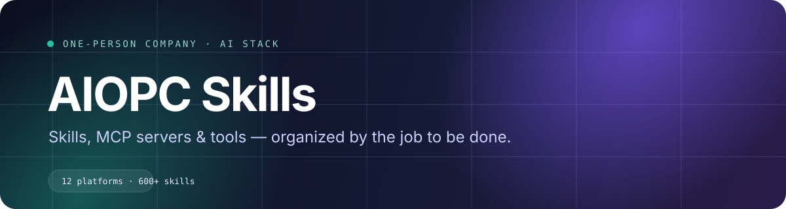

# 🧰 AIOPC Skills

**给 AI 用的技能、MCP 与工具索引**
*按一人公司的真实工作流组织，不堆合集。*

一人公司 / 超级个体的 AI 工具箱。按“选题 → 验证 → 产品 → 设计 → 营销 → 销售 → 运营 → 算账”拆成 9 个职能栈；另有一条按平台（小红书、公众号、抖音、TikTok、X…）的入口，方便按渠道找打法。

> 每条只保留「名称 + 一句话」；每个栈单独一页，先看 Top picks，再按需翻全表。

---

## 🚀 怎么用

1. **按当前任务选一个栈**：不知道选哪个，就从下面的「如果只装 12 个」开始。
2. **打开那一页，先试 Top picks**：每页只推 4 个，带“为什么”和“第一次怎么用”。
3. **用真实任务跑一遍**：跑不通就换，跑通了再回来加第二个。

---

## ⚡ 如果只装 12 个

| 任务 | 先装 | 一句话 |
|---|---|---|
| 想法打磨 | [idea-refine](https://www.skills.sh/addyosmani/agent-skills/idea-refine) | 把粗糙想法打磨成可执行概念 |
| 中文去 AI 味 | [humanizer-zh](https://www.skills.sh/op7418/humanizer-zh/humanizer-zh) | 中文去 AI 味，保留原意和语气 |
| 转化文案 | [copywriting](https://www.skills.sh/coreyhaines31/marketingskills/copywriting) | 转化文案写作 |
| PRD | [prd-development](https://www.skills.sh/deanpeters/product-manager-skills/prd-development) | 结构化 PRD 流程 |
| 界面设计 | [frontend-design](https://www.skills.sh/anthropics/skills/frontend-design) | 高质量前端界面设计 |
| 设计稿实现 | [figma-implement-design](https://www.skills.sh/openai/skills/figma-implement-design) | 把设计稿实现成代码 |
| SEO 审计 | [seo-audit](https://www.skills.sh/coreyhaines31/marketingskills/seo-audit) | 全站 SEO 审计 |
| AI 搜索 | [ai-seo](https://www.skills.sh/coreyhaines31/marketingskills/ai-seo) | 让内容被 AI 搜索引用 |
| 落地页转化 | [landing-page-conversion-audit](https://www.skills.sh/autonnel/autonnel-skills/landing-page-conversion-audit) | 落地页转化审计 |
| 竞品监控 | [firecrawl-monitor](https://www.skills.sh/firecrawl/cli/firecrawl-monitor) | 网页变化监控与通知 |
| 定价 | [pricing](https://www.skills.sh/coreyhaines31/marketingskills/pricing) | SaaS 定价策略 |
| 单位经济 | [unit-economics](https://www.skills.sh/anthropics/financial-services/unit-economics) | 单位经济 |

---

## 🎯 按平台打

- 📕 **[小红书](docs/zh/platforms/p-xiaohongshu.md)** — 封面、标题、正文、发布、复盘，一条链路。
- 📗 **[公众号](docs/zh/platforms/p-wechat.md)** — 长文、排版、配图、发布、群聊提炼。
- 🎬 **[抖音 / 视频号](docs/zh/platforms/p-douyin.md)** — 开头、逐字稿、标题封面、信息提取、章节导航。
- 🎵 **[TikTok](docs/zh/platforms/p-tiktok.md)** — 内容、脚本、文案、广告。
- 🐦 **[X / Twitter](docs/zh/platforms/p-x.md)** — 帖子、线程、算法优化、自动化。
- 💼 **[LinkedIn](docs/zh/platforms/p-linkedin.md)** — 专业内容、代写、外联、广告。
- 👽 **[Reddit](docs/zh/platforms/p-reddit.md)** — 原生帖子、找线索、广告。
- ▶️ **[YouTube](docs/zh/platforms/p-youtube.md)** — 搜索、Shorts、缩略图、广告。
- 🛒 **[电商（Etsy / Amazon / Shopify）](docs/zh/platforms/p-ecommerce.md)** — 选品、listing、SEO、定价、结账。
- 📱 **[App Store / ASO](docs/zh/platforms/p-appstore.md)** — 商店页、关键词、本地化、定价。
- 🔍 **[SEO / GEO](docs/zh/platforms/p-seo.md)** — 技术、内容、外链、本地、AI 搜索。
- 📬 **[私域 / Newsletter / 播客](docs/zh/platforms/p-private.md)** — 社群、邮件列表、播客，把流量变成可反复触达的资产。

---

## 🧭 9 个职能栈

- 🚀 **[一、创业起点](docs/zh/01-startup.md)** · 36 个技能 — 选题、验证、商业模式、定位——先把“做什么”想清楚。
- ✍️ **[二、文案](docs/zh/02-writing.md)** · 55 个技能 — 按“写给哪里”拆：小红书、公众号、短视频、广告、冷邮件、落地页、电商、商店。
- 🛠️ **[三、产品与研发](docs/zh/03-product.md)** · 49 个技能 — 从需求到上线，按工程阶段拆。
- 🎨 **[四、设计与前端](docs/zh/04-design.md)** · 107 个技能 — 设计是一大块：风格、排版、组件、动效、Figma、前端实现。
- 📣 **[五、营销与增长](docs/zh/05-marketing.md)** · 103 个技能 — 按“被看见 → 被理解 → 被购买”拆开，每一格只放能直接用的。
- 💼 **[六、销售、客服与运营](docs/zh/06-ops.md)** · 54 个技能 — 把“卖”和“交付”拆成可复用动作。
- 🎬 **[七、内容生产](docs/zh/07-content.md)** · 26 个技能 — 图、视频、PPT、文档、音频，按最终交付物分。
- 🔎 **[八、数据与研究](docs/zh/08-data.md)** · 19 个技能 — 找资料、抓数据、做分析、盯变化。
- 📈 **[九、OPC / 经营](docs/zh/09-opc.md)** · 29 个技能 — 定价、财务、营销规划，一人公司的经营动作。
- 🔌 **[MCP 与运行时](docs/zh/10-mcp.md)** · 19 个工具 — 服务器、自动化、编程 Agent

---

## 🧠 经典与竞品

- 🧠 **[商业经典与思维模型](docs/zh/classics.md)** — 芒格、Naval、PG、塔勒布，以及 Lean Startup、Mom Test 等 20 个框架。
- 🧑‍💼 **[一人公司全栈](docs/zh/solo-founder.md)** — 直接竞品 solo-founder-skills 的 59 个技能，按能力重排。
- 🧑‍💼 **[创始人技能包（按能力拆）](docs/zh/founder-packs.md)** — 五个创始人包的 56 个技能，按能力重排。
- 🧭 **[Lenny 产品与增长](docs/zh/lenny.md)** — 从 148 个技能里选 45 个，按产品/增长/销售/团队/决策重排。
- 🗺️ **[竞品与大佬合集](docs/zh/landscape.md)** — 我们跟踪的 OPC/创始人技能合集。

---

## 🧪 收录标准

- 来源：skills.sh 上安装量靠前的技能包与社区清单，拆成单个技能后重新分类。
- 这是索引，不是镜像：每条都回到原技能页；摘要为简短整理，不转载原文。
- 只收有具体流程、模板或脚本的；纯一句 prompt 包装不收。
- 所有链接核验于 **2026-11-11**；skills.sh 页面内有安装命令和原仓库。
- 不追求“全”：每个栈先保证能解决一类真实任务，再补长尾。

---

## 🤝 贡献

欢迎 PR。格式：`- **[名称](链接)** — 一句话说明。` 提交前先打开链接确认可访问，并说明补了哪个栈。

> 本清单只做索引，版权归各项目作者。链接与项目状态会变化，使用前请自行核验。

---

**[⬆ 回到顶部](#top)** · [English](README.md)

