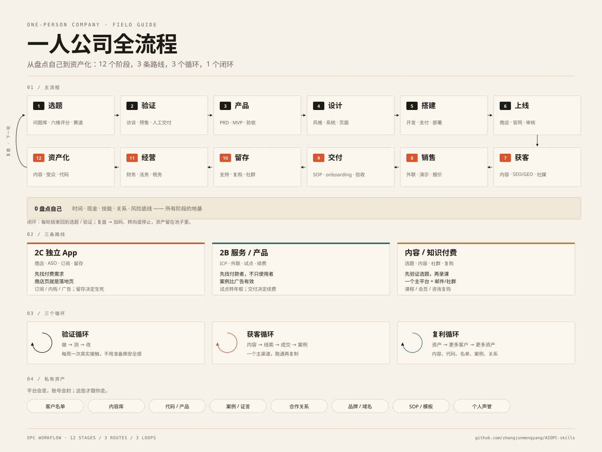

[← Back to index](../../README.md) · [中文](../zh/workflow.md)

# 🧭 OPC Workflow & Capability Map

Twelve stages from self-audit to asset building, 21 capabilities and the 10 most-missed items. Complements the OPC talk deck: the deck explains why and how to teach; this page maps each step to skills.

> Companion deck: [OPC Sharing](https://docs.xiaohongshu.com/doc/55736c63da0ab149198d36cab67220b4) — macro framing, 2C/2B routes, cases and talk outline.

One map: 12 stages / 3 routes / 3 loops / private assets · <a href="../../assets/opc-workflow.png">Download PNG</a>

---

## 12 stages

| Stage | Decision | Where |
|---|---|---|
| 0 | **Self-audit** — Time, cash, skills, relationships, risk | [Open](01-startup.md) |
| 1 | **Pick a direction** — Problem bank, scoring, niche | [Open](01-startup.md) |
| 2 | **Validate** — Interviews, pre-sales, manual delivery | [Open](01-startup.md) |
| 3 | **Define the product** — PRD, scope, acceptance | [Open](03-product.md) |
| 4 | **Design** — Style, design system, pages, Figma | [Open](04-design.md) |
| 5 | **Build** — Build, payments, deploy | [Open](03-product.md) |
| 6 | **Launch** — Store/site, launch, review | [Open](05-marketing.md) |
| 7 | **Acquire** — Content, SEO/GEO, social, ads | [Open](05-marketing.md) |
| 8 | **Sell** — Outreach, demo, quote, close | [Open](06-ops.md) |
| 9 | **Deliver** — SOP, onboarding, acceptance | [Open](06-ops.md) |
| 10 | **Retain** — Support, repeat, community, referrals | [Open](workflow.md#support) |
| 11 | **Operate** — Finance, tax, legal, insurance | [Open](09-opc.md) |
| 12 | **Build assets** — Content, audience, code, sell/license | [Open](workflow.md#risk) |

---

## Capability check

● dedicated page / ○ partial / — missing.

| Capability | Status | Where |
|---|---|---|
| 选题与验证 | ● | [Open](01-startup.md) |
| 用户研究 | ● | [Open](01-startup.md) |
| 产品定义 | ● | [Open](03-product.md) |
| 设计 | ● | [Open](04-design.md) |
| 开发 | ● | [Open](03-product.md) |
| 支付 | ○ | [Open](03-product.md) |
| 上线 | ● | [Open](05-marketing.md) |
| SEO / GEO | ● | [Open](05-marketing.md) |
| 内容 | ● | [Open](07-content.md) |
| 社媒 | ● | [Open](platforms/p-xiaohongshu.md) |
| 广告 | ● | [Open](platforms/p-seo.md) |
| 销售 | ● | [Open](06-ops.md) |
| 定价 | ● | [Open](09-opc.md) |
| 交付 | ● | [Open](06-ops.md) |
| 客服 | ● | [Open](workflow.md#support) |
| 留存 | ● | [Open](workflow.md#support) |
| 数据 | ● | [Open](08-data.md) |
| 财务 | ● | [Open](workflow.md#finance) |
| 法务 | ● | [Open](workflow.md#legal) |
| 风险与安全 | ● | [Open](workflow.md#risk) |
| 资产化 | ○ | [Open](workflow.md#risk) |

---

## 10 most-missed items

1. Legal entity and contracts: sole prop vs company, contracts, invoices
2. Privacy policy, terms of service, refund rules
3. Tax registration, invoicing, payment compliance
4. Backups, account security, 2FA, password manager
5. Support SLA and refund/cancellation flow
6. Cash flow and 6-12 months of runway
7. Insurance: liability, business, professional
8. Platform dependency and ban contingency
9. Exit and asset building: sell, license, audience assets
10. Mental health: isolation, anxiety, burnout

---

## Fill the gaps

### Legal & compliance

- **[entity-compliance](https://www.skills.sh/anthropics/claude-for-legal/entity-compliance)** — Entity compliance.
- **[saas-msa-review](https://www.skills.sh/anthropics/claude-for-legal/saas-msa-review)** — SaaS MSA review.
- **[nda-review](https://www.skills.sh/anthropics/claude-for-legal/nda-review)** — NDA review.
- **[dpa-review](https://www.skills.sh/anthropics/claude-for-legal/dpa-review)** — DPA review.
- **[vendor-agreement-review](https://www.skills.sh/anthropics/claude-for-legal/vendor-agreement-review)** — Vendor agreement.
- **[ip-clause-review](https://www.skills.sh/anthropics/claude-for-legal/ip-clause-review)** — IP clause review.
- **[marketing-claims-review](https://www.skills.sh/anthropics/claude-for-legal/marketing-claims-review)** — Marketing claims review.
- **[hiring-review](https://www.skills.sh/anthropics/claude-for-legal/hiring-review)** — Hiring review.
- **[policy-drafting](https://www.skills.sh/anthropics/claude-for-legal/policy-drafting)** — Policy drafting.
- **[pia-generation](https://www.skills.sh/anthropics/claude-for-legal/pia-generation)** — Privacy impact assessment.
- **[dsar-response](https://www.skills.sh/anthropics/claude-for-legal/dsar-response)** — DSAR response.
- **[launch-review](https://www.skills.sh/anthropics/claude-for-legal/launch-review)** — Launch review.
- **[oss-review](https://www.skills.sh/anthropics/claude-for-legal/oss-review)** — OSS license review.
- **[termination-review](https://www.skills.sh/anthropics/claude-for-legal/termination-review)** — Termination review.
- **[legal-risk-assessment](https://www.skills.sh/anthropics/knowledge-work-plugins/legal-risk-assessment)** — Legal risk assessment.
- **[pci-compliance](https://www.skills.sh/wshobson/agents/pci-compliance)** — PCI compliance.

### Finance & tax

- **[unit-economics](https://www.skills.sh/anthropics/financial-services/unit-economics)** — Unit economics.
- **[3-statement-model](https://www.skills.sh/anthropics/financial-services/3-statement-model)** — 3-statement model.
- **[financial-plan](https://www.skills.sh/anthropics/financial-services/financial-plan)** — Financial plan.
- **[dcf-model](https://www.skills.sh/anthropics/financial-services/dcf-model)** — DCF model.
- **[comps-analysis](https://www.skills.sh/anthropics/financial-services/comps-analysis)** — Comps analysis.
- **[deal-screening](https://www.skills.sh/anthropics/financial-services/deal-screening)** — Deal screening.
- **[model-update](https://www.skills.sh/anthropics/financial-services/model-update)** — Model update.
- **[variance-commentary](https://www.skills.sh/anthropics/financial-services/variance-commentary)** — Variance commentary.
- **[gl-recon](https://www.skills.sh/anthropics/financial-services/gl-recon)** — GL reconciliation.
- **[accrual-schedule](https://www.skills.sh/anthropics/financial-services/accrual-schedule)** — Accrual schedule.
- **[accounting](https://www.skills.sh/whawkinsiv/solo-founder-skills/accounting)** — Accounting.
- **[finances](https://www.skills.sh/whawkinsiv/solo-founder-skills/finances)** — Financial planning.
- **[payments](https://www.skills.sh/whawkinsiv/solo-founder-skills/payments)** — Payments.
- **[founder-cfo](https://www.skills.sh/jakeschincariol/founder-skill/founder-cfo)** — Founder CFO.
- **[pricing-strategist](https://www.skills.sh/ognjengt/founder-skills/pricing-strategist)** — Pricing strategist.
- **[revenue-kpi-framework](https://www.skills.sh/mbfinotti/revops-skills/revenue-kpi-framework)** — Revenue KPIs.
- **[revenue-leakage](https://www.skills.sh/mbfinotti/revops-skills/revenue-leakage)** — Revenue leakage.
- **[revenue-reporting](https://www.skills.sh/mbfinotti/revops-skills/revenue-reporting)** — Revenue reporting.
- **[startup-financial-modeling](https://www.skills.sh/wshobson/agents/startup-financial-modeling)** — Financial modeling.
- **[startup-metrics-framework](https://www.skills.sh/wshobson/agents/startup-metrics-framework)** — Startup metrics.

### Founder OS

- **[personal-productivity](https://www.skills.sh/refoundai/lenny-skills/personal-productivity)** — Personal productivity.
- **[energy-management](https://www.skills.sh/refoundai/lenny-skills/energy-management)** — Energy management.
- **[time-energy-management](https://www.skills.sh/refoundai/lenny-skills/time-energy-management)** — Time and energy.
- **[managing-imposter-syndrome](https://www.skills.sh/refoundai/lenny-skills/managing-imposter-syndrome)** — Imposter syndrome.
- **[having-difficult-conversations](https://www.skills.sh/refoundai/lenny-skills/having-difficult-conversations)** — Difficult conversations.
- **[giving-feedback](https://www.skills.sh/refoundai/lenny-skills/giving-feedback)** — Giving feedback.
- **[high-stakes-decisions](https://www.skills.sh/refoundai/lenny-skills/high-stakes-decisions)** — High-stakes decisions.
- **[running-decision-processes](https://www.skills.sh/refoundai/lenny-skills/running-decision-processes)** — Decision processes.
- **[planning-under-uncertainty](https://www.skills.sh/refoundai/lenny-skills/planning-under-uncertainty)** — Planning under uncertainty.
- **[systems-thinking](https://www.skills.sh/refoundai/lenny-skills/systems-thinking)** — Systems thinking.
- **[evaluating-trade-offs](https://www.skills.sh/refoundai/lenny-skills/evaluating-trade-offs)** — Trade-offs.
- **[founder-psychology](https://www.skills.sh/refoundai/lenny-skills/founder-psychology)** — Founder psychology.
- **[focus](https://www.skills.sh/whawkinsiv/solo-founder-skills/focus)** — Focus.
- **[plan](https://www.skills.sh/whawkinsiv/solo-founder-skills/plan)** — Planning.
- **[improve](https://www.skills.sh/whawkinsiv/solo-founder-skills/improve)** — Improvement.
- **[next](https://www.skills.sh/whawkinsiv/solo-founder-skills/next)** — Next step.

### Support & retention

- **[user-onboarding](https://www.skills.sh/refoundai/lenny-skills/user-onboarding)** — User onboarding.
- **[retention-engagement](https://www.skills.sh/refoundai/lenny-skills/retention-engagement)** — Retention.
- **[customer-health-score](https://www.skills.sh/mbfinotti/revops-skills/customer-health-score)** — Customer health score.
- **[customer-churn-signals](https://www.skills.sh/mbfinotti/revops-skills/customer-churn-signals)** — Churn signals.
- **[qbr-facilitator](https://www.skills.sh/ncklrs/startup-os-skills/qbr-facilitator)** — QBR facilitator.
- **[renewal-manager](https://www.skills.sh/ncklrs/startup-os-skills/renewal-manager)** — Renewal manager.
- **[cs-strategist](https://www.skills.sh/ncklrs/startup-os-skills/cs-strategist)** — CS strategist.
- **[support-operations](https://www.skills.sh/ncklrs/startup-os-skills/support-operations)** — Support operations.
- **[onboarding-specialist](https://www.skills.sh/ncklrs/startup-os-skills/onboarding-specialist)** — Onboarding specialist.
- **[customer-lifecycle-marketer](https://www.skills.sh/ncklrs/startup-os-skills/customer-lifecycle-marketer)** — Lifecycle marketing.
- **[community-building](https://www.skills.sh/refoundai/lenny-skills/community-building)** — Community building.
- **[customer-research](https://www.skills.sh/coreyhaines31/marketingskills/customer-research)** — Customer research.
- **[feedback](https://www.skills.sh/whawkinsiv/solo-founder-skills/feedback)** — Feedback.

### Risk & assets

- **[security](https://www.skills.sh/whawkinsiv/solo-founder-skills/security)** — Security.
- **[security-and-hardening](https://www.skills.sh/addyosmani/agent-skills/security-and-hardening)** — Security hardening.
- **[security-audit](https://www.skills.sh/cloudflare/skills/security-audit)** — Security audit.
- **[incident-response](https://www.skills.sh/anthropics/knowledge-work-plugins/incident-response)** — Incident response.
- **[compliance](https://www.skills.sh/whawkinsiv/solo-founder-skills/compliance)** — Compliance.
- **[monitor](https://www.skills.sh/whawkinsiv/solo-founder-skills/monitor)** — Monitoring.
- **[grow-sustainably](https://www.skills.sh/slavingia/skills/grow-sustainably)** — Grow sustainably.
- **[company-values](https://www.skills.sh/slavingia/skills/company-values)** — Company values.
- **[minimalist-review](https://www.skills.sh/slavingia/skills/minimalist-review)** — Minimalist review.
- **[personal-brand-network](https://www.skills.sh/refoundai/lenny-skills/personal-brand-network)** — Personal brand network.
- **[revenue-funnel](https://www.skills.sh/mbfinotti/revops-skills/revenue-funnel)** — Revenue funnel.

> Index page: summaries are editorial notes; read the full content at the source link.

---

[← Back to index](../../README.md)

