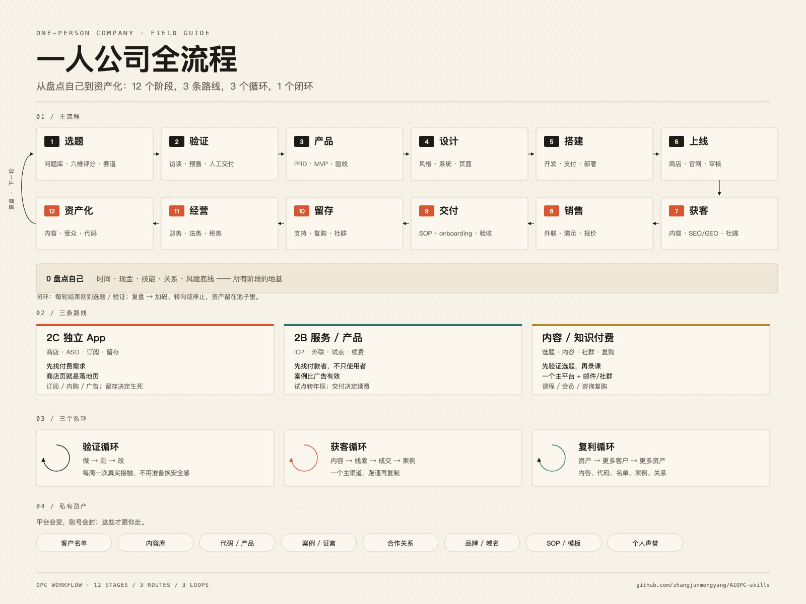

[← 返回总览](../../README.zh.md) · [English](../en/workflow.md)

# OPC 全流程与能力地图

从盘点自己到资产化，12 个阶段、21 项能力、10 个最容易漏的坑。它不是一条直线，是一个闭环：资产化之后回到选题/验证，复盘决定加码、转向还是停止。和《OPC 分享》那份讲稿互补：讲稿讲为什么和怎么讲，这里讲每一步用什么技能。

> 配套讲稿：[OPC 分享](https://docs.xiaohongshu.com/doc/55736c63da0ab149198d36cab67220b4) — 宏观认知、2C/2B 路线、案例、分享大纲。

12 个阶段与复盘回路 · <a href="../../assets/opc-workflow.png">下载完整图片</a> · <a href="../../assets/opc-workflow-en.png">English version</a>

---

## 12 阶段

| 阶段 | 要做的决策 |
|---|---|
| 0 | [盘点自己](01-startup.md) — 时间、现金、技能、关系、风险底线 |
| 1 | [选题](01-startup.md) — 问题库、六维评分、赛道选择 |
| 2 | [验证](01-startup.md) — 访谈、预售、人工交付 |
| 3 | [产品定义](03-product.md) — PRD、范围、验收标准 |
| 4 | [设计](04-design.md) — 风格、设计系统、页面、Figma |
| 5 | [搭建](03-product.md) — 开发、支付、部署 |
| 6 | [上线](05-marketing.md) — 商店/官网、发布、审核 |
| 7 | [获客](05-marketing.md) — 内容、SEO/GEO、社媒、广告 |
| 8 | [销售](06-ops.md) — 外联、演示、报价、成交 |
| 9 | [交付](06-ops.md) — SOP、onboarding、验收 |
| 10 | [留存](workflow.md#support) — 支持、复购、社群、转介绍 |
| 11 | [经营](09-opc.md) — 财务、税务、法务、保险 |
| 12 | [资产化](workflow.md#risk) — 内容、受众、代码、出售/授权 |

---

## 三个循环

| 循环 | 持续重复的动作 |
|---|---|
| 验证 | 做 → 测 → 改 → 再做 |
| 获客 | 内容 → 线索 → 成交 → 案例 → 新内容 |
| 复利 | 资产 → 更多客户 → 更多资产 |

每轮复盘后，决定加码、转向还是停止；继续时回到选题或验证。已积累的资产保留下来。

## 三条路线

| 路线 | 重点动作 |
|---|---|
| 2C 独立 App | 商店上架、ASO、订阅与留存 |
| 2B 服务与产品 | 确定目标客户、外联、试点、交付与续费 |
| 内容与知识付费 | 验证选题、生产内容、经营社群与复购 |

可持续积累的资产包括客户名单、内容库、代码与产品、案例与证言、合作关系、品牌与域名、SOP 与模板，以及个人声誉。

---

## 能力自查

● 有专门页面 / ○ 部分覆盖 / — 还没做。

| 能力 | 状态 |
|---|---|
| [选题与验证](01-startup.md) | ● |
| [用户研究](01-startup.md) | ● |
| [产品定义](03-product.md) | ● |
| [设计](04-design.md) | ● |
| [开发](03-product.md) | ● |
| [支付](03-product.md) | ○ |
| [上线](05-marketing.md) | ● |
| [SEO / GEO](05-marketing.md) | ● |
| [内容](07-content.md) | ● |
| [社媒](platforms/p-xiaohongshu.md) | ● |
| [广告](platforms/p-seo.md) | ● |
| [销售](06-ops.md) | ● |
| [定价](09-opc.md) | ● |
| [交付](06-ops.md) | ● |
| [客服](workflow.md#support) | ● |
| [留存](workflow.md#support) | ● |
| [数据](08-data.md) | ● |
| [财务](workflow.md#finance) | ● |
| [法务](workflow.md#legal) | ● |
| [风险与安全](workflow.md#risk) | ● |
| [资产化](workflow.md#risk) | ○ |

---

## 最容易漏的 10 件事

1. 法律实体与合同：个体户/有限公司、合同、发票
2. 隐私政策、服务条款、退款规则
3. 税务登记、发票、收款合规
4. 备份、账号安全、2FA、密码管理
5. 客服 SLA、退款/取消流程
6. 现金流与 6-12 个月生活储备
7. 保险：责任险/商业险/职业险
8. 平台依赖与封号预案
9. 退出与资产化：出售、授权、受众资产
10. 心理与健康：孤独、焦虑、过劳

---

## 补齐：全流程里最容易缺的技能

### 法务与合规

- **[entity-compliance](https://github.com/anthropics/claude-for-legal/blob/HEAD/corporate-legal/skills/entity-compliance/SKILL.md)** — 主体与合规。
- **[saas-msa-review](https://github.com/anthropics/claude-for-legal/blob/HEAD/commercial-legal/skills/saas-msa-review/SKILL.md)** — SaaS 合同审阅。
- **[nda-review](https://github.com/anthropics/claude-for-legal/blob/HEAD/commercial-legal/skills/nda-review/SKILL.md)** — NDA 审阅。
- **[dpa-review](https://github.com/anthropics/claude-for-legal/blob/HEAD/privacy-legal/skills/dpa-review/SKILL.md)** — DPA 审阅。
- **[vendor-agreement-review](https://github.com/anthropics/claude-for-legal/blob/HEAD/commercial-legal/skills/vendor-agreement-review/SKILL.md)** — 供应商合同。
- **[ip-clause-review](https://github.com/anthropics/claude-for-legal/blob/HEAD/ip-legal/skills/ip-clause-review/SKILL.md)** — 知识产权条款。
- **[marketing-claims-review](https://github.com/anthropics/claude-for-legal/blob/HEAD/product-legal/skills/marketing-claims-review/SKILL.md)** — 营销声明审查。
- **[hiring-review](https://github.com/anthropics/claude-for-legal/blob/HEAD/employment-legal/skills/hiring-review/SKILL.md)** — 招聘合规审查。
- **[policy-drafting](https://github.com/anthropics/claude-for-legal/blob/HEAD/employment-legal/skills/policy-drafting/SKILL.md)** — 政策起草。
- **[pia-generation](https://github.com/anthropics/claude-for-legal/blob/HEAD/privacy-legal/skills/pia-generation/SKILL.md)** — 隐私影响评估。
- **[dsar-response](https://github.com/anthropics/claude-for-legal/blob/HEAD/privacy-legal/skills/dsar-response/SKILL.md)** — 数据主体请求。
- **[launch-review](https://github.com/anthropics/claude-for-legal/blob/HEAD/product-legal/skills/launch-review/SKILL.md)** — 上线合规审查。
- **[oss-review](https://github.com/anthropics/claude-for-legal/blob/HEAD/ip-legal/skills/oss-review/SKILL.md)** — 开源许可证审查。
- **[termination-review](https://github.com/anthropics/claude-for-legal/blob/HEAD/employment-legal/skills/termination-review/SKILL.md)** — 员工解雇、遣散安排与最终工资支付审查。
- **[legal-risk-assessment](https://github.com/anthropics/knowledge-work-plugins/blob/HEAD/legal/skills/legal-risk-assessment/SKILL.md)** — 法律风险评估。
- **[pci-compliance](https://github.com/wshobson/agents/blob/HEAD/plugins/payment-processing/skills/pci-compliance/SKILL.md)** — PCI 合规。

### 财务与税务

- **[unit-economics](https://github.com/anthropics/financial-services/blob/HEAD/plugins/vertical-plugins/private-equity/skills/unit-economics/SKILL.md)** — 单位经济。
- **[3-statement-model](https://github.com/anthropics/financial-services/blob/HEAD/plugins/agent-plugins/pitch-agent/skills/3-statement-model/SKILL.md)** — 三表模型。
- **[financial-plan · 仓库入口](https://github.com/anthropics/financial-services)** — 财务计划。
- **[dcf-model](https://github.com/anthropics/financial-services/blob/HEAD/plugins/agent-plugins/pitch-agent/skills/dcf-model/SKILL.md)** — DCF 估值。
- **[comps-analysis](https://github.com/anthropics/financial-services/blob/HEAD/plugins/agent-plugins/pitch-agent/skills/comps-analysis/SKILL.md)** — 可比公司分析。
- **[deal-screening](https://github.com/anthropics/financial-services/blob/HEAD/plugins/vertical-plugins/private-equity/skills/deal-screening/SKILL.md)** — 交易筛选。
- **[model-update](https://github.com/anthropics/financial-services/blob/HEAD/plugins/agent-plugins/earnings-reviewer/skills/model-update/SKILL.md)** — 模型更新。
- **[variance-commentary](https://github.com/anthropics/financial-services/blob/HEAD/plugins/vertical-plugins/fund-admin/skills/variance-commentary/SKILL.md)** — 差异分析。
- **[gl-recon](https://github.com/anthropics/financial-services/blob/HEAD/plugins/agent-plugins/gl-reconciler/skills/gl-recon/SKILL.md)** — 总账对账。
- **[accrual-schedule](https://github.com/anthropics/financial-services/blob/HEAD/plugins/vertical-plugins/fund-admin/skills/accrual-schedule/SKILL.md)** — 应计计划。
- **[finances](https://github.com/whawkinsiv/solo-founder-skills/blob/HEAD/skills/finances/SKILL.md)** — 财务规划。
- **[payments](https://github.com/whawkinsiv/solo-founder-skills/blob/HEAD/skills/payments/SKILL.md)** — 收款与支付。
- **[founder-cfo](https://github.com/Jakeschincariol/founder-skill/blob/HEAD/skills/founder-cfo/SKILL.md)** — 创始人 CFO。
- **[pricing-strategist](https://github.com/ognjengt/founder-skills/blob/HEAD/skills/pricing-strategist/SKILL.md)** — 定价策略。
- **[revenue-kpi-framework](https://github.com/mbfinotti/revops-skills/blob/HEAD/skills/revenue-kpi-framework/SKILL.md)** — 收入 KPI。
- **[revenue-leakage](https://github.com/mbfinotti/revops-skills/blob/HEAD/skills/revenue-leakage/SKILL.md)** — 收入漏损。
- **[revenue-reporting](https://github.com/mbfinotti/revops-skills/blob/HEAD/skills/revenue-reporting/SKILL.md)** — 收入报告。
- **[startup-financial-modeling](https://github.com/wshobson/agents/blob/HEAD/plugins/startup-business-analyst/skills/startup-financial-modeling/SKILL.md)** — 3-5 年财务模型。
- **[startup-metrics-framework](https://github.com/wshobson/agents/blob/HEAD/plugins/startup-business-analyst/skills/startup-metrics-framework/SKILL.md)** — 创业指标。

### 创始人 OS

- **[personal-productivity · 仓库入口](https://github.com/refoundai/lenny-skills)** — 个人效率。
- **[energy-management · 仓库入口](https://github.com/refoundai/lenny-skills)** — 精力管理。
- **[time-energy-management](https://github.com/refoundai/lenny-skills/blob/HEAD/skills/time-energy-management/SKILL.md)** — 时间与精力。
- **[managing-imposter-syndrome · 仓库入口](https://github.com/refoundai/lenny-skills)** — 冒充者综合征。
- **[having-difficult-conversations · 仓库入口](https://github.com/refoundai/lenny-skills)** — 困难对话。
- **[giving-feedback](https://github.com/refoundai/lenny-skills/blob/HEAD/skills/giving-feedback/SKILL.md)** — 给反馈。
- **[high-stakes-decisions](https://github.com/refoundai/lenny-skills/blob/HEAD/skills/high-stakes-decisions/SKILL.md)** — 高风险决策。
- **[running-decision-processes · 仓库入口](https://github.com/refoundai/lenny-skills)** — 决策流程。
- **[planning-under-uncertainty · 仓库入口](https://github.com/refoundai/lenny-skills)** — 不确定性下规划。
- **[systems-thinking · 仓库入口](https://github.com/refoundai/lenny-skills)** — 系统思考。
- **[evaluating-trade-offs](https://github.com/refoundai/lenny-skills/blob/HEAD/skills/evaluating-trade-offs/SKILL.md)** — 权衡取舍。
- **[founder-psychology](https://github.com/refoundai/lenny-skills/blob/HEAD/skills/founder-psychology/SKILL.md)** — 创始人心理。
- **[focus](https://github.com/whawkinsiv/solo-founder-skills/blob/HEAD/skills/focus/SKILL.md)** — 专注。

### 支持与留存

- **[user-onboarding · 仓库入口](https://github.com/refoundai/lenny-skills)** — 用户引导。
- **[retention-engagement](https://github.com/refoundai/lenny-skills/blob/HEAD/skills/retention-engagement/SKILL.md)** — 留存与参与。
- **[customer-health-score](https://github.com/mbfinotti/revops-skills/blob/HEAD/skills/customer-health-score/SKILL.md)** — 客户健康分。
- **[customer-churn-signals](https://github.com/mbfinotti/revops-skills/blob/HEAD/skills/customer-churn-signals/SKILL.md)** — 流失信号。
- **[qbr-facilitator](https://github.com/ncklrs/startup-os-skills/blob/HEAD/skills/qbr-facilitator/SKILL.md)** — QBR 主持。
- **[renewal-manager](https://github.com/ncklrs/startup-os-skills/blob/HEAD/skills/renewal-manager/SKILL.md)** — 续费管理。
- **[cs-strategist](https://github.com/ncklrs/startup-os-skills/blob/HEAD/skills/cs-strategist/SKILL.md)** — 客户成功策略。
- **[support-operations](https://github.com/ncklrs/startup-os-skills/blob/HEAD/skills/support-operations/SKILL.md)** — 支持运营。
- **[onboarding-specialist](https://github.com/ncklrs/startup-os-skills/blob/HEAD/skills/onboarding-specialist/SKILL.md)** — 引导专家。
- **[customer-lifecycle-marketer](https://github.com/ncklrs/startup-os-skills/blob/HEAD/skills/customer-lifecycle-marketer/SKILL.md)** — 生命周期营销。
- **[community-building · 仓库入口](https://github.com/refoundai/lenny-skills)** — 社区建设。
- **[customer-research](https://github.com/coreyhaines31/marketingskills/blob/HEAD/skills/customer-research/SKILL.md)** — 客户研究。

### 风险与资产

- **[security-and-hardening](https://github.com/addyosmani/agent-skills/blob/HEAD/skills/security-and-hardening/SKILL.md)** — 安全加固。
- **[security-audit · 仓库入口](https://github.com/cloudflare/skills)** — 安全审计。
- **[incident-response](https://github.com/anthropics/knowledge-work-plugins/blob/HEAD/engineering/skills/incident-response/SKILL.md)** — 事故响应。
- **[grow-sustainably](https://github.com/slavingia/skills/blob/HEAD/skills/grow-sustainably/SKILL.md)** — 可持续增长。
- **[company-values](https://github.com/slavingia/skills/blob/HEAD/skills/company-values/SKILL.md)** — 公司价值观。
- **[minimalist-review](https://github.com/slavingia/skills/blob/HEAD/skills/minimalist-review/SKILL.md)** — 极简复盘。
- **[personal-brand-network](https://github.com/refoundai/lenny-skills/blob/HEAD/skills/personal-brand-network/SKILL.md)** — 个人品牌网络。
- **[revenue-funnel](https://github.com/mbfinotti/revops-skills/blob/HEAD/skills/revenue-funnel/SKILL.md)** — 收入漏斗。

> 索引页：摘要为整理，版权归原作者；完整内容请回原链接。

---

[← 返回总览](../../README.zh.md)
